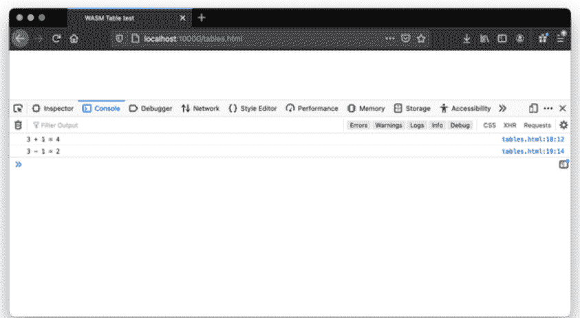
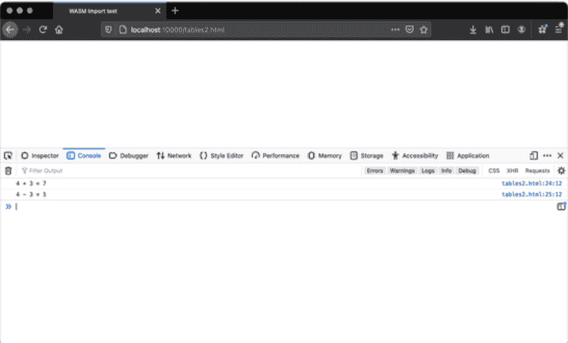

## 第 7 章. WebAssembly 表

### 早期发布读者的注意事项

使用 Early Release 电子书，你可以在这些技术正式发布之前很久就获得书籍的早期形式——作者在写作时的原始未编辑内容——从而利用这些技术。

这将是最终书籍的第 7 章。

如果你对我们如何改进本书的内容和/或示例有任何评论，或者如果本章中缺少材料，请联系作者 wasmbook@bosatsu.net。

> 餐桌是教授和练习不仅是餐桌礼仪，也是交谈、体谅、宽容、家庭情感以及除小步舞以外的所有礼貌社会成就的中心。
> 
> —Judith Martin

餐桌是分享思想和故事的绝佳隐喻。与独自进食相比，与他人一起加入总是更有趣。如果你召集来自各行各业的一群人，你可以激发关于近乎无限多个话题的光辉、充满活力的对话。没有人拥有所有的故事。一些参与者可能会分享同一故事的某些方面。其他人可能有自己的版本。然而，为了发挥作用，仍需要一定程度的礼仪、克制以及接受其他参与者所提供内容的意愿。行为不端、不停止说话或踩到他人台词的餐桌客人会让所有人感到糟糕。


表格是 WebAssembly 的另一个特性，它使 WebAssembly 成为具有功能依赖性的现代软件系统，而这些依赖性将由额外的模块来满足。它们提供了与静态链接库相比，动态共享库等效的能力。想法是并非每个模块都需要提供其执行工作所需的一切。那样会极其低效。相反，它是针对某些其他模块在运行时满足需求的承诺而编写的。在 C 和 C++ 世界中，这被称为动态链接。显然，我的晚餐桌隐喻只是对单词 table 的一种戏仿，但正如在餐桌上分享想法需要某种协调一样，我们也需要这种机制来在库之间共享行为。让我们更仔细地探索这个想法，然后看看 WebAssembly 如何支持它。

### 静态链接与动态链接

任何关注我 Twitter 的人都知道我妻子是一位多么出色的厨师。她来自一个优秀的厨师家庭，并有机会向大量慷慨的导师学习。人们经常看到我发布的她制作的烹饪艺术作品，并向我索要食谱。这通常不像只是发送一个链接那么简单，因为她经常结合多个来源的想法，然后加入自己的风格。

在我们家，她可以依靠她积累的食谱书库。她可以说：“用那本书做这个酱。用另一本书中描述的技术准备牛肉。达到你想要的熟度后，加入我认为会让它更好的这些额外配料。”

在我们家，她可以引用已知来源的步骤和配料清单，并用自己的额外步骤修改过程。但是，当她想把食谱给别人时，她不能指望对方拥有这些书籍。在这种情况下，她必须把来自她来源的食谱复制到一份自包含的新食谱文档中。此时，所有步骤和配料都定义在一个地方，食谱就可以发送给别人了。

这基本上就是静态链接和动态链接之间的区别。一个典型的程序需要读取和写入文件内容、打开窗口、收集用户输入或通过网络发送消息。这些都是常见任务，通常作为操作系统提供的库中的功能可用。当你希望使用其中一个库中的函数时，你会告诉链接器允许运行时链接。否则它会抱怨缺少符号引用。

在运行时，操作系统会搜索其配置路径，该路径告诉它在哪里找到这些共享库。在启动程序之前，它们会将库中的功能映射到可以动态链接到其余代码的内存位置。

这种方法有许多原因。首先只是效率。假设你有一个名为 a() 的函数，被十几个或更多其他程序引用。使用静态链接，每个可执行文件都有自己的副本。程序占用更多的磁盘空间。它们在运行时的内存占用也会更大。这根本不是空间的高效利用。

如果动态库被加载到共享内存空间中，那么我们可能只需要磁盘上一个版本的一个副本。取决于操作系统的复杂性，你可能也只需要一次在内存中保留一个副本。

动态链接库通常有自己的发布周期。如果你使用的是可执行程序中的系统库之一，你可能会更新操作系统并获得带有安全问题补丁的库的新版本。只要编号机制有效并且向后兼容， presumably 你就可以通过使用修补版本来加强应用程序的安全性，而无需做其他任何事情。

请看示例 7-1。这是一个独立的函数，没有 main() 函数。它 intended 作为库使用。我们可以将其编译为静态库，但现在我们将只创建目标代码并将我们的 main() 程序链接到它。注意这个函数也依赖于 printf()，因此必须导入 stdio.h 头文件。

#### 示例 7-1. 一个带有调用函数的库

```
#include <stdio.h>

void sayHello(char *message) {
    printf("%s\n", message);
}
```

在示例 7-2 中，你将看到 main() 函数，它首先调用 printf()，然后调用我们的函数，该函数也调用 printf()。

#### 示例 7-2. 一个调用我们库函数的示例 main() 方法

```
#include <stdio.h>

extern void sayHello(char *message);

int main() {
    printf("Hello, world.\n");
    sayHello("How are you?");
    return 0;
}
```

默认情况下，如果你用 clang 编译这两个文件，它会生成一个输出文件。我让它使用默认名称。运行它时，我们看到了预期的行为。默认情况下，出于我上面列出的所有原因，编译器将对系统库使用动态链接。

```
brian@tweezer ~/g/w/s/ch07> clang main.c library.c
brian@tweezer ~/g/w/s/ch07> ls
a.out*      library.c  main.c
brian@tweezer ~/g/w/s/ch07> ./a.out
Hello, world.
How are you?
```

你可以用 nm 命令验证我们在这里使用的是动态链接。首先，我们看到我们的二进制文件为 main() 和 sayHello() 提供了定义，但没有为 printf() 提供定义。那是从标准库中重用的函数。

```
brian@tweezer ~/g/w/s/ch07> nm a.out
0000000100008008 d __dyld_private
0000000100000000 T ___mh_execute_header
0000000100003f10 T _main
                U _printf
0000000100003f50 T _sayHello
                U dyld_stub_binder
```

在 Linux 上，你可以看到相同的构建步骤会产生一个包含更多提及函数的二进制文件。这很自然，因为它是一个不同的操作系统，具有不同的运行时和不同的二进制格式。关键点是我们的 方法在我们的二进制文件中提供，但 printf() 没有。

```
brian@bbfcfm:~/src/hello$ nm a.out
0000000000404030 B __bss_start
0000000000404030 b completed.8060
0000000000404020 D __data_start
0000000000404020 W data_start
0000000000401080 t deregister_tm_clones
0000000000401070 T _dl_relocate_static_pie
00000000004010f0 t __do_global_dtors_aux
0000000000403e08 d __do_global_dtors_aux_fini_array_entry
0000000000404028 D __dso_handle
0000000000403e10 d _DYNAMIC
0000000000404030 D _edata
0000000000404038 B _end
0000000000401218 T _fini
0000000000401120 t frame_dummy
0000000000403e00 d __frame_dummy_init_array_entry
000000000040216c r __FRAME_END__
0000000000404000 d _GLOBAL_OFFSET_TABLE_
                w __gmon_start__
0000000000402024 r __GNU_EH_FRAME_HDR
0000000000401000 T _init
0000000000403e08 d __init_array_end
0000000000403e00 d __init_array_start
0000000000402000 R _IO_stdin_used
0000000000401210 T __libc_csu_fini
00000000004011a0 T __libc_csu_init
                U __libc_start_main@@GLIBC_2.2.5
0000000000401130 T main
                U printf@@GLIBC_2.2.5
00000000004010b0 t register_tm_clones
0000000000401170 T sayHello
```

```
0000000000401040  T  _start
0000000000404030  D  __TMC_END__
```

otool 命令是可在 macOS 上使用的另一个命令，可显示你的二进制文件成功执行所需的动态库。显示了系统库的 macOS 版本。

```
brian@tweezer ~/g/w/s/ch07> otool -L a.out
a.out:
    /usr/lib/libSystem.B.dylib (compatibility version 1.0.0,
current version 1292.60.1)
```

otool 在 Linux 上不存在，但使用 objdump 我们可以看到类似的结果。我已为节省空间删除了一些输出，但相关部分如下所示。如你所见，我们需要 libc.so.6 来满足我们二进制文件的需求。在 Windows 上会有类似的工具来检查你的 DLL 依赖项。

```
brian@bbfcfm:~/src/hello$ objdump -x a.out

a.out:      file format elf64-x86-64
a.out
architecture: i386:x86-64, flags 0x00000112:
EXEC_P, HAS_SYMS, D_PAGED
start address 0x0000000000401040

...

Dynamic Section:
    NEEDED             libc.so.6
    INIT               0x0000000000401000
    FINI               0x0000000000401218
    INIT_ARRAY         0x0000000000403e00
    INIT_ARRAYSZ       0x0000000000000008
    FINI_ARRAY         0x0000000000403e08
    FINI_ARRAYSZ       0x0000000000000008
    HASH               0x00000000004002e8
    GNU_HASH           0x0000000000400310
    STRTAB             0x0000000000400390
    SYMTAB             0x0000000000400330
    STRSZ              0x000000000000003f
    SYMENT             0x0000000000000018
    DEBUG              0x0000000000000000
```


```
PLTGOT              0x0000000000404000
PLTRELSZ            0x0000000000000018
PLTREL              0x0000000000000007
JMPREL              0x0000000000400428
RELA                 0x00000000004003f8
RELASZ              0x0000000000000030
RELAENT             0x0000000000000018
VERNEED             0x00000000004003d8
VERNEEDNUM          0x0000000000000001
VERSYM              0x00000000004003d0
```

```
Version References:
  required from libc.so.6:
    0x09691a75 0x00 02 GLIBC_2.2.5

...
```

WebAssembly 并不是操作系统，显然，但它受益于类似的概念。我们的选择是相同的，将所有函数定义放入单个模块中，使其独立存在，或者从另一个模块调用行为以满足我们的需求。鉴于我们将频繁通过网络下载 WebAssembly 模块，让它们保持较小尺寸是可取的。这也会影响磁盘存储、模块验证、内存中实例的加载等。为此，我们有 Table 实例。

### 在模块中创建表

Table 实例具有一些与我们在第 4 章中介绍的 Memory 实例相似的特征。目前每个模块中只能有一个，但它可以定义在模块中，也可以通过导入对象传入。每个模块一个实例的限制未来可能会被解除，但目前我们必须遵守。

我们在 WebAssembly 中使用这种结构而不是仅使用 Memory 实例的部分原因是因为后者可以被模块操纵。如果我们正在进行适当的晚餐对话，我们不希望任何参与者重写礼貌的规则。共享模块的世界也是如此。如果我们加载并验证了一个通过 Table 实例导出函数的模块，我们不希望另一个模块能够让它对其他人造成破坏。因此，你唯一能做的就是对存储在表中的函数引用进行间接函数调用。目前函数引用是唯一可以存储在 Table 实例中的内容，但这也预计在未来会发生变化。

为了避免在此阶段过度复杂化，我将回到 Wat 中的简单函数定义，以演示创建 Table 实例并导出它们的方式。

在示例 7-3 中，我创建了两个函数。$add 函数接收两个参数，将它们相加并返回结果。$sub 函数接收两个参数，用第一个减去第二个然后返回结果。到目前为止，正如他们所说，这有什么意义？这只是来自早期章节的重复内容。这里的不同之处在于接下来会发生什么。

#### 示例 7-3. 导出其 Table 实例的模块

```
(module
  (func $add (param $a i32) (param $b i32) (result i32)
    get_local $a
    get_local $b
    i32.add)

  (func $sub (param $a i32) (param $b i32) (result i32)
    get_local $a
    get_local $b
    i32.sub)

  (table (export "tbl") anyfunc (elem $add $sub))
)
```

我们引入了一个新的 Wat 关键字 table。这定义了一个函数引用的集合。注意内联的导出命令。我们将允许主机环境通过 $add 和 $sub 函数调用方法，但不能通过其名称调用。主机只能通过 Table 实例调用行为。anyfunc 类型目前是此结构唯一允许的类型，正如我们之前所说。基于 elem 引用的顺序，$add 将位于第 0 位，$sub 将位于第 1 位。

到目前为止你已经知道，我们可以将 Wat 文件转换为 Wasm 模块并按如下方式查看其内容。注意 Table 部分、Type 部分和 Export 部分。

```
brian@tweezer ~/g/w/s/ch07> wat2wasm math.wat
brian@tweezer ~/g/w/s/ch07> wasm-objdump -x math.wasm

math.wasm:      file format wasm 0x1

Section Details:

Type[1]:
  - type[0] (i32, i32) -> i32
Function[2]:
  - func[0] sig=0
  - func[1] sig=0
Table[1]:
  - table[0] type=funcref initial=2 max=2
Export[1]:
  - table[0] -> "tbl"
Elem[1]:
  - segment[0] flags=0 table=0 count=2 - init i32=0
    - elem[0] = func[0]
    - elem[1] = func[1]
Code[2]:
  - func[0] size=7
  - func[1] size=7
```

示例 7-4 中的 JavaScript 按我们在早期章节中做的方式实例化我们的模块。从那里它从模块的导出部分提取 Table 实例。

#### 示例 7-4. 从 JavaScript 使用导出的 Table 实例

```
<!doctype html>
<html>
  <head>
    <meta charset="utf-8">
    <title>WASM Table test</title>
    <script src="utils.js"></script>
  </head>
  <body>
    <script>
      fetchAndInstantiate('math.wasm').then(function(instance) {
        var tbl = instance.exports.tbl;
```

```
console.log("3 + 1 = " + tbl.get(0)(3,1));
console.log("3 - 1 = " + tbl.get(1)(3,1));
});
</script>
</body>
</html>
```

在获取引用后，我们可以检索与第 0 位关联的函数并调用它。请记住，get() 调用返回的是对函数的引用。要调用它，我们在第二组括号中提交参数，然后将结果打印到控制台。然后我们对第 1 位的函数也这样做。

通过 HTTP 提供 HTML 并打开 JavaScript 控制台。当浏览器执行代码时，它应该看起来像图 7-1。



图 7-1. 通过 Table 实例调用方法的输出

Table 实例仅定义为有两个引用。如果你尝试访问超出 tbl.length 的位置，它将导致异常。

### WebAssembly 中的动态链接

我们的最后一个示例将是一个使用 WebAssembly 动态链接的简单示例。我们将定义两个模块。一个将包含我们之前定义的 $add 和 $sub 方法。第一个模块如示例 7-5 所示。与我们之前看到的不同之处在于，此模块从主机导入一个 Table。我们使用 elem 指令将算术函数放入此表中。加法函数存储在位置 0。减法函数存储在位置 1。

#### 示例 7-5. 一个动态链接的模块

```
(module
  (import "js" "table" (table 2 anyfunc))

  (func $add (param $a i32) (param $b i32) (result i32)
    get_local $a
    get_local $b
    i32.add)

  (func $sub (param $a i32) (param $b i32) (result i32)
    get_local $a
    get_local $b
    i32.sub)

  (elem (i32.const 0) $add)
  (elem (i32.const 1) $sub)
)
```

我们的第二个模块将导出两个函数，myadd 和 mysub。它向其客户端宣传能够加减两个数字的能力。内部，它将调用从主机 JavaScript 环境也导入的导入 Table 实例中的函数引用。

我们所宣传功能的实现如示例 7-6 所示。两个函数都调用 call_indirect 指令。在早期章节中，我们看到了使用 call 指令调用当前模块中定义的函数。call_indirect 指令通过标识你想要调用的 Table 的哪个元素来调用函数。

#### 示例 7-6. 依赖于动态链接模块的模块

```
(module
  (import "js" "table" (table 2 anyfunc))

  (type $sig (func (param $a i32) (param $b i32) (result i32)))

  (func (export "myadd") (param $a i32) (param $b i32) (result i32)
    (call_indirect (type $sig) (get_local $a) (get_local $b)
    (i32.const 0))
  )

  (func (export "mysub") (param $a i32) (param $b i32) (result i32)
    (call_indirect (type $sig) (get_local $a) (get_local $b)
    (i32.const 1))
  )
)
```

会让你注意到的事情之一是 type 指令的使用。这将定义函数的签名，以在 WebAssembly 中提供一点类型安全。想法是导入的 Table 函数应该具有你想要调用的签名。

在此例中我们定义了一个函数签名，接收两个 i32 并返回一个 i32。当我们通过 Table 调用方法时，我们指出这是我们期望的类型。在签名之后，我们将函数的参数推送到栈上，然后最后推送 Table 位置号。对于加法，这是常数值 0，表示 Table 中的第一个位置。对于减法，它将是第二个位置。

我们将所有内容放在示例 7-7 中。首先我们做的是创建一个共享的 Table 实例。这将通过 importObject 传递给两个模块。不同之处在于 math2.wat 模块将它的函数 $add 和 $sub 分别写入位置 0 和 1。mymath.wat 模块在从主机 JavaScript 环境调用 myadd 和 mysub 时间接调用这些位置。作为调用的一部分，它们还将传递给它们的动态链接函数参数。

由于我们处理的是两个模块，我们的实例化机制略有不同。不是等待单个 Promise，我们调用 Promise.all() 方法，该方法会阻塞直到所有子任务


Promises are met. 在这种情况下，它意味着两个模块都已加载并准备就绪。

#### 示例 7-7. 使用动态链接实例化两个模块

```
<!doctype html>
<html>
    <head>
        <meta charset="utf-8">
        <title>WASM Dynamic Linking test</title>
        <script src="utils.js"></script>
    </head>
    <body>
        <script>
            var importObject = {
                js: {
                    table: new WebAssembly.Table({ initial:2,
                    element:"anyfunc" })
                }
            };

            Promise.all([
                fetchAndInstantiate('math2.wasm', importObject),
                fetchAndInstantiate('mymath.wasm', importObject)
            ]).then(function(instances) {
                console.log("4 + 3 = " + instances[1].exports.myadd(4,3));
                console.log("4 - 3 = " + instances[1].exports.mysub(4,3));
            });
        </script>
    </body>
</html>
```

一旦两个模块都可用，这段代码就会使用一些参数调用 myadd 和 mysub 方法。请注意，我们选择了代表我们行为版本的第二个模块实例。它是一个实例数组，而不是单个实例。

通过 HTTP 提供服务后，浏览器中的结果应类似于图 7-2 中所示。一个模块通过共享的 Table 实例间接调用另一个模块中实现的 behavior。



图 7-2. 调用我们动态链接函数的输出结果

这结束了我们对 WebAssembly 作为平台主要功能元素的介绍。本书的其余部分将在这些基础之上展开，并向您展示 WebAssembly 现在以及未来如何被使用的多个示例。这包括我们尚未涵盖的一些更高级的功能。

1 我在 Twitter 上宣布这是一个词。因此它在互联网上，所以它必须是真实的。我用它来区分 0 基集合中的第二个位置。如果我说第一个，你可能会感到困惑。如果我编造一个词，也许你就不会了。
