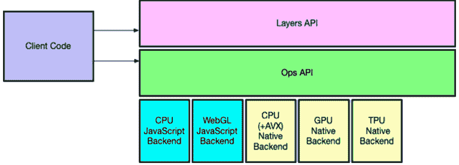
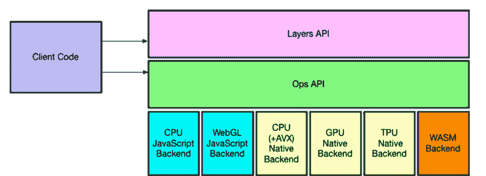
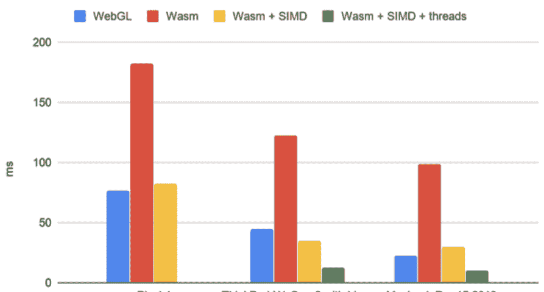
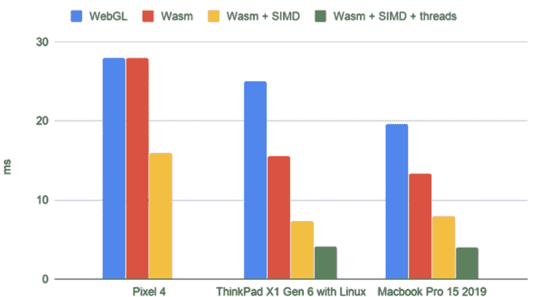

## Chapter 9. Applied WebAssembly : Tensorflow.js

### A NOTE FOR EARLY RELEASE READERS

With Early Release ebooks, you get books in their earliest form—the author’s raw and unedited content as they write—so you can take advantage of these technologies long before the official release of these titles.

This will be the 9th chapter of the final book.

If you have comments about how we might improve the content and/or examples in this book, or if you notice missing material within this chapter, please reach out to the author at wasmbook@bosatsu.net.

> Now, the world don’t move
> to the beat of just one drum,
> What might be right for you,
> May not be right for some.
> 
> —Theme to “Diff’rent Strokes”

这是我们“Applied WebAssembly”章节中的第一章，我在此重点介绍该技术的潜在用例。正如你在本书中将看到的那样，并没有单一用途。相反，设计者打造了一个平台，其触及范围不断扩大，几乎涵盖软件开发行业的各个方面。所以请跟上。我不会专门教授新功能。相反，我希望帮助塑造你对我们行业正在迅速变化以及 WebAssembly 将如何提供帮助的理解。

首先，我想让你停下来思考一下编程语言和机器学习。你首先想到的是哪一种？你的答案很可能不是 JavaScript。为什么会这样？机器学习如今是一个极其注重性能的活动，计算工作量巨大。

诸如 Python 之类的语言与机器学习的关联比 JavaScript 更强。如果我们诚实地说，这也有些牵强。Python 本身是一个糟糕的数值语言。然而，它在可读性、灵活的编程风格（函数式、面向对象、过程式）和广泛的算法、可视化和数据处理功能之间取得了很好的平衡。如果你能让它运行得更快，那么它就能满足很多需求。Numpy、原生库、集群云环境等可以为其提供足够的计算能力来完成训练过程。

不过，大多数组织并不在运营中使用 Python，因此你很可能需要将模型序列化为其他格式，以便加载到 C/C++、C#、Java 或 JavaScript 应用程序中。由于开放格式如 Open Neural Network Exchange（ONNX）¹ 的出现，这变得更容易了，但许多框架如 Tensorflow 天然支持这种混合使用。

第一步是训练我们的模型。第二步是推理。直到几年前，Tensorflow 要求你用 Python 训练，但你可以将模型保存到磁盘并加载到其他环境中。如今，你可以选择用 Python、JavaScript 或 Swift 使用 Tensorflow 进行训练。

我们将讨论 Tensorflow.js，它旨在为 JavaScript 环境在浏览器内外提供机器学习能力。在浏览器中使用 JavaScript 进行机器学习（特别是）比你想象的更有意义。为了理解机器学习与 JavaScript 和 WebAssembly 之间的关系，我们必须先快速讨论一下硬件以及它如何改变我们的行业。

### Hardware

典型的程序员认为她的工作是编写运行在包含中央处理器（CPU）、主内存、存储系统、显示器和某种输入设备的计算机上的软件。虽然这仍然涵盖了大量的软件开发，但我们拥有的计算运行时生态系统比大多数人意识到的要丰富得多。计算机、平板电脑、游戏机、网络设备、智能手机、手表、嵌入式系统、物联网（IoT）设备以及片上系统（SOC）提供了执行软件的各种硬件系统。

以 C++ 著称的 Herb Sutter 写过一篇优秀的文章²，名为“Welcome to the Jungle”，值得你花时间阅读。在其中，他强调了过去几十年硬件发展对软件行业的影响。大约 30 年间，摩尔定律³ 将更高的密度转化为更快的芯片。如果你的软件运行缓慢，你只需等待 18-24 个月，它就会变快。

一旦我们停止制造更快、更复杂的芯片，我们就利用额外的密度制造更多简单的芯片。多核系统成为常态。与之前的“免费午餐”时期不同，开发人员现在必须编写疯狂的并发代码才能受益于额外的处理能力，而且并非每个问题都适合这种模式。此外，这是一种棘手的代码，很容易出错。这在很大程度上推动了我们转向函数式编程语言和不可变数据结构。

其他发展包括云计算的出现以满足弹性需求、边缘计算以在地理上进行分布以实现低延迟的客户体验，以及异构计算环境。这包括图形处理器（GPU）、现场可编程门阵列（FPGAs）和专用集成电路（ASICs）。

所有这些都与这样一个事实联系在一起：计算需要时间和电力。未来成功的 IT 战略很大程度上将围绕最小化时间成本、电力成本和延迟成本展开。这将影响事物运行的位置。将大量数据推送到云中以进行弹性、突发式训练是有意义的。但如果这导致大型模型，这些模型就很难分发到桌面/移动体验中，因为体积太大。同时，我们也不希望互联网传感器和汽车刹车在关键时刻进行云调用。

我们面临着数据的绝对爆炸，这将使所有这些变得更加关键。为了在合理的时间内处理数据，我们需要访问硬件加速。这使数学并行化变得可行。正是在这个世界里，我们最终可以探索浏览器中的基于 JavaScript 的机器学习概念。

### Playground

Tensorflow Playground⁴ 是一个实验环境，让非专家通过直接操作⁴ 了解神经网络的工作原理。[content]

典型的程序员认为她的工作是编写运行在包含中央处理器（CPU）、主内存、存储系统、显示器和某种输入设备的计算机上的软件。虽然这仍然涵盖了大量的软件开发，但我们拥有的计算运行时生态系统比大多数人意识到的要丰富得多。计算机、平板电脑、游戏机、网络设备、智能手机、手表、嵌入式系统、物联网（IoT）设备以及片上系统（SOC）提供了执行软件的各种硬件系统。

Herb Sutter of C++ fame has written an excellent essay² called “Welcome to the Jungle” that is worth your time. In it, he highlights the impact of hardware developments on the software industry over the last several decades. For approximately 30 years, Moore’s law³ translated higher density into faster chips. If your software was slow, you simply waited 18-24 months and it would get faster.

Once we stopped being able to make faster, more complex chips, we used the extra density to make more simple chips. Multicore systems became the norm. Unlike the previous “free lunch” period, developers now had to write crazy concurrent code to benefit from the extra processing power and not every problem fits this mold nicely. Also, this is tricky code and easy to get wrong. This has largely pushed us toward functional programming languages and immutable data structures.

Other developments include the emergence of cloud computing to meet elastic demand, edge computing to distribute it geographically for low-latency customer experiences, and heterogenous computing environments. This includes Graphical Processing Units (GPUs), Field Programmable Gate Arrays (FPGAs) and Application-Specific Integrated Circuits (ASICs).

Tied up in all of this is the idea that it takes time and power to compute things. A big part of a successful IT strategy moving forward is going to be about minimizing time costs, power costs and latency costs. This is going to influence where things run. It makes sense to push large amounts of data into the cloud for elastic, bursty training sessions. But if this results in large models, those are not as easily distributed to desktop/mobile experience because of size. At the same time, we do not want internet sensors and car brakes making cloud calls at crucial times.

We are facing an absolute explosion of data which is going to make all of this more crucial. In order to process data in reasonable amounts of time, we need access to hardware acceleration. This parallelizes the math so it is tractable. It is in this world that we finally can explore the concept of JavaScript-based machine learning in the browser.

### Playground

Tensorflow Playground⁴ is an experimental environment for non-experts to gain intuition about how neural networks work through direct manipulation⁵. The idea is that these models are increasingly driving systems with real-world consequences, but the background needed to understand them is beyond the typical non-academic researcher. By working with visual representations, non-technical users are able to gain a sense of cause and effect.

The problem is that the JavaScript environment is single-threaded and the numerics support is not great for the kind of math that training neural networks requires. The Playground environment allows you to change all hyperparameters of the training process via simple user interface actions. While it is easy and fun to experiment with changing these parameters, they can have significant impacts on the quality of the results. In order to see the effect quickly and in real time, the runtime needs to recalculate significant portions of the code otherwise the whole point of direct manipulation is lost. Fortunately they were able to eke out enough performance to make it all work by relying on the presence of WebGL in the browser. We will discuss this idea more below.

### Tensorflow.js

Out of the success of the Playground came an appreciation of what was necessary and possible to bring deep learning systems to the browser. It may strike you as a bit odd to want to run such computationally-intensive systems on potentially lower-end devices such as phones or tablets. Even just running in the browser on a powerful desktop machine is a slightly odd concept. There are quite a few benefits to the idea though.

Unsurprisingly, the experience of clicking on a link and downloading a deep learning-based application is a lot easier than having to install a potentially large number of required libraries. There is zero installation to load a web page. It is easier to share research and practical applications when it is this easy. This broadens the potential for interaction among deep learning researchers and makes it easier to target endusers with applications that employ these capabilities.

Given the popularity of JavaScript, it is a bit of a steep request that web developers learn Python in order to do machine learning. There is an overwhelming amount of open source JavaScript code for building all manner of software systems. Being able to take advantage of it all would be a benefit to developers of machine learning systems in the other direction.

Our phones and tablets have quickly become something much more than mobile portable electronic devices. They have become diagnostic tools, part of our banking systems, methods of identification and more. New software is being written to detect the onset of dementia or the presence of strokes by analyzing video from their cameras. Both for the quality of the user experience and privacy law compliance with respect to the results of diagnostic outcomes, being able to push apps to the device will be much less encumbered by regulatory burdens than trying to take data off of the device.

Finally, many of the devices that these downloaded apps might run on have powerful and sophisticated GPUs available for use. Not only could it be possible to do deep learning systems in the browser, it might actually perform well.

So, why are we discussing all of this?

The design of the Tensorflow.js framework is elegant and results in clean APIs that work across a wide range of devices. Rather than limiting the implementation to what is available everywhere, they chose to create a pluggable backend to cover the widest number of systems.

The basic version of the backend is a CPU-based JavaScript implementation that will run anywhere. All of the code executes directly on the CPU without benefit of optimizing instruction sets such as the Advanced Vector Extensions (AVX)⁶. It does not perform effectively anywhere but it will run basically everywhere. Other options are better first choices, but this is a decent fallback position.

The next major backend is accelerated by WebGL. There is no direct support for accessing GPUs from JavaScript, but there is via WebGL which is supported in nearly every browser. By pretending to do 3D graphics, they can execute calculations on the GPU and write the results into the textures. This produces a fast and convenient implementation that runs well on just about every major modern browser. It is similar to what was done with the Tensorflow Playground application mentioned earlier.

#### NOTE

This is not as strange a scenario as it sounds. Prior to the availability of GPU computation libraries such as CUDA, OpenCL, Metal and Vulkan, researchers would do this with OpenGL to get access to comparatively cheap computation. These APIs that specifically allow the use of GPUs for arbitrary computation was part of what accelerated the machine learning and deep learning systems we enjoy these days.

Servers with deep learning needs can be implemented in Node.js, so the next backend is designed to run in a freer environment than the browser. Apps running in Node.js can read from and write to the filesystem, load and use native libraries, and communicate directly with the normal native Tensorflow libraries. These can take advantage of multicore systems, GPUs or other hardware accelerating devices such as Google’s Tensor Processing Units (TPUs).

你可以在图 9-1 中看到 API 设计的基本结构。

图 9-1. Tensorflow.js 分层 API 和后端

这里有很多内容需要拆解。首先，低层的算子通过上图所示的 Ops API 暴露出来。需要深入细节的开发者可以选择在该层进入 API。然而，在其之上，还有一个受 Keras 启发的 Layers API，其设计考虑了愉悦的开发者体验。这是一个用于使用简化的堆叠层方法定义复杂神经网络架构的简单 API。它隐藏了许多细节，但仍通过相对直接的机制暴露出强大的行为。

无论客户端代码使用哪种 API 进入 Tensorflow.js API，针对这些 API 编写的应用程序都可以在后端覆盖的所有环境中移植。这包括在浏览器中、在浏览器之外、带硬件加速和不带硬件加速的情况。这本身就是一个相当了不起的设计成就，但当能够利用硬件加速时，代码在不同环境中也会运行得非常出色。如我们所见，这可以有多种形式，但我们并不是针对最低公分母环境编写代码，应用程序代码也不必因一堆功能检测代码而负担沉重，以查看环境提供了什么。

使用 MobileNet⁷ 进行单次推理的结果，平均一百分次运行，结果显示在表 9-1 中。这些数据取自向世界介绍 Tensorflow.js 的论文《Tensorflow.js : Machine Learning for the Web and Beyond⁸》。

#### 表 9-1. Tensorflow.js

### 性能结果

| Backend | Time(ms) | Speedup |
|---|---|---|
| CPU JavaScript | 3426 | 1x |
| WebGL (Intel Iris Pro) | 49 | 71x |
| WebGL (GTX 1080) | 5 | 685x |
| Node.js CPU w/ AVX2 | 87 | 39x |
| Node.js CUDA (GTX 1080) | 3 | 1105x |

趋势上的结果并不令人惊讶，但具体细节有点令人惊讶。在没有任何硬件加速的原始 JavaScript 后端上运行需要近 3.5 秒。只需将后端切换为受 WebGL 支持优化的后端，即使是性能非常适中的集成 GPU，也能在浏览器中实现 71 倍的加速。在配备更强 GPU 的桌面机器上，我们实现了近 700 倍的加速。没有 GPU 优势但拥有带优化 AVX 指令的 CPU 的服务器应用程序改进了近 40 倍。同一环境在更强大的 GPU 支持下产生了令人瞠目结舌的 1000 倍以上的加速。请记住，应用程序本身没有任何变化，只是运行它的环境发生了变化。

这就是我的主要观点。从“免费午餐”时期到多核时期的转变迫使开发者必须以显著不同的方式编程才能利用这些额外资源。如果我们必须改变编程方式才能利用定制加速、多 CPU、云托管环境以及在浏览器中运行，我们的深度学习应用程序将变成一团无法维护的代码。相反，我们看到的是一种隔离变化部分并利用我们可用的硬件选项的策略。这引出了我们将要考虑的最后一个后端。

### WebAssembly 后端

Tensorflow.js 发布后不久，团队发布了一个用 WebAssembly 编写的新的后端。鉴于我们刚刚讨论的覆盖范围，你可能会惊讶他们为何觉得有必要这样做。然而，到现在我希望你意识到这可能并不意味着从零开始。显然需要做一些工作，但大量工作是通过依赖现有代码来处理的。特别是，XNNPack⁹ 库被扩展以支持 WebAssembly 构建。

这将我们的后端集合扩展到包括图 9-2 中所示的后端。

图 9-2. Tensorflow.js 的 WebAssembly 后端

这突出了 WebAssembly 的一个主要用例。它并不是要取代 JavaScript，至少不是在所有情况下。它是关于在不必等待浏览器厂商社区达成共识的情况下扩展浏览器中可能实现的功能。WebGPU¹⁰ 或类似技术正在通过标准化流程推进，但这可能需要数年时间。用 C++ 编写的现有库旨在优化并在许多平台上移植，现在就能将其中很大一部分能力带到浏览器中，而无需等待。

这将计算运行时扩展到包括没有强大 GPU 的旧设备。代码可以优化以在各种平台上仍然运行良好。此外，WebAssembly 设计者正在逐步采用我们将在后续章节中讨论的两个高级功能。这包括使用单指令多数据（SIMD）¹¹ 并行化以及使用多线程。

在图 9-3 中，我们与之前一样使用了 MobileNet。显然，仅 WebAssembly 后端本身的性能不如 WebGL 支持的后端。你被鼓励使用 Wasm 后端而不是纯 JavaScript 后端，因为它在任何地方都会表现得更好。取决于模型大小，由于 WebGL 执行的一些固定成本，Wasm 后端比 WebGL 后端更有意义。请注意，当线程和 SIMD 并行化被添加到 Wasm 组合中时，支持这些功能的平台的性能有了显著提升。

### MobileNet v2

图 9-3. Tensorflow.js 后端在各平台上的相对性能

在图 9-4 中，我们看到参数数量更少的另一个模型的结果。在这种情况下，Wasm 后端更有意义。请注意 Pixel 4 上的可比性能以及 Linux 和 Mac 笔记本上显著更好的性能。再次，线程和 SIMD 的使用显著改善了 WebGL 为基础的后端的性能。

### BlazeFace

图 9-4. Tensorflow.js 后端在各平台上的相对性能

至少目前，WebAssembly 并非在每种情况下都是最快的解决方案。它是一个相对较新的平台，要榨干其中所有潜在优化还需要一段时间。然而，鉴于其年轻的年龄，它已经改变了在各种计算环境中可能实现的功能。

本章的关键教训是，WebAssembly 及其相关技术可以为我们提供更多选择，并且在许多情况下，为在多样化的计算表面上部署高性能软件系统提供更好的选择。我们在接下来的内容中会看到许多其他用途，但现在是时候扩展我们的语言和 WebAssembly 选项了。

- 1 有关这个日益流行的努力的更多细节可以在这里找到：https://onnx.ai
- 2 这就是我在正文中提到的文章。在其中，他还引用了他写的一篇名为“免费午餐结束了”的文章，也值得你花时间阅读：https://herbsutter.com/welcome-to-the-jungle/
- 3 摩尔定律是对硅芯片制造趋势中密度方面一个著名的观察。https://en.wikipedia.org/wiki/Moore%27s_law
- 4 你可以在这里尝试 Tensorflow Playground：http://playground.tensorflow.org
- 5 直接操作是一种用户界面风格，用户拥有控件，可以安全地探索性地操作应用程序及其数据。
https://en.wikipedia.org/wiki/Direct_manipulation_interface
- 6 AVX/AVX2 是对 Intel x86 指令集架构（ISA）的扩展，提供了我们在此使用的那种数学的并行优化：
https://en.wikipedia.org/wiki/Advanced_Vector_Extensions
- 7 MobileNets 模型集合专为高效的移动和嵌入式视觉应用而设计：https://arxiv.org/pdf/1704.04861.pdf
- 8 这篇论文读起来不错，值得你花时间：https://arxiv.org/pdf/1901.05350.pdf
- 9 XNNPack 可在此处获得，尽管它并不打算直接供深度学习研究人员使用：https://github.com/google/XNNPACK
- 10 这个新兴标准将以跨平台的方式直接向浏览器公开 GPU 支持：https://en.wikipedia.org/wiki/WebGPU
- 11 SIMD 是一种数据并行处理类型，对数据的不同部分执行相同指令于多个计算元素上。https://en.wikipedia.org/wiki/SIMD

