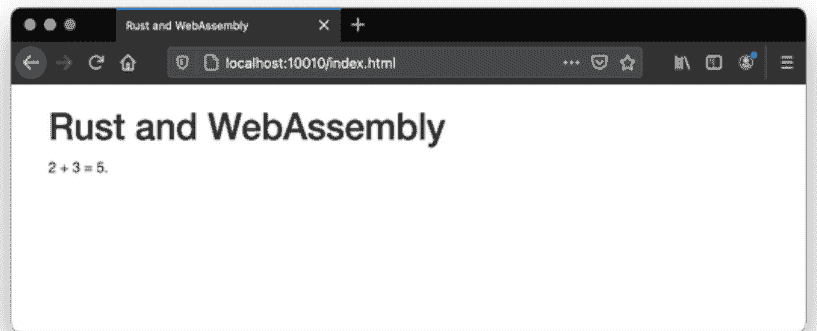
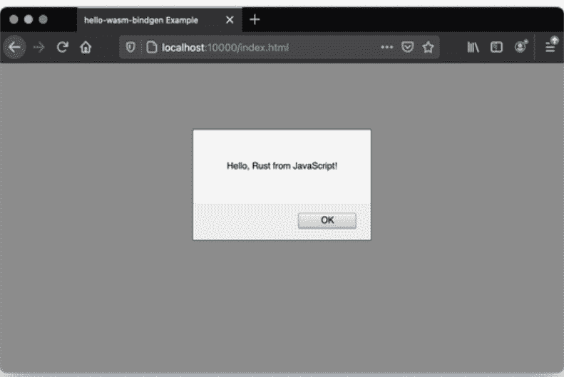
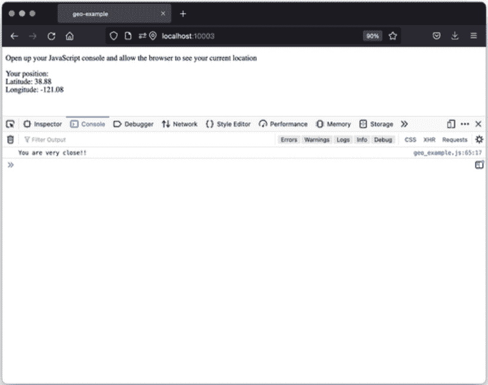
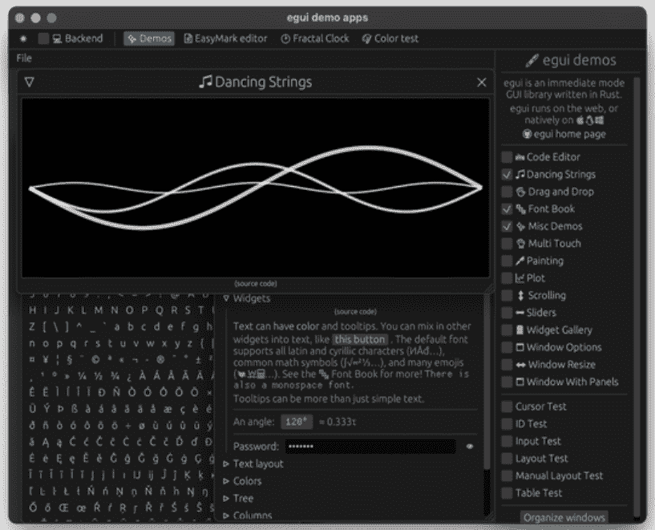
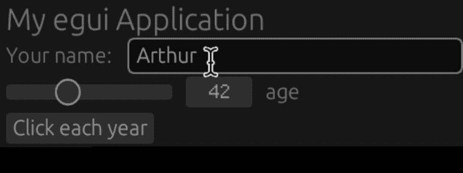

## 第10章 Rust

### 早期发布读者的说明

使用 Early Release 电子书，您可以在这些标题正式发布之前很久就利用这些技术——作者在写作过程中提供的原始且未经编辑的内容。

这将是最终书籍的第10章。

如果您对如何改进本书的内容和/或示例有任何建议，或者如果您注意到本章中缺少材料，请联系作者 wasmbook@bosatsu.net。

> 街上都在谈论，它在提醒你
> 其实并不重要你站在哪一边
> 你正走开，他们在你背后议论
> 他们永远不会忘记你，直到有新人出现
> ——Eagles，《New Kid in Town》

在我职业生涯的某个时期，我停止关心新的编程语言。似乎总有一个新语言就在拐角处。大多数时候，它们对我来说一点也不有趣。如今，一种新的编程语言必须在之前的基础上提供足够的优势，才能吸引我们的注意并值得我们学习、投入工具链等的精力。

大约在这个时候，我了解到 Go 和 Rust，并把它们放在同一个概念空间里：系统语言，提供与 C 和 C++ 大致相似的速度，但也包含使其更安全的语言特性。由于我一直是 Unix 极客，我被 Ken Thompson 和 Rob Pike¹ 参与 Go 的事吸引。我也很兴奋地看到一些 Plan 9 的想法开始获得关注。因此，我投入了一些精力学习 Go，并且很高兴我这么做了。我没有看到也学习 Rust 的必要，因为我认为它只是更多同样的东西。

然后我对 WebAssembly 感兴趣了。

一旦我听说 Rust 在后端原生发出 WebAssembly，我就知道我需要深入研究。这时我了解了 Rust 语言、其社区、工具、文档，并有点爱上了它。别误会，我也喜欢 Go 社区和语言，但 Rust 与 WebAssembly 之间的关系是如此之强，以至于我大部分兴趣都转移了，并且我再也没有回头。

到目前为止，本书主要集中在 C 和 C++ 与 WebAssembly 之间的关系上。这是迈向不同语言的第一步。Rust 是一种现代语言，具有现代的理念。它提供了非常好的运行时性能，同时提供了一个几乎不可能作为事后想法实现的<|message|>安全网。鉴于 C 和 C++ 在我们每天面临的错误、缺陷和恶意软件利用中仍发挥着重要作用，拥有一种快速、安全的系统语言是一个实质性的改进。在经历了开源社区宠儿的漫长时期后，这些好处开始被商业开发者明显认识到，对 Rust 的兴趣每天都在增长。

C 和 C++ 显然在我们的行业中仍然发挥着重要作用，但如果在新项目中做出选择，我会选择 Rust 而不是它们。它真的已经成为每个人都在谈论的新人，所以让我们在研究 Rust 与 WebAssembly 之间的相互作用之前先了解原因。

### Rust 简介

鉴于本书已经非常庞大，我无法以任何严谨的方式教您 Rust。对于这一点，我鼓励您查阅 Steve Klabnik 和 Carol Nichols 的免费书籍《The Rust Programming Language》，或 Jim Blandy、Jason Orendorff 和 Leonora F.S. Tindall 的《Programming Rust》第二版或更新版本。

对这种新语言的高层次介绍是，它始于 Graydon Hoare 在 Mozilla 任职期间的副业，但已演变成一种正在 Google、Microsoft、Apple 和其他领先技术公司获得关注的改变行业的语言。他们感兴趣的原因有很多，但采用的主要驱动力是它是一种快速、安全、现代的语言。最初 intended 作为用于低级库和操作系统服务的系统编程语言，它甚至开始进入 Linux 内核扩展。

语言中的一系列基本设计选择解决了整类错误。在其他语言中会表现为运行时错误的问题在 Rust 中变成了编译时错误。不幸的是，它的学习曲线相当陡峭。你会遇到让 Rust 编译器不悦的无法解释的边缘情况，并且最初可能会相当沮丧。我把这种体验比作青少年成长过程。

最初，作为青少年，对你的期望并不多，但慢慢地期望越来越多，直到你突然成为成年人。过渡过程可能痛苦且令人沮丧。作为开发者，Rust 编译器期望你清晰地沟通并表明你的意图，以便它能相应地做出反应。像 JavaScript 这样的语言对你没有任何这样的要求，所以根据你的背景，这可能会有点令人不快。

然而，虽然你最初可能会对 Rust 编译器期望的成年程度感到不满，但它很快就会成为人们充满热情的语言。它在过去几年中赢得了几次最喜欢语言的调查²，所以显然，度过陡峭的学习曲线是一次有回报的体验。一旦青少年成为年轻成年人，即使有额外的期望，很少有人会渴望回到自己的年轻时期。

假设您已按照附录 A 所述安装了 Rust，我们可以轻松处理“Hello, World!”程序，如示例 10-1。

#### 示例 10-1. Rust “Hello, World!”

```
fn main() {
    println!("Hello, World!");
}
```

这里，我们有一个 main () 方法以及将字符串打印到控制台的能力。虽然它看起来像是一个强调的名称，但感叹号只是将其标记为宏，这是一种我们没有时间探索的语言特性³。就我们的目的而言，只需将其视为 C 中的 printf() 或 Java 中的 System.out.println()。编译和运行这个简单程序就像以下命令一样简单：

```
brian@tweezer ~/g/w/s/ch10> rustc helloworld.rs
brian@tweezer ~/g/w/s/ch10> ./helloworld
Hello, World!
```

到目前为止，没什么大不了的，但用不了多久就会遇到 Rust 的不同之处。考虑示例 10-2 中的非常基本示例。

#### 示例 10-2. Rust 不可变变量

```
fn main() {
    let s = "cool";
    s = "safe";

    println!("Rust is {}", s);
}
```

我们将一个字符串字面量分配给变量 s。Rust 对类型很挑剔，但不会不必要地挑剔。当它可以使用类型推断⁴来确定变量应该具有什么类型时，就没有理由啰嗦。Rust 编译器可以看出这里正在分配一个字符串的引用。然后我们改变主意，用另一个字符串引用覆盖该值，然后打印出新值。在几乎任何其他编程语言中，这都是完全可以做的事情。在 Rust 中……

```
brian@tweezer ~/g/w/s/ch10> rustc immutable.rs
warning: value assigned to `s` is never read
  --> immutable.rs:2:9
   |
2 |     let s = "cool";
   |             ^
   |
   = note: `# [warn(unused_assignments)]` on by default
   = help: maybe it is overwritten before being read?
```

```
error[E0384]: cannot assign twice to immutable variable `s`
  --> immutable.rs:3:5
   |
2 |     let s = "cool";
   |       -
   |       |
   |       first assignment to `s`
   |       help: make this binding mutable: `mut s`
3 |     s = "safe";
   |     ^^^^^^^^^^^ cannot assign twice to immutable variable

error: aborting due to previous error; 1 warning emitted

For more information about this error, try `rustc --explain E0384`.
```

这个错误信息有很多内容。一方面，由于 Rust 团队意识到学习曲线很陡峭，他们花费了不成比例的时间确保错误信息是有帮助和信息的⁵。

第一个错误信息只是简单地说，第一次赋值意义不大，因为你在它被读取之前就立即覆盖了该值。这只是表明潜在代码异味⁶的观察。你可以抑制此警告，如果你不想看到它，但默认情况下它指出这些问题是很不错的。

真正的问题是 Rust 变量默认是不可变的。一旦你分配一个值，就不能更改它。这似乎是一个奇怪的政策，但它迫使你在想要变量值更改时和不想要时保持清晰。有很大一类错误涉及无意覆盖变量。你可能直到测试失败或出现运行时问题才注意到你已经这样做了。

显然，我们需要在 Rust 中使用可变变量，你只需要告诉编译器你想要它，如示例 10-3 所示。

#### 示例 10-3. 可变 Rust 变量

```
fn main() {
    let mut s = "cool";
    s = "safe";
}
```


```
println!("Rust is {}", s);
}
```

现在，通过重新编译（并抑制未使用的赋值警告）我们进入了一个更愉快的状态。

```
brian@tweezer ~/g/w/s/ch10> rustc -A unused_assignments
immutable.rs
brian@tweezer ~/g/w/s/ch10> ./immutable
Rust is safe
```

起初，你可能会觉得必须如此清晰地进行沟通很烦人，但 Rust 编译器只是在教你如何成为一个成年人，在那里沟通对于福祉和成功至关重要。

让我们再看一个例子，当你开始使用 Rust 时可能会遇到问题。在示例 10-4 中我们有另一个非常简单的程序。我们将一个字符串字面量赋给变量 s，然后重新赋给变量 t，然后打印两者。

#### 示例 10-4. 使用 Rust 变量

```
fn main() {
    let s = "Hello, world.";
    let t = s;
    println!("s: {}", s);
    println!("t: {}", t);
}
```

这是一个完全合理的做法，我们可以看到 Rust 编译器对此没有任何问题。

```
brian@tweezer ~/g/w/s/ch10> rustc memcheck.rs
brian@tweezer ~/g/w/s/ch10> ./memcheck
s: Hello, world.
t: Hello, world.
```

然而，只有一个小的改动，我们就可以像示例 10-5 中那样破坏它。

#### 示例 10-5. Rust 内存检查器违规

```
fn main() {
    let s = "Hello, world.".to_string();
    let t = s;
    println!("s: {}", s);
    println!("t: {}", t);
}
```

问题在 Rust 编译器的错误信息中得到了很好的突出显示。

```
brian@tweezer ~/g/w/s/ch10> rustc memcheck.rs
error[E0382]: borrow of moved value: `s`
  --> memcheck.rs:4:23
   |
2 |     let s = "Hello, world.".to_string();
   |             - move occurs because `s` has type
   | `std::string::String`, which does not implement the `Copy` trait
3 |     let t = s;
   |             - value moved here
4 |     println!("s: {}", s);
   |                        ^ value borrowed here after move

error: aborting due to previous error

For more information about this error, try `rustc --explain E0382`.
```

可能看起来没什么大不了的，但通过添加 to_string() 方法调用，我们违反了 Rust 的内存检查器。这是因为我们将一个字符串字面量变成了一个堆分配的字符串。栈是为与当前函数相关联的短期变量分配的地方，以便它们在超出词法作用域时可以轻松清理（即在函数结束时）。堆分配的内存会在不再需要之前一直被分配。在 C 和 C++ 中，你通常必须自己作为程序员来管理这个过程。在 Java 和 JavaScript 环境中，运行时垃圾收集器会为你完成此操作。

Rust 通过强制执行值的拥有权来管理缺乏运行时垃圾收集器。在任何给定时间，只有一种变量可以拥有与堆分配值相关联的内存。在示例 10-5 中，我们首先将字符串的所有权分配给变量 s。当我们将 s 分配给 t 时，所有权转移。此时，s 不再指向任何有效内容，因此我们尝试在 println! 宏中使用 s 被捕获为违规。

字面值和其他结构可能实现上面错误消息中提到的 Copy trait。这是一种允许相关位在变量之间复制而不引起所有权转移的行为。因为 Rust 字符串结构没有实现此 trait，所以所有权检查适用。所有权转移发生的其他情况包括变量在函数进出时、在循环中，以及其他词法结构如条件子句。

好消息是，通过更明确地表达我们的意图，我们可以在不引入新风险的情况下解决这个问题。我们试图避免的具体风险是使用前未初始化、使用后释放，以及在 C 和 C++ 等语言中常见的其他错误。我们可以使用引用而不是直接访问，这允许我们“借用”一个值。我们可以有可变引用，但一次只能有一个。这些功能有点像 Java 等语言中的读写锁。

一旦我们更好地沟通我们的意图，Rust 编译器就可以帮助我们实现目标，而不是一直与我们对抗。净效果是 Rust 将多个运行时错误移至编译时错误，这是一个更好的处理位置。这消除了更多类别的错误，并使我们能够生产出更高质量的软件，包括用于系统开发的快速、高并发类型的代码。

使用 Rust 的体验不仅仅是被编译器骚扰。语言特性、工具和社区的各个方面一旦度过学习曲线就会让人愉快使用。Rust 的速度和安全性与其基于 LLVM 的结合使其成为与 WebAssembly 配对的绝佳语言。

### Rust 和 WebAssembly

如果你按照附录 A 中安装 Rust 的说明进行操作，那么你已经拥有了使用 Rust 进行 WebAssembly 的基础。正如我之前提到的，正是 Rust 对 WebAssembly 的原生支持最初引起了我对 Rust 的好奇心。

你会记得在图 5-1 中你看到 LLVM 提供了三阶段架构。由于 Rust 是基于 LLVM 的语言，为了支持 WebAssembly，它基本上只需要一个新的后端。这并不完全正确，但现在这是一个合适的虚构。

你可以通过发出以下命令查看已安装的后端：

```
brian@tweezer ~/g/w/img> rustup target list | grep installed
wasm32-unknown-unknown (installed)
x86_64-apple-darwin (installed)
```

Rust 后端标记为三元组，表示指令集架构（ISA）、厂商和操作系统。我在 Intel Mac 上运行了该命令，所以你看到了相应的默认后端。但你也可以注意到 WebAssembly 后端已安装。由于它生成针对 WebAssembly 栈机的代码，我们不是在谈论 x86_64、aarch64、arm7 或 riscv64。因为这段代码是可移植的，所以无关紧要你在哪个机器上运行它，这就是为什么三元组用 unknown-unknown 填充的原因。

如果你查看示例 10-6，你会看到将两个数字相加的代码（Rust 中的 i32）和一个 main() 方法来测试行为。

#### 示例 10-6. Rust 函数将两个整数相加

```
pub extern "C" fn add(x: i32, y: i32) -> i32 {
    x + y
}

fn main() {
    println!("2 + 3: {}", add(2,3));
}
```

使用默认后端，你可以查看构建和运行此代码的原生 Rust 版本的结果。

```
brian@tweezer ~/g/w/s/ch10> rustc add.rs
brian@tweezer ~/g/w/s/ch10> ./add
2 + 3: 5
```

将相同的代码编译成 WebAssembly 模块与选择 WebAssembly 后端并指示我们想要生成 C 动态库一样简单。你可以删除 main 函数或添加编译指令以抑制死代码投诉，如下所示：

```
brian@tweezer ~/g/w/s/ch10> rustc -A dead_code --target wasm32-unknown-unknown
-O --crate-type=cdylib add.rs -o add.wasm
```

我们可以使用 wasm3 运行时在命令行上执行我们的函数：

```
brian@tweezer ~/g/w/s/ch10> wasm3 --func add add.wasm 2 3
Error: [Fatal] repl_call: function lookup failed
Error: function lookup failed ('add')
```

呃... 或不是。

```
brian@tweezer-2 ~/g/w/s/ch10> ls -laF add*
-rwxr-xr-x  1 brian  staff  334920 May  4 11:54 add*
-rw-r--r--  1 brian  staff     111 May  4 12:07 add.rs
-rwxr-xr-x  1 brian  staff 1501227 May  4 12:16 add.wasm*
```

哇，那个文件相比原生版本相当大。这再次是因为 Rust 编译器对在 WebAssembly 环境中执行此代码所需的期望。原生版本可以依赖原生动态库来提供所需的功能。到本书的这一点，你应该记得如何调查 Wasm 模块的内容。

```
brian@tweezer ~/g/w/s/ch10> wasm-objdump -x add.wasm
add.wasm:      file format wasm 0x1

Section Details:

Table[1]:
  - table[0] type=funcref initial=1 max=1
Memory[1]:
  - memory[0] pages: initial=16
Global[3]:
  - global[0] i32 mutable=1 - init i32=1048576
  - global[1] i32 mutable=0 <__data_end> - init i32=1048576
  - global[2] i32 mutable=0 <__heap_base> - init i32=1048576
Export[3]:
  - memory[0] -> "memory"
  - global[1] -> "__data_end"
  - global[2] -> "__heap_base"
Custom:
  - name: ".debug_info"
Custom:
  - name: ".debug_pubtypes"
Custom:
  - name: ".debug_ranges"
Custom:
  - name: ".debug_aranges"
Custom:
  - name: ".debug_abbrev"
Custom:
  - name: ".debug_line"
Custom:
  - name: ".debug_str"
Custom:
  - name: ".debug_pubnames"
Custom:
  - name: "producers"
```

好吧，所以有一堆调试信息和导出的内存等等，但没有导出的 add 函数。我们可以在方法定义中添加一个编译指令来解决此导出问题，如示例 10-7 所示。

#### 示例 10-7. Rust 函数将两个整数相加正确导出

```
#[no_mangle]
pub extern "C" fn add(x: i32, y: i32) -> i32 {
```


```
x + y
}
```

现在，重建并检查结果。你应该能在导出部分看到 add 方法。我们可以在命令行上调用它。

```
brian@tweezer ~/g/w/s/ch10> wasm3 --func add add.wasm 2 3
Result: 5
```

正如你可能猜到的那样，我们也可以几乎毫不费力地通过典型的 HTML/JavaScript 组合来调用我们的行为，就像在示例 10-8 中一样。

#### 示例 10-8. 从 HTML 调用 Rust 函数

```
<!doctype html>
<html lang="en">
    <head>
        <meta charset="utf-8">
        <link rel="stylesheet" href="bootstrap.min.css">
        <title>Rust and WebAssembly</title>
        <script src="utils.js"></script>
    </head>
    <body>
        <div class="container">
            <h1>Rust and WebAssembly</h1>
            2 + 3 = <span id="sum"></span>.
        </div>
        <script>
            fetchAndInstantiate('add.wasm').then(function(instance) {
                var add = instance.exports.add(2,3);
                var sumEl = document.getElementById('sum');
                sumEl.innerText=add;
            });
        </script>
    </body>
</html>
```

在图 10-1 中，你可以看到从 JavaScript 在浏览器中调用函数的熟悉结果。不同之处当然在于它最初是用 Rust 而不是我们一直使用的 C 和 C++ 编写的。



图 10-1. 从 HTML 调用 Rust

如果 Rust 和 WebAssembly 之间只有这些内容可谈，那不会太令人兴奋。幸运的是，得益于 wasm-bindgen，情况很快变得更有趣得多。

### wasm-bindgen

在后续章节中，我将向你介绍若干由最低可行产品 MVP 之后制定的提案所解锁的功能。这包括引用更复杂结构如字符串和列表的能力、线程支持、多值返回类型等。在此之前，wasm-bindgen 在更高层面上架起 JavaScript 与 Rust 之间的桥梁，帮助你在仅传递数字之外将数据跨越鸿沟传递。该工具并非仅为 Rust 设计，但迄今为止大多数收益都体现在 Rust 上。

如果你已按照附录 A 中所述安装了 wasm-bindgen 和 wasm-pack，你应该已具备完成本章剩余部分所需的一切。后者不是必需的，但能让事情更轻松，因此我们将从使用其打包功能开始。

wasm-bindgen 的“Hello, World!” 是从 Rust 调用 alert() JavaScript 方法，而无需在 WebAssembly 中直接导入该方法。正如你很快会看到的，完整的浏览器功能将被解锁并可从 Rust 使用。更令人惊讶的是，它会看起来像是完全用 Rust 编写的。此外，你还可以将 Rust 代码与 JavaScript 共享，并使其看起来像 JavaScript。我曾使用过多种跨语言桥接技术，这其中是我见过的更好的之一。

第一步是使用 cargo 构建工具创建一个 Rust 库项目。这将为基本项目建立脚手架。

```
brian@tweezer ~/src> cargo new --lib hello-wasm-bindgen
Created library `hello-wasm-bindgen` package
```

你可以将 src/lib.rs 文件中的默认代码覆盖为下面示例 10-9 中所示的内容。

#### 示例 10-9. 用于 wasm-bindgen 的库

```
use wasm_bindgen::prelude::*;

#[wasm_bindgen]
extern {
    pub fn alert(s: &str);
}

#[wasm_bindgen]
pub fn say_hello(name: &str, whom: &str) {
    alert(&format!("Hello, {} from {}!", name, whom));
}
```

这比我们迄今为止看到的 Rust 稍微复杂一些，但也不算太糟糕。第一行导入 wasm_bindgen::prelude 模块的内容，以便我们能在 Rust 代码中使用它。这包括将我们连接到 JavaScript 运行时环境的绑定代码。

下一行是一个 Rust 属性名 #[wasm_bindgen]。这表示我们计划调用一个名为 alert() 的外部函数。这是我们通过上述 use 语句从 prelude 导入的功能之一。如果你觉得这个方法听起来很熟悉，你是对的！这最终会调用你可能多次从 JavaScript 调用过的同名方法。

注意其签名。这不是一个 JavaScript 函数。从我们的角度来看，我们只是在 Rust 代码中调用一个 Rust 函数。wasm-bindgen 提供的桥接如此无缝，以至于我们此时甚至不必考虑另一种语言。

这个“Hello, World!” 实例也会反向进行。从 JavaScript，我们将调用 Rust。下一个 #[wasm_bindgen] 属性应用于我们在库中定义的一个 Rust 函数，该函数接受两个字符串切片。我们使用 Rust 的 format! 宏，它等同于其他语言中的字符串格式化函数。我们取返回字符串的引用并将其传递给上面标识的 alert() 函数。该属性将生成一个等效的 JavaScript 函数以供另一侧调用。从其角度来看，它将调用 JavaScript 而不是 Rust！同一个属性在两个方向上保持我们同步，这相当了不起。

下一步是使用 wasm-pack 生成我们的支持代码。为此，我们需要更新 Cargo.toml 以指示我们希望生成 C 动态库风格的输出，并且需要 wasm-bindgen 作为依赖，如示例 10-10 所示。

#### 示例 10-10. Cargo.toml 文件

```
[package]
name = "hello-wasm-bindgen"
version = "0.1.0"
edition = "2018"

[lib]
crate-type = ["cdylib"]

[dependencies]
wasm-bindgen = "0.2.73"
```

现在我们可以使用 wasm-bindgen 生成一个包装我们 Rust 代码的 JavaScript 模块。我已删除了一些关于缺少属性和 README 文件的警告，以及一些翻译不佳的可爱小表情符号。

```
brian@tweezer ~/s/hello-wasm-bindgen> wasm-pack build --target web
[INFO]:  Checking for the Wasm target...
[INFO]:  Compiling to Wasm...
    Compiling hello-wasm-bindgen v0.1.0 (/Users/brian/src/hello-wasm-bindgen)
        Finished release [optimized] target(s) in 0.26s
[INFO]: Optimizing wasm binaries with `wasm-opt`...
[INFO]:     Done in 0.73s
[INFO]:     Your wasm pkg is ready to publish at
/Users/brian/src/hello-wasm-bindgen/pkg.
brian@tweezer ~/s/hello-wasm-bindgen> ls -laF pkg
total 72
drwxr-xr-x   8 brian  staff   256 May 10 17:20 ./
drwxr-xr-x   9 brian  staff   288 May 10 17:20 ../
-rw-r--r--   1 brian  staff     1 May 10 17:20 .gitignore
-rw-r--r--   1 brian  staff   861 May 10 17:20 hello_wasm_bindgen.d.ts
-rw-r--r--   1 brian  staff  4026 May 10 17:20 hello_wasm_bindgen.js
-rw-r--r--   1 brian  staff 15786 May 10 17:20 hello_wasm_bindgen_bg.wasm
-rw-r--r--   1 brian  staff   291 May 10 17:20 hello_wasm_bindgen_bg.wasm.d.ts
-rw-r--r--   1 brian  staff   266 May 10 17:20 package.json
```

我们使用 --target web 标志来指示我们希望包可在浏览器中加载。其他选项包括使用 Webpack 打包所有内容，或针对 Node.js 或 Deno，如我们稍后将看到的那样。在 pkg 目录中，你会看到生成的 JavaScript、我们的 Wasm 模块以及 package.json 文件。还有我们代码的 TypeScript 声明文件。如果你使用 wasm-objdump 并查看模块的导出部分，你会看到以下内容：

```
Export[4]:
  - memory[0] -> "memory"
  - func[19] <say_hello> -> "say_hello"
  - func[34] <__wbindgen_malloc> -> "__wbindgen_malloc"
  - func[38] <__wbindgen_realloc> -> "__wbindgen_realloc"
```

这包括一个 Memory 实例、我们导出的方法和一些内存分配函数。

最后一步是像示例 10-11 中那样从 HTML 和 JavaScript 调用 ES6 模块。

#### 示例 10-11. 从 JavaScript 调用 Rust

```
<!DOCTYPE html>
<html>
    <head>
        <meta charset="utf-8">
        <title>hello-wasm-bindgen Example</title>
    </head>
    <body>
        <script type="module">
            import init, {say_hello} from "./pkg/hello_wasm_bindgen.js";
            init()
                .then(() => {
                    say_hello("Rust", "JavaScript");
                });
        </script>
    </body>
</html>
```

如果你像之前那样通过 HTTP 提供 HTML 文件，你应该会看到如图 10-2 所示的结果。这是 JavaScript 通过 wasm-bindgen 生成的导出函数调用 Rust，而 Rust 又通过 wasm-bindgen 生成的 Rust 包装器回调到 JavaScript 中的浏览器功能。




Figure 10-2. Calling JavaScript from Rust from JavaScript

尽管结果看似平凡，但这是一个令人非常满意的结果，因为在这两种语言之间生成的桥接从任一侧看都非常自然。只是在 Rust 中思考字符串切片要容易得多，而不是像我们之前必须做的那样将字节写入内存实例。

好了，现在基础部分已经掌握，让我们尝试一些更有趣的东西。我非常喜欢 Rust 的一个特性就是它的模式匹配支持。其他语言也有这个功能，但我真的很喜欢 Rust 的实现方式。请查看示例 10-12。你会首先看到一个块上带有 #[wasm_bindgen] 属性，表示我们希望从 JavaScript 调用一个名为 log() 的方法。注意带有 js_namespace 为 console 的第二个内部属性。这展示了我们如何借助 wasm-bindgen 直接从 Rust 调用 console.log()。

#### Example 10-12. Rust Pattern Matching in Action

```
use wasm_bindgen::prelude::*;
```

```
#[wasm_bindgen]
extern "C" {
    #[wasm_bindgen(js_namespace = console)]
    fn log(s: &str);
}

#[wasm_bindgen]
pub fn describe_location( lat : f32, lon : f32 ) {
    let i_lat = lat as i32;
    let i_lon = lon as i32;

    use std::cmp::Ordering::*;

    let relative_position = match(i_lat.cmp(&38), i_lon.cmp(&-121)) {
        (Equal, Equal) => "very close!",
        (Equal, Greater) => "east of me",
        (Equal, Less) => "west of me",
        (Less, Equal) => "south of me",
        (Less, Greater) => "southeast of me",
        (Less, Less) => "southwest of me",
        (Greater, Equal) => "north of me",
        (Greater, Greater) => "northeast of me",
        (Greater, Less) => "northwest of me"
    };

    log(&format!("You are {}!", relative_position));
}
```

在 Rust 中可以使用 log() 方法后，我们定义了一个名为 describe_location() 的函数，它接受两个 f32 用于与我家的大致位置进行比较。为了简化比较并且不泄露太多关于我所在位置的细节，我只比较我当前位置的整数部分（38N，-121W）。为此，我将传入的浮点数强制转换为整数，然后导入允许我比较整数的功能。截断后的 i_lat 值与我的纬度进行比较，i_lon 值与我的经度进行比较。结果被放入一个 Rust 元组中，这类似于 Python 元组，是将一个或多个值放入单个结构中的轻量级方法。

然后元组中的值与将另一个位置与我的位置进行比较时的各种可能性进行匹配。如果 cmp() 返回两个 Equal 值，则该位置在我附近。如果纬度相等但经度不相等，则另一个位置在我东侧或西侧。我们在这里拥有的是处理九种不同情况的一种极其紧凑但可读性很强的方式。如果这被表达为一堆嵌套的 if-then 子句，可读性会困难得多。

一旦生成了相对位置的描述，我们就会调用 log 函数来打印结果。由于这最终是 console.log() 函数，结果将打印在浏览器开发者控制台中。

下一步是构建我们的包以在 HTML 和 JavaScript 中导入。

```
brian@tweezer ~/s/geo-example> wasm-pack build --target web
[INFO]: Checking for the Wasm target...
[INFO]: Compiling to Wasm...
    Compiling geo-example v0.1.0 (/Users/brian/src/geo-example)
    Finished release [optimized] target(s) in 0.51s
[INFO]: Optimizing wasm binaries with `wasm-opt`...
[INFO]: Done in 1.01s
[INFO]: Your wasm pkg is ready to publish at
/Users/brian/src/geo-example/pkg.
```

在示例 10-13 中，我们看到用于调用我们行为的 HTML 和 JavaScript。我们导入函数然后调用一个 JavaScript 函数来测试浏览器上是否可用 geolocation 对象。如果存在，我们请求当前位置，这会触发用户批准的弹出窗口。如果获得位置，结果将显示为占位段落元素的 innerText，并且我们调用 Rust 中的 describe_location() 方法进行模式匹配。

#### Example 10-13. Calling the Rust pattern matching from HTML

```
<!DOCTYPE html>
<html>
  <head>
    <meta charset="utf-8">
    <title>parsing-example</title>
  </head>
  <body>
    <script type="module">
      import init, {describe_location} from "./pkg/parsing_example.js";
```

```
init()
    .then(() => {
        getLocation();
    });

var output = document.getElementById("output");

function getLocation() {
    if (navigator.geolocation) {
        navigator.geolocation.getCurrentPosition(showPosition);
    } else {
        output.innerHTML = "This browser doesn't support Geolocation.";
    }
}

function showPosition(position) {
    output.innerHTML = "Your position:" +
        "<br>Latitude: " + position.coords.latitude +
        "<br>Longitude: " + position.coords.longitude;

    describe_location(position.coords.latitude,
    position.coords.longitude);
}
</script>
<p>Open up your JavaScript console and allow the browser to see your location</p>
<p id="output"></p>
</body>
</html>
```

执行此代码的结果如图 10-3 所示。



Figure 10-3. Pattern matching geolocations from JavaScript in Rust

### Designing Code For In and Out of the Browser

我想介绍的最后一个部分是另一个我认为会越来越流行的 WebAssembly 用例。我们已经研究了使用 JavaScript 以外的语言来定位浏览器。我们也讨论了在浏览器运行时中重用现有代码的场景。但如果代码本身就是设计为在浏览器内外运行呢？我认为一旦更多人熟悉 WebAssembly 所提供的内容，这将成为一个越来越常见的场景。

只要我关注 WebAssembly，我就一直期待这种活动，但我对 Emil Ernerfeldt 的 egui 库⁷ 进展得有多远感到惊讶。他将该项目描述为“纯 Rust 中的易于使用的即时模式 GUI”⁸ 基本上，它是一个复杂的用户界面库，可在浏览器内外使用。

我们在本章中多次提到，Rust 得益于其 LLVM  heritage，可以发出各种后端目标。Emil 也正是利用这一点让它发挥作用。但他做得非常优雅，我认为可以从他所做的事情中学到很多。他实现细节的完整内容超出了本章范围，但如果您有兴趣做类似的事情，我想引起您对该项目的注意。

首先，让我们看看他的应用作为原生应用程序运行的效果。如果您使用 Linux，您必须安装 GitHub 站点上列出的几个额外包，但之后，您只需运行：

```
brian@tweezer ~/g/egui> cargo run --release -p egui_demo_app
```

结果应该看起来像图 10-4 中显示的那样，具体取决于您点击的选项。如果您尝试演示，您会发现它是一个外观吸引人、功能丰富的用户界面库。Rust 社区非常期待有更多像这样的工具包可用于构建应用程序和游戏。



Figure 10-4. Native execution of the egui Demo App

当您运行上述演示时执行的代码（src/main.rs）如示例 10-14 所示（我删除了一些配置代码以抑制警告）。注意 main() 方法仅在原生编译时使用。

#### Example 10-14. Main program for the egui Demo App

```
// When compiling natively:
fn main() {
    let app = egui_demo_lib::WrapApp::default();
    let options = eframe::NativeOptions {
        // Let's show off that we support transparent windows
        transparent: true,
        ..Default::default()
    };
    eframe::run_native(Box::new(app), options);
}


对于原生执行，egui 库具有可插拔的后端，使用 egui_glium 库渲染组件。其目前⁹ 使用的是名为 Glium 的 Rust 包装器来调用 OpenGL。egui_glium 库是 egui GitHub 仓库的一部分。

文件 src/lib.rs 显示了故事的另一部分，见示例 10-15（我也在这里移除了一些用于抑制警告的配置代码）。

#### 示例 10-15. egui Demo App 的 WebAssembly 入口点

```
#[cfg(target_arch = "wasm32")]
use eframe::wasm_bindgen::{self, prelude::*};

/// This is the entry-point for all the web-assembly.
/// This is called once from the HTML.
/// It loads the app, installs some callbacks, then returns.
/// You can add more callbacks like this if you want to call in to your code.
#[cfg(target_arch = "wasm32")]
#[wasm_bindgen]
pub fn start(canvas_id: &str) -> Result<(), wasm_bindgen::JsValue>
{
    let app = egui_demo_lib::WrapApp::default();
    eframe::start_web(canvas_id, Box::new(app))
}
```

注意使用了 wasm_bindgen 注解。eframe 库也被用作抽象，以隐藏在原生或浏览器中运行的细节。比较示例 10-14 中使用的函数和示例 10-15 中使用的函数。

对于在 Web 上下文中运行 demo 应用，egui 使用了一个名为 egui_web 的库。它依赖 WebGL 在 HTML 5 canvas 中通过 WebAssembly 渲染组件。

如果你查看 target/release 目录，你会看到应用程序大约有 5.6 兆字节。

```
brian@tweezer ~/g/egui> ls -lah target/release
total 11736
drwxr-xr-x   13 brian  staff   416B Sep 29 15:56 .
drwxr-xr-x@   5 brian  staff   160B Aug 16 11:54 ..
drwxr-xr-x   57 brian  staff   1.8K Sep 29 15:55 build
drwxr-xr-x 394 brian  staff    12K Sep 29 15:56 deps
```
```
-rwxr-xr-x  2 brian  staff  5.6M Sep 29 15:56 egui_demo_app
-rw-r--r--  1 brian  staff  8.5K Sep 29 15:56 egui_demo_app.d
drwxr-xr-x  2 brian  staff   64B Aug 16 11:53 examples
drwxr-xr-x  2 brian  staff   64B Aug 16 11:53 incremental
-rw-r--r--  1 brian  staff  8.5K Sep 29 15:56 libegui_demo_app.d
-rw-xr-xr-x  2 brian  staff   49K Sep 29 15:56 libegui_demo_app.dylib
-rw-r--r--  2 brian  staff  2.0K Sep 29 15:56 libegui_demo_app.rlib
```

如果你查看 docs 目录，你会看到应用程序的 WebAssembly 版本也已构建，并且只有 3.5 兆字节。

```
brian@tweezer ~/g/egui> ls -lah docs
total 7288
drwxr-xr-x  6 brian  staff  192B Sep 29 15:51 .
drwxr-xr-x 28 brian  staff  896B Sep 29 15:51 ..
-rw-r--r--  1 brian  staff   60K Sep 29 15:51 egui_demo_app.js
-rw-r--r--  1 brian  staff  3.5M Sep 29 15:51 egui_demo_app_bg.wasm
-rw-r--r--  1 brian  staff  222B Aug 16 11:51 example.html
-rw-r--r--  1 brian  staff  2.9K Aug 16 11:51 index.html
```

那里还有一个 index.html 文件和一些用于引导整个过程的 JavaScript。我省略了大部分 HTML，但示例 10-16 突出了重要部分。demo 应用被赋予了 <canvas> 元素以便渲染到其中的 id。

#### 示例 10-16. egui Demo App 的 HTML 骨架

```
<!-- this is the JS generated by the `wasm-bindgen` CLI tool -->
<script src="egui_demo_app.js"></script>
<script>
    // We'll defer our execution until the wasm is ready to go.
    // Here we tell bindgen the path to the wasm file so it can start
    // initialization and return to us a promise when it's done.
    wasm_bindgen("./egui_demo_app_bg.wasm")
        .then(on_wasm_loaded)
        .catch(console.error);

    function on_wasm_loaded() {
```
```
// This call installs a bunch of callbacks and then
returns.
    console.log("loaded wasm, starting egui app");
    wasm_bindgen.start("the_canvas_id");
}
</script>
```

如果你在 docs 目录启动一个 HTTP 服务器并将浏览器指向你选择的端口，你可以在图 10-5 中看到结果。

```
brian@tweezer ~/g/e/docs> python -m http.server 10003
Serving HTTP on :: port 10003 (http://[::]:10003/) ...
```


图 10-5. egui Demo App 的浏览器执行

如果你对这一切如何运作感兴趣，我鼓励你深入研究我提到的各种库。各地都有有用的指针和文档，包括创建自己的自定义小部件的技巧。

demo 应用作为入门手段相当复杂且令人不知所措，但为了让你了解代码的样子，请参阅取自 GitHub 文档的示例 10-17。

#### 示例 10-17. 构建简单应用程序的代码片段

```
ui.heading("My egui Application");
ui.horizontal(|ui| {
    ui.label("Your name: ");
    ui.text_edit_singleline(&mut name);
});
ui.add(egui::Slider::new(&mut age, 0..=120).text("age"));
if ui.button("Click each year").clicked() {
    age += 1;
}
ui.label(format!("Hello '{}', age {}", name, age));
```

此代码示例的结果显示在图 10-6 中。



图 10-6. 示例代码的渲染表单

如果你有兴趣使用 egui 构建可在原生或浏览器中工作的应用程序，Emil 在 https://github.com/emilk/egui_template 提供了一个可用的项目模板。只需 fork 该仓库（或使用 GitHub 模板创建自己的仓库）并按照说明开始使用即可。

我希望你能享受使用这个很酷的库及其相关基础设施的乐趣。我的更大观点是，它代表了软件的 intentional 设计，旨在同时针对原生和基于浏览器的应用程序交付。我预计在不久的将来会看到更多这种方法。

wasm-bindgen Guide 书中有许多更令人兴奋的示例，展示了你如何直接从 Rust 与浏览器功能交互，包括渲染到 <canvas> 元素、执行 WebGL 以及直接操作 DOM。还有从 Rust 调用 JavaScript 代码的示例，从 TypeScript 在 Deno 中调用。我们将在第 12 章研究如何使用 wasm-bindgen 在 Rust 中支持线程。

正如你所见，Rust 是一种现代且令人兴奋的编程语言本身。事实上它能够原生生成 WebAssembly 代码也很酷，但没有 wasm-bindgen 的支持，构建任何有意义的东西仍然相当棘手。有了这个有点神奇的工具，Rust 就可以以令人惊讶和出乎意料的方式驱动浏览器的行为。

但现在我们必须向前迈出巨大的一步，进入一种更通用的策略，使 WebAssembly 应用程序更具可移植性。

1 Ken Thompson 是 B 编程语言的创建者，B 是 C 的直接前身。他还发明并实现了 Unix 操作系统的很大一部分。Rob Pike 是一位作者和程序员，参与了 Unix 的开发以及影响 Go 的后续项目，如 Plan 9。

2 有很多地方可以阅读关于 Rust 人气的内容，但这是一个很酷的：https://www.nature.com/articles/d41586-020-03382-2

3 对于好奇的人，你可以在这里了解更多关于 Rust 中宏的信息：https://doc.rust-lang.org/book/ch19-06-macros.html

4 类型推断是程序的一种质量，允许编译器或运行时在未被告知的情况下推断出值的类型：https://en.wikipedia.org/wiki/Type_inference

5 这很快就会成为你喜欢 Rust 编译器和重视开发者体验的社区的事情。

6 Kent Beck 推广了富有表现力的短语“代码坏味道”，以暗示你可以在知道问题所在之前就感觉到代码中的问题，因为你注意到了一些线索。当食物变坏时，你通常在意识到之前就能闻到。代码也一样。 https://en.wikipedia.org/wiki/Code_smell

7 egui 的 GitHub 仓库在这里：https://github.com/emilk/egui

8 GitHub 仓库解释了他为什么对立即模式方法感兴趣。

9 Glium 库目前不再维护，所以 Emil 计划在某个时候用其他库替换它。


