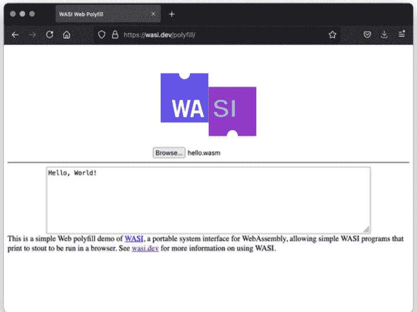
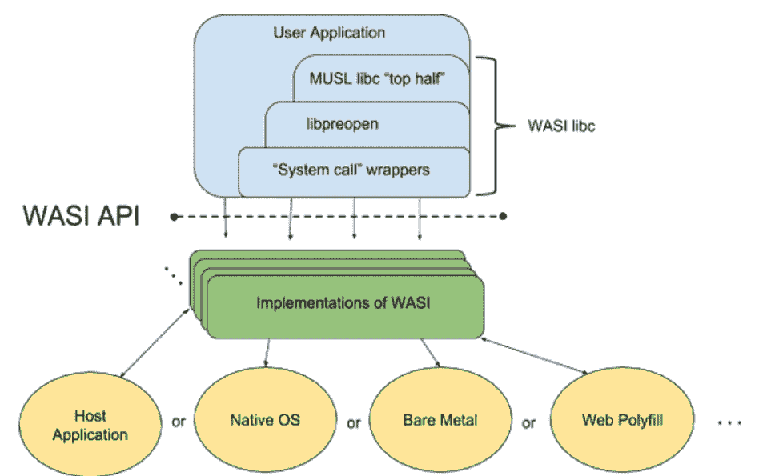

## 第11章. WebAssembly 服务接口 (WASI)

### 致早期发布读者的一则说明

使用 Early Release 电子书，您可以在这些标题的正式发布之前很久就利用这些技术——作者在撰写时提供的原始且未经编辑的内容。

这将是最终书籍的第11章。

如果您对如何改进本书的内容和/或示例有任何意见，或者如果您注意到本章中缺少材料，请联系作者 wasmbook@bosatsu.net。

> 我并不生活在这个世界上是为了满足你的期望，你也不生活在这个世界上是为了满足我的期望。
> 
> ——布鲁斯·李

由于 WebAssembly 的安全性和安全性目标，作为后果，在其他平台上更容易实现的一些事情在 WebAssembly 中变得不必要地困难。在像 C、C++ 或 Rust 这样的语言中，从文件系统读取、向控制台写入以及在内存中操作字符串都是简单的活动。预计操作系统会允许具有足够权限的用户执行这些操作。没有明确的、上下文相关的边界。

不幸的是，这也是大多数现代网络威胁背后的问题，例如网络钓鱼攻击、权限提升、供应链攻击等等。如果攻击者能够说服特权用户运行不可信的代码，他通常可以窃取本不属于他的其他资源的访问权限。沙箱环境存在是为了防止这种情况，但它们通常很慢、笨重且给开发人员带来负担。WebAssembly 希望解决这个问题，并且在许多方面确实如此。从根本上说，WebAssembly 模块无法访问其托管环境未提供的任何内容。

到目前为止，我们看到的 MVP 和工具在很大程度上是关于使代码可移植的。现在我们将学习如何使应用程序可移植。解决方案，事实证明，从根本上说，是否能够满足期望。这不仅仅是语言的问题，也是应用程序编程接口 (API) 可用性、运行时环境配置、安全限制等等的问题。因此，就像布鲁斯·李的引言一样，我们的托管环境并不总是存在于运行的代码的期望中。我们仍然可以掌控。

### WebAssembly 系统接口 (WASI)

到目前为止您看到的酷炫演示和代码示例，特别是那些涉及图形、声音、视频等的内容，在很大程度上之所以可能，是因为它们在浏览器中运行。这是一种旨在成为通用客户端的软件，是其他代码的宿主。通过将任意程序发送到客户端执行，可以扩展 Web。它内置了安全限制，但如今它实际上是一个功能丰富的编程环境，充满了诸如 WebGL 用于 3D 图形、加速视频、WebRTC 用于协作等 API。Emscripten 通过浏览器运行时环境可用的内容提供了 POSIX 和 OpenGL 等标准 API 的实现，以便标准 C/C++ 应用程序只需编译即可继续工作。

我们已经看到了一种为模块实例提供函数以通过它们导入的对象调用的机制。例如，记住传递一个打印到控制台的 JavaScript 函数，而不是依赖标准 C 库来提供对 printf() 的访问。这是一种从根本上不令人满意的方法。每个需要打印到控制台的 WebAssembly 模块都应该只调用一个函数，最好是它最初编写时使用的那个，每当需要时。这关乎安全且高效地满足期望。

然而，由于安全问题，布鲁斯·李引言的另一部分是相关的。仅仅因为一个程序想要读取或写入文件系统并不意味着它就可以这么做。我们业务关键的桌面计算机并不存在于这个世界上是为了满足恶意软件的期望。我们希望控制应用程序在何种上下文中访问资源，如果有的话。

关于期望的另一个问题是，浏览器之外的运行时环境是 WebAssembly 潜在执行表面的重要组成部分。其中许多 API 在 Node.js 或 Deno 等环境中并不以相同的方式可用。没有兼容的 Web IDL¹ 定义的接口来公开对音频和视频播放、3D 图形等的访问。确实有其他类似的 API 可用，但它们与浏览器内部的内容并不直接兼容，应用程序必须重写才能使用它们。

通常，POSIX 函数将在不同的操作系统中一致定义，并映射到较低级别的内核函数或特定于平台的 API，例如 Win32²。这些是可重用功能的关键部分，我们希望它们是快速且稳定的实现。由应用程序开发人员提供的任意 JavaScript 包装函数可能不够快或稳定。许多这些浏览器外部 API 也没有沙箱浏览器环境相同的<|message|> 安全保证，因此它们在那里也不可直接使用。

这些是 WebAssembly 系统接口 (WASI) 试图解决的众多问题之一。这是一项艰巨的任务，到目前为止，这项工作正在扩展并变得相当复杂，但基础相当简单，所以我们将从那里开始。

最终，我们希望有一个功能生态系统，程序被允许访问时可以期望其可用。我们希望功能能够跨语言边界工作，这意味着我们需要方法来引用诸如字符串、列表和数组等高级结构。我们希望实现受保护但快速。我们希望某种类型安全，并且不必在我们编写的代码中依赖太多功能测试。我们还希望诸如垃圾回收和异常处理等语言特性能够从支持它们的语言中获得，而不会给不支持它们的语言带来负担。为了满足这些要求，WebAssembly 平台需要扩展。在第12章中，我将介绍其中一些主要扩展，但现在我希望保持在相对较高的层面。

让我们再一次重温第10章中我们著名的示例的 Rust 版本，如示例11-1所示。我们已经确定问题在于 println! 宏在浏览器中不可用。C 版本中的 printf() 函数也是如此。我们已经看到了各种绕过方法，但这些解决方案仍然令人困扰。

#### 示例 11-1. Rust “Hello, World!”

```
fn main() {
    println!("Hello, World!");
}
```

出于稍后会变得清晰的原因，我将重建这个基本 Rust 程序的示例脚手架并运行它。cargo new 命令将建立项目的目录结构并填充一个简单的应用程序，其效果与上面的示例基本相同。

```
brian@tweezer ~/g/w/s/ch11> cargo new --bin hello-world
    Created binary (application) `hello-world` package
brian@tweezer ~/g/w/s/ch11> cd hello-world/
brian@tweezer ~/g/w/s/c/hello-world> cargo build --release
    Finished release [optimized] target(s) in 0.03s
brian@tweezer ~/g/w/s/c/hello-world> cargo run --release
    Finished release [optimized] target(s) in 0.01s
    Running `target/release/hello-world`
Hello, world!
```

cargo build 工具通过在 src/main.rs 中放置一个友好的程序为我们创建了项目脚手架。我们构建了此应用程序的优化发布版本，然后运行了相关的原生可执行文件。记住，Rust 基于 LLVM，因此默认后端将是您安装工具链的任何操作系统。

我们在第10章中看到，我们可以使用 WebAssembly 后端从 Rust 生成模块，但由于涉及字符串、内存管理、与操作系统交互等所有限制，它无法工作。

```
brian@tweezer ~/g/w/s/c/hello-world> cargo build ↵
  --target wasm32-unknown-unknown --release
    Compiling hello-world v0.1.0 (/Users/brian/git-personal/webassembly-the-definitive-guide/src/ch11/hello-world)
    Finished release [optimized] target(s) in 0.89s
brian@tweezer ~/g/w/s/c/hello-world> ls -laF target/wasm32-unknown-unknown/release/
total 3008
drwxr-xr-x  10 brian  staff   320 Jun 27 16:02 ./
drwxr-xr-x@  5 brian  staff   160 Jun 27 16:02 ../
drwxr-xr-x   2 brian  staff    64 Jun 27 16:02 build/
drwxr-xr-x   4 brian  staff   128 Jun 27 16:02 deps/
drwxr-xr-x   2 brian  staff    64 Jun 27 16:02 examples/
-rw-r--r--   1 brian  staff   228 Jun 27 16:02 hello-world.d
-rwxr-xr-x   2 brian  staff 1534049 Jun 27 16:02 hello-world.wasm*
drwxr-xr-x   2 brian  staff    64 Jun 27 16:02 incremental/
brian@tweezer ~/g/w/s/c/hello-world > wasm3 target/wasm32-unknown-unknown/release/hello-world.wasm
Error: [Fatal] repl_call: function lookup failed
Error: function lookup failed ('_start')
```

一个根本性问题是，基本模块结构未定义与可执行程序相同类型的应用程序二进制接口 (ABI)³。它没有预期的初始化函数名称。开发人员认为 main() 是起点，但通常这是由非常精简的 C 运行时环境从名为 "start" 的方法调用的。

另一个问题是，没有直接的方法从 WebAssembly 模块写入控制台或读写文件。这似乎是 WebAssembly 的一个相当大的障碍，但我鼓励你不要就此放弃希望！如果我们使用不同的后端会怎样？而不是 wasm32-unknown-unknown，我们将使用 wasm32-wasi。


```
brian@tweezer ~/g/w/s/c/hello-world> cargo build --target wasm32-wasi --release
    Compiling hello-world v0.1.0 (/Users/brian/git-personal/webassembly-the-definitive-guide/src/ch11/hello-world)
    Finished release [optimized] target(s) in 0.74s
brian@tweezer ~/g/w/s/c/hello-world> wasm3 target/wasm32-wasi/release/hello-world.wasm
Hello, world!
```

嗯。你看吧？

让我们调查一下这个模块。

```
brian@tweezer ~/g/w/s/c/hello-world > wasm-objdump -x target/wasm32-wasi/release/hello-world.wasm
hello-world.wasm:          file format wasm 0x1

Section Details:

Type[18]:
  - type[0] () -> nil
  - type[1] (i32) -> nil
  - type[2] (i32) -> i64
  - type[3] (i32, i32) -> nil
  - type[4] (i32, i32) -> i32
  - type[5] (i32, i32) -> i64
  - type[6] (i32) -> i32
  - type[7] (i32, i32, i32) -> i32
  - type[8] (i32, i32, i32, i32) -> i32
  - type[9] () -> i32

...
Import[4]:
  - func[0] sig=8 <_ZN4wasi13lib_generated22wasi_snapshot_preview1_8fd_write> <- wasi_snapshot_preview1.fd_write
  - func[1] sig=1 <__wasi_proc_exit> <- wasi_snapshot_preview1.proc_exit
  - func[2] sig=4 <__wasi_environ_sizes_get> <- wasi_snapshot_preview1.environ_sizes_get
  - func[3] sig=4 <__wasi_environ_get> <- wasi_snapshot_preview1.environ_get
...

Export[5]:
  - memory[0] -> "memory"
```

+   - global[1] -> "__heap_base"
+   - global[2] -> "__data_end"
+   - func[247] <_start.command_export> -> "_start"
+   - func[248] <main.command_export> -> "main"

...

这是一个 WebAssembly 模块，但它也导出了一个已知的起始点，这样像 wasm3 这样的 WASI 感知环境就知道如何初始化它并开始执行。WASI 的内容远不止这个引导过程。它还为模块导入其执行所需的功 能提供了一种便捷方式。这本质上就是 Rust wasm32-wasi 后端为我们所做的事情。它会发出对标准库实现的调用，该实现将由我们的代码运行的主机环境提供。同样，wasm3 至少是一个简陋的 WASI 环境，因此它提供了这些能力。它在浏览器之外作为 WebAssembly 引擎出现，早于 WASI，但它积极支持我们将在下一章讨论的不断发展的标准和新提案。

如果你按照附录 A 的安装步骤操作，可以再安装两个 WASI 环境，Wasmtime⁴ 和 Wasmer⁵。两者都是开源的且是独立的项目。

```
brian@tweezer ~/g/w/s/c/hello-world> wasmtime target/wasm32-wasi/release/hello-world.wasm
Hello, world!
brian@tweezer ~/g/w/s/c/hello-world> wasmer target/wasm32-wasi/release/hello-world.wasm
Hello, world!
```

最后，还有一个 cargo 本身的扩展使用了 Wasmtime，但有助于使构建、运行和测试基于 Rust 的 WASI 应用程序变得更加容易。

```
brian@tweezer ~/g/w/s/ch11 > cargo install cargo-wasi
    Updating crates.io index
    ...
brian@tweezer ~/g/w/s/c/hello-world> cargo wasi run
```

```
Finished dev [unoptimized + debuginfo] target(s) in 0.03s
Running `/Users/brian/.cargo/bin/cargo-wasi target/wasm32-wasi/debug/hello-world.wasm`
Running `target/wasm32-wasi/debug/hello-world.wasm`
Hello, world!
```

关于这一切如何工作的实际细节比我现在想深入讨论的要复杂得多，但为了让你稍微窥探一下幕后，示例 11-2 是来自 Wasmtime WASI 教程⁶ 的一个例子。它在比你之前做过的更低的层面上工作，但这是相当典型的系统编程。

#### 示例 11-2. 从 Wat 调用标准库行为

```
;; Taken from the Wasmtime WASI Tutorial
(module
    ;; Import the required fd_write WASI function which will write
    the given io
    ;; vectors to stdout. The function signature for fd_write is:
    ;; (File Descriptor, *iovs, iovs_len, nwritten) -> Returns #
    of bytes written
    (import "wasi_unstable" "fd_write"
        (func $fd_write (param i32 i32 i32 i32) (result i32)))

    (memory 1)
    (export "memory" (memory 0))

    ;; Write 'hello world\n' to memory at an offset of 8 bytes
    ;; Note the trailing newline which is required for the text to
    appear
    (data (i32.const 8) "hello world\n")

    (func $main (export "_start")
        ;; Creating a new io vector within linear memory
        ;; iov.iov_base - This is a pointer to the start of the
        ;; 'hello world\n' string
        (i32.store (i32.const 0) (i32.const 8))
        ;; iov.iov_len - The length of the 'hello world\n' string
        (i32.store (i32.const 4) (i32.const 12))

        (call $fd_write
            (i32.const 1) ;; file_descriptor - 1 for stdout
            (i32.const 0) ;; *iovs - The pointer to the iov array at
            memory loc 0
            (i32.const 1) ;; iovs_len - We're printing 1 string
            (i32.const 20) ;; nwritten - Mem loc to store the # of bytes
```

```
written
    )
    drop ;; Discard the number of bytes written from the top of the stack
)
)
```

Unix 管道和过滤器方法用于工具组合，允许你将一个程序的输出重定向到另一个程序的输入⁷。示例包括使用 less 命令暂停滚动的终端消息，或使用 grep 命令查找与特定模式匹配的进程表中的元素。

文件是 Unix 中真实磁盘文件以及虚拟文件（如程序的输入或输出）的通用抽象。能够打印到控制台是通过写入特定文件描述符来管理的。在此环境中，程序中的文件描述符 0 代表标准输入，即传入程序的内容。文件描述符 1 代表标准输出，即程序在正常情况下记录的内容。文件描述符 2 是标准错误，通常用于错误消息。

距离我们上次摆弄 Wat 已经过去了几章，这比我们迄今为止看到的要复杂一些，但我认为在一些指导下你应该能够理清它。

我们做的第一件事是从 wasi_unstable 命名空间导入一个名为 fd_write 的函数。这是 WASI 环境如果想满足我们的期望就会与我们见面的地方。如果我们没有提供这种行为，我们将无法执行。

fd_write 函数接收四个参数，指示使用哪个文件描述符，我们在内存中存储要写入的字符串的位置、它的长度以及写入已写入字节数的 位置。正如指定的那样，这将在我们的字符串之后在内存中。

我们接下来定义模块的 Memory 实例并导出它。我们刚刚导入的函数将根据我们发送给它的参数来检查它。我们使用一个 data 元素将字符串 “hello world” 写入我们的内存的字节 8 处。最后我们导出一个方法，该方法最终会调用所有这些。

我们将基指针指向字符串的数值位置写入前四个字节，并将其长度写入随后的四个字节。字符串本身将存在于这些数字之后。最后我们调用我们导入的 fd_write 函数。

你会注意到我们甚至不需要将 Wat 文件编译回二进制模块。我们的友好小 WASI 环境可以为我们完成这项工作。

```
brian@tweezer ~/g/w/s/ch11> wasmtime hello.wat
hello world
brian@tweezer ~/g/w/s/ch11> wasmer hello.wat
hello world
```

很明显你不会想像这样用 Wat 编写程序。我只是想让你了解幕后发生的事情。你将在 Rust 或 C 等语言中编写程序，并使用 WASI 感知的工具链编译它们。说到 C，我们现在将最后一次重温我们可靠的“Hello, World!”程序，见示例 11-3。

#### 示例 11-3. C “Hello, World!” 希望是最后一次！

```
#include <stdio.h>

int main() {
    printf("Hello, World!\n");
    return 0;
}
```

我们需要将其编译为 WASI 友好的形式。有几种方法可以做到这一点，但其中最简单的方法之一是使用我们 Wasmer 朋友的 Wasienv 工具链⁸。C 编译需要头文件和库，但在此情况下，我们还需要一个 WASI 感知的标准库功能版本⁹。正如 Emscripten 具有 cc、c++、make 和 configure 的替代品，Wasienv 也有。我去掉了无关紧要的编译警告，但否则你应该开始了解这一切有多强大。


```
brian@tweezer ~/g/w/s/ch11> wasicc -o hello hello.c
brian@tweezer ~/g/w/s/ch11> wasm3 hello.wasm
Hello, World!
brian@tweezer ~/g/w/s/ch11> wasmer hello.wasm
Hello, World!
brian@tweezer ~/g/w/s/ch11> wasmtime hello.wasm
Hello, World!
brian@tweezer ~/g/w/s/ch11> ./hello
Hello, World!
```

我们现在已经使用相同的运行时运行了在 Rust 和 C 中未经修改编译的代码。相同的 WASI 形式的 WebAssembly 模块也可在 Linux 或 Windows 上运行。只要我们的 WASI 启用主机满足我们的期望，我们应该可以在 WebAssembly 运行的任何地方运行。注意 Wasienv 甚至为我们生成了一个独立的原生应用程序！你将在下一章了解这意味着什么。

事实证明，Node.js 和 Deno 也都支持 WASI。甚至还有一个 JavaScript 兼容层，可以让你的 WASI 启用应用程序在浏览器中运行！请参阅图 11-1，了解 WASI 兼容层在实际中的示例。这可在 https://wasi.dev/polyfill/ 获取。



图 11-1. 在浏览器中的兼容层中运行 WASI 应用程序

WebAssembly 使你的代码具有可移植性。WASI 通过在你需要时满足其期望来使你的应用程序具有可移植性。

## 基于能力的<|message|>

WASI 的另一个方面对于 WebAssembly 在这种无处不在的计算环境中的未来至关重要。我们希望能够向我们想要提供功能的应用提供功能，但不提供给恶意软件。由于我们通常无法区分两者，我们很可能会将受限的沙箱环境作为默认。

从一开始，WASI 就被设想为一种手段，用于对托管模块的行为施加基于能力的访问限制。

简而言之，这意味着，就像 WebAssembly 不给任意代码直接访问内存一样，WASI 不给它直接访问敏感资源（如文件句柄、网络套接字或子进程详情）的权限。相反，资源将通过不可伪造的、不透明的句柄暴露出来，向代码提供能力。由于这需要将语言特定的或可能是操作系统级别的结构在 WebAssembly 模块之间传递，我们需要一种方法来创建外部引用。

如何以及为何这会起作用，在本书撰写时仍是一个复杂且不断变化的目标。我一直在为自己纠结要关注多少细节，最终决定现在其中大部分内容会成为一种干扰，部分原因是这些提案仍在进行中。这也是因为它在某些方面超级复杂，即使它逐渐发展成一个越来越优雅的设计。在第 12 章我会让你了解更多细节，但现在，让我们专注于看到结果。

在示例 11-4 中，我们有一个用 Rust 编写的简单程序，它将一个字符串写入文件然后读回。从编程角度来看，它非常简单。真正的大问题，当然是访问文件系统。如果你还不是 Rust 大师，不要为细节而烦恼，程序的流程应该仍然有意义。

#### 示例 11-4. 使用文件系统的 Rust 程序

```
use std::fs;
use std::io::{Read, Write};

fn main() {
    let greeting = "Hello, world!";
    let outfile = "hello.txt";
    let mut output_file = fs::File::create(outfile)
        .expect(&format!("error creating {}", outfile));

    output_file.write_all(greeting.as_bytes())
        .expect(&format!("Error writing: {}", outfile));

    let mut input_file = fs::File::open(outfile)
        .expect(&format!("error opening {}", outfile));

    let mut input = String::new();
    input_file.read_to_string(&mut input)
        .expect(&format!("Error reading: {} ", outfile));

    println!("Read in from file: {}", input);
}
```

我将此代码放在另一个 cargo 驱动的项目中，因此生成原生可执行文件轻而易举。

```
brian@tweezer ~/g/w/s/c/hello-fs> cargo build --release
    Finished release [optimized] target(s) in 0.01s
brian@tweezer ~/g/w/s/c/hello-fs> cargo run --release
    Finished release [optimized] target(s) in 0.01s
    Running `target/release/hello-fs`
Read in from file: Hello, world!
brian@tweezer ~/g/w/s/c/hello-fs> ls -alF
total 32
drwxr-xr-x  10 brian  staff   320 Jun 27 13:18 ./
drwxr-xr-x  10 brian  staff   320 Jun 27 18:42 ../
-rw-r--r--   1 brian  staff   177 Jun 27 12:18 Cargo.toml
-rw-r--r--   1 brian  staff    13 Jun 27 18:47 hello.txt
drwxr-xr-x   3 brian  staff    96 Jun 27 13:18 src/
drwxr-xr-x@  7 brian  staff   224 Jun 27 18:42 target/
brian@tweezer ~/g/w/s/c/hello-fs> cat hello.txt
Hello, world!
```

如你所见，我们可以构建并运行程序。文件被创建并读回一个字符串，我们将其打印到控制台。这是因为，作为这台机器的主要用户和管理员，我有权限执行这些操作。

如果我从互联网下载一个随机程序并运行它会怎样？那可能不是个好主意。我被赋予的权限通过我们称之为混淆代理问题¹¹ 的场景授予了随机代码。如果它是一个恶意应用程序，它可以删除文件、窃取我的比特币私钥¹² 或加密我的硬盘以勒索赎金。

然而，让我们重新编译应用程序以针对 WASI 并尝试在 Wasmtime 中运行它。

```
brian@tweezer ~/g/w/s/c/hello-fs> cargo build --target wasm32-wasi --release
Finished release [optimized] target(s) in 0.01s
brian@tweezer ~/g/w/s/c/hello-fs> wasmtime target/wasm32-wasi/release/hello-fs.wasm
thread 'main' panicked at 'error creating hello.txt: Custom {
kind: Other, error: "failed to find a
pre-opened file descriptor through which \"hello.txt\" could be
opened" }', src/main.rs:8:10
note: run with `RUST_BACKTRACE=1` environment variable to display
a backtrace
Error: failed to run main module `target/wasm32-wasi/release/hello-fs.wasm`

Caused by:
    0: failed to invoke command default
    1: wasm trap: unreachable
      wasm backtrace:
        0: 0x838a - <unknown>!__rust_start_panic
        1: 0x7fd5 - <unknown>!rust_panic
        2: 0x7c42 - <unknown>!std::panicking::rust_panic_with_hook::h914d916f8f3c1673
        3: 0x7190 - <unknown>!std::panicking::begin_panic_handler::{closure}::h15c8896377a9b562
        4: 0x70d1 - <unknown>!std::sys_common::backtrace::__rust_end_short_backtrace::h8e2b0a38bc469b94
        5: 0x7790 - <unknown>!rust_begin_unwind
        6: 0xdc62 - <unknown>!core::panicking::panic_fmt::h79dd662186e4ad97
        7: 0xebb2 - <unknown>!core::result::unwrap_failed::hc8762c9cd74198d4
        8: 0xce3 - <unknown>!hello_fs::main::h13132a06338f22dc
        9: 0x73d - <unknown>!std::sys_common::backtrace::__rust_begin_short_backtrace::h3c3458f2edddefd1
        10: 0xe02 - <unknown>!std::rt::lang_start::{closure}::h4a57af2dc5415a53
        11: 0x8139 - <unknown>!std::rt::lang_start_internal::hb132ad43e5d53599
        12: 0xdc9 - <unknown>!__original_main
        13: 0x44d - <unknown>!_start
        14: 0x11bff - <unknown>!_start.command_export
      note: run with `WASMTIME_BACKTRACE_DETAILS=1` environment variable to display more information
```

嗯，这没起作用。有很多噪音，但关键点是我们没有执行我们想要执行的操作的能力，因为 WASI 主机尚未以不可伪造的句柄的形式赋予我们这种能力（在上面的错误消息中称为“预打开文件描述符”）。

重新启动可执行文件但调用允许目录访问的命令行参数解决了问题。

```
brian@tweezer ~/g/w/s/c/hello-fs> wasmtime --dir=. target/wasm32-wasi/release/hello-fs.wasm
Read in from file: Hello, world!
```

Wasmer 以稍微不同的方式表述消息，但问题是相同的。

```
brian@tweezer ~/g/w/s/c/hello-fs> wasmer target/wasm32-wasi/release/hello-fs.wasm
thread 'main' panicked at 'error creating hello.txt: Os
  { code: 2, kind: PermissionDenied, message: "Permission denied" }', src/main.rs:8:10
note: run with `RUST_BACKTRACE=1` environment variable to display a backtrace
error: failed to run `target/wasm32-wasi/release/hello-fs.wasm`
  1: WASI execution failed
  2: failed to run WASI `_start` function
  3: RuntimeError: unreachable
      at __rust_start_panic (hello-fs.wasm[171]:0x838a)
      at rust_panic (hello-fs.wasm[163]:0x7fd5)
      at
std::panicking::rust_panic_with_hook::h914d916f8f3c1673 (hello-fs.wasm[156]:0x7c42)
      at std::panicking::begin_panic_handler::
{{closure}}::h15c8896377a9b562 (hello-fs.wasm[145]:0x7190)
      at
std::sys_common::backtrace::__rust_end_short_backtrace::h8e2b0a38bc469b94 (hello-fs.wasm[144]:0x70d1)
      at rust_begin_unwind (hello-fs.wasm[155]:0x7790)
      at core::panicking::panic_fmt::h79dd662186e4ad97 (hello-fs.wasm[239]:0xdc62)
      at core::result::unwrap_failed::hc8762c9cd74198d4 (hello-fs.wasm[262]:0xebb2)
      at hello_fs::main::h13132a06338f22dc (hello-fs.wasm[17]:0xce3)
      at
std::sys_common::backtrace::__rust_begin_short_backtrace::h3c3458f2edddefd1
```


f2edddefd1 (hello-fs.wasm[12]:0x73d)
    at std::rt::lang_start::{{closure}}::h4a57af2dc5415a53
(hello-fs.wasm[20]:0xe02)
    at std::rt::lang_start_internal::hb132ad43e5d53599
(hello-fs.wasm[164]:0x8139)
    at __original_main (hello-fs.wasm[18]:0xdc9)
    at _start (hello-fs.wasm[10]:0x44d)
    at _start.command_export (hello-fs.wasm[310]:0x11bff)
↳> 4: unreachable

而解决方案是相同的。

```
brian@tweezer ~/g/w/s/c/hello-fs> wasmer --dir=. target/wasm32-wasi/release/hello-fs.wasm
Read in from file: Hello, world!
```

向可执行实例添加命令行选项似乎并不是最稳健的安全机制，但这忽略了更大的重点。你当然可以使用 Wasmer 或 Wasmtime 来启动你的应用程序，但这并不是必需的。在下一章中，你将学习如何编写自己的 WASI 启用代码，在这种情况下，你可以使用任何你想要的机制来启用或禁用行为。

有了这个，让我们重新梳理一下，对 WASI 做一个更宏观的审视，以结束本章。

### The Bigger Picture

WebAssembly 的完整愿景比大多数人意识到的要宽泛得多。人们对 MVP 的能力有相当的认知，但对大多数人来说，这就是全部了。能够使用 JavaScript 以外的语言将代码部署到浏览器中听起来很酷，但在语言和 JavaScript 运行时引擎的进步面前，并不是严格的必需。

在我看来，愿景中更重要的一部分是，我们将能够用我们想要的任何语言编写代码，并在我们想要的几乎任何环境中使用它。这使我们能够在新环境中利用现有软件，而无需重写它。这使我们能够选择适合问题的语言，而不需要新的运行时。如果一个组织在生产环境中部署了 Java 虚拟机（JVM），那么转向 Ruby on Rails 或基于 Python 的解决方案可能需要安装各自的环境¹³。

这绝不是全有或全无的前景。有时我们出于性能原因希望原生运行代码，有时我们希望获得 Web 的零安装优势。有时我们希望在沙箱中运行，有时则不希望。考虑到将这一愿景变为现实所需的所有变量，从头设计几乎是不可能的。

但本章中你希望已经开始看到的是，这一愿景之所以能够成为现实，是因为 WebAssembly 设计者做出了深思熟虑的选择。他们试图在避免过度或不足设计之间找到平衡。MVP 省略了并非每种语言都支持的语言特性，如线程、垃圾回收和异常。所有这些都有技术提案和工作示例，但前期做太多是不合适的。

显然，平台作为其现状存在局限性。提案的稳定流正在发布，以在合适的时候扩展平台的功能。WASI 已成为一个焦点，允许这些提案独立出现，并被 Wasmtime、Wasmer 和 Wasm3 等平台逐步采用。坦白说，这使得追踪在哪里添加了什么变得非常混乱，但通过程序机制，他们也开始整理这个问题。

为了实现大量期望的行为，WASI 设计者意识到有必要标准化模块之间如何链接。我们需要一个解决方案，允许我们在不透露底层结构的情况下引用内存中不可伪造的句柄。我们还需要一种方法来引用字符串、列表和记录等类型。解锁这些额外行为需要依赖于提案的设计和实现。其中一些提案将在下一章中介绍，但 Wasmtime、Wasmer 和 wasm3 已经开始实施其中几个基本提案。

这一过程将继续进行，并将设计新的 WASI 模块。虽然初始行为侧重于文件和控制台访问，但已经有针对一系列功能的提案，包括加密函数、加密货币合约、2D 和 3D 绘图、网络和神经网络系统。不会只有一个 WASI 命名空间，而是会有价值的命名空间就有多少。并非每个应用程序都需要每个模块。并非每个环境都会提供这些模块的完整实现。它们可以是上下文受限的、虚拟化的或在具有相同依赖关系的多个模块之间共享的。为此，WASI 可能永远不会“完成”。

在图 11-2 中，你可以看到这一切意味着什么的基本轮廓，以及我们大约如何实现它。在第 12 章及后续章节中，我将详细阐述这些要点，但现在我认为这一愿景是一个合适的目标。



Figure 11-2. The WASI layered vision

在软件分层的顶部，我们有我们的应用程序。这显然是我们编写的大部分内容，包括独立可执行文件、Web 应用程序、框架、库、微服务、无服务器函数等等。这将代表我们创造的大部分业务价值。当我们做出糟糕的技术选择时，这些业务价值会被锁定在孤岛中，并比需要更早地成为遗留系统。提取功能很困难，我们唯一的真实选择往往是重新实现，这通常与增加业务价值相反。即使我们做出良好的技术选择，我们的行业也不会停滞不前，而重用通常具有有限的范围。

然而，在这一愿景中，我们可以想象表达我们软件运行环境期望的通用框架的出现。我们已经开始看到通过编写到中间、可移植的表示形式来从 WebAssembly 获得语言独立性。这使我们在希望扩展到的环境中留下了经常未满足的期望。现在我们开始看到主机环境可以是模块化的、可虚拟化的、可互换的等等，以提供满足我们接口期望的功能。在浏览器中运行但期望文件系统访问的代码可以获得一个满足需求但使用本地存储或其他东西的抽象。你甚至可以想象一种场景，其中“文件系统”抽象是诸如 Fuse¹⁴ 之类的用户态文件系统，由云存储提供商透明支持。

重点是我们的代码不必重写就可以在这些环境之间浮动，无论它们是完全特权的原生应用程序、虚拟化、托管、在浏览器中还是嵌入式。利用 LLVM 等模块化编译器架构，我们能够添加一个后端，以灵活的方式表达我们的期望。我们可以实现代码共享和动态链接策略，以适合的方式进行。

另一方面，我们周围正在展开一场雪球般的安全地狱景观，有恶意软件、网络钓鱼攻击和勒索软件。如果我们能够在沙箱环境中从任何地方以任何语言运行代码，这将大大加强我们的默认安全态势。

一个安全、可移植和快速的计算生态系统的愿景如此强大，以至于 Bytecode Alliance 成立以将其推向前进。早期成员包括 Mozilla、Intel、Microsoft、Fastly 等。他们在安全受保护的环境和性能之间取得平衡。不同于孤立模块之间的大型、重量级通信进程，他们正在创建一种“纳米进程”机制，将各种不同的需求带入现实。他们设想了我们行业更光明的未来，能够开发满足现代系统需求的高性能、安全代码，并比我们目前能够做到的更长时间地捕获业务价值。这是一个我们可以都支持的想法。


3 操作系统的应用程序二进制接口定义了程序如何链接和执行。更多信息：https://en.wikipedia.org/wiki/Application_binary_interface

4 Wasmtime 最初是 Mozilla 项目，但现在是 Bytecode Alliance 的一部分，我们很快会讨论它：https://wasmtime.dev

5 Wasmer 是公司名称，也是 WebAssembly 主机环境。
https://wasmer.io

6 来自 Bytecode Alliance 的 WASI 教程：
https://github.com/bytecodealliance/wasmtime/blob/main/docs/WASI-tutorial.md

7 这种架构风格是 Unix 的诸多方面之一，使其对出版商如此强大，对开发者如此高效：https://en.wikipedia.org/wiki/Pipeline_(Unix)

8 有关 Wasienv 工具链的更多信息可在此处找到：
https://github.com/wasienv/wasienv

9 我现在正试图让你免受其中一些复杂性的困扰，但如果你坚持要了解更多，你可以查看：https://github.com/WebAssembly/wasi-libc

10 本书的范围不包括对基于能力的安全性的全部范围进行有意义的讨论，但对于好奇的人：
https://en.wikipedia.org/wiki/Capability-based_security

11 当权限相互交织时，很难理清谁被允许做什么：
https://en.wikipedia.org/wiki/Confused_deputy_problem

12 而且我当时拥有的任何比特币，如果我在 2008 年开始关注的话，本来会相当可观的，如果我真的，嗯，挖矿之类的。唉。

13 是的，是的，我知道 Jython 和 JRuby。

14 Fuse 为许多虚拟文件系统提供了基础：
https://en.wikipedia.org/wiki/Filesystem_in_Userspace
