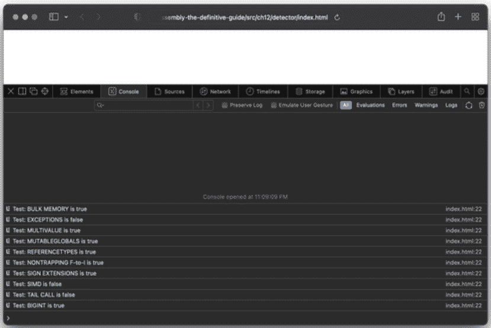
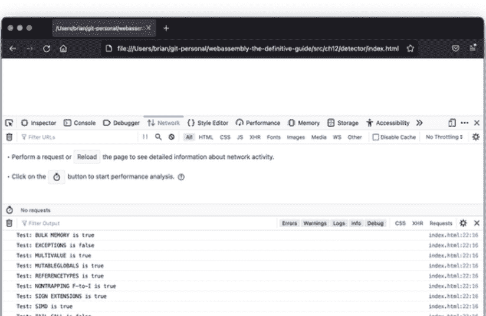
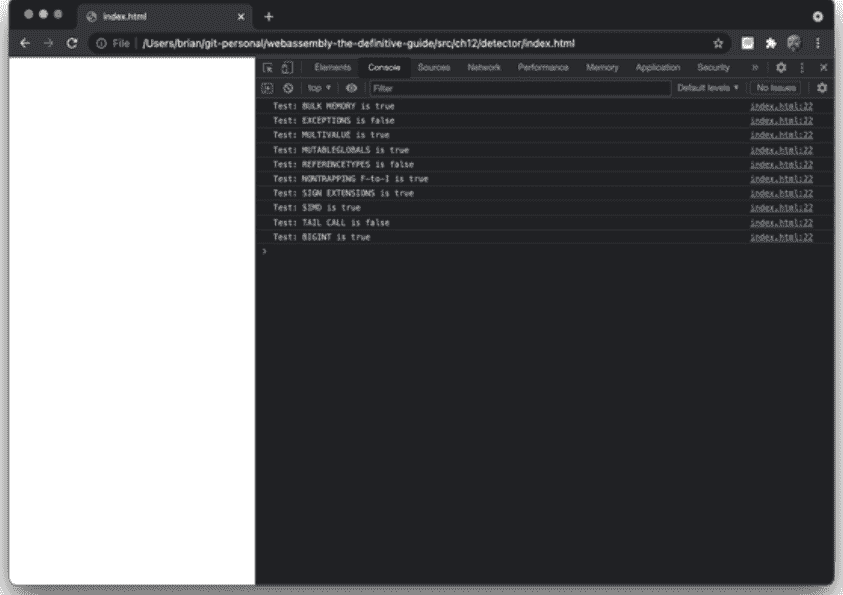

## 第 12 章. 扩展 WebAssembly 平台

### 早期发布读者须知

使用 Early Release 电子书，您可以在官方发布这些标题之前很久就利用这些技术——在作者撰写时获得书籍的最原始和未编辑内容。

这将是最终书籍的第 12 章。

如果您对如何改进本书的内容和/或示例有任何评论，或者如果您注意到本章中缺少材料，请联系作者 wasmbook@bosatsu.net。

> 他收集信息碎片
> 他善于适应
> 因为对陌生人和安排者来说
> 持续变化将一直存在
> 
> —Rush, Digital Man

WebAssembly 的最小可行产品 MVP 定义划定了界限，但从未打算成为所有用途的全面解决方案。它主要关注语言中无处不在的功能，以及不需要线程、垃圾回收和异常处理复杂性的运行时。我们在整本书中看到了其他一些限制。虽然人们找到绕过这些不足的方法令人印象深刻，但 MVP 从来不是最终状态。它是开始。

WebAssembly 平台的设计者对其决策采取了外科手术式的方法。虽然从外部看可能令人困惑，但其内部有一致性，考虑到了几个更大和更长期的目标。这些决策的许多动机都记录在规范本身旁边。与其在下一个大版本中强行塞入对遗漏的解决方案，他们创建了一系列后续提案，这些提案被独立跟踪。其中一些提案相互依赖，因此提交和采纳的顺序是有序的。

由于后 MVP 世界正以这种方式演变，跟踪哪些功能在哪个发行版中可用变得有点棘手。我完全预计会有工具和库来协助此事，但希望开发人员的负担会降到最低。其中一些复杂性并不特别有趣或有用，所以我不想花太多时间在上面，但看到诸如多值和引用类型提案如何帮助实现更重的接口类型提案还是有点启发性的。

就我们的目的而言，我们将把它们视为一系列后续功能，目前尚未完全支持，但代表了 WebAssembly 平台超越其 modest 起点的方向。我不会全面介绍这些提案，因为其中许多更晦涩或尚未完全发展。只需意识到有几个尝试改进针对 WebAssembly 的体验，使我们的代码更广泛可用、安全、快速和可移植。

### WASI 运行时

在第 11 章中我们介绍了 WASI 背后的主要思想。它已成为为平台添加新功能的主要途径之一。引入拟议扩展有一个流程，然后它将经历一系列阶段，最终被采用和标准化¹。正如我们在上一章中指出的那样，并非每个运行时都会支持每个提案。即使在某些情况下支持某个提案，出于安全原因，在其他情况下可能不支持。我们使用 Wasmer 和 Wasmtime 引擎看到了一些基本的命令行用法，但更有趣的现实是，你将能够使用基于 WASI 的机制从自己的应用程序中执行任意功能。

这将使你能够安全地构建和部署插件机制、无服务器函数、热交换替换、数据过滤器、零售促销、Kubernetes 节点、区块链引擎以及可以用任意语言编写的扩展点。语言自由、性能和沙箱隔离的结合已推动许多项目和公司开始这样做。

边缘计算公司如 Fastly 和 Cloudflare 允许客户在多租户环境中地理分布微服务和无服务器函数以实现低延迟访问。Istio 和 Envoy 允许其用户使用基于 WebAssembly 的机制创建过滤器并支持新协议。第二状态的 WasmEdge 环境在其他用途中，针对区块链和软件定义车辆。WasmCloud 提供了基于 Actor 模型的分布式系统基础设施。甚至微软的 Flight Simulator² 也正在将基于动态链接库 DLL 的插件转向 WebAssembly 模块。我们将在第 15 章讨论其中一些其他项目。

现在我将向你展示使用 WebAssembly 和 WASI 与一些简单模块的基本用法。一旦你对概念和事件顺序感到舒适，我们将介绍一些由我们的基于 WASI 的框架支持的新提案，看看平台如何演进以填补一些 MVP 的遗漏。

首先，创建一个 Rust 二进制项目。

```
brian@tweezer ~/g/w/s/ch12> cargo new --bin hello-wasi
    Created binary (application) `hello-wasi` package
brian@tweezer ~/g/w/s/ch12> cd hello-wasi
```

我们需要添加对 wasm time crate 的依赖，以便我们可以使用允许我们实例化模块并执行代码的运行时结构。编辑 hello-wasi 目录中的 Cargo.toml 文件，使其看起来像示例 12-1。请记住，到你阅读本文时，版本号可能不同，但它应该仍然有效。

#### 示例 12-1. Cargo.toml 文件

```
[package]
name = "hello-wasi"
version = "0.1.0"
edition = "2018"

[dependencies]
wasmtime = "0.28.0"
```

我们将使用下面库的 Rust 版本，但其他语言如 C 和 Python 也有类似结构。我们将在后续章节中查看 .NET 和 AssemblyScript 版本。甚至可以使用 wasmtime 的命令行版本与 bash，如示例 12-2 所示。

#### 示例 12-2. 从 Bash 调用我们的函数

```
#!/bin/sh
# Based on https://docs.wasmtime.dev/lang-bash.html
function how_old() {
    local x=$(($1))
    local y=$(($2))
    local result=$(wasmtime hello.wat --invoke how_old $x $y 2>/dev/null)
    echo "$result"
}

for num in "2021 2000" "2021 1980" "2021 1960"; do
    set -- $num
    echo "how_old($1, $2) = $(how_old "$1" "$2")"
done

brian@tweezer-2 ~/g/w/s/c/hello-wasi> chmod ogu+rx hello.sh
brian@tweezer-2 ~/g/w/s/c/hello-wasi> ./hello.sh
how_old(2021, 2000) = 21
how_old(2021, 1980) = 41
how_old(2021, 1960) = 61
```

当我们使用受支持的开发语言中的库、类和结构时，我们对生命周期有更大的控制。首先，作为提醒，


我们将使用第 2 章中的年龄计算模块作为可调用对象。你可以通过查看示例 12-3 来复习记忆。

#### 示例 12-3. 我们的年龄计算 Wasm 模块

```
(module
    (func $how_old (param $year_now i32) (param $year_born i32)
    (result i32)
        get_local $year_now
        get_local $year_born
        i32.sub)
    (export "how_old" (func $how_old))
)
```

现在我们将创建一个独立的 Rust 应用程序，通过 Wasmtime 库调用该行为。请记住，Wasmer、Wasm3 和其他环境也将有自己的实现策略，我们将在本书剩余部分演示其中的一些。我会带你了解细节，但请先看示例 12-4。

#### 示例 12-4. Rust 中最小的 Wasmtime WASI 集成

```
use std::error::Error;
use wasmtime::*;

fn main() -> Result<(), Box<dyn Error>> {
    let engine = Engine::default();
    let mut store = Store::new(&engine, ());
    let module = Module::from_file(&engine, "hello.wat")?;
    let instance = Instance::new(&mut store, &module, &[])?;

    let how_old =
        instance.get_typed_func::<(i32,i32), (i32), _>(&mut store,
"how_old")?;
    let age : i32 = how_old.call(&mut store, (2021i32, 2000i32))?;

    println!("You are {}", age);

    Ok(())
}
```

在导入我们使用的各种功能的前置定义后，我们开始使用 Wasmtime Rust 库定义的结构。查阅表 12-1 以了解这些类型的描述。

##### 表 12-1. Wasmtime 结构

| 名称 | 描述 |
|------|-------------|
| Engine | 一个用于配置值的全局上下文，旨在跨线程共享。 |
| Store | WebAssembly 对象的集合，包括实例、全局变量、内存和表。 |
| Module | WebAssembly 模块的编译形式。 |
| Instance | 编译后模块的一个实例。 |

Engine 包含任何特殊的配置细节。正如你在示例 12-4 中看到的，我们只是使用默认配置。这用于创建 Store。它为 WebAssembly 功能提供上下文，因此是隔离的单元。在一个 Store 中创建的不同 WebAssembly 结构不能在其他 Store 实例之间共享或访问。在 Wasmtime API 的 Rust 版本中，可变引用会传递给 Store 实例，从而禁止在线程间共享它们。

Engine 接下来用于初始化和编译 Module 实例。检索底层字节有多种机制，但就我们的目的而言，我们只是从文件系统读取 .wat 文件。请记住，我们在这里构建的是一个原生的 Rust 应用程序，而不是 WASI 应用程序，因此它将被允许访问文件系统。

一旦 Module 编译完成，我们就可以创建它的一个新 Instance。在这种情况下我们没有提供任何导入对象，但我们将在下面看到从 Rust 主机环境向模块共享函数的示例。从 Instance 我们能够检索到对导出函数包装器的引用，以便几乎像调用常规 Rust 函数一样调用它。我们使用类型安全的 get_typed_func，在这里它接受两个 i32 参数并返回一个 i32 结果。

最后，我们使用值 2021i32 和 2000i32 调用我们的函数，它们代表数字“2021”和“2000”的 Rust 32 位整数类型字面量。结果被捕获到一个 Rust i32 变量中，然后打印到控制台。

我已在下面删除了多余的构建输出，但我想演示它只是一个常规的 Rust cargo 构建命令，使用原生的操作系统后端生成调用 WebAssembly 行为的应用程序。

```
brian@tweezer ~/g/w/s/c/hello-wasi> cargo build --release
    Finished release [optimized] target(s) in 3m 22s
brian@tweezer ~/g/w/s/c/hello-wasi> cargo run --release
    Finished release [optimized] target(s) in 0.38s
    Running `target/release/hello-wasi`
You are 21
```

现在你已经看到了基础知识，我们将研究 Wasmtime 作为运行时所支持的一些新提案。由于本书正在编写中，这绝对是一个移动目标，因此到你阅读时，可能会增加更多支持。在你 WebAssembly 职业生涯的这个阶段，我认为你不必纠结于提案本身的细节，尽管我会在相关的地方链接到它们。我认为对你更重要的是看到 WebAssembly 平台如何演变的切实示例。因此，我只会关注在 WASI 环境中可用的提案，但在章节结束时我会暗示还有什么即将到来。

### 多值返回

MVP 对调用函数采用了一些相当基础的语义。虽然它们可以接受任意数量的参数，但函数只能产生单个结果。对于许多情况，这显然是可以的，但很容易想象这种限制会过于严格的场景。

考虑我们之前涉及字符串的一些示例。因为我们使用线性 Memory 实例来分配字符串，所以我们需要同时引用字符串的基地址和字符串的长度。没有简单的方法可以做到这一点，而不依赖于我们之前使用的技巧，即先写入字符串长度，然后再写字符序列。

如果一种语言支持元组，例如 Python 或 Rust 呢？这允许开发者轻松地将多个值打包成一个结构从函数返回，但来自另一种语言的客户端可能希望将其解包或解构为更符合该语言习惯的表示形式。

即使是交换一对值或排序数组这样简单的事情也会变得有问题。它必须在原地在线性内存块中完成。几种算术函数如果考虑模运算、进位位等，也可能返回多个值。

除了函数返回值之外，MVP 中的另一个限制是诸如条件块和循环之类的指令序列无法消费值或返回多个结果。同样有趣的是在那里交换值、进行溢出算术运算，或具有多值元组响应。

如果你还记得第 2 章，WebAssembly 函数的结果位于栈顶。栈顶的几个元素完全可以被解释为多个返回值。因此，既作为平台的改进，也为了促进其他扩展，多值返回类型扩展是一个重要的下一步。此时它已合并到主规范中，并在许多 WebAssembly 环境中实现。

该提案引入了新的指令，例如上述的算术函数。其中包括接受分子和除数并返回商和余数的 i32.divmod。它还允许多个值保留在栈上，而不必复制到线性内存实例中。这既更快也更节省内存。

由于 Wasmtime 已经支持 Multi-Value 提案，我们可以轻松演示其有用性。在示例 12-5 中，你可以看到一个 Wat 文件，它提供了我们将使用的结构。第一行导入一个从 Rust 环境接收两个参数并返回两个参数的函数。正如你所见，将结果在语法上扩展以支持多个值并不是什么大问题。实现它显然更复杂，但正如我上面提到的，结果来自栈顶，所以并不算火箭科学。我们调用的新函数名为 swap，因为我们将传入的函数将执行交换操作。

#### 示例 12-5. 演示多值返回类型的简单 Wat 文件

```
(module
  (func $swap (import "" "swap") (param i32 i32) (result i32 i32))

  (func $myfunc (export "myfunc") (param i32 i32) (result i32 i32)
    (call $swap (local.get 0) (local.get 1))
  )
)
```

下一行定义了一个名为 myfunc 的导出函数，它调用我们的 swap 函数。请记住，发送给函数的参数可以作为位置 0 和 1 的局部变量寻址。我们调用指令将这些值推入栈，然后直接调用导入的函数。我们在函数定义中不需要做任何特殊的事情，只需指出我们返回两个 i32 值作为结果。swap 返回后，这些值应位于栈顶。幕后细节是 Wasmtime 团队必须实现的内容，但对 Wat 语法的冲击相当低。

在示例 12-6 中，你可以看到将调用我们的 Wat 函数的主机应用程序。该应用程序的大部分与你在示例 12-4 中看到的非常相似。

#### 示例 12-6. 使用 Wasmtime Rust 库练习多值返回类型

```
use std::error::Error;
use wasmtime::*;

fn main() -> Result<(), Box<dyn Error>> {
    let engine = Engine::default();
    let mut store = Store::new(&engine, ());
    let module = Module::from_file(&engine, "mvr.wat")?;

    let callback_func = Func::wrap(&mut store, |a: i32, b: i32| -> (i32, i32) {
        (b, a)
    });
```


```
let instance = Instance::new(&mut store, &module, &
[callback_func.into()])?;

    let myfunc =
        instance.get_typed_func::<(i32,i32), (i32, i32), _>(&mut store,
"myfunc")?;
    let (a, b) = myfunc.call(&mut store, (13, 43))?;

    println!("Swapping {} and {} produces {} and {}.", 13, 43, a, b);

    Ok(())
}
```

新的地方在于我们通过调用 `Func::wrap` 来定义一个回调函数。这会接收我们 `Store` 实例的可变引用以及一个 Rust 闭包，该闭包接收两个 `i32` 参数并返回一个包含两个 `i32` 参数的元组。我们使用符合惯用的 Rust 方式来表达这一功能，这非常酷！闭包的实现相当简单。我们只是返回一个参数顺序相反的元组。

现在我们有了回调，注意我们在创建模块 `Instance` 时将其传递给导入上下文。之后我们获取从 WebAssembly 模块导出的 `myfunc` 函数的包装器，并使用一个元组值调用它。这同样是符合惯用的 Rust 写法，也是传递两个参数非常自然的方式。这些参数会在幕后解构为我们的函数所期望的两个参数。调用导出函数的結果被捕获为一个元组，我们随后将其解构并打印出结果。

```
brian@tweezer ~/g/w/s/c/hello-mvr> cargo build --release
    Compiling hello-mvr v0.1.0 (/Users/brian/git-
personal/webassembly-the-definitive-guide/src/ch12/hello-mvr)
    Finished release [optimized] target(s) in 3.17s
brian@tweezer ~/g/w/s/c/hello-mvr> cargo run --release
    Finished release [optimized] target(s) in 0.22s
    Running `target/release/hello-mvr`
Swapping 13 and 43 produces 43 and 13.
```

### Reference Types

能够指定多个返回值是某些额外提案的必要前提。另一个使能提案是能够指定对不透明句柄的引用。这对于添加垃圾回收、具有类型化的引用、异常处理等至关重要，但它对于主机环境能够传入指向资源的不可见引用的能力也是关键，这些资源我们不希望 WebAssembly 模块必然拥有原始访问权限。请记住，我们谈论的是能够在任意操作系统上的任意语言中的任意结构之间传递任意引用。试图在如此灵活的同时保持性能绝非易事！

我们之前能够创建引用，但仅限于函数，并且仅限于一旦创建后就无法操作的 `Table` 实例。这在一定程度上是为了禁止模块操作内存中的敏感细节或更改哪个函数位于哪个槽位。回想第 7 章，我们必须对函数引用进行间接调用，而不是更常见的对其他函数的直接调用。

这个新提案⁴ 使我们能够操作 `Table` 成员、增长 `Table` 实例大小，并能够在 WebAssembly 模块与其主机环境之间传递 `externref` 引用。

Wasmtime 支持创建 `externref` 引用，因此让我们使用其 API 创建另一个示例应用程序。需要明确的是，任何 WASI 环境都必须支持这些基本提案，但我们关注的是 Wasmtime。

```
brian@tweezer ~/g/w/s/ch12> cargo new --bin hello-extref
    Created binary (application) `hello-extref` package
```

这只是对我们 Wat 文件语法的一个相对简单的更改。快速查看示例 12-7 你会发现我们可以将 `externref` 元素存储在 `Table` 中，或作为参数传入或作为函数结果返回。这是 Wasmtime 关于这些引用类型的示例的简化版本。我在这里不重点关注它们，但也可以对 `externref` 元素创建全局变量引用。

#### Example 12-7. A Wat file with externref parameters, Table elements and results.

```
(module
  (table $table (export "table") 10 externref)

  (func (export "func") (param externref) (result externref)
    local.get 0
  )
)
```

我们的模块导出一个可容纳十个引用的 `Table`。我们还有一个函数，它只是返回其参数。不幸的是，示例 12-8 中的 Rust 代码比我们之前看过的其他示例复杂得多，因为我们在包装这些引用、克隆它们、解引用它们并按需提取包装的数据。我会带你逐步了解，以便我们能专注于新内容。

你会看到的第一件事是引入了一个 `Config` 实例。我们之前一直在使用默认配置来创建 `Engine` 实例，但我们需要打开对外部引用的支持，然后相应地配置我们的 `Engine`。从那以后，从设置角度来看应该看起来很熟悉。

为了展示我们对引用的灵活性，我们从 Wasmtime API 创建了两个 `ExternRef` 结构实例。其中一个可能是不可伪造的持票令牌或在模块进行共享函数调用时可以传回的东西。为我们的目的，我只使用一个字符串切片，内容为“secret key”。另一个引用指向一个字节数组。由于 `ExternRef` 结构是一个参数化类型，它能够包装这两种数据类型。

在创建引用之后，我们从模块中检索导出的 `Table` 并将我们引用的克隆存储在槽 3 和 4 中。我们使用 `Some` 包装器，这样更容易判断引用是否存在。如果不存在，我们可能会得到一个 `None` 实例。这是通过 Rust 中的一个名为 `Option` 的结构⁵ 实现的。由于表存储 `externref` 元素，模块无法查看其细节。然而，当我们取回它们时，它们仍然代表我们放入其中的结构。其他编程语言将根据静态类型和内存管理细节有不同的机制来实现此过程，但看起来基本相同。

#### Example 12-8. A Wasmtime Rust application that uses externref elements

```
use std::error::Error;
use wasmtime::*;

fn main() -> Result<(), Box<dyn Error>> {
    let mut config = Config::new();
    config.wasm_reference_types(true);

    let engine = Engine::new(&config)?;
    let mut store = Store::new(&engine, ());
    let module = Module::from_file(&engine, "extref.wat")?;

    let instance = Instance::new(&mut store, &module, &[])?;

    let eref = ExternRef::new("secret key");
    let arr : [u8; 4] = [1, 2, 3, 4];

    let eref2 = ExternRef::new(arr);

    let table = instance.get_table(&mut store, "table").unwrap();
    table.set(&mut store, 3, Some(eref.clone()).into())?;
    table.set(&mut store, 4, Some(eref2.clone()).into())?;

    let ret = table.get(&mut store, 3)
        .unwrap()
        .unwrap_externref()
        .unwrap();

    let ret2 = table.get(&mut store, 4)
        .unwrap()
        .unwrap_externref()
        .unwrap();

    let str = *ret.data().downcast_ref::<&'static str>().unwrap();
    let arr2 = *ret2.data().downcast_ref::<[u8; 4]>().unwrap();
```

```
println!("Retrieved external reference: {} from table slot {}", str, 3);
println!("Retrieved external reference: {:?} from table slot {}", arr2, 4);

let func = instance.get_typed_func::<Option<ExternRef>, Option<ExternRef>, _>(
(&mut store, "func")?;

let ret = func.call(&mut store, Some(eref.clone()))?;

let str2 = *(ret.unwrap()).data().downcast_ref::<&'static str>()
.unwrap();

println!("Received {} back from calling extern-ref aware function.", str2);

Ok(())
}
```

提取引用看起来有点奇怪，但第一个 `unwrap()` 函数确定我们是否在 `Table` 实例的边界内进行了索引引用。它然后提取 `externref` 并验证它是否为该类型实例（而不是其他引用类型）。最后的 `unwrap()` 确保它没有产生空引用，这是该提案为 WebAssembly 平台带来的另一个补充。

接下来的步骤可能更奇怪一些，但我们正在解引用我们的引用，提取数据并将其强制转换为我们期望的类型，在本例中是一个具有静态生命周期的字符串切片（也称为字符串字面量）和一个包含四个元素的 `u8` 数组。假设这些向下转换成功，我们打印出从模块实例中取回的元素值。

我们的最后一步获取对模块导出函数的引用，该函数接收一个 `Option` 包装的 `ExternRef` 并返回一个 `Option` 包装的 `ExternRef`。回想示例 12-7，我们的函数只是返回其参数。我们使用我们 `ExternRef` 的克隆副本调用我们的函数，


capture the return value and go through the same downcasting to extract the value.

Now that everything has been explained, we can execute the example as per usual.

```
brian@tweezer ~/g/w/s/c/hello-extref> cargo run --release
    Finished release [optimized] target(s) in 0.36s
    Running `target/release/hello-extref`
Retrieved external reference: secret key from table slot 3
Retrieved external reference: [1, 2, 3, 4] from table slot 4
Received secret key back from calling extern-ref aware function.
```

This is admittedly not the most exciting example in the world, but this proposal, like the Multi-Value Return proposal, is more about what it enables than something you would use in and of itself.

### Module Linking

The final proposal that we will cover briefly in this chapter is the Module Linking proposal⁶. The scope of this proposal is quite large, but it ultimately is about allowing modules themselves to be imported through a variety of mechanisms and styles.

Consider the fundamentals of the WASI standard library. We want to have a dependency on a module that will provide this behavior without having to import individual methods one-by-one. That approach would be fragile, annoying, and ultimately would perform poorly if every function invocation had to go through a JavaScript wrapper or something similar. We do, however, like the idea of virtualizing the implementations so that filesystem access might be approximated by the use of local storage in a browser while other APIs might behave as expected (e.g. printing to the JavaScript console through fd_write). We also want the benefit of shared nothing architectures such as the Unix pipes and filters strategy we have discussed previously without performance penalties there either. We also want to be able to have shared instances of widely-used modules to save on memory.

What we need is the ability to describe types of modules and allow different implementations to satisfy those types.

Because there are complicated requirements, it is a complicated proposal. To keep things simple for now, we are going to demonstrate a simple example, but the full implications are going to be huge for the resilience and convenience of large, complicated module dependency trees in our WebAssembly systems. There is even a new textual format for describing these interfaces based on Wat. It only allows interface definitions, however, so it has an extension of .wit instead to differentiate the type.

In Example 12-9 we see a sample module as defined in the Module Linking proposal.

#### Example 12-9. A Wat file for a sample module

```
(module
  (memory (import "a") 1 2)
  (func (import "b") (param i32))
  (table (export "c") 1 funcref)
  (func $notImportedOrExported (result i64)
    i64.const 0
  )
  (func (export "d") (result f32)
    f32.const 0
  )
)
```

In Example 12-10 we see a the corresponding interface file (.wit) which has no implementation details but still defines the “type” of the module based upon the elements it imports and exports. This is ultimately going to give us the ability to link modules more cleanly, flexibly and performantly.

#### Example 12-10. A Wit file for the same module

```
(module
  (memory (import "a") 1 2)
  (func (import "b") (param i32))
  (table (export "c") 1 funcref)
  (func (export "d") (result f32))
)
```

For convenience sake, I am just going to show the module linking example from the Wasmtime examples⁷. We have two modules, one which depends
on the other and one which depends on having a WASI capability of writing to the console.

Our *Cargo.toml* file shown in Example 12-11 has a few more dependencies than we have seen so far. The most important one, however, is the `wasmtime-wasi` dependency. This is an implementation of the standard WASI functionality that we are going to link against below.

#### Example 12-11. A Cargo.toml file for our module linking example

```
[package]
name = "hello-modlink"
version = "0.1.0"
edition = "2018"

[dependencies]
wasmtime = "0.28.0"
wasmtime-wasi = "0.28.0"
anyhow = "1.0.19"
```

In the first module shown in Example 12-12, we import a function called `double` that will take an `i32`, double it, and return an `i32`. We are also importing a convenience function called `log` that will print a string in a Memory at the given offset and of the given length. We will also import a Memory instance to use and a global variable representing an offset to use as the location of our activity.

Our exported `run` function loads the constant “2” to the stack and then calls the `double` function. Remember that the top of the stack will contain the parameter so we expect this to produce the value “4”. We do not do anything with the output, but you can feel free to convince yourself that it does work. The point is mainly that our call to an imported function did actually work.

After doubling the value, we call the `log` function to print out “Hello, World!”. Notice we write our string into memory with a `data` element at the location specified by the global variable.

#### Example 12-12. A module that we will link against that depends on another module

```
(module
    (import "linking2" "double" (func $double (param i32) (result i32)))
    (import "linking2" "log" (func $log (param i32 i32)))
    (import "linking2" "memory" (memory 1))
    (import "linking2" "memory_offset" (global $offset i32))

    (func (export "run")
        ;; Call into the other module to double our number, and we could print it
        ;; here but for now we just drop it
        i32.const 2
        call $double
        drop

        ;; Our `data` segment initialized our imported memory, so let's print the
        ;; string there now.
        global.get $offset
        i32.const 14
        call $log
    )

    (data (global.get $offset) "Hello, world!\n")
)
```

The second module is shown in Example 12-13. It defines a type for a function that takes four i32 parameter and returns an i32. This type will correspond to the fd_write method that we will import from the WASI namespace "wasi_snapshot_preview1". This method, as we saw in Chapter 11 takes parameters for the file description, where the string vectors start, how many there are and where it should write the return value representing the number of bytes written.

There is also a simple function called double that loads the i32 parameter sent in to the stack, follows up with the constant “2” and then invokes the i32.mul instruction which will pop the top two stack values, multiply them, and write the result back to the top of the stack.

Our exported log function calls the imported fd_write after setting up the details. Notice many modules might import the fd_write functionality, but here we have a reusable function that hides most of the
details. Other modules can import our function definition and just pass in a memory pointer and length to achieve the same results.

Finally, our module exports a Memory instance and a global variable indicating the current offset to write values into. This is a (potentially fragile) way to allow the memory used to be managed by this module while allowing other modules to write into unused space.

#### Example 12-13. A second module that our first module depends upon

```
(module
  (type $fd_write_ty (func (param i32 i32 i32 i32) (result i32)))
  (import "wasi_snapshot_preview1" "fd_write" (func $fd_write (type $fd_write_ty)))

  (func (export "double") (param i32) (result i32)
    local.get 0
    i32.const 2
    i32.mul
  )

  (func (export "log") (param i32 i32)
    ;; store the pointer in the first iovec field
    i32.const 4
    local.get 0
    i32.store

    ;; store the length in the first iovec field
    i32.const 4
    local.get 1
    i32.store offset=4

    ;; call the `fd_write` import
    i32.const 1      ;; stdout fd
    i32.const 4      ;; iovs start
    i32.const 1      ;; number of iovs
    i32.const 0      ;; where to write nwritten bytes
    call $fd_write
    drop
  )

  (memory (export "memory") 2)
  (global (export "memory_offset") i32 (i32.const 65536))
)
```


The Rust code in Example 12-14 introduces a few more features of the Wasmtime APIs. The first is the concept of a Linker. This is a tool that will help link modules together based upon their import and export configurations. Because the WASI functionality is widely used, it is available as the separate dependency we saw in Example 12-11 above. We basically add details of this module to our linker so they are available to be linked to modules that depend on this behavior.

After this we instantiate our two modules, configure the WASI instance and add the details to our Store so that they will be contextually available at runtime.

We register our second module with the Linker instance because we are going to want to make it available to our first module. Keep in mind that the whole idea here is about balancing reuse, swappability, performance, isolation, and the other requirements.

#### Example 12-14. A module that we will link against that depends on another module

```
use anyhow::Result;
use wasmtime::*;
use wasmtime_wasi::sync::WasiCtxBuilder;

fn main() -> Result<()> {
    let engine = Engine::default();

    // First set up our linker which is going to be linking modules together. We
    // want our linker to have wasi available, so we set that up here as well.
    let mut linker = Linker::new(&engine);
    wasmtime_wasi::add_to_linker(&mut linker, |s| s)?;

    // Load and compile our two modules
    let linking1 = Module::from_file(&engine, "linking1.wat")?;
    let linking2 = Module::from_file(&engine, "linking2.wat")?;

    // Configure WASI and insert it into a `Store`
    let wasi = WasiCtxBuilder::new()
        .inherit_stdio()
        .inherit_args()?
        .build();
```

```
let mut store = Store::new(&engine, wasi);

// Instantiate our first module which only uses WASI, then
register that
// instance with the linker since the next linking will use it.
let linking2 = linker.instantiate(&mut store, &linking2)?;
linker.instance(&mut store, "linking2", linking2)?;

// And with that we can perform the final link and the execute
the module.
let linking1 = linker.instantiate(&mut store, &linking1)?;
let run = linking1.get_typed_func::<(), (), _>(&mut store, "run")?;
run.call(&mut store, ())?;
Ok(())
}
```

Finally we link our first module to our second module, fetch the run function and invoke it as below.

```
brian@tweezer ~/g/w/s/c/hello-modlink> cargo run --release
    Compiling hello-modlink v0.1.0 (/Users/brian/git-personal/webassembly-the-definitive-guide/src/ch12/hello-modlink)
    Finished release [optimized] target(s) in 21.49s
    Running `target/release/hello-modlink`
Hello, world!
```

### Feature Testing

One of the ways you can navigate this topsy-turvy world of partial support for numerous proposals is to use a library from Google called wasm-feature-detect⁸. It’s not just a clever name. That is what it does.

It is quite straight-forward and is easily extensible with plugin tests. They solicit input from developers who want to add checks for new proposal features they do not yet test for. Contributions involve a .wat file that provides a use of one of the new proposals to see if it works. The module will be compiled by wabt.js⁹

In Example 12-15 you can see the test for the Multi-Value return proposal.

#### Example 12-15. A wasm-feature-detect detector for Multi-Value return support.

```
;; Name: Multi-value
;; Proposal: https://github.com/WebAssembly/multi-value
;; Features: multi_value

(module
  (func (result i32 i32)
    i32.const 0
    i32.const 0
  )
)
```

Using the library to test for certain features is straightforward as well. In Example 12-16 I have a simple test that goes through most of the available tests and indicates whether they are supported by the current browser or not.

#### Example 12-16. A test document to see which of the new proposals a browser supports.

```
<!doctype html>
<html lang="en">
  <head>
    <meta charset="utf-8">
    <script type="module">
      import {
        bigInt,
        bulkMemory,
        exceptions,
        multiValue,
        mutableGlobals,
        referenceTypes,
        saturatedFloatToInt,
        signExtensions,
        simd,
        tailCall
      } from "https://unpkg.com/wasm-feature-detect?module";

      function test(test, promise) {
        promise().then( supported => {
          console.log("Test: " + test + " is " + supported);
        });
      }

      test("BIGINT", bigInt);
      test("BULK MEMORY", bulkMemory);
```

```
test("EXCEPTIONS", exceptions);
test("MULTIVALUE", multiValue);
test("MUTABLEGLOBALS", mutableGlobals);
test("REFERENCETYPES", referenceTypes);
test("NONTRAPPING F-to-I", saturatedFloatToInt);
test("SIGN EXTENSIONS", signExtensions);
test("SIMD", simd);
test("TAIL CALL", tailCall);
</script>
</head>
<body>
</body>
</html>
```

In Figure 12-1 you can see the results of loading this test HTML in Safari. At the time of this writing, this is Safari 15.0 which was just recently released with more support for WebAssembly. Notably lacking is support for the SIMD Proposal.



Figure 12-1. Testing WebAssembly features in Safari

In Figure 12-2 you can see the results of loading this test HTML in Firefox. It has always been one of the browsers with strongest WebAssembly

support so it is not surprising that the coverage is so good.



Figure 12-2. Testing WebAssembly features in Firefox

In Figure 12-3 you can see the results of loading this test HTML in Chrome. Also a browser with strong WebAssembly support, I was surprised by the lack of support for Reference Types, but I imagine that will appear soon enough.



Figure 12-3. Testing WebAssembly features in Chrome

### Other Proposals

There are many other proposals coming to the WebAssembly platform. There are probably going to be new ones all of the time¹⁰. This is one of the primary methods that the WebAssembly platform designers are using to extend the platform incrementally over time.

Each proposal is considered on its own merits and its potential impact on the text and binary formats of modules, the parsing and validation of modules, dependencies on or for other proposals, and more. What you have heard about the making of laws and sausages¹¹ is true for the standards process as well. These documents use precise and formal language to describe the details so there is no error from difference in interpretation by implementors.

Some of the proposals are fundamental such as the ability to add garbage collection, higher-level interface types, threads, vectorized math and more. Others are more subtle or are designed to enable other new features but must be designed and implemented first. There are not a lot of developer-friendly descriptions of most of these yet, but I believe Wasmtime, Wasmer, Wasm3 and other environments are going to be the best place for you to learn about them as they add support over time.

If the whole process seems a little hodge-podge, well, that is a fair criticism which is why there is a proposal to add feature detection to the WebAssembly platform so that is easier to detect which features are enabled and which are not. Direct access is going to be the best bet, but there may be opportunities for shims, polyfills and other fallback positions in case they are not. Ideally we will not have the need for an excessive amount of feature detection as that complicates testing strategies and portability, but it is inevitable that there will be some of it.

For now, this is enough of a peek at what is coming and how WebAssembly will evolve over time. Now it is time to learn about how we can use this platform from the .NET World.

- 1 You can track the existence and progress of the various proposals here: https://github.com/WebAssembly/WASI/blob/main/docs/Proposals.md
- 2 You can find details about extending Flight Simulator with WebAssembly here: https://docs.flightsimulator.com/html/Programming_Tools/WASM/WebAssembly.htm
- 3 As it represents a fundamental change to the WebAssembly platform, the Multi-Value Proposal has been merged into the WebAssembly standard itself.
- 4 You can read the Reference Types proposals here if you are into that kind of thing: https://github.com/WebAssembly/reference-types
- 5 You can find out more about Option instances here: https://doc.rust-lang.org/std/option/
- 6 The Module Linking Proposal is fairly complicated and requires the support of several of the more fundamental proposals to be supported first. You can read an explanation here if you like: https://github.com/WebAssembly/module-linking/blob/master/proposals/module-linking/Explainer.md
- 7 This and other examples of using the Wasmtime APIs are available here: https://github.com/bytecodealliance/wasmtime/tree/main/examples


8 wasm-feature-detect 库的 GitHub 仓库在这里：
https://github.com/GoogleChromeLabs/wasm-feature-detect

9 wabt.js 是我们在本书早期介绍的 WebAssembly Binary Toolkit (WABT) 功能的移植。它的 GitHub 仓库在这里：
https://github.com/AssemblyScript/wabt.js

10 你可以目前在这里跟踪主要提案及其所处的阶段：
https://github.com/WebAssembly/proposals

11 尽管它经常被归因于奥托·冯·俾斯麦，但证据表明说法律像香肠一样的是约翰·戈德弗雷·萨克斯。如果你喜欢其中任何一种，你就不应该观看它们是如何制作的。
