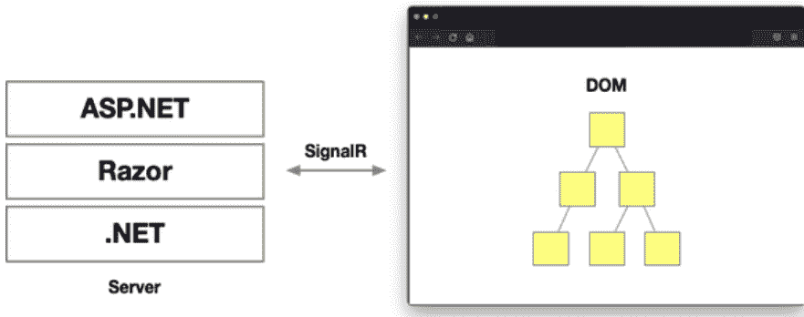
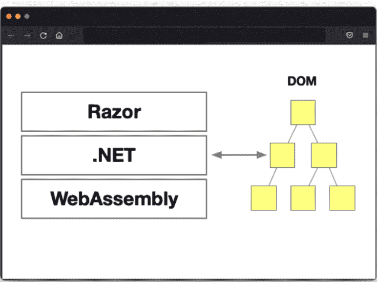
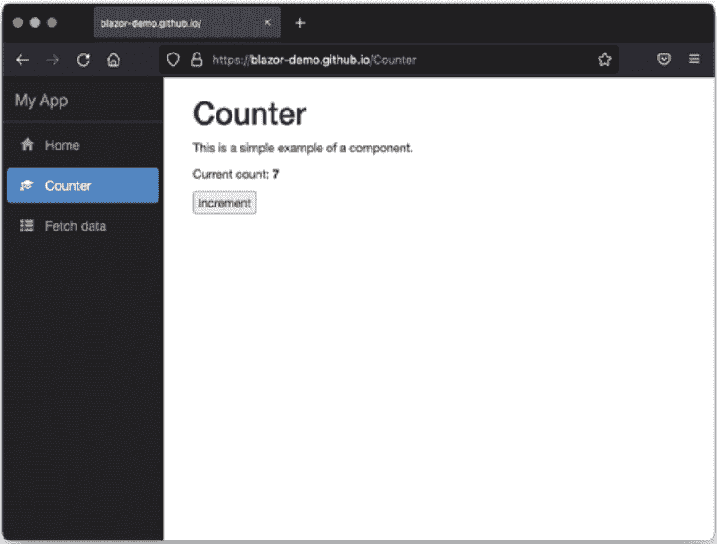
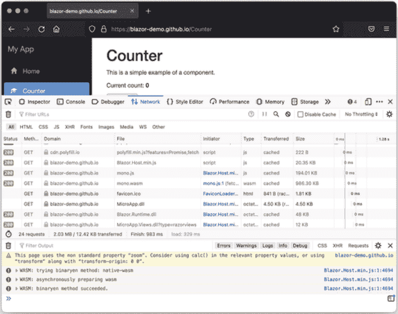
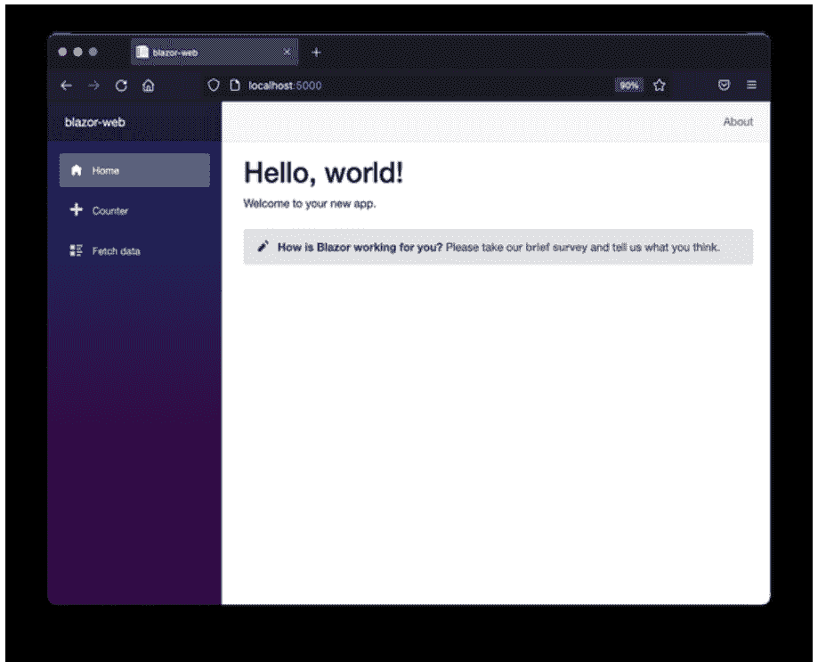
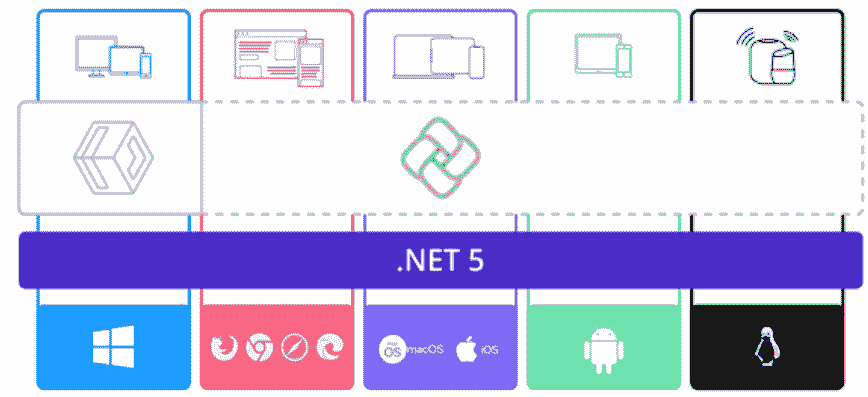
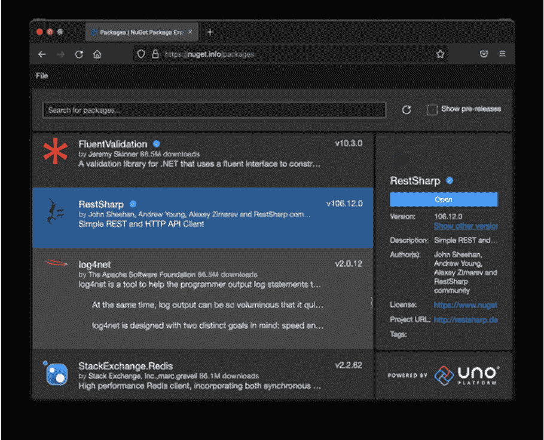
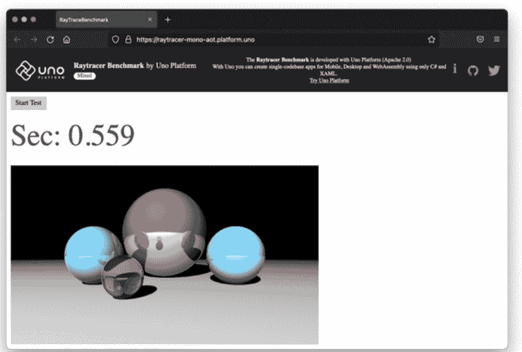

## 第 13 章. WebAssembly 与 .NET

### 早期发布读者的注意事项

使用 Early Release 电子书，您可以在这些标题的正式发布之前很长时间就利用这些技术——作者在写作时提供的原始和未编辑的内容，以便您可以在这些技术正式发布之前利用它们。

这将是最终书籍的第 13 章。

如果您对如何改进本书中的内容和/或示例有任何意见，或者如果您注意到本章中缺少材料，请联系作者 wasmbook@bosatsu.net。

> 我认为桌上足球¹ 是一种足球和烤肉串的结合。
> ——米奇·赫德伯格

在我整个职业生涯中，我与 .NET 保持着一种尊重的冷漠关系。我对它没有什么意见，我只是几乎从未需要过它，并且花很少的时间在 Windows 特定的工作上，而在很多年里它就是这样。

在 2000 年代初期，我确实帮助与一些同事启动了一个基于 .NET 的项目，用于可视化模拟建筑物攻击的场景。想法是，通过使用爆炸的真实物理模型，我们可以将可视化与基于各种保护措施的可能结果结合起来。安全规划者可以考虑物理屏障的不同位置，并对涉及装有炸药的车辆的设施进行测试。如果他们只能靠近到如此程度，对建筑物或刚进入入口的人会造成什么样的影响²？Windows 是目标平台，显然我们需要一些计算速度，所以我们为核心库选择了托管 C++ 基础，为应用程序选择了 C#。我没有在这个项目上待很久，但最终它是一个相当成功的项目。

除此之外，我做过我需要用 Java、C++、JavaScript、Rust、Python 和其他语言和环境做的事情。我认识很多喜欢 .NET 和其周围工具的人，但它对我的职业生涯来说从来没有太重要过。

话虽如此，我一直对像 Mono³ 这样的计划很感兴趣，所以我会 somewhat 关注那个世界正在发生的事情。加上，我的很多朋友都是该领域的专家和倡导者，所以他们也会让我知道那里发生了什么。其中一个令人兴奋的转变是，微软的开发工具和 .NET 框架现在是跨平台开发的真正解决方案。

当我开始了解一些正在获得动力的 .NET 和 WebAssembly 计划时，我仍然感到惊讶。它们最初感觉像是足球和烤肉串的结合，奇怪而过时的搭配。然而，我越想越觉得，这些技术的整合中存在一些引人注目且后果重大的方面，值得探索。

### .NET 和 Wasmtime

正如您可能已经开始意识到的那样，WebAssembly 的用例远不止 MVP 带来的直接方法。我们将从一个不完全是 .NET 特定的集成开始，类似于我们在前几章中看到的。Wasmtime 平台通过其 NuGet 包⁴ 支持 .NET 集成。此示例支持使用 WebAssembly 模块、库和插件扩展 .NET 应用程序的想法。

在尝试以下操作之前，您需要安装 .NET Core SDK。请参阅附录 A 以获取帮助您完成此操作的说明。一旦工具可用，我们将创建一个新目录

并初始化一个项目。dotnet 命令行工具能够基于现有模板创建结构。其中最简单的一个是控制台模板，所以我们将使用它。

```
brian@tweezer ~/g/w/s> mkdir wasmtime-dotnet
brian@tweezer ~/g/w/s> cd wasmtime-dotnet
brian@tweezer ~/g/w/s/wasmtime-dotnet> dotnet new console
The template "Console Application" was created successfully.

Processing post-creation actions...
Running 'dotnet restore' on /Users/brian/src/wasmtime-dotnet/wasmtime-dotnet.csproj...
    Determining projects to restore...
    Restored /Users/brian/src/wasmtime-dotnet/wasmtime-dotnet.csproj (in 58 ms).
Restore succeeded.
```

一旦项目结构初始化，我们将需要添加对 Wasmtime NuGet 包的依赖。截至本文撰写时，版本 0.28.0-preview1 是最新版本。您可能想要或需要使用更新的版本。

```
brian@tweezer ~/g/w/s/wasmtime-dotnet> dotnet add package ↩
  --version 0.28.0-preview1 wasmtime
    Determining projects to restore...
    Writing
/var/folders/mn/4kd_fxdj3lxbp ljfhjyp5sw40000gn/T/tmp5A8L0B.tmp
info : Adding PackageReference for package 'wasmtime' into
project '/Users/brian/src/wasmtime-dotnet/wasmtime-dotnet.csproj'.
info : Restoring packages for /Users/brian/src/wasmtime-dotnet/wasmtime-dotnet.csproj...
info :   GET https://api.nuget.org/v3-flatcontainer/wasmtime/index.json
info :   OK https://api.nuget.org/v3-flatcontainer/wasmtime/index.json 234ms
info :   GET https://api.nuget.org/v3-flatcontainer/wasmtime/0.28.0-preview1/wasmtime.0.28.0-preview1.nupkg
info :   OK https://api.nuget.org/v3-flatcontainer/wasmtime/0.28.0-preview1/wasmtime.0.28.0-preview1.nupkg 235ms
info :   GET https://api.nuget.org/v3-flatcontainer/microsoft.csharp/index.json
info :  OK https://api.nuget.org/v3-flatcontainer/microsoft.csharp/index.json 210ms
info :  GET https://api.nuget.org/v3-flatcontainer/microsoft.csharp/4.6.0/microsoft.csharp.4.6.0.nupkg
info :  OK https://api.nuget.org/v3-flatcontainer/microsoft.csharp/4.6.0/microsoft.csharp.4.6.0.nupkg 20ms
info : Installed Microsoft.CSharp 4.6.0 from
https://api.nuget.org/v3/index.json with content hash
kxn3M2rnAGy5N5DgcIwcE8QTePWU/XiYcQVzn9HqTls2NKluVzVSmVWRjK7OUPWbl
jCXuZxHyhEz9kPRI QeXow==.
info : Installed Wasmtime 0.28.0-preview1 from
https://api.nuget.org/v3/index.json with content hash
diVfo3IYN8ZBRwY30dlWme7vFC2NelIeqBCNiaK/FIGVLoa6IHoBfpsDqBm9gjcNY
8wDsRDo/u4xRquSCG+2dg==.
info : Package 'wasmtime' is compatible with all the specified
frameworks in project '/Users/brian/src/wasmtime-dotnet/wasmtime-
dotnet.csproj'.
info : PackageReference for package 'wasmtime' version '0.28.0-
preview1' added to file '/Users/brian/src/wasmtime-
dotnet/wasmtime-dotnet.csproj'.
info : Committing restore...
info : Writing assets file to disk. Path:
/Users/brian/src/wasmtime-dotnet/obj/project.assets.json
log  : Restored /Users/brian/src/wasmtime-dotnet/wasmtime-
dotnet.csproj (in 2.45 sec).
```

此时，您的项目中应该生成了一个名为 Program.cs 的控制台应用程序，它应该看起来像示例 13-1。

#### 示例 13-1. 生成的 C# 控制台应用程序

```
using System;

namespace wasmtime_dotnet
{
    class Program
    {
        static void Main(string[] args)
        {
            Console.WriteLine("Hello World!");
        }
    }
}
```

通过执行以下命令仔细检查一切是否正确设置。

```
brian@tweezer ~/g/w/s/wasmtime-dotnet> dotnet run
Hello World!
```

如果您看到了我们通常友好的问候，我们就可以继续了。为了保持简单，我们将只使用我们现有的 howold 函数以保持一致性。供参考，请确保示例 13-2 中显示的模块位于您的项目目录中名为 hello.wat 的文件中（例如，如果您遵循了我上面的命令，则为 wasmtime-dotnet）。

#### 示例 13-2. 我们的年龄计算 Wasm 模块

```
(module
  (func $how_old (param $year_now i32) (param $year_born i32)
  (result i32)
    get_local $year_now
    get_local $year_born
    i32.sub)
  (export "how_old" (func $how_old))
)
```

不出所料，Wasmtime 类将与我们在 Rust 中看到的名称类似，尽管我们现在将使用 C# 作为集成的基础。如果您将 Program.cs 文件更改为示例 13-3 中看到的内容，我们就可以在 Wasi 支持⁵ 下恢复工作。

#### 示例 13-3. 使用 Wasmtime 在 C# 中执行 WebAssembly

```
using System;
using Wasmtime;

namespace wasmtime_dotnet
{
    class Program
    {
        static void Main(string[] args)
        {
            using var engine = new Engine();
            using var module = Module.FromTextFile(engine, "hello.wat");
            using var linker = new Linker(engine);
            using var store = new Store(engine);

            var instance = linker.Instantiate(store, module);
            var howOld = instance.GetFunction(store, "how_old");
```


```
Console.WriteLine($"You are {howOld.Invoke(store, 2021, 2000)}");
    }
}
}
```

执行代码显然会产生你所期望的结果。

```
brian@tweezer ~/g/w/s/wasm time-dotnet> dotnet run
You are 21
```

当然，我们对在主机与 WebAssembly 模块之间边界上想要执行的其他操作也有很好的支持。在示例 13-4 中，我们有一个从 .NET 主机导入的函数被调用的例子。

#### 示例 13-4. 调用从主机环境传入的函数。

```
(module
  (type $voidfunc (func))
  (import "hello" "world" (func $hello.world (type $voidfunc)))
  (func $exec
    call $hello.world
  )
  (export "exec" (func $exec))
)
```

设置模块并共享要调用的函数的代码在示例 13-5 中突出显示。请注意，我们可以使用 C# 闭包作为存储在 Store 实例中的函数的基础。我们从模块中检索导出的 exec 函数并调用它，这反过来又调用了我们提供的 hello.world 命名空间函数。

#### 示例 13-5. 我们的主机环境提供要调用的 C# 闭包

```
using System;
using Wasmtime;

namespace wasm time_dotnet
{
    class Program
    {
        static void Main(string[] args)
        {
            using var engine = new Engine();
```
```
using var module = Module.FromTextFile(engine, "hello.wat");
using var linker = new Linker(engine);
using var store = new Store(engine);

linker.Define(
    "hello",
    "world",
    Function.FromCallback(store,
        () => Console.WriteLine("I like soccer and shishkabobs."))
    );

var instance = linker.Instantiate(store, module);
var exec = instance.GetFunction(store, "exec");
exec.Invoke(store);
}
```

运行 dotnet 命令行将显示你所期望的结果。

```
brian@tweezer ~/g/w/s/wasmtime-dotnet> dotnet run
I like soccer and shishkabobs.
```

在脚注中链接的 GitHub 仓库中还有大量其他示例，包括其他 Wasi 集成的示例。也有使用 .NET 与 Wasmer 运行时相似的示例可用。主要观点是 WebAssembly 可以轻松地从 .NET 环境调用并与其交互。下一个用例有点偏离，但仍然是这些技术日益增长的组合。

### Blazor

微软对 WebAssembly 有另一种设想，这与他们重新致力于为所有主要平台的开发者提供工具和框架的兴趣相一致。Blazor 框架⁶ 允许开发者使用 C# 编写交互式组件和应用程序来面向 Web。开发可以在 Windows、macOS 和 Linux 上的各种工具上完成。

Blazor 使用 Razor 语法，这是一种 HTML 和 C# 的混合标记语言。如果你觉得这听起来有点像足球和串烤肉，我同意，但我们将在下面看到一些工作示例。主要好处是它允许开发者使用现有的工具和 .NET 库构建用户界面，而不必依赖 JavaScript 用户界面框架。虽然这些在 JavaScript 开发者中非常流行，但与更传统的面向对象用户界面体验相比，学习曲线相当陡峭。

使用该框架编写的应用程序可以选择部署在服务器上或在浏览器中。两种模式都允许用户界面在浏览器中呈现，但在第一种情况下，主要逻辑在服务器上执行。用户界面更新的通信通过 SignalR⁷ 连接管理。这是一种远程过程调用 RPC 方法，允许服务器通过 WebSockets、服务器发送事件或长轮询技术在浏览器中调用 JavaScript 中的行为。这不是我们将重点关注的用例，但它与我想就此用例提出 larger point 相关。我将在下面回到它。此部署模型在图 13-1 中可视化。



图 13-1. Blazor Server 部署模型

更相关的场景是称为 Blazor WebAssembly 的浏览器内部署模型。在此场景中，C# 和 Razor 文件被编译为 .NET 程序集，然后下载到浏览器。

生成的产物是一个在浏览器中运行的单页应用程序 SPA，可以对本地显示的内容进行更改。显然，为了使其工作，.NET 运行时也必须在浏览器中可用，因此它也必须被下载。本地用户界面更新能够通过 JavaScript 互操作直接影响 DOM。此部署模型如图 13-2 所示。



图 13-2. Blazor WebAssembly 部署模型

它可能不清楚这是如何工作的，但你不必再往前看，前文提到的 Mono 平台就足够了。它已被编译为 WebAssembly，因此在其之上运行的代码产物也应该在它支持的任何环境中工作。.NET 运行时的大小对于手机和嵌入式设备等小型设备来说可能是一个潜在问题，但总体而言，这是一个你会不频繁支付的代价，因为它只是一个依赖的网络资源，可以对其设置缓存控制，因此不会成为持续的带宽负担。

我们将在下面构建一个示例应用程序，但现在，请考虑图 13-3 所示的 Blazor WebAssembly 演示站点。这显示了一个简单的有状态计数器和一个用于操作它的按钮，以及左侧的一些可路由组件，用于在 SPA 中显示其他面板。



图 13-3. Blazor WebAssembly 演示网站

为了了解这可能如何工作，请考虑图 13-4 所示的细节。Mono 平台显示为 mono.wasm。它由一个名为 mono.js 的伴随 JavaScript 文件初始化，该文件看起来像我们在全书中看到的各种引导 JavaScript。在图像底部你会看到关于此引导过程的控制台日志详细信息。即使许多 .NET 程序集的大小为几十到几百千字节，你也会注意到它们都来自之前的会话缓存，因此无需重新获取。



图 13-4. Blazor 演示网站周围的网络流量

两种部署策略各有利弊。Blazor Server 模型不会给客户端带来下载大型二进制运行时的负担，但后端与前端用户界面组件之间的交互存在延迟问题。在缓慢和不稳定的网络或远程客户端上，这可能存在问题。Blazor WebAssembly 模型通常无法访问完整的 .NET 平台，以便使运行时下载保持在可管理的大小。对于目前而言，调试也是 Blazor WebAssembly 的一个问题，但这显然是微软应该能够解决的问题，鉴于他们致力于为开发者提供良好工具的态度。

现在，让我们生成 Blazor WebAssembly 演示脚手架。幸运的是，我们不需要在之前的示例中已经使用过的东西之外安装任何东西。然而，我们将引用一个名为 blazorwasm 的新模板，它将为我们设置此部署模型。如果你想尝试创建服务器托管模型，你将使用 blazorsserver 作为你的模板名称。

```
brian@tweezer ~/g/w/s> dotnet new blazorwasm -o blazor-web
The template "Blazor WebAssembly App" was created successfully.
This template contains technologies from parties other than Microsoft,
see https://aka.ms/aspnetcore/5.0-third-party-notices for details.

Processing post-creation actions...
Running 'dotnet restore' on /Users/brian/src/blazor-web/blazor-web.csproj...
    Determining projects to restore...
    Restored /Users/brian/src/blazor-web/blazor-web.csproj (in 4.83 sec).
Restore succeeded.
```

此时，我们有一个可用的工作应用程序。如果我们调查目录结构，我们会发现我们确实站在巨人的肩膀上。幕后有大量的代码在运行，以使一个看似简单的应用程序正常工作。下面的 tree 命令产生了 700 行文件和目录。当然，典型的 JavaScript 框架也会引入大量的依赖。你可以自行决定权衡是否值得，但显然许多组织会得出结论认为它是值得的。

我下面大量删除了多余的行，只是为了专注于你关心的核心文件，但如果你感觉冒险并且安装了 tree，不妨试试。

剩下的是一个相当直接的项目。以 .razor 结尾的文件是组件文件。目录结构中散布着几个配置文件。几个组件具有自定义的层叠样式表 CSS 文件来定义其样式。

```
brian@tweezer ~/g/w/s/c/blazor-web> tree .
├── App.razor
```


├── Pages
│   ├── Counter.razor
│   ├── FetchData.razor
│   └── Index.razor
├── Program.cs
├── Properties
│   └── launchSettings.json
├── Shared
│   ├── MainLayout.razor
│   ├── MainLayout.razor.css
│   ├── NavMenu.razor
│   ├── NavMenu.razor.css
│   └── SurveyPrompt.razor
├── _Imports.razor
├── bin
... <====== 删除了大量 .NET 依赖项
├── blazor-web.csproj
├── obj
... <====== 删除了大量 .NET 依赖项
└── wwwroot
    ├── css
    │   ├── app.css
    │   ├── bootstrap
    │   │   ├── bootstrap.min.css
    │   │   └── bootstrap.min.css.map
    │   └── open-iconic
    │       ├── FONT-LICENSE
    │       ├── ICON-LICENSE
    │       ├── README.md
    │       └── font
    │           ├── css
    │           │   └── open-iconic-bootstrap.min.css
    │           └── fonts
    │               ├── open-iconic.eot
    │               ├── open-iconic.otf
    │               ├── open-iconic.svg
    │               ├── open-iconic.ttf
    │               └── open-iconic.woff
    ├── favicon.ico
    ├── index.html
    └── sample-data
        └── weather.json

在应用特定的文件和大量 .NET 依赖项之后，我们看到一个名为 wwwroot 的目录，它代表了各种资产和资源，这些资产和资源需要被提供以完成应用程序。这包括字体、一些示例 JSON 数据，以及应用程序的精简版 Bootstrap 基础。

我无法对 Razor 组件及其包含的所有内容进行详细的教程，但我想介绍应用程序的基础知识，以便你能够把握其功能。主视图存储在 Pages 目录中。共享布局存储在 Shared 目录中。示例 13-6 中显示的主应用程序文件位于主项目目录中的 App.razor。

#### 示例 13-6. 在 Razor 中定义的高层级应用程序组件

```
<Router AppAssembly="@typeof(Program).Assembly" PreferExactMatches="@true">
    <Found Context="routeData">
        <RouteView RouteData="@routeData" DefaultLayout="@typeof(MainLayout)" />
    </Found>
    <NotFound>
        <LayoutView Layout="@typeof(MainLayout)">
            <p>Sorry, there's nothing at this address.</p>
        </LayoutView>
    </NotFound>
</Router>
```

这代表了应用程序的高层级细节，包括被标识为 MainLayout 的默认布局。如果它无法找到可用的布局，请注意它有一个默认消息。这是一个我们期望通过 HTTP 提供服务的 SPA，因此我们需要一种将端点路由到页面的机制。我们很快就会看到这些细节。

在示例 13-7 中，我们有来自 Shared/MainLayout.razor 的默认布局。我们可以看到它继承自 LayoutComponentBase，并由侧边栏左侧的 <div> 元素中的 NavMenu 组成。这突出了 Razor 组件混合了 C# 对象交互和 HTML 布局。它是一种有点奇怪的语法，但一旦你习惯了，就不会特别繁重。

#### 示例 13-7. 默认布局是一个共享模板

```
@inherits LayoutComponentBase

<div class="page">
<div class="sidebar">
    <NavMenu />
</div>

<div class="main">
    <div class="top-row px-4">
        <a href="http://blazor.net" target="_blank" class="ml-md-auto">About</a>
    </div>

    <div class="content px-4">
        @Body
    </div>
</div>
</div>
```

按照惯例，文件 *Index.razor* 包含着陆页，就像大多数网站由一个名为 *index.html* 的文件定义一样。在示例 13-8 中，当默认路由被调用时，此组件的主体将被插入到 `MainLayout` 中的 `@Body` 位置。

#### 示例 13-8. 默认路由指向 Pages 目录中的 Index.razor

```
@page "/"

<h1>Hello, world!</h1>

Welcome to your new app.

<SurveyPrompt Title="How is Blazor working for you?" />
```

我们看到上面的第一个 `@page` 指令，它指示主应用程序将默认的 "/" HTTP 请求指向此渲染页面。我们还看到典型的友好问候以 HTML 形式呈现，以及一个用于调查的嵌入组件。

由于此页面及其资源需要通过 HTTP 提供，我们将使用以下命令启动它。

```
brian@tweezer ~/g/w/s/blazor-web> dotnet run
Building...
info: Microsoft.Hosting.Lifetime[0]
      Now listening on: https://localhost:5001
```

```
info: Microsoft.Hosting.Lifetime[0]
    Now listening on: http://localhost:5000
info: Microsoft.Hosting.Lifetime[0]
    Application started. Press Ctrl+C to shut down.
info: Microsoft.Hosting.Lifetime[0]
    Hosting environment: Development
info: Microsoft.Hosting.Lifetime[0]
    Content root path: /Users/brian/src/blazor-web
```

在图 13-5 中，你将看到如果你将浏览器指向 http://localhost:5000 时生成的输出。如果你想查看所有加载的 .NET 程序集和运行时，请先打开网络视图。注意，如果你点击调查链接，它会带你到一个真正的 SurveyMonkey 调查！



图 13-5. 正在运行的生成的 Blazor WebAssembly 应用程序

路由到只读渲染的 HTML 片段很酷，但如何维护一些状态并使用非默认路由呢？侧边栏左侧的 Counter 链接将带你到从 *Pages/Counter.razor* 文件渲染的视图，如示例 13-9 所示。

#### 示例 13-9. 具有有状态字段和交互式 UI 元素的页面

```
@page "/counter"

<h1>Counter</h1>

<p>Current count: @currentCount</p>

<button class="btn btn-primary" @onclick="IncrementCount">Click me</button>

@code {
    private int currentCount = 0;

    private void IncrementCount()
    {
        currentCount++;
    }
}
```

我们在此代码示例中看到了一些更有趣的行为。首先，你会注意到 `@page` 指令指向的不是默认路由，因此你可以想象为你的 SPA 设置多个视图。你看到了更多奇怪的语法，但这次我们定义了一个 `<button>` 元素以及当用户按下它时我们希望调用的行为。在这种情况下，`@onclick` 提示告诉我们我们想要调用组件上的一个名为 `IncrementCount` 的函数。这是在下面的 `@code` 块中定义的，就像组件将维护的状态字段 `currentCount` 一样。它被初始化为 0，但每次按下按钮时都会递增。

虽然你可能不选择像这样直接在 *.Razor* 文件中嵌入组件，但至少可以这样做，并且使得在视图中维护和反映状态变得相当简单。点击 `Counter` 链接并亲眼看看。停止服务器并尝试在每次按下按钮时使用 `Console.WriteLine` 打印一条消息到控制台。花一分钟惊叹一下，与我们早期关于 WebAssembly 不支持字符串的抱怨相比，你在这本书中已经取得了多大的进步。

我在这里想指出的最后一件事是 Pages/FetchData.razor 文件的内容，如示例 13-10 所示。这包括了对于更有用的 SPA 你需要处理的许多细节，例如获取远程数据、在视图中使用条件逻辑，以及迭代你获取的数据。

#### 示例 13-10. 具有依赖注入 HttpClient 的更复杂的页面

```
@page "/fetchdata"
@inject HttpClient Http

<h1>Weather forecast</h1>

<p>This component demonstrates fetching data from the server.</p>

@if (forecasts == null)
{
    <p><em>Loading...</em></p>
}
else
{
    <table class="table">
        <thead>
            <tr>
                <th>Date</th>
                <th>Temp. (C)</th>
                <th>Temp. (F)</th>
                <th>Summary</th>
            </tr>
        </thead>
        <tbody>
            @foreach (var forecast in forecasts)
            {
                <tr>
                    <td>@forecast.Date.ToShortDateString()</td>
                    <td>@forecast.TemperatureC</td>
                    <td>@forecast.TemperatureF</td>
                    <td>@forecast.Summary</td>
                </tr>
            }
        </tbody>
    </table>
}
```


```
</tbody>
</table>
}

@code {
    private WeatherForecast[] forecasts;

    protected override async Task OnInitializedAsync()
    {
        forecasts = await Http.GetFromJsonAsync<WeatherForecast[]>("sample-data/weather.json");
    }

    public class WeatherForecast
    {
        public DateTime Date { get; set; }

        public int TemperatureC { get; set; }

        public string Summary { get; set; }

        public int TemperatureF => 32 + (int)(TemperatureC / 0.5556);
    }
}
```

大多数本示例对于熟悉 C# 和 .NET 功能的开发者来说应该相当清晰。我们对空的初始数据集进行了处理。代码包含一个返回异步 Task 的函数，该函数将用于获取存储在 wwwroot/sample-data/weather.json 文件中的 JSON 数据。同样，这在技术上并不是应用程序的一部分，因此不会被编译到程序集中，而是会像其他 HTTP 资源一样被提供。

你已经看到足够的内容，可以知道我们可以导入一个 JavaScript 函数，从而允许我们使用 XMLHttpRequest 或 fetch 请求来检索数据。对于将 WebAssembly、Web 和 .NET 之类的平台集成起来的这种用例来说，其中一个好处是平台直接以一种便捷的机制提供了此功能。

注意示例 13-10 顶部第二个指令。这是一个依赖注入指令。如果你熟悉像 Spring 这样的基于容器的框架，你会知道这是一种声明式的方式来请求

将正确类型的对象提供给我们的组件。它可能并不清楚这个对象实例将来自何处。如果你看看示例 13-11，这就是我们将启动整个过程的主程序。我们在下面突出显示了 HttpClient 被添加到我们的组件的位置。

#### 示例 13-11. 我们项目的 main 程序

```
using System;
using System.Net.Http;
using System.Collections.Generic;
using System.Threading.Tasks;
using System.Text;
using Microsoft.AspNetCore.Components.WebAssembly.Hosting;
using Microsoft.Extensions.Configuration;
using Microsoft.Extensions.DependencyInjection;
using Microsoft.Extensions.Logging;

namespace blazor_web
{
    public class Program
    {
        public static async Task Main(string[] args)
        {
            var builder = WebAssemblyHostBuilder.CreateDefault(args);
            builder.RootComponents.Add<App>("#app");

            builder.Services.AddScoped(sp
                => new HttpClient {
                    BaseAddress = new
Uri(builder.HostEnvironment.BaseAddress)
                });

            await builder.Build().RunAsync();
        }
    }
}
```

① HttpClient 实例作为基于我们部署上下文的 scoped 组件被添加。

正如指示的行所示，System.Net.Http.HttpClient 对象的实例被添加为一个 scoped 组件，可供注入到我们的页面中。这样我们的页面组件就不必担心该对象的生命周期或配置，我们可以重用该功能，并且完全不需要执行额外的配置来将导入的函数传递到我们的代码中。

即使我们只查看了基于 Blazor WebAssembly 项目由命令行 dotnet 工具生成的脚手架项目，我希望你对这种用例为我们做了什么有一个很好的概念。我们本质上拥有一个受益于 WebAssembly 的环境，而无需将其作为开发运行时的突出特性来展示，如果你不希望它这样的话。我们所构建的应用程序重用了 .NET 框架和组件、Razor 语法，以及我们所看到的大量其他功能。

一方面，这将为 C# 开发者提供一种简单的方式来开发可部署到浏览器的应用程序。作为 Dr. Roy Fielding 论文⁹ 中详细说明的可选约束之一，这是一种非常有用的方式来扩展我们的“通用客户端”的行为。

使用 .NET 的开发者显然一直有构建 Web 应用程序的方法，但与其他平台一样，它们是后端 C#（或其他 .NET 语言）和浏览器中 JavaScript 的混合体。我们现在打开了一条通往桌面企业应用程序和现在可以在浏览器中运行的应用程序之间相当大程度重用的路径。这不是一条直接的路径，但我想象随着时间的推移它会变得更好，你只需重新编译代码库即可针对其他平台。

那时我认为这种 WebAssembly 用例可能会掀起更大的波澜。如果老板们意识到他们可以从代码库中获得显著的重用，并且 C# 开发者可以更轻松地构建网页，我认为企业应用程序使用的前端技术将戏剧性地转向 .NET。

### Uno Platform

还有一个最终的 WebAssembly 和 .NET 集成的用例值得提及，因为它出人意料地比之前的示例具有更广泛的覆盖范围。Uno Platform¹⁰ 是一个多平台开发框架，用于使用 C# 和 WinUI 构建像素完美的应用程序。从单一代码库出发，你可以定位 Windows、iOS、macOS、Android、Linux 以及现在，借助 WebAssembly，Web。这与 Blazor 承诺的截然不同，尽管基于 Blazor 的应用程序应该可以在这些环境中的浏览器中运行。

区别在于 Uno 也针对原生应用程序并使它们在每个环境中看起来完全相同。这是我整个职业生涯中跨平台开发的一个难题。你要么拥有多个代码库并针对看起来适合操作系统的原生应用程序（例如，应用程序在运行于 macOS 时看起来像 macOS 应用程序），要么拥有单一代码库在任何地方看起来都一样，因此不像原生应用程序。两者都不是理想的情况。你不希望你的应用程序的行为与用户在其主要桌面环境中习惯的应用程序不同，但你也不想多次重建应用程序。

对于常见的外观和感觉方法，有无数解决方案，但大多数看起来和感觉都很糟糕。那些勉强吸引人且有用的解决方案仅限于原生应用程序，而不运行在浏览器中。这是有原因的，我希望到现在为止已经很清楚了。提供常见外观和感觉的原生库在浏览器中不可用。即使花时间使用 Canvas-graphics 和 WebGL 或类似技术来模拟是值得的，代码库也必须是 JavaScript 而不是 C、C++ 或 C#，就像其他代码库一样。

这就是 Uno Platform 如此引人注目的原因。他们似乎真的通过一些扎实的工程和抽象解决了这个问题。.NET 应该获得很大一部分功劳，但 WebAssembly 是拼图的最后一块。

本书其他地方，我们已将 WebAssembly 作为开发应用程序的主要愿景。这包括它提供的优点和局限性。我们已经看到了围绕这些局限性的各种解决方案，以及额外的工具、基础设施、对平台的扩展新提案等等。对于 Blazor WebAssembly 以及现在 Uno Platform 来说，WebAssembly 只是一个方便的实现细节。对于 Blazor 来说，无论你是在服务器上托管还是在浏览器中托管，都不会实质性地影响开发风格。两者都使用 Razor 组件和 JavaScript 互操作。服务器模型只是使用更多分离和独立的通信模型。

对于 Uno Platform 来说，主导的风格、代码库和抽象是围绕 Xamarin¹¹ 构建的，Xamarin 是一个开源平台，提供针对 Android、iOS、macOS、Linux 或任何有 .NET 运行时可用的地方的跨平台开发。鉴于 Mono 平台的可移植性，这是实现无处不在的原生支持的手段。

Xamarin 包含一种名为 Xamarin.Forms 的用户界面技术，它建立在 XAML 组件绑定之上。Uno 不使用 Xamarin 的这一部分，而是专注于基于 WinUI 的应用程序。WinUI 是一个现代用户界面工具包，也建立在 XAML 之上，提供 Fluent Design¹²、可访问的应用程序和其他现代应用程序开发技术。

在图 13-6 中，你可以看到 Uno Platform 的高层架构。在 Windows 上，它可以理解为这些技术的原生平台。定位 iOS、Android 和 macOS 时，Uno Platform 使用 Xamarin Native 库与 WinUI 的组合，该组合由 .NET 5 和 .NET 6 平台支持。在 Linux 上，他们使用 Skia 库¹³ 做了一件很酷的事情，该库也是 WebAssembly 友好的¹⁴。最后，由于 Mono 运行时已被编译为 WebAssembly 并可在浏览器中使用，如你所见，它是定位浏览器的策略的基础。




图 13-6. Uno 平台架构

再次强调，为了提供这种令人惊叹范围内的像素级跨平台解决方案，投入了大量的工程工作。我的主要目的是让你了解这个用例，并让你自行探索其是否满足你的需求，因此我将 Uno Platform 的探索留给你。不过作为激励，我想指出一些它在实际应用中的例子，我认为这些例子能凸显其价值主张。

首先，NuGet Package Explorer（NPE），最初是一个基于 .NET 6 的 Windows Presentation Foundation（WPF）应用程序，已被移植到基于 WebAssembly 目标的渐进式 Web 应用（PWA）。这是一款曾作为原生应用被下载数十万次的应用程序。现在它不仅可用作 Web 应用，而且在 Uno 支持的各种平台上都能保持一致的外观和感觉。你可以在图 13-7 中看到 NPE 的运行情况，并在 https://nuget.info 试用一下。



图 13-7. 在 macOS 上 Firefox 中运行的 NuGet Package Explorer

Uno Platform Playground¹⁵ 是另一种让你更熟悉技术组合及其如何融合在一起的绝佳方式。代码片段菜单中提供了大量示例供你探索。图 13-8 显示了 Cards 示例，其中包含一个由精美卡片填充的 ListView XAML 元素。


图 13-8. Uno Platform Playground

最后，图 13-9 显示了一个更复杂的 Uno 基于的 Ray Tracer 示例及其渲染输出。不仅它是一个产生出色效果的更复杂的应用程序，而且也是比较不同语言和运行时环境下光线追踪相对性能的一种方式¹⁶。



图 13-9. Uno Platform 上的 Ray Tracer 演示

显然，关于 .NET 和 WebAssembly 这两个独立但强大的平台的集成，还有很多可以说的。关于该主题正在涌现几本新书，我鼓励你去查阅，但我也尝试为你提供了多个可以找到工作项目和代码示例以供自行探索的地方。

在本章中，我们看到了令人兴奋的结果，我认为这预示着我们行业即将发生的转变。至少，它也表明 C# 开发者可以坚持使用他们熟悉和喜爱的语言，并有效地构建在各种地方运行的应用程序，而不必完全依赖前端的 JavaScript。在下一章中，我们将看到一种让 JavaScript 和 TypeScript 开发者也能受益于 WebAssembly 的方法。

1 如果你不熟悉这个名字，桌上足球是许多家庭和休闲设施中流行的游戏，玩家通过金属杆操纵足球运动员。你可以在这里看到更多信息：https://en.wikipedia.org/wiki/Table_football

2 幸运的是，我并不是那个在沙漠里炸尸体以确定对人体影响的项目成员！

3  Mono 是一个开源的跨平台 .NET 框架。https://www.mono-project.com

4  NuGet 是一个用于管理代码依赖的包管理系统，类似 NPM。Wasmtime NuGet 包可在以下位置获取：https://www.nuget.org/packages/Wasmtime

5  接下来的两个示例基于 Wasmtime .NET 库示例：https://github.com/bytecodealliance/wasmtime-dotnet

6  有关 Blazor 的更多详细信息，请访问：https://dotnet.microsoft.com/apps/aspnet/web-apps/blazor

7  你可以在这里找到有关 SignalR 的详细信息：https://docs.microsoft.com/en-us/aspnet/core/signalr

8  Bootstrap 是一个开源样式表系统，广泛用于制作响应式、移动优先的应用程序。你可以在这里找到更多详细信息：https://getbootstrap.com

9  虽然说 Dr. Fielding “发明”了 REST 是不正确的，但他的论文为许多已在早期 Web 基础设施中实现的想法提供了正式定义。他的论文是对架构风格的分析，其中 REST 是其中之一。这是一篇非常易读的论文，值得你花时间阅读：https://www.ics.uci.edu/~fielding/pubs/dissertation/top.htm

10  有关 Uno Platform 的更多详细信息，请访问：https://platform.uno

11  Xamarin 本身就是一个很酷的平台，但如果没有 WebAssembly，就无法以相同的方式定位浏览器。更多详细信息请访问：https://dotnet.microsoft.com/apps/xamarin/cross-platform

12  Fluent Design 是微软于 2017 年推出的设计语言，面向现代 UI 系统。

13  Skia 是一个非常不错的跨平台开源 2D 绘图库。更多详细信息请访问：https://skia.org

14  有关 Skia 和 CanvasKit WebAssembly 用例的更多详细信息，请访问：https://skia.org/docs/user/modules/canvaskit/

15  Uno Platform Playground 可在此获取：https://playground.platform.uno/#wasm-start

16  RayTracer 应用可见于：https://raytracer-mono-aot.platform.uno GitHub 仓库为：https://github.com/unoproject/Uno.RayTraceBenchmark
