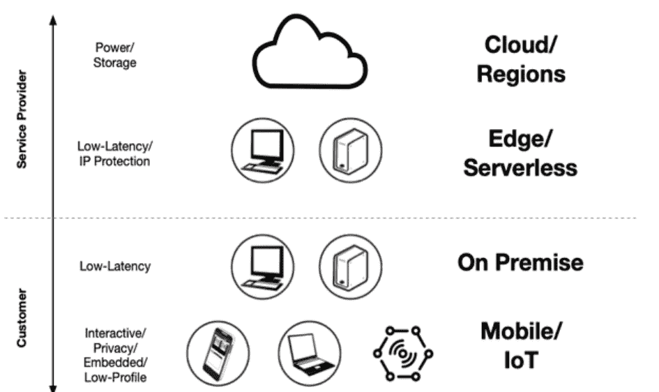
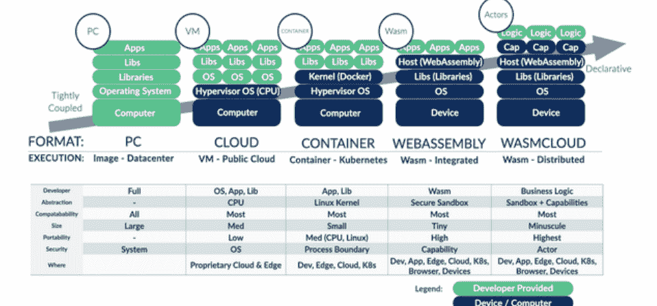
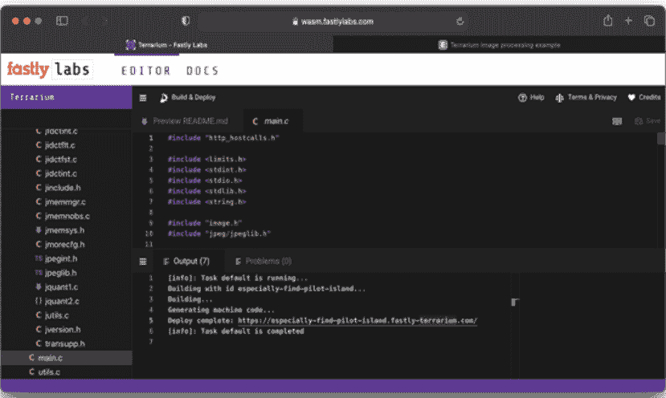
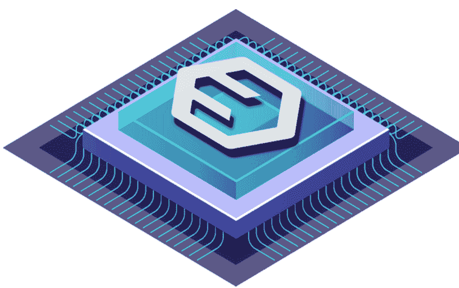
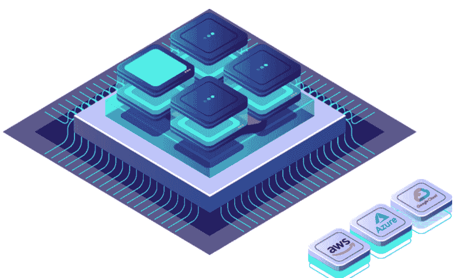
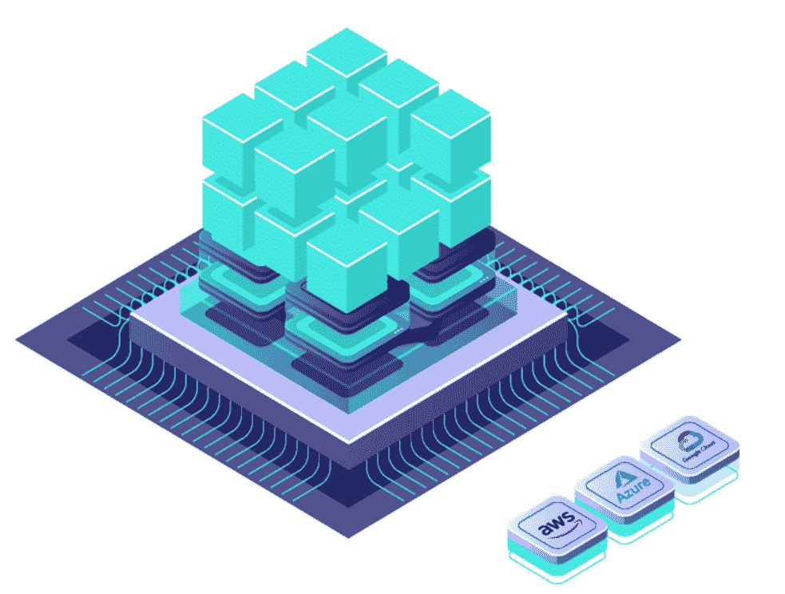
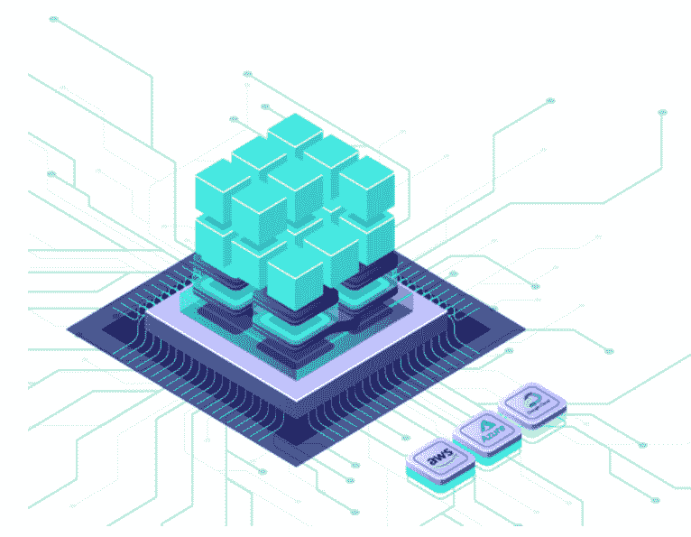

## 第 15 章 应用 WebAssembly：在云端和边缘

### 给早期发布读者的说明

使用 Early Release 电子书，你可以在官方发布这些书名之前很久就利用这些技术——作者在写作时的原始未编辑内容。

这将是最终书籍的第 15 章。

如果你对如何改进本书的内容和/或示例有任何评论，或者如果你注意到本章中缺少材料，请联系作者 wasmbook@bosatsu.net。

> 我已从两边看过云朵
> 从上到下，仍然不知为何
> 我回忆的是云的幻象
> 我真的完全不了解云朵
> 
> ——Joni Mitchell

鉴于当今云计算倡议的流行和普遍性，以一句关于不理解云的引言开始本章似乎很奇怪。如果我们诚实地说，我认为可以公平地说很多人并不了解使用云计算的全部范围。显而易见的是速度提升和轻松启动实例，与通常难以承受的采购物理硬件系统的场景形成对比。但云中的一切策略和云中无物一样愚蠢。

你思考云策略的真正驱动因素不应仅仅是采购和开发者生产力，尽管这些都是重要考虑因素。更普遍的想法是考虑计算的成本。这是一个比看起来更复杂的计算，既体现在我所说的“成本”和“计算”上。在本章中，我将重点关注我们运行计算的位置正在迅速变化，以及 WebAssembly 将如何成为其中的关键部分。

### 一个简短的个人插曲

在我职业生涯早期，我是 Parabon¹ 公司的第一批员工之一。我们构建了一个互联网分布式计算平台，以聚合世界各地计算机上的空闲时间。请记住那是云计算之前。在将我们的引擎及其基于 Java 的核心为了安全移植到八个平台之外，我们还构建了客户端 API、用于调度工作的服务器基础设施以及半打或更多垂直应用来使用它。我们运行的任务类型包括线性扩展的基因序列比较、用于穷举回归搜索的基于遗传算法的特征选择，以及基于蒙特卡洛的渲染系统。

这一举措的全部意义在于在计算能力上寻找套利机会。组织没有为其峰值需求购买足够的计算能力，因此在计算上能处理的任务存在上限。我们为一类已知为“尴尬并行”问题² 提供了弹性能力。客户可以根据需要解决特定问题而请求任意多或少的计算资源。这给了他们一个旋钮，可以根据需求产生边际成本。

在进行穷举搜索时，这使他们能够包含通常没有资源分析的更多特征。这在一例中帮助了一家制药公司找出为什么某种疗法对某些患者有效而对其他患者无效。另一个很好的匹配例子是 NASA 的一名顾问，他能够将模拟从在正常情况下可用的设备上花费九个月，缩短到在我们的平台上只需四到五小时。为了实现在各种操作系统之间的可移植性以及我们承诺给计算提供者的保护，他必须将代码从 Fortran 移植到 Java。虽然 Fortran 在与当时 Sun 的新语言的直接竞争中可以轻松击败它，但我们会通过并行化弥补。

即使有尴尬并行问题约束的限制，鉴于当时宽带部署的情况，数据密集型任务如数字渲染并不适合我们的平台。计算与数据之比太低。将数据送到所需位置在时间和带宽方面成本太高。我们从根本上提供的是计算中介形式。即使在当时，我也觉得需要更多东西才能真正提供最大价值，但云计算尚未出现，无法为我们提供资源虚拟化的更完整愿景。

另一个推动我思考的工作经历是我在视频游戏行业的时间。我参与了一款基于另一款拥有 4000 万用户的游戏的游戏开发，所以我们相当确定需要扩展。把所有东西都放到云中成本会过高，因此我们运行了我们购买和设置的混合数据中心设备，然后使用云服务作为弹性溢出。同样，我们只在需要时使用额外资源，并且不必为其全天候运行付费。

### 我们的行业在演进

有了这一背景，当我谈论计算的“成本”时，我指的是时间成本、金钱成本、没有弹性供应所带来的机会成本、功耗成本和延迟成本。这些都是我们今天试图最小化的成本。云计算是策略的一部分，但微服务和无服务器函数等架构设计也是如此。苹果的 M1 设计也是如此。M1 芯片中有两个 CPU，一个更注重性能，一个更注重功耗。研究人员正在分析使用机器学习策略来排序 LLVM 优化以最大化性能或最小化功耗的复杂方法。应用程序代码不会改变，只是其编译形式。

我们在哪里以及如何利用计算元素来解决问题，已成为成功 IT 战略的最重要方面之一。这包括高级和定制硬件，例如矢量化 CPU 指令³、图形处理单元（GPU）、现场可编程门阵列（FPGA）⁴、专用集成电路（ASIC）⁵ 和张量处理单元（TPU）⁶。每种硬件类型都有不同的能力、指令、成本和性能特征。将工作负载映射到这些元素将是实现以最小化一系列成本的方式完成计算的重要部分。

物理位置是成本的另一个要素，因为延迟正如你所知⁷，我们无法忽视。如果你熟悉云区域的概念或使用内容分发网络（CDN）来提供静态资源，你将理解让事物更接近用户的好处。域名系统（DNS）技巧允许根据用户所在地理区域动态选择端点。

边缘计算是一种新兴的服务提供，它将这些想法更进一步地结合在一起，混合了分布式计算（类似 Parabon）、云托管和地理分布资源。不同之处在于，我们不再只谈论静态资源，而是可执行代码。Web 架构允许我们将事物推送到浏览器中。正如你所见，WebAssembly 在此用例中具有突出作用。有时你可能出于隐私原因、低延迟用户体验等原因希望在浏览器或设备上运行。其他时候，你可能不希望在用户设备上运行专有代码，但仍希望靠近。这就是边缘计算的领域。它是部署位置的连续体，跨越集中式数据中心、区域边界、服务提供商接入点边界、本地系统，


local access points, and on device. 事情已经变得有点复杂了，这本身就是一种轻描淡写的说法。

隐含在这种多样化的位置中，有各种硬件架构、隐私模型、对可能敏感信息的访问以及计算能力。我们之前提到的那位 NASA 研究员（即把他的代码移植到 Java）所承受的需求，如今不太可能是一个合理的请求。这些环境需要给客户提供选择语言的自由，同时提供保护以避免他们在多租户系统中相互干扰。

这种位置连续体的快照视图可以在图 15-1 中看到。开发人员出于不同的原因希望能够在此景观中部署软件构件。在云中进行大型模型训练和数据分析是有价值的。结果可能不适合在移动设备或嵌入式系统上运行。一些服务可以更靠近用户以实现低延迟、更好的体验。出于知识产权保护的原因，您可能不希望将某些行为全部发送到设备上。在其他情况下，隐私法规，例如支付卡行业（PCI）、健康保险流通与责任法案（HIPAA）和通用数据保护条例（GDPR）将鼓励或要求您这样做。

我们有通过基于容器的环境和 Kubernetes 驱动的基础设施在云中部署可扩展基础设施的策略。在该空间中表现良好的绝大多数事物在移动设备或嵌入式系统中将完全无用。



图 15-1. 位置与责任的连续体

WebAssembly 和 WASI 提供了覆盖所有这些差异的非常好的方案。我认为它们将在这一领域大放异彩，并在我们迄今为止看到的有前景的用途之外掀起热潮。我想向您介绍写作时期的一些领先项目，但完全预计这些项目在不久的将来会大幅扩展。

在最近的一次演讲⁸中，来自 Cosmonic 和 wasmCloud 项目（将在下面介绍）的 Liam Randall 强调了我一直在讨论的连续体。请看下面的图 15-2。



#### 图 15-2. 我们行业的演变

我们可以看到我们的行业随着时间的推移是如何变化的。开发人员需要负责的内容一直在缩小。我们可以依靠运行时环境提供的东西却在增长。最初，我们必须管理一切。我们必须购买硬件，安装操作系统和补丁以及任何依赖库或应用程序。保持这些系统修补是一个全职工作，并且经常会与我们系统构建所依据的内容产生不兼容。

诸如 Linux 和 FreeBSD 之类的开源操作系统改变了行业。以前涉及专有操作系统昂贵许可的内容变得免费。我们可以拥有任意多的副本，但根据各种硬件配置设置和配置它们的工作仍然是一项昂贵且 ripe for innovation 的活动。

云的爆发引入了一个虚拟化层，我们可以在其中免受硬件细节的保护。这使我们能够以时间片使用的方式共享访问物理系统。启动各种操作系统配置的预定义镜像使满足需求变得容易，并且可以从已知的起点快速移动。这些虚拟机镜像很大、笨重，并且对于各种用途来说都是过度设计。

应用程序开发人员管理依赖项的负担仍然很大，但这是一个进步。

我们所知的容器系统可以追溯到 1970 年代 *chroot* 系统⁹ 的种子。在 2000 年，FreeBSD 的 Jail¹⁰ 系统出现，作为一种允许多租户主机进一步分离共享内容和每个用户独特内容的方式。这推动了人们对 Linux 控制组的兴趣和开发，多年后导致了 2008 年 Linux Containers（LXC）的开发。Google 和 CloudFoundry 在此期间有一些产品，但最终是 Docker 于 2013 年发布，真正推动了这一进程。

总体而言，这种容器化方法允许比上一代更重的镜像更精细的虚拟化粒度。更多的基础设施可以预先定义，因此我们可以专注于安装共享库和应用程序的正确版本。

WebAssembly 引入了安全、稳定、可移植代码的新版本的概念，正如您所见。API 可用性仍然是一个问题，但 WASI 有助于解决这个问题。沙箱代码的概念在这种环境中变得越来越重要，不仅因为我们在第 8 章中讨论的供应链攻击，而且因为我们希望在图 15-1 的各个层中在多租户系统中部署代码。正如 Liam 在上面链接的演讲中所提到的，随着基于能力的<|message|>
安全系统获得关注，您可能会预计这一趋势会继续下去。

在最近几章中，我们探讨了应用程序通过 Wasmtime 和 Wasmer API 加载和执行可重用的 WebAssembly 模块。最终，这就是我们最终过渡的基础。这种用例有助于定义新的应用程序主机层，该层将提供支持插件、模块、扩展甚至基本功能的选择。代码需要获得批准的能力才能执行超出基本执行的操作，例如从文件系统读取、生成线程或打开网络连接。这种方法将促进各种用途，例如使用不同语言编写的插件代理和过滤器的长期运行应用程序、微服务和无服务器函数。

除了这种灵活的计算风格之外，这些方法的开销甚至更小，并且安全性比目前每个人都如此兴奋的容器模型更严格。这将使我们能够进入图 15-1 中突出的整个计算景观。为了强调我们讨论的潜在影响，Docker 联合创始人 Solomon Hykes 在这些讨论中经常被引用，他说过：“如果 WASM+WASI 在 2008 年就存在，我们就不需要创建 Docker。这就是它的重要性。服务器上的 Webassembly 是计算的未来。”11 正如他随后承认的那样，这并不一定意味着 Docker 将消失，而是我们谈论的是同等重要性的事物。这两种技术很可能会找到合作的方式。

让我们看看这些想法如何以各种方式结合起来，为我们异构且庞大的计算未来奠定基础。我们将在下面探索一些商业和开源产品作为示例，说明现在正在考虑的内容。在我们意识到之前，肯定会有更多。

### Fastly Compute@Edge

Fastly 在过去十年中一直是一家成功的 CDN 提供商。他们是 Bytecode Alliance 的创始成员，并最近聘用了许多来自 Mozilla 专注于 WebAssembly 和 WASI 的工程师。他们正在通过其 Compute@Edge 平台远远超越提供静态内容，进入我们正在想象的这个新世界。

该产品核心是 Lucet WebAssembly 编译器和运行时，该运行时正在与我们在第 11 章中提到的 Mozilla Wasmtime 项目合并。Fastly 通过开源它并将其贡献给 Bytecode Alliance，希望通过利用各自的优势使两个运行时变得更丰富。两者都围绕 CraneLift12 项目构建，并且与 WASI 结合使用时将促进客户能够将用多种编程语言编写的功能安全地推送到 Fastly 的 Compute@Edge 环境中。

Lucet 运行时的一个定义特征是它能够在 50 微秒以内实例化 WebAssembly 模块，而 V8 则需要 5 毫秒来完成同样的事情¹³。除了这种速度优势之外，它还可以以非常低的内存开销来做到这一点，以千字节而不是数十兆字节为单位衡量。

与 Compute@Edge 平台的交互方式与您想象的差不多。您注册一个账户并获得受令牌¹⁴保护的 API 访问权限。有命令行工具用于启动项目并将其部署到生态系统中，并具有动态 DNS 条目。目前代码可以用 Rust、AssemblyScript 或 JavaScript 编写。许多功能目前处于测试阶段，但他们正在快速推进，并且 heavily involved 在相关技术和标准的开发和维护中。

虽然部署任意代码到他们的系统需要注册要求，但由于其基于 WebAssembly，他们的 Terrarium Platform 可以轻松地在浏览器中探索。它围绕 WebAssembly Studio¹⁵ 构建，提供了一种简单的方式来体验将功能部署到其平台的便捷性。

首先访问 https://wasm.fastlylabs.com。您应该会看到一个带有弹出窗口的网站，允许您选择各种项目。有面向 C、TypeScript 和基本 Wat 代码库的空项目。还有 C 和 Rust 示例，它们执行实际工作，例如通过 HTTPS 提交 DNS 查询、图像处理、获取远程数据的天气应用、与 GitHub 通信的 GraphQL 示例以及节流代理示例。

一旦您选择了其中一种项目类型，浏览器将用其关联的结构填充。在本例中，我选择了 C 中的图像处理示例。每个文件都可以探索和编辑，但我只是点击了图 15- 中顶部的“Build & Deploy”按钮


3. 请注意，它会为托管应用生成一个随机的 DNS 名称以方便使用。



图 15-3. 编译并部署的 C 图像处理示例。

如果您访问生成的域名，您将看到由所选文件 main.c 生成的 HTML。这仅为完整性考虑，在图 15-4 中展示。

### Terrarium 图像处理示例

从远程 URL 获取图像，进行解压缩、调整大小、锐化和即时重新压缩。

图像 URL 可以在 image.h 头文件中更改。

影响返回图像的 HTTP 查询参数为：width（像素）、height（像素）和 sharpening（0=不锐化，100=最大锐化）。

动态生成的图像 URL 示例：
- 640x360，无锐化
- 640x360，25% 锐化
- 1280x720，20% 锐化
- 320x240，100% 锐化

图 15-4. 通过浏览器访问已部署的图像处理示例

最后，如果您点击将较大图像锐化 20% 的链接，您将看到类似图 15-5 中所示的猫图片。令人兴奋的并不是您可以将应用程序发布到网络并通过浏览器调用它。令人兴奋的是，您可以选择自己的语言，包括 C 这样极不安全的语言，并将其部署到他人基础设施中的混合架构中（具有地理复制以实现低延迟交互的可能性），而无需担心。


图 15-5. 锐化 20% 的猫图像

在部署位置的连续体上，我们主要关注边缘计算，正如名称所示。接下来我们将研究一种解决方案，该方案将帮助开发人员将 WebAssembly 模块部署到现有的 Kubernetes 集群中。

### Krustlet

虽然 Docker 容器提供了隔离和行为依赖机制，但 Kubernetes 已成为编排这些容器以实现复杂应用程序和工作流的自动化部署的主要环境之一。这两种技术在很大程度上相互利用了各自的优势。甚至作为部署引擎，它们也紧密耦合在一起。虽然这在大型云部署中不是问题，但在我们想要针对更小规模平台时就会成为问题。最终我们将寻求一种机制，允许用更轻量级结构表达的行为进行组合。但，直接将 WebAssembly 与 Kubernetes 集成也是一种合理的目标。

这正是微软的 DeisLabs 团队¹⁶ 在过去几年中一直在实验的内容。

该团队已将 WebAssembly 识别为部署安全、快速、安全的软件的替代方式。他们认为从这样一个安全的基线开始更容易，而不是必须锁定容器实例，而这很难做到正确。他们开发了 Krustlet¹⁷，这是一个基于 Rust 的 Kubelet（因此得名）。这种方法的其他显著优势是启动和关闭时间更快，以及比传统容器更小的部署单元。这为物联网（IoT）传感器和设备、嵌入式系统以及其他受限环境创造了新的机会，同时也与现有的 Kubernetes 环境兼容。

他们并不认为现有应用程序会突然被重新打包为组合的 WebAssembly 模块，因此这绝不打算取代 Docker。相反，它是一个最小功能性的 Kubelet，可以基本“按原样”与 Kubernetes 交互。除了仅使用开放容器计划（OCI）容器之外，您还可以混合搭配 WebAssembly 和运行时环境的功能。这些运行时层并非固定不变，但 Krustlet 历史上一直与 Wasmtime 以及下面 wasmCloud 项目的前身一起工作。通过打破 Kubernetes 与容器之间的耦合，我们预计此类工作会带来有趣的发展。值得注意的是，Krustlet 已被云原生计算基金会（CNCF）采纳为沙箱项目。

请记住，这在很大程度上是一种通过 WebAssembly 扩展现状的方式。它最终将允许在容器和基于 Kubernetes 的策略的配合下使用更广泛的引擎和计算位置。它还强调了我们在编排策略和应用程序主机提供商方面有选择，这将在下一部分讨论。

### SubOrbital

Suborbital¹⁸ 项目源于对将行为的组合、编排和调度与容器解耦的类似兴趣。

他们最初考虑将 Docker 容器作为工作流的基础，但发现它们笨重、缓慢且难以保护。WebAssembly 更适合，因此让我们看看它是如何组合起来的。

Suborbital 平台包含多个部分。第一个是用于表达 API 服务的基于 Go 的开发环境，称为 Vektor。它允许以简单的方式表达复杂行为，包括建立和配置服务器。Vektor 指南包含示例 15-1，即一种演示启动服务器并注册和挂载简单处理程序的方法，该服务器配置了由 Let’s Encrypt 支持的证书。

#### 示例 15-1. 示例 Vektor 服务器

```
import "github.com/suborbital/vektor/vk"

server := vk.New(vk.UseAppName("Vektor API Server"),
    vk.UseDomain("vektor.example.com"))

server.GET("/ping", HandlePing)

if err := server.Start(); err != nil {
    log.Fatal(err)
}

func HandlePing(r *http.Request, ctx *vk.Ctx) (interface{}, error)
{
    return "pong", nil
}
```

下一个元素是用于调度函数和可运行行为的基于 Go 的运行时，称为 Reactr。它可以作为独立应用程序运行，也可以作为服务运行，并通过 HTTPS 连接接收工作以提供无服务器函数（FaaS）环境。它处理内存管理、功能安全系统，并且可以调度用 Rust、AssemblyScript 和 Swift 编写的可运行工作。函数可以同步、异步调度，或链接在一起以提供类 Unix 管道和过滤器的功能组合模型。

Grav 环境是一个基于 Go 的分布式消息网格，用于扩展受管组件之间的通信。它旨在具有低开销、高弹性、支持多种消息样式（例如请求/回复和广播）以及内存内和进程间消息模型。它有特定的预期用途，并不打算取代 RabbitMQ 或 Kafka 等更成熟的通用环境。

一个全面且一致的命令行工具 *subo* 允许您与 Suborbital 环境交互，并隐藏了特定语言构建系统、容器结构等许多细节。已部署的工件可以以多种方式打包，并且可以在运行时增量热交换。

Atmo 是将所有内容[content]

3. 请注意，它会为托管应用生成一个随机的 DNS 名称以方便使用。


图 15-3. 编译并部署的 C 图像处理示例。

如果您访问生成的域名，您将看到由所选文件 main.c 生成的 HTML。这仅为完整性考虑，在图 15-4 中展示。

### Terrarium 图像处理示例

从远程 URL 获取图像，进行解压缩、调整大小、锐化和即时重新压缩。

图像 URL 可以在 image.h 头文件中更改。

影响返回图像的 HTTP 查询参数为：width（像素）、height（像素）和 sharpening（0=不锐化，100=最大锐化）。

动态生成的图像 URL 示例：
- 640x360，无锐化
- 640x360，25% 锐化
- 1280x720，20% 锐化
- 320x240，100% 锐化

图 15-4. 通过浏览器访问已部署的图像处理示例

最后，如果您点击将较大图像锐化 20% 的链接，您将看到类似图 15-5 中所示的猫图片。令人兴奋的并不是您可以将应用程序发布到网络并通过浏览器调用它。令人兴奋的是，您可以选择自己的语言，包括 C 这样极不安全的语言，并将其部署到他人基础设施中的混合架构中（具有地理复制以实现低延迟交互的可能性），而无需担心。


图 15-5. 锐化 20% 的猫图像

在部署位置的连续体上，我们主要关注边缘计算，正如名称所示。接下来我们将研究一种解决方案，该方案将帮助开发人员将 WebAssembly 模块部署到现有的 Kubernetes 集群中。

### Krustlet

虽然 Docker 容器提供了隔离和行为依赖机制，但 Kubernetes 已成为编排这些容器以实现复杂应用程序和工作流的自动化部署的主要环境之一。这两种技术在很大程度上相互利用了各自的优势。甚至作为部署引擎，它们也紧密耦合在一起。虽然这在大型云部署中不是问题，但在我们想要针对更小规模平台时就会成为问题。最终我们将寻求一种机制，允许用更轻量级结构表达的行为进行组合。但，直接将 WebAssembly 与 Kubernetes 集成也是一种合理的目标。

这正是微软的 DeisLabs 团队¹⁶ 在过去几年中一直在实验的内容。

该团队已将 WebAssembly 识别为部署安全、快速、安全的软件的替代方式。他们认为从这样一个安全的基线开始更容易，而不是必须锁定容器实例，而这很难做到正确。他们开发了 Krustlet¹⁷，这是一个基于 Rust 的 Kubelet（因此得名）。这种方法的其他显著优势是启动和关闭时间更快，以及比传统容器更小的部署单元。这为物联网（IoT）传感器和设备、嵌入式系统以及其他受限环境创造了新的机会，同时也与现有的 Kubernetes 环境兼容。

他们并不认为现有应用程序会突然被重新打包为组合的 WebAssembly 模块，因此这绝不打算取代 Docker。相反，它是一个最小功能性的 Kubelet，可以基本“按原样”与 Kubernetes 交互。除了仅使用开放容器计划（OCI）容器之外，您还可以混合搭配 WebAssembly 和运行时环境的功能。这些运行时层并非固定不变，但 Krustlet 历史上一直与 Wasmtime 以及下面 wasmCloud 项目的前身一起工作。通过打破 Kubernetes 与容器之间的耦合，我们预计此类工作会带来有趣的发展。值得注意的是，Krustlet 已被云原生计算基金会（CNCF）采纳为沙箱项目。

请记住，这在很大程度上是一种通过 WebAssembly 扩展现状的方式。它最终将允许在容器和基于 Kubernetes 的策略的配合下使用更广泛的引擎和计算位置。它还强调了我们在编排策略和应用程序主机提供商方面有选择，这将在下一部分讨论。

### SubOrbital

Suborbital¹⁸ 项目源于对将行为的组合、编排和调度与容器解耦的类似兴趣。

他们最初考虑将 Docker 容器作为工作流的基础，但发现它们笨重、缓慢且难以保护。WebAssembly 更适合，因此让我们看看它是如何组合起来的。

Suborbital 平台包含多个部分。第一个是用于表达 API 服务的基于 Go 的开发环境，称为 Vektor。它允许以简单的方式表达复杂行为，包括建立和配置服务器。Vektor 指南包含示例 15-1，即一种演示启动服务器并注册和挂载简单处理程序的方法，该服务器配置了由 Let’s Encrypt 支持的证书。

#### 示例 15-1. 示例 Vektor 服务器

```
import "github.com/suborbital/vektor/vk"

server := vk.New(vk.UseAppName("Vektor API Server"),
    vk.UseDomain("vektor.example.com"))

server.GET("/ping", HandlePing)

if err := server.Start(); err != nil {
    log.Fatal(err)
}

func HandlePing(r *http.Request, ctx *vk.Ctx) (interface{}, error)
{
    return "pong", nil
}
```

下一个元素是用于调度函数和可运行行为的基于 Go 的运行时，称为 Reactr。它可以作为独立应用程序运行，也可以作为服务运行，并通过 HTTPS 连接接收工作以提供无服务器函数（FaaS）环境。它处理内存管理、功能安全系统，并且可以调度用 Rust、AssemblyScript 和 Swift 编写的可运行工作。函数可以同步、异步调度，或链接在一起以提供类 Unix 管道和过滤器的功能组合模型。

Grav 环境是一个基于 Go 的分布式消息网格，用于扩展受管组件之间的通信。它旨在具有低开销、高弹性、支持多种消息样式（例如请求/回复和广播）以及内存内和进程间消息模型。它有特定的预期用途，并不打算取代 RabbitMQ 或 Kafka 等更成熟的通用环境。

一个全面且一致的命令行工具 *subo* 允许您与 Suborbital 环境交互，并隐藏了特定语言构建系统、容器结构等许多细节。已部署的工件可以以多种方式打包，并且可以在运行时增量热交换。

Atmo 是将所有内容联系在一起的最后部分。它是一个服务器端 API 框架，用于声明式地管理已部署的功能。开发人员可以专注于功能，并依靠基础设施根据需要进行扩展。虽然 Atmo 本身并不绑定到 Kubernetes，但如果配置为这样做，它可以用于协助自动扩展基础设施。Atmo 通过 YAML 指令文件进行配置，以定义可运行函数应如何部署和打包。这包括管理路由、业务逻辑和状态管理。

Suborbital 仍处于测试版，但它提供了由图 15-2 中最后一列建议的运行时环境的引人注目的愿景。甚至还有一个名为 Flight Deck 的无头版 Atmo 即将推出，它将允许软件即服务（SaaS）供应商自然地通过此生态系统管理的 API 和功能扩展其应用程序。

### WasmEdge

我接下来要介绍的项目是来自 SecondState¹⁹ 的 WasmEdge 项目。它是一个安全且高性能的 WebAssembly 运行时，也已被 CNCF 采纳为官方沙箱项目。它还被设想为我们迄今为止在本章中讨论的各种位置中的目标运行时。

除了我们已经看到的典型主机功能外，WasmEdge 还具有一种衡量执行时间消耗的机制，这将是


在尝试将无服务器 FaaS 环境和基于区块链的系统货币化时非常有用。我们将在第 16 章中看到 Wasmtime 也具有这种能力。

WasmEdge 团队是 Jamstack 概念的坚定倡导者，这是一套包含 Javascript、API 和 Markup²⁰ 的技术套件。其基本思想是前端在构建过程中被转换为优化的、静态的单页和资源。这使得它们的运行时性能具有降低的复杂性和负载负担。虽然前端可能被转换为静态资源，但它们通过与后端 API 和超媒体系统交互来保持动态行为。

其后端可通过标准 HTTP 客户端（如浏览器或命令行工具如 HTTPie²¹）进行干净的查询。

执行其 FaaS 上部署的函数与以下操作一样简单，但请注意。我省略了编译后的 WebAssembly 代码的字节。

```
brian@tweezer ~> http
https://rpc.ssvm.secondstate.io:8081/api/executables/1
{
  "wasm_id": 1,
  "wasm_sha256": "0xfb413547a8aba56d0349603a7989e269f3846245e51804932b3e02bc0be4b665",
  "wasm_description": "Function as a Service (FaaS)",
  "wasm_as_buffer": {
    "type": "Buffer",
    "data": [
      48,
      44,
      57,
      55,
      .
      .
      .
    ]
  },
  "wasm_state": "{}",
  "wasm_callback_object": "{}"
}
```

正如你所见，可以通过操作资源来定义新的端点。要调用端点的行为以发出友好的、参数化的问候，你可以发出以下命令。

```
brian@tweezer ~> echo "from the future" | http -f POST
https://rpc.ssvm.secondstate.io:8081/api/run/161/say Content-Type:text/plain
HTTP/1.1 200 OK
Access-Control-Allow-Origin: *
Connection: keep-alive
Content-Length: 22
...
Content-Type: text/html; charset=utf-8
Date: Tue, 17 Aug 2021 18:48:13 GMT
ETag: W/"16-kf3Sg+1nPhqMOp7M01tMU9CkSVk"
...

hello from the future
```

WasmEdge 提供的其他功能包括基于能力的安全性、RockDB 支持的存储机制、WASI 集成、TensorFlow 功能等。

一个使用此功能性的示例在此描述 https://www.secondstate.io/articles/faas-face-detection。该示例使用在 FaceNet²² 数据集上训练的多任务级联卷积网络（MTCNN）模型。

该示例包含指向实际代码的 GitHub 仓库的链接，以及通过命令行工具和浏览器构建、部署和调用此功能的过程的描述。提交 1927 年索尔维会议²³ 的一张著名图片的结果显示在图 15-6 中。

### 检测人脸

使用 MTCNN Tensorflow 模型。参见代码教程

请上传一个图像文件（示例）

选择文件 solvey

查找人脸

图 15-6. 在一张著名图片上调用 MTCNN 模型

从 REST API 调用复杂功能本身并不具有开创性。但能够在便携的、高性能的沙箱环境中安全地部署你想要运行的代码则是如此。事实上，你也可以在 Node.js 或其他形式中本地运行相同的行为，这对于测试而言同样有用。

除了基本的 WASI 支持外，WasmEdge 还支持第 12 章中讨论的多个提案，甚至还有一个 WASI socket 扩展用于添加网络支持。WasmEdge 还具有类似于我们从 Wasmer 和 Wasmtime 看到的 API，用于将 WebAssembly 行为嵌入到任意其他应用程序中。

如果你访问 SecondState 网站，你会找到其他关于在区块链、汽车基础设施中使用 WasmEdge 的示例，

以及各种其他场景。我们将在第 16 章中涉及其中一些内容，但现在我们将专注于我们最终的 WebAssembly 应用程序基础设施运行时。

### wasmCloud

wasmCloud 项目²⁴ 是一个复杂且不断发展的技术集合，以前称为 waSCC（代表 WebAssembly Secure Capabilities Connector）。它最近被选为官方 CNCF 应用程序运行时项目，并有望帮助开发人员在我们本章讨论的整个位置范围内构建基于参与者的模型并编排能力。我想重点关注它，因为我认为他们有效地解决了解决图 15-1 最后几列之谜所需的各种工程决策。这当然不是唯一可能做到这一点的项目，但目前它是该愿景最稳健、最全面的提炼。

wasmCloud 提供了对基于云的基础设施的全面抽象。参与者的使用使开发人员能够基于消息处理和基础设施提供的能力来产生业务功能。能力只是非功能性需求的术语，参与者需要应用程序运行时来满足其期望。清晰的分离允许在不同环境中重用，以及在同一环境中热交换底层实现。

与 wasmCloud 相关的工具和框架旨在解决 Liam 在上述演讲中概述的将多语言代码库部署到日益多样化的平台集的复杂性。它们专注于仅添加所需的部分，这就是为什么它们利用 WebAssembly 和 WASI 的原因。团队最近做出了向 Elixir 和 OTP 平台迁移的决定，而不是在该生态系统中手工制作并发解决方案。他们很早就决定将他们的连接基础设施基于 NATS²⁵ 工具链和框架，用于自适应边缘和分布式通信。

最终你得到的是一个跟踪我们行业演进的技术栈，能够满足各种运行时配置和场景的需求。让我们快速浏览一下涉及的层。

栈的底部是 WebAssembly 和 WASI。从这里我们拥有一个可移植且安全的架构，可以在各种能力和资源不同的运行时和环境中运行。与之前的沙箱环境不同，这给了我们语言选择的自由以及高性能结果的好处。此基础层显示在图 15-7 中。


图 15-7. wasmCloud 栈的 WebAssembly 基础

wasmCloud 在 WebAssembly 基础上扩展了签名包、减少样板代码、可组合的参与者模型以及水平和垂直可扩展性。它支持多租户无状态和隔离的已部署业务功能的执行。此层在图 15-8 中突出显示。



图 15-8. wasmCloud 云层扩展了 WebAssembly 基础

wasmCloud 基础之上的能力部分是参与者履行其执行模型所需的热插拔非功能性依赖项。wasmCloud 包含广泛的预定义能力，如数据存储、提供网络资源、消息队列等。这些在图 15-9 中可视化。



图 15-9. 能力为参与者提供非功能性需求

开发人员将在这些能力之上构建并根据需要提供自己的提供者以满足专业需求。存在于此层之上的参与者将以隔离或组合的业务功能存在，可以在更丰富的层中垂直增长。底层的分发模型（基于 WebAssembly 的参与者）保持相当轻量级，并且可以利用其他环境中类似配置的、受约束合适的栈。与 Kubernetes 和容器之间的紧密耦合不同，这为组织提供了更多重用选项。我们在图 15-10 中展示了开发人员花费大部分时间所在的层。



图 15-10. 开发人员花费大部分时间创建和组合参与者

最后，所有这些都连接到一个自形成和自愈的 Mesh Lattice Network。它使用全局发现机制、可调拓扑以及跨各种云提供商的离线和在线执行模式支持。这种最终的灵活性在图 15-11 中展示。




*图 15-11。Lattice 网络基础设施具有灵活性、自组织和自愈能力*

这些设计选择的综合效应是一个 remarkable 生态系统，能够满足 21 世纪的需求。作为最后一个例子，来自 Red Badger 的优秀人士发布了他们最近在多个云提供商之间部署 wasmCloud 集群的实验。它使用 Krustlet 和 wasmCloud，详细内容见此 GitHub 仓库：https://github.com/redbadger/wasmcloud-k8s-demo。这是对图 15-1 中所示演进的一种可能实现的引人注目的愿景。

我完全预计我们会看到类似技术结构的替代实现。我也期待我们在本章中提到的其他项目以及我们尚未听说过的新项目会取得伟大成就。权衡和技术演进在其他计划中仍将保持连贯。开发人员在所使用的基础设施方面将越来越不用担心，从而可以专注于他们主要受雇开发的业务价值。鉴于现代软件开发世界的异构性，我不确定还能怎样。

接下来我们将进行最后一次架构的短暂偏离，进入去中心化系统的世界，看看我们的 WebAssembly 相关技术家族在那里能为我们做什么。

1 Parabon 如今专注于计算与 DNA 的交叉领域，用于下一代疗法和法医工具，例如用于解决冷案的工具。曾有一部流行的电视节目基于他们与 CeCe Moore 的合作，名为“The Genetic Detective”。更多详情：https://parabon-nanolabs.com

2 有关此类问题的更多信息可在此处获得：
https://en.wikipedia.org/wiki/Embarrassingly_parallel

3 这包括诸如高级向量扩展（AVX）等技术：
https://en.wikipedia.org/wiki/Advanced_Vector_Extensions 和流式 SIMD 扩展（SSE）：https://en.wikipedia.org/wiki/Streaming_SIMD_Extensions

4 FPGA 允许软件程序根据需要写入硬件：
https://en.wikipedia.org/wiki/Field-programmable_gate_array

5 ASIC 代表高性能、低能耗、单用途计算元件：
https://en.wikipedia.org/wiki/Application-specific_integrated_circuit

6 Google 开发了 TPU 以便根据需要部署在需要性能提升的面向消费者的应用中：https://en.wikipedia.org/wiki/Tensor_Processing_Unit

7 分布式计算的谬误值得铭记：
https://en.wikipedia.org/wiki/Fallacies_of_distributed_computing

8 你可以在这里观看 Liam 的精彩演讲：https://www.youtube.com/watch?v=HPA8qmsHQfc

9 chroot 系统通过更改进程及其子进程的根目录来帮助隔离进程。更多详情可在此处找到：https://en.wikipedia.org/wiki/Chroot

10 有关 FreeBSD Jail 系统的更多详情可在此处获得：
https://en.wikipedia.org/wiki/FreeBSD_jail

11 他在 Twitter 上这样说：https://twitter.com/solomonstre/status/1111004913222324225

12 https://github.com/CraneStation/cranelift

13 Fastly 关于开源 Lucet 的公告可以在这里找到：
https://www.fastly.com/blog/announcing-lucet-fastly-native-webassembly-compiler-runtime

14 鉴于注册流程，我不会展示可用的示例，但如果你感兴趣，可以在这里找到更多详情：https://developer.fastly.com/learning/compute/

15 你可以在这里探索 WebAssembly Studio 实验：https://webassembly.studio

16 该团队在很大程度上由曾参与 Helm，即 Kubernetes 包管理器的人组成。你可以在这里了解更多详情：https://deislabs.io

17 有关该项目的更多详情可以在这里找到：https://krustlet.dev

18 你可以在以下网址了解有关 Suborbital 及其相关项目的信息：https://suborbital.dev

19 你可以在其网页上找到有关 SecondState 的更多信息：
*https://www.secondstate.io*

20 你可以在 *https://jamstack.org* 探索更大的 Jamstack 世界

21 在 *https://httpie.org* 了解为什么 HTTPie 是我最喜欢的命令行 HTTP 客户端

22 描述 FaceNet 的论文可以在这里获得：*https://arxiv.org/abs/1503.03832*

23 很难强调这张照片所体现的集体智力。共有 17 位诺贝尔奖得主入选。你可以在这里了解有关这张非凡照片及其来源聚会的更多信息：*https://en.wikipedia.org/wiki/Solvay_Conference*

24 wasmCloud 的网站可以在这里获得：https://wasmcloud.dev

25 NATS 也是 CNCF 官方孵化项目。更多详情可在此处获得：
*https://nats.io*
