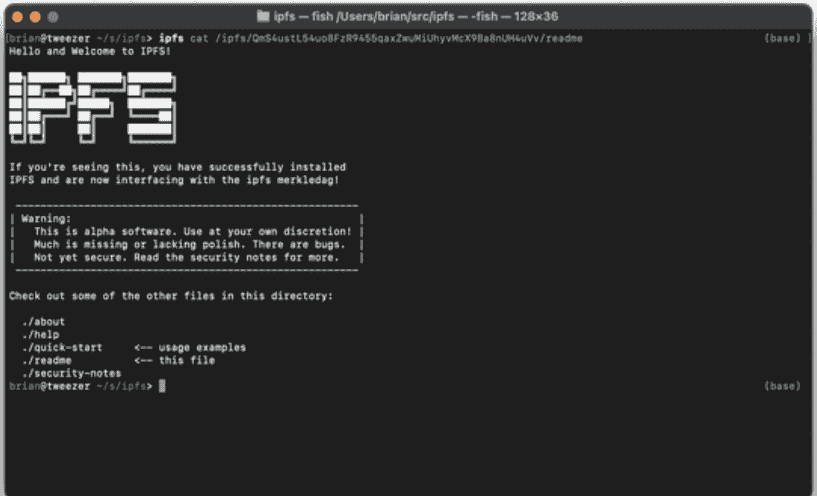
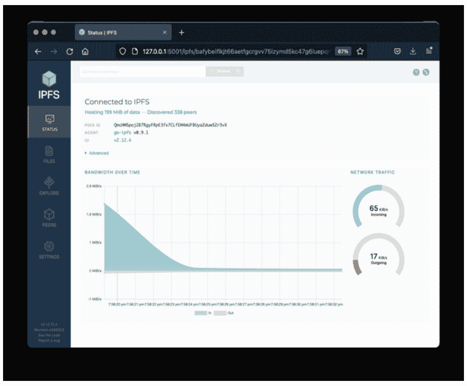
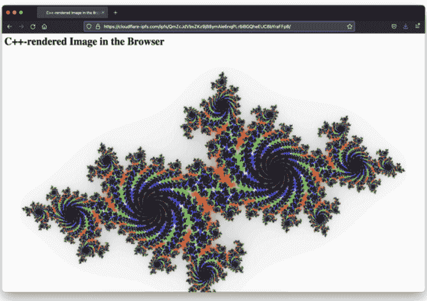

## 第 16 章。应用 WebAssembly：去中心化应用

### 早期发布读者须知

凭借 Early Release 电子书，您可以在这些书籍的正式发布之前很久就利用这些技术——作者在写作时的原始未编辑内容，以便您能够在这些标题的正式发布之前就利用这些技术。

这将是最终书籍的第 16 章。

如果您对我们如何改进本书的内容和/或示例有任何评论，或者如果您注意到本章中缺少材料，请联系作者 wasmbook@bosatsu.net。

> 当代技术确实允许去中心化，它也允许中心化。这取决于你如何使用技术。
> —Noam Chomsky

我们编写的软件根据部署的位置和方式承担不同的角色。传统系统通常是单一应用，接收输入，进行一些处理并产生输出。Unix 命令通常是协调在一起形成脚本化工作流的工具。在本书中，我们主要讨论了 WebAssembly 在客户端用户界面的优势，并偶尔涉足服务器端技术。如今，我们的软件在云中扮演许多其他角色，通过微服务架构、在嵌入式系统和移动设备中，以及无服务器函数。

这些不同的角色通常在架构上服务于一个目的，试图管理变化，允许独立的技术选择，满足规模需求或促进重用和避免孤岛。分散元素如何组织和协调存在内在的张力。大多数传统系统都是集中管理的，但我们看到开发人员能够将广泛部署的去中心化系统驯服为生产性使用的能力不断增强。让我们先讨论一些权衡。

### 集中化 vs 去中心化

我们的行业长期在集中化和去中心化之间摇摆。两种安排都不是理想的，各自都有好处和负面影响。集中化易于控制、索引、优化并提供统一体验。去中心化可以稳定、赋权且抗审查。大中型机、托管服务和信息孤岛式社交媒体网站是集中化的例子。个人电脑、移动设备和文件共享系统是去中心化类型的例子。

拒绝人们访问集中化资源很容易。如果不维护，它们通常很脆弱。许多政府试图通过控制信息访问来控制某些思想的访问。去中心化系统很难变得有用、高效，并且避免市场压力，这些压力最终会在某个时候鼓励重新集中化。

Web 总体上在两种力量之间取得了相当不错的平衡。一方面，任何人都可以发明一种新协议并在端口上监听与其通信的客户端。直到我们引入命名之前，没有必要的集中化。域名系统（DNS）具有集中取向。尽管为了速度和便利而在层级上分散，但仍存在权威。一旦你拥有域名，你就可以在该域中创建任意多的资源。你可以自由共享它们并授予你选择的任何人访问权限。但是，DNS 也可以被控制，正如那些在咖啡店、飞机上或压迫性政权国家使用 WiFi 的人所悲伤地发现的那样。


问题的一部分在于使用基于位置的身份标识。一方面，能够通过 HTTP 协议连接的名称是我们将要交互的事物，这非常有用。另一方面，如果我们决定停止托管这些资源，它们就会消失。在我之前关于资源导向架构模式¹的书中，我将策展的 URI 模式识别为为交互带来稳定性的方式。但正如任何遇到过损坏链接的人都可以证明的那样，这种做法并不被广泛采用。

网络的一个好处是，内容生产者和内容消费者在很大程度上可以自行选择技术。通过使用标准，我们可以交换声明性结构来定义布局和样式选择，这些选择在各种目标上都能很好地工作。Javascript 很早就成为这个故事的一部分，现在，正如你所见，WebAssembly 也是如此。

去中心化受益于对标准、协议和工程实践的一致使用，这些标准、协议和工程实践允许任意参与者交换内容。能够以可移植、安全和高效的方式交换可执行内容将拓宽可能性的范围。

当我们在 Parabon 构建分布式计算系统时，我们不得不依赖 Java 语言和平台，以便获得我们需要的<|message|>安全和可移植性保证。我们最终是一个集中控制的平台，但在现代环境中，使用 WebAssembly、WASI 以及我们讨论过的各种运行时，构建类似的去中心化系统是相当直接的。在上一章中，我们看到这如何帮助演进我们的计算格局。正如 Chomsky 所说，我们可以支持任一方法；我们做什么由我们决定。

我们现在将讨论一些去中心化平台，包括：

- Bitcoin and Legacy Ethereum
- ewasm
- The Polkadot Network
- The Interplanetary File System (IPFS)

### From Bitcoin to Ethereum

去中心化系统的代表之一尤其是 Bitcoin 以及加密货币²一般而言。尽管有过度的炒作和负面的唱衰，Satoshi Nakamoto 设计到系统中的东西从技术和社会角度来看是相当了不起的。讨论一项技术的整体性时需要考虑许多未被计入的外部性，但我想专注于与手头主题相关的内容。

除了明显的货币概念之外，Bitcoin 系统充满了可以驱动利益相关者行为的经济杠杆。其主要成就是开发了一种共识机制，允许参与者在无需真实身份或薄弱信任概念的情况下就规则及其执行达成一致。到现在，大多数人都知道它是如何工作的，但为了清晰起见，我将简要总结它，作为现代区块链思维的基础。我们将在讨论作为后续平台的 Ethereum 时将其与 WebAssembly 联系起来。

Bitcoin 有一个最大货币基数将被释放。它使用计算困难的问题来控制货币随时间递减的稳定释放。大约每十分钟左右，生态系统就会增加一点，但随着时间的推移，它正在逐渐减少。矿工验证平台上执行的所有交易。这是他们的主要目的。但作为回报，他们可以参与一个循环的谜题来找到哈希问题的解决方案。随着更多矿工参与，攻击问题的能力就越强，所以它会随着时间的推移变得更困难。在当前形式下，单台计算机独自解决一轮需要数十万年。

没有人有那种时间，所以他们通过矿池并行合作在几分钟内找到它。找到它的节点会将其解决方案告知其他矿工，其他矿工验证结果。一旦大家就结果达成共识，这就使该节点有权授予自己 CoinBase 交易³，该交易将与矿池同伴共享。获胜节点还必须决定哪些其他交易将进入当前区块，然后将其链接回之前的区块。这就是区块链名称的由来。

实际上在节点上运行的东西相当受限。它是大量的哈希交易、通信协议以及涉及执行一种名为 Script 的小型类似 Forth⁴语言的交易验证。这主要只是验证将 Bitcoin 发送到另一个账户的账户是否控制着与该账户关联的私钥。实际上没什么大不了，也没什么别的可以做的。有一些回旋余地，但它是有意受限的语言，因此易于在多个平台上支持。

我解释 Parabon 在做什么的一种方式是，它就像 Seti@Home 项目⁵一样，只是它是基于 Java 的通用预先编程解决方案。后者的区别在于 SETI@Home 最初只做一件事⁶。它只是分块处理数据。因此，他们可以相当放心地使用别人的电脑，因为它只做固定数量的任务。

正如我在第 15 章中指出的那样，我们在平台上运行什么问题方面实际上受到特定类型的限制，但实际代码可以是我们允许的任何内容（即无磁盘或网络访问）。我们做了素数搜索、线性扩展的基因序列比较、机器学习、电离层模拟等等。由于我是公司的第一位工程师，我被问到的一个问题是“你如何控制失控的进程？”我们使用别人的电脑，但我们正在考虑允许客户端运行任意代码。这就是我们面临的安全代码安装在我们的电脑、手机、平板电脑和手表上的同样困境。

Bitcoin 核心开发者希望矿工节点上可能发生的事情保持受限，更像 SETI@Home。Vitalik Buterin 和其他人希望平台上可以运行的内容得以扩展。当很明显这不可能时，Ethereum 项目因此而出现。两个项目之间的主要区别之一是关于节点上将运行什么的性质。Ethereum 开发者想要一种图灵完备语言⁷。撇开大量理论不谈，这又回到了失控任务的问题。所以，让我们快速绕道谈谈这个问题。

### How do you solve a problem like The Halting Problem?

如果我们想在计算平台上运行任意任务，有两种方法来确定代码是否最终会停止。一种是推理它，另一种是尝试它，不幸的副作用是可能要等到宇宙热寂发生之前我们才能回答这个问题。其中一个可能比另一个更难，而事实证明，它不是尝试和等待（尽管这仍然不推荐）。

在可计算性理论中，这被称为不可判定问题⁸，这是 Bitcoin 开发者对运行图灵完备语言的想法不感兴趣的原因之一。如果你要为使用别人的电脑的时间付费，知道程序是否会结束会很好⁹。

然而并非一切都丢失。Ethereum 平台上的矿工节点必须运行任意合约代码。你使用的计算资源越多（存储、CPU 时间等），你就必须支付越多。启动一个合约执行并让它运行几个千年，然后才意识到你永远不会为这项工作得到报酬，这会非常令人恼火。Ethereum 团队提出了一个很好的解决方案，称为“gas”。想法是如果你想跨国驾驶，你最好有足够的钱买汽油。否则，在中途你会耗尽汽油，你可能会被困住。Ethereum 合约会通过快速启发式方法评估其运行的大致成本，启动合约的客户端必须支付这么多或更多。随着合约执行，它会消耗 gas 并可能耗尽。如果耗尽，节点会得到努力的补偿，而你可能一无所有。这是对一个


otherwise intractable problem. It also simultaneously forces contract developers to exercise caution and test their code locally.

The Ethereum project also intended to run on a variety of hardware and software platforms so the code that gets executed made sense to be virtualized. They designed a handful of contract languages, but the one that caught on initially was called Solidity. It has an LLVM-based compiler, but it emits a bytecode that can run on their custom virtual machine. As you can imagine, this was a non-trivial engine to write so, as WebAssembly emerged, there became a lot of interest in migrating to a new virtual machine that they would not have to maintain.

The concept of gas is still important, however. As WebAssembly is being imagined as the engine for several blockchain-based projects, it is unsurprising that the idea has begun to show up in the platforms we are discussing as well.

In Example 16-1 you can see a simple implementation that calculates Fibonacci numbers directly in Wat taken from the WasmTime GitHub repository. If you need a refresher on the algorithm, check out our example in Chapter 4.

#### Example 16-1. Wat implementation of Fibonacci numbers

```
(module
  (func $fibonacci (param $n i32) (result i32)
    (if
      (i32.lt_s (local.get $n) (i32.const 2))
      (return (local.get $n))
    )
    (i32.add
      (call $fibonacci (i32.sub (local.get $n) (i32.const 1)))
      (call $fibonacci (i32.sub (local.get $n) (i32.const 2)))
    )
  )
  (export "fibonacci" (func $fibonacci))
)
```

Notice there is no concept of time or cost in this calculation. It is recursive but it will just do what you ask it to do. While this is not an excessively hungry calculation, you could keep a node busy calculating a large number of Fibonacci numbers. What we would like is a concept like gas that allows us to do what we want to do, but to measure the cost and to cut it off if it exceeds that cost.

The code in Example 16-2 is able to do this because Wasmtime supports the concept of “fuel”. Remember that Store instances are keepers of the runtime instance details, so we allocate 10,000 fuel units in the store. We instantiate a compiled version of our .wat file as a module so we can invoke the fibonacci() function.

#### Example 16-2. Rust Wasmtime example with fuel

```
use anyhow::Result;
use wasmtime::*;

fn main() -> Result<()> {
    let mut config = Config::new();
    config.consume_fuel(true);
    let engine = Engine::new(&config)?;
    let mut store = Store::new(&engine, ());
    store.add_fuel(10_000)?;
    let module = Module::from_file(store.engine(),
"examples/fuel.wat")?;
    let instance = Instance::new(&mut store, &module, &[])?;

    // Invoke `fibonacci` export with higher and higher numbers until we
    // exhaust our fuel.
    let fibonacci
        = instance.get_typed_func::<i32, i32, _>(&mut store,
"fibonacci")?;

    for n in 1.. {
        let fuel_before = store.fuel_consumed().unwrap();
        let output = match fibonacci.call(&mut store, n) {
            Ok(v) => v,
            Err(_) => {
                println!("Exhausted fuel computing fib({})", n);
                break;
            }
        };
        let fuel_consumed = store.fuel_consumed().unwrap() -
        fuel_before;
        println!("fib({}) = {} [consumed {} fuel]", n, output,
        fuel_consumed);
        store.add_fuel(fuel_consumed)?;
    }
}
```
```
}
    Ok(())
}
```

Once we have the instance, we start an unbounded loop of n from 1 to infinity. Clearly we do not want to wait for this code to complete on its own. So, we are going to leverage fuel. Individual instructions are calibrated as having a cost, so we keep track of how much we spend each iteration and subtract it from our available fuel deposit. Once we run out, our attempt to invoke the function will fail and break out of the loop.

So, we have a general capability that can be built into various runtimes to allow us to run arbitrary code safely without concern about whether it will spin out of control or not. Building a generic blockchain engine out of this capability is clearly one potential use.

### ewasm

The legacy Ethereum Virtual Machine is referred to as EVM1. The new version is known as ewasm. The documentation and design process are available here: https://ewasm.readthedocs.io. This is a work in progress and there have been many changes along the way, but the goal is still to create a new virtual machine on a WebAssembly base for all of the reasons that should be obvious by now. One consequence that may not be obvious is that this will likely open up contract languages to a much wider given the ease with which LLVM-based compilers can be reused.

They did not come to this decision lightly. As can be seen on the “Comparison with Other Architectures” section of the documentation linked above, they considered all manner of intermediate representations and bytecode formats as the possible basis for this new virtual machine.

The main arguments for heading down this path are obviously speed, efficiency, and security. We are talking about a standards-based instruction set which will be curated and extended over time by the W3C. The Ethereum community will benefit from this work and will not have to make all of the design decisions themselves. The widespread and growing

toolchain support for a wider number of languages is going to create a natural path for using languages that developers are already familiar with such as C/C++, Rust, Go, AssemblyScript, and more (including some new ones we will discuss in the final chapter!).

WebAssembly is intrinsically portable which will also reduce the burden on the Ethereum developer community to target an increasing number of hardware platforms as they become available. This portability and the performance gains will also allow more of the Ethereum platform itself to be expressed in Wasm instructions which keeps the size of the codebase down when supporting multiple platforms. This is useful both from a level of effort and a code analysis for security auditing perspective.

They do not want to design themselves into a corner, however, so they are introducing some new ideas. The first is the idea of the Ewasm Contract Interface (ECI) which defines the structure of a contract module. Modules are communicated in the Wasm binary format. Contracts will be allowed to import symbols defined to be part of the Ethereum Environment Interface (EEI). This exposes the core Ethereum API to the ewasm environments. You can think of it a little like the relationship between WASI and WASI-host environments. Contracts are expected to export a main() function to initiate the contract and a Memory instance for sharing data between contracts and its host environments. Again, these should make sense to you by now.

I am not able to give you a proper tutorial for this new platform here, but the basic idea is that contracts will need to be able to fetch and store data, call functionality in other contracts, be deployed at knowable addresses, etc. The concept remains that the more burden a contract puts on the platform, the more cost it will incur. Gas still remains and so there will be an intricate metering capability similar to what we saw in the previous section but with more nuance.

Because different instructions might cost more or less on different platforms, they are assigning each Wasm opcode to one or more IA-32 (x86) instructions having a fixed cycle count. This is expected to represent an average CPU used to host Ethereum nodes running at approximately 2.2GHz. One second of CPU use is configured to cost 10 million gas. These numbers are not going to be fixed in time and will be periodically adjusted based upon observation and the evolution of hardware systems.

The cost of an instruction is equivalent to a cycle count * the gas per cycle equivalence for the instruction type. For example, the get_local instruction costs 3 cycles and is expected to cost 0.0135 Gas. Loading things into and out of memory will have similar costs. Accessing constant values (e.g. i32.const) does not require any transfer of data, calculation or storage so it is essentially a 0 gas operation.

As there is so much compiled EVM1 bytecode in existence, there are also plans to have a Transcompiler to convert EVM1 bytecode into ewasm bytecode for backward compatibility. There are some differences including that EVM1 uses 256-bit integers by default and ewasm will use 64-bit integers, but there will be compensating actions to make it all work and price the work accordingly in the new environment.

Finally, there will also be predefined contracts for functionality that will be needed as part of the behavior of the Ethereum environment to function properly. This includes a sentinel contract for validation and metering injection, the transcompilation of EVM1 to ewasm, various hashing algorithms (e.g. SHA2-256, RIPEMD160, KECCAK256), and more.

This remains an adventurous work in progress, but the design motivation makes sense and the selection criteria aligns with many of the reasons we have highlighted for being excited about WebAssembly in general. Decentralized systems have a lot of innate complexity in them. Whatever they can do to standardize, secure, optimize, and expand the range of contract language options available to cryptocurrency smart contract developers is likely to strengthen the Ethereum platform overall.

### Polkadot

While Bitcoin is the overall market leader in the cryptocurrency space, Ethereum has emerged as a close second. With its support for multiple


languages and arbitrary contracts in a widening collection of languages, if you needed to target a specific, non-Bitcoin platform, Ethereum would be a defensible choice even with some of the growing pains it has experienced over the years. But what if you did not want to tie yourself to a single platform such as Ethereum? This is where Polkadot comes in. It is a new blockchain project designed from the ground up with blockchain interoperability in mind.

Polkadot¹⁰ was founded by Dr. Gavin Wood, author of the Ethereum Yellow Paper¹¹, with an eye toward upgradeable, extensible, and interoperable blockchain capabilities. It is one of the cornerstones of the Web3 Foundation¹².

One of the projects funded by the Web3 Foundation was to bring an ewasm virtual machine into the Polkadot ecosystem. The contract was awarded to Second State, makers of the WasmEdge platform we introduced in the previous chapter. The project is called Substrate and its webpage is here: https://substrate.dev. You can find the project on GitHub: https://github.com/second-state/substrate-ewasm. With support for the ewasm contract interface and execution environment, this opens the door for Ethereum contracts to be transparently deployed to Polkadot-based blockchains. Not only does this avoid lock-in, it also increases the transfer of ideas, contracts, and capabilities into an ever richer collection of blockchain-based stakeholders. Other projects based upon the SecondState ewasm engine include Oasis Ethereum¹³ and Parastate¹⁴.

These are simply a couple of examples of the intersection of WebAssembly and blockchain-flavored decentralization. I anticipate there will be many, many more, but for now I want to wrap up the chapter with a quick introduction of another one of my favorite decentralization projects that is also a star of the Web3 world. It too will benefit from WebAssembly.

### Interplanetary File System (IPFS)

I have to admit, I fell in love with this project initially just for its name. Granted, I have come to respect it and honestly be in awe at what the
community is able to produce since then, but the name still rules. The thing is, it is not just a clever name. It is simultaneously a historical reference¹⁵ and an aspirational nod to a future that is closer than most of us are anticipating. Humans will soon be going back to the moon and making early forays to Mars. The network latencies involved with communicating with bases on these planets are going to be problematic. One aspect of the design criteria for IPFS is to help solve some of these issues. I will not bother explaining how they plan to do this, but perhaps that will pique your curiosity to investigate. The project produces an overwhelming amount of code, documentation, videos, and tutorials, but their main website is a good starting point: https://ipfs.io.

One of the coolest aspects of IPFS is that they are designing their layers around the idea of reuse across projects. You do not have to buy into their entire stack, elegant as it is. Instead, you can pick and choose the pieces that your project might benefit from and go from there. Examples of useful (and reuseful) projects from this community includes Multiformats¹⁶, libp2p¹⁷, and IPLD¹⁸.

While there are many ways WebAssembly is showing up in this community, I want to highlight a very simple one. I am not going to describe how IPFS works in detail, but there are some core ideas. The whole thing is based upon Merkle-DAGs¹⁹. A Directed Acyclic Graph (DAG) is a graph structure that has identifiers based upon hashes of the node’s contents. Merkle DAGs are similar to Merkle Trees²⁰ which are useful for detecting changes of content-based addressable blocks.

The net effect of these decisions is that files can be broken down into dependencies between blocks that are identified by content identifiers (CIDs) driven by the actual content of the blocks. As files change, the only portions that need to be updated are the effected blocks. Doing so does not invalidate the existing immutable Merkle DAGS, so multiple versions of files can co-exist simultaneously.

If you do not have a background in these kinds of decentralized systems, there are a lot of behind-the-scenes details that we do not need to focus on
to make my larger point. To hide those details, I am going to use the Go-based command line tools from the IPFS project. You can find how to install these in Appendix A if you are interested in trying them. There are libraries in many other languages. Many of these do not require you to install and run things locally if you do not want to. As you will see below there are HTTP gateways for bridging the Web as you know it and the IPFS network.

In order to use the tools, you need to generate an identity. This does not involve your name or anything, it is just an RSA keypair that can be used to digitally sign documents and communicate with the large network. Creating a node identity is easy.

```
brian@tweezer ~> ipfs init
initializing IPFS node at /Users/brian/.ipfs
generating 2048-bit RSA keypair...done
peer identity: QmZoRwJ7YYayf5eNWDweN5GCGJjuRnKGJA3susZqjV8Jcb
to get started, enter:
    ipfs cat
/ipfs/QmS4ustL54uo8FzR9455qaxZwuMiUhyvMcX9Ba8nUH4uVv/readme
```

The very long content identifier (CID) that starts with QmZoRwJ refers to the node I created. There are no services running yet, we simply have tools that allows us to communicate with the IPFS network. That includes the ability to request files. Files have similar CIDs to the node, as do blocks. If you dig into the IPLD model mentioned above, you will see that it is just a big interlinked collection of named, immutable nodes. The comment at the end of what was produced above indicates that we can find out more by issuing that command. As you will see soon, you do not need to have these tools involved, but at this point something needs to know how to communicate with the network. The ipfs command line tool takes multiple arguments. One of them makes it act like the Unix cat command to show the contents of a file. In this case, it is a file called readme referenced as a subelement of the directory it lives in. This convenience is a bit like a fragment identifier on a Web URL to avoid multiple round trips. We can ask for it in one go. The results should look something like what you see in Figure 16-1.



Figure 16-1. Requesting files from IPFS

Note that there are other files in that directory so you could ask for them as well. If you did not know what files were available, you could simply ask IPFS. Notice below I am using the directory name on its own. As you can see, each file in the directory has its own CID.

```
brian@tweezer ~/s/ipfs> ipfs ls
/ipfs/QmS4ustL54uo8FzR9455qaxZwuMiUhyvMcX9Ba8nUH4uVv
QmZTR5bcpQD7cFgTorqxZDYaew1Wqgfbd2ud9QqGPAkK2V 1677 about
QmYCvbfNbCwFR45HiNP45rwJgvatpiW38D961L5qAhUM5Y 189 contact
QmY5heUM5qgRubMDD1og9fhCPA6QdkMp3QCwd4s7gJsyE7 311 help
QmejvEPop4D7YUadeGqYWmZxHhLc4JBUC zJHHWMzdcMe2y 4 ping
QmXgqKTbzdh83pQtKFb19SpMCpDDcKR2ujqk3pKph9aCNF 1681 quick-start
QmPZ9gcCEpqKTo6aq61g2nXGUhM4iCL3ewB6LDXZ C tioEB 1091 readme
QmQ5vhrL7uv6tuoN9KeVBwd4PwfQkXdVVmDLUZ uTNxqgvm 1162 security-notes
```

Adding files to IPFS is easy. I am going to take the example from Chapter 6 where we rendered a Windows bitmap file from C++ in the browser. As a reminder, this is what is in that directory.

```
brian@tweezer ~/s/i/bitmap> ls -alF
total 1800
drw xr-xr-x   11 brian  staff      352 Aug 18 12:27 ./
drw xr-xr-x    3 brian  staff       96 Aug 18 12:26 ../
-rw-r--r--@   1 brian  staff      893 Aug 18 12:26 Makefile
-rw-r--r--@   1 brian  staff      948 Aug 18 12:26 Makefile.lib
-rw-r--r--@   1 brian  staff      776 Aug 18 12:26 Makefile.orig
-rw-r--r--@   1 brian  staff   247721 Aug 18 12:26 bitmap_image.hpp
-rw-r--r--@   1 brian  staff    21026 Aug 18 12:26 bitmap_test.cpp
-rw-r--r--    1 brian  staff   249496 Aug 18 12:26 bitmap_test.js
-drwxr-xr-x    1 brian  staff   257924 Aug 18 12:26
bitmap_test.wasm*
-rw-r--r--@   1 brian  staff   120054 Aug 18 12:26 image.bmp
-rw-r--r--    1 brian  staff     3127 Aug 18 12:26 index.html
```

To add the files, we just go into that directory and issue the following.

```
brian@tweezer ~/s/i/bitmap> ipfs add -r .
added QmUViZoR2Znn pG XyNxRyVp4kpG64kCYgHLp7w3SdmUsRcf
bitmap/Makefile
added QmTPTTSvSdwgjGciTH5EgoPdujcrfXvqqSXDUB83uoFhR5
bitmap/Makefile.lib
added QmWF i2rEqobqnz9RZbWrtjNRcftkbRUNmK SoxZxDuMzhDT
bitmap/Makefile.orig
added QmZbBUguGknW7wWAKJoZ2XXiDXAsa1zDQgLSuKn7JX7edy
bitmap/bitmap_image.hpp
added QmNffnsKcGhNveuEXUuwmLYUqMEW33ZpmY3Xke1oK7Y7Uh
bitmap/bitmap_test.cpp
added QmWcuK2svP5qyDaDksvtWanNqDGDoj3CfuqsJXkrKY3MNo
bitmap/bitmap_test.js
added QmRwyDerSuwq1VrP56gy28JsXTXYyhPyHxFWH1zctHHe5m
bitmap/bitmap_test.wasm
added QmQDwr7R6WxMJgiV4PWkLMJxpzAV8pXhafwfr5omoD93xp
bitmap/image.bmp
added Qmdn3WDNXNm94c5FFBPUDq7kdfoeRP8JfgyjAd1BroQFni
bitmap/index.html
added QmZcJdVbvZkz9jB8ymAie6nqPLr6iBGQheEUC8bYraFFpB bitmap
880.83 KiB / 880.83 KiB
[==================================================] 100.00%
```

At this point the directory has an identifier as do all of the files. Nobody else in the world can see these yet even if they were able to guess the node identity²¹. In order to publish, you need to start an instance of the IPFS Daemon, a background server that communicates with peers and responds


to requests from other nodes. 启动并同步需要一些时间，但运行守护进程的结果看起来大致如下。

```
brian@tweezer ~> ipfs daemon
Initializing daemon...
go-ipfs version: 0.9.1-dc2715af6
Repo version: 11
System version: amd64/darwin
Golang version: go1.16.6
Swarm listening on /ip4/127.0.0.1/tcp/4001
Swarm listening on /ip4/127.0.0.1/udp/4001/quic
Swarm listening on /ip4/169.254.245.235/tcp/4001
Swarm listening on /ip4/169.254.245.235/udp/4001/quic
Swarm listening on /ip4/192.168.1.169/tcp/4001
Swarm listening on /ip4/192.168.1.169/udp/4001/quic
Swarm listening on /ip6/::1/tcp/4001
Swarm listening on /ip6/::1/udp/4001/quic
Swarm listening on /ip6/fd4b:2552:d54e:3:1444:3cef:8a9b:25f3/tcp/4001
Swarm listening on /ip6/fd4b:2552:d54e:3:1444:3cef:8a9b:25f3/udp/4001/quic
Swarm listening on /ip6/fde3:9366:f229:3:18e0:193e:c7d2:8aaa/tcp/4001
Swarm listening on /ip6/fde3:9366:f229:3:18e0:193e:c7d2:8aaa/udp/4001/quic
Swarm listening on /p2p-circuit
Swarm announcing /ip4/127.0.0.1/tcp/4001
Swarm announcing /ip4/127.0.0.1/udp/4001/quic
Swarm announcing /ip4/192.168.1.169/tcp/4001
Swarm announcing /ip4/192.168.1.169/udp/4001/quic
Swarm announcing /ip6/::1/tcp/4001
Swarm announcing /ip6/::1/udp/4001/quic
API server listening on /ip4/127.0.0.1/tcp/5001
WebUI: http://127.0.0.1:5001/webui
Gateway (readonly) server listening on /ip4/127.0.0.1/tcp/8000
Daemon is ready
```

这些看起来很奇怪的标识符展示了上面提到的 Multiformats 的强大之处。这些是自描述的网络引用。我们有守护进程用于与同伴通信的各种端口和协议。我们有它监听的端口、它绑定的 IP 地址（例如 localhost 或其他接口）、其网络类型（即 ip4 与 ip6）以及用于与我们的节点通信的首选传输方式。注意 TCP 与 QUIC over UDP 之间的区别。这是一个极其强大的思想，它在整个技术栈中支持弹性、简单的交互模型和可扩展性。

守护进程会通过 DNS 查找引导节点。它可以使用多播 DNS（mDNS）在同一网络上查找其他节点。有很多方式可以与外界通信。但是，几分钟后，你可以通过以下方式查明它正在与谁通信。我省略了大量结果，但我们可以看到对等方的 Multiformat 网络引用，包括它们的节点身份以及与之通信的首选方式。

```
brian@tweezer ~/s/ipfs> ipfs swarm peers
/ip4/1.170.45.218/tcp/44262/p2p/QmbsXKVDhxFDgZW6zxrGfgPjXopvhNmGFqqqazv1kyZLkv
/ip4/1.254.1.205/tcp/45622/p2p/QmRePjhxRLWJoAXan79JzvxeUwqW5DyeZbHfxi3yIbSke7
/ip4/101.18.52.217/udp/38214/quic/p2p/12D3KooWBjaFGCZ1heSh4HBy6tsj31348hDeGZhBnRRonCa2JtLT
/ip4/101.70.141.179/udp/7962/quic/p2p/12D3KooWAwcdxRJbDXcYh4FxrNkarnT1BGmqYTedc16oGim4WK8m
/ip4/104.131.131.82/udp/4001/quic/p2p/QmaCpDMGvV2BGHeYERUEnRQAwe3N8SzbUtsmvsqQLuvuj
/ip4/104.207.140.198/udp/4001/quic/p2p/12D3KooWFgmp9SgKqGvcE5zEs19iGq16gpMqeV5CYMo2vdD8KiJb
/ip4/104.236.47.160/tcp/4001/p2p/QmXhDHnhAr1PAE6pK1GbxN1Ez5zmkJHq vSN1GHSgPiuLWP
/ip4/104.238.220.184/tcp/4001/p2p/QmRi2tR7Uf33VmKhGBUNZvFEuCnFwaL Lf2FsdYNcLCm4gu
/ip4/104.248.69.187/tcp/4001/p2p/12D3KooWHoqCWMkMuDrauyD6wuJUrPoQ fZGPULj99hX94eu69ps5
/ip4/107.173.84.101/tcp/4001/p2p/12D3KooWNKQGwEMJXqta2uV2xBSsVrN1 jZKd78CF4QossGghaLSe
/ip4/107.184.158.170/udp/35299/quic/p2p/12D3KooWQMeiAvzKWGM7V83EN kNqtgJJhdQeQ2xLAihWvvaaXMuC
/ip4/109.153.171.191/tcp/4001/p2p/12D3KooWK2mqKoGUtZeiJpKCJc3XWLw yk2oC9isNPzvW6ftq9GSv
/ip4/109.194.47.83/tcp/4001/p2p/QmQmfPz9Xn4cNE6vfWcfrozeNDCx9BJFC dRMM3Cnmx2226
/ip4/109.206.48.199/tcp/35317/p2p/QmaY9GdxBY2ovzD1HNhcyBhawTda7gu 6QU8rHv6w4pTfqv
/ip4/111.229.166.178/tcp/4001/p2p/12D3KooWAjVr5JL7VgfoNqT8zro2bp9 fMKUamF2WAYE4syRzBR3z
/ip4/111.92.180.99/tcp/53353/p2p/QmYNmBBbzV7AVytNHmVgoHAKd9CvFRWDj32qvHDyjCgJMe
...
```

守护进程在有人请求之前不会开始发布文件，但它也启动了一些本地服务。第一个是监听在 /ip4/127.0.0.1/tcp/8000 上的只读 HTTP 网关。我们一直在使用 IPFS Go 命令行工具，但我们本地主机上的任何其他人都可以不受这些限制地访问此服务。

举例来说，IPFS 中有一张著名的猫的图片。你可以使用命令行工具请求其详细信息。

```
brian@tweezer ~/s/ipfs> ipfs ls
/ipfs/bafybeidsg6t7ici2osxjkukisd5inixiunqdpq2q5jy4a2ruzdf6ewsqk4
/cat.jpg
QmPEKipMh6LsXzvtLxunSPP7ZsBM8y9xQ2SQQwBXY5UY6e 262144
QmT8onRUFpgvkoPMdMvCHPYxh98iKCfFkBYM1ufYpnkHJn 181086
```

你看到的是与该文件关联的两个块。你也可以使用守护进程的本地 HTTP 网关，如图 16-2 所示。URL 被遮蔽了，但没有什么花哨的，浏览器只是在通过 HTTP 请求文件。


图 16-2. 通过 HTTP 网关从 IPFS 请求文件

本地 HTTP 网关不止一个。IPFS 项目在 https://ipfs.io/ipfs/<CID> 上运行一个，CloudFlare 在 https://cloudflare-ipfs.com/ipfs/<CID> 上运行一个。只需将 CID 替换为猫图像节点名称和文件名，你也应该能在那里看到它。

我刚刚展示给你的可能比你意识到的更酷，因为两者都是 TLS 终止的端点。这意味着你可以通过嗅探数据包而无需任何人知道你在请求什么来从 IPFS 请求文件。IPFS 在绕过审查方面非常成功。任何试图扼杀一个网关的尝试都可能引发更多网关的出现。

守护进程启动的另一项服务是用于浏览节点详情并更自然地与平台交互的 Web 应用程序。它在上面的守护进程输出中列为 WebUI，位于 http://127.0.0.1:5001/webui。如绑定所示，只有同一台机器上的用户可以访问它，但你可以将其配置为绑定到 IP 地址，以便任何其他本地网络机器都可以请求文件而无需安装任何 IPFS 工具。该应用程序如图 16-3 所示。



图 16-3. 通过 WebUI 与 IPFS 交互

在 WebUI 中你可以做很多其他很酷的事情，但为了回到主题，仔细看看这个窗口的地址栏。端口 5001 提供了一个 Web 应用程序……来自 IPFS。

```
brian@tweezer ~/s/ipfs> ipfs ls
/ipfs/bafybeiflkjt66aetfgcrgvv75izymd5kc47g6luepqmfq6zsf5w6ueth6y
bafkreigqagdyzmirtq1n7dc4qfz5sb7tkdexbzmhwoxzblkma3kakpeoqma 5324
asset-manifest.json
bafkreihc7efnl2prri6j6krcopelxms3xsh7undpsjqbf sasm7ikiyha4i 34494
favicon.ico
bafkreihmzivzfdhagatgqinzy6u4mfopfldebcc4mvim5rzrdpins5pr7a 4530
index.html
```

```
bafkreicayih3vhhjugxshbar5ylocvcqz4xixuqk6cflyxpnuxf2spwws4 24008
ipfs-logo-512-ice.png
bafybeiadadzwwymj72nnlyoy6bza4lhps6sofmgmyf6ew5klzwdae4g3pa -
locales/
bafkreicplcott4fe3nnwvz3bidothdtqd vpr5wygbxzoyfozm7tiues77q 298
manifest.json
bafybeierqn364ton5lp5ogcu4l22gukzprwieaau7lvcan555n3sg4i6we -
static/
```

浏览器请求 Web 应用程序所在目录的根 CID。index.html，如同往常，是默认文件。如果你 ipfs cat 该文件，你会看到它引用了静态资源、样式表等。某个地方，有人发布了这个应用程序。它并不是以传统意义上托管在云托管站点之类的形式托管。我对它的来源没有任何直接了解，但它通过 HTTP 网关本地提供给我的浏览器。

那我之前发布的包含 C++ 渲染位图文件的目录呢？因为我的守护进程已经运行了一段时间，其他节点现在可以请求它了。查看图 16-4，我的应用程序通过 CloudFlare 的 TLS 前端呈现的令人震惊的结果。

## C++-rendered Image in the Browser



图 16-4. 通过 IPFS HTTP 网关与我本地发布的文件交互

我不会再深入细节，但想强调这还意味着什么。请记住 Merkle DAG 是不可变的。如果我通过修改一两个文件来更改我的应用程序，只有这些文件需要重新发布。记住发布只是将文件添加到 IPFS。它们的编辑会导致其块的哈希不同，这意味着文件的哈希不同，这意味着目录的哈希不同。有了新的顶层 CID。但旧的仍然有效。你可以用 DNS 玩一些游戏，但我将留给你通过 IPFS 文档和教程自行发现。

这与 WebAssembly 有什么关系？我是想突出平台优势的交集以及它作为另一个用例所带来的影响。我刚刚演示了一个 Web 应用程序通过 CDN 提供服务，具有地理分布，而无需其他托管需求。它在本地提供服务，结果可以在途中缓存。这包括编译为 WebAssembly 并在沙箱中运行的 C++ 代码，在你使用的任何浏览器或平台上运行。多个版本


可以同时得到支持，并且用户可以决定何时升级。
你可以在不支付托管费用的情况下为世界各地的任意客户端提供服务。你可以使用任何你想要的语言来实现高性能的交互式系统，无论你的用户偏好什么平台。他们因为安全保护而感到舒适地运行你的应用程序，并且没有中央机构可以轻易地关闭你。
告诉我这不酷。

- 1. “Resource-Oriented Architectures: Patterns for Webs of Data”
- 2. Crypto means cryptography.
- 3. The CoinBase transaction is how BitCoin is minted at a controlled pace.
- 4. 你可以在这里阅读关于 Forth 的内容：https://en.wikipedia.org/wiki/Forth_(programming_language)
- 5. 有关超级酷的 Seti@Home 项目的更多详细信息可以在这里找到：https://en.wikipedia.org/wiki/SETI@home
- 6. 他们最终将所做的事情扩展为一个更通用的框架，称为 BOINC。你可以在这里阅读相关内容：https://en.wikipedia.org/wiki/Berkeley_Open_Infrastructure_for_Network_Computing
- 7. 我不会把这个变成一门有限自动机课程。如果你想深入探讨更广泛的影响（小心，这是个深不见底的兔子洞），请查看这里：https://en.wikipedia.org/wiki/Turing_completeness
- 8. 关于不可判定性的更多信息：https://en.wikipedia.org/wiki/Undecidable_problem
- 9. Alan Turing 在 1936 年证明了这并不总是可能的。
- 10. 有关 Polkadot 网络的更多信息可以在其网站上找到：https://polkadot.network
- 11. Yellow Paper 著名地描述了以太坊平台上的许多设计动机。如果你对区块链技术更感兴趣，花时间阅读以下内容是值得的：https://ethereum.github.io/yellowpaper/paper.pdf
- 12. Web3 基金会资助对能够促进这种去中心化愿景整体成功的项目的<|message|>研究：https://web3.foundation
- 13. 有关 Oasis Ethereum 的更多详细信息可在以下位置找到：https://www.oasiseth.org
- 14. 有关 Parastate 的更多详细信息可在以下位置找到：https://www.parastate.io
- 15. J.C.R. Licklider 将早期版本的正在兴起的 ARPAnet（后来成为互联网）称为星际计算机网络。更多详细信息可以在这里找到：
https://en.wikipedia.org/wiki/Intergalactic_Computer_Network

- 16 Multiformats 允许你以自描述、灵活的状态表达哈希、网络地址和其他有用的值。更多信息：https://multiformats.io

- 17 libp2p 是一个 remarkable、可插拔、功能丰富的网络栈，允许交换传输、多路复用通道、处理高延迟环境等等。更多详细信息：https://libp2p.io

- 18 IPLD 是一种用于去中心化系统的链接数据格式。更多信息：https://ipld.io

- 19 有关 Merkle-DAGs 的更多详细信息：https://docs.ipfs.io/concepts/merkle-dag

- 20 有关 Merkle Trees 的更多详细信息：https://en.wikipedia.org/wiki/Merkle_tree

- 21 我会押注不会。
