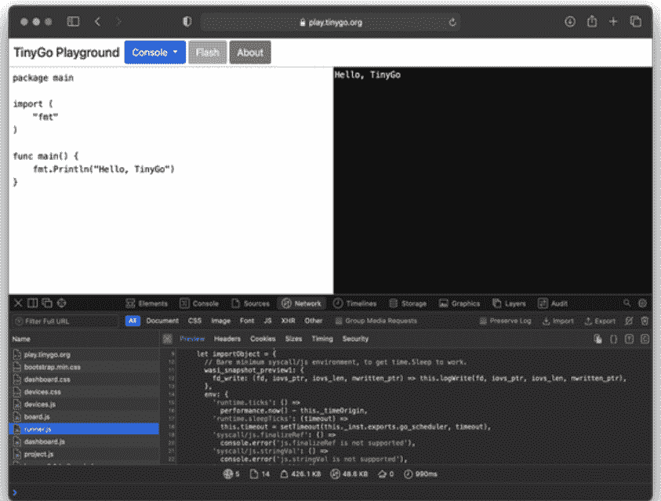
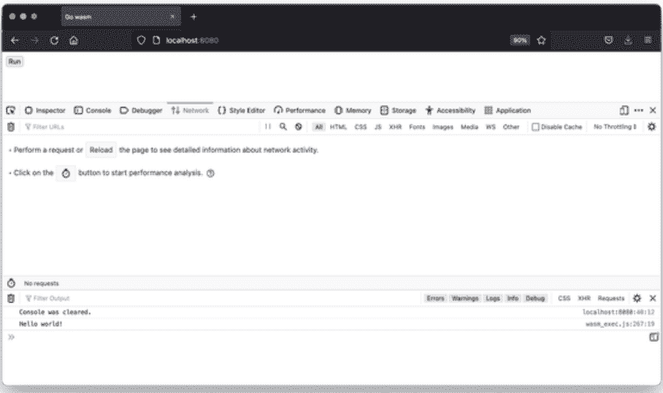
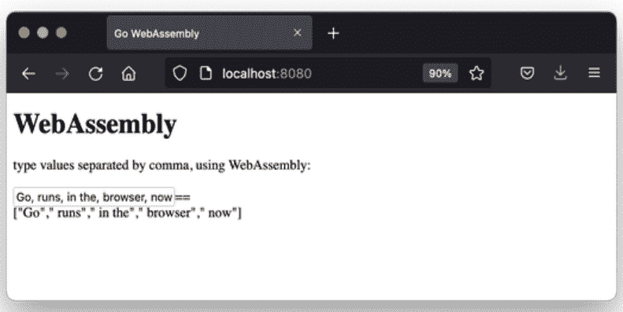
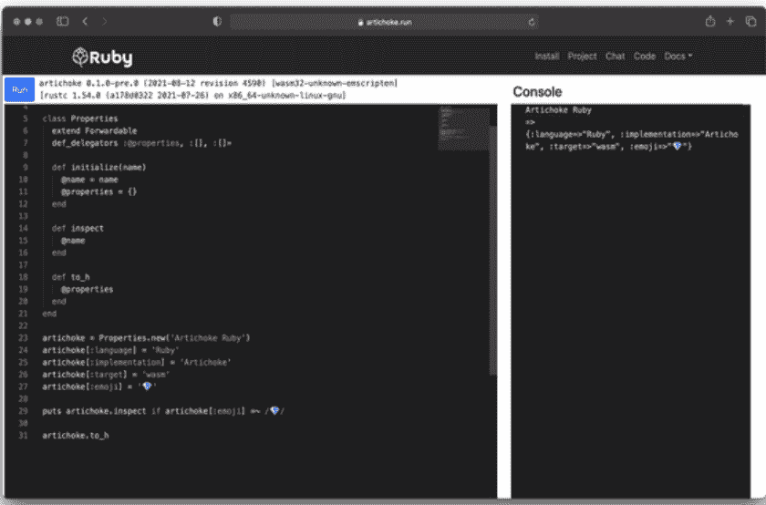
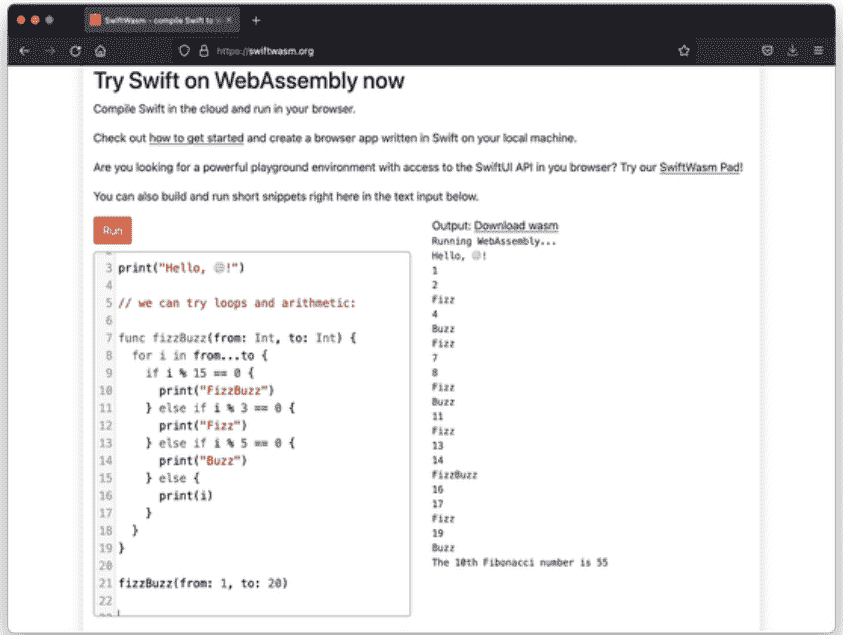
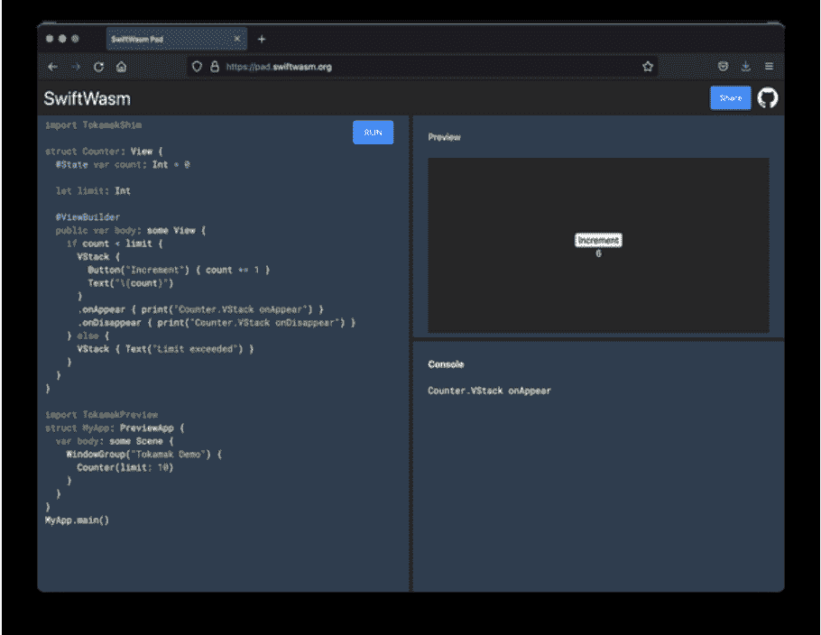

## 第 17 章. WebAssembly 和其他语言

### 早期发布读者须知

使用 Early Release 电子书，你可以在官方发布这些书名之前很久就利用这些技术——作者在写作时提供的原始未编辑内容。

这将是最终书籍的第 17 章。

如果你对如何改进本书的内容和/或示例有任何评论，或者如果你注意到本章中缺少材料，请联系作者 wasmbook@bosatsu.net。

> 如果你用一个人能理解的语言与他交谈，那会打动他的头脑。如果你用他自己的语言与他交谈，那会打动他的心灵。
> —Nelson Mandela

我们即将[content]

可以同时得到支持，并且用户可以决定何时升级。
你可以在不支付托管费用的情况下为世界各地的任意客户端提供服务。你可以使用任何你想要的语言来实现高性能的交互式系统，无论你的用户偏好什么平台。他们因为安全保护而感到舒适地运行你的应用程序，并且没有中央机构可以轻易地关闭你。
告诉我这不酷。

- 1. “Resource-Oriented Architectures: Patterns for Webs of Data”
- 2. Crypto means cryptography.
- 3. The CoinBase transaction is how BitCoin is minted at a controlled pace.
- 4. 你可以在这里阅读关于 Forth 的内容：https://en.wikipedia.org/wiki/Forth_(programming_language)
- 5. 有关超级酷的 Seti@Home 项目的更多详细信息可以在这里找到：https://en.wikipedia.org/wiki/SETI@home
- 6. 他们最终将所做的事情扩展为一个更通用的框架，称为 BOINC。你可以在这里阅读相关内容：https://en.wikipedia.org/wiki/Berkeley_Open_Infrastructure_for_Network_Computing
- 7. 我不会把这个变成一门有限自动机课程。如果你想深入探讨更广泛的影响（小心，这是个深不见底的兔子洞），请查看这里：https://en.wikipedia.org/wiki/Turing_completeness
- 8. 关于不可判定性的更多信息：https://en.wikipedia.org/wiki/Undecidable_problem
- 9. Alan Turing 在 1936 年证明了这并不总是可能的。
- 10. 有关 Polkadot 网络的更多信息可以在其网站上找到：https://polkadot.network
- 11. Yellow Paper 著名地描述了以太坊平台上的许多设计动机。如果你对区块链技术更感兴趣，花时间阅读以下内容是值得的：https://ethereum.github.io/yellowpaper/paper.pdf
- 12. Web3 基金会资助对能够促进这种去中心化愿景整体成功的项目的研发：https://web3.foundation
- 13. 有关 Oasis Ethereum 的更多详细信息可在以下位置找到：https://www.oasiseth.org
- 14. 有关 Parastate 的更多详细信息可在以下位置找到：https://www.parastate.io
- 15. J.C.R. Licklider 将早期版本的正在兴起的 ARPAnet（后来成为互联网）称为星际计算机网络。更多详细信息可以在这里找到：
https://en.wikipedia.org/wiki/Intergalactic_Computer_Network

- 16 Multiformats 允许你以自描述、灵活的状态表达哈希、网络地址和其他有用的值。更多信息：https://multiformats.io

- 17 libp2p 是一个 remarkable、可插拔、功能丰富的网络栈，允许交换传输、多路复用通道、处理高延迟环境等等。更多详细信息：https://libp2p.io

- 18 IPLD 是一种用于去中心化系统的链接数据格式。更多信息：https://ipld.io

- 19 有关 Merkle-DAGs 的更多详细信息：https://docs.ipfs.io/concepts/merkle-dag

- 20 有关 Merkle Trees 的更多详细信息：https://en.wikipedia.org/wiki/Merkle_tree

- 21 我会押注不会。

## 第 17 章. WebAssembly 和其他语言

### 早期发布读者须知

使用 Early Release 电子书，你可以在官方发布这些书名之前很久就利用这些技术——作者在写作时提供的原始未编辑内容。

这将是最终书籍的第 17 章。

如果你对如何改进本书的内容和/或示例有任何评论，或者如果你注意到本章中缺少材料，请联系作者 at wasmbook@bosatsu.net。

> 如果你用一个人能理解的语言与他交谈，那会打动他的头脑。如果你用他自己的语言与他交谈，那会打动他的心灵。
> —Nelson Mandela

我们即将结束我们的故事，至少现在是这样。我们已经看到了 WebAssembly 已经大放异彩的各种用例、语言和平台集成、托管环境等等。对于开发人员来说，有很多选择可以让他们在这种令人兴奋的新平台上保持生产力和有效性。有些语言及其相关运行时为何能与 WebAssembly 良好配合，而其他语言为何不能，有具体的理由。缺乏垃圾回收和在各处良好的线程支持是自 MVP 早期以来一直存在的障碍，但两者都正在稳步得到解决。

正如我们在第 12 章中所看到的，这些和其他限制是众所周知的，并且在各种主机和运行时环境中日益可用。对于开发人员可能想要使用的几乎任何语言来说，未来的支持将更加广泛。因此，请，如果你最喜欢的语言尚未得到支持，请保持信心。我不认为它需要很长时间才会得到支持。

话虽如此，对于许多其他流行语言甚至新兴但仍有些小众的语言，存在增量努力、部分解决方案和正在进行的工作，我们将在本章中讨论这些。我并不建议这些是更受支持语言的即插即用替代品，但，也许是让光线进入一个更美好的多语言 WebAssembly 未来的裂缝。正如开篇引言中 Madiba 所说，我们可以理解许多语言，但我们喜欢使用自己的语言。

### TinyGo

正如我在第 10 章中提到的，我最初被 Go 吸引作为用于取代 C 和 C++ 的系统语言，是因为其简洁的语法、与 Unix 和 Plan 9 的联系，以及 Rob Pike 和 Ken Thompson 的参与。当它在 WebAssembly 支持方面落后于 Rust 时，我的注意力减弱了，但我一直期待着这一差距缩小的一天。我们还没有完全达到，但我们正因一个名为 TinyGo¹ 的新变体而越来越接近。该项目并非特定于 WebAssembly，但它基于构建在 LLVM 基础设施上的新 Go 编译器，从而将 WebAssembly 作为后端打开。

从他们的 FAQ“什么是 TinyGo 呢？”² 中我们看到，它是一个基于标准库的解析器（因此可移植并且得到各种 WebAssembly 工具如 Emscripten 和 wasi-sdk 的良好支持）以及 LLVM 用于其可重用的优化支持。除此之外，FAQ 还指出它还包括编译器内在函数（用于优化的规则）、内存分配器、调度器、重新实现的常用包以及对字符串操作的支持。

TinyGo 中的“Tiny”部分是希望针对微控制器，而这些微控制器不受常规 Go 编译器支持。没有 LLVM 的分层架构，在后端添加这种支持对许多开发人员来说会比其价值更麻烦。LLVM 改变了工作量，因此打开了各种新的可能性。常规 Go 工具链的另一个方面是它会产生大型二进制文件，这对于嵌入式系统和微控制器也是不合适的。解决这些问题组合也恰好很好地支持了 Go 到 WebAssembly 的路径，这可能会继续结出果实并允许 Go 以这种方式使用。

鉴于 Rust 和 Go 在许多人脑中处于同一空间，而 Rust 也对使用其基于 LLVM 的工具链来定位嵌入式系统感兴趣，FAQ 进一步将 Go 作为一个选项进行论证，因为它具有公认更浅的学习曲线、通过 goroutines 和 channels 实现的线程实现无关的并发支持以及丰富的标准库。在 Rust 中，其中一些功能由依赖的 Cargo 包支持。他们承认 Rust 有其自身的优势，但更大的观点是，市场上有足够的想法需求来支持这两种语言，因此这项努力是值得的。

在图 17-1 中我们展示了浏览器中的 TinyGo playground。希望对运行时 *importObject* 的预览在你学习了 WASI 和其他与 WebAssembly 运行时共享行为的方式后会产生共鸣。



图 17-1. 浏览器中的 TinyGo Playground

如果你克隆 TinyGo 仓库³，就有一些示例突出了交互，这些交互在结构上现在应该很熟悉，即使你不懂 Go。

如果你按照附录 A 中详细说明的方式安装编译器，你可以运行这些示例。在示例 17-1 中，你可以看到 examples/wasm/main 中的 main.go 文件。

#### 示例 17-1. 基础 TinyGo 示例

```
package main

func main() {
    println("Hello world!")
}
```

要运行示例，你必须执行以下操作。它构建命名的示例（例如 main）然后将必要的文件复制到 html


directory. 要提供该目录的内容，可以运行 Go HTTP 服务器。

```
brian@tweezer ~/g/t/s/e/wasm> make main
rm -rf ./html
mkdir ./html
cp ../../../targets/wasm_exec.js ./html/
tinygo build -o ./html/wasm.wasm -target wasm -no-debug ./main/main.go
cp ./main/index.html ./html/
brian@tweezer ~/g/t/s/e/wasm> go run server.go
2021/08/14 13:49:42 Serving ./html on http://localhost:8080
```

图 17-2 展示了此示例中不出意外的输出。



图 17-2. 浏览器中的 TinyGo main 示例

我不会在此复制该文件，但鉴于你在本书其他地方看到的内容，浏览 wasm_exec.js 文件可能对你会很有兴趣。TinyGo 的作者创建了一个通用的 API，用于在浏览器、Node.js、Electron 应用程序和 Parcel 中一致地调用 Go。你在图 17-1 中看到了该文件的一段片段。

更有趣的 Go 示例可以在示例 17-2 中找到。不仅我们看到了更多 Go 语言的实际应用，我们还看到了他们为与 JavaScript 环境交互而建立的机制。

#### 示例 17-2. 更有趣的 Go 示例

```
package main

import (
    "strings"
    "syscall/js"
)

func splitter(this js.Value, args []js.Value) interface{} {
    values := strings.Split(args[0].String(), ",")

    result := make([]interface{}, 0)
    for _, each := range values {
        result = append(result, each)
    }

    return js.ValueOf(result)
}

func main() {
    wait := make(chan struct{}, 0)
    js.Global().Set("splitter", js.FuncOf(splitter))
    <-wait
}
```

main() 方法基于上面表达的 splitter() 函数创建了一个全局 JavaScript 函数。运行以下命令会调用编译器并将 JavaScript 文件复制到 html 目录，以便此程序运行。

```
brian@tweezer ~/g/t/s/e/wasm> make slices
rm -rf ./html
mkdir ./html
cp ../../../targets/wasm_exec.js ./html/
tinygo build -o ./html/wasm.wasm -target wasm -no-debug ./slices/wasm.go
cp ./slices/wasm.js ./html/
cp ./slices/index.html ./html/
```

复制的文件包括如前所述的可重用 API wasm_exec.js。index.html 大多平淡无奇，但我将其展示在示例 17-3 中，以便你可以看到输入和 div 元素。

#### 示例 17-3. Go slices 示例的简单 HTML 文件

```
<!DOCTYPE html>

<html>
    <head>
        <meta charset="utf-8" />
        <title>Go WebAssembly</title>
        <meta name="viewport" content="width=device-width, initial-scale=1"/>
        <script src="wasm_exec.js" defer></script>
        <script src="wasm.js" defer></script>
    </head>
    <body>
        <h1>WebAssembly</h1>
        <p>type values separated by comma, using WebAssembly:</p>
        <input type="text" id="a" value=""/>=<div id="b"></div>
    </body>
</html>
```

正如我所说，除了加载我上面提到的通用 Go API 和应用程序特定的 Javascript wasm.js 之外，这个 HTML 文件并没有太多内容。这在示例 17-4 中展示。

#### 示例 17-4. Go slices 示例的应用程序特定 JavaScript

```
'use strict';

const WASM_URL = 'wasm.wasm';

var wasm;

function update() {
    const value = document.getElementById("a").value;
    document.getElementById("b").innerHTML
        = JSON.stringify(window.splitter(value));
}

function init() {
    document.querySelector('#a').oninput = update;

    const go = new Go();
    if ('instantiateStreaming' in WebAssembly) {
```

```
WebAssembly.instantiateStreaming(fetch(WASM_URL), go.importObject).then(function (obj) {
    wasm = obj.instance;
    go.run(wasm);
})
} else {
  fetch(WASM_URL).then(resp =>
    resp.arrayBuffer()
  ).then(bytes =>
    WebAssembly.instantiate(bytes, go.importObject).then(function (obj) {
      wasm = obj.instance;
      go.run(wasm);
    })
  )
}
}

init();
```

除了根据环境提供的功能选择流式或非流式实例化 WebAssembly 模块的方法外，此代码还建立了在名为 *a* 的输入字段更改时调用的 *update()* 函数。值被发送到从 Go *main* 方法添加的 *window* 实例上的全局 JavaScript 函数 *splitter()*。此字符串将在逗号分隔的边界上拆分，然后通过 Javascript 发送回在 HTML 中显示，如图 17-3 所示。



图 17-3. 浏览器中运行的 Go slices 示例

显然，只为了像这样拆分字符串而编写 Go WebAssembly 模块是愚蠢的，但这个演示只是想向你展示交互的机制。我认为我们还没有看到 Go 对 WebAssembly 支持的最终形式，但我很高兴 TinyGo 将这种语言带到了如此远的程度。

### Artichoke

我长期以来一直是 Ruby 语言的粉丝。它具有简洁的语法和强大的元编程能力。很难描述为什么一种语言会引起共鸣而另一种不会，但 Ruby 的美学一直吸引着我。尽管如此，我从未真正做过太多事情，除了偶尔的 Rails 项目。我记得 Rails 最初引起开发者社区关注时大家的兴奋。对于各种原因，尽管 Rails 极具生产力且深受喜爱，但性能问题和需要支持另一个运行时的需求阻碍了其世界统治。Charles Nutter 和 JRuby⁴ 社区做出了巨大的努力让 Ruby 在 JVM 上运行，但我们现在在 Artichoke 项目⁵ 中看到了另一个选择出现。

Artichoke 是一个基于 Rust 的 Ruby 运行时环境，旨在与 Matz 的 Ruby 解释器 MRI⁶ 兼容。现在还处于早期阶段，所以我不想花太多时间在这个项目上，但它似乎进展很快，他们正在寻找贡献者，所以我想提及它，以防你感兴趣。我很想看到它发展成为一种全速的方式，让 Ruby 更充分地进入 Webassembly 环境，因为它还支持在沙箱环境中运行不受信任的代码。

我在附录 A 中详细说明了一些安装 artichoke 的方法。这包括 artichoke Ruby 解释器和一个名为 airb 的 irb⁷ 替代品。目前，通过 Playground⁸ 尝试这种 Ruby 到 WebAssembly 工具链可能是最简单的方法，可以在图 17-4 中看到。



图 17-4. 浏览器中运行的 Artichoke Ruby

与 TinyGo 一样，我认为这不是 Ruby 和 WebAssembly 的终点，但它足够真实，应该能让 Ruby 爱好者确信，在不久的将来，他们将能够更充分地参与 WebAssembly 生态系统。

### Swift

Swift 编程语言继续让我惊讶于其不断扩大的影响范围。最初似乎是 macOS 和 iOS 编程世界中 Objective-C 的一个不错的现代替代品，已经扩展为开源、适用于服务器端开发，并且在 TensorFlow 领域的机器学习中得到良好支持的语言。目前将 Swift 归类为正式支持 WebAssembly 还不合适，但正如你将看到的，它离得很近，我认为我们很快就会在主工具链中看到它。

它自然过渡到 WebAssembly 的部分原因是 Swift 基于 LLVM，就像 Rust、clang、TinyGo 和我们讨论过的许多其他项目一样。除此之外，还有一个充满活力的社区对看到这两种技术变得更直接兼容感兴趣。

一如既往，在浏览器中开始在 Swift 和 Webassembly 的交叉点上玩耍是最简单的方法。SwiftWasm 网页 (https://swiftwasm.org) 提供了这样的机会，如图 17-5 所示。



图 17-5. 浏览器中运行的 SwiftWasm

不仅可以通过像 Tokamak 项目⁹ 这样的项目在浏览器中执行常规 Swift 代码，而且也可以在浏览器中运行越来越多的 SwiftUI 程序。这在图 17-6 中有一个示例。




Figure 17-6. SwiftUI application running in the browser

图 17-6. 在浏览器中运行的 SwiftUI 应用

There are many other projects involving Swift and WebAssembly, but one more I wanted to highlight was the “Swift, Wasm, and Algorithms” project shown in Figure 17-7. This represents an interactive version of the algorithms Apple has added support for at the Swift and Algorithms repo (https://github.com/apple/swift-algorithms). This open-source package of algorithms focuses on generating sequences, combinations, permutations, and more from collections classes.

涉及 Swift 和 WebAssembly 的项目还有很多，但我还想重点介绍一下图 17-7 所示的“Swift, Wasm, and Algorithms”项目。这代表了 Apple 在 Swift and Algorithms 仓库 https://github.com/apple/swift-algorithms 中新增支持的算法的交互式版本。该开源算法包专注于从集合类生成序列、组合、排列等。

Figure 17-7. Swift, Wasm and Algorithms as interactive documentation

图 17-7. Swift、Wasm 和 Algorithms 作为交互式文档

The page shown above allows users to interactively experiment with the inputs and configurations for these algorithms which is a great way to learn how they work. By being able to use the Swift code directly, developers can see exactly how it will behave under different circumstances which is more useful than approximating the libraries by re-writing them in JavaScript.

上图所示的页面允许用户交互式地试验这些算法的输入和配置，这是一种了解它们工作原理的绝佳方式。通过能够直接使用 Swift 代码，开发人员可以准确地看到它在不同情况下的行为，这比通过用 JavaScript 重写来近似库更有用。

While the browser-based demos are fun and easy to show off, it will be more interesting to try our hand at more conventional programming. If you install the SwiftWasm toolchain as described in Appendix A, you should be able to run the following commands on macOS or Linux to verify that you have the WebAssembly-aware version of the Swift compiler installed.

虽然基于浏览器的演示很有趣且易于展示，但尝试更常规的编程会更有趣。如果按照附录 A 中所述安装 SwiftWasm 工具链，你应该能够在 macOS 或 Linux 上运行以下命令，以验证已安装 WebAssembly 感知的 Swift 编译器版本。

```
brian@tweezer ~> swift --version
SwiftWasm Swift version 5.3 (swiftlang-5.3.1)
Target: x86_64-apple-darwin20.6.0
```

In Example 17-5 we have our usual introductory program expressed in Swift.

在示例 17-5 中，我们用 Swift 表达了我们通常的入门程序。

#### Example 17-5. Hello, world! in Swift

#### 示例 17-5. Swift 中的 Hello, world！

```
print("Hello, world!")
```

We can generate a WASI-targeted version of the program as follows and notably run it in both Wasmer and Wasmtime which highlights how good the support is already.

我们可以通过以下方式生成该程序的 WASI 目标版本，并且值得注意的是，它可以在 Wasmer 和 Wasmtime 中运行，这凸显了目前支持的良好程度。

```
brian@tweezer ~/s/swift> swiftc -target wasm32-unknown-wasi
hello.swift ↵
  -o hello.wasm
brian@tweezer ~/s/swift> wasmer hello.wasm
Hello, world!
brian@tweezer ~/s/swift> wasmtime hello.wasm
Hello, world!
```

There are limitations to what is possible with this integration at the moment. Much of the functionality that the Swift standard library depends upon is not yet available because standard threading support in WebAssembly is still a moving target. Hopefully you can see that we are well on our way to having proper Swift support for WebAssembly though, both in and outside the browser.

目前这种集成存在一些限制。Swift 标准库所依赖的大部分功能尚未可用，因为 WebAssembly 中的标准线程支持仍在不断变化。希望你能看到，我们在为 WebAssembly 提供适当的 Swift 支持方面，无论是在浏览器内还是浏览器外，都已取得了长足的进展。

### Java

It seems inconceivable that Java is on this list of under-supported languages and runtimes, but, alas it is true. Java’s reliance on garbage collection and threads are among the biggest reasons this is still the case. As these proposals advance, things will obviously change but for now we have a limited number of options.

Java 似乎不可思议地出现在这个受支持程度不足的语言和运行时列表中，但不幸的是这是真的。Java 对垃圾回收和线程的依赖是导致这种情况持续存在的主要原因之一。随着这些提案的推进，情况显然会发生变化，但目前我们的选择有限。

The first option allows us to embed WebAssembly in Java with Wasmer as we have seen for other languages. That is clearly not the same thing as compiling Java to run on a WebAssembly platform, but it is a start. It depends on the Wasmer library and Java Native Interface (JNI) to load, but it is straightforward enough overall. The basic structure is shown in Example 17-6.

第一个选项允许我们使用 Wasmer 将 WebAssembly 嵌入到 Java 中，正如我们在其他语言中看到的那样。这显然与将 Java 编译为在 WebAssembly 平台上运行不同，但这是一个开始。它依赖于 Wasmer 库和 Java Native Interface (JNI) 来加载，但总体上足够简单。基本结构如示例 17-6 所示。

#### Example 17-6. Our howOld function being called from Java via Wasmer

#### 示例 17-6. 通过 Wasmer 从 Java 调用我们的 howOld 函数

```
import org.wasmer.Instance;

import java.io.IOException;
import java.nio.file.Files;
import java.nio.file.Paths;

class HowOldExample {
    public static void main(String[] args) throws IOException {
        byte[] bytes = Files.readAllBytes(Paths.get("howold.wasm"));
        Instance instance = new Instance(bytes);

        Function howOld = instance.exports.getFunction("howOld");
        Integer result = (Integer) howOld.apply(2021, 2000)[0];

        System.out.println("Result: " + result);

        instance.close();
    }
}
```

There is nothing substantially different from what we have seen so far with respect to the Wasmer API. We instantiate an instance of a WebAssembly module, retrieve a Function instance and invoke it with our parameters. In the wasmer-java/examples directory¹⁰ there are additional demonstrations on how to interact with exported Memory instances.

就 Wasmer API 而言，与我们迄今为止看到的内容没有实质性区别。我们实例化一个 WebAssembly 模块的实例，检索 Function 实例并使用我们的参数调用它。在 wasmer-java/examples 目录¹⁰ 中，有更多关于如何与导出的 Memory 实例交互的演示。

The Bytecode Alliance does not presently maintain Java APIs for interacting with the WasmTime runtime, but there are community-supported versions available here: https://github.com/kawamuray/wasmtime-java and here: https://github.com/bluejekyll/wasmtime-java. They behave very much like the Wasmtime APIs we have seen in Rust and .NET in previous chapters.

Bytecode Alliance 目前并未维护用于与 WasmTime 运行时交互的 Java API，但这里有社区支持的版本：https://github.com/kawamuray/wasmtime-java 和这里：https://github.com/bluejekyll/wasmtime-java。它们的行为与我们在前几章中在 Rust 和 .NET 中看到的 Wasmtime API 非常相似。

Another similar option is to use GraalVM, a high-performance JDK distribution that provides support for polyglot development and near native performance to the Java world. With additional support it is possible to run Python, Ruby, R, JavaScript, WebAssembly, and LLVM-based languages through the LLVM JIT engine. Not only is it possible to write these languages, it is also possible to have them interoperate. There is a similar API from the GraalVM community for instantiating WebAssembly modules and invoking them from Java which is substantively equivalent to what we just did. Given the polyglot interoperability, I would concede that it was a step closer to supporting Java and WebAssembly more fully, but it is still not a full solution. Until there is proper, standardized garbage collection and thread support in the WebAssembly ecosystem, it is not going to be straightforward to run Java in this way.

另一个类似的选项是使用 GraalVM，这是一个高性能的 JDK 发行版，为 Java 世界提供多语言开发支持和接近原生的性能。在额外支持下，可以通过 LLVM JIT 引擎运行 Python、Ruby、R、JavaScript、WebAssembly 和基于 LLVM 的语言。不仅可以编写这些语言，还可以让它们相互协作。GraalVM 社区提供了一个类似的 API，用于实例化 WebAssembly 模块并从 Java 调用它们，这在实质上等同于我们刚才所做的。鉴于多语言互操作性，我承认这更接近于更全面地支持 Java 和 WebAssembly，但它仍然不是完整的解决方案。在 WebAssembly 生态系统中实现适当的标准化垃圾回收和线程支持之前，以这种方式运行 Java 并不会很简单。

Once this does happen, and we see additional improvements in the WebAssembly run times from a performance and optimization perspective, then we will start to see organizations question the need for a JVM and a WebAssembly engine in production. Java itself will not go away, but I can see a scenario in the future where people are fine with a single runtime of co-mingled software whether it is using GraalVM or a WebAssembly engine.

一旦这种情况发生，并且我们从性能和优化的角度看到 WebAssembly 运行时有额外的改进，那么我们将开始看到组织质疑在生产环境中需要 JVM 和 WebAssembly 引擎的需求。Java 本身不会消失，但我可以看到未来的一种场景，人们对使用 GraalVM 或 WebAssembly 引擎的单一混合软件运行时感到满意。

While Java is not a fully-supported language yet, it does not mean there is not a strategy toward adoption. The company Leaning Technologies has a commercial offering called CheerpJ¹¹ that has some impressive results. The solution is a combination of ahead-of-time compilation, a WebAssembly and JavaScript runtime and the ability to do dynamic compilation on the fly. I will let you investigate their offering on your own, but you can see the remarkable achievement of running the SwingSet3 demo in the browser in Figure 17-8. This will not represent the ultimate integration strategy from Java and WebAssembly, but if you have a need now to support legacy systems in the browser, it might be an option.

虽然 Java 尚未完全受支持，但这并不意味着没有采用策略。公司 Leaning Technologies 有一个名为 CheerpJ¹¹ 的商业产品，其效果令人印象深刻。该解决方案结合了提前编译、WebAssembly 和 JavaScript 运行时以及动态即时编译的能力。我会让你自行研究他们的产品，但你可以在图 17-8 中看到在浏览器中运行 SwingSet3 演示的非凡成就。这不会代表 Java 和 WebAssembly 的最终集成策略，但如果你现在需要在浏览器中支持遗留系统，这可能是一个选择。

Figure 17-8. The SwingSet3 demo running in a browser via CheerpJ

图 17-8. 通过 CheerpJ 在浏览器中运行的 SwingSet3 演示

### Kotlin

Kotlin reminds me of the old Saturday Night Live ad parody for “Shimmer”, the combination floor wax and dessert topping¹². As a language and a runtime, there are so many things it can be, it feels like it falls into multiple categories simultaneously. It can be used to target applications on the JVM, it transpiles to JavaScript to run in the browser, it has a scripting side to its list of identities, and it can generate native applications on iOS and Android via an LLVM compiler.

Kotlin 让我想起了 Saturday Night Live 对“Shimmer”的旧广告恶搞，即地板蜡和甜点配料的组合¹²。作为一种语言和运行时，它可以做的事情太多了，感觉它同时属于多个类别。它可用于定位 JVM 上的应用程序，可转译为 JavaScript 在浏览器中运行，其身份列表中还有脚本方面，并且可通过 LLVM 编译器生成 iOS 和 Android 上的原生应用程序。

What it is, undoubtedly, is popular. Different organizations use it for different reasons, but it combines many different language features to create a concise and safe industrial-strength object-oriented programming language. It has been adopted as the preferred language for developing Android applications as well as a fully-supported language for super star open source projects such as Spring and Gradle.

它无疑是流行的。不同的组织出于不同的原因使用它，但它结合了许多不同的语言特性，创造出一种简洁且安全的工业级面向对象编程语言。它已被采用为开发 Android 应用程序的首选语言，也是 Spring 和 Gradle 等超级明星开源项目的完全支持的语言。

Along the way, they experimented with generating WebAssembly through its LLVM compiler. As of now, they are deprecating that approach for a more fully-supported backend to handle Kotlin to WebAssembly directly. This is definitely a work in progress as they were forming a new team to manage this and trying to staff it up in May of 2021.

在过程中，他们尝试过通过其 LLVM 编译器生成 WebAssembly。截至目前，他们正在弃用这种方法，转而采用更受支持的后端直接处理 Kotlin 到 WebAssembly 的转换。这绝对是一个正在进行的工作，因为他们在 2021 年 5 月组建了一个新团队来管理此事并试图配备人员。

You can still use the *kotlinc-native wasm32* backend to experiment if you like, but that is not going to be the long-term strategy. So, while there are great things in the plans for the pairing between these languages, we must take a wait-and-see approach for the time being.

如果你愿意，你仍然可以使用 *kotlinc-native wasm32* 后端进行实验，但这不会是长期策略。因此，虽然这些语言之间的配对计划中有很多很棒的东西，但目前我们必须采取观望态度。

### Zig

It will not surprise me to hear that you might have never heard of Zig, or if you have, only in passing. My favorite anecdote about it is that Jakub Konka, a well-respected software and researcher into algorithms and compiler theory learned Zig while waiting for a Rust compile to finish¹³. It is a funny story that gets to poke fun at the notoriously slow Rust compiler¹⁴ while also giving you a suggestive hint about what Zig brings to the table.

我不会感到惊讶，如果你从未听说过 Zig，或者如果你听说过，也只是偶然。关于它的我最喜欢的轶事是，备受尊敬的软件工程师和算法与编译器理论研究员 Jakub Konka 在等待 Rust 编译完成时学会了 Zig¹³。这是一个有趣的故事，既嘲笑了臭名昭著的缓慢 Rust 编译器¹⁴，也暗示了 Zig 带来的东西。

First of all, as indicated by the story, Zig is a simple language. Their website¹⁵ suggests that your time is better spent debugging your applications rather than your knowledge of your programming languages. Complex programming languages are hard to learn and hard to be effective with until you have mastered them over years. Zig has no hidden control flow, no hidden memory allocations, and neither a preprocessor, nor a macro system. Its entire syntax is captured in a 500 line parsing expression grammar file.

首先，正如故事所示，Zig 是一种简单的语言。他们的网站¹⁵ 建议你把时间花在调试应用程序上，而不是花在对编程语言的知识上。复杂的编程语言很难学习，直到你花几年时间掌握它们之前，很难有效地使用它们。Zig 没有隐藏的控制流，没有隐藏的内存分配，也没有预处理器，也没有宏系统。它的整个语法都包含在一个 500 行的解析表达式语法文件中。


Their functional design aesthetic is captured in their main documentation webpage. It is precisely that: a single page. It is a long, easily searchable file that also functions nicely offline.

Do not confuse their avoidance of flimflammery with a restricted feature set. Zig is a fast, portable language that supports cross-compilation for targeting multiple platforms, a wide range of safety and optimization options, direct support for SIMD vectorization, and much, much more.

What I am hoping to stress here is not that you need to learn Zig, although it is high on my list of new languages to master. Instead, I want you to think more about the fact that languages bring some amount of value to the table while runtimes bring other types of value. We have imagined a variety of use cases throughout the book that involve anything from reusing legacy libraries to writing safe, modern code that eliminates some runtime errors by turning them into compile time errors. We have a range of options in choosing a language in which to express our application and systems functionality. And, increasingly, we do not need to worry that our niche little language can never be used because it lacks a well-supported runtime platform. I indicated above that I thought it was the Ruby runtime that cast a shadow over the developer love affair with Ruby’s productivity. These kinds of choices no longer seem to be the show-stoppers that they might have been in the past.

Through various API styles, we can connect clients written in one language to services written in another. By adopting loose-coupling in the responses (e.g. hypermedia, JSON-LD, etc.), we have the freedom to vary one or the other without impacting either in many cases. Architectural approaches like microservices allow for even more decentralized governance in technology choice as long as it does not put a burden on our operational runtimes and deployment strategies. As WebAssembly modules can officially be consumed as ES6 modules in the very near future, there will be even less concern about the language that a software artifact is built in.

I just think it is important to highlight that WebAssembly helps manage many of these tradeoffs by turning them into not-tradeoffs. When you have the freedom to pick a language that you love, that is a good match to the problem, that leverages existing developer training and experience, or that allows for longer-term business value capture and reuse, then so many of the big problems we have faced in the past simply evaporate moving forward.

This is not to say that there are not issues in supporting a polyglot language environment. You will want to exercise some amount of oversight in technology choice so that errant developers do not thrust their weird preferences on their peers and then quit. But, if they do, you have the freedom to continue to use their code as long as it works until you have the chance to swap it out.

Whether it is avoiding calcified legacy technology lock-in, insufficient reuse, or roadblocks toward modernization, WebAssembly is well-poised to add business value widely and deeply in technology infrastructures. If that means developing business applications in C# and .NET or writing sophisticated modern algorithms in a language like Zig, all of these use cases are on the table. That is worth highlighting more than once because it cuts to the core of the point of this book.

While we certainly are not going to motivate the strengths of Zig in our well-trodden example, it will at least highlight the mechanics to experiment on your own should you get the Zig bug. You will find a Zig version of our howOld() function in Example 17-7. It does not look substantially different from what we have seen before, but, how hard is subtracting one integer from another really?

#### Example 17-7. Our howOld function written in Zig

```
export fn howOld(now: i32, then: i32) i32 {
    return now - then;
}
```

Building our example as a “freestanding” WebAssembly module (as opposed to, say, a WASI-targeting one) looks like the following. Do not blink or you might miss the compilation step.

```
brian@tweezer ~/g/w/s/c/zig> zig build-lib howOld.zig ↵
    -target wasm32-freestanding -dynamic
```

We can invoke our new module in a variety of ways, but, for something different, let’s use the Node.js code in Example 17-8.

#### Example 17-8. Calling our Zig module from Node.js

```
const fs = require('fs');
const source = fs.readFileSync("./howOld.wasm");
const typedArray = new Uint8Array(source);

WebAssembly.instantiate(typedArray).then(result => {
  const howOld = result.instance.exports.howOld;
  let age = howOld(2021, 2000);
  console.log('You are: ' + age);
});
```

Running this gives the following.

```
brian@tweezer ~/g/w/s/c/zig> node main.js
You are: 21
```

A more interesting example is shown in Example 17-9, which is taken from the Zig website and highlights its WASI support. In this case, we demonstrate the use of capabilities-based security and controlled access to the command line and file system by printing out which directories our code has access to as a list of preopens to the runtime.

#### Example 17-9. A WASI-targeted Zig application using console and potentially file system access

```
const std = @import("std");
const PreopenList = std.fs.wasi.PreopenList;

pub fn main() !void {
    var general_purpose_allocator =
    std.heap.GeneralPurposeAllocator(.{}){};
    const gpa = &general_purpose_allocator.allocator;

    var preopens = PreopenList.init(gpa);
    defer preopens.deinit();

    try preopens.populate();
```

```
for (preopens.asSlice()) |preopen, i| {
    std.debug.print("{}: {}
", .{ i, preopen });
}
}
```

I am not going to go through the Zig-specific details, but basically we are simply printing out what directories we have preopen access to based upon capabilities awarded us by our host environment. Building this application requires a different backend target. Rather than the “Freestanding” WebAssembly module, we will produce a WASI-based one.

The first line below obviously builds the WASI-module. The second one executes it in Wasmtime without giving it access to any directories. As a consequence, there is no output. The third line reexecutes Wasmtime with permission to the current directory which the application is now able to acknowledge.

```
brian@tweezer ~/g/w/s/c/zig> zig build-exe preopens.zig -target wasm32-wasi
brian@tweezer ~/g/w/s/c/zig> wasmtime preopens.wasm
brian@tweezer ~/g/w/s/c/zig> wasmtime --dir=. preopens.wasm
0: Preopen{ .fd = 3, .type = PreopenType{ .Dir = '@"."' } }
```

I am not trying to sell you on Zig¹⁶. Instead, I am trying to reinforce one of the major themes of this book. WebAssembly is a remarkably value-amplifying technology. Being able to pick a language because it is legacy and therefore useful to reuse or because it is new, exciting, and adds new benefits while being able to target the full menagerie of runtimes we have discussed is quite the achievement.

If you would like to have a little more fun with Zig, check out this implementation of the popular video game written in Zig and using WebGL: https://raulgrell.github.io/tetris.

### Grain

The final language I am going to cover is certainly not the final language that can generate WebAssembly. There are many others we have not had an opportunity to pursue. Instead, I picked a language that is unique from all of the others we have discussed in that it was designed to emit WebAssembly while also being a vehicle for popularizing exciting and exotic new academic language features.

The Grain language¹⁷ is young but promising and merges functional benefits, strong-typing and language accessibility. Many functional programming languages are tremendously powerful, but they also seem arcane and not intended for typical developers. It is nice to see these features show up in developer-friendly languages such as Java (post JDK 8), Rust, and now Grain. Despite this adoption of the functional style, it is not unnecessarily pure, however, and also supports mutable variables. Balancing type inferencing with a rich standard library of composite structures, direct support for WebAssembly primitives and the pattern-matching capabilities of Rust are among its chief charms.

The website has great documentation about setting up VS Code with a Grain extension for an all-around positive developer experience. My purpose here is not necessarily to teach you Grain. I will let the online resources and Grain community do that. Instead, I just wanted to end with the idea that language innovation does not have to occur in a vacuum. It is entirely likely that other new programming languages will be designed with WebAssembly in mind. Having a path forward with continuous innovation that is easy to adopt is yet another reminder that we are not dealing with the technology choices of the past.

We can build a future where language and runtime and hardware platform and API style and data model and storage system choices can be unified into a comprehensive vision of technical and business value.

But that, my friends, is probably my next book.

### And then?

There you have it. We have covered tremendous ground in this book from the basics of the MVP with its low-level details, to the transition out of the


browser into WASI-based environments. We have seen remarkably large and sophisticated software projects compiled to WebAssembly, sometimes using shims and shortcuts to deal with the platform limitations. We have also seen the active pace of the new proposals that seek to extend WebAssembly into just about every nook and cranny of our complex, heterogeneous, and ever-changing world of modern software.

And now, we have concluded with a quick survey of how support for WebAssembly is being added nearly across the board to our favorite programming languages in one form or another. It is also being adopted by and driving the features of exciting new languages. It seems like it is becoming an expectation that all of these languages will want to emit WebAssembly output to lay claim to their portion of the future.

Some of the inertia so far has been awareness, but there is now a growing consensus that WebAssembly will have far-reaching impacts at making our software safe, fast, and portable. Where there are limitations and omissions, these are generally being overcome and closed quickly both by extending the platform and developing toolchains that protect us from annoying minutiae.

I started talking about WebAssembly professionally on the NoFluffJustStuff¹⁸ tour in early 2017, just after the MVP had been finalized and browser support was becoming ubiquitous. That was clearly well before most people were ready to take advantage of this emerging platform, but I wanted to start painting a picture of what was coming so software developers can be prepared.

I have never become less excited about what this platform has in store for us; my interest has only grown. As you evaluate the various tools, technologies, and use cases we have alighted upon in this book, I hope you have caught at least some of that excitement. Things will continue to change on a weekly basis, but I hope that the majority of what I have written about is stable and worthy of your time.

I thank you for your attention and I cannot wait to see what you do with what you have learned.

- 1 The TinyGo webpage is here: https://tinygo.org
- 2 The TinyGo FAQ is here: https://tinygo.org/docs/concepts/faq
- 3 The TinyGo repo is available here: https://github.com/tinygo-org/tinygo
- 4 You can find more about this remarkable project here: https://www.jruby.org
- 5 The Artichoke web page is available here: https://artichokeruby.org
- 6 More details about what this means can be found here:
  https://en.wikipedia.org/wiki/Ruby_MRI
- 7 The irb is an interactive Ruby REPL environment: https://github.com/ruby/irb
- 8 The Artichoke Playground is located here: https://artichoke.run
- 9 The Tokamak project GitHub repo is here: https://github.com/TokamakUI/Tokamak
- 10 The wasmer-java GitHub repo is available here: https://github.com/wasmerio/wasmer-java
- 11 https://leaningtech.com/cheerpj
- 12 NBC is protecting the video, but you can listen to the skit here:
  https://www.youtube.com/watch?v=wPO8PqHGWfU
- 13 Jakub’s hands have been all over WASI, witx, Wasmtime, and more. More details are available here: http://www.jakubkonka.com
- 14 Although to be fair, it is because it is doing so much and has gotten much better over time.
- 15 The main Zig website is https://ziglang.org
- 16 Although if I have piqued your interest, “Sorry, not sorry.”
- 17 The website is located here: https://grain-lang.org
- 18 You can find out more about this traveling software carnival here: https://nofluffjuststuff.com
