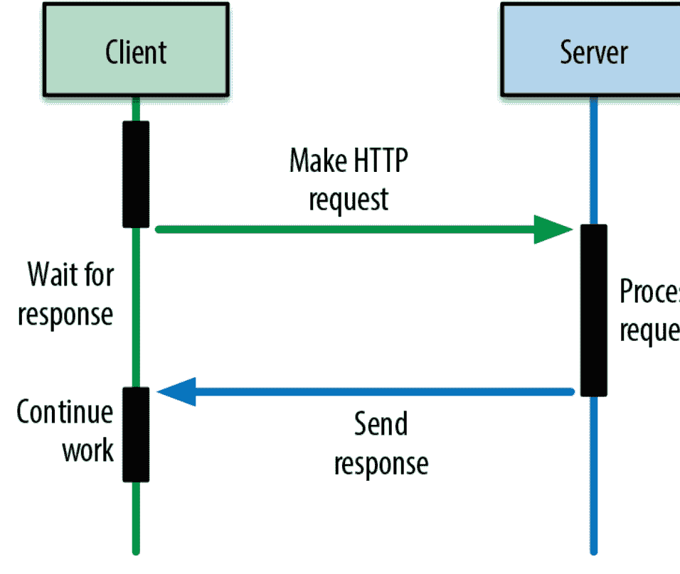
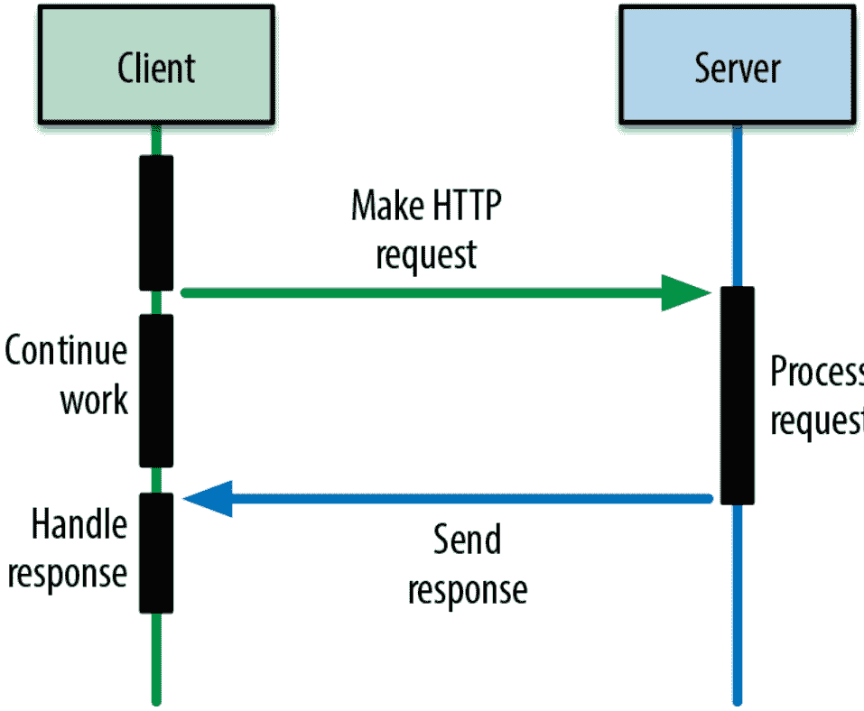
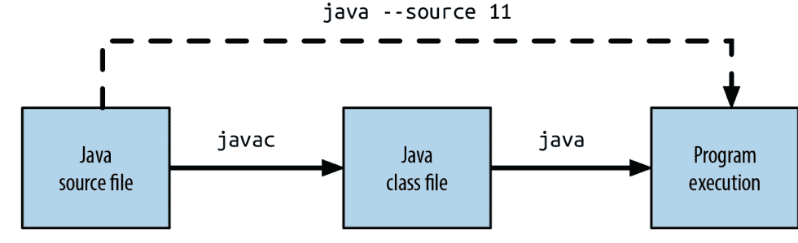

## 新特性

对于许多开发者而言，升级到新 Java 版本的主要动力在于通过应用最新且强大的功能来提高生产力。在本节中，你将了解 Java 11 引入的语言和平台改进。我们将首先看看影响最大的特性：新的 HTTP 客户端。

## 通过 HttpClient 实现内置和增强的 HTTP 通信

在微服务和服务 API 的世界里，HTTP 通信是不可避免的。通常，你需要编写代码来调用端点以获取或修改数据。

HttpURLConnection 是一个用于 HTTP 通信的 API，已经存在很久了，但无法满足现代应用程序的需求。因此，过去 Java 开发者不得不求助于更高级、功能更丰富的库，例如 Apache HttpComponents 或 Square 的 OKHttp，它们已经支持 HTTP/2 和 WebSocket 通信。

Oracle 意识到了 Java 功能集中的这一不足之处，并在 Java 9 中引入了 HTTP 客户端实现作为实验性功能。HttpClient 已经成熟，现在是 Java 11 中的一个最终特性。如果有一个理由让你升级到 Java 11，那就是这个！再也不要维护构建过程中所需的外部依赖项了。

简而言之，Java 的 HTTP API 可以处理同步和异步通信，支持 HTTP 1.1 和 2，并且支持所有常见的 HTTP 方法，如 GET、POST、PUT 和 DELETE。使用 java.net.http 模块进行典型的 HTTP 交互如下所示：

- 1. 创建 HttpClient 的实例并对其进行配置。
- 2. 创建 HttpRequest 的实例并填充信息。
- 3. 将请求传递给客户端，执行请求，并获取 HttpResponse 的实例。
- 4. 处理 HttpResponse 中包含的信息。

听起来很抽象？让我们看看同步和异步 HTTP 通信的具体示例。

## 同步通信

首先，让我们编写一个执行同步 GET 调用的程序。图 1-2 表明，同步调用会阻塞客户端，直到 HTTP 请求被服务器处理且响应被发送回来。



图 1-2. 同步 HTTP 通信

为了演示目的，我们使用 Postman Echo，这是一个用于测试 HTTP 客户端的 RESTful 服务。示例 1-1 创建了一个 HTTP 客户端实例，执行了一个 GET 调用，并在控制台上渲染了一些响应信息。

### 示例 1-1. 使用 HttpClient API 进行同步 GET 调用

```
import java.io.IOException;
import java.net.URI;
import java.net.http.HttpClient;
import java.net.http.HttpRequest;
import java.net.http.HttpResponse;
```

```
```java
import java.time.Duration;

HttpClient httpClient = HttpClient.newBuilder()
        .connectTimeout(Duration.ofSeconds(10))
        .build();

try {
    String urlEndpoint = "https://postman-echo.com/get";
    URI uri = URI.create(urlEndpoint + "?foo1=bar1&foo2=bar2");
    HttpRequest request = HttpRequest.newBuilder()
            .uri(uri)
            .build();
    HttpResponse<String> response = httpClient.send(request,
            HttpResponse.BodyHandlers.ofString());
} catch (IOException | InterruptedException e) {
    throw new RuntimeException(e);
}

System.out.println("Status code: " + response.statusCode());
System.out.println("Headers: " + response.headers()
        .allValues("content-type"));
System.out.println("Body: " + response.body());
```
```

- 1. 创建并配置 HTTP 客户端实例。该客户端使用 10 秒的连接超时。
- 2. 创建并配置 HTTP 请求。默认情况下，HTTP 请求使用 GET 方法。
- 3. 发送 HTTP 请求并获取响应。
- 4. 处理 HTTP 响应返回的数据；例如，状态码、头部和正文。

> **注意**
> 
> 你可能已经注意到，`HttpClient` API 大量依赖建造者模式。当创建可以填充可选参数的更复杂对象时，建造者模式特别有用。与暴露具有多个参数重载的构造函数不同，建造者模式提供了用于配置对象的直观方法，从而形成一种易于理解和使用的流畅 API。

`HttpClient` API 并不局限于仅仅进行同步调用。在下一节中，我们将探讨一个异步通信的示例。

## 异步通信

如果你不想等待响应并希望稍后处理响应，或者如果你想并行处理一系列调用，异步通信就非常有用。图 1-3 展示了这种形式。



*图 1-3. 异步 HTTP 通信*

假设你想实现一个工具，用于解析网页上使用的链接，并通过对其发起 HTTP GET 请求来验证它们。示例 1-2 定义了一个 URI 列表，并通过发出异步调用并收集结果来检查这些 URI。

### 示例 1-2. 执行异步 HTTP 调用并稍后对响应做出反应

```
```java
import java.io.IOException;
import java.net.URI;
import java.net.http.HttpClient;
import java.net.http.HttpRequest;
import java.net.http.HttpResponse;
```
```

```
```java
import java.time.Duration;
import java.util.List;
import java.util.concurrent.CompletableFuture;
import java.util.stream.Stream;

import static java.util.stream.Collectors.toList;

final List<URI> uris = Stream.of(
        "https://www.google.com/",
        "https://www.github.com/",
        "https://www.ebay.com/"
    ).map(URI::create).collect(toList());

HttpClient httpClient = HttpClient.newBuilder()
        .connectTimeout(Duration.ofSeconds(10))
        .followRedirects(HttpClient.Redirect.ALWAYS)
        .build();

CompletableFuture[] futures = uris.stream()
        .map(uri -> verifyUri(httpClient, uri))
        .toArray(CompletableFuture[]::new);
CompletableFuture.allOf(futures).join();

private CompletableFuture<Void> verifyUri(HttpClient httpClient,
                                          URI uri) {
    HttpRequest request = HttpRequest.newBuilder()
            .timeout(Duration.ofSeconds(5))
            .uri(uri)
            .build();

    return httpClient.sendAsync(request,
            HttpResponse.BodyHandlers.ofString())
            .thenApply(HttpResponse::statusCode)
            .thenApply(statusCode -> statusCode == 200)
            .exceptionally(__ -> false)
            .thenAccept(valid -> {
                if (valid) {
                    System.out.println("[SUCCESS] Verified "
                            + uri);
                } else {
                    System.out.println("[FAILURE] Could not "
                            + "verify " + uri);
                }
            });
}
```
```

- ❶ 定义应被验证的 URI 列表。
- ❷ 异步验证所有 URI 并评估 future 结果。

3. 发送异步 HTTP 请求，检查响应的状态码是否为 OK，并通过打印消息对结果做出反应。

正如示例 1-1 和 1-2 所示，新的 HttpClient 功能非常强大且富有表现力。HttpClient 还具备此处未提及的更多功能。例如，它还可以处理反应式流、身份验证和 Cookie 等。欲了解更多信息，请参考 Oracle 的学习资料和 Javadocs。

Java 11 中另一个有趣的特性是无需编译即可启动 Java 程序的能力。让我们来看看这是如何工作的。

## 无需编译即可启动单文件程序

Java 不是一种脚本语言。对于你想执行的每个程序，你都需要先通过显式运行 javac 命令对其进行编译。这种往返过程使得尝试测试用小代码片段变得不太方便。Java 11 改变了这一情况。你现在可以直接执行包含在单个文件中的 Java 源代码，而无需先编译，如图 1-4 所示。



图 1-4. 编译和不编译执行 Java 程序

这一新功能为 Java 语言初学者提供了一个很好的起步平台，并允许用户以临时方式尝试逻辑。

开始很容易。让我们选择一个简单的例子。文件 HelloWorld.java 通过 main 方法中的 System.out.println 在控制台上显示消息“Hello World”：

```
public class HelloWorld {
    public static void main(String[] args) {
        System.out.println("Hello World!");
    }
}
```


要执行，请使用 Java 11 运行 `java` 命令。Java 会即时编译源文件，并使用类路径中的类文件运行程序。任何可能出现的编译错误都会在控制台中显示：

```
$ java -version
openjdk version "11" 2018-09-25
OpenJDK Runtime Environment 18.9 (build 11+28)
OpenJDK 64-Bit Server VM 18.9 (build 11+28, mixed mode)

$ java HelloWorld.java
Hello World!
```

无需编译即可启动单文件程序非常方便，但有几个限制需要注意。在 Java 11 中，程序不能使用除 `java.base` 模块之外的任何外部依赖。此外，只能启动单文件程序。目前不支持从其他 Java 源文件调用方法，但如有需要，可以在同一文件中定义多个类。我个人认为这一功能是快速原型设计的有用工具。

在下一节中，你将了解已添加到现有库类中的新方法。

## 字符串、集合和文件的新库方法

很多时候，Java 开发人员不得不依赖像 Google Guava 或 Apache Commons 这样的外部库来获取便捷方法，否则他们就需要从一个项目复制粘贴到另一个项目。这些实现可能很小，但它们确实增加了需要维护和测试的额外 API 接口。Java 11 为 `String`、`Collections` 和 `Files` API 添加了便捷方法。

让我们通过示例来探索新功能。为了有趣，让我们编写一些 JUnit 测试，应用新的 API 并验证它们在不同用例中的正确行为。

## 字符串 API 增强

`String` API 新增了四个便捷方法。让我们通过示例逐一了解它们。

### 重复字符串

我们来看的第一个方法是 `String.repeat(Integer)`。从名称来看，你可能已经猜到该功能的目的。它只是将字符串重复 n 次。

我能想到不止一种情况下 `repeat` 方法会派上用场。假设你需要构建一个数据表，在键/值对之间填充空白以提高可读性。以下测试用例演示了该方法在这种场景下的使用：

```
@Test
void canRepeatString() {
    assertEquals("CPU Usage:               5%",
        renderInfo("CPU Usage:", "5%"));
    assertEquals("Memory Usage:          9.14 MB",
        renderInfo("Memory Usage:", "9.14 MB"));
    assertEquals("Free Disk:             96.5 GB",
        renderInfo("Free Disk:", "96.5 GB"));
}

private String renderedInfo(String title, String value) {
    return title + " ".repeat(30 - title.length()
        - value.length()) + value;
}
```

### 检查空白或空字符串

我相信你在职业生涯中的某个时刻一定需要实现数据验证。假设你想验证输入到基于 Web 的输入字段中的值的有效性。当然，我们不想允许空白值。

Java 11 引入了 `String.isBlank()` 方法，它指示字符串是否为空或仅包含空白。现在此功能已成为 Java 核心特性，不再需要引入 Apache `StringUtils` 作为外部依赖。你可以在以下测试用例中看到它的使用：

```
@Test
void canCheckIfStringContainsWhitespaces() {
    String nameFormFieldWithoutWhitespace = "Duke";
    String nameFormFieldWithWhitespace = "   ";
    assertFalse(nameFormFieldWithoutWhitespace.isBlank());
    assertTrue(nameFormFieldWithWhitespace.isBlank());
}
```

### 移除前导和尾随空白

验证字符串与清理字符串密切相关。开发人员经常遇到需要清理以提取实际信息的数据。这可能涉及过滤隐藏、错误或无用的字符。

新引入的 `String.strip()` 方法负责移除前导和尾随空白。你还可以更具体地使用 `String.stripLeading()` 仅移除前导字符，或使用 `String.stripTrailing()` 仅移除尾随字符。以下测试用例演示了所有三种方法的使用：

```
@Test
void canStripStringOfLeadingAndTrailingWhitespaces() {
    String nameFormField = "   Java Duke   ";
    assertEquals("Java Duke", nameFormField.strip());
    assertEquals("Java Duke", nameFormField.stripLeading());
    assertEquals("   Java Duke", nameFormField.stripTrailing());
}
```

### 处理多行字符串

逐行处理多行字符串可能既繁琐又消耗内存。首先，你必须根据行终止符拆分字符串。接下来，你需要遍历每一行。对于处理大型文本操作的软件系统，内存消耗可能是一个大问题。

Java 11 中引入的 `String.lines()` 方法允许你将多行文本作为 `Stream` 处理。`Stream` 表示一个元素序列，可以顺序处理，无需一次性将所有元素加载到内存中。以下是一个实际使用该方法的测试用例：

```
@Test
void canStreamLines() {
    String testString = "This\nis\na\ntest";
    List<String> lines = new ArrayList<>();
    testString.lines().forEach(line -> lines.add(line));
    assertEquals(List.of("This", "is", "a", "test"), lines);
}
```

## 集合 API 增强

在过去，将集合转换为数组很麻烦。你需要提供数组的新实例、其泛型类型以及数组的最终大小。

Java 11 使这种转换更加方便。现在，你可以使用 `Collection.toArray(IntFunction<T[]>)` 方法提供函数，而不是传递数组实例。以下代码示例比较了将集合转换为数组的旧方式和新方式：

```
@Test
void canTurnListIntoArray() {
    List<String> months = new ArrayList<>();
    months.add("January");
    months.add("February");
    months.add("March");
    assertArrayEquals(new String[]
        { "January", "February", "March" },
        months.toArray(new String[months.size()]));
    assertArrayEquals(new String[]
        { "January", "February", "March" },
        months.toArray(String[]::new));
}
```

1 在 Java 11 之前将集合转换为数组。

2 在 Java 11 中使用新方法将集合转换为数组。

## 文件 API 增强

对于开发人员来说，读写文件是非常常见的操作。Java 11 之前的代码需要你编写不必要的样板代码。为了解决这个问题，项目通常会引入可重用的工具方法，或者求助于众多开源库之一。

Java 11 添加了带各种重载的方法 `Files.readString(Path)` 和 `Files.writeString(Path, CharSequence, OpenOption)`，这使得读写文件更加容易。以下代码片段展示了这两种方法的实际应用：

```
@Test
void canReadString() throws URISyntaxException, IOException {
    URI txtFileUri = getClass().getClassLoader()
        .getResource("helloworld.txt").toURI();
    String content = Files.readString(Path.of(txtFileUri),
        Charset.defaultCharset());
    assertEquals("Hello World!", content);
}

@Test
void canWriteString() throws IOException {
    Path tmpFilePath = Path.of(
        File.createTempFile("tempFile", ".tmp").toURI());
    Path returnedFilePath = Files.writeString(tmpFilePath,
        "Hello World!", Charset.defaultCharset(),
        StandardOpenOption.WRITE);
    assertEquals(tmpFilePath, returnedFilePath);
}
```

## Optional 和 Predicate 的增强

Java 8 添加了 `Optional` 类型。该类型是一个包含可选值的单值容器。其主要目的是避免代码中充满不必要的 `null` 检查。你可以通过调用 `isPresent()` 方法来检查容器中是否存在值，而无需实际检索它。

在最新版本的 Java 中，你还可以询问相反的情况：“值是否为空？”无需使用 `isPresent()` 方法的取反，现在只需使用 `isEmpty()` 方法即可让代码更易于理解。以下测试用例比较了两种方法的使用：

```
@Test
void canCheckOptionalForEmpty() {
    String payDay = null;
    assertTrue(!Optional.ofNullable(payDay).isPresent());    ①
    assertTrue(Optional.ofNullable(payDay).isEmpty());    ②
    payDay = "Monday";
    assertFalse(!Optional.ofNullable(payDay).isPresent());    ①
    assertFalse(Optional.ofNullable(payDay).isEmpty());    ②
}
```

① 在 Java 11 之前检查 `Optional` 中是否存在值。

② 在 Java 11 中检查 `Optional` 中是否存在值。

`Predicate` 通常用于过滤对象集合中的元素。Java 11 添加了静态方法 `Predicate.not(Predicate)`，它返回一个预定义的 `Predicate` 实例，该实例对给定的 `Predicate` 取反。

假设你想过滤字符串流，例如某些月份。新的 `Predicate` 方法对于过滤所有不满足特定条件的月份非常有帮助。在下面的代码中，你会发现一个示例，它过滤掉所有不以字母“M”开头的月份。这比必须将 `(Predicate<String>) month -> month.startsWith("M")).negate()` 传递给 `filter` 方法更具表现力。

```
@Test
void canUsePredicateNotAsFilter() {
    List<String> months = List.of("January", "February", "March");
```


```
```java
List<String> filteredMonths = months
        .stream()
        .filter(Predicate.not(month -> month.startsWith("M")))
        .collect(Collectors.toList());
assertEquals(List.of("January", "February"), filteredMonths);
}
```
```

核心库 API 扩展就介绍到这里。Java 11 还改进了对 `var` 关键字的处理。接下来，我们来看看这些变化。

## 在 Lambda 中使用 VAR 关键字

从 Java 10 开始，你可以在声明局部变量时不必指定类型。变量使用 `var` 关键字，而不是声明类型。在运行时，变量的赋值会自动确定类型；这是通过类型推断实现的。即使使用 `var` 关键字，变量仍然是静态类型的。

在 Java 11 中，你现在还可以将 `var` 关键字用于 Lambda 的参数。将 `var` 用于 Lambda 参数有一个主要好处：你可以为变量添加注解。例如，你可以通过使用 JSR-303 的 `@NotNull` 注解来指示变量的值不能为 null。

让我们回到前面示例中使用的 `Predicate.not(Predicate)` 方法。在下面的示例中，我们通过提供 `var` 关键字和注解来增强 Lambda 定义：

```
```java
import javax.validation.constraints.NotNull;

@Test
void canUseVarForLambdaParameters() {
    List<String> months = List.of("January", "February", "March");
    List<String> filteredMonths = months
            .stream()
            .filter(Predicate.not((@NotNull var month) ->
                    month.startsWith("M")))
            .collect(Collectors.toList());
    assertEquals(List.of("January", "February"), filteredMonths);
}
```
```

接下来，我们来看看从 Unicode 8 到 Unicode 10 的转变。

## 采用 Unicode 10

Java 10 使用 Unicode 8 标准进行本地化。Unicode 标准在不断发展，因此 Java 11 是时候跟进最新版本 Unicode 10 了。从 Unicode 8 到 10 的升级包含 16,018 个新字符和 10 种新文字。文字是用于表示文本信息的字母和其他书写符号的集合。例如，Unicode 10 增加了马萨拉姆贡迪文，这是一种中南达罗毗荼语系的语言。

Unicode 10 中备受期待的增补之一是“科尔伯特表情符号”，这是一张嘴巴中性、单眉挑起的脸，因喜剧演员斯蒂芬·科尔伯特而流行。下面的示例使用了科尔伯特表情符号：

```
@Test
void canUseColbertEmoji() {
    String unicodeCharacter = "\uD83E\uDD28";
    assertEquals("🤨", unicodeCharacter);
}
```

接下来，我们看看 Java 11 中一个更底层的变更：嵌套访问控制。它对最终用户的影响不太明显，但它解决了长期存在的技术债务，最终得以重构。

## 嵌套访问控制

要理解 Java 11 的下一个变更，我们需要看看嵌套类。假设你有一个名为 Outer.java 的外部类，其中包含一个名为 Inner.java 的内部类。Inner.java 可以访问 Outer.java 的所有私有字段和方法，因为它们在逻辑上属于一起。图 1-5 展示了这种数据结构。

## Outer.java

```
private static String level = "outer";
```

## Inner.java

```
public static String getOuterField() {
    return Outer.level;
}
```

图 1-5. 从嵌套类访问父类字段

你可能知道，Java 编译器会为内部类创建新的类文件，在本例中为 Outer$Inner.class。在底层，编译过程还会在类之间创建所谓的扩展可访问性的桥接方法。

Java 11 借助所谓的嵌套类同伴，偿还了必须生成这些桥接方法的技术债务。现在，内部类无需编译器进行额外工作即可访问外部类的字段和方法。

你可能会问自己：“编译器优化很棒，但它对我作为开发者有什么影响呢？” 嗯，在 Java 11 之前，如果不将可访问性控制设置为 true，就不可能通过反射访问外部类的字段。随着嵌套访问控制的改变，这种控制不再需要。下面的类层次结构演示了改变后的行为：

```
import java.lang.reflect.Field;

public class Outer {
    private static String level = "outer";

    public static class Inner {
        public static String getOuterViaRegularFieldAccess() {
            return Outer.level;
        }
    }
```

```
```java
public static String getOuterViaReflection() {
    try {
        Field levelField = Outer.class
                .getDeclaredField("level");
        // levelField.setAccessible(true);
        return levelField.get(null).toString();
    } catch (NoSuchFieldException
             | IllegalAccessException e) {
        throw new RuntimeException(e);
    }
}

public static void main(String[] args) {
    Inner.getOuterViaRegularFieldAccess();
    Inner.getOuterViaReflection();
}
```
```

① Java 10 或更早版本需要此行。

② 在 Java 10 中已有效。

与本节的先前代码示例一样，我们也通过测试验证了正确行为，如下所示（有关此更改的更多详细信息，请参阅 JEP 181）：

```
```java
private final Outer.Inner inner = new Outer.Inner();

@Test
void canAccessPrivateFieldFromOuterClass() {
    assertEquals("Outer", inner.getOuterViaRegularFieldAccess());
}

@Test
void canAccessPrivateFieldFromOuterClassViaReflection() {
    assertEquals("Outer", inner.getOuterViaReflection());
}
```
```

我们探讨的最后一个面向开发者的特性是 Java 飞行记录器，该特性过去仅限商业用途。如果你需要对 Java 应用程序进行性能分析，请记住这个工具。

## 使用 Java 飞行记录器记录操作系统和 JVM 事件

Java 飞行记录器（JFR）是一种用于剖析正在运行的 Java 应用程序并捕获诊断信息以进行进一步分析的工具。这个工具对 Java 来说并不新鲜。它在 Java 7 中已经推出，但当时被视为商业功能，你需要使用 JVM 选项 -XX:+UnlockCommercialFeatures -XX:+FlightRecorder 显式启用。

在 Java 11 中，JFR 开源了，并包含在 OpenJDK 中。为了让你了解如何使用 JFR，让我们看看捕获指标所需的步骤。首先，你需要运行一个 Java 程序，并提供必要的 VM 选项以启用记录。在下面的示例中，我们使用设置为 60 秒的基于时间的记录选项：

```
$ java -XX:StartFlightRecording=duration=60s,
filename=recording.jfr,settings=profile,name=SampleRecording MyMain
Started recording 1. The result will be written to:
/Users/bmuschko/dev/projects/whats-new-in-java-11/recording.jfr
```

你可能已经从控制台输出中注意到，分析数据已捕获到文件 recording.jfr 中。是时候以可视化的方式查看它，以便我们分析指标了。认识一下 Java Mission Control (JMC)！

JMC 可以检查 JFR 产生的数据，并在布局良好的用户界面中将其可视化。请注意，JMC 不是 JDK 的一部分；你必须独立下载并安装它。

## 注意

> JFR 记录不向后兼容。你需要使用 JMC 7 的早期访问版本来检查 Java 11 生成的记录。

开始使用很简单，只需将 JMC 指向 JFR 生成的记录文件即可。图 1-6 展示了 JMC 对示例应用程序内存消耗的渲染。我不打算进一步详细说明 JFR 和 JMC 的功能。如果你计划在自己的项目中使用这些工具，可以在网上找到大量信息。


图 1-6. JMC 渲染记录的内存消耗

新特性就介绍到这里。我相信你会发现我们在这里讨论的新功能将来能帮助你提高生产力。接下来，我们讨论 Java 11 中已移除的特性和 API。
