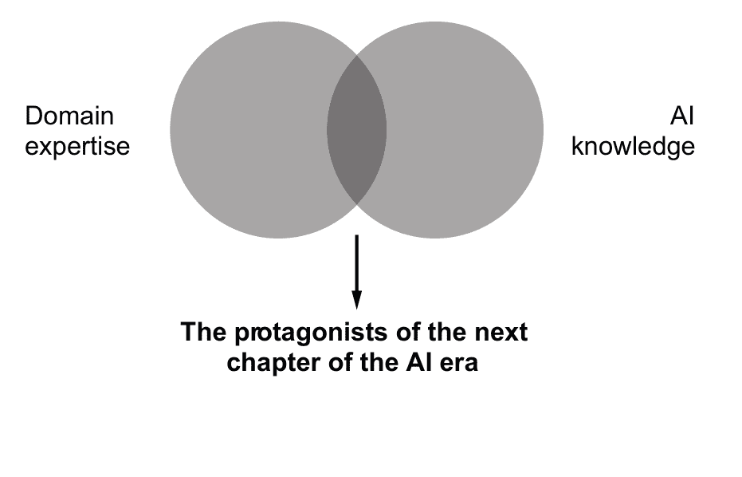
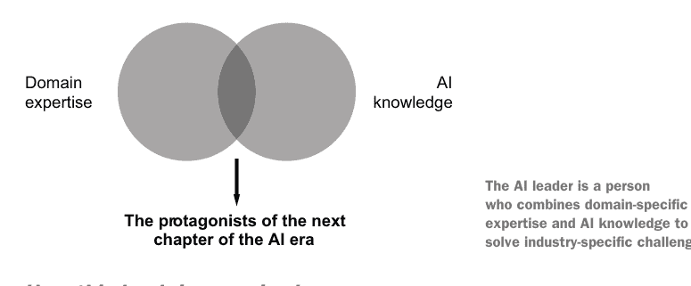
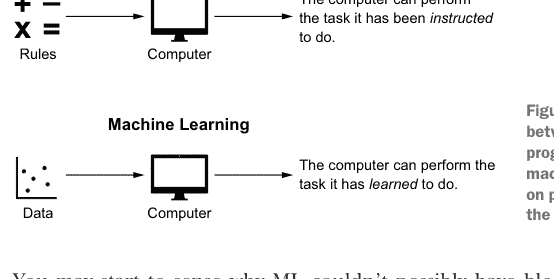

# 人工智能零基础指南

> “未来已经到来——只是分布不均。”
> —威廉·吉布森（William Gibson）

## 前言

2014年，我们打开了一封改变我们人生的邮件。我们获得了奖学金，可以去科技的摇篮——硅谷学习和工作。事实证明，这正是见证现代人工智能重生的完美时机和地点。将在2010年代推动AI革命的技术，正从学术实验室迈出第一步。在硅谷，很容易窥见幕后，因为兴奋的极客们在公开活动中分享他们的知识。

对我们两人而言，对硅谷公司而言都很清楚，AI即将左右摇晃各行各业。然而，我们回到欧洲后才意识到，剩下的商业世界还没有跟上这一现实。商业领袖、专业人士和企业家对AI的潜力知之甚少。即使少数有远见的人也难以找到将愿景变为现实所需的工具和技能。

再一次，新的技术创新浪潮的成果看起来将是硅谷少数几家公司的专属游乐场，而欧洲又将被落下。这一次，我们决定不再袖手旁观。我们着手传播创造AI价值所需的意识、技能和愿景。我们通过创立AI Academy来实现这一目标：一家专注于人工智能教育和战略咨询的公司。在过去几年里，我们很荣幸指导了数百人，从企业家到医疗保健、能源、消费品和时尚行业大型企业的决策者。我们帮助他们过滤噪音和炒作，并引导他们形成AI如何发展其组织的自身愿景。

在2018年夏天，我们意识到，无论我们的业务多么成功，我们都正在偏离民主化AI的使命。事实上，我们的知识仅对我们可以通过研讨会和指导接触到的少数公司有用。在这个圈子之外，来自世界各地的许多才华横溢且充满灵感的个人仍然希望更深入地了解AI并用它做令人兴奋的事情。然而，他们所拥有的要么是学术界的超技术材料，要么是大众媒体分享的充满炒作的故事。对后者感到兴奋，对前者感到困惑，他们为自己的组织构想了雄心勃勃的AI项目，却真的不知道如何使其成功。

本书是我们提炼所有指导和咨询经验的尝试，以帮助这些有远见的人。虽然记者专注于点击诱饵文章和企业公关，但我们将向你展示AI的较少光鲜但极其有效的应用，这些应用帮助Google将能源账单削减了40%，Amazon将销售额提高了35%，Pinterest将用户参与度提高了30%，Netflix每年节省超过十亿美元，Square在24小时内为小企业提供贷款。本书将教你他们是如何做到的。我们将给你一个清晰的AI原理、优势和当前局限性的理解。这种新知识将补充你在领域中已有的经验，并使你在AI时代成为领导者。

你会明白AI不是万灵药，在产品中使用它（或声称使用）并不是成功的免费通行证。我们将与你分享我们辛苦得来的关于如何设计、构建和管理成功AI产品的经验。在你甚至还没读完本书之前，你就已经开始思考这项技术在你组织中的*实际*作用。

理解AI不仅仅是跟上技术。它也是从根本上改变组织能够实现什么的关键。奖赏是巨大的：一个充满机会的蓝海仍在等待开明的AI领导者。科技公司已经用AI赚取了财富。本书是我们邀请你加入这场盛宴的邀请。

Gianluca致谢：谢谢你，Sofia，成为我的伴侣和我的朋友。你对生活的无尽热情激励我充分、快乐地生活，并谦卑地知道我在你心中拥有一个特别的位置。Grazie alla mia famiglia. Sapere di poter contare sul vostro supporto e amore incondizionato è il mio porto sicuro dalla quale far partire ogni mia avventura, passata, presente e futura.

Nicolò致谢：谢谢你，Angela，成为我性格的互补另一半。你的能量、热情和奉献让我的生活充满乐观和挑战，激励我成为一个比我希望成为的更好的人。Grazie alla mia famiglia per essere stata una roccaforte di stabilità, un esempio di amore, e un fuoriclasse di pazienza con il sottoscritto.

## 关于本书

*Zero to AI*旨在帮助你理解如何在大小组织、营利和非营利组织中使用AI。我们希望这是一个一站式解决方案，让你有足够的信心开始在你的组织中使用AI。为了帮助你实现这一目标，我们将本书分为两部分，具有两个不同的目标：

- 本书的第一部分是关于技术、其核心原则，以及公司如何使用它来构建惊人的产品。在这一部分结束时，你将理解AI能做什么和不能做什么，并知道如何与技术人员有效沟通的词汇。
- 第二部分专注于组织和价值创造。我们将与你分享我们在咨询实践中用于选择、设计和构建成功AI产品的策略。

## 谁应该阅读本书

三类人从最近AI的改进浪潮中受益：科技企业家、向他们倾注资金的风险投资家，以及少数备受追捧的AI专家，他们的薪水飙升至七位数。如果我们五年前就开始写作，我们会为这些人写一本技术手册。

今天，我们认为技术人员已经获得了足够的成功，是时候让下一代专业人士加入AI革命了。AI时代即将到来的篇章的主角不会对仅仅为了技术进步而构建AI应用感兴趣。他们不是计算机科学或数学专家。

他们是特定行业的专家，希望将AI作为解决现实世界问题的工具。

其中一些未来的主角为大型企业工作。他们的名片上写着CEO、经理或实习生并不重要。重要的是他们在这些快速变化的时代通过帮助组织保持竞争力来加强职业生涯的驱动力。其他人则为小型公司工作，希望看到它们成长并创造新的产品和服务。还有一些人是企业家，正在寻找要构建的“下一个大事件”。让我们不要忘记那些希望培养独特技能的学生和应届毕业生。

在我们作为顾问和工程师的经验中，我们遇到了许多这样渴望成为AI领导者的人（见图1）。我们尽力给予他们所需的东西：对AI是什么、能做什么以及如何为其组织带来价值的清晰理解。我们写这本书是因为我们希望你加入革命者的队伍。

## 本书的组织方式

因为你需要两套基本技能才能将AI引入你的组织，所以本书也分为两部分，共10章。

第一部分是关于理解AI。因为现代AI建立在数据之上，本节的每一章都会向你介绍不同类型的数据以及最适合每种数据的AI工具：

- 第1章是对AI历史的简要介绍，以及引发2010年代AI革命的创新。
- 第2章是关于核心业务运营产生的数据，以及AI如何在此基础上构建独特产品和服务。
- 第3章更深入地探讨了AI在销售和营销中的应用。
- 第4章介绍了可以理解、生成和转换图像、视频和音频等媒体的AI模型。
- 第5章介绍了理解和生成书面文本的AI算法。
- 第6章展示了向人类推荐个性化内容的模型。

## 关于作者

**Gianluca Mauro** 和 **Nicolò Valigi** 共同创立了 AI Academy，这家公司提供 AI 战略咨询服务，并举办教授本书所述概念的研讨会。通过 AI Academy，Gianluca 和 Nicolò 帮助了从创意阶段初创企业到跨国公司在内的各类公司，开启了它们的 AI 之旅。

**Gianluca** 拥有工程学和创业背景。他的热情在于利用人类创造力来探索技术如何构建更好的产品和更好的社会。他通过在大学、企业和行业会议上演讲，激励人们也这样做。在空闲时间，他喜欢演奏音乐、练习武术和举重。

**Nicolò** 喜欢摆弄代码、机器人和（看似）智能的软件。他研究过无人机的大脑、NASA 航天器的齿轮，并帮助推动了自动驾驶汽车中的数据流。他还定期在国际会议上发表演讲，而且更经常地试图拆开他身边的任何电子设备。

## 人工智能简介

**本章涵盖**
- 了解人工智能的历史视角
- 理解机器学习及其与 AI 的关系
- 探索 AI 应用爆炸式增长的驱动力

人工智能（AI）并不是一项新技术。几十年来，计算机科学家尝试了不同的方法，试图实现计算的圣杯：智能机器。虽然距离复制人脑的奇迹仍然遥远，但 AI 应用已经开始充斥我们的日常生活，并为我们的电子设备提供动力，从智能手机到家庭警报系统。

为什么会有这种看似突然的爆发？本章将通过向你介绍现代 AI——包括其背后的核心原理，以及我们如何以及为何走到今天这一步——来回答这个问题。

如果你是那些人中的一员，并且现在对通用 AI 尚未到来感到失望，不要绝望。窄 AI 应用仍然能够创造巨大的价值。例如，能够检测肺癌的 AI 是一种窄应用，但依然极其有用。

1956 年达特茅斯研究夏季研讨会的结果非常有趣，在参与者中激起了一波兴奋和希望。科学家的热情蔓延到了美国政府，政府开始大力资助一个特定应用的研究：英语/俄语翻译。在冷战期间，找到值得信赖的俄语翻译一定不容易。

经过最初几年的工作，一个政府委员会发布了臭名昭著的 1966 年自动语言处理咨询委员会（ALPAC）报告。该文件汇集了许多研究人员对 AI 研究状况的看法。大多数看法并不十分积极：

> 早期对简单或精选文本的机器翻译……就像通用科学文本的“机器翻译”一直令人失望一样，具有欺骗性的鼓舞人心。……当然，没有人能保证我们不会突然或至少很快实现机器翻译，但我们认为这不太可能。
> 
> ……在近期或可预见的将来，没有实用机器翻译的前景。

ALPAC 报告标志着被称为第一次 AI 寒冬的时期的开始：对 AI 研究的公共资助停止了，热情降温，研究人员将工作转向其他领域。

人们对 AI 的兴趣一直消退，直到 1980 年代，IBM 和施乐（Xerox）等私营公司开始投资于一个新的 AI 春天。一种称为专家系统的技术激发了新的希望：专家系统是以精确的 if-then 规则形式编码某一领域人类专家知识的计算机程序。一个例子将帮助你理解专家系统的设计原理。

假设你想构建一个可以替代胃肠病专家的 AI 系统。使用专家系统的方法是：你请一位医生极其精确地描述他们如何为患者做决策。然后你请一位程序员煞费苦心地将医生的知识和诊断流程转化为计算机能够理解和执行的 if-then 规则。一个极度简化的版本看起来像这样：

> 如果患者胃痛且体温高，那么患者得了流感。
> 
> 如果患者胃痛且食用了过期食物，那么患者食物中毒。

等等。一旦医生的知识被编码到软件中，当患者到来时，软件会遵循与医生相同的决策路径，并（希望如此）得出相同的诊断。这种方法有几个问题：

正如我们从经验中学习一样，机器学习（ML）技术让计算机能够从数据中学习。让我们用一个经典的玩具示例来具体说明：教计算机识别图片中的狗和猫。如果你要教一个孩子完成这个任务，你不会拿起一本兽医书，开始阅读耳形或毛色差异。相反，你可能会指给他们看一些图片，让大脑施展魔法。

针对“狗或猫”问题的 ML 解决方案类似于我们童年的学习经历。我们向计算机输入数千张猫的图片，并告诉它“这些是猫”，然后输入数千张狗的图片，告诉它“这些是狗”。最后，我们让它自动找出这两种宠物之间的区别。我们不必解释区分狗和猫的关键要素。一个好的 ML 应用会从它接收的示例中学会这一点。图 1.1 展示了传统编程和机器学习之间的区别。

图 1.1 传统编程方法与机器学习之间的区别：前者依赖精确的规则和指令，后者依赖数据和学习。

你可能开始意识到为什么 ML 不可能在 2000 年代之前蓬勃发展。这类技术的主要成分是数据，而互联网使数据收集变得容易得多。ML 的另一个关键成分是计算能力：从数据中学习不是免费的，计算机需要快速的处理器来执行这项任务。得益于云计算和处理能力的提升，获得强大计算机的途径从未如此简单和廉价。

为了让你感受短短几年间发生了多大的变化，我们询问了 Alex Waibel——他是语音识别 AI 的先驱之一，也是 Facebook AI 团队首批成员之一——20 年前从事 ML 工作有何不同。在 2000 年代初，他能使用的最强大的计算机有一个公寓那么大，花费数百万美元，而且他需要租用它来训练模型。如今，他桌上就有强大得多的计算能力，只需几千美元。你的手机可能比 20 年前顶级研究人员能用的设备还要强大。

数据的可用性和廉价的计算能力为机器学习的蓬勃发展创造了完美的环境。事实上，我们今天所谓的 AI 中许多（大多数）最酷的面向消费者的应用都严重依赖 ML：Siri 语音虚拟助手、谷歌翻译、自动驾驶汽车等等。

回到 AI 的历史，似乎 ML 是推动当今 AI 爆发的引擎，在经历了 1980 年代最后的 AI 寒冬之后，终于带来了一些希望。事实上，现代 AI 的成功如此依赖于 ML 技术，以至于人们常常混淆两者之间的区别。那么，什么是人工智能？让我们来一探究竟。

## 1.3 人工智能究竟是什么？

以我们作为技术专家、顾问和公众演讲者的经验来看，我们经常遇到对 AI、数据科学和 ML 定义持不同看法的人。虽然许多人相当固执己见，但很少有人能捍卫自己的立场。事实上，为 AI 找到一个普遍定义并不像看起来那么简单。

从名称来看，我们可能会尝试通过找出我们与智能相关的人类特质来定义人工智能。一旦我们就什么使人类聪明达成一致，我们就可以说任何能做同样事情的计算机就是 AI。这说得通，对吧？虽然这是一种常见的方法，但即使在简单场景下也会崩溃。例如，一个能在瞬间将 13.856 除以 13 精确到小数点后第十位的人，绝对会被称为聪明，但其人工对应物是一个 2 美元的袖珍计算器，没有人敢称它为 AI。与此同时，我们绝不会因为某人能在拥挤的交通中驾驶就称他们聪明，但自动驾驶汽车通常被认为是当今科技行业正在研发的最难形式的 AI 之一。我们不应该对定义智能如此困难感到惊讶；毕竟，哲学家和科学家已经为此争论了几个世纪。

我们不仅用不同的标准来衡量人类智能和机器智能，而且对于什么算 AI、什么不算 AI，我们似乎也在很快地改变主意。让我们以保罗·格雷厄姆（Paul Graham）为例，他是 Y Combinator 的创始人，这是硅谷最成功的创业加速器，可以说是科技界最具前瞻性的人之一。2002 年，格雷厄姆写了一篇文章，提出了一种检测垃圾邮件的新方案。那时，电子邮件刚刚起步，垃圾邮件（不想要的邮件）是非技术人员广泛使用互联网的最严重威胁之一。现在很难想象，但最优秀的计算机科学家当时正忙于编写复杂的规则，让计算机自动筛选伟哥广告。

在他的文章中，格雷厄姆构思了一种基于 ML 的新方法，通过处理数千封“好”邮件和垃圾邮件来学习对邮件进行分类。保罗的简单软件比工程师们编造的复杂规则更好地学会了识别垃圾邮件。快进 20 年，自动垃圾邮件检测器已经是一项平淡无奇的技术，如果我们敢称它为 AI，会被嘲笑出房间。

事实上，AI 似乎关乎掌握那些我们的想象力认为计算机不应该能够完成的任务。一旦我们在日常生活中习惯了一项技术，我们就会摘掉 AI 的光环，开始称它只是计算机软件。这是一种被深入研究过的现象，称为 AI 效应。

由于 AI 效应，我们称之为 AI 的目标随着技术的进步而不断移动。基于这些考虑，我们得出的人工智能定义是“一种

“给某个软件贴上的一个临时标签，因为它做了些酷炫又令人惊讶的事，直到我们习以为常为止。”我们不知道你怎么想，但这实在算不上一个令人满意的定义。

我们希望已经说服了你：要找到一个让所有人都满意、并且随着技术发展仍然有效的定义，是极其困难的。考虑到人工智能效应，我们决定避开那种狭隘的 AI 定义——那种定义会奖励“花哨”的应用，却在炒作消退后将其抛弃。我们采用一个更广泛的定义，将不那么花哨的应用也包含在内。这就是我们对 AI 的定义：

> 无需明确的人类指令即可解决问题的软件。

如你所见，我们的定义侧重于技术的结果，而非构建技术所用的具体方法。有些人不会同意这个定义，因为它几乎等同于我们在本章前面谈到的机器学习。事实是，学习是一种智能特质；虽然机器学习只是工具，但它恰恰是如今我们碰巧称为 AI 的那些成功应用背后 99% 的工具。未来这种情况可能会改变，但我们尚未看到任何与机器学习同样有前景的新方法出现。正因如此，本书将涉及的每一款 AI 应用都基于机器学习：它就是对当下及不久未来的 AI 版图最准确的描绘。

现在，我们清楚了机器学习是什么，有了一个行之有效的现代 AI 定义，也了解了这些术语如何演变。我们只差第三个你可能听过的流行词：数据科学。

数据科学（DS）是一个广泛的多学科领域，运用科学方法和流程来分析数据并提取洞见。机器学习技术只是数据科学工具箱中的一些工具。在实践中，当人们提到一个数据科学项目时，通常指的是静态的工作：从数据中提取洞见，并以演示文稿或报告的形式呈现。另一方面，AI 则更多用于实时运行的软件场景中。

例如，分析交通数据以设计新的城市规划、最大限度地减少拥堵，很可能属于数据科学范畴。然而，如果你用同样的数据实时控制交通，引导车辆走不那么拥堵的路线，多数人会说这个项目属于 AI。在第一种情况下，项目的输出是一份报告；第二种情况下，则是每周 7 天、每天 24 小时运行的“实时”软件。请记住，这种划分大多是约定俗成的：关于什么是 AI、什么是数据科学，其实并没有硬性规则。表 1.1 总结了我们所看到的差异。

表 1.1 AI 与数据科学的主要区别

| 人工智能 | 数据科学 |
| :--- | :--- |
| 基于数据自动执行任务或预测未来事件。 | 基于数据产生洞见。 |
| 通常“实时”使用：持续处理新数据并产生答案。 | 通常“一次性”使用：产生一些为决策提供信息的洞见。 |
| 通常以软件形式存在。 | 通常以演示文稿或报告的形式存在。 |

希望这些部分有助于揭开一些常见误解术语的神秘面纱，并为这些技术建立背景。现在，你可以开始学习 AI 的核心原理，了解你能用 AI 做什么，以及如何将这项变革性技术引入你的组织。在下一节，我们将说明这一旅程的步骤，以及本书如何引导你完成它们。

## 1.4 我们的教学方法

如果你想在工作中高效地使用 AI，首先理解它的基本构造至关重要。我们注意到，不具备扎实原理理解就来接触 AI 的非技术人员，往往最终只会构想出根本无法实现的项目，或者错过那些极易解决、唾手可得的机会。读完本书第一部分后，你将掌握所需的全部 AI 原理，从而避开这些死胡同，并充分利用这项技术。

即便只读完第一章，你已经明白，几乎所有现代 AI 应用都依赖机器学习，而机器学习的核心就是从数据中学习。这正是我们以数据作为你理解 AI 向导的原因。本书第一部分每一章都聚焦一种特定类型的数据，向你展示如何在你的组织中发现它、你可以用它做什么，以及它如何融入 AI 的世界。

第一部分中的每一章都使用一个玩具示例来介绍你所需的机器学习概念。我们发现这是教授机器学习概念最有效的方式，否则这些概念会过于枯燥和抽象。我们没有深入探讨技术方面的原因很简单，有两个：

- 技术变化如此之快，实现细节很快就会过时。
- 简而言之，你不需要了解这些细节。除非你想转行写代码，否则我们认为，更大的价值在于让 AI 成为你知识储备的一部分，而由别人来用计算机语言实际实现你的构想。

这并不意味着我们会完全让你避开技术细节。作为工程师，我们深知，技术团队与毫无技术背景的人沟通是很困难的。我们不希望他们与你交流不畅，因此我们确保你将学习 AI 工具最重要的技术方面。即使最终你把它们交给团队去处理，了解这些技术细节也能帮助你规划和管理相关工作。

每一章都包含一个或多个真实世界的商业案例，这些案例中的公司取得了非凡成果。我们之所以提及具体公司、产品或服务，是希望帮助你建立认知，但你不应觉得受限于这些案例。我们与案例研究中的任何公司都没有关联或利益关系；只是恰好它们正在构建伟大的产品，值得我们所有人学习。

在呈现案例时，我们采用了一种受哈佛商学院案例教学法启发的方法论：我们首先尽可能中立地呈现案例，最后向你提出开放式问题。紧接着，我们会给出我们对这些问题的思考，以及供进一步讨论的提示。我们建议你不要马上阅读这些答案，而要先试着根据你的知识和案例中读到的内容，思考*你*会如何回答，然后再阅读我们的看法。请注意，我们提出的问题没有唯一解：如果你对案例得出了我们没有包含在答案中的有趣见解，干得漂亮！这意味着你已经学到了所需的东西，并能独立提炼洞见（如果真能这样，我们这本书的目标也就达成了）。

## 小结

- 人工智能有着悠久的成功与失败历史，可以追溯到 20 世纪 50 年代。
- 通用人工智能是拥有一台无所不知机器的空想。相比之下，我们今天拥有的所有 AI 应用都是窄领域的，它们专注于特定任务。
- 机器学习是当今实现 AI 的主流方式，其基础是让机器自主地从数据中学习。
- 数据科学与 AI 和 ML 相关，但更侧重于提取洞见，而非持续的智能。
