## 核心业务数据的人工智能

### 本章内容概览

- 从资金密度和商业影响的角度审视业务数据
- 使用监督学习来预测关键信息
- 比较机器学习与传统软件工程
- 案例研究：利用 AI 创建新业务线并优化流程

本章探讨*核心业务数据*，这是与你业务价值主张最贴近的数据类型。核心业务数据是让你的组织运转起来的秘密配方。它是商业运营收集的订单数据，社交网络追踪的人际互动，以及医疗保健初创公司追踪的血压测量值。由于核心业务数据是组织的核心，它也是你第一个 AI 应用的绝佳候选对象。在核心业务数据上应用 AI 就像是作弊：数据如此接近组织的价值生成引擎，以至于成功的项目几乎注定会产生戏剧性的影响。

为了勾起你的兴趣，让我们简要提及本章末尾的两个案例研究。第一个案例涉及吉姆·高（Jim Gao）的一项举措，他是谷歌前员工，负责其数据中心的运营。他审视了用于冷却谷歌庞大计算机的大型空调系统收集的数据，并思考如何使用机器学习来优化其能耗。结果是这家科技巨头的账单削减了 40%。第二个案例关于 Square，一家总部位于旧金山的支付服务公司。Square 一直在为小型企业处理信用卡支付，并意识到其收集的所有数据都可以用于向小型企业提供定制化和低风险的贷款。通过使用机器学习模型，Square 创建了一个全新的业务线，并开拓了小型企业贷款这一蓝海市场。其服务质量无出其右：通过自动化贷款机构审核流程，Square 可以在提交请求后的一个工作日内将贷款存入客户的银行账户。结果，Square 在四年内发放了超过 30 亿美元的贷款，违约率极低，仅为 4%。读完本章，你将了解这些公司是如何实现这些变革的。

## 2.1 在核心业务数据上释放 AI 的力量

我们将核心业务数据定义为“对组织营收或成本产生直接影响的数据”。核心数据因组织业务的不同而千差万别：电商运营的购物车历史、工程组织的物理测量值，以及医疗保健公司的患者行为。无论其形式如何，核心数据都是有价值的，因为它描述了直接影响组织绩效的事件和模式，并且很容易为其赋予货币价值。

我们已经提及了本章末尾等待你的两个案例研究。让我们来看看为什么这两家公司使用的数据属于核心业务数据：

- 像谷歌这样的公司依赖大型数据中心来提供其服务（处理网络搜索、存储照片、路由电子邮件等）。对于谷歌来说，可能唯一的可变成本是用于保持数据中心计算机冷却所消耗的能量。因此，关于其冷却设备的数据是谷歌业务的核心，因为它与其主要成本之一直接相关。
- Square 的核心产品是其销售点（POS）解决方案。通过该产品，Square 处理流向其客户的所有支付。由于 Square 的使命是赋能小型企业，其交易数据与该愿景紧密相连，并对客户具有价值。

查看数据价值的一个好方法是思考一个我们称为数据“资金密度”的指标：数据对组织营收或成本的影响程度。核心业务数据具有高资金密度：每个电商订单、工作线索或金融交易都会直接影响你的营收或成本。当你远离组织的核心价值主张时，你所收集数据的资金密度也会相应降低。记录网站访问量可能很有价值，但远不如追踪订单有价值。对于医院来说，呼叫中心数据可能有用，但远不如患者记录重要。这就是为什么我们决定从所有资金密度最高的数据开始这本书：你的核心业务数据。

通常我们看到，核心业务数据采取结构化的形式，就像 Microsoft Excel 电子表格中整洁的行和列一样。在工程术语中，我们将这种类型的数据称为结构化数据。其他结构化数据的例子包括天气报告、物理过程测量、金融交易、大多数市场以及供应链和仓储指标。作为一个经验法则，任何你可以加载到 Excel 中的东西都可能属于结构化数据的范畴。其他类型的数据很难填入整洁的 Excel 列中：想想图片、语音录音或书中的文本。

理解同一信息可以以结构化和非结构化两种形式存在是非常重要的。例如，考虑记录医疗诊断的以下方式：

> 患者詹卢卡·毛罗（Gianluca Mauro）肩部关节有严重炎症；治疗方案是每天服用两片可的松，持续五天。

同样的信息可以以结构化的方式记录，如表 2.1 所示。

### 表 2.1 结构化形式的医疗诊断

| 患者 | 诊断 | 部位 | 药物 | 频率（次/天） | 疗程（天） |
|---|---|---|---|---|---|
| Gianluca Mauro | 严重炎症 | 肩部关节 | 可的松 | 2 | 5 |

信息是相同的——但在第一种情况下，它以非结构化的方式（文本）表示；而在第二种情况下，它是结构化的。与结构化数据相比，非结构化数据更难被计算机处理。后续章节将涵盖针对非结构化数据的 AI 技术，包括图像和书面语言。目前，让我们坚持使用结构化数据，并欣慰地知道大多数核心业务数据都属于这一类别。

### 2.2 在核心业务数据中使用 AI

既然你知道如何查找和识别核心业务数据，让我们看看 AI 能对它做什么。因为我们相信故事的教学力量，我们开发了一个简化的例子，它将伴随你完成本书的第一部分。

FutureHouse 是一个虚构的企业，运营着一个在线房地产交易市场，房主可以在那里发布待售房屋，并希望吸引感兴趣的买家。FutureHouse 一直优先考虑客户服务，并雇用代理人提供支持，帮助卖家评估房价。买家使用该网站寻找梦想中的房子。

我们选择这个例子是因为它对许多读者来说会很熟悉，同时给我们机会探索 AI 领域的许多方面。一个很好的附加好处是，住房市场是机器学习文献中的一个典型示例。如果你决定深入机器学习的技术细节并可能编写自己的代码，你会在网络上找到大量的参考资料。

我们将首先解释一下住房市场是如何运作的，然后介绍机器学习在该业务中的一个应用。我们将使用这一描述作为契机来介绍关键术语和概念，并 concludes 将这些概念扩展到其他更通用的应用中。

#### 2.2.1 房地产交易市场示例

房地产经纪人处于住房市场的中心。他们连接卖家和买家，帮助他们确定合适的房产价格。图 2.1 展示了在房地产经纪人仔细关注下，典型的房屋销售交易是如何展开的：

1. 一位客户进来想要出售他们的房子。在上市之前，他们想要获得关于其价值多少的专业意见。
2. 房地产经纪人在检查房屋后，根据其面积、房龄、包含的电器、附近的其他报价等设定价格。
3. 房屋被列入清单。
4. 潜在买家找到该清单并参加开放房屋活动。最终，一位幸运的买家买下了该房产。

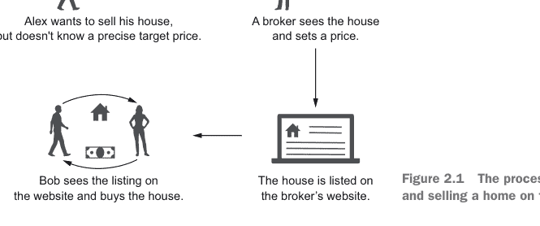

FutureHouse 在这个过程中每个步骤都能收集数据。以下是其主要数据资产：

- 所有待售房屋的图片
- 房屋的描述（面积、位置等）
- 网站所有用户的网络访问和点击历史

- 该地区已售房产的历史记录
- 曾到访者留下的房屋评价
- 经纪人与买家之间的谈判记录
- 有关该地区即将开工建设的新闻报道

所有这些数据源的价值并不相同；它们的“美元密度”不同。例如，新闻报道是一个通用性很强的数据集，其他每家公司都能获取。因此，尽管它可能很有价值，但对 FutureHouse 来说并非核心。网站访问量、图片和评价可能很重要，因为它们具有业务特异性，是业务独有的，因此它们的美元密度高于新闻报道。不过，它们对业务成功并没有直接影响。已售房屋的历史记录与其他所有数据源相比，与业务绩效的关联要大得多，因为房地产经纪人的传统商业模式是按售出房屋收取成功费：这就是你的核心业务数据。

假设我们想要利用这些数据构建一个由 AI 驱动的房产评估工具，自动预测平台上挂牌房源的最优价格。价格估算通常由对该地区和类似房屋有经验的经纪人完成。他们过去监督过许多房产的销售，对房产的公平价格形成了深刻的直觉。这就是我们希望 AI 接手的任务。

让我们尝试更全面地列出经纪人在建议售价之前可能会考虑的因素：

- 建筑面积
- 楼层数
- 卧室数量
- 卫生间数量
- 建造年份
- 是否有游泳池？
- 是否有车库？
- 能源效率
- 地理位置
- 社区品质
- 公共交通

如果你问经纪人是如何得出价格的，他们可能会说“凭经验”之类的话。他们可能会参考标准指南，比如该社区每平方英尺的平均价格，但很难清楚地说明其他因素是如何影响他们的决策的。如果你无法解释自己的思考过程，你甚至无法将其编写成计算机程序。

经纪人通过长期观察许多房产的售价来学习如何评估房屋价值。机器学习背后的主要思想是，计算机也能做到同样的事情：它可以从过去已售房屋的历史数据中学习如何评估房屋价值，将房屋的特征（面积、社区等）和最终售价都输入给它。

这个 AI 能让你拥有与经验丰富的经纪人相同的专业知识，同时具备软件的速度、规模、可用性和成本优势，让任何房屋卖家都能在一瞬间获得其房产价值的估算。数据可用性与商业价值的这种结合，是基于 AI 的创新圣杯。我们已经确定了一个清晰的价值主张，并有合适类型的数据作为支撑来构建它。

#### 2.2.2 为 FutureHouse 添加 AI 能力

本书的目标之一是让你学会如何与数据科学家和工程师沟通，因此这一段将帮助你熟悉相关术语和技术细节。在构思阶段的这一步，我们已经决定要构建一个自动化的房价预测引擎。我们相信它将有助于优化我们的内部流程，并为客户创造价值，因为他们可以直接在线获得房屋报价。我们还拥有该地区的交易记录，包括房屋的一些重要特征（例如建筑面积）和售价。如果你把所有这些都带给工程师，假设对话会是这样进行的（关键词以斜体突出显示）：

你：我们想在我们的房地产挂牌网站上添加一个自动价格预测器。你能帮我们吗？

工程师：不错——这是机器学习中的一个标准问题。有一些知名的*机器学习算法*，我很有信心能产生一个好的*模型*。我们有哪些*输入*？

你：我们和经纪人聊过，他们通常会考虑建筑面积、卫生间数量、到公共交通的距离等因素。这是一份完整的清单。

工程师：当然，这份*特征*列表看起来是个不错的起点。你需要模型输出什么*目标*？就是预期的房产价格吗？

你：没错，我们只需要这个。价格将帮助我们在网站上免费提供实时报价。

工程师：好的。你们有什么可用数据？

你：我们有过去十年该地区所有房屋交易的记录。

工程师：太好了！这些记录包含你之前提到的所有*特征*吗？

你：是的，大部分都包含。我们肯定有建筑面积之类的信息，但公共交通方面你可能需要想点办法。

工程师：好的，我可以处理。你还有所有这些数据的*标签*吗？

你：有的，记录中包含了每处房产的最终售价。

工程师：了不起。我们说的*样本*有多少？

你：过去五年大约有 20 万笔交易。

工程师：太棒了！这应该足以*训练我们的模型*了。

让我们稍作回顾，重新梳理一下刚才的对话。首先，工程师将你的项目称为*机器学习问题*。在机器学习这类领域中，“*问题*”一词并不带有负面含义；它用来指代具有特定目标和已知条件的定义明确的任务。这个项目的目标是构建一个*模型*：一个能够估算我们特定区域房产价值的自动化计算机程序。即使其内部机制要复杂得多，模型就像一个袖珍计算器：它有一组*输入*，通过*机器学习算法*处理它们，然后产生我们关心的*目标*。很多人也喜欢说模型*预测*目标，或者进行*预测*（例如，你经常会读到关于模型*预测质量*的内容）。在我们的例子中，输入是一组描述每个房屋的*特征*：建筑面积、房间数量等等。

工程师还询问了*样本*的数量，即我们记录中过往房屋销售的数量。当我们谈论某个特定样本（房屋）输出的期望值时，我们通常称之为*标签*，就像我们为每个样本标注了正确的输出值一样。用类似图 2.2 的 Excel 表格来可视化这一点很容易。

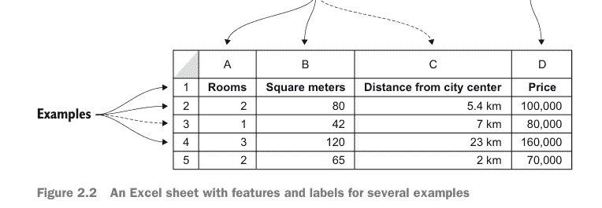

图 2.2 一个包含多个样本的特征和标签的 Excel 表格

我们的机器学习工程师要求提供历史数据，是因为他们需要指导计算机经历一个称为*训练*的过程。

正如经验丰富的房地产经纪人可以根据过去已售房屋的经验来估算新房子的价格一样，机器学习算法也可以在称为*训练*的阶段，基于过去的样本学习如何预测房屋价格。在这个初始阶段，工程师编写代码，将我们拥有的数千个样本输入模型。每个样本既包含特征（用于学习的房屋特征），也包含对应的标签（售价），这样算法就能从这些过去的经验中*学习*。训练完成后，我们就拥有了一个独立的计算机程序（即*模型*），它汇集了房价预测的全部预测能力。由于模型现在嵌入了训练数据集中的知识，我们可以开始独立于训练数据使用它。

每当我们想要评估一套新房屋时，我们可以将它的特征输入模型，并获得它可能的市场价格。这第二步被称为*推理*，它使模型对组织具有实用性，因为模型正在为我们平台上新挂牌的房源生成估值。模型训练完成后，我们可以请工程师将其接入 FutureHouse 的网站，并开始随时响应用户的请求。

如果你对训练和推理之间的界限仍然有些模糊，这很正常。毕竟，人类在生活中同时进行着对新知识的学习和对过往信念的推断：我们那位房地产经纪人朋友自职业生涯开始以来，一直在评估房产，同时从每一笔已售房屋中学习。然而，重要的是你要认识到，在机器学习领域，这是两个非常独立的步骤。一旦数据集准备就绪，训练就只不过是数据与工程师可能决定测试的不同模型之间的机械性管道连接。真正的价值是在*推理*阶段产生的，此时我们可以利用所有过去的经验来做出新的预测。训练和推理之间的这种区别在图 2.3 中直观地表示出来。

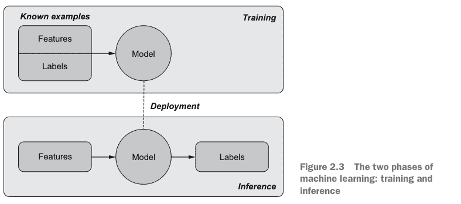

到目前为止，我们已经设法用一般的术语重新描述了房产价格预测问题，这在处理其他问题时将会派上用场。我们要求工程师构建一个模型，能够将输入（也就是*特征*）映射到*目标值*（房屋价格）。我们还将提供一些数据，形式是一长串*样本*（过往销售记录），每个样本都包含一些*特征*（建筑面积和其他数字）和一个*标签*（售价）。我们希望模型能够预测新进入市场的房屋价格，并且预测方式要与我们所提供的样本保持一致。换句话说，我们期望模型对纽约翠贝卡社区一套新的两居室公寓的定价，与过去一年该社区附近已售的其他两居室公寓相似。

到目前为止，我们已经介绍了不少抽象概念，让我们暂停片刻，回顾一下：

- *机器学习算法*——一种让计算机从数据中学习的技术
- *特征*——算法可以学习的对象的一组特性
- *标签*——我们希望算法预测的输出或目标
- *训练*——机器学习算法被输入过去的示例并从中学习的阶段
- *模型*——训练阶段的输出——一个自包含的计算机程序，给定一组特征，可以预测一个标签
- *推理*——将模型用于新示例的阶段

这些抽象概念的妙处在于，我们现在可以将它们应用于其他问题。例如，假设我们想预测二手车价格而非房价。你能想到会使用哪些特征吗？车型和行驶里程可能是很好的猜测，保养历史也是如此。但你还可以发挥更多想象力：考虑政府对低污染车辆的补贴、那些车型的谷歌搜索次数等等。更一般地说，所有那些我们希望基于已有的一组信息去预测一个（尚不知晓的）值的问题，都是*监督学习*的实例。

监督学习是当今机器学习中在工业和研究领域应用最广泛的分支。我们到目前为止的示例就属于这一子集：它使用一系列技术，让机器学会在一组称为*特征*的信息与一个称为*标签*的目标值之间建立映射。监督学习乃至整个机器学习的妙处在于，无论这个公式多么复杂，计算机都会自动找到它。一个成功的模型会做出与标签一致的预测，从而将数据集中蕴含的经验迁移到新案例上。图 2.4 展示了监督学习应用中特征与标签如何相互作用。

至此，你已经了解了监督学习背后的基本概念。正如你所见，这并非什么高深莫测的事。实际上，它很容易理解。复杂性在于内部工作机制：即*机器学习算法*，这些让计算机进行学习的引擎。在本书中，除非我们认为它

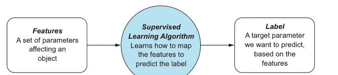

图 2.4 监督学习的核心概念：在一组特征与一个标签之间建立映射

可能对你有用，否则我们不会深入探讨这些算法。借助如今的工具和服务，我们相信你只需掌握足够的知识，就能为你的组织创造价值，提出 AI 产品或服务，并在适当时机将任务交给机器学习工程师。现在你已经开始知道如何做到这两点，击个掌吧！

即使前面的概念看起来很简单，也不要低估你新获得的知识：许多公司利用你刚刚学到的这些简单技术创造了数十亿美元的价值。那么，机器学习为何如此强大？这就是下一节的主题。

#### 2.2.3 机器学习的优势

在上一节中，我们与一位虚构的工程师进行了一次愉快的对话，分别时我们知道他们将基于一些特征（如房屋面积）来构建房价预测模型。暂时抛开价格预测问题，假设我们想要一个买家需要缴纳的房产税计算器。如果是那样，我们与工程师的对话就会简短得多：

你：我们想在网站上添加一个房产税计算器。你能帮忙吗？

工程师：好的。税法中相关的章节是什么？

你：你可以参考 4123 和 564b。

工程师：太好了，我只需要这些。

构建价格预测器与房产税计算器的主要区别在于，后者受已经以数学形式表达的精确规则支配。即使是最初级的会计师也能应用确定房产税的数学公式，并将其应用于新的房产，几乎不需要经验。物理学也是如此：自从艾萨克·牛顿在 17 世纪发现动力学定律以来，我们就能够预测物体的运动，并制造火箭将人送上月球。每当我们遇到类似情况时，数学和传统计算机科学就能很好地解决问题：我们只需将规则和公式转换为计算机代码，结果将是 100% 准确的。

但价格预测的例子则不然：房屋特征与其售价之间的关系是模糊的、不清楚的，而且肯定没有写在规则手册里。即使是最有经验的中介也无法写出计算机友好的房产估值规则，程序员也无法将其转化为软件。

在过去一个世纪里，人类利用计算机实现了惊人的目标，甚至将火箭送入太空，并每天处理数十亿笔金融交易。然而，我们最精密的机器人仍然无法像六岁小孩那样安全地过马路。

事实上，计算机科学在很长一段时间里一直卡在许多重要问题上，因为它们过于复杂，无法通过分析来理解。将诗歌翻译成外语、驾驶汽车或接听电话，这些任务都是人类通过经验习得，而非遵循指令来完成的。机器学习终于让计算机也能做到同样的事情，完全绕开了数学规则，从而开启了全新的应用领域。

其根本洞见在于，我们可以利用*经验*来弥补规则和数学关系的缺失。换句话说，模型是通过从过去的示例中学习相关信息来开发的。这与传统编程形成对比，在传统编程中，模型由人开发并费力地编码到计算机中（即*编程*）。

图 2.5 展示了这一根本差异。机器学习的核心思想是，我们可以利用数据中的特征和标签，让计算机自主地学习它们之间的关系。在存储了这些信息后，目标是让模型在未见过的示例（新房）上复制相同的关系，根据一组特征（房屋特征）预测标签（房价）。这一总体概念与人类的日常做法并无不同：孩子们只需要被教几次马和矮马的区别，就能“领会”并将这种差异内化于心。

与传统软件工程相比，机器学习有两张王牌在手。我们已经讨论了第一张：有些问题我们只能用计算机以这种方式解决。使用机器学习的第二个原因是软件是静态的：即使工程师能想出复杂的逻辑规则，这些规则在产品发布后也无法更改。借助机器学习，添加新的训练数据既能提升性能，也能应对全新的情况，而无需额外的工程投入。例如，随着一波新公寓售出，我们只需用新数据重复训练，预测结果就会得到调整。

在过去十年中，这两大优势一直是机器学习创造价值的关键。既然你已经理解了它们，让我们来看看它们能够应用的其他场景，以及一些公司借助它们赚得盆满钵满的真实案例。

### 传统编程——具有已知规则和关系的问题

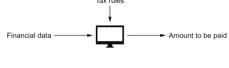

### 机器学习——无法分析解释但可以从经验中学习的问题

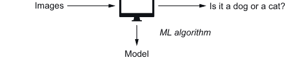

图 2.5 传统编程与机器学习方法的区别

#### 2.2.4 将 AI 应用于通用核心业务数据

你大概能猜到，AI 可应用的行业远不止房地产。AI 可应用于无数领域。本节将通过泛化本章介绍的基础工具来帮助你拓宽视野。

我们之前提到过，我们的价格预测算法属于机器学习的一个分支，称为监督学习。监督学习算法显然不仅限于识别房屋特征与其售价之间的关系。这些算法的精妙之处在于，它们是通用的学习机器，可以适应几乎任何特征影响标签值的现象。

切换标签是最直接体现监督学习算法灵活性的方式。假设我们用房屋售出所需的时间替换当前的标签（售价）。该指标同样可以很容易地从历史记录中获取，并且对客户和经纪人有用，以便他们衡量房屋需求并据此行动。大型豪宅的售出速度比两居室公寓慢似乎是合理的。即使标签不同，我们很可能仍可重用为价格预测所识别的同一组特征，从而得到一个新的算法，该算法不是预测房屋的最佳价格，而是预测找到买家所需的时间。

如果你每次打开 Excel 电子表格时都以机器学习问题的潜在特征和标签的角度来看待列，你将为自己打开一扇机遇之门。例如，如果你在一家银行工作，习惯于查看包含客户数据的 Excel 表格，你现在可能会看到如何将该数据用作特征和标签。银行[content]

#### 2.2.4 将 AI 应用于通用核心业务数据

你大概能猜到，AI 可应用的行业远不止房地产。AI 可应用于无数领域。本节将通过泛化本章介绍的基础工具来帮助你拓宽视野。

我们之前提到过，我们的价格预测算法属于机器学习的一个分支，称为监督学习。监督学习算法显然不仅限于识别房屋特征与其售价之间的关系。这些算法的精妙之处在于，它们是通用的学习机器，可以适应几乎任何特征影响标签值的现象。

切换标签是最直接体现监督学习算法灵活性的方式。假设我们用房屋售出所需的时间替换当前的标签（售价）。该指标同样可以很容易地从历史记录中获取，并且对客户和经纪人有用，以便他们衡量房屋需求并据此行动。大型豪宅的售出速度比两居室公寓慢似乎是合理的。即使标签不同，我们很可能仍可重用为价格预测所识别的同一组特征，从而得到一个新的算法，该算法不是预测房屋的最佳价格，而是预测找到买家所需的时间。

如果你每次打开 Excel 电子表格时都以机器学习问题的潜在特征和标签的角度来看待列，你将为自己打开一扇机遇之门。例如，如果你在一家银行工作，习惯于查看包含客户数据的 Excel 表格，你现在可能会看到如何将该数据用作特征和标签。银行 famously 使用监督学习在发放贷款前预测客户的信用风险，使用收入、年龄和婚姻状况等特征。如果你在一家维护公司工作，并且拥有设备故障数据，你不会感到惊讶，有些公司可以通过使用设备年龄和上次大修以来经过的时间等特征来预测设备在新月内损坏的可能性。你现在已经拥有理解和构建这类问题的所有知识，并且在章节末尾的案例研究中你也会得到更多练习。

在第一部分接下来的章节中，我们将从两个主要方面扩展这项技术：关注模型的 *输入* 或 *输出*。就输入而言，我们将教你 AI 技术，这些技术可以使用图像或文本作为输入，大大扩展我们能够处理的难题类型。关于输出，我们将讨论模型家族，这些模型不仅预测与训练数据匹配的标签，还能执行其他有用的任务，例如将相似项目分组，或帮助客户发现有趣的内容。

现在是时候总结本章的技术部分了，让我们回顾最重要的概念。你已经了解到，机器学习的魔力在于用从数据点自动学习到的模型取代对复杂过程（如房地产市场）的分析性理解。只要示例能很好地代表系统的行为，我们就可以利用模型中嵌入的知识来预测未见事件（如新房上市）。你已经看到，我们事先需要做一些工作来定义业务愿景并识别数据。然后我们就可以请工程师训练模型。训练完成后，我们得到一个可用于推理的成品模型，最终获得业务价值。

虽然第一部分本章和其他章节侧重于你可以用 AI 做什么，但在第二部分我们将更多谈论如何将其变为现实。现在是时候回到两个案例研究了。

## 2.3 案例研究

本节介绍来自两家公司的两个案例研究，它们在两种截然不同的 AI 应用上开展了工作，但有很多共同点：它们都使用核心业务数据和监督学习获得了难以置信的竞争优势。

第一个来自 Google，该公司利用其数据中心能源消耗的核心业务数据，将能源账单削减了 40%。第二个案例的主角是 Square，该公司利用其客户 POS 交易的核心业务数据，赢得了小企业贷款的蓝海。

### 2.3.1 Google 如何利用 AI 削减其能源账单

2014 年，Jim Gao 是 Google 的一名工程师。他负责让科技巨头数据中心（DCs）的庞大空调系统尽可能平稳高效地运行。凭借机械工程背景，Gao 遵循能源行业既定的最佳实践并取得了优异成果。

在最常见的节能措施实施后，Google 数据中心的性能开始趋于平稳，暴露了传统节能方法的局限性。很明显需要一种新方法。Gao 决定走一条未被开垦的道路，利用 Google 的 20% 政策——一项允许员工将 20% 的时间用于他们认为最有利于 Google 的工作的举措。作为一名数据中心工程师，他非常清楚部署在 DC 中的传感器以及为运营目的从中收集的大量数据。Gao 决定学习机器学习并尝试构建模型来预测和改善 DC 性能。

### 数据中心能源消耗问题

数据中心是容纳联网服务器的建筑。在 Google 的案例中，这些机器提供搜索和地图查询、存储照片和文档，并执行 Google 为向用户提供服务所需的所有其他任务。

能源消耗是 DC 成本的主要驱动因素，因为它们容纳了大量耗电的计算机。高成本并不是衡量 DC 能源消耗时需要考虑的唯一因素；环境影响也很重要。如今，数据中心消耗了全球 2% 的电力，随着对网络服务需求的增加，这一数字势必会上升。用于为计算机供电的能源量无法轻易由运营团队优化，因为它取决于计算工作负载和芯片效率。因此，数据中心工程师努力减少所有额外消耗。

数据中心的效率通常通过跟踪称为 *power usage effectiveness (PUE)* 的指标来衡量。该指标反映了除实际计算机以外的任何用途所使用的能源量：

PUE = Total Facility Energy / IT Equipment Energy

完美的数据中心 PUE 为 1：所有能源都用于为计算机供电。PUE 越高，用于其他系统的能源就越多，其中制冷是最重要的。例如，PUE 为 1.5 意味着为计算机供电消耗每千瓦时（kWh）能源，还需要额外 0.5 kWh 能源用于制冷和其他次要需求。

Google 一直是 PUE 效率的领导者。根据 Uptime Institute 对 900 名数据中心运营商进行的 2018 年调查，该行业的平均 PUE 为 1.58。Google 不断改进其 PUE，直到 2013 年达到 1.12。不幸的是，这一数值直到 2017 年才有所改善。

### 数据中心效率的 ML 方法

Gao 意识到，进一步降低 PUE 的障碍之一是，使用传统工程方法在不同场景下正确预测它极其复杂，因为各因素之间存在复杂的相互作用（例如，风可以帮助冷却厂房并减少人工制冷需求）。另一方面，他非常清楚其团队作为日常运营的一部分收集的大型数据集，数千个传感器部署在组件上，收集数百万个数据点。

Gao 预见到利用这些数据训练 ML 模型克服传统热力学局限性的潜力。他的第一种方法是构建一个简单的神经网络（用于构建监督学习模型的经典算法），该网络经过训练可根据影响 PUE 的特征列表预测 PUE。Gao 使用了总共 19 个特征，包括以下内容：

- Total server IT load
- Total number of process water pumps running
- Mean cooling tower leaving-water-temperature set point
- Total number of chillers running
- Mean heat exchanger approach temperature
- Outside air wet-bulb and dry-bulb temperatures
- Outside air relative humidity, wind speed, and direction

该监督学习问题的标签是 PUE。如图 2.6 所示，为了训练他的模型，Gao 使用了 184,435 个时间样本，分辨率为五分钟（大约两年的运营数据）。最终模型能够预测 DC PUE

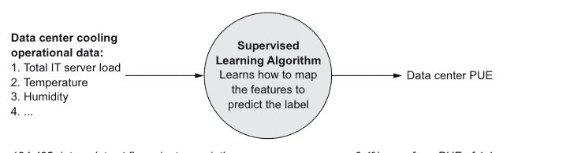

图2.6 Gao的机器学习模型

在PUE为1.1时，误差在0.004 ± 0.0005以内，约为0.4%。Gao能够利用开源编码框架快速构建出第一个概念验证（POC）模型。

最终得到的模型主要用于三个应用场景：

- 通过比较任意给定条件下数据中心（DC）的实际性能与预测性能，实现自动性能告警和故障排查
- 评估PUE对运行参数的敏感性
- 在不进行物理更改的情况下，对不同配置进行数字模拟

Gao的工作成果对公司产生了重大影响，并得到了数据中心副总裁Joe Kava的公开认可。他在谷歌官方博客文章中描述了这项工作及其成果。《通过机器学习打造更好的数据中心》一文强调了Gao的模型如何能够识别出人类无法发现的数据模式，从而构建出一个能够以99.6%的准确率预测PUE的模型。

Gao和他的团队开始利用该模型寻找提高效率的新方法。例如，当服务器离线时，已知会导致数据中心性能下降。得益于Gao的模型，谷歌数据中心团队能够对数据中心行为进行模拟，并找到遏制性能损失的新方法，从而节省能源和资金。

## 机器学习在数据中心优化中的应用势头正盛

Gao的独立工作引起了公司高层的关注。他被提升为跨职能团队负责人，该团队由机器学习、软件、电气、机械、控制和运营工程师组成，旨在开发端到端的数据中心智能解决方案。

新团队中的机器学习专业知识来自DeepMind，这是一家专注于前沿AI算法的英国公司，于2014年被谷歌以5亿美元收购。额外的机器学习专业知识成为实现公司历史上前所未有的性能的关键资产，将PUE的额外开销降低了15%，并使总能源账单减少了40%。

尽管DeepMind的模型比Gao的方法更复杂、更准确，并帮助谷歌削减了40%的能源账单，但它仍然只能提供建议，需要人工审核和实施。该项目合乎逻辑的下一步是将数据中心电力管理完全交给AI解决方案，同时由人类专家担任监督者。

DeepMind的模型于2017年8月部署，已经实现了10%的节能。在新模型运行期间，它们产生了额外的数据，这些数据被用于重新训练模型并进一步提高其性能。一年之内，节能率从10%提升到了30%。

AI控制系统采用了新颖的冷却管理方式，以专家数据中心运营商未曾预料和探索的方式实现了顶级性能。例如，谷歌数据中心运营商之一Dan Fuenffinger表示，当AI系统能够自主利用冬季条件，在较低温度下制取水，从而减少能源消耗时，他感到非常惊讶。

## 案例问题

- 1. 提高数据中心的PUE是一个具有挑战性的问题，Gao凭直觉认为机器学习可能是解决该问题的方法。这一挑战的哪些特点使其非常适合机器学习？
- 2. 哪些关键要素使Gao能够独自构建第一个POC？
- 3. 谷歌如何将一位工程师的倡议转变为全公司的成功？

## 案例讨论

谷歌的数据中心项目是一个经典的优化案例，机器学习非常适合此类问题。它始于我们有业务兴趣预测的关键绩效指标（KPI）（即PUE），以及一系列影响它的参数（温度、压力、负载等）。工程师们曾试图构建一个能够将这些参数映射到PUE的模型，但依赖热力学的传统方法存在严重缺陷，导致它们无法提供超过一定阈值的结果。

这就是机器学习业务问题应有的样子：一组变量与一个对业务有直接影响的指标之间存在复杂、未知的关系。Gao在识别这些特征并意识到机器学习可能是解决这一问题的正确工具方面做得非常出色。

有几个要素促成了Gao的成功。首先是数据的可用性，没有数据就不可能开展机器学习解决方案。Gao从工作经验中知道这个数据集的存在，并且得益于公司灵活的数据治理，他能够轻松获取所需数据，开始进行实验。我们稍后将更详细地讨论数据治理，但很明显，数据的可用性和可访问性对于启动这样的机器学习项目至关重要。请注意，这些数据已经存在多年，但没有人看到过其单纯的运营目的之外的价值。

帮助Gao起步的另一个因素是开源工具的可用性，这使他能够快速构建POC。这让他获得了所需的关注和企业支持，从而将他的方法提升到新的水平，引入了DeepMind的熟练机器学习工程师，并在他的初步直觉的基础上继续发展。

最后，这个项目的执行方式是一个优秀机器学习战略的完美案例。我们将在本书第二部分更详细地讨论这个主题，但请注意，这个项目并非始于宏大的使命和复杂的解决方案。第一步足够简单，可以由一位工程师用其20%的时间完成，但也足够强大，足以证明该方法的潜力。第二步更为复杂，要实现更高的性能，需要获取新知识、进行测试、积累势头，并迈向完全自动化的AI控制这一下一步。谷歌计划分步构建该项目，每一步都有切实的投资回报率（ROI），并建立在前一步的基础上，直到达到最先进的性能并对利润产生重大影响。

总而言之，本案例研究有以下主要启示：

- * 一个可能适合机器学习的问题必须具备某些特征：
    - 存在一个重要的KPI。
    - 该KPI受到一系列可测量参数的影响。
    - 这些参数通过复杂且未知的关系影响KPI。
- * 运营数据集可能具有巨大的隐藏价值。
- * 开源技术可以让小型工程师团队构建POC，为企业带来切实成果，并证明该概念可以扩展和进一步改进。
- * 在构建机器学习项目时，从小处着手总是一个好主意，确定能立即产生业务影响的最小任务，为更复杂的项目奠定基础。

### 2.3.2 Square如何利用AI向小企业贷款数十亿

本案例研究讲述了一家金融科技初创公司如何通过向传统上服务不足的小企业提供贷款来挑战大型银行。通过对其零售交易数据集应用机器学习，Square Capital可以在企业提出申请之前主动提供小额贷款。Square的违约率仅为行业平均水平的一半。

### Square与Square Capital

Square是一家专注于小企业需求的金融服务公司。它由Twitter创始人杰克·多尔西（Jack Dorsey）于2009年创立，并于2015年上市。公司总部位于旧金山，2019年市值达260亿美元，拥有2300名员工。Square的第一款产品是一款直接插入智能手机的信用卡读卡器，使小型零售商和专业人士能够接受信用卡付款。该读卡器硬件免费分发，无需月订阅费，从而推动

Square 在小型零售商中的声誉。其硬件标志性的设计和稳定的推荐流也促成了 Square 声誉的建立（迄今为止国际扩张有限）。

在运营的最初几年，Square 专注于年营业额不足 12.5 万美元的小型企业这一细分市场；这些企业在银行和传统支付处理商那里服务很差。Square 低廉的费用和易于使用的网站帮助将企业家吸引到一个正在成长为完整金融生态系统的体系中。在上市前的几年里，Square 通过推出点对点支付应用、客户关系管理（CRM）和营销平台，以及面向大型商家的销售点硬件来补充其服务。

2014 年，Square 推出了 Square Capital，这是其金融生态系统的另一个组成部分。随着小型企业扩张，它们经常出现可能通过额外营运资金缓解的现金流问题。然而，传统银行往往对这些客户的需求不敏感，因为小额贷款无法证明营销和处理贷款所需的开销是合理的。Square Capital 利用其销售点交易数据主动向客户提供小额贷款。对客户而言，体验是无缝的，因为他们可以直接从用于生态系统中其他服务的同一管理网站接受和管理贷款。贷款没有特定的还款时间表；资金会自动从 Square 处理的信用卡交易中扣除。无摩擦的体验和现有的客户基础使 Square Capital 能够迅速扩张；仅在 2014–2018 年间，就有 200,000 家商户通过该平台借入超过 31 亿美元。

虽然信用风险模型已成为金融行业数十年的支柱，但 Square 可以访问更广泛的数据集，包括每个单独购买的季节性和时间性。这使 Square 能够建立对每家业务现金流状况具有极高可见性的模型，并适当确定提供的贷款规模。加上直接的还款选项，这将贷款拖欠率降至 4%，为行业平均水平的一半。

## 批评与竞争

从财务角度来看，Square Capital 提供的贷款并没有什么新意。贷款机构自古以来就一直向企业提供商户现金预支（MCAs）以满足其短期现金需求。与没有规定时限的 MCAs 相比，Square Capital 贷款必须在 18 个月内偿还。这使得 Square 能够将贷款转让给更广泛的金融机构，而这些机构更难处理没有已知还款日期的 MCAs。Square 仅作为贷款的发起人，而非贷款人，维持了与其它科技公司可比的具有吸引力的资产负债表。

虽然大多数金融机构使用机器学习来评估信用风险，但像 Square 这样的当今金融科技公司也被批评为从其信用申请流程中移除了太多的人为监督。例如，点对点借贷初创公司 Prosper 在 2015 年因放贷而受到审查

从用户体验的角度来看，Square Capital 是将基于 AI 的功能无缝带入现有平台的良好示例，对终端用户来说完全透明且自然。建立在商户已对 Square 产生的信任之上，Square Capital 的产品低调且适合其受众。没有不必要的“基于 AI 的风险评估”或晦涩的技术优先营销的吹嘘。剩下的就是专注于客户体验。

在企业财务方面，有趣的是看到 Square 通过使用 ML 进行信用风险评估获得的灵活性如何使其能够尝试新的商业模式。提供固定期限贷款，而不是传统的 MCAs，使 Square 能够专注于其核心使命，而不是自己承担贷款。这使 Square 能够实现爆炸性（约 50% 每年）的增长，利用其优势而不会在资产负债表上堆积额外风险。

本案例的一个有趣要素是 ML 在特定边缘情况下的缺点。我们将 ML 算法的自主学习视为优势，但有时我们很难窥探算法在做出决策时遵循的逻辑。如果小型企业的贷款申请被 ML 算法拒绝，解释原因可能很困难或不可能。我们将在最后一章更详细地介绍 ML 的这一方面。

Square 从强势地位起步，因为其商业模式使公司能够收集所有客户的核心业务数据：他们的交易历史。该数据资产是 Square Capital 建立的支柱。请注意，这些数据是 Square 为提供标准 POS 服务而自然收集的，并在 Square Capital 推出时成为一项不可思议的资产。

### 2.3.3 案例研究启示

Google 和 Square 都创建了 AI 应用，使它们在竞争对手之上获得了巨大优势，同时在核心上有所不同。Google 使用 AI 来降低成本和改善运营，而 Square 则用它来推出一个全新的服务。基本原则保持不变：Square 和 Google 都在核心业务数据上使用 AI，从大多数其他公司视为沉没成本的东西中创造了巨大价值。

请注意，Google 和 Square 都使用了最初并非为 AI 而收集的数据。在 Google 的案例中，存储数据中心空调系统的运营数据以便报告和监控系统按预期运行的做法很常见。Jim Gao 利用 ML 提高系统性能的想法是新颖的，体现了 Google 工程师的出色直觉。

Square 也是如此：它收集客户交易数据是为了提供销售分析等服务，但提供贷款并不是收集这些数据的最初原因。Square 最初甚至没有提供商业贷款服务：这是一个完全由 ML 和其拥有的这一丰富数据集所实现的新服务。这使 Square 能够进入一个完全未被充分服务的市场，因为传统银行没有资源来评估小型企业的贷款资格。

从这两个案例研究中你还应记住的另一个方面是，两者都使用了监督学习方法。Google 学习根据其运营参数预测冷却厂的 PUE，而 Square 根据其交易历史确定小型企业的资格。问题设置的相似性如图 2.7 所示。在 Google 的案例中，监督学习特别有助于克服传统能源效率解决方案的局限性。Square 的应用用于自动化一个如果由人类完成会过于耗时的流程。

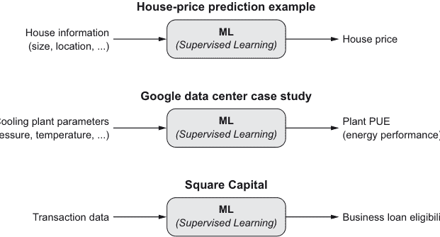

**图 2.7** 房屋预测示例以及 Square 和 Google 案例研究如何使用监督学习

## 2.4 评估性能和风险

现在是时候与 FutureHouse 的领导层开会，坐下来谈谈我们交付的项目所带来的风险和担忧。我们已为房产价值预测算法确定了一个很好的商业案例，收集了正确的数据并构建了它。现在，你只需要按下那个让该功能出现在网站供用户使用的红色按钮。你即将继续；办公室里所有人都看着你。你的手出汗且颤抖。你冒险一跃，按下按钮，闭上眼睛，希望算法能正常工作。幸运的是，现实世界中事情并非如此。在不彻底衡量其性能的情况下部署模型是不负责任的。

首先：机器学习基于数据和统计，因此其预测可能永远不会 100% 准确。但我们希望预测对业务有价值，同时尊重所有安全和道德标准。我们构建的整体系统必须容忍这种误差幅度，原因与我们首先使用机器学习的原因相同：其中一些问题如此复杂，以至于无论有多少数据都不可能全部捕捉到。使用 ML 于生死攸关的情况的公司（如自动驾驶汽车）必须更加谨慎和保守

在一栋拥有50个浴室的住宅案例中，假如训练数据集中根本没有类似的豪宅。大多数模型家族在这种情况下都不会发出警报，因此工程师必须对输入和输出实施一些健全性检查，以确保安全。

另一个重要的风险因素围绕着机器学习之所以卓越的核心：自动提取目标与特征之间的映射关系。这是一种强大的能力，但也意味着工程师很难理解模型在给定一组特征的情况下为何做出特定的预测。这就是为什么机器学习常被称为黑盒：你知道输入（特征）和输出（目标），但很难理解模型为何选择了该输出。虽然某些模型家族比其他的更好，但事实是，这是与AI大规模应用相关的最令人担忧的方面之一。别担心，因为本书的第二部分将 dành 大量篇幅讨论这个问题。

我们在这一章中涵盖了很多内容。我们通过设计一个面向客户的人工智能功能——为一家虚构的房地产经纪公司预测房产价值——向你介绍了监督学习的主要概念。你了解了数据的价值及其如何用于构建机器学习模型。这些案例研究帮助你将这些知识应用于行业情境，因此你开始能够识别自己组织中的类似机会。

最后，分享一个有趣的事实。Zillow 是美国领先的在线房地产交易平台。预测房产价值对 Zillow 来说至关重要，而机器学习是一个显而易见的解决方案，以至于它举办了一场寻找最佳算法的竞赛。获胜奖品是什么？一百万美元。

## 摘要

- 核心业务数据是与组织价值创造引擎联系最紧密的数据类型。因此，它也是受AI影响潜力最大的部分。
- 监督学习是一类机器学习算法，允许计算机在足够多的示例下学习如何映射输入（特征）和输出（标签）。
- 机器学习可以解决许多传统软件工程失败的高难度问题，因为它基于历史数据而非数学理解。
- 即使基于机器学习的模型永远无法达到 100% 的准确性，数值指标（如准确率）也可以帮助跟踪其性能。

## 3.1 **为什么在销售和市场推广中使用 AI**

营销人员的主要目标之一是找到最佳方式，在正确的时间将正确的产品推荐给正确的客户。但即使涉及数十亿美元的利益，营销人员也长期受到各种限制。第一个限制是数据缺乏。当世界不像现在这样互联互通时，回答问题的唯一方法就是与人交谈。互联网在很大程度上解决了这个问题：现在比以往任何时候都更容易接触广泛的受众，向他们展示信息，并衡量他们的反应。硬币的另一面是，数据变得如此庞大和细致，以至于人类难以理解并从中提取洞察。

我们要在本章开始时提供一点关于 AI 如何改变一切的洞察。每个营销人员都知道，并非所有客户都相同，他们在对个性化信息有响应时效果最佳。一种常见的营销策略是根据人口统计或类似方面将客户划分为*细分市场*。一个简单的细分可以是“每年在娱乐上花费超过 1,000 美元的 25 至 30 岁富裕女性”。营销人员可以为这一类人群定制信息，这与针对其他细分市场的做法不同。虽然这种技术与市场一样古老，但在 AI 出现之前，这确实是我们能做的最好的。

这种方法的局限在于，无论你的细分多么具体（营销人员称之为*微细分*），你总是最终会遇到这样的情况：两个客户即使本质上不同，仅仅因为属于同一类别而被完全同等对待。人脑能管理的类别数量是有限的。想想你的多少朋友在纸面上与你拥有相似特征（同年龄、同街区、同教育背景），但品味却截然不同。

正如你在图 3.1 中看到的，传统的市场细分方法无法将 Marc 作为一个独特的个体 Marc 进行目标定位。它总是将他作为一个“生活在特大城市、25 至 30 岁的男性”进行定位。AI 改变了游戏规则，因为它能处理更多的信息。借助 AI，你可以实现大规模个性化，从人们具体的行动和特征中学习，并针对他们真实的一面进行定位，而不是针对他们所属的人工划分的类别。

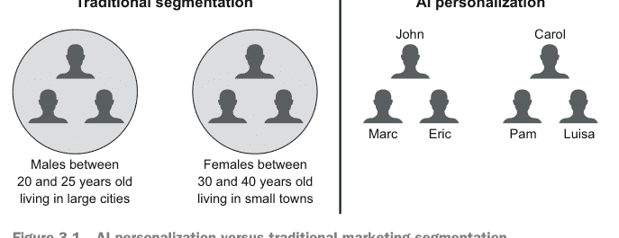

图 3.1  **AI 个性化与传统市场细分**

这种细粒度个性化能力对业务意味着什么？嗯，专门从事营销AI的公司可以展示一些令所有营销人员梦寐以求的惊人指标。例如，Amplero 是一家专注于 AI 驱动营销的美国公司。以下是其营销材料中报道的一些结果：

- 它帮助一家主要欧洲电信公司将前 30 天的每用户平均收入从 0.32% 增加到 2.8%，增幅接近 800%。
- 它将北美前五大移动运营商之一的客户获取成本（CAC）降低了超过 97%：从每位客户 40 美元降至仅 1 美元。
- 它成功在一家主要欧洲移动运营商最不满意的客户取消套餐前三周重新定位他们，创造了更有意义的客户体验以重新激活他们，并将留存率从 2% 提高到 10%。

这些数字并非意在吹嘘某家特定营销公司的结果。你会发现许多初创公司和较大的组织也能取得类似的结果。如果在你的组织中实现这种性能的想法让你不寒而栗，你并不孤单。让我们看看这如何实现。

营销是一个复杂的职能，因此，我们不会列出所有可能的应用，而是专注于适用于大多数企业的三个一般问题：

- 识别哪些客户很可能离开你的服务（流失）
- 识别哪些客户很可能购买新服务（追加销售）
- 识别类似的客户群体（客户细分）

## 3.2 预测流失客户

最重要的营销指标之一是客户流失（也称为客户流失率或客户转换率）。流失率定义为在一段时间内离开某企业的客户百分比。能否提前知道哪些客户最不满意，并最有可能在近期放弃某产品或服务，那将是多么美好？这正是 AI 如何帮助你解决客户流失问题：利用机器学习和组织的数据资产，我们可以找到最有可能离开你服务的客户，并联系他们，用个性化信息重新提高他们的参与度。接下来，我们将展示流失预测器是如何工作的，让你有信心看到这种应用在你组织中的机会。

在这个机器学习问题中，我们有两类客户：那些可能流失的顾客和那些没有流失的顾客。因此，我们的 ML 模型需要学习预测的标签是客户属于其中一个类别还是另一个类别（假设即将流失的客户属于类别 1，其他客户属于类别 0）。例如，一家电话公司可能会将其退订电话套餐的所有客户标记为“已流失”，而将仍保留套餐的所有其他客户标记为“未流失”。

现在我们已经定义了算法需要预测的标签，让我们来看看可以使用哪些特征。记住，在一个 ML 问题中，*特征* 是模型用来区分类别的参数。这些可以是用户的属性（例如人口统计数据）或其与产品的交互（例如过去一个月使用特定服务的次数）。

我们刚刚描述的内容具有 *监督学习* 问题的形式：一个 ML 算法被要求基于历史数据学习特征集（客户特征）与标签（流失/未流失）之间的映射。让我们回顾一下解决它的必要步骤，如图 3.2 所示：

1.  从业务任务开始定义一个 ML 任务（识别可能离开我们服务的客户）。
2.  明确识别标签：流失或未流失。
3.  识别特征：客户中可能影响流失可能性的要素。你可以通过思考如果自己来做这项工作会看什么来提出可能的例子：
    - 年龄
    - 客户使用服务的时间长度
    - 在服务上花费的金额
    - 过去两个月使用服务的时间
4.  收集流失客户和活跃客户的历史数据。
5.  训练模型：ML 模型将学习如何根据特征预测标签。
6.  执行推理：使用模型对新数据进行处理，以识别哪些当前客户可能流失。

请注意，标签必须通过查看过去的客户记录来追溯确定。让我们先考虑最简单的情况。假设你有一个基于订阅的商业模式，像 Netflix 或 Spotify。订阅通常会自动续订，所以

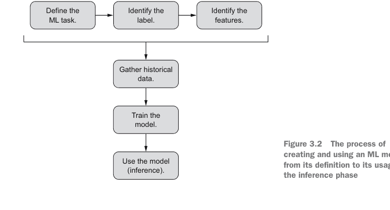

到目前为止，你在为流失预测项目定义标签方面的信心和效率已经远超大多数业务经理。每位数据科学家都会为此感激不尽，但如果你真的想帮助他们，你需要付出额外的努力：帮助他们选择特征。

如果这听起来像是一个技术细节，你就错过了一个让你的经验和领域知识大放异彩的绝佳机会。在一个 ML 问题中，记住特征是我们试图建模的现象的一个属性，它会影响其结果。假设你是一位营销专家，没有人比你更了解相关特征的见解，你的专业知识可以帮助你的数据科学团队走上一条通向成功结果的道路。

为了让你了解你的贡献可能是什么样子，请自问：“如果我必须猜测单个客户的流失可能性，我会看哪些参数？”这可以为你与工程师的对话提供信息：

工程师：你知道是什么影响客户流失吗？我需要想出一些相关的特征。

营销人员：当然，我们知道付款方式与流失高度相关。通常，有合同而不是预付卡的人不太可能放弃服务，因为他们有更多的锁定效应。还要注意的是，当我们接近合同到期日时，客户开始关注竞争对手，所以这也是一个因素。

工程师：很有趣。我肯定会在模型中使用一个表达“合同”或“预付”的特征。另一个特征将是距离合同到期的天数。还有别的吗？

营销人员：当然，我们知道年龄起着很大作用。这些年轻的千禧一代总是换公司，而年长的人更忠诚。此外，如果有人长期是我们的客户，这就是忠诚度的一个良好指标。

工程师：不错；我们可以查看 CRM 并包含“注册天数”和“年龄”两个特征。年龄是唯一有趣的人口统计属性吗？

营销人员：我不认为性别是；我们从未注意到任何影响。职业很重要：我们知道自雇人士不太愿意更改计划。

工程师：好的，我会尝试 double-check 性别是否与流失有任何相关性。关于职业，这是一个很好的提示。谢谢！

这样的对话可以持续数天，通常在工程师和你之间不断来回。你提供经验和领域知识，工程师将其翻译成机器可读的内容。最终，工程师会带着一些从数据分析中得出的见解或问题回来，需要你的帮助来解释。正如你所见，这不是一个书呆子练习：这是业务与书呆子之间的团队合作。

### 3.3 使用 AI 提升转化率和交叉销售

你已经看到流失预测如何成为分类算法的一个强大应用。在这种情况下，我们为客户标记的类别是“流失”或“未流失”。在其他情况下，你可以用与营销部门相关的类别来标记客户，并使用 ML 算法进行预测。一个自然的例子是客户是否会基于过往销售购买服务。

让我们想象你有一个经典的营销漏斗：客户订阅免费服务，然后其中一些最终升级到付费版。因此，你有两类客户：

- 已转化——在试用免费版后购买了付费服务的客户
- 未转化——继续使用免费服务的客户

网络公司可能会投入数百万美元来最大化用户转化为付费产品的数量。对采用软件即服务（SaaS）商业模式的软件公司来说，这一指标至关重要：公司提供通过订阅购买的服务。根据转化率，基于网络的订阅业务可能生死攸关。

试图提高付费用户转化率的最 naive 方法是对整个用户群进行大规模营销活动：新闻通讯、优惠、免费试用等等。更 sophisticated 的营销人员可能会考虑制定复杂的策略来评估转化的可能性，并更明智地投资营销预算。例如，我们可能认为打开过新闻通讯的用户比从未打开过的用户更有可能购买付费服务，并针对他们投放 Facebook 广告（你是否曾在访问网站或打开新闻通讯后在 Facebook 上收到垃圾信息？）。

鉴于该主题的重要性以及其上的资金规模，让我们看看是否可以使用 ML 根据其转化可能性对用户进行分类，优化我们的营销成本并取得更好的效果。如果你看这个问题，你会发现它非常适合机器学习。你已经看到你有一个明确定义的任务：识别可以从免费升级到付费服务的用户。这是一个监督学习分类任务，并且你已经准备好了标签：假设购买了付费服务的用户为 1，未购买的用户为 0。你现在需要思考用于训练分类器的特征。记住，识别特征的一个良好起点是问自己这个问题：“如果我必须自己猜测转化的可能性，我需要什么信息？”这些信息可能包括以下内容：

- 免费产品的用量。记住这必须是一个实际数字，所以你必须想出一种有用的描述方式。如果你销售像 Dropbox 这样的服务，用量可以用一组参数来描述：
    - 存储的文件数
    - 用户登录的设备数（提示服务对用户有多有用）
    - 每天/每周/每月访问次数（表明用户依赖它的频率）
- 新闻通讯打开率（用户对我们信息有多感兴趣？）
- 用户订阅多久以前
- 获客渠道（通过朋友推荐订阅的人可能比点击 Facebook 广告的人更有价值。）

这些变量可能因你拥有的业务类型而异，但概念通常很简单：思考哪些因素可以暗示转化的可能性，然后将它们输入你的 ML 算法。值得指出的是，一些企业拥有比其他企业更多的数据：例如，使用 Facebook 登录的互联网服务将能够知道所有用户兴趣作为此类分类器的特征。

假设你拥有过去已转化客户以及未转化客户的历史数据，你可以训练算法识别你选择的特征如何影响用户购买付费服务的可能性。训练阶段完成后，你的算法终于准备好将从以前客户身上学到的知识应用到现有客户身上，按从最有可能转化到最不可能转化的顺序对他们进行排名。正如你从前一章回忆的那样，这一阶段称为推理（在算法在过去数据上训练后对新数据进行预测）。图 3.4 说明了从过去客户行为中学习并对新客户进行预测的过程。

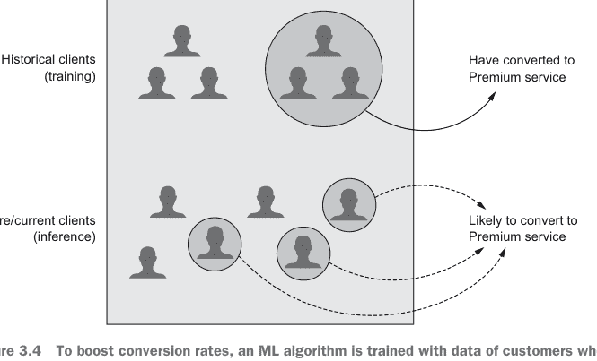

图 3.4 为了提高转化率，ML 算法使用过去购买过付费服务的客户数据进行训练。之后，该算法识别哪些客户最有可能做同样的事情。

请注意，我们将此方法应用于使用免费增值模式（免费服务和付费升级）的基于互联网的系统的案例，但它可以应用于任何其他情况，即你有一组客户执行一种操作，而另一组客户执行另一种操作（或什么都不做）。这种场景很常见，我们希望鼓励你寻找此类情况并思考是否有空间为其构建一个 ML 分类器。

为了给你一些灵感，这里有一些可以应用此方法的其他案例：

- 你有一个基础产品和一些追加销售（配件或附加服务，电信公司很常见）。你可以用“已购买追加销售 X”或“未购买追加销售 X”来标记客户，并利用他们对基础产品的使用情况来评估是否值得向客户提出追加销售。
- 你有一个新闻通讯并希望优化其打开率。你的标签是“已打开新闻通讯”或“未打开新闻通讯”。用于分类器的特征可能是你发送电子邮件的时间（星期几、小时等）以及一些与用户相关的特征，你还可以根据内容对电子邮件进行标记（例如，“信息性”、“产品新闻”或“白皮书”）。
- 你有一个实体店并有忠诚度卡（用于跟踪哪个客户购买了什么）。你可以开展营销活动（再次是新闻通讯，也可以是实体广告）并根据是什么让用户进入你的商店以及什么没有让他们进入来对用户进行分类。

正如你所见，我们刚刚描述的将用户分为两个独立类别并构建可以识别这两个类别的 ML 分类器的方法非常灵活，可以用于大量问题。相当强大，不是吗？

## 3.4 执行自动化客户细分

在本章的引言中，我们提到了营销人员在制定营销计划时必须执行的关键活动之一：客户细分。对市场进行细分意味着将具有相似特征和行为的客户划分为组。此努力背后的核心思想是，同一组的客户会对类似的营销行动做出反应。例如，时尚零售商可能会从为男性与女性、青少年与年轻人与专业人士分别设立市场细分中受益。

细分可以更具体或更不具体，因此颗粒度也不同。以下是两个例子：

- 广泛细分——20 至 25 岁的年轻男性
- 高度具体细分——20 至 25 岁的年轻男性，在大学学习，居住在美国五大城市之一，并且对第一人称射击电子游戏充满热情

只要数据量有限，无论是示例数量（客户数量）还是特征数量，营销人员都可以凭直觉在脑海中执行此细分任务。这通常会产生像第一个那样的通用客户细分，这考虑到这些群体之间存在的差异，可能会有所限制。营销人员可以尝试定义像第二个那样的更具体细分，但他们如何想出它呢？以下是典型头脑风暴会议中可能提出的问题：

- 使用 20 至 25 岁的阈值是个好主意吗，还是使用 20 至 28 岁更好？
- 我们能确定居住在大城市的大学生与居住在小城市的大学生在根本上不同吗？我们不能把他们全部放入一个集群吗？
- 男性与女性之间是否存在根本差异？我们真的需要创建两个细分，还是这只是陈词滥调？

回答这些问题可以通过三种方式进行：

- 凭直觉。 我们现在不是 1980 年，所以不要那样做。
- 查看数据，并利用营销人员的直觉来解释它。这比凭直觉好，但营销人员可能会将自己的偏见投射到分析中，看到他们想看到的东西。所以也应避免这一点。
- 让 AI 自己提出客户细分，同时让营销人员参与其中，利用他们的创造力和背景知识。

选项 3 最有可能胜过其他选项。让我们看看为什么以及如何实现。

### 3.4.1 无监督学习（或聚类）

让我们看看我们刚刚描述的问题：

- 我们从哪里开始：一个客户池，具有一系列特征来描述他们（年龄、位置、兴趣等）
- 我们想要什么：我们可以用来划分客户的特定数量的细分

你可以想象这个问题为有一堆客户，需要将每个客户放入一个桶中，我们称之为集群（图 3.5）。

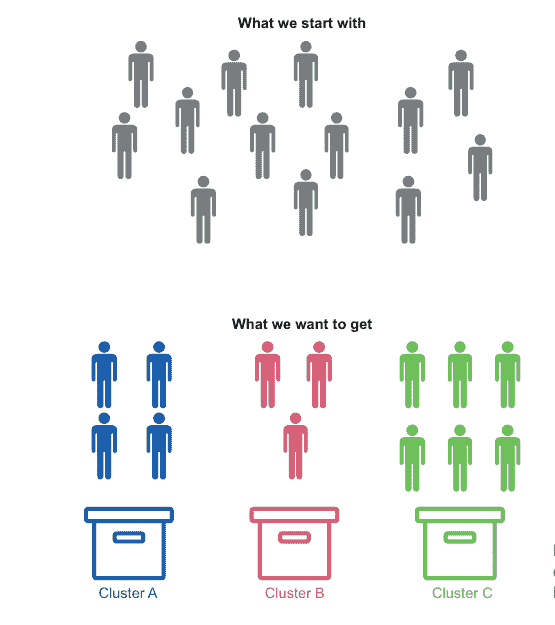

图 3.5 聚类算法将一组均匀的客户分为三个集群。

我们将使用的客户特征与我们在前几章中称之为特征的东西相似，因此你可能会认为我们处理的是同一种任务，可以使用我们已经描述过的相同工具。但魔鬼在细节中：因为我们事先不知道想要定义的组，所以我们不知道要应用哪些标签。到目前为止，在本书中，我们使用了一种称为监督学习的 ML 子集。监督学习任务的典型配方如下：

1. 我们有一组客户的数据，这些客户由某些特征表征。
2. 这些客户还有一个标签：我们感兴趣预测的目标值（例如，他们是否流失）。
3. 监督学习算法遍历客户的数据，并学习特征与标签之间的一般映射。

在我们新的场景中，第 2 点缺失了：我们没有为每个用户附加标签。这正是我们希望新算法找到的。因此，我们的新任务如下所示：

1. 如前所述，我们有一组由某些特征表征的客户数据。
2. 我们希望将客户分为特定数量的细分（集群）——假设是三个。
3. 我们运行某种 ML 算法，该算法查看数据后确定我们可以得到的最佳集群并将用户拆分到其中。

这种新型 ML 算法称为 *聚类*，或 *无监督学习*。无监督学习是另一种形式的 ML，其中算法被提供一组未标记的示例（仅一组参数），并被要求将示例划分为共享某种相似性的组。在这种意义上，无监督学习算法使用相似性的概念来克服先前定义标签的缺乏，以自主的方式将它们接收的示例划分为组。这是监督学习与无监督学习之间的核心区别：监督学习算法学习一组特征与标签之间的映射，而无监督算法只是查看标签并根据共享某种相似性的集群对数据点进行分组，如图 3.6 所示。

技术人员，并以开放的心态接受他们提供给你的输入。

可视化聚类的一种好方法是想象星星在夜空中散布的方式。我们的脑海会直觉地将邻近的星星分组并为其分配星座。大多数现实世界的应用会更复杂一些，主要有三个原因：

- 有时，数据点是均匀分布的，使得很难决定考虑多少个集群，更不用说如何划分客户了。
- 作为人类，我们很容易在有限的维度上执行细分，但在维度数量增加时我们会感到困难。回想一下星座的例子：我们将天空视为二维画布；在三维空间中执行相同任务会困难得多。在四维中，这是不可能的。那 20 个客户信息维度呢？
- 从商业角度来看，细分不是无意义的练习，只有当各个细分可以与业务结果联系起来时才最有用，通常以客户终身价值、价格敏感度或渠道偏好来衡量。

在下一节中，我们将通过一个示例来解决这些问题。现在，让我们更深入地了解聚类的内部机制。当处理聚类问题时要做出的第一个重要决定之一是决定为聚类使用哪些特征（或维度）。在我们夜空的简单示例中，维度的选择是显而易见的：每颗星的水平和垂直位置。现实世界的应用可能要复杂得多。

### 3.4.2 *客户细分的无监督学习*

本节将为你提供有关无监督学习的更多细节，并揭示这些算法的内部工作原理。到目前为止你学到的核心概念足以让你设想在你的组织内部监督学习的新的应用。如果这足以满足你的目标，请随意跳过本节。如果你想了解如何在实践中使用这些技术，请继续阅读。

让我们以一个销售鞋子的电子商务网站为例，该网站可以访问其客户的购买历史。每个数据点代表一次购买或退货，并包含有关鞋子的信息，例如价格、品牌、尺码、颜色、交易日期和时间，以及是否与其他商品一起购买。我们可以决定使用所有这些特征进行细分，也可以将其分析限制在子集。例如，查看客户购买的所有鞋子的颜色可能有助于我们更好地了解该客户的品味，或者查看这些购买的当天时间可能提供有关提出折扣的最佳时间的建议。

我们甚至可以推导出参数，例如每次购买的平均花费金额和每月购买的鞋子数量。这两条信息结合起来很可能会帮助聚类算法找到高频/低价值客户与低频/高价值客户之间的自然区别。

为了简化起见，假设我们正在构建一个简单的聚类算法，该算法查看每个客户的三个特征：

- 年龄
- 性别
- 在电商上的平均月消费

请记住，未用于聚类的属性不会被丢弃，但可用于画像。这意味着描述每个群体的特征以指导营销决策。

表 3.1 显示了前五个客户的数据。

表 3.1 在输入无监督学习算法之前的前五个客户特征

| Customer ID | Age | Gender | Average monthly spending ($) |
|---|---|---|---|
| 1 | 18 | M | 14.67 |
| 2 | 21 | M | 15.67 |
| 3 | 28 | M | 18.02 |
| 4 | 27 | F | 34.61 |
| 5 | 32 | F | 30.66 |

在一些最常用的聚类算法中，下一步将是决定我们要寻找的聚类数量。这通常是违反直觉的：毕竟，你难道不希望算法告诉你有多少用户群体吗？不过仔细想想，人口可以有多种方式进行切片和切分，而提前选择聚类数量是引导算法的唯一方法。现在让我们保持简单，假设我们要得到三个聚类。聚类算法将找到一种划分用户的方式，使得

- 同一聚类内的客户彼此相似。
- 不同聚类中的客户彼此不同。

这样，我们在数学上就能确定，当我们选择一个行动来针对某个聚类的客户时，我们最大化了他们会以相同方式响应的可能性。聚类算法的两个输出值得关注：

- 将与每个用户关联的聚类，如表 3.2 所示。
- 聚类中心。每个聚类都有一个中心，可以被视为属于该聚类的用户类型的“刻板印象”。营销人员称之为买家角色。

表 3.2 添加一个由无监督学习算法识别的 Cluster 列
| Customer ID | Age | Gender | Avg monthly spending ($) | Cluster |
| ----------- | --- | ------ | ------------------------ | ------- |
| 1           | 18  | M      | 14.67                    | 1       |
| 2           | 21  | M      | 15.67                    | 1       |
| 3           | 28  | M      | 18.02                    | 3       |
| 4           | 27  | F      | 34.61                    | 2       |
| 5           | 32  | F      | 30.66                    | 2       |

查看聚类中心至关重要，因为它为我们提供了算法发现内容的定量信息，我们可以据此解释以提取洞察。每个中心都将由我们之前用来描述用户的相同三个特征来表征（尽管我们可能会重新排列它们以使其更有意义）。通常，我们还会添加落入每个聚类的用户数量。表 3.3 显示了聚类中心可能的样子，假设我们从 1,000 名客户的数据开始。

表 3.3 我们算法发现的三个聚类的特征摘要
| Cluster number | Age | % female | Avg monthly spending ($) | # of customers |
| -------------- | --- | -------- | ------------------------ | -------------- |
| 1              | 18.2  | 20% | 15.24 | 290 |
| 2              | 29.3  | 90% | 28.15 | 120 |
| 3              | 22    | 40% | 17.89 | 590 |

这个看似无害的表格充满了有用的信息。让我们花点时间尝试推断洞察并了解我们的细分市场：

- 聚类 1 主要由年轻（平均年龄：18.2 岁）、 predominantly 男性且消费不高的人组成（平均月消费为 15.24 美元）。这是一个平均大小的聚类（29% 的用户在此）。
- 聚类 2 倾向于年长的女性（平均 29.3 岁），她们的花费远高于任何其他聚类（平均花费 28.15 美元，与聚类 1 和 3 的 15.24 美元和 17.89 美元相比）。这是一个相当小的细分市场，有 12% 的用户属于它。
- 聚类 3 在男性与女性之间几乎平均分配。他们不像聚类 1 那样年轻，但肯定花费少于聚类 2，且年轻得多（22 岁 vs 29.3 岁）。

营销人员可以很好地利用这些信息，并为每个群体制定个性化的营销产品策略。例如，与聚类 2 中的客户相比，可以向聚类 1 和 3 的客户提供更便宜的产品。添加新特征，如购买鞋子的颜色，可能会为我们提供进一步的洞察，以便做出更精细的决策。

注意，这个过程始于数据和算法对其的发现，但最终以人类查看结果并解释聚类中心来提取可操作的有用信息而结束。这一方面是任何 ML 算法的关键，但对于聚类尤其关键：真正的价值是通过 AI 能够做到的事情与专家和好奇的人类能够在其之上构建的东西之间的共生关系来实现的。

## 3.5 衡量性能

由于基于 ML 的预测对业务结果有直接影响，因此评估其性能是一项重要的技能。研究人员和工程师经常会为你开发模型，并使用不同的指标报告算法的性能。虽然这些指标很好地描述了模型的统计性能，但它们并不能说明全部情况。事实上，这些书呆子数字与业务结果之间的联系可能很微妙。了解 ML 指标以便就模型准确性如何影响你的业务目标做出明智决策是你的工作。

### 3.5.1 分类算法

机器学习工作的重要部分是习惯于处理错误。即使性能最好的算法也不会 100% 完美，并且会错误分类一些示例。记住，构建 ML 应用的过程是先在历史数据上进行一些训练，然后在“现实世界”中使用它：了解算法部署后可能犯多少错误以及犯什么类型的错误是很重要的。

评估算法最简单、最天真的方法是使用一个称为准确率的指标，表示正确猜测的百分比除以总预测数：

$$Accuracy = \frac{Correct predictions}{Total predictions}$$

然而，并非所有错误都相同。在我们的流失预测器的情况下，有两种可能的错误：

- 客户被算法错误标记为流失，但实际上仍在参与。这被称为 *false positive (FP)*。
- 客户被算法错误标记为活跃，但实际上即将取消订阅。这是一种 *false negative (FN)*。

这种区别不是书呆子的另一个执念：它对业务有直接影响，了解它将如何影响你的业务决策很重要。优秀的数据科学家不应仅用简单的准确率数字来表示性能，你也不应该。更好的想法是使用像表 3.4 这样更有信息量的表格。

## 一个棘手的情况以及如何避免被欺骗

假设你正在一个包含 1,000 名用户的样本数据集上构建你的流失预测器，分为如下：

- 900 名是活跃的。
- 100 名是流失的。

这类数据集被称为 *unbalanced*，因为代表一个标签的示例数量远高于代表另一个标签的示例数量。现在，假设你构建了一个预测准确率为 90% 的算法。这听起来不错，但事实如此吗？如果你构建算法每次都预测“活跃”，它将正确 90% 的时间（因为 90% 的用户是活跃的）。在这种情况下，我们将有以下情况：

- 100% 真负例（所有未流失的人都被正确识别。）
- 0% 真阳例（算法从未发现任何流失客户。）

实际上，你的算法表现很差，即使它正确 90% 的时间。正如你所见，查看真阳性和假阴性是一种避免被高准确率性能欺骗的更有用策略。

现在，假阳性、假阴性、真阳性和真阴性都是绝对指标。最好将它们报告为不受样本总数影响的绝对指标。两个指标可以帮助我们做到这一点，称为 *precision* 和 *recall*。以下是它们告诉我们的内容：

- *Precision*—在算法预测为流失的所有客户中（真阳性），有多少人真的会流失？
- *Recall*—在所有流失的客户中，算法预测了多少？

图 3.8 显示了基于算法预测的精确度和召回率的计算方法。

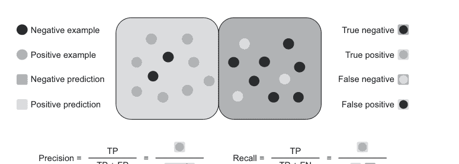

图 3.8 真阳性、真阴性、假阳性和假阴性的图形表示，以及这些指标如何组合形成精确度和召回率

你可以把高精确率、低召回率的算法想象成一名狙击手：它在开枪前要确保万无一失，因此保持保守，除非100%确定，否则不会开枪。这意味着它会漏掉一些目标，但只要它开枪，你就有信心它会命中正确的目标。另一方面，高召回率、低精确率的算法就像一挺机枪：它发射大量子弹，击中了本该击中的许多目标，但也会顺带击中一些错误的目标。表3.5总结了精确率、召回率和准确率之间的区别，以及这些指标告诉你的信息。

**表3.5 准确率、精确率和召回率**

| 指标 | 定义 | 该指标告诉你什么 |
| --- | --- | --- |
| 准确率 | (真正例 + 真负例) / 总样本数 | 算法犯了多少错误？对正例和负例的错误分类没有区别。 |
| 精确率 | 真正例 / (真正例 + 假正例) | 当算法识别出一个正例时，你应该在多大程度上信任它？ |
| 召回率 | 真正例 / (真正例 + 假负例) | 在所有正例中，算法找出了多少个？ |

### 3.5.2 聚类算法

说到无监督学习，评估性能是一件棘手的事情，因为没有客观的“好坏”指标：由于我们没有可供比较的标签，无法定义算法的输出是“对”还是“错”。还要记住，大多数聚类算法需要你先定义希望它识别出的簇的数量，因此你还需要回答另一个问题：你对簇数量的选择是否恰当。我们该如何摆脱这种看似迷雾重重的情况呢？

首先，一些数学工具可以告诉数据科学家聚类是否做得好。遗憾的是，从数学角度来看表现优异的算法，并不一定意味着它对商业目标有用。如果你购买了这本书，我们假设你不是在用机器学习发表科学论文，而是为了帮助你的组织。如果确实如此，那些数学技巧不会引起你的兴趣。你应该做的是审视你的结果，并问自己以下这些问题：

1. 结果可解释吗？换句话说，聚类中心能否被解释为具有逻辑意义的买家画像？如果答案是肯定的，请继续回答问题2。

2. 结果可执行吗？换句话说，我的各个簇之间是否有足够大的差异，以至于我可以针对属于不同中心的客户制定不同的策略？

如果这些问题的答案是肯定的，那么恭喜你：你可以开始在真实世界中测试结果、收集数据，然后继续前进——要么在获得更多数据后迭代和调整算法，要么利用新的知识重新设计你的方法。幸运的是，表现不佳的无监督算法通常比表现不佳的监督学习算法风险更低，因为“对”或“错”预测的概念更加模糊。因此，你不必过于担心指标，而应关注你应该建立的测试方法，以评估项目的业务影响。我们将在本书第2部分深入讨论迭代和设计过程。

## 3.6 将机器学习指标与业务结果和风险挂钩

现在你已经对常见的机器学习指标有了一些了解，让我们看看它们在业务场景中的含义。假设你已经部署了一个出色的流失预测器，它识别出了一组可能放弃你服务的客户，而你想通过个性化的电话联系他们每个人。

如果你的数据科学团队构建了一个高*精确率*但低*召回率*的模型，你不会浪费太多电话：每次打电话，你都会和一个真正在考虑离开你的用户交谈。另一方面，有些用户正在离开服务，但你的算法却没能发现他们。而一个高召回率、低精确率的算法则会让打很多电话——这样你会联系到很大一部分（甚至全部）计划放弃你服务的客户，但也会浪费电话给那些根本没打算退订的用户。

精确率和召回率之间的权衡显然取决于具体业务。如果每个客户的价值都很高且联系成本低，就选择高召回率。如果客户不会进行大额购买、不愿被不必要地打扰，而且打电话成本高昂，就选择高精确率的模型。更复杂的策略可以是，将电话等更昂贵的行动保留给价值更高或流失概率更高的客户，而对其他客户采用电子邮件等更廉价的方式。如图3.9所示，你可以根据两个参数决定是关注召回率还是精确率：失去客户的成本，以及你为挽留客户所采取行动的成本。

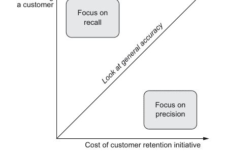

*图3.9 基于关键业务指标，决定是关注高精确率、高召回率还是仅关注整体准确率的速查表*

在安全关键型应用中，问题会变得更加严重。如果我们有一个用于医学诊断的分类器，假阳性和假阴性的代价是非常不同的。假设我们的算法在检测肺癌。在表3.6中，你可以看到每种错误的含义及其影响。

**表3.6 真阳性、真阴性、假阳性和假阴性的影响**

| 指标 | 含义 | 影响 |
| --- | --- | --- |
| 真阳性 | 算法预测患者患有癌症，而且是对的：患者确实生病了。 | 患者立即得到所需治疗。 |
| 真阴性 | 算法预测患者是健康的，而患者确实健康。 | 患者如释重负地回家了。 |
| 假阳性 | 算法预测患者患有癌症（因此是阳性），但患者实际上是健康的（因此是假）。 | 患者受到惊吓，也许会开始治疗，但实际上没事。 |
| 假阴性 | 算法预测患者是健康的（阴性），但患者实际上生病了（假）。 | 患者如释重负地回家了，但实际上生病了，没有得到所需的治疗。 |

正如你所看到的，错误带来的代价非常不同，这取决于我们把健康患者还是生病患者误判了。假阳性可能意味着额外的检查，或也许是不必要的治疗，而假阴性则会让患者失去生存所急需的治疗。

在这种情况下，你会清楚地看到，针对错误的指标进行优化是多么危险。仅仅拥有高准确率并不能说明算法是好的，因为它会同等对待假阴性和假阳性。在这种情况下，我们想要的是高召回率：我们希望尽可能多的生病患者被识别出来，即使这意味着会出现一些假阳性。假阳性可能会导致额外的不必要检查，并让一些家庭感到恐慌，但它能确保最多数量的病人被发现并得到照护。

如你所见，每个算法都有其性能指标，你需要能够评估哪个指标对你最重要，这样你的数据科学团队才能致力于最大化它。我们已经看到，最佳选择并不总是显而易见的。从商业角度看，最有力的想法是将每一种错误分类与具体的美元金额挂钩。如果你的假设是正确的，这将自动带来最佳的业务结果。我们虚构的电信公司可以为不满意的客户制定一个保留计划：如果他们在未来12个月内继续留在公司，就给他们100美元奖金，从而留住那些否则在不久的将来会流失到竞争对手那里的客户。

另一方面，假设每流失一个客户，公司就损失500美元利润。现在我们有了所有这些数字，就可以轻松计算出假阴性和假阳性让我们损失了多少钱。每一个假阴性（一个客户，他

（在我们能够用折扣吸引他们之前就已流失到竞争对手的客户）会让我们损失500美元的收入。每个假阳性案例（一个本不会流失但还是收到了礼物的忠诚客户）会让我们损失100美元的收入。现在我们可以用一些基本的会计计算将模型性能与货币价值挂钩：

总成本 = $500 * FN + $0 * TN + $100 * FP + $100 * TP

其中，FN 是假阴性数量，TN 是真阴性数量，FP 是假阳性数量，TP 是真阳性数量。

你可以将同样的思路用于其他使用二分类模型的场景。例如，假设你正在为一条生产线开发自动化质量控制系统。你可以调整模型，要么放行更多物品（提高假阴性率），要么立即拒绝更多物品（提高假阳性率）。前者可能会放过更多有缺陷的物品，从而导致生产流程下游出现更多问题；后者则可能造成不必要的材料浪费，因为完全合格的产品也被拒收。无论如何，你都可以根据具体的业务情况调整上述公式。

无论你采取什么策略，你仍然需要接受一个事实：没有哪个机器学习算法是完美的（如果它看起来完美，那一定是哪里出了问题）。你会犯错：请确保这些错误是可以接受的，并且你和你的算法都能从中学习。

## 3.7 案例研究

本节介绍两家真实公司利用AI开展营销活动的案例研究。第一个是Opower，一家能源公司，它使用聚类方法根据用户的能源消费习惯对用户进行细分。第二个是Target的一项举措：这家零售商店利用其客户数据，尽早识别怀孕迹象，并开始推广婴儿纸尿裤。

### 3.7.1 利用AI优化目标定位与市场定位：Opower

能源公司与客户之间的关系很特殊：通常消费品公司在客户购买时就能收到钱，而能源消费则存在延迟：人们先使用一段时间能源，之后才收到账单。此外，人们并不是为了买能源而买能源；它是享受其他商品（比如打开电视）所需的一项必要支出。

这两个因素使得每家公用事业公司都很难了解客户并与他们互动。这不仅对能源公司的营销部门是个问题，也影响其整体成本和盈利能力。事实上，公用事业公司生产能源的成本并不总是相同：这取决于他们使用哪种发电厂来生产，而这一选择又取决于他们需要生产多少能源，以及提前规划的程度。

最理想的情况是需求完全平稳：公用事业公司可以利用最好的发电厂开始生产X数量的能源，并且永远不需要改变。当然，实际情况并非如此，因为每日需求曲线更像鸭子形状，通常有两个峰值：一个出现在人们起床时，另一个出现在人们下班回家时。为了满足这些高峰期的需求，公用事业公司需要使用易于启停和调节的发电厂，但灵活性是有代价的：这些发电厂运行成本更高、消耗更多能源，并且燃烧更昂贵的燃料。如图3.10所示，这个问题正在加剧：如今的用电习惯使能源需求曲线变得更加不平坦，白天出现更大的低谷，早晚出现更尖锐的高峰。每家公用事业公司的梦想都是塑造客户的用电习惯，将高峰转移到一天中的不同时间，从而实现整体近乎平坦的需求。

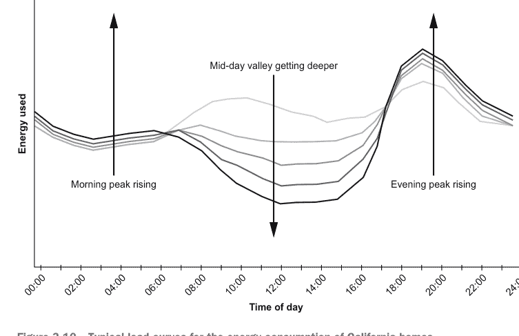

图 3.10 加利福尼亚州家庭典型用电负荷曲线

## OPOWER 的战略

Opower成立于2007年，其使命是为能源公司提供工具，帮助他们精准定位用户，并促使用户改变用电习惯，从而实现节能和整体更平稳的需求。该公司从公用事业公司的客户那里获取智能电表数据，并通过邮件、电子邮件、互联网门户、短信，有时还包括家用能源显示屏，向用户发送包含其能源消耗详情和改善习惯建议的报告。

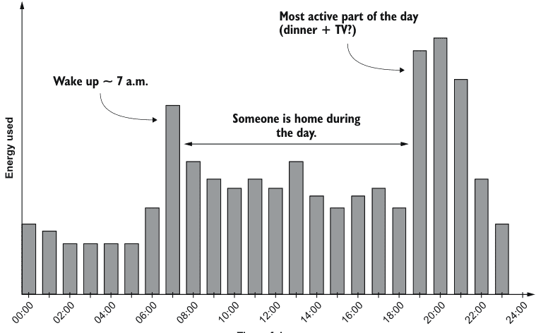

图 3.11 一个家庭在一天中不同时间的能源消耗值

该公司的秘诀是行为科学与数据科学的结合。Opower采用了机器学习的核心应用之一——无监督学习——来识别可以类似方式定位的特定用户群体。

能源用户最具特征性的元素是他们的消费模式：他们在一天中不同时段使用多少能源。因此，我们可以像图3.11那样看待每个用户：由24个数字组成，代表一天中每个小时的能源消耗量。这些数字描绘了用户习惯的准确图景，就像电子商务场景中的购买次数、平均支出和购买商品数量一样。

根据消费模式识别不同的用户群体并非易事。如果我们用这种方式表示1000个用户，并将他们全部绘制在一张图上，就会得到数据科学家喜欢称之为“毛团”的图形：一堆错综复杂的线条相互叠加，人眼无法分辨。另一方面，识别模式正是无监督算法最有用的地方；利用这些算法，Opower识别出了五个用户集群。我们从互联网上收集数据，并运行了一个无监督算法来模拟Opower取得的结果；你可以在图3.12中看到这个“毛团”和最终形成的五个集群。

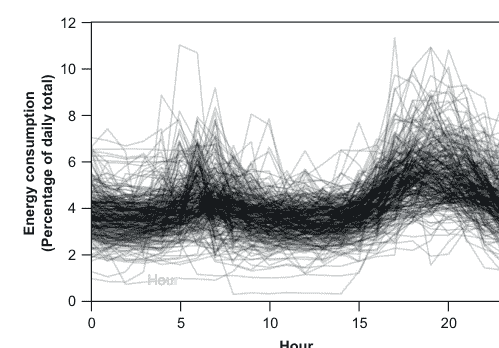

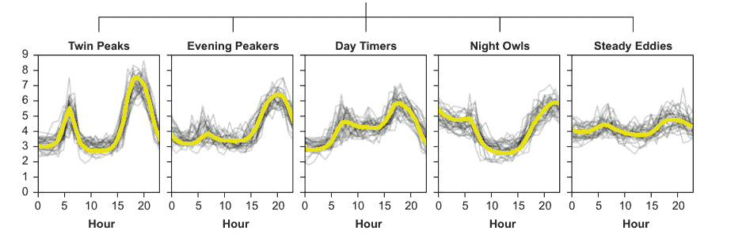

图 3.12 将1000个用户形成的“毛团”变成五个集群

观察这些集群，我们可以尝试逐一解读：

- *双峰型*——他们在清晨消耗大量能源，远高于其他集群的用户。他们在傍晚晚餐时间左右也有一个峰值，但比清晨峰值略低。
- *晚间高峰型*——他们从清晨开始平缓上升，在傍晚达到一个高峰。早晨的第一个峰值不存在。
- *日间型*——他们没有其他集群都有的典型峰值。相反，他们在白天消耗较高，且上升和下降都很平缓。
- *平稳型*——他们是最平稳的一类；两个典型峰值都非常平缓。
- *夜猫子型*——他们在清晨和深夜有典型峰值，但倾向于在夜间消耗能源。

Opower利用聚类结果以不同方式定位不同用户。其基础设施允许将每个集群分成小组并测试不同的信息。通过对结果的分析并结合行为科学，Opower能够

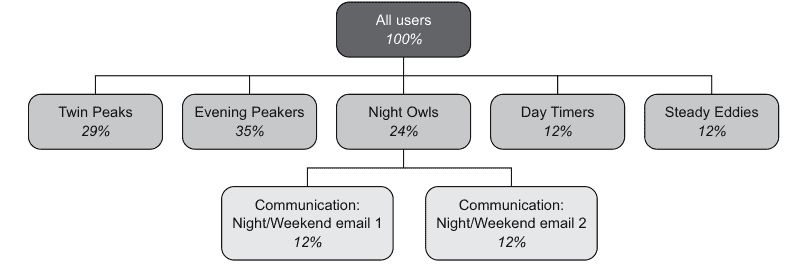

# 图 3.13 Opower 用于定位用户的决策树

不断改进其目标定位策略。这种细分的一个例子如图3.13所示：Opower可以选定一个特定集群（本例中为“夜猫子型”），将其分成两个小组，并用不同的电子邮件分别进行定向营销。这种方法使Opower能够优化其信息传递，并以尽可能最佳的方式触达目标人群。

凭借这一方法，Opower成功帮助消费者节省了10%的能源账单，同时通过总需求的更好分配使公用事业公司更加盈利。正因如此，Opower于2016年被Oracle以5.32亿美元收购。

## 案例问题

你如何说服一群人改变他们的行为？

## 案例讨论

想一想Opower使命的复杂性：它必须通过向数百万人发送某种报告，让他们改变能源消费方式。如果你认为同一条信息能对所有人都奏效，那就太天真了。

每个人对不同激励和不同信息会有不同反应，因此理想情况下，你需要针对每个人发送不同的信息。当然，这不现实，也不可扩展，但你可以通过将受众划分为具有共同点的群体来取得很大进展。对Opower来说，这第一步就是通过无监督学习完成的。请记住，无监督学习是一类机器学习算法，它会在数据中寻找模式，根据特征找出相似的数据点群体。在Opower的案例中，最重要的特征就是用户的能源消费习惯，因此Opower需要一种方法来量化这一点。Opower将能源消费习惯表示为特征（一组数字）的想法是：考虑一天中每个小时某个用户消耗的能源量。结果是每个用户由24个数字表示，这对人类来说足够容易理解，对计算机来说也非常简单：一旦无监督学习算法获得这些数据，它就能轻松比较两个用户并发现相似之处。

无监督学习为Opower提供了用户之间第一个、也是最重要的区分维度：他们的能源消耗。第二步是衡量这些效果……

不同的信息，Opower 正是通过使用行为科学和 A/B 测试（向不同的人发送不同的信息并衡量结果）来实现的。

关于该算法在此识别出的聚类数量的最后一点实施说明。Opower 有五个，但这个数字是从哪里来的？对于一些广泛使用的算法，你需要先确定算法要寻找的聚类数量，然后算法会为其进行优化。

数学工具为数据科学家提供了关于从数学角度来看哪个数字会产生最佳结果的线索，但这不一定是满足你业务需求的最佳解决方案，因此没有“正确”或“错误”的解决方案。由于没有决定聚类数量的脚本，确定这个数字有时会感觉像是在做杂货购物：“我们想要五个聚类吗？让我们做六个；多一点总比不够好，以防我们用完。”我们可以认为做出决定实际上要简单得多。

想想这个：每次你要求算法再找到一个聚类时，它就会在数据中看到新的、更微妙的模式。假设我们有 1,000 名用户，上限是找到 1,000 个聚类，每个用户都有自己的聚类。在达到这种极端情况之前，你有时会发现再增加一个聚类也无法获得任何新知识。这是一个很好的停止时机。增加聚类会使算法的结果更具体，但也更难解释。图 3.14 说明了这种权衡。

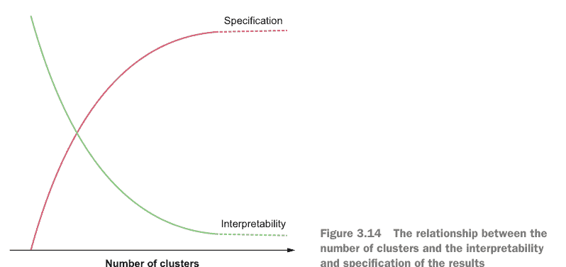

理想的过程是从一个相当小的聚类数量开始；理想情况下，这个数字可以由你的数据科学家提供，他们将使用数学工具来找出从技术角度来看什么是有意义的。从那里，你可以向下移动，合并不同的聚类，或向上移动，增加聚类的粒度。每次增加或减少聚类数量时，尝试解释结果并问自己更高的聚类数量是否能帮助你更好地理解现象。如果答案是否定的，我们可以认为你找到了

据报道，Target 能够凭借其新策略增加销售额。然而，收入的增加是有代价的：人们开始感觉自己被监视了，并对这种做法不满意。公众可能不喜欢这种密集定位技术的第一个警告信号出现在一位不满的父亲抱怨 Target 寄给他的高中女儿的婴儿用品优惠券时。正如同一篇 Forbes 文章报道的那样，他对商店经理大喊：

> 我女儿收到这个了！她还在上高中，你却给她寄婴儿衣服和婴儿床的优惠券？你是在鼓励她怀孕吗？

事实证明，这个女孩实际上怀孕了，而 Target 在她父亲之前就已经知道了。 据报道，Target 的经理稍后给这位愤怒的父亲打了电话，并得到了 Forbes 报道的他的回应：

> 我和我女儿谈过了。原来我家发生了我并不完全了解的事情。她八月就要分娩了。我要向你道歉。

正如 Forbes 文章报道的那样，Target 最终将通过 ML 获得的个性化推荐与目录中看似随机的商品混合在一起（例如，在尿布优惠券旁边加上割草机的优惠券），以避免让客户感觉自己被跟踪。

## CASE QUESTION

特别折扣是赢得客户、击败竞争对手的有效方式吗？

## CASE DISCUSSION

特别优惠和优惠券是零售商用来吸引客户的极其常见的策略。然而，当每个人都知道一个人正在寻找一种每个人都可以销售的特定产品时，其效果通常是促销战，侵蚀零售商的利润。这对客户来说可能很好，但对零售商来说绝对不是。我们认为，如果以下条件为真，向客户提供折扣可以是一种有效的营销思路：

- 1. 零售商知道要向谁发送优惠券（它能有效地定位其用户）。
- 2. 其他零售商没有同时定位该人，以避免前面提到的价格战。

零售商最初采用的策略很聪明：使用公开可用的出生登记处数据来在婴儿出生后立即定位家庭。该策略在第 1 点（定位正确的客户）方面有效，但在第 2 点上失败了：正如名称所示，开放数据是开放的，每个零售商都可以使用它。

Target 的案例是完美的例子，说明你如何使用数据和机器学习来击败竞争对手，在任何人之前定位完美的客户。Target 从其核心业务销售数据开始：通过忠诚度卡收集的客户购物习惯。它还能够为过去的客户建立“正在等待孩子”/“没有等待孩子”的标签，通过查看该客户是否实际上在未来开始购买尿布来判断。我们希望你已经意识到这看起来像是一个经典的监督学习分类问题：

- - 特征是客户的购物习惯（让数据科学家弄清楚如何精确构建它们）。
- - 标签是该客户是否正在等待婴儿，根据婴儿相关商品的特征购买情况。
- - 在为过去数据构建模型后，它可以应用于当前客户，识别出正在等待婴儿的人。

请注意，标签并不是立即可用的：Target 的客户不会打电话给零售商，告知婴儿出生了。然而，可以通过查看他们过去的购买行为来为过去的客户分配此标签：如果一位客户六个月前开始购买尿布或婴儿车，她必须在九个月前怀孕，可以被标记为正例。

想想这种方法有多强大。孕妇的购买习惯中存在模式：她们可能会停止购买某些食物，如香肠或寿司，吃更健康的食物，或戒烟。问题是，当缺乏明确的指标（例如，购买产前维生素或尿布）时，人类很难通过查看客户购买情况来发现模式。但对 ML 算法来说并不难，它可以弄清楚哪些购买习惯暗示着怀孕。

你还应该记住的是，听起来像是一个好故事，Target 为提升销售额而做出的伟大举措，也可能是一个由于在如此敏感的领域进行激进定位而引发的公关定时炸弹。

总之，你应该从本案例中记住以下几点：

- - ML 可以帮助你预测未来的购买，抢在竞争对手之前。
- - 核心业务数据比公开可用的数据具有更高的价值（有关此内容，请参阅第 8 章）。
- - 留意“ creepy ”因素：ML 可能如此强大，以至于人们会觉得你在监视他们。

## Summary

- - AI 在营销和销售中有效性的核心原因在于能够大规模定位特定客户并做出数据驱动的决策。
- - 流失预测模型是 AI 在营销中的典型应用，可以发现最有可能停止使用你服务的客户。
- - 同样，机器学习可以帮助营销人员通过识别哪些客户更倾向于购买更多来找到追加销售机会。
- - 无监督学习是机器学习的一个子集，使计算机能够在数据中找到结构，找到相似数据点的聚类。聚类在营销中也有用途。
- - 有不同的方法和指标来评估分类算法的性能（我们涵盖了准确率、召回率和精确率）。每一种都告诉我们算法的不同方面，你可以根据业务目标选择最合适的指标。
- - Opower 使用无监督学习将能源消费者分为聚类，然后单独定位他们以优化其能源消费模式。
- - Target 使用监督学习来识别哪些客户即将生孩子，然后向他们提供尿布和婴儿用品的优惠券。

