## AI for media

#### This chapter covers

- Using AI to understand the content of images
- Using deep learning to solve challenges in computer vision
- Detecting and labeling human faces
- Creating original artwork with deep learning
- Using AI with audio data
- Case study: automating vegetable sorting with a $1,000 robot

Images and videos are probably the richest source of data that humans use to understand the world. Sadly, they were largely off-limits for computers until the 2010s. While cameras had been getting better and better for decades, computers still couldn’t understand the content of images. A pivotal moment was the development of a new field of machine learning called *deep learning (DL)*. This family of algorithms has unsurpassed (for now) learning power that can reach superhuman accuracy in important tasks like detecting objects and faces in images. These abilities allow businesses to supercharge their existing products with abilities that would have been considered magical just 10 years ago, from automatically creating photo albums based on the content of images, to automating industrial processes with robots.

## 4.1 Improving products with computer vision

FutureHouse’s home-price-prediction tool that we developed in chapter 2 is a resounding success. Customers are really happy with the pricing suggestions they get from the AI model and are rushing to list their homes on the website. Newly listed homes are sold fast at a price very close to the algorithm’s suggestion. Business is going well, but this only fuels your ambitions.

During another brainstorming session, the user experience team brings up behavioral analytics data for the marketplace and breaks some alarming news. A good chunk of users are dropping out of the step-by-step flow for listing their property. The biggest drop happens when they’re asked to upload images and manually pick which room of the house they depict (bathroom, living room, and so forth). This process is long and tedious, and your team is motivated to start a new project to streamline the user experience: we can use AI to automatically label images and get rid of all the manual work. The experience for users would be much easier: they simply upload a bunch of pictures, which are then automatically tagged as bathroom/kitchen/living room/etc. The overall flow will become much faster and more pleasant.

What we’re designing is an algorithm that has as an input the picture of a room, and as output its type (bathroom, kitchen, and so forth), as shown in figure 4.1. Notice that our AI will have to learn how to map these inputs to a specific target (the room category); therefore, we’re dealing with a supervised learning problem. More specifically, it’s a *classification* problem, because the target is a category, not a number. For obvious reasons, most engineers use a common name for this task: *image classification*.

Now that you know what type of problem we’re dealing with, you also know what type of training data we need to collect: a collection of labeled pictures that have already been grouped according to the room they were taken in. Luckily, we know just the right place to get them: users have gone through the painful process of uploading

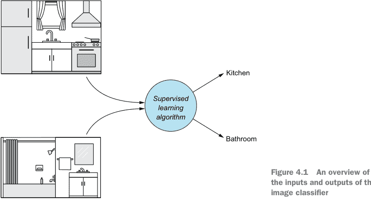

pictures of rooms and tagging them with a category. Now, we can take all this *labeled data* and build a model that tags images automatically, so that future users won’t have to do all this boring work. This pattern is pretty common when building AI applications in business: a manual process has already produced a lot of labeled data, which can be used to develop AI-based automation.

If we had to follow the blueprint in the previous chapter, the next step would be to identify relevant features so that the algorithm can learn which elements make a bathroom and which elements make a kitchen. Remember: a *feature* is any aspect of each input item that you believe is going to be useful for the algorithm when it comes to learning how to classify items. Table 4.1 shows examples of features you might want to use.

### Table 4.1 Domain knowledge is often the best tool for choosing features.

| Objective | Possible features |
|---|---|
| Predicting the price of a house | Square footage, location, renovation year |
| Deciding whether a tumor is benign or malignant | Size of the tumor, age, blood-test results |
| Deciding whether a customer is going to unsubscribe | Use of the product, age, monthly spending, products purchased |

The *learning* part of machine learning begins only *after* engineers have defined which features to use for a specific problem. While humans are pretty good at doing this task by using intuition and experience, traditional ML algorithms need to be told exactly which numbers to use. The question you should ask yourself to identify relevant features is “If I had to classify this picture myself, what would I look for?” It would be natural to use features like these:

- Is there a toilet in the picture?
- Is there a refrigerator in the picture?
- Is there a shower in the picture?

The task seems so easy that we don’t even need machine learning to solve it: if there’s a shower, we know we’re looking at a bathroom. (We suggest having a face-to-face chat with your architect should your kitchen have a shower!) Sadly, from the point of view of a computer, things are not that easy.

When programmers write code that processes digital images (this field is called *computer vision*), all they have to work with is a long list of numbers that represent the color for each spot in the image. Figure 4.2 shows an example of the numbers that form an image with a few dozen *pixels* (individual points). Pictures taken by your smartphone will have millions of these colored pixels (this is what *megapixel* means).

Given that the data we have is just a collection of apparently random numbers, how can we define features? For the first time in this book, we’re struggling to do so. If we could just recognize some of the shapes contained in a picture, our job would be easy; but, unfortunately, our data is just a bunch of raw numbers. The first approach that

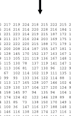

207 202 136 89 119 103 117 139 210 212 213 215 220 217 219 224 218 209 215 222 216 215 229 215 235 219 225 191 196 193 185 193 189
204 203 140 92 105 103 131 212 213 214 220 214 216 215 221 215 214 214 224 214 208 214 184 155 150 202 217 215 205 222 216 215 225 219 195 190 191 190 193
204 203 140 90 77 178 214 211 202 214 217 214 221 221 214 221 213 222 221 214 207 212 223 223 212 177 172 148 174 215 212 212 215 210 221 214 200 148 134 138 137 188 138 192 190
203 208 176 74 94 167 201 167 172 180 219 208 214 218 217 211 211 217 214 212 211 207 214 216 219 193 169 171 196 163 213 222 222 217 215 206 198 216 197 198 195 197 191 197 197 194
203 214 131 51 175 180 162 134 178 202 216 214 222 222 218 205 214 195 215 219 214 220 214 224 184 171 179 168 146 141 217 224 198 219 216 196 195 197 197 193 196 197 197 187 173
205 213 145 33 114 191 157 159 193 201 179 174 188 163 165 158 190 111 105 119 113 101 121 133 167 167 148 151 165 212 209 209 210 209 210 205 211 205 197 193 200 192 180 170
203 202 159 131 195 197 186 202 198 178 145 143 155 113 98 64 125 115 113 178 141 125 113 133 178 141 157 141 162 169 113 143 158 145 220 202 210 212 208 196 200 193 200 208 198 198 194 195 184
202 205 148 182 155 195 197 201 194 194 154 165 143 139 130 111 115 113 104 112 129 141 164 153 155 146 122 119 225 215 212 224 185 196 206 192 194 194 186 151
199 205 149 182 155 199 173 181 150 216 141 143 154 141 87 67 102 114 102 119 141 115 219 193 212 212 194 214 215 212 212 212 212 212 210 212 207 204 134 194 186 146
188 194 173 144 194 164 165 208 219 158 164 177 184 137 181 163 113 111 134 101 139 144 102 134 202 194 220 194 186 206 194 166 200 197 194 190 195 187 195 95
189 195 194 179 178 180 158 194 166 202 162 142 126 136 132 133 109 119 111 134 107 122 130 144 92 132 152 207 221 190 210 212 190 210 200 200 194 153 187 189 167 169 96
195 156 178 166 144 149 185 178 146 159 175 141 161 174 188 138 131 174 113 138 118 144 126 114 157 144 129 142 171 178 160 192 202 180 198 200 207 196 204 196 194 178 164 88
139 156 208 171 164 154 170 185 159 193 168 158 169 151 110 132 135 134 126 162 112 126 148 169 94 132 152 189 171 140 133 150 145 185 202 196 130 196 202 186 196 196 130 46
197 198 159 188 144 158 165 188 195 196 191 202 166 163 157 180 160 165 155 174 164 137 134 147 116 143 162 147 77 81 62 42 48 45 82 46 136 160 199 203 180 166 194 190 136 117 152
195 142 202 173 151 147 183 197 193 188 195 186 182 169 190 184 192 157 174 165 164 113 138 138 128 174 127 114 123 112 61 39 55 113 21 100 132 125 130 6 39 55 110 143 159 137 158 116 52
188 143 240 133 146 161 159 167 188 184 195 192 171 170 184 194 201 173 192 184 192 152 172 196 189 167 163 62 83 75 113 2 123 4 30 42 8 12 9 144 30 9 152 150 123 130
162 188 174 179 174 146 122 119 146 155 171 210 212 182 174 159 206 157 178 188 192 173 129 163 114 62 49 15 2 113 3 113 4 9 6 8 112 14 5 6 1 75 10 4 120 130 73
144 156 143 138 148 58 86 90 159 103 157 197 147 88 97 158 185 189 185 194 159 10 79 87 96 144 95 150 138 107 119 5 44 15 78 95 112 148 98 22 38 3 105 122 34 64 106 98
113 129 78 46 109 131 83 76 128 182 133 82 105 109 131 152 178 184 128 137 68 108 125 109 104 105 68 99 158 78 163 177 4 27 44 81
144 141 142 183 175 145 146 135 130 162 203 179 134 93 57 34 29 111 110 131 108 112 69 77 96 166 132 81 31 76 112 144 95 47 79 6 5 9 32 124 54 24 38
128 187 200 157 198 202 182 184 184 184 200 209 178 114 98 102 62 76 44 110 173 87 29 57 84 44 56 92 96 105 78 54 8 46 55 74 44 92 113 100 10 24 81
205 204 204 210 206 184 195 195 190 191 189 190 193 163 152 138 125 6 118 6 15 19 114 163 169 177 148 95 99 125 110 104 35 34 4 59 66 45 6 22 10 103 10 25
192 184 194 193 183 155 175 193 130 193 150 180 167 113 115 157 170 155 135 147 158 49 111 62 45 96 104 42 39 42 49 33 27 79 99 45 12
189 188 186 154 184 135 142 185 195 176 138 187 180 143 84 70 46 65 141 106 106 108 175 86 64 83 96 111 94 52 38 59 64 42 36 43 40 52 77 79 84 61 32
207 208 208 208 208 205 200 205 202 211 210 158 122 73 6 49 121 152 95 63 49 92 88 35 84 167 72 75 2 5 1 53 4 63 61 87 73
208 208 209 205 209 205 207 210 210 210 124 41 3 0 2 0 4 95 45 68 37 24 45 92 47 26 0 1 0 2 3 114 70 9 40 113 112 141 147 148
205 206 207 208 204 204 204 204 204 214 119 111 114 111 117 116 139 139 131 123 127 112 108 111 111 115 113 111 114 113 148 197 146 164 146 164 163 173 164
207 205 207 205 209 207 204 204 203 208 134 120 201 116 117 112 108 120 203 201 204 206 201 142 199 187 145 170 189 183 147 175 174 174 175 177 174
207 207 207 207 205 204 207 207 202 205 209 118 116 201 211 157 112 209 205 202 208 211 117 112 119 119 152 114 144 211 211 174 174 196 190 201

### Figure 4.2 An image of a cat, and the same image as read by a computer (scaled to 40 × 40 pixels to fit on a page). Each number represents the brightness of a pixel.

computer vision researchers tried in order to solve this problem was to find clever ways to extract features by hand. They would build complex mathematical tools called *filters* that can spot basic shapes in images, and then try combining these to detect elements.

This approach can work for basic objects. If you think about the shapes that form a shower head, you’ll probably picture a circle and a cylinder that represents the handle. That can work for many shower heads, but what about design items like the one on the right in figure 4.3?

You can probably imagine the frustration of a computer vision expert who has to build by hand new filters to catch every possible shower head shape. The approach of hand-building a feature set for every image to tell computers its content clearly has severe shortcomings.

The key to conquering computer vision has been a special class of machine learning algorithms called *deep learning*. To give you an idea of its power, let’s talk about the

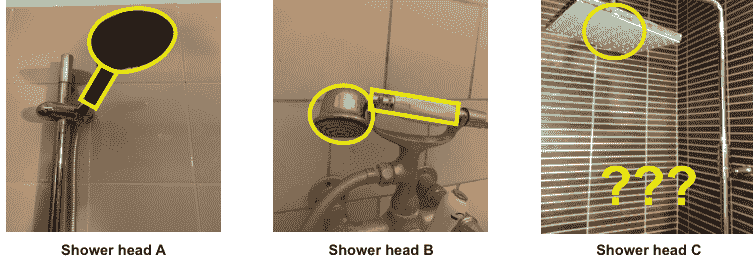

# 花洒 A

# 花洒 B

# 花洒 C

图 4.3 虽然由于其基本形状可以识别出 A 和 B 是花洒，但识别 C 就困难得多。

用于评估计算机视觉模型的基准：ImageNet 数据集。该数据集拥有超过 1400 万张图像，每张图像都标注了约 20,000 个类别中的一个，包括数百种狗的品种和食物类型。传统的计算机视觉方法在 2010 年代初期最高只能达到约 75% 的准确率。考虑到平均人类准确率为 95%，这并不算太好。深度学习打破了这一纪录，在 2015 年超越人类，随后比赛于 2017 年最终以 97.3% 的准确率关闭（见图 4.4）。

为什么深度学习如此强大，我们为这种新获得的能力付出了什么代价？本章的其余部分将阐明这一点。

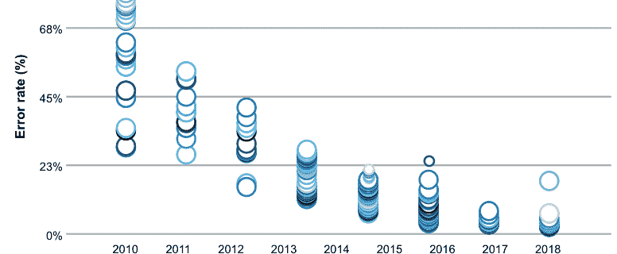

图 4.4 深度学习自 2013 年登场以来一直主导着 ImageNet 竞赛。

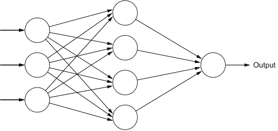

**图 4.7** 当你将多个神经元连接起来时，情况开始变得有趣，因为它们能够表达更复杂的数学运算。

回到图像分类，我们想要做的是创建一个网络，它接收图像像素，进行一些内部计算，并输出输入图像的（希望是）正确类别。图 4.8 显示了这一切是如何组合在一起的。当然，现实生活中的网络会比图 4.7 中的复杂得多：一个用于 ImageNet 的竞争性模型大约有五十万个神经元协同工作！

在深度神经网络中，神经元按列（或 *层*）组织，这种结构使它们能够从图像中提取特征，而无需手工指定。为什么以及如何做到这一点呢？

你可以把每一层想象成生产线上的一个步骤：构成图像的原始数字进入第一层，在那里该层的神经元通过应用它们的数学运算（乘法和加法）对其进行处理。其结果是，这些原始数字被修改并转换成了其他数字，然后

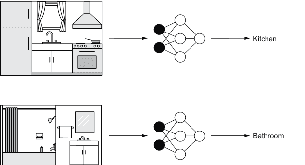

**图 4.8** 深度神经网络处理输入图像（左侧），并产生与训练标签一致的分类（右侧）。

传递给第二层。第二层应用其他变换并将其结果发送到第三层。这个过程对每一层重复，直到最后一层会说，“图像包含厨房”或“图像包含浴室”。

生产线的类比是有意义的，因为没有一种神奇的机器能在单一步骤中将钢材和皮革等原材料变成一辆闪亮的新车。如果你看过生产线视频，你会看到造车过程被分为小步骤：原材料首先由机器塑造成小的基本组件，包括旋钮、齿轮等等。然后这些组件由其他机器加工，形成换挡杆、方向盘、收音机等。只有在这些复杂部件建成后，它们才最终组装成汽车；不可能存在一台巨大的机器能在单一步骤中将原材料变成汽车。深度神经网络的每一层基本上做同样的事情，只是它处理的是数字而不是钢材。

这些变换是自动特征提取神奇力量的关键。当神经网络刚开始在大量图像上训练时，其初始准确率很糟糕，因为各层中的神经元尚未学会如何有意义地处理这些数字。随着网络看到更多图像且训练继续，一种特殊的数学技术称为 *反向传播* 会鼓励每个神经元调整其应用的变换，以便整个网络提高分类准确率。网络看到的图像越多，其神经元就会学习到越有意义的变换。

但这些变换是什么？听起来很模糊，在深度学习的早期，它们对构建这项技术的研究人员来说也有些神秘。在深度神经网络取得惊人表现后，研究人员开始深入挖掘其内部工作原理。他们发现的东西极其有趣：当第一层的神经元优化其变换时，它们会以一种方式进行优化，使其能够从原始像素中识别简单的线条、边缘和角落，这与第一批计算机视觉工程师试图手工制作的滤波器类似。下一层将接收到比初始原始数字更丰富的信息：这些新数字代表图像不同部分中形状的存在，而非单个像素的颜色。第二层将在此信息基础上构建，并应用另一个变换，使其能够从更简单的线条、边缘和角落中识别更复杂的形状，如圆圈和正方形。继续下去，某一层最终会识别出我们在浴室与厨房示例中关心的形状：花洒、烤箱、马桶、微波炉等等。图 4.9 显示了这些日益复杂的形状是什么样的。最后，最后一层必须根据前一层提取的元素做出最终决定，判断图像属于哪个类别。

深度学习的魔力在于，所有这些神经元和层都自主地学会了将构成图像的数百万个数字从基本形状分解到复杂形状，然后基于它们做出预测。基本上，神经网络的模块化结构使其能够分步骤处理信息，并且由于巧妙的

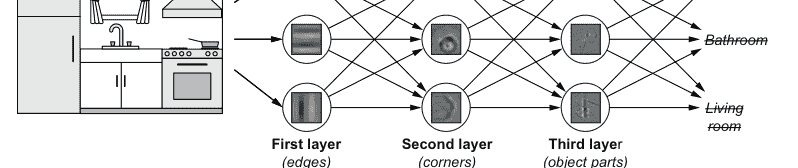

图 4.9 由训练用于识别汽车、人物和动物的深度神经网络开发的内部表示

数学公式，网络学会调整这些步骤以识别其所学习图像的更具特征的特征：在我们的例子中是水槽、冰箱、烤箱等。

这些形状看起来与本章开头我们寻找的特征完全一样。得益于深度学习的魔力，它们已被自动识别：没有人告诉第一层如何识别线条和角落，没有人告诉后续层如何将它们组合成圆圈和矩形，也没有人想出巧妙的方法来教最后几层如何识别复杂的元素如花洒。我们所做的只是取一个具有一堆层的神经网络，给它喂入厨房和浴室的图像，让反向传播背后的数学完成其余工作。

所有这些深度学习的魔力都是免费的吗？不幸的是，不是。我们要求我们的网络做很多事情，而深度学习的诸神要求付出代价：大量的计算能力和大量的数据。

虽然计算能力变得越来越便宜，但获取更多标注数据并不容易。在房屋经纪人的例子中，你需要等待获得数千张房屋房间的图片，这可能令人痛苦。这是否意味着如果你的业务不拥有大型数据集，就必须放弃深度学习？幸运的是，一种称为迁移学习的技术是宝贵的资产，可以让你从小型数据集和开源代码开始构建最先进的算法。让我们看看它是如何工作的。

## 4.3 使用迁移学习处理小型数据集

迁移学习有点像一种技巧，利用深度神经网络的分层结构，将其“知识”从一个任务转移到另一个任务。如图 4.10 所示，深度神经网络的工作方式是通过识别图像中的基本形状。例如，要识别烤箱，你需要发现圆圈和矩形，并将它们组合起来识别旋钮、手柄、玻璃等。

如果你仔细想想，圆圈、矩形和其他基本形状并不独特于房间标记问题。如果你必须区分狗和猫，你仍然需要在识别眼睛、耳朵、尾巴等之前识别圆圈、三角形和矩形。毕竟，无论它们出现在房屋

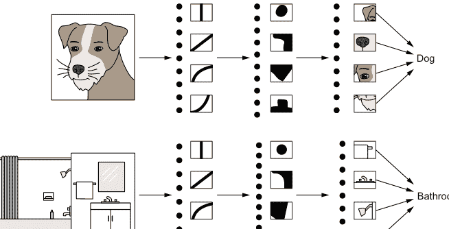

房间和动物用 DL 分类器的相似之处。第一层学习识别相同的通用几何模式。

一只狗或浴室。仅最后几层专门用于特定的分类任务，如图 4.10 所示。

由于互联网上充满了猫狗的图片，我们能否利用所有这些数据训练一个大型神经网络并在我们的房间分类任务中复用其中的内容？可以，这就是迁移学习的核心理念：前几层学习到的基本几何特征在大多数图像分类任务中基本相同，如图 4.11 所示。这使你能够利用庞大的数据集（如 ImageNet）来 *预训练* 你的神经网络，然后通过在房地产数据集上训练来将其 *专门化* 用于房间分类。

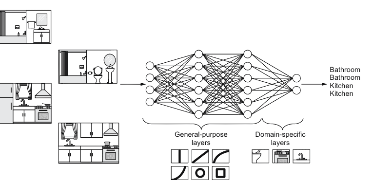

在迁移学习中，通用层被用于多个任务，而特定领域的层则针对特定问题进行训练。

好消息还不止于此：许多神经网络的开源版本已在 ImageNet 等大型数据集上进行了预训练。回到我们的原始任务，你的数据科学家将按以下步骤构建我们的房间分类器：

- 1. 下载一个在通用数据集（如 ImageNet）上预训练的神经网络的开源实现。
- 2. 保留第一层，因为它们能够识别基本形状（圆形和矩形），并丢弃最后几层，因为它们针对的是 ImageNet 中包含的特定图像（从卡车到豹子）进行调优。
- 3. 使用你相对较小的房间图片数据集（数百张图片而不是数千张），重新训练网络的最后几层。这些层将利用图片中包含的基本形状信息并学习识别淋浴喷头、烤箱等元素。

正如你所见，该过程相对简化，但这项技术对任何组织的优势都是显著的：

- *你可以在没有海量数据集的情况下获得最先进的性能，只需来自你特定领域的几百张图像。*
- *你不需要太多计算能力，因为你使用的基线网络是由其他人训练并作为开源发布的（通常是大公司如 Google 或 Facebook）。*
- *在大数据集上训练大型神经网络并不容易；通过使用这些开源版本，你是在建立在科技巨头七位数研究人员的经验之上。*

## 4.4 人脸识别：教会计算机识别人

里程碑式的电影《机器战警》于 1987 年上映。在这个反乌托邦的未来，底特律的犯罪激增，警察局资金不足，为巨型企业 Omni Consumer Products（OCP）提供了为执法提供实验性高科技产品的空间。警官 Alexander James “Alex” Murphy 被残酷折磨，被宣布死亡后，成为 OCP 新型仿生技术的试验品，使他变成了一个名为 RoboCop 的半机械人。仍然被他作为人类的过去生活所困扰，有一天 RoboCop 看到了一群他认出与他被处决有关的人，并拍下了其中一个人的照片。他将其上传到警察电脑，电脑扫描警察记录并发现了该人的身份。这个应用被称为人脸识别，而在 1987 年，它是科幻电影的主题。

如果你最近买了一部智能手机，这项技术可能现在就在你的口袋里。唯一的区别是，虽然在老电影中它被用来搜寻罪犯，现在最常见的用途是……解锁手机。人脸识别是深度学习（图 4.12）的另一个应用，看起来像是一个传统的分类问题，但增加了一些有趣的方面。

假设你正在尝试构建一个智能门锁，使用摄像头的图像根据站在门前的人来解锁你家的大门。如果你、你的伴侣或你的女儿敲门，摄像头会拍下脸部照片，如果它识别出该人是这三人之一，就会打开门。如果它不认识任何人，门就会保持锁定。我们该如何构建这样的东西？让我们先分解问题。

我们的输入数据是一张人脸图像。任务是理解它属于谁：你、你的伴侣、你的女儿，还是其他人。就像本章开头厨房/浴室的例子一样，这是一个有监督的分类任务。正如我们所见，深度学习是解决大多数图像分类问题的最佳工具。我们甚至可以利用迁移学习，通过在 ImageNet 上训练的网络重新训练最后几层。

与往常一样，下一步是找到训练数据：你打开家庭相册并拍摄几百张你家人的照片。重要的是你能获得尽可能多的照片，这样算法就会有你在不同光照条件、不同发型等情况下的面部示例。为了完成数据集，你从互联网上下载几百张随机人的照片并标记为“其他”。这样模型就能学会识别你家人面部的最显著特征，并忽略所有人类面部共有的属性。

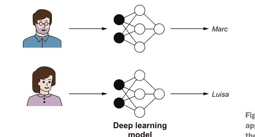

图 4.12 人脸识别是图像分类的一种特定应用，其中输入图像是人脸。

这种方法听起来应该可行，而且确实可行。这里的挑战是：你的女儿在高中，她的朋友 Catherine 经常来你家和你的女儿一起做作业。最好也能把 Catherine 加入可信人员名单，这样门也会为她解锁。你现在有五个类别而不是四个：

- 你
- 伴侣
- 女儿
- Catherine 这个学习伙伴
- 其他

你必须向 Catherine 索要几百张她的面部照片并训练一个全新的模型。你、 Catherine 或她的父母都不愿意为此只是为了加快开门速度。

这个问题与现在许多智能手机上存在的人脸识别技术相似。当苹果发布配备 Face ID 的 iPhone X 时，它工作得很好，而不需要你上传数百张照片并等待几个小时重新训练神经网络。你只需看几秒钟摄像头，就完成了。这是魔法吗？

事实证明这不是魔法；这是一种叫做 *一 shot 学习* 的技术：另一种技巧，允许特殊的深度神经网络仅使用一个训练示例而不是通常需要的数千个示例来学习分类项目。

这一切都归结于神经网络识别图像中形状和模式的能力。如果你训练一个网络来识别人脸，它将遵循我们在“厨房与浴室”任务中强调的相同步骤，首先识别线条和边缘，然后逐渐识别越来越复杂的形状。在人脸识别的情况下，这些复杂形状会是什么？它们将是面部特征：鼻子、额头或嘴唇可能呈现的不同形状。

在每部 iPhone 的软件内部，一个神经网络是在数千张人脸上训练的。当你在设置 Face ID 时，它第一次看你的脸时，会将你的脸部图像分解以识别基本形状，然后是关键的面部特征，并将其编码为一个小数字列表（从数百到数千）。这个数字列表被称为 *embedding*。

每次你解锁手机时，它都会拍下你的脸部照片，通过其神经网络运行，得到其 embedding，并将其与第一次设置时保存的 embedding 进行比较。如果数字接近，意味着该图像的面部特征也相似，因此属于手机主人，手机就会解锁（图 4.13 的前两行）。如果 embedding 与“黄金” embedding 差异很大，则必须是不同的人（图 4.13 的后两行）。就这样！简单、快速、高效且准确。

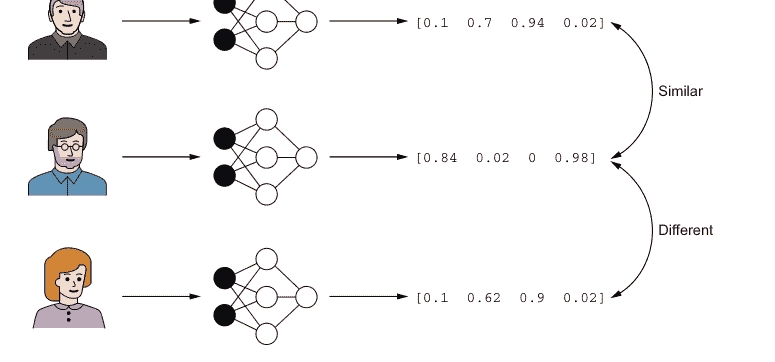

图 4.13 在人脸识别中，自拍被翻译成 embedding（一个数字列表），可以与已知图像的 embedding 进行比较。

*Embeddings*（或 *encodings*）之所以得此名，是因为它们将原始图像中的信息 *embed* 到少数几个数字中，把原始图片中包含的大量信息编码成更紧凑、更方便且更有意义的形式（从前置摄像头产生的数百万个数字到仅几百个）。

Embeddings 开辟了许多机会，你刚刚看到一类学习是如何成为实现面部识别等功能的好方法，只需少量示例且无需不断重新训练模型。利用编码还能构建许多其他有趣的应用，你即将了解更多。

## 4.5 使用内容生成和风格迁移

内容生成和风格迁移是 AI 的新兴应用，它们终于推动 AI 从理解走向 *创造*。

我们要谈的第一个应用是自动 *内容生成*。前面我们说过，神经网络会找出构成汽车、摩托车、船、面孔等的相关元素。当用不同面孔训练时，神经网络会专注于识别面孔的特定任务，因此会创建出不同脸颊、额头、鼻子等形状的表示。如果我们向神经网络输入成千上万张人们微笑的图像呢？好吧，它会学会什么是微笑（哪些颜色和形状组合会形成微笑面孔的印象）。如果我们用成千上万张头发卷曲发黑的人的照片训练它呢？好吧，它现在将纯粹从输入数据中学习卷曲黑发是什么样子。

现在，如果神经网络知道什么是微笑，我们能否找到一种方法让这个网络生成全新的微笑？或者更好的是，我们能否拿一张悲伤的脸，让神经网络修改像素，使其在那张脸上加上微笑？事实证明我们可以做得更进一步。如果一个用微笑图像训练的神经网络理解了构成微笑的元素会怎样，当我们用成千上万张某位名人的图像训练它，比如约翰·奥利弗？网络当然会编码构成他面部的面部特征。如果我们输入的是视频呢？好吧，只要数据足够，它不仅会开始学习构成奥利弗面部独特的元素，还会学习他最独特的动作和面部表情。我们能否也尝试把这些特征转移到别人身上？当然可以，结果令人惊叹，正如你在图 4.14 中的前后对比图像中所见。

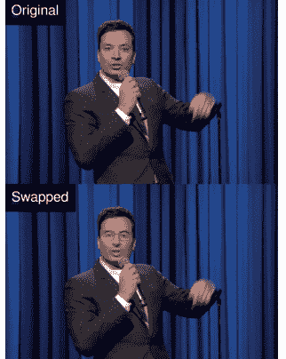

图 4.14 在这个 AI 生成的片段中，约翰·奥利弗的面部特征被应用到吉米·法伦的图像上。（由 Gaavro Oberoi 生成，[https://goberoi.com/](https://goberoi.com/)。）

不幸的是，有些人以不道德的方式使用了这项强大的技术。你将在本书最后一章看到更多关于自动化内容生成风险的内容。现在，让我们回到这项技术的更积极的一面。你已经看到网络如何学习图像类别的相关特征并将其从一个图像转置到另一个图像，我们重点关注了人脸。基于相同技术还能构建什么其他应用？

一个例子是 *风格迁移*：从一张图片中提取 *风格* 并将其应用到另一张图片上。在图 4.15 中，模型让斑马看起来像马（上排），让马看起来像斑马（下排）。上排看起来很棒：甚至小马的毛发也被捕捉到了。然而，看起来模型很难区分人类皮肤和马毛：下排中的女人也被“斑马化”了。

这无疑令人着迷，但你能用它做什么呢？好吧，除了生成美丽的图片外，我们老实说还不知道！但不要太快否定这种艺术性方面，因为一些公司已经建立了成功的产品正是做这件事。

一个很好的例子是 Prisma，这是一款应用，允许你拍照并使用我们刚才提到的技术应用不同风格。2016 年 6 月在 iOS App Store 首发一周后，该应用下载量超过 750 万次，活跃用户超过 100 万。仅一个月后，它已安装在超过 1250 万台设备上，全球活跃用户超过 150 万，并在 77 个国家的 App Store 中名列前十。

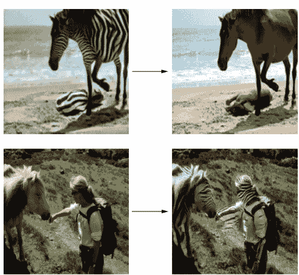

图 4.15 风格迁移的实际应用，将斑马图案应用到马（和人类）身上。图像使用“Unpaired Image-to-Image Translation Using Cycle-Consistent Adversarial Networks”中 Jun-Yan Zhu 等人的代码生成，https://arxiv.org/abs/1703.10593。

## 4.6 需要注意的问题

DL 模型是我们迄今为止见过的最复杂的 AI 类型，这意味着它们也伴随着更微妙的陷阱。首先，深度神经网络的强大之处在于其能够自动从输入图像中提取和计算特征。这很棒，因为它们比人工设计的算法表现更好，而且你也不需要支付工资。然而，另一方面是，我们其实并不真正知道深度神经网络为什么工作得如此好。仅举一例，你的平均图像分类模型的表现由大约 5000 万个数字控制，这些数字在训练期间被调整和优化。即使最聪明的科研人员和工程师也几乎没有希望理解这种复杂性。

在 ML 社区内部，DL 模型实际上被视为黑箱：它们强大且准确，但我们很难解释它们为何做出某些决策。可以理解的是，研究人员首先专注于让这项技术发挥作用，现在才开始窥探黑箱内部。我们通常说深度模型缺乏可解释性，这对其在安全关键型应用中的使用是一个问题。

例如，一辆自动驾驶汽车可能会部署一个 99% 准确的模型来检测过马路的行人。纸面上看起来很棒，但可能不足以打造一个安全的产品：在剩下的 1% 的情况下会发生什么？在传统的机器学习中，工程师至少对模型如何运作和决策有一定的了解。对于深度学习来说，这通常并非如此，催生了一个名为可解释 AI 的新研究领域。

可解释 AI 的研究主要沿着两个方向进行：开发人类容易理解其决策的模型族，以及创建新的工具和技术来解释我们已有的模型的决策。在这两种情况下，想法是我们不想为了可解释性而牺牲准确性。虽然对新模型的研究仍处于早期阶段，但在可视化和模型调试工具方面已经出现了许多有趣的结果。一个例子是华盛顿大学三位研究人员于 2016 年发表的论文：“Why Should I Trust You?”: Explaining the Predictions of Any Classifier” by Marco Ribeiro et al.（https://arxiv.org/abs/1602.04938）提供了很多思考的素材（甚至标题也很抓人）。

该论文的一个例子是使用深度神经网络训练的计算机视觉应用，用于分类哈士奇和狼。这是一项艰难的任务，因为这两种动物看起来相似。研究人员做了个狡猾的举动：他们收集了家养哈士奇在家中的照片，以及生活在寒冷地区野外的狼的照片。在此数据上训练的分类器表现 surprisingly 好，一个天真的 ML 工程师可能会被诱惑到此为止并发布产品。然而，如果你深入挖掘并尝试理解算法在看什么——它构建了哪些特征来理解动物类型——你会发现一件有趣的事。

算法根本不在乎动物。它识别的唯一特征是图片中是否有雪。因为所有狼的照片都有雪景背景，所以它很容易理解“如果我看到白色背景，那就

“它是狼。”如果你决定用雪地上的哈士奇来测试这个算法，它每次都会说“狼”。事实上，即使你在雪地上放一只巴哥犬，它也会一直说“狼！”有趣的是：我们原本试图构建一个能够区分狼和哈士奇的智能算法，结果得到的却是一个统计白色像素的算法。

那么，最大的启示是什么？一位伟大的哲学家曾说过：“能力越大，责任越大”（其实是蜘蛛侠的本叔叔说的）。这对深度神经网络来说尤其如此。它们自主学习特征的能力非常强大，但必须谨慎对待：模型可能学到了一些你意想不到的东西。

要检查一个在数百万张图像上训练的算法所学到的一切是不可能的，所以你需要灵活应对。灵活应对的方法就是记住我们在本书开头所说的：在人工智能领域，最需要关注的一件事是*数据*。如果模型产生了偏见，你应该从数据中寻找原因和解决方案。

## 4.7 面向音频的 AI

音频数据与图像有许多相同的复杂性，因为数据看起来相似：大量数字代表波形和音频峰值。因此，我们将仅提及AI在音频方面的三个主要应用：

- 语音转文字，即*语音识别*
- 文字转语音，即*语音生成*
- 触发词检测

让我们逐一简单介绍。*语音识别*是从一段口语对话的音频录音中理解词语。输入是原始音频，输出是其文本记录（图4.16）。每次你向Siri、谷歌助手或Alexa提问时，你都使用过这项技术。

这是另一项在深度学习成熟并且我们能够收集和处理大规模数据集之前并不十分准确的技术。仔细想想，这个问题与图像问题相同：如果你听一段某人说“你好”的音频文件，你应该能够识别组成不同字母声音的发音，然后识别出这个单词。这是否让你想起了深度神经网络的层次结构？

尽管深度神经网络为语音识别带来了重大进展，但如今的解决方案仍存在严重缺陷。算法表现相当不错，但最大的瓶颈之一是数据。要训练一个深度学习算法执行语音识别，你需要带标签的音频文件：某人声音的录音以及所说内容的文本记录。电影恰好能满足这种数据需求：你可以将音频作为输入，字幕作为标签。然而，并不是每种语言都有深厚的电影史，有些语言可用的数据集很小。此外，大多数演员发音标准，因此算法很难泛化到蹩脚英语。

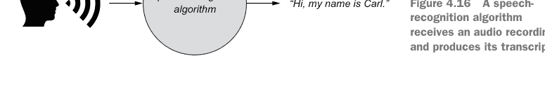

*文字转语音*是从文本生成音频的任务。正如语音识别是Alexa用来理解你声音的技术一样，*语音生成*是它用来回话的技术（图4.17）。得益于深度学习，这项技术也发展迅速，这些算法产生的声音比以前在地铁里听惯的机器人般、金属质感的声音自然得多。然而，这些新算法的主要问题之一是它们仍然很耗电，很难在移动设备上使用尖端技术。

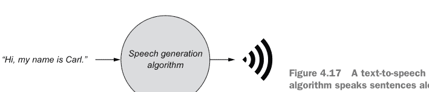

我们希望你知道的最后一个任务是*触发词检测*。当你说出“嘿，Siri”或“OK，Google”时，这项技术会解锁你的手机。与通用语音识别相比，它经过优化，只关注这一种表达，因此可以在手机后台运行而不会耗尽电池。

与触发词检测一样，语音识别和语音生成对于小型组织来说既先进又难以开发；即使是谷歌和Facebook这样的科技巨头仍在对其进行研究。幸运的是，你会在本书第二部分看到，这些公司大多将技术作为服务提供，而这几乎就是你所需要的，因为它们是非常标准的应用，通常不需要特定定制。

## 4.8 案例研究：用深度学习优化农业

小池诚是一位常驻日本的软件工程师。当他开始帮助家里的黄瓜农场干活时，他忍不住注意到父母花了大量时间按质量对农产品进行分类。日本农业对产品质量非常自豪，这意味着小池的母亲每天要花多达八小时根据黄瓜的形状、颜色和刺的数量进行分类。由于日本没有标准化的黄瓜质量分类，小池家的农场采用了九级分类法，从最好的到最差的。你可以在图4.18中看到这些类别。

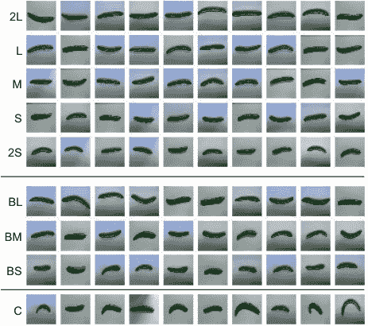

小池决定尝试将这一过程自动化，以便家人可以专注于优化种植。凭借他在汽车工程方面的背景，他能够设计和建造基于传统传送带设计的自动分拣机的机械部件。

自动化机械臂（由计算机控制）根据质量分类将每根黄瓜推入对应的箱子。机器建好并测试后，小池必须为机械臂实现控制算法。从实现的角度来看，最难完成的任务如下：

- 1. 在物品通过传送带时识别不同的物品
- 2. 根据形状、颜色、表面外观对每个物品进行分类
- 3. 协调机械臂的运动，将每个物品推入正确的箱子

小池可以利用自己的专业知识处理任务1和3，这些属于传统自动化工程领域。他随后意识到任务2是一个*物体分类*任务，为此他可以利用大量的研究和开源代码。这将传统软件工程工作量减少到只需几个小时来搭建其中一个免费可用的框架，接着他迎来了下一个真正的挑战：收集训练数据。在这种特定领域的情况下，数据收集的唯一途径通常是求助于唯一拥有必要专业知识的人。小池收集了示例（图片）和标签，而他的母亲则耐心地根据农场严格的质量标准对约8000根黄瓜进行分类。该数据集可在 https://github.com/workpiles/CUCUMBER-9 免费获取。

在为原型收集到足够的训练数据后，剩下的就只是常规软件工程：将模型的预测接入传送带的控制系统。图4.19展示了这一过程：相机拍摄黄瓜图像，然后由神经网络处理；根据网络的预测，机械臂将黄瓜放入与其类别对应的桶中。

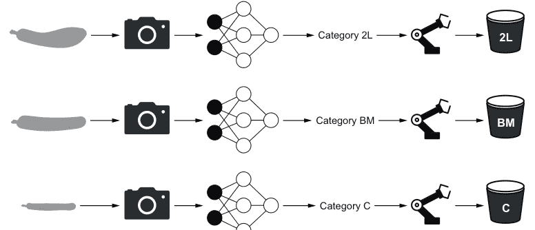

图4.19 小池系统的核心步骤，从拍摄黄瓜图像到最终放入正确的桶中

整个过程在一条小型传送带上进行。你可以在图4.20中看到最终产品。

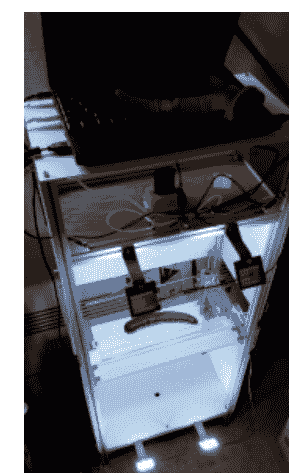

图4.20 最终黄瓜分拣机的一部分，相机拍摄黄瓜图像，计算机计算预测，然后将黄瓜向前移动，放入正确的桶中。

小池称整个系统的准确率为70%，尽管在测试集上测得的准确率经常超过95%。这表明测试数据并未准确捕捉真实情况下样本的变异性。例如，某些形状或颜色的黄瓜在训练集中可能代表性不足。通常，如果所有训练样本和标签都是在收获季节初期收集的，而随着季节推移黄瓜越长越大，就会出现这种情况。

为了提高系统性能，小池决定采用多摄像头方法：不同的摄像头从不同固定角度拍摄黄瓜图像，然后输入神经网络对黄瓜进行分类。你可以在图4.21中看到小池数据集的升级版本。

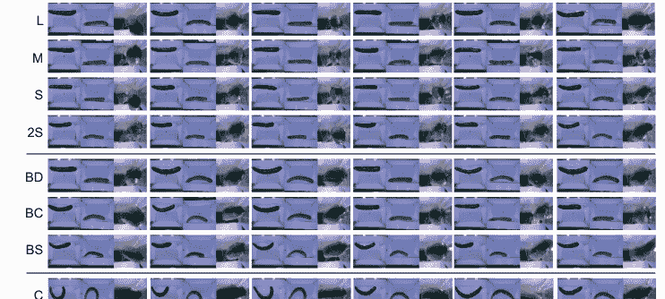

图 4.21 小池数据集的升级版，每个黄瓜从三个不同角度拍摄而成

小池的故事吸引了许多新闻媒体，它们报道了这个“大卫与歌利亚”式的故事，表明即使是单个工程师也能构建出能与大公司相媲美的 AI 应用。但许多记者没有提到，小池花了三个月时间才收集到原型所需的 8000 个样本。他拍摄的图像分辨率也极低，以至于模型根本无法识别黄瓜上的刺和划痕。另一方面，谷歌的博客发布了他们自己版本的报道，强调了其开源库和云服务在加速训练方面的作用。

### 4.8.1 案例问题

- 1. 为什么这个问题非常适合用机器学习来解决？
- 2. 哪些关键选择和权衡让小池能够以最低投入快速开发出原型？
- 3. 你会如何设计衡量这个项目成功的准则？

### 4.8.2 案例讨论

自工业革命以来，自动化生产流程的商业价值就一直很明确。这个项目是 AI 通过聚焦机器人先进感知能力而带来新一轮改进的一个例子。许多工厂的设计都让工业机器人能够在最低灵活性要求下完成任务：想象一条传送带运送着敞开的罐头，同时被灌入产品。在这种情况下，控制工厂的算法几乎不需要摄像头或其他高级传感器，因为流程是严格固定的。黄瓜的情况则截然不同，因为很难控制黄瓜会长成什么形状（大自然不喜欢标准化），而且你需要自己分拣它们。编写硬编码规则很困难，因此机器学习非常适合这类决策过程。

小池的项目也是将 20 世纪的技术（工业自动化）与 21 世纪的 AI 和软件连接起来的一个典型例子。在机械装置建成之后，算法就是监督式分类的教科书式应用，研究人员已经为此写了数千篇论文。这让小池能够利用成熟的技术（比如本章讨论的那些），甚至复用开源代码。

尽管项目很小，但它包含了构建 AI 应用流水线中的所有步骤：识别商业价值（节省时间）、收集训练数据，以及将模型接入业务流程。从技术角度来说，这是一个很好的例子，说明了当你对问题使用正确的思维模型时会发生什么：一切都会变得更容易，因为你可以更有效地与工程师沟通，并且可以利用大量的现有技术。一旦小池意识到他的工具核心是一个物体分类模型，他就可以直接开始收集带标签的训练数据，然后使用互联网上的开源代码。

请注意，构建技术对小池来说并不难，因为他能够使用云服务提供商和开源技术。真正耗时的是创建数据集。这又是一个例子，说明在构建 AI 应用时，数据是最宝贵的资产。在这个案例中尤其如此；小池收集的数据与他实际应用中收集的图像相比具有一些不同的特性，正如测试集和现实生活之间性能差异所暗示的那样。如果项目需要进一步扩展，这可能是一个需要重点改进的方面。

最后，考虑一下小池最初遇到的问题：他难以衡量模型的性能，因为模型在从未见过的样本（测试集）上表现得比它学习过的样本（训练集）更好。这当然很可疑，很可能是因为他训练集中的黄瓜是在与训练集不同的季节生产的。这一挑战凸显了谨慎选择数据的重要性：大数据集还不够，你还需要它们能够代表你在实际应用中可能遇到的潜在情况。

在最低可接受准确率方面，小池本可以以他母亲的判断作为基准，并设定一个对他来说合理的阈值。然而，批判性地思考错误意味着什么也很重要：把黄瓜放进错误的箱子里代价是什么？由于这个应用中的错误不会带来破坏性后果（例如，不像医学领域），小池本可以决定接受不那么出色的性能，以便彻底把他可怜的母亲从这项繁重的任务中解脱出来。

## 小结

- 深度学习是机器学习算法的一个家族，它为大多数处理图像和音频的 AI 应用提供动力。
- 深度学习的秘诀在于它能够自动从数据中提取相关特征，使工程师免于漫长（或根本不可能完成）的工作。
- 迁移学习是一种有助于减少深度学习对训练数据贪得无厌需求的技术。
- 人脸识别和自动化内容生成是利用深度学习模型灵活性的巧妙应用。
- 深度学习在处理音频方面与处理图像一样出色，并且是当今识别和生成语音的最先进方法。
