# 自然语言人工智能

#### 本章涵盖

- 理解自然语言处理的主要挑战
- 通过情感分析衡量文本中的观点
- 使用自然查询搜索文本内容
- 构建对话界面（聊天机器人）
- 案例研究：机器学习辅助的语言翻译

让计算机理解语言一直是计算机科学家自 20 世纪 50 年代以来的梦想。这很可能是因为人类大部分知识和文化都以书面文字编码，而语言的使用是使我们区别于动物的最强大能力之一。这些技术的总称，包括理解和生成语言，就是*自然语言处理（NLP）*。

不幸的是，让机器拥有理解和生成语言的能力，其难度与期望值一样高：支撑这种无缝人机交互的技术还尚未问世。但这并没有阻止公司、机构和媒体过度宣传端到端解决方案的潜力。*聊天机器人*就是这种现象的典型例子，它们被吹捧为能够与客户交流的自主代理，可以无缝增强或取代人类员工处理销售或售后等复杂事务。结果却令人失望：2017 年，硅谷博客 The Information 发表了对 Facebook Messenger 个人助理 M 的研究报告。该博客称，M 无法处理 70% 的用户请求。可想而知，破碎的承诺只会带来浪费金钱、浪费时间以及挫败感。

如果这个介绍听起来并不令人鼓舞，那么也有好消息。首先，技术正在飞速发展，可能性也在相应扩大。其次，你将学习如何发现和开发那些可以从更简单、更成熟的 NLP 工具中获益的隐藏项目。这些机会在 NLP 的炒作泡沫中常常被低估，但它们可以成为你 AI 努力的有力成功案例。

本章有两个主要目标：

- 让你掌握判断一个想法在当今技术（以及你的资源）下是否可行的知识
- 教你如何规划自然语言项目，着眼于最大化投资回报。这将使你能够拨开迷雾，在组织中发现隐藏的机会。

我们将首先解释为什么语言对计算机来说确实很难，以及机器学习如何在过去几年再次拯救了我们，让我们能够构建出令人惊叹的产品和解决方案。

## 5.1 自然语言理解的魅力

让我们面对现实吧。我们在互联网上消费信息的方式一直陷入一种不自然的妥协：我们仍然在点击按钮和选择下拉菜单，而在现实世界中我们只是使用简单的语言。自然语言处理是一种能够让我们消除这一障碍的技术，让人们以体验物理世界的方式使用数字世界。

让我们试着想象一下，在如今熟悉的房地产经纪网站世界中，NLP 会如何改变游戏规则。我们设身处地地想象它的一个用户：一位来自旧金山、想买房子的富有初创企业投资人。她想要一栋大别墅，至少四个房间，靠近 101 号高速公路，并且必须能看到海景。

现在，当她访问该网站时，她面对的是我们都习以为常的经典互联网门户视图：一个菜单、一些用于价格、位置、卧室数量的框，以及每个房源的大量信息（图片、描述等等）。

当你只是想要一个简单答案时，摆弄所有这些按钮、选择器和下拉菜单，感觉就像坐在喷气式飞机的驾驶舱里。而她的问题是：

> 旧金山有哪些靠近高速公路、能欣赏到绝美海景、并且至少有四间卧室的别墅？我想这个周末去参观最好的几栋。

请注意，由于宽度和深度都会影响任务的复杂度，因此我们可以说任务的总体复杂度与其乘积成正比：

$$复杂度 = 宽度 \times 深度$$

如果我们将这两个指标绘制在坐标轴上，就能得到一种有效的方法来可视化 NLP 任务的复杂度。如图所示，面积较大的矩形所代表的任务比面积较小的任务更复杂，见图 5.1。

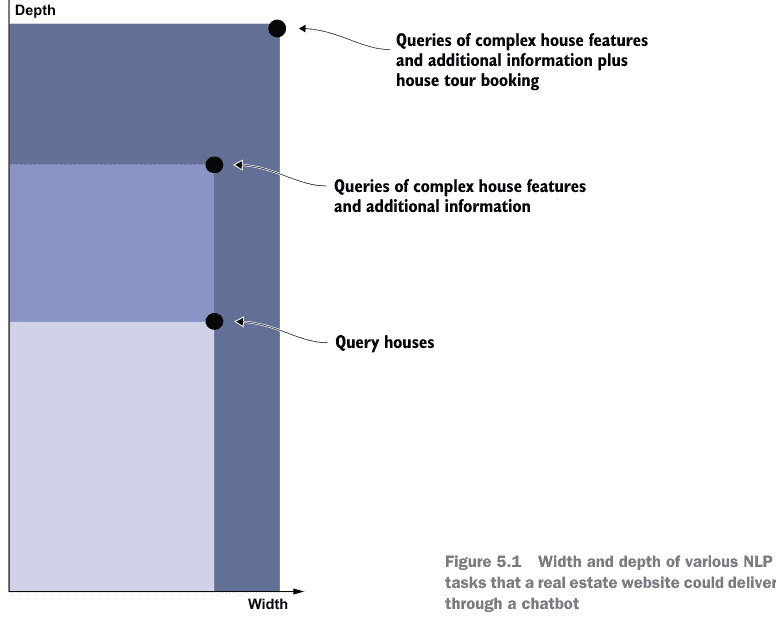

让我们回到房地产网站聊天机器人的示例。该聊天机器人可以执行的一个简单操作是理解基本用户查询，基本上取代了传统的搜索界面。这是一个查询示例：

> 给我看看旧金山市中心卧室数超过四间且价格低于 200 万美元的房子。

在这种情况下，聊天机器人需要执行与单个领域（房产属性）相关的单一操作——查询数据库。我们可以对聊天机器人提出更多要求，并扩展其功能，从该数据库中提取元信息或回答更复杂的查询，例如：

> *普雷西迪奥（Presidio）社区的海景四居室，且距离 101 号高速公路 10 分钟以内，平均房价是多少？*

这不会增加宽度，因为语言领域仍限于房屋，但深度大大提高了，因为机器人必须能够处理的可能操作数量增加了。最后一步可能还包括管理房产参观预约。随着操作数量的增加，深度会再次增加。现在，宽度也增加了，因为机器人需要理解与预约相关的新语言表达。

请记住，两个截然不同的任务可能具有相似的复杂度。让我们稍作转换，看看两个你很可能已经熟悉的典型 NLP 示例：

- 推文情感分析——对于这个任务，模型阅读短文本，必须判断其表达的是积极还是消极情感。换句话说，情感分析旨在了解作者对文本主要主题的看法。示例：“我喜欢斯皮尔伯格的新电影”是积极的。“这款新手机的摄像头太糟糕了”是消极的。
- 客户支持工单分类——对于这个任务，模型阅读客户投诉并将其分配给几个潜在原因类别之一。示例：“密码错误”属于身份验证问题，“网站无法加载”属于连接性问题。

第一个任务宽度很高，因为它可以处理许多主题（人们使用 Twitter 谈论一切），但深度很低，因为它只有两种可能结果：积极或消极的评价标记。

另一方面，第二个任务宽度较低，因为它需要处理的工单都大致与同一领域（IT 故障）相关，但其深度较高，因为它需要将工单放入多个类别中。在我们的宽度/深度图中，这两个任务看起来如图 5.2 所示。

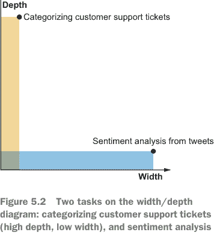

我们如何将这些洞察转化为可操作的信息？从宽度和深度角度审视 NLP 任务有助于评估其可行性。通常，你希望从最低的宽度/深度组合开始设计你的 NLP 应用，以尽可能保持两者都低。随后根据需求在其基础上进行构建，并根据你能实现的绩效来决定。在图 5.3 中，你可以看到应用可行性随其深度和宽度变化的表示。

| | |
|---|---|
| 特定应用领域（例如，客户服务工单） | 类似人类的能力（甚至谷歌都无法做到） |
| 特定领域通用任务（例如，书籍情感分析） | 通用技术（例如，情感分析） |

**深度**

**宽度**

图 5.3 基于其宽度和深度的 NLP 应用。应用越接近右上角，使用当今技术实现的可能性就越低。

在本章的下一部分，我们将使用这种思维模型作为指南，探索为我们的房产列表网站添加 NLP 功能的路径。

## 5.3 为组织添加 NLP 功能

让我们回到上一章中断时的房地产中介网站。基于深度学习（DL）的图像分类器极大地改善了用户体验，每月访问量正在迅速增长。客户访问我们的网站，可以通过每个房源的图像快速找到他们感兴趣的详细信息，并通过询问关于他们最喜欢的房子的更多信息来推进流程。目前，对特定房源感兴趣的人有两个选项来了解更多信息：

1. 花大量时间阅读房主留下的描述以及其他访问过该房产的人的所有评论（让我们假设我们的房地产平台有房产评论功能）。
2. 致电客户服务，由客服将客户连接到处理该房产的经纪人。

第一个选项的用户体验并不好，而第二个选项对你的业务来说非常昂贵。我们已经构想了一个类似人类的计算机程序（通常称为机器人、聊天机器人或智能体），它完全可以接管房产经纪人的角色，但我们也明白，这种 NLP 应用使用当今技术不太可能奏效。我们可以将这个高级应用称为 brokerbot：它同时具有高宽度和高深度。

让我们退后一步看看我们的业务目标。业务目标是让客户能够快速找到关于每个房源所需的信息。如果从这种方式来看，brokerbot 有点过度了：我们仍然可以使用更简单的技术，逐步迈向更好的用户体验和更快的搜索。

我们知道用户花了大量时间浏览其他潜在购房者写的评论。这些评论包含大量通常未包含在房屋描述中的信息，例如对灯具、社区的一手评价等。我们希望利用这些信息帮助其他用户做出尽可能好的决定，但很少有人愿意花时间阅读所有这些材料。

在接下来的章节中，我们将利用我们拥有的主要自然语言内容——用户评论，逐步为我们的网站开发更复杂的 NLP 功能。你会发现，即使是基本的 NLP 功能也能对人有所帮助，而不必设计那些可能最终令人失望并让用户沮丧的超级复杂类人功能。正如你在图 5.4 中看到的，在自然语言处理这样复杂且尚不成熟的领域，增加产品的复杂度会指数级地增加技术风险，而业务价值在一段时间后会趋于平稳。

为我们的网站添加 NLP 功能的第一步应该是我们能构建的最简单但仍有价值的事情。在我们的情况下，它可以是开发一个系统将每个房产评论分类为积极或消极，使新用户更容易了解挂牌房产的实际好坏。

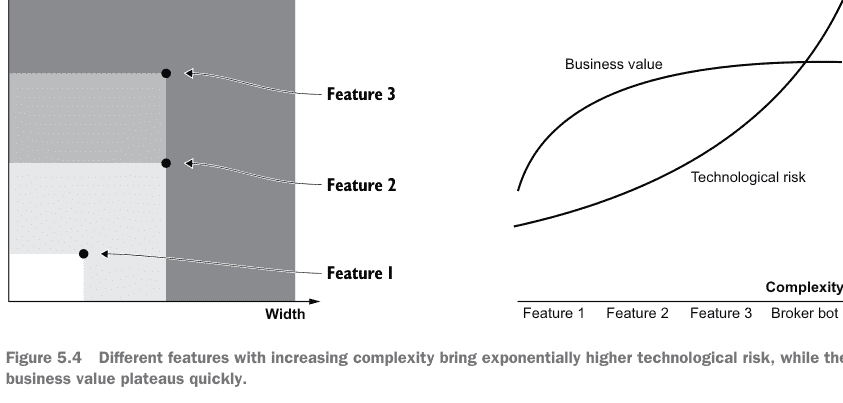

图 5.4 复杂度递增的不同功能带来指数级更高的技术风险，而业务价值迅速趋于平稳。

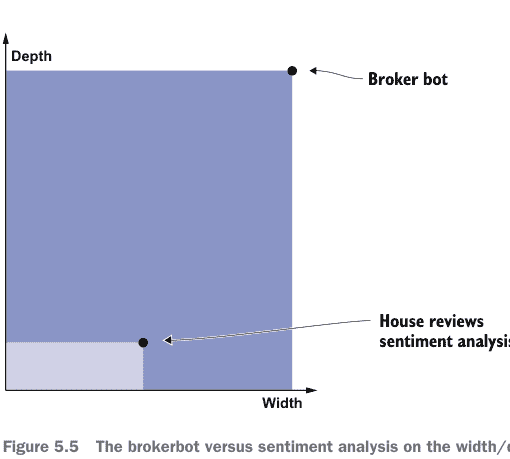

### 5.3.1 情感分析

互联网上用户产生的一种惊人数量的文本内容涉及观点和感受。例如，想想亚马逊上的用户评论、Twitter 回复，甚至博客文章。*情感分析算法*消化所有这些非结构化文本，并确定作者对主题持积极、消极还是中立的看法。

情感分析是一项重要任务，其用途远不止对房屋评论进行分类。你可以实时通过社交媒体源监控营销活动结果，甚至评估会议期间对个人演讲的反应。华尔街交易公司常规使用情感分析来衡量公众对某公司的看法，并据此指导他们的交易决策。

但让我们回到我们的房地产列表网站。以下是用户发布的一些评论摘录：

- 厨房电器陈旧且有异味。
- 客厅的日落景色令人惊叹。

我们想要做的是构建一个算法，能够像图 5.6 那样将每个句子标记为积极或消极。

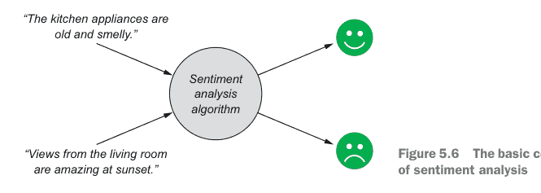

假设我们并不知道机器学习，并且需要向计算机解释如何通过开发算法来对这些句子进行评分。一个实用的经验法则是查看某些标志性词语，例如“terrible”和“amazing”。事实上，最早的情感分析算法正是这样工作的：研究人员 painstakingly 构建了一个重要词的词典，并将每个词标记为积极、消极或中性。例如，这样的词-情感词典可能看起来像这样：

- Delighted—Positive
- Killed—Negative
- Shout—Negative
- Desk—Neutral

一旦你有了这样的情感词汇表，你就可以通过计算每个句子中积极词和消极词的数量来对每个句子进行分类，从而为句子得到一个最终分数。

这种简单的方法存在许多问题。语言极其复杂，而且我们每个人使用语言的方式都非常不同；同一个词可以用不同方式使用来传达完全相反的信息。假设你将“nice”列为积极情感词，而其中一位评论者写道：

> It would be nice if they completely removed that tapestry.

即使该句子对房屋的整体看法是负面的，我们的朴素系统也会因为“nice”的积极含义而将其视为积极。也许你可以通过添加更复杂的规则来改进这个系统，比如这样：

> It would be [POSITIVE WORD] if ..’ => negative

尽管该规则适用于前面的片段，但仍然很容易被欺骗。例如，以下句子实际上极其积极，但会被评为负面意见：

> It would be nice if I could move into this place right away!

我们是否要继续添加硬编码规则？游戏已经变得复杂起来（而且很无聊），但仍然很容易欺骗我们的系统。还要注意，我们仍然只是在玩弄几个词；我们甚至还没有开始绘制英语词汇的广阔海洋。即使我们真的做到了这一点，对于其他语言，我们几乎也需要从头再来。

到现在为止，你可能已经开始认为这种方法注定会失败。如果你熟悉本书的主要主题，你可能会认为我们为你准备了更好的东西，而你是对的。也许一台机器可以自行找到执行任务的方法，而无需我们解释它。

我们可以像在前几章中看待其他 ML 问题一样来看待情感分析。给定一段文本，我们需要决定它属于“positive”还是“negative”类：一个 *分类* 问题。类别（标签）将简单地为“positive”或“negative”，特征将是句子的词语。不是手动创建规则来将每个词分类为积极或消极，我们可以训练一个 ML 模型来为我们完成这项工作。事实证明，文本中特定词语的存在与否足以让模型判断意见是负面还是正面。

这种方法简单而有效。其中第一个勾勒出这个想法的人是 Paul Graham，硅谷最成功的创业加速器 Y Combinator 的传奇创始人。他在试图解决他认为对早期互联网最大的威胁之一——垃圾邮件时想到了这种方法。当时，你的电子邮件收件箱会充满各种欺诈广告，从假彩票奖金到假冒伟哥。2002 年，Graham 提出了一种新方法，他在他的文章《A Plan for Spam》（www.paulgraham.com/spam.html）中描述了它。

Graham 的计划始于这样一个认识：大多数开发人员会被吸引去编写显式规则来检测垃圾邮件。在互联网的早期，通过使用显式规则，很容易正确识别几乎 80% 的垃圾邮件。然而，抓住最后那 1% 的垃圾邮件发送者会变得极其不同。另一方面，简单的 ML 方法从一开始就更有效。概念非常简单：让一个 ML 算法看到一堆垃圾邮件和非垃圾邮件，让它自行找出哪些词最有可能表明垃圾邮件。

在有限的努力下，Graham 的算法能够击败专家程序员 painstakingly 编码的最复杂的硬编码规则。它还发现了奇怪的词与垃圾邮件之间的惊人相关性，而以前从未有人想到过：事实证明，ff0000，即网络上“红色”的颜色代码，与色情词一样是垃圾邮件的良好指标。

Graham 的经历提供了两个有趣的收获。首先，在 2002 年，Graham 认为自主垃圾邮件过滤是 AI。今天，我们把这个功能视为理所当然，并认为它比咖啡机还不那么复杂。此外，我们不会详细介绍 Graham 使用的具体分类器（顺便说一下，它叫做 *naive Bayes*），但它可能是数学家能想到的最简单的算法之一。然而，它仍然能够智胜他和世界上一些最聪明的工程师。学习经验再次战胜了硬编码规则。

### 5.3.2 从情感分析到文本分类

情感分析已经改善了我们网站上用户的体验，但我们希望朝着 brokerbot 再迈出几步。我们决定解决另一个问题：评论冗长，谈论房屋的各个方面，从客厅的照明到社区。特别对某个主题感兴趣的潜在买家必须浏览所有评论才能找到谈论该主题的评论。通过按主题标记每条评论将是一个很棒的功能，允许潜在买家快速找到他们想要的信息。

与情感分析中只有两个类别（积极和消极）不同，现在我们有更多类别，因为评论可能涉及家具、视野、社区声望等等。这种任务通常被称为 *text or document classification*。

文档分类比情感分析更复杂还是更不复杂？同样，让我们使用宽度/深度图来可视化差异。任务的 *宽度* 更高，因为文档分类模型需要理解更大的词汇量。诸如“shelves”、“dishwasher”或“orchard”之类的词在情感分析中可以被忽略，但在分类中显然很重要。NLP 应用的 *深度* 衡量任务的复杂程度。在情感分析的情况下，我们只是想把评论放在两个桶中的一个。对于文本分类，我们可以根据我们想要划分评论的类别拥有任意多的桶；例如，关于客厅、房屋磨损、社区等的评论。我们决定使用的类别越多，模型就越深，如图 5.7 所示。

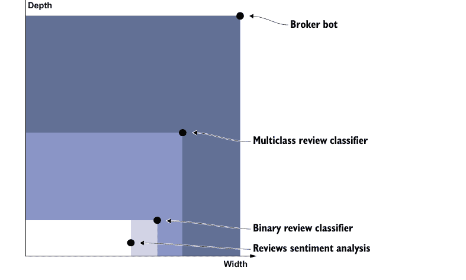

图 5.7 将 brokerbot 与本章中我们开发的其他、更简单的 NLP 应用进行比较

基本的 ML 模型通常足以进行情感分析，但在更复杂的任务如分类中会出现问题，主要是因为它们忽略了词的含义，而只是计算它们在标记数据集中出现的频率。这意味着分类器对“awesome”和“breathtaking”具有相似含义这一事实没有任何洞察力。为什么这是个问题？假设你有 20 个包含“awesome”词的训练示例，但没有包含“breathtaking”词的示例。一个对词的含义没有任何了解的模型将学习将包含“awesome”词的每条评论分类为积极示例，但不知道如何处理“breathtaking”词。如果模型能够把握词的含义，那么只要看到几个包含几个积极词的示例就足以扩展其分类能力到所有积极词（也就是说，它会正确解释“stunning”、“fabulous”和“gorgeous”，即使训练示例中只有“awesome”）。

词的高变异性造成了与我们在第 4 章中图像所遇到的问题相似的问题。当我们开始谈论计算机视觉时，我们的主要问题是图像由数百万像素组成，很难找到方法将这些数据的复杂性分解为更简单的项目，比如基本形状的存在。我们解决该问题的方案是使用深度学习，一类能够自主提取复杂特征的特殊算法（在图像的情况下，从基本信息如角和边缘，到复杂信息如人脸识别中的面部特征）。你还看到了如何使用这些算法构建嵌入，即图像内容的计算机友好摘要。

幸运的是，深度学习也适用于文本，可以帮助我们构建比简单存在某些词更强大的特征。以同样的方式，我们使用嵌入将原始图像像素转换为有意义的信息（例如，尖鼻子或大耳朵），我们也可以使用它们将词转换为一组数字，表示抽象的词特征，如“positiveness”和“strength”。正如具有相似对象的两张图像具有相似的嵌入一样，相似的词也将具有相似的嵌入（也就是说，相似的词如“awesome”和“fabulous”将被转换为相似的数字集）。

如果我们将词嵌入的数字解释为空间中的坐标，我们就可以直观地理解这种表示的强大之处。例如，在图 5.8 中，你可以看到词在 3-D 平面上表示。在左侧平面上，你可以看到积极词彼此接近，而它们远离消极词（消极词彼此接近）。右侧图表也适用：与客厅家具相关的对象倾向于聚类在一起，并且远离与社区相关的形容词。在这种设置中，接近仅仅意味着两个相近词的词嵌入相似，这使我们的文本文档分类器的工作大大简化：它现在可以忽略“amazing”、“fabulous”或“beautiful”等相似词之间的差异，并将它们全部视为代表“积极”感受的相似数字。

就像计算机视觉一样，NLP 应用也可以利用迁移学习来减少所需的训练数据量。正如你在第 4 章中看到的，迁移

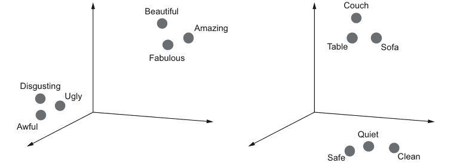

Figure 5.8  在这些表示在 3D 平面上的词嵌入中，左侧是正面和负面词汇，右侧是与邻里和客厅相关的词汇。

学习是一种“预热”模型的方式，先用大量易获取的通用数据对模型进行预训练，然后再使用领域特定的训练数据对其进行训练，而后者通常更难获取。就像计算机视觉应用一样，模型可以学习简单的形状和模式，NLP 模型也会掌握基础词汇和语法，这对几乎所有任务都有用（“美丽”无论谈论房子还是其他东西，其含义都相同）。

NLP 研究社区发布了多个在海量文本数据库上训练的深度学习模型，因此它们能够理解并创建几乎完整词汇的嵌入。图 5.9 概述了为特定分类任务采用可自由获取嵌入的基本思路。

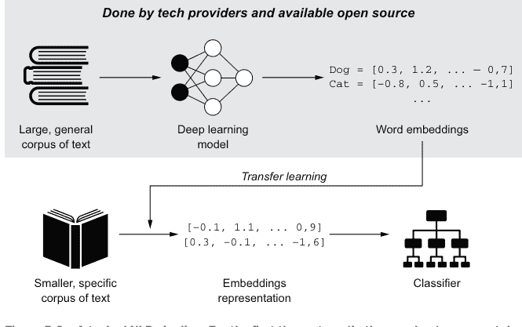

Figure 5.9  一个典型的 NLP 流程：对于前三个步骤（灰色框内），你可以利用开源模型和嵌入。最后三个步骤涉及领域特定的数据集。

计划是使用可自由获取的预训练模型来计算你自己的文本的嵌入（例如，网站上的房屋评论集合）。这些模型已经在大量文本语料上训练，因此完成了理解语法和词汇的艰难工作，使它们能够学习所有复杂的规则。当你拥有*你关心的*文本的嵌入向量（例如，房屋评论）时，建立用于情感分析或其他任务的分类器会容易得多，因为嵌入表达的含义远比原始文本丰富。

### 5.3.3  规划 NLP 分类项目

文本分类是一种通用且有用的应用，可以在组织的各个不同场景中发挥作用。表 5.4 为你提供了一些灵感。

**Table 5.4**  三个面向业务应用的基于 NLP 的分类示例

| Application | Input data | Possible classes |
|---|---|---|
| Automatic ticket dispatcher | Tweets and email sent to customer service | Root cause of the issue (lack of internet connection, wrong billing, and so on) |
| Automatic car insurance claims categorizer | Insurance claim report | Kind of damage (broken engine, scratch, and so on) |
| Medical claims classifier | Doctor’s report | Disease |

在将文档分类应用于业务问题时，重要的是要记住风险和性能取决于我们想要识别的类别数量。在图 5.10 的宽度/深度图中，你可以通过想象我们要求 AI 算法识别的类别越多，应用的深度就会越大，从而使任务更具挑战性，来可视化复杂性的增加。

还有一点需要注意的是，如果你在训练数据中某个类别的示例数量有限，算法将很难学会识别该类别的元素，因为它没有看到足够的案例。回到我们的房屋评论分类器，假设你有表 5.5 中的情况。在这种情况下，我们前三个类别的训练数据很多，但最后

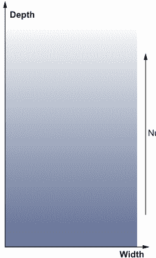

缺少示例。第 4 类只有三个示例，而其他类别有数百条评论。

解决这种状况的方法要么是获取更多训练数据，要么是简单地将不幸的类别与其他相似类别合并。例如，第 3 类和第 4 类都与邻里相关，因此我们可以将它们合并为一个更广泛的“关于邻里的评论”类别，总共会有 988 + 3 = 991 条评论。最终数据集的类别减少了一个，但在示例数量上更加平衡，如表 5.6 所示。

#### Table 5.5 Initial example dataset of home reviews

| Class ID | Class name | Number of examples in class |
|---|---|---|
| 1 | Wear and tear review | 1,541 |
| 2 | Furnitures review | 769 |
| 3 | Public service in neighborhood reviews | 988 |
| 4 | Neighborhood safety reviews | 3 |

#### Table 5.6 The same dataset after merging classes 3 and 4

| Class ID | Class name | Number of examples |
|---|---|---|
| 1 | Wear and tear review | 1,541 |
| 2 | Furniture review | 769 |
| 3 | Neighborhood reviews | 991 |

减少类别数量也有助于降低任务的深度，提高整体准确率，从而降低系统在现实世界中使用时出错的风险。

### 5.3.4 Document search

在本章开头，我们提出了 brokerbot：一个能够像人类一样理解文本的 AI 应用。这对现代 AI 技术来说过于复杂，因此我们从可以构建的最简单应用开始：情感分析分类器。通向更深层次语言理解的下一步是文本分类。不幸的是，它仍然存在两个重要局限：

- 它是一个分类任务，这意味着我们需要收集标签。
- 类别是预先定义的：如果用户想要搜索的內容未包含在类别中，我们就无法帮助他们。

第一个问题可以通过巧妙的数据收集技巧或简单地付钱给人工手动添加标签来克服。第二个问题更具挑战性，这正是 Google 所擅长的：它的搜索栏允许你输入任何感兴趣的内容并立即获得按相关性排序的结果列表。这个任务是 NLP 的一个分支，通常称为文档搜索和检索。

我们想要做的是：我们在网站顶部放置一个搜索栏，当用户输入他们感兴趣的内容（比如“房屋隔热”）时，算法会搜索所有可用的评论并挑选与搜索最相关的那些，如图 5.11 所示。

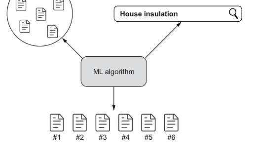

Figure 5.11 在文档搜索中，算法在文档集上训练（左上）。当它接收到用户的查询（右上）时，会生成最相关内容列表。

对于文档搜索，词嵌入的概念可以极大地帮助我们。回想一下，词嵌入是一组几百个数字，用来编码一个词的含义，且相似的词具有相似的嵌入。嵌入使我们能够将相似含义从文学的模糊世界转移到数字的冰冷世界。我们可以利用这一点，以便当用户询问“house insulation”时，我们可以将这两个词转换为它们的嵌入，如果我们对所有评论也做了同样的处理，那么就可以寻找其数值表示更接近“house insulation”嵌入的评论。

我们希望帮助你在脑海中可视化这个概念，所以想象一个两元素嵌入：每个词仅由两个数字表示，如图 5.12 所示。当然，这种嵌入在实践中不会很有用，因为两个数字不足以捕捉词汇的丰富性（实际应用中使用的嵌入由数百甚至数千个数字组成）。

想象为数据库中每个文档画一个点，然后再画一个对应用户查询嵌入的新点。得益于嵌入的构建方式，与用户查询最相似的文档在物理上会更接近查询点。这意味着回答用户查询很容易：只需挑选最接近它的几个点，它们就对应最相似的文档。这种解决方案在嵌入向量多于两个数字时也适用；只是更难可视化。

文档搜索是 NLP 中相当成熟的应用，通常在更复杂的产品中扮演构建模块的角色。它显然没有其他应用那么花哨，但

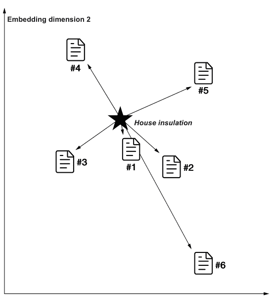

图 5.12 文档搜索算法通过查找与查询句子嵌入相似的文档来回答用户查询（图中用星号表示）。

技术，但它通常是你可以在基于文本的数据资产中获得价值时可以采取的最初步骤之一。特别是，我们在这里解释的这种文档搜索风格，几乎无法回答任何依赖于逻辑或解释的查询；它唯一能做的就是返回与查询听起来相似的文档，希望你能以某种方式觉得它们有用。

### 5.3.5 自然对话

在我们所有努力接近 brokerbot 的过程中，我们始终依赖人类生成文本，并且很高兴创建使人们更容易访问这些信息的算法。自然的改进将是一个能够自行生成语言的模型，而不是拼凑现成的句子。

我们要马上打破坏消息：该领域仍处于研究的最前沿，今天的技术还未准备好投入主流使用（尚未）。我们本节的目标是向你展示局限性所在，以及在今天拥有的条件下如何绕过它们。

市场上最先进的技术是一家名为 GPT-2 的模型，由非营利研究组织 OpenAI 开发。该模型能够执行各种任务，其中最令人印象深刻的一项是基于人类提示生成文本。我们下载了该模型的开源实现并亲自尝试：

- 我们的提示——在语言生成中实现类人性能将是人工智能的一个惊人里程碑。新的 OpenAI GPT-2 模型能否成为转折点？
- GPT-2 完成——这个模型会对像 AIQ 和 HCI 这样的其他人工智能项目产生什么影响？
- OpenAI 正是为了应对这类问题而诞生的。我们在过去五年里一直在语音识别领域工作。在这个领域工作时，我们在开源代码中开发了语音识别。在 GPT-2 公布数周后，现在是迈出语音识别下一步的时候了，我们自豪地推出版本 2。
- 人工智能面临的最大挑战，最重要的问题是：
  - 一般信息
  - 知识往往无法获取
  - 信息可以从许多可能相互冲突的来源获得

正如你所见，结果相当令人信服。内容本身不一定有意义，但几乎以完美的语法保持在主题上。这得益于模型训练所使用的海量数据：超过 800 万个网页。回到房地产，这里是 GPT-2 对另一句与房屋相关的句子的最后一次尝试：

- 我们的提示——这房子是令人难以置信的划算：从客厅看到的景色非常出色，而且社区非常有发展潜力。
- GPT-2 完成——我希望升级到两居室，因为我真的很喜欢这房子和这个社区。如果你住在中佛罗里达，你应该去看看。我的丈夫喜欢我家在镇北边，我们靠近迈阿密和许多海滩。我家就在街区之外。我们都很超级开心，我们的家超级温馨。我们确实搬过家，但从未计划离开。我们也曾有过其他地方可以休息，从未有过如此方便的度假地。我强烈推荐它！我们爱它！！！

该模型“注意到”它接收到的文本类似于 Airbnb 房源列表之类的评论，并且它继续添加文本，就像在写房屋评论一样。

你也可以使用 GPT-2 来回答关于某段文本的问题，这可能比生成随机句子更有趣的应用。事实上，这将非常接近 brokerbot，因为我们可以用 GPT-2 用自然语言回答用户关于房屋的咨询。以下是 GPT-2 问答能力的几个例子：

- *我们的提示*——GPT-2 模型由 OpenAI 开发，通过在 800 万个网页的 40GB 互联网文本上训练先进的深度学习模型。该模型性能惊人，但远非完美。

  Q: 谁开发了 GPT-2？

  *GPT-2 回答*——GPT-2 由 OpenAI 开发，旨在开发和训练深度学习模型，然后可用于机器学习应用。该团队的目标是为下一代应用构建“互联网机器学习引擎”。

- *我们的提示*——《从零到 AI》是一本面向非技术人员的关于人工智能的书籍。该书将帮助你理解 AI 的核心原则以及如何将其应用于你的业务。它由 Nicolò Valigi 和 Gianluca Mauro 撰写，由 Manning Publications 出版。

  Q: 谁写了《从零到 AI》？

  *GPT-2 回答*——《从零到 AI》一直由 Nicolò Valigi 撰写。我一直是 Valigi 的忠实粉丝，他之前的书籍在我今天的写作中相当有影响力。我通过他在 Apple 的 Mac、iPod 和 iPhone 的工作认识他。他还参与了《乐高电影》、《霍比特人》电影和《Serendity》的剧本。我有机会在去年夏天为我女儿大学第一年写这本书，读到他如何利用自己在行业最高水平的多年经验和成功来帮助写一本更具吸引力的书，这很有趣。话虽如此，我想感谢 Nicolò Valigi，并希望他能继续写一本伟大的书，帮助我们所有人变得更聪明。

即使这些表现看起来很惊人，严重限制仍然影响着这项技术，研究人员正在努力修复它们。示例如下：

- 很难控制模型的输出。例如，我们在获得此处展示的结果之前尝试了三到四次。即使对于在训练数据中广泛存在的热门话题，OpenAI 研究人员也报告说模型只能大约 50% 的时间产生可信的结果。
- 当模型不了解某个主题时，它会根据可能合理的推测编造内容，即使完全是错误的。一个很好的例子是最后一个：模型编造了我们其中一位作者曾在 Apple 工作并撰写剧本，只是因为提示涉及技术和书籍。
- 模型并不真正理解自己所说的内容的意思：它有时会提到不可能的场景，比如水下燃烧的火焰。
- 它可能会卡住并开始循环重复词语。
- 它可能会不自然地切换主题。

可以说，这些模型最大的局限是它们似乎理解提示中的概念，但实际上是在欺骗我们：它们所做的只是根据自己看到的数十亿句子，猜测下一个词更可能是什么。换句话说，它们是在复述庞大的训练数据集，而不是理解。

你可以通过比较医生和机器学习算法来可视化理解与概率推理之间的差异。医生可以通过阅读教科书、理解其内容，也许在 X 光片上练习来诊断病人。另一方面，今天没有任何机器学习算法能做到同样的事情。要对扫描进行诊断，机器学习算法需要大量示例，而“阅读”一本单一的书之前并不会以任何方式帮助它改善诊断。

那么，我们如何更接近 brokerbot 呢？我们是否只能坐等文本生成成熟？幸运的是，不必如此。你可以采用其他策略来创造当下的价值，所以请继续跟随我们。

### 5.3.6 设计克服技术局限性的产品

让我们想象一下，我们真的想用今天提供的任何技术来构建 brokerbot。我们可以回到我们的情感分析算法和主题分类器，为每个主题准备一份现成的句子列表。假设用户写下类似这样的问题：

What are the apartments with the best view?

我们的主题分类器可能会理解该问题的主题是你能从公寓中欣赏到的全景，而我们的情感分析知道我们对积极的东西感兴趣（我们也知道这是一个问题，因为句末有问号，不需要花哨的技术）。现在，你可能有一系列符合“主题 = 景色”和“情感 = 好”的要求的问题，例如：

Would you rather be by the ocean or close to a park?

请注意，这个问题并不是由任何聪明的 AI 算法生成的；是一个人类想出来并将其存储在数据库中，与其他问题一起。用户可能会这样回答：

I love trees! Golden Gate Park is my favorite

同样，我们的情感分析会理解这句话有积极的感受，我们的主题分类器会理解我们在谈论树木（其嵌入与之前提到的公园相似——你看到了嵌入的强大之处？），因此对该问题的回答是“公园”。如果你构建分类器使其能够做到这一点，你也可能捕捉到对金门公园的提及并寻找靠近它的房屋。从那里，你可以编写脚本来理解现在是展示房产的合适时机，并为该特定用户推荐最佳房屋。

看起来很棒而且流畅，对吧？但如果用户对之前问题的回答是这样的呢？

I'd say that I love the ocean, but when it's winter, there are many storms here, so I'd go with something else.

这可能是我们能遇到的最倒霉的情况。很明显，用户更喜欢俯瞰漂亮公园的景色，但这句话带来了几个挑战：

- 它谈论的是海景。
- 它从未真正提到与公园相关的任何内容。
- 它说“love”，这传达了积极的含义。
- 没有任何词语暗示对海景的负面情绪。

算法很可能会被这样的句子弄糊涂，并沿着预定的脚本继续进行错误的后续提问。更糟糕的是，用户可能会这样回答：

> *你知道吗？我真的很喜欢看着有漂亮建筑的高楼。*

如果您没有想到这个答案怎么办？用户沿着脚本路径走到了死胡同，而您没有答案。您很可能会用类似这样的通用回答：“我不明白你的意思，能重复一下吗？”用户将永远无法以您能处理的方式回答问题（您根本没有预先编码任何匹配这些兴趣的内容！），从而变得沮丧并放弃该产品。

听起来熟悉吗？对我们来说确实如此，这就是消费者在使用聊天机器人却没有确保其功能与当今技术能够提供的功能相匹配的公司时所得到的令人沮丧的体验。

解决方案在于您如何规划应用程序的范围。如果您意识到当今技术的局限性，请尽力在这些局限性内保持，围绕它们构建您的应用程序，并保持复杂性较低，无论是宽度还是深度。就 brokerbot 而言，我们可能会明确将 brokerbot 的功能限制在很小的一组操作中，例如仅根据基本参数查询房屋（位置、大小、价格）。此外，尽可能避免使用自然语言，而是使用封闭式问题（是/否），或使用按钮让用户从不同选项中进行选择。例如，机器人可能是与用户开始对话的一方，以便引导到特定主题，从而限制答案的宽度。机器人可能会通过以下问题开启对话：

> *你好！我是 brokerbot，我在这里帮助你找到你的新房子。首先，你的预算是多少？*

在这里，您可以决定让用户用自然语言给出答案，或提供一个用于选择价格的滑块。后者是最安全的，但由于我们知道用户的答案将涉及定价，因此我们也有信心能够理解自然语言的答案。从那里，机器人可以继续询问有关位置、大小等方面的问题，直到最终向用户展示房屋选择，并最终甚至征求反馈。

对话脚本和设计仍然是构建能为人们带来价值的技术唯一的方法。我们鼓励您利用本章获得的知识，批判性地思考您希望聊天机器人做什么以及它希望如何与用户互动。

## 5.4 案例研究：Translated

1999 年，Marco Trombetti 和 Isabelle Andrieu 决定一起创业。Trombetti 当时在学习物理学，而 Andrieu 是一名语言学家。为了利用他们的技能，这对年轻夫妇想出了建立一家基于互联网的翻译公司的想法。他们称之为 *Translated*，并以 100 美元的初始投资用于互联网域名 Translated.net 启动。在接下来的 20 年里，Translated 将成为世界上最大的在线专业翻译公司，有机增长且没有任何外部投资。

Translated 专注于专业翻译，例如医学期刊和工程用户手册。此类翻译传统上由公司聘用的专业译员完成，这些公司充当经纪人。将文本与译员匹配并非易事：许多文件既需要深厚的语言技能，也需要专业知识。例如，将一篇关于经导管主动脉瓣植入的论文从英语翻译成德语就需要一位精通两种语言的心脏病专家。拥有译员数据库的翻译经纪人可以利用这一点，并收取高额溢价为客户提供合适的译员。翻译公司越大，匹配译员与工作的挑战和低效率就越大。这正是 Trombetti 和 Andrieu 设法利用的机会。

Trombetti 和 Andrieu 面临的第一个挑战是建立一个庞大的译员数据库。从一开始，这对二人组就投资于搜索引擎优化（SEO），以便在专业翻译服务的 Google 搜索中名列前茅。在互联网的早期阶段，他们的投资很快就得到了回报，Translated 开始每月收到数百份简历。早期的成功带来了新的挑战：许多发送简历的译员不符合公司的质量标准，而将专业译员与非专业译员区分开来需要大量的人力。Translated 有陷入与其他翻译经纪人相同的低效率的风险。

解决这一挑战的灵感来自 Trombetti 在 2002 年读到我们本章前面提到的同一篇 Paul Graham 论文“A Plan for Spam”时产生的想法。Trombetti 认为，用于区分垃圾邮件和非垃圾邮件的同一种方法可用于对收到的简历是否来自专业或非专业译员进行初步评估，如图 5.13 所示。

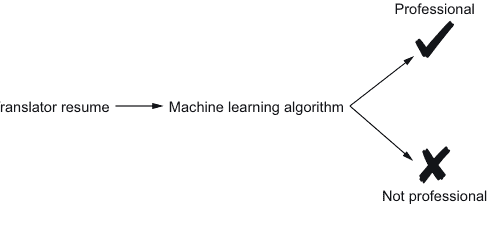

**图 5.13** Translated 的机器学习算法帮助公司自动识别专业和非专业译员。

该算法首次于 2002 年引入，当时公司每天开始收到数百份翻译请求，此后一直不断改进。算法的下一个演进是将它转变为自动译员-文档匹配人工智能，使用 Translated 的项目经理（PMs）多年来进行的匹配进行训练。一旦部署，在任何新的翻译请求时，算法都会查看文档和公司的译员库，并为每位译员计算匹配概率。然后 Translated 的 PMs 会验证匹配并分配任务。这一过程使这家年轻的初创公司能够处理大量客户和译员，而不会损害交付速度（对客户来说通常至关重要的因素），并通过拥有较少数量的 PM 团队来保持其运营成本低廉。

今天，Translated 充当双边平台：一方面，译员申请提供服务；另一方面，客户提交需要翻译的文件。在后端，Translated 为每项工作匹配合适的译员，并将最终结果交付给客户，而他们无需相互互动。他们算法的当前版本被命名为 T-Rank。

该算法考虑了源文档的最多 30 个因素，包括译员的简历（专业领域）和以前的项目（以前工作的质量和及时性）。利用这些数据，T-Rank 可以根据译员与工作的契合度对公司组合中的译员进行排名，并为每项任务提供最佳专业人员，如图 5.14 所示。与算法的早期版本一样，最终建议由专家 PM 审核。如果 PM 拒绝建议，反馈将被记录下来并用于微调算法，以不断提高其性能。

市场上的成功为 Translated 带来了现金和数据。稳定的现金流使 Trombetti 和 Andrieu 能够在不寻求外部投资的情况下运营公司并保持完全所有权。另一方面，Translated 开始通过其计算机辅助翻译系统 Matecat 收集专业人员完成的翻译，改进其匹配算法，并推动公司走向新的使命：成为机器辅助翻译的领导者。

为了评估其机器学习生成的翻译的性能，Translated 一直在跟踪专业译员更改的建议词百分比。在早期，译员必须更改 45% 的建议词。

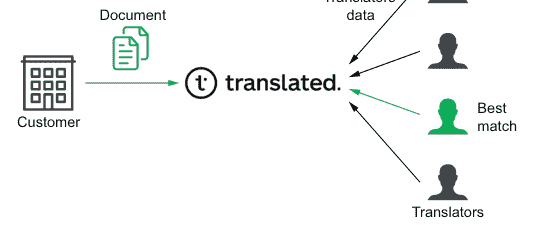

图 5.14 Translated 是一个双边平台：客户发送文档，译员发送他们的数据，公司为每个待翻译文档在其组合中找到最佳译员。

与 AI 辅助的译者匹配相结合，这足以让公司比竞争对手更快地交付翻译。2018 年，该公司可提供超过 120 万次专业翻译，在使用最多的八种语言中，专业译者更改的词占比降至 24%，比其他翻译引擎低 30%。

为了进一步提升译者的体验和生产力，公司投资了一项名为 ModernMT 的技术，这是首个自适应神经机器翻译。传统上，机器学习算法在大量数据上进行训练（训练阶段），在使用时保持静态（推理阶段）。如果译者看到一个糟糕的建议并对其进行修正，这个修正不会在下一次训练使用新数据之前被机器翻译（MT）算法考虑在内。这意味着在译者处理一份文档时，相同的修正可能需要多次应用。结果是译者体验令人沮丧且效率低下。

如图 5.15 所示，ModernMT 在译者进行翻译时实时学习并调整。如果同一文档中出现多次相同短语，且译者只修正一次，ModernMT 将在第一次就学习该修正并避免重复错误。

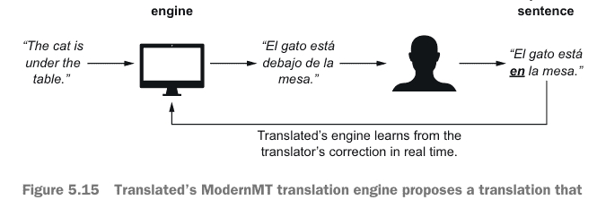

图 5.15 Translated 的 ModernMT 翻译引擎提出一个翻译，最终可由译者进行修正。译者的修正随后会被 ModernMT 学习。

截至 2019 年，Translated 每月收到 2,000 份译者的简历。该公司已为超过 130,000 名客户撮合了 120 万次专业翻译，翻译由超过 180,000 名专业译者在 151 种语言中完成。基于该数据集构建的算法在 27 种最常用语言上实现了最先进的机器翻译性能。Translated 的算法促进了专业人士的工作，但并未取代他们。它们提供句子的首次自动翻译，只需进行完善和微调：如今，译者只需更改公司平台建议的 24% 的词语。这比市场上任何其他解决方案都好 30%。Translated 在 2018 年报告收入为 2,100 万欧元，员工 51 人：12 名开发人员，35 名运营人员，预计 2019 年增长 40%。

Translated 仍在投资改进其翻译引擎。目标并不是让 AI 产生完美的翻译。事实上，如果由专业译者完成的翻译被另一位专业人士审阅，那个人仍会更改约 11% 的词语。这是因为语言的极端表达性：同一个概念可以用不同的词语表达，以表达略有不同的含义和细微差别。据 Trombetti 称，这是一名译者最重要且最有成就感的任务：确保文档的丰富性在翻译中得到表达。因此，他的目标是改进公司的 AI 算法，让译者能够专注于他们需要更改的 11% 的词语，以最具表现力的方式传达文档的原始信息。

Trombetti 和 Andrieu 希望让译者能够从事更有成就感、更高质量的工作，并在过程中实现翻译的民主化。在我们与他们的访谈中，他们是这样说的：

> 我们的技术不仅为我们创造了大量机会，也为译者创造了机会，他们终于不再反复纠正同样的枯燥内容，而是将时间花在更具人性化、传达文本真正含义、更具说服力和创造性上。

### 5.4.1 案例问题

- 1. 如何为 NLP 任务制定 AI 策略？
- 2. AI 是取代人类的工具吗？

### 5.4.2 案例讨论

Translated 是 AI 渐进式成功策略的绝佳范例。在初期，公司使用 AI 技术解决一个简单的用例：将译者简历分类为专业人士或非专业人士。请注意，这个首个用例是公司可以构建的最简单的应用之一，但其技术风险非常低，因为 Trombetti 和 Andrieu 知道同样的方法已在其他领域尝试过（电子邮件垃圾邮件分类）。即使简单，这个用例也有几个使其在当时非常适合 AI 的特征，例如以下几点：

- 它在超越竞争对手方面发挥了高度战略作用。
- 它具有短的投资回报时间（其结果可以立即看到）。
- 它具有低实施风险。

这一首个应用的成功带来了更多客户和更多数据。Translated 丰富的数据资产形成了一个正向循环，随着数据量的增加，译者匹配技术变得更加强大，并允许在早期无法实现的新应用，例如 AI 辅助翻译。

即使 AI 辅助翻译在 20 年前本可以成为杀手级功能，公司也没有立即投资其中。缺乏数据是首个原因，但 Trombetti 等待的最大原因是技术还不够成熟。它是顺应技术浪潮的典型例子，让研究先为技术的成熟迈出艰难的第一步，并利用研究成果与战略数据资产在此基础上构建，达到最先进的性能。对于像 Translated 这样处于技术前沿的公司来说，良好的时机可能是关键成功因素。

还请注意，Translated 知道机器翻译是一项极其复杂的任务，在宽度/深度图上会非常靠上且靠右，但公司以一种使其仍然极其有用的方式框定了该技术。公司的做法是让专业译者拥有最终决定权：技术不产生最终文档，而是产生一个专家人类可以处理的首次近似。

对用户体验的关注是公司战略中的关键要素。Translated 将其机器学习研究工作集中在解决译者最常遇到的问题上，这促成了 ModernMT 的开发：首个适应典型翻译工作流程的神经网络。这一创新使译者能够避免在同一文档中多次修复翻译，从而节省时间和挫败感。使用标准的静态神经网络实现相同性能将需要在研究和数据方面付出巨大努力。

现在让我们谈谈 AI 与取代人类之间的关系。正如你现在所熟知，现代 AI 基于机器学习：一种能够从数据中学习如何执行任务的技术。这意味着今天的 AI 应用可以处理单一明确定义的任务，具有特定的输出和明确定义的评估指标。

大多数人类工作比这更复杂。一份工作可能需要执行一系列任务，单独来看可能适合机器学习算法，但整体上需要额外的技能才能正确执行。所需技能的例子如下：

- 例外处理
- 同理心
- 创造力
- 基于不完整数据做决策

另一方面，AI 算法通常在以下任务上优于人类：

- 基于大量数据做决策
- 速度
- 客观性（前提是它们在无偏数据上训练）

如果我们查看人类为完成工作所做的任务，我们会发现一个子集不需要人类特有的技能，非常适合 AI 代理。对于 Translated 来说，这就是扫描简历。如果公司雇佣人员扫描数千份简历并为翻译找到最佳匹配，它将需要一支庞大的团队来做出直接的决定（例如，丢弃医生简历以翻译飞机手册）。这种高层次的选择主要需要速度

以及处理大量信息的能力，这两点正是 ML 算法擅长的。

在识别高潜力的 ML 项目时，Trombetti 有一个简单的规则：

> 看看一家公司可以用 1,000 名未经训练的实习生完成的任务。
> 这些是可以被 AI 自动化的任务。

该公司知道，为精细的工作挑选译员需要敏感性和经验。因此，最终决定不会交给算法：其输出仍由项目经理使用软技能进行审核，以验证或拒绝算法的选择。

那 Translated 的 AI 辅助翻译服务呢？高质量地翻译一份文档需要同理心和创造力。这两种特质是人类的专长，而 ML 算法对于此类问题 notoriously 并不是可行的解决方案。然而，Translated 也成功地将 AI 用于此应用。

Translated 在提供 AI 辅助翻译方面取得成功的首要原因是，它从未将 AI 营销为人类替代品。这将意味着超出 AI 的能力范围并交付劣质产品。该公司所做的是在使用 AI 的同时明确表示其结果并不完美，但足以让译员的工作更轻松。这样，他们的注意力就可以集中在需要更多同理心和创造力的文档部分，而将翻译最简单的句子这项任务留给 Translated 的 AI。

## Summary

- 自然语言处理模型可以理解和分类文本的含义，甚至可以自行写出内容。
- 当今的 NLP 技术并不总是符合炒作。将复杂性表述为宽度和深度有助于你的团队理解什么可行，什么不可行。
- 通过分解和界定 NLP 项目的范围，你可以绕过最先进算法的局限性。情感分析、文本分类和文档搜索都是这些更成熟的构建模块的例子。
- 分阶段推出 AI 功能是建立对 NLP 模型的信心并打造 AI 驱动的强势企业的绝佳方式，就像你在 Translated 案例研究中所看到的那样。
