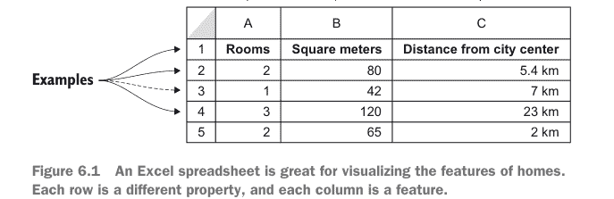
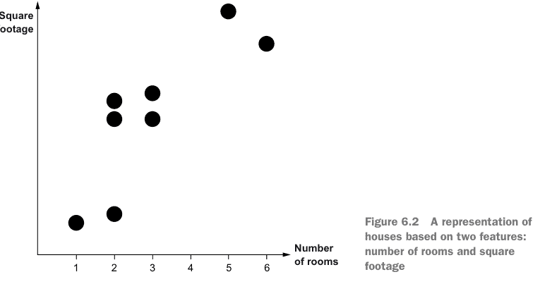
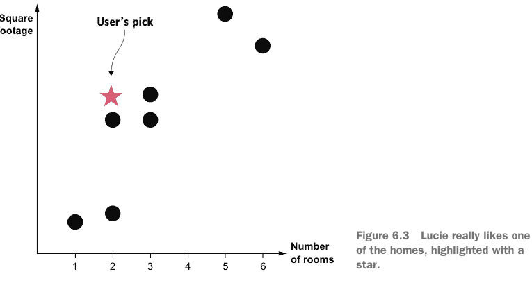
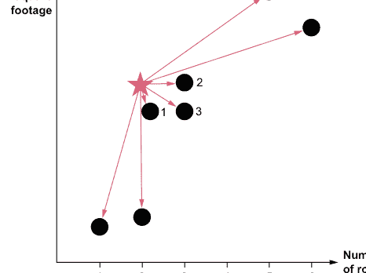
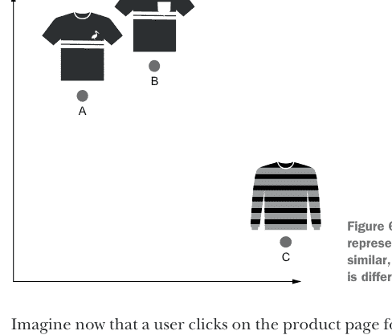
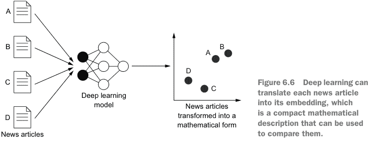
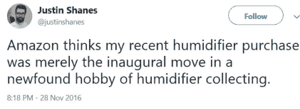

## AI for content curation and community building

**This chapter covers**

- 使用推荐系统来建议引人入胜的内容和产品
- 了解推荐系统的两种方法：基于内容和基于社区
- 了解算法推荐的缺点
- 案例研究：使用推荐系统节省 10 亿美元的流失

推荐系统是当今“个性化”体验的幕后主力，也是帮助消费者浏览庞大媒体、产品和服装目录的基本工具。每当你点击亚马逊的相关优惠或查看 Netflix 推荐的电影时，这些公司都在利用推荐系统来推动用户参与度和顶线增长。没有它们，在互联网上浏览庞大的产品和数字内容将变得几乎不可能。

在本章末尾的案例研究中，你将看到 Netflix 认为其推荐系统自 2015 年以来每年为公司节省了超过 10 亿美元。

### 6.1 The curse of choice

你是否曾经进入一家大型商场购物，却感到迷失方向？当有数百件可供选择、颜色、面料、品牌和价格各不相同的时候，很难找到梦想中的 T 恤。互联网没有房地产限制，因此你可能要从的不是数百件，而是数万件 T 恤中进行选择。或者电影。或者歌曲。或者新闻文章。或者洗碗片。挫败感近在咫尺，而沮丧的客户对业务不利。

互联网充斥着如此多的选择，以至于我们*需要*找到一种方法来帮助做出选择。在第 3 章中，我们尝试通过一组称为无监督学习的技术，根据用户的口味对用户进行分组，并向他们提供匹配口味的优惠。然而，这仍然不足以达到*营销奇点*：一对一沟通的圣杯，即每个客户都能获得完全个性化的优惠和推荐以获得最大满意度。这就是本章的主题。

你如何帮助人们做出选择？如果我们看看优秀的店员，他们会做以下一件事或两件事：

- 他们了解自己的目录。如果你喜欢一条牛仔裤，他们就能推荐相似的牛仔裤并迅速引导你找到完美的选择。
- 他们了解你。如果你是回头客，他们就了解你的口味，可以推荐你可能喜欢的商品：“你一定要试试这些牛仔裤；它们现在很流行，而且真的很符合你的风格。”

在本章中，你将看到如何构建算法，即使比人类更好，也能做到这两件事。这些算法称为*推荐系统*，它们可以大规模地为客户提供量身定制的推荐。

### 6.2 Driving engagement with recommender systems

得益于我们在前几章中构建的基于 AI 的功能，FutureHouse 吸引了越来越多的用户。免费估算售价和自动化的房源列表也吸引了许多新卖家。所有这些成功带来了新的挑战：现在挂牌出售的房产太多了，买家很难找到完美的家。我们需要找到一种方法来突出与他们口味相符的房产，让他们更容易找到梦想中的家。解决方案很明确：我们需要构建一个“为你推荐的房屋”功能，让它学习每个用户的口味并为他们预先挑选房屋。

让我们试着思考 FutureHouse 如何决定向每个用户展示哪些房屋。经验丰富的人类会如何处理这个问题？房地产经纪人可能会查看客户喜欢的一处或多处房屋，然后推荐其他相似的房屋（例如，位于同一社区或房间数量相同）。

我们如何将这种方法转化为互联网世界？一个显而易见的想法是跟踪每个客户在网站上访问的房屋，并建议他们查看与已找到的房屋相似的房产。例如，如果一位潜在买家已经查看了几处靠近火车站的三居室房屋，那么他们很可能会对具有相同属性的其他房屋感兴趣。

我们如何定义相似的含义呢？如果我们对如何衡量相似性有明确的想法，我们就可以直接向计算机解释。然而，我们对相似的想法是直观和自然的，因此我们很难做到这一点。到目前为止，你已经熟悉了，这正是机器学习的完美起点。

在第 2 章中，我们介绍了特征的概念，即每个单独房屋的可衡量方面，可用作 ML 算法的输入。更具体地说，我们为构建价格预测模型所做的准备工作表明，房间数量、平方英尺以及与公共交通的距离是需要考虑的最重要因素之一。与我们为价格预测所做的工作类似，我们可以将每处房屋的特征值列在 Excel 电子表格中，如图 6.1 所示。

图 6.1 Excel 电子表格非常适合可视化房屋的特征。每行是一个不同的房产，每列是一个特征。

让我们从简单开始，只考虑房屋的一个特征：平方英尺。很明显，1,000 平方英尺的房屋和 1,100 平方英尺的房屋比 12,000 平方英尺的房屋更相似。因此，我们的算法应该向访问过 1,100 平方英尺房屋的用户推荐 1,000 平方英尺的房屋，并避免展示 12,000 平方英尺的别墅。在 ML 术语中，这通过特征值之间的距离概念来形式化：1,100–1,000 远小于 12,000–1,000，因此算法可以判断它们彼此更相似。

正如你在第 2 章中所见，大多数现实世界的 ML 应用不使用单一特征，而是使用数十甚至数百个特征。让我们再提升一个档次，考虑第二个特征：房间数量。如果我们为每处房屋在（非常小）房屋数据集中画一个圆圈，图表将如下图 6.2 所示。

让我们想象一个新用户的体验，我们称她为露西。露西在 FutureHouse 注册并开始浏览。她立刻点击了其中一套房子，并在其页面上花费了大量时间，查看图片、阅读描述、考虑评论等等。我们可以认为这是一个明确的迹象，表明露西喜欢那套房子。如果我们取图 6.2 中的图表并将对应于露西最喜欢房子的点变成星号，我们就得到图 6.3。

我们的任务是帮助她找到其他符合她口味的房子：与她刚刚花费大量时间查看的那套房子相似的房子。即使只是盯着图 6.4 看，也很直观地感觉到另外三套房子与露西最喜欢的房子非常相似。其他四套房子似乎差异很大：左下角的两套太小了，而右上角的两套可能太大了。

图 6.4 计算机将每对房屋进行配对并测量它们之间的直线距离。

现在我们需要将这种推理转化为计算术语，以便我们可以将其自动化并同时帮助成千上万像露西这样的人。我们将再次使用前面介绍过的距离概念。想象用尺子测量图 6.3 中打印的点（即房屋）之间的距离：这正是计算机所做的，如图 6.4 所示。

在我们测量了星号房屋与数据集中所有其他房屋的距离之后，我们可以要求计算机按从短到长的顺序对它们进行排序，并挑选出前两到三套展示给露西。

当然，我们仍然只考虑房屋面积和房间数量，因此我们的相似性概念是粗略且不完整的：我们忽略了许多其他重要的房屋特征，包括位置、建造年份等。幸运的是，当我们把所有其他特征加回来时，算法实际上并没有改变；只是对我们这些贫穷、有限的人类来说，更难在纸上绘制和概念化。工程师可以轻松构建能够处理我们在第 2 章用于价格预测的所有特征的距离算法，而计算机可以毫不费力地计算它们。

我们刚刚描述的是有史以来最简单的推荐系统，但它仍然有效，而且这个基本概念很容易部署在各种业务场景中。考虑显示每套房屋详细信息和图片的页面。工程师很容易在侧边栏添加指向与用户正在浏览的房屋最相似的三到四套房屋的链接，从而获得额外的流量。

更复杂的模型还会跟踪用户口味随时间的演变，考虑他们曾经交互过的所有房屋。甚至更好的是，我们可以根据物品类别和一年中的时间对选择进行分组，而不是将所有偏好同等对待。例如，电子商务网站会在开学季选择推荐你孩子最喜欢的铅笔品牌，但会认识到同样的推荐在夏季并不有用。

请注意，露西的推荐系统只查看了露西最喜欢的房屋的特征，完全忽略了她是谁以及社区中其他用户做了什么。对于我们制作的更复杂的例子也是如此：我们现在仍然只关注内容。这就是为什么这一类推荐系统被称为基于内容的推荐系统。

#### 6.2.1 基于内容的系统超越简单特征

虽然我们虚构的 FutureHouse 示例到目前为止对我们很有帮助，但你可能会想知道推荐系统如何适应其他类型的物品，例如你在最喜欢的电商网站上的衣服。谈论房屋时，我们很幸运地拥有一个描述性特征集，而且收集起来也相对容易。同样，这些特征也是我们在第 2 章用来预测房屋售价的特征。

然而，许多组织在推荐系统部署在特征选择非常困难的商品目录上时。想象一下本章开始时的例子：为你找到最好的 T 恤。我们可以用什么特征呢？

- 主导颜色（黑色、白色等）
- 面料（棉、合成）
- V 形或 c 形领口
- 版型（修身、常规）
- 袖子（长袖、短袖、七分袖）

如果买 T 恤这么容易，很多时装设计师就会失业。现实是，很难想出能够捕捉 T 恤风格的标准，就像任何服装一样，或者一般来说，任何视觉媒体一样。

幸运的是，我们在第 4 章已经解决了同样的挑战，当时我们意识到传统机器学习的不足，并引入了基于深度学习的先进模型，这是一类能够自动从复杂数据源中提取特征的算法。这些模型能够将图像转换为称为嵌入的小数字集，它们以紧凑的形式表示图像的高级特征。

让我们回顾一下当深度神经网络被训练来识别人脸时我们所说的内容。当你训练人脸识别算法时，它学会识别人脸的高级特征并将每个输入图像转换为称为嵌入的数字序列。这些嵌入表示图像中某些重要面部特征的存在（或缺失）；例如，图像中的人是否有尖鼻子、大耳朵等等。

如果用 T 恤做同样的事情会怎样呢？好吧，你会神奇地拥有一种方法，将那件 T 恤的图片从数百万像素转换为几百个数字，表达其一些高级风格特征。这些可能是垂直条纹、水平条纹、不同物体的图案、句子、标志等。虽然我们直觉上知道所有这些特征都与表征 T 恤相关，但我们无法手工做到这一点。深度学习算法可以自动完成，拯救了我们所有人。

一旦我们使用深度神经网络将图像转换为其嵌入，我们突然发现自己处于上一节描述的相同情况：我们可以将所有图像转换为空间中的一组点，并使用相似性标准来发现与用户最喜欢的 T 恤相似的 T 恤。显然，嵌入将由数百或数千个维度组成，以便捕捉 T 恤风格的细微差别。为了可视化这个概念，我们绘制了三个 T 恤嵌入的 2D 表示，如图 6.5 所示。

图 6.5 三件 T 恤的嵌入在二维平面上的表示。T 恤 A 和 B 相似，因此它们的嵌入很接近。T 恤 C 与 A 和 B 不同，因此远离两者。

现在想象一个用户点击 T 恤 A 的产品页面并花费时间查看它，检查可用的尺码、颜色和材质。我们可以将此解释为对该 T 恤风格的兴趣表现，并推荐另一个嵌入接近它的 T 恤；例如，T 恤 B。我们将避免建议 T 恤 C，因为我们知道它的嵌入远离用户喜欢的 T 恤的嵌入，因此可能不符合他们的口味。

这再次是深度学习和嵌入的魔力：神经网络找到了一种“理解”图像并将其转换为实际上有意义的小数字集的方法（至少对计算机而言）。如果你想想，图像并不是你见过嵌入强大应用的唯一地方。在第 5 章中，你看到了嵌入在处理另一种复杂数据类型——文本时是多么强大。

我们描述的同样方法也适用于文本。假设我们正在尝试向网站上的用户推荐新闻文章，并希望找到一篇与用户花费最多时间阅读的新闻相似的文章。我们可以将每篇文章中的词语转换为其嵌入并将我们新的向量化文章放置在空间中，如图 6.6 所示。

一旦我们获得了新闻文章的空间表示，就可以让“相似性”的概念引导我们为推荐用户新闻。如果用户阅读了文章 A，我们就知道他们很可能对文章 B 也感兴趣，因为它们的嵌入向量彼此接近，因此内容上也相似。这正是深度学习和嵌入的魔力所在：它们允许我们将即使是像文章和图像这样复杂的数据源转化为携带语义信息的数值表示，就像本章开头我们用于房屋描述时采用的技术一样。

#### 6.2.2 特征与相似性的局限性

根据前文的介绍，你可能会认为*相似性*的概念（配合一些深度学习的“魔法”）能够解决所有推荐问题，从新闻文章到家用产品。本节将帮助你建立直觉，了解为什么在某些情况下，相似性并不是最佳策略。让我们从另一个我们都非常熟悉的经典例子开始：推荐观看的电影。

让我们通过遵循之前用于向潜在买家推荐房屋的相同方法，来处理这个新问题。第一步是找到算法可以用来描述电影的*特征*。大多数人会列出这样一份清单：

- 导演
- 发行年份
- 类型（喜剧、剧情、动画、爱情）
- 前三名主演

如果我们使用这份特征清单，很快就会发现，算法生成的推荐结果充其量是乏味的，最糟糕时则完全是荒谬的。在演员和导演的整个职业生涯中，他们参与过各种各样的电影：即使你喜欢*《泰坦尼克号》*，这也并不意味着你会仅仅因为*《华尔街之狼》*的主演是莱昂纳多·迪卡普里奥，就同样喜欢这部电影。

我们可以尝试借助深度学习的力量来改进模型。我们可以将所有电影对话输入到自然语言模型中，以生成能够捕捉电影主题和情绪的额外特征。这很可能效果不错：关于爱情的对话和船长的担忧讨论将为推荐增加更多的细微差别，潜在地产生其他禁恋故事和灾难片。然而，你未来的推荐很可能在一段时间内仍会停留在“爱情与灾难”类别中，你可能会觉得这不够诱人。

遗憾的是，无论我们在特征构建上变得多么复杂，我们仍面临一个根本局限：我们的推荐引擎仍然基于相似性。这意味着模型只能推荐与用户过往选择相符的项目。这肯定会让他们感到无聊透顶：在取消 Netflix 订阅之前，你能忍受多少部安吉丽娜·朱莉的奇幻电影或蹩脚对话？因此，基于内容的推荐体系的阿喀琉斯之踵在于，其输出可能变得平淡且可预测。虽然这对娱乐或时尚购物来说并不理想，但它非常适合其他一些行业；例如，向医生推荐药物。

毫不意外，为推荐增添人情味的最佳方法是将人类纳入其中。通过利用一个消费并评分目录中产品的用户社区，我们可以构建更具细微差别的推荐系统。这就是我们将在下一节中探索的内容。

### 6.3 群体智慧：协同过滤

简单回顾一下，到目前为止我们探索的推荐系统类型通常被称为基于内容的推荐系统，因为它们使用用户过去喜欢的项目的描述属性，在目录中查找并推荐相似的项目。然而，这种方法在两个方面存在缺陷：可能难以表达有意义的特征，且生成的推荐可能可预测且枯燥。

让我们暂停一秒，思考一下我们在现实生活中如何应对这个问题。人们总是向朋友索要推荐：书籍、餐厅、电影等等。随着时间的推移，我们大多数人已经发现，有些朋友在音乐或食物品味上与我们相似，因此我们热切地听取他们的推荐，因为我们预期过去相似的偏好也会延伸到未来。

人工智能可以利用一个在共享目录中表达对项目偏好的用户社区，将这一人类传统扩展到更大的群体。基于此概念构建的人工智能算法被称为协同过滤算法：这是一种推荐系统的社会方法，基本上做了我们在现实生活中与朋友一起做的事情。

如果我们仅仅依靠相似用户的品味和偏好历史，那么协同模型的作用就是匹配拥有相同品味的用户，使他们可以相互获得推荐。在现实生活中，我们会开始相互分享偏好历史，并发现它们匹配得很好：“哦，你也喜欢《玩具总动员》和《泰坦尼克号》！你看过……吗？”协同模型可以做同样的事情，匹配品味相似的用户，尽管是在大得多的规模上。

与基于内容的模型一样，你必须收集用户的偏好。让我们回到房地产平台的示例，查看示例数据以理解协同模型背后的直觉。表 6.1 展示了平台三位虚构用户：Alice、Bob 和 Jane 的偏好。

#### 表 6.1 Alice、Bob 和 Jane 的房屋偏好

| 房屋 | Alice | Bob | Jane |
|---|---|---|---|
| 房屋 A：Dogpatch 社区的一居室 | ? | 喜欢 | 不喜欢 |
| 房屋 B：金融区的三居室 | 喜欢 | 不喜欢 | 喜欢 |
| 房屋 C：Mission 区的公寓 | 不喜欢 | ? | 不喜欢 |
| 房屋 D：Mission 区的一居室 | 不喜欢 | 喜欢 | 不喜欢 |
| 房屋 E：Marina 社区的三居室 | 喜欢 | ? | 喜欢 |

表格的每一行显示了 Alice、Bob 和 Jane 对我们（ admittedly 较小的）目录中每五套房屋的看法。与基于内容的模型一样，收集这些偏好数据有很多种方法。最明显的方法就是直接询问他们；例如，在房屋描述页面上使用五星评分小部件。许多精明的组织会走得更远，追踪更详细的信息，例如用户阅读描述或滚动浏览图片所花费的时间。如果 Bob 在过去两天内查看了某套房房源列表 10 次，并且每次会话都花费了五分钟，这是一个非常好的指标，表明他真的很感兴趣。

示例数据集包括 Alice 和 Bob 未能查看的房屋（在表 6.1 中用问号表示）。Alice 从未找到房屋 A，而 Bob 没有看到房屋 C 和 E。正如你所了解的，推荐系统的目标是从这些“缺失”的房屋中选出他们更可能感兴趣的房屋，以便我们可以将其置于搜索结果顶部，帮助他们找到可能会购买的新房子。

通过观察表格，我们已经可以看出 Alice 和 Jane 有相似的兴趣：两人都喜欢房屋 E，都不喜欢房屋 C 和 D。另一方面，与 Jane 和 Alice 相比，Bob 似乎品味完全不同，因为他与他们评价的任何房屋都不一致。

在生成推荐时，协同过滤系统会将 Alice 和 Jane 配对为品味相似的两个人，并且不会向 Alice 展示房屋 A，因为它不符合 Jane 的偏好。至于 Bob，我们知道他在寻找与 Alice 和 Jane 完全不同的东西，因此我们将建议他查看房屋 C（Alice 和 Jane 都不喜欢），而不会推荐房屋 E（两人都喜欢）。

换句话说，协同过滤背后的想法是忽略项目之间的相似性，而是基于项目交互和偏好，关注用户之间的相似性。注意这些模型忽略了用户的特征，仅依赖于对浏览房屋给出的评分。这意味着在我们的示例中，Alice 和 Jane 的配对不是基于性别或年龄等共同社会特征，而是基于他们对房屋品味的匹配。

协同系统的真正魔力在于，它们完全不需要知道目录中的项目或用户的情况：只要有用户进行评分

things, we can figure out which users have similar tastes and recommend things to each other. The same model works with homes just as well as with movies, as long as the community casts enough ratings. This also makes collaborative filtering systems easier to integrate into existing platforms, because you don’t have to fish around for additional data about each item (say, the movie’s director), and can instead relax while users are busy letting you know what they think. Even better, since these recommendations are based on the real-world preferences of other humans, they can be novel and surprising, just like those you would get from a friend.

Collaborative filtering systems work well only when there are many more users than items in the catalog. Otherwise, it’s hard to select groups of users with common tastes: large catalogs with many items that have never been rated (or just once) don’t play well. For instance, let’s assume the hyperbolic case in which your real estate website has just Bob, Jane, and Alice as users, but 500 houses are listed for sale. It’s going to be highly unlikely that our lonely three users have seen the same houses, which means that we can’t use the clever trick of taste-matching that we’ve described.

An example of a company that is perfectly poised to exploit collaborative filtering is Netflix, which has tens of millions of users interacting with just hundreds of movies. At the other end of the spectrum, put yourself in Pinterest’s shoes: while it also has hundreds of millions of users, the content available for those users to interact with is basically the whole web: hundreds of billions of images. In Pinterest’s case, the best approach is using content-based recommendations. This is indeed what the company has done: in January 2017, the company announced that its new deep learning system providing content-based recommendations of pins increased users’ engagement by 30% overnight.

Another important point is that collaborative filtering works when you have enough user-item interactions to build your model. If you have a young company with a small history of interactions, you may have to ditch this approach altogether. In this case, all you can do is start off with a content-based system so you can start providing recommendations without a large database of existing ratings. As the user base grows, and the ratings start coming in, you can introduce a collaborative component to provide more unique recommendations. As you’ll see in the examples, best-in-class organizations actually mix the two approaches, providing a broad range of recommendations that can appeal to most of their user base.

### 6.4 Recommendations gone wrong

Many of the AI-based tasks that we have discussed so far have straightforward definitions of performance that we usually translate in terms of *accuracy* to compare models in different situations. For example, we have talked about the accuracy in predicting the sale price of a home, or in classifying dogs and cats in pictures. One could easily adopt the same approach for recommender systems—for example, by setting aside a test set of ratings and measuring the accuracy in predicting them. However, this simplistic approach ignores the complex reality of human tastes and preferences, and the effect they have on business performance.

The first problem involves user experience. Automated recommendations work well most of the time, but sometimes we’re left wondering how a ridiculous suggestion came about. Screen real estate is limited, and so is the attention of your users; you don’t want to waste it by showing useless products.

As you’ve seen, most state-of-the-art recommender systems operate on a variety of signals, based both on item features and community ratings. Because human tastes are fairly unpredictable, just one off-base suggestion might have a strong effect on customer trust, making it drastically less effective at driving business value. Depending on the specifics of the community, recommender systems might mistake a trivial feature (like the release year of a movie) for an important one, leading to surprising (and disappointing) recommendations. Also, a strategy can work well for a product category but be completely useless for others: it may be nice to see T-shirts similar to ones I bought, but don’t fill my screen with air conditioners similar to my recent purchase (figure 6.7 shows a report from the trenches).

Figure 6.7 An Amazon user isn’t particularly impressed with the recommendations he received.

While user experience is an important consideration, it would be foolish to ignore the enormous impact that recommender systems have in shaping public opinion and discourse. Much, if not all, of the media that we consume (whether news, videos, or social media posts) has at some point been filtered by a recommender system. This means that this technology is uniquely positioned to influence our collective world view. We’ll keep the conversation strictly about the business implications of this technology for now, and explore the broader impacts on society in chapter 10.

#### 6.4.1 The recommender system dream

Let’s end this section with some food for thought. Let’s assume that as of now, 20% of Amazon recommendations convert to a purchase. Suppose that one of Amazon’s data scientists finds a clever way to improve its recommender algorithm so much that now 100% of the recommendations turn into purchases. Why should Amazon wait for you to go online and shop when it already knows exactly what you want to buy? The easiest solution would be to directly ship stuff to your home, with a nice postcard saying “You’re welcome.”

Of course, a 100% conversion rate seems a bit too much. Yet, the concept is still valid: theoretically, a threshold exists at which product recommendations become so effective that it will take less effort for users to return what they don’t like or don’t need rather than proactively shop. In such a scenario, Amazon could simply ship us 10 products, and we would ship back what the model got wrong.

This may sound futuristic, but fashion companies are already experimenting with this model. Think about it: improving a single piece of technology can lead to total disruption of business models and customer purchase habits. This is the power of recommender systems and many other AI technologies.

### 6.5 Case study: Netflix saves $1 billion a year

When Netflix was founded in 1997, it started operating a subscription model for shipping physical DVDs to households, who then returned the media through the mail after watching the movie. Over the following decade, large-scale availability of fast internet access and personal devices allowed the company to transition to digital distribution of content. With a single monthly subscription fee, customers can watch as many movies and TV series as they like, using smartphones, tablets, laptops, or smart TVs.

Convenience and lower prices compared to physical media or cable TV made Netflix one of the fastest-growing companies in recent years. From 2005 to 2018, revenues grew from $682 million to almost $16 billion, and the share price climbed by almost 150 times, going from $2 per share at the beginning of 2005 to almost $300 at the end of 2018. In 2018, the company had 150 million subscribers from more than 190 countries.

The main driver of such explosive growth has certainly been its novel concept of internet-based TV with seemingly unlimited choices. However, new opportunities brought with them new, unprecedented problems. Humans are generally bad at making decisions when confronted with too many choices, and picking a TV show to watch is no exception. Consumer research reports that the typical Netflix user will tune out after only 60 seconds spent choosing a new title to watch.

To face this new challenge, the company heavily invested in recommender systems to help users find compelling content within the extensive Netflix catalog.

#### 6.5.1 Netflix’s recommender system

While the concept of internet TV popularized by Netflix brought along new challenges, it also brought new opportunities to collect data. Thanks to the on-demand infrastructure, Netflix has access to vast amounts of data about what each user does: what they watch, where and when they log in, and so on.

The most important way in which Netflix’s recommendation system interacts with customers is the home page they visit right after logging in (see figure 6.8). While the interface changes depending on the type of device, the starting point is a collection of about 40 rows representing different movie categories, and up to 75 items per row. To decide how to populate this screen real estate, Netflix feeds all the data it collects into a group of algorithms, each specialized in a different recommendation task. Together, these algorithms make up the Netflix recommender system.

At the core of the system is an algorithm called the Personalized Video Ranker (PVR). The PVR, based on the large amount of data that Netflix collects on users’ viewing habits, is used to estimate the likelihood that a user will watch movies in all the different movie categories (for example, Thriller or Drama). The Netflix home page also

# 各分类下的电影排名

# 电影分类

# 电影分类 A

# 电影分类 B

# 电影分类 C

# 图 6.8 Netflix 首页的构成

它还有其他特殊的行，这些行拥有各自特定的推荐算法。例如“Top Picks”行，它推荐从所有分类中挑选出的最佳内容。该算法称为“Top N 视频排名器”。PVR 用于在目录的特定子集中寻找最佳电影，而 Top N 排名器则遍历整个目录。

另一个特殊的行是“Trending Now”内容。Netflix 将个性化推荐与来自时间趋势的信号相结合。具体来说，公司发现了影响用户行为的两类因素。第一类与周期性趋势有关，例如圣诞节或情人节。另一类趋势与短期事件有关，例如选举或自然灾害引发的关注。即使在这种情况下，Netflix 也不会向每位用户展示相同的行，而是将整体趋势的信号与个性化条目混合在一起。

另一个独特的行是“Continue Watching”。虽然所有其他行都专注于用户从未看过的内容，但这一行专注于用户已经开始观看但尚未看完的内容。“继续观看排名器”使用以下应用特定特征来选择最有可能被看完的标题：

- 自上次观看以来经过的时间
- 设备
- 放弃点（节目中途与开头或结尾相比）
- 自上次观看以来观看的其他标题

到目前为止我们看到的所有算法都依赖协同过滤技术来挑选推荐——通过查看具有相似观看模式（因此具有相似品味）的其他用户的选择来推断用户的品味。“因为您看过”行则是个例外，因为它提供与用户之前喜欢的内容相似的内容。该任务由“视频-视频相似度”算法执行，这是一种基于内容的推荐系统。该算法不考虑用户的品味：其输出是用户所选电影与 Netflix 目录其余部分之间的相似度排名。然而，选择使用“视频-视频相似度”算法来处理哪部电影，则是根据用户的品味进行个性化的。

在这些算法的基础上，Netflix 于 2015 年引入了一种页面生成算法，以决定在不同情况下向特定用户展示哪一行。表 6.2 总结了构成其推荐系统的 Netflix 算法。

# 表 6.2 组成 Netflix 推荐系统的算法

| 算法 | 用途 | 标准 |
|---|---|---|
| 个性化视频排名器 | 给定一个电影分类，从该分类中选择用户最可能观看的电影。 | 协同过滤 |
| Top N 视频排名器 | 在目录中的所有电影中，为特定用户选择最佳电影。 | 协同过滤 |
| 流行趋势 | 基于各种时间趋势，选择符合趋势且用户最可能观看的电影。 | 协同过滤 |
| 继续观看 | 给定用户已开始但未完成的电影集合，选择他们最可能继续观看的电影。 | 协同过滤 |
| 视频-视频相似度 | 给定一部电影，查找最相似的电影。 | 基于内容（视频相似度） |
| 页面生成 | 选择向特定用户展示哪些行以及以何种顺序展示。 | 协同过滤 |

#### 6.5.2 推荐与用户体验

Netflix 推荐系统是客户与该服务互动的主要方式，因此它也在不断演变，以适应平台本身的发展。在 Netflix 通过邮寄物理 DVD 给客户的那些年里，驱动客户参与的“观看/评分/再观看”反馈循环比今天要慢得多。客户每周只能收到一次新内容，而每周的寄送中最好有一些能让他们在周五晚上消遣的东西。

随着在线流媒体的出现，游戏规则发生了变化：因为用户可以随时开始和停止观看任何内容，推荐可以更加灵活。与此同时，广泛的用户研究发现，在流媒体时代，留存率最重要的驱动力是客户花在观看内容上的时间。Netflix 推荐系统的目标也随之演变。对这种（渐进）变化的批评者认为，它过于偏向“足够好”的内容，唯一目的是让订阅用户每天上瘾数小时。而更有风险的建议，相应地拥有更高的失望风险，则被低估了。

任何被全球数亿人使用的算法都难免受到批评，Netflix 推荐系统也不例外。虽然明显错误的推荐经常在社交媒体上流传，但更微妙的误判也揭示了该领域尚未解决的问题。用户经常抱怨模型无法追踪多个独立的“心情”和媒体消费倾向。典型的例子是周五晚上的烂片狂欢影响了接下来两个月的推荐。

#### 6.5.3 推荐的商业价值

2015 年，Netflix 首席产品官 Neil Hunt 和产品创新副总裁 Carlos Gomez-Uribe 撰写了《Netflix 推荐系统：算法、商业价值和创新》(https://dl.acm.org/citation.cfm?id=2843948)。他们报告称，Netflix 推荐系统负责了平台上 80% 的流媒体播放时长，其余 20% 来自搜索功能。然而，由于用户经常搜索目录中不存在的标题，这 20% 中的一部分就变成了推荐问题。

在评估算法有效性时，Netflix 依赖于特定指标。其中最重要的两个是有效目录规模（ECS）和采纳率。

ECS 是一种描述观看行为在目录条目中分布程度的指标。该指标有数学公式，但其背后的主要思想相当简单：如果大部分观看来自单个视频，那么 ECS 接近 1。如果所有视频产生的观看量相同，则 ECS 接近目录中的视频数量。如果目录中有些电影很少被看到，有些更受欢迎，那么 ECS 介于两者之间。该值越高，说明越多的人在观看目录中的所有电影，这会导致更高的客户满意度，并提高 Netflix 为获得媒体发行权或制作媒体所花费资金的回报。因此，Netflix 的目标是最大化这一价值。为了测试推荐系统的有效性，Netflix 尝试通过以下两种方法向用户提供内容：

- 使用流行度指标——从目录中最受欢迎的电影开始，逐渐添加其他流行电影（黑线）
- 使用个性化系统——从 PVR 评分排名第一的电影开始，按照 PVR 算法规定的顺序添加其他电影

使用个性化系统使 ECS 增加了 400%。

Netflix 使用的另一个关键参与指标是采纳率，定义为所提供的推荐中导致播放的比例。接近 1 的值意味着推荐在 100% 的情况下会被选择，而接近 0 的值意味着推荐不会被选择。Netflix 尝试通过两种方法向用户提供一系列推荐：

- 展示 *N* 部最受欢迎的电影
- 展示推荐系统认定为对用户最佳选择的 *N* 部电影

比较这两种方法，Netflix 注意到个性化系统相比“最受欢迎”方法带来了显著的改进，“最佳匹配”电影与“最受欢迎”电影相比，采纳率提升了近四倍，而且随着电影排名越来越不匹配，性能逐步下降。

推荐的改进以及这些指标的改善与业务绩效的提升密切相关。对于像 Netflix 这样的纯订阅制服务，需要关注的三个关键指标是：新成员的获取率、成员取消率（流失率）以及前客户回归率。Hunt 和 Uribe 报告称，Netflix 在个性化和推荐方面的努力使流失率降低了几个百分点。总体而言，他们估计，在其总营收低于 70 亿美元时，所有推荐算法的综合努力每年为 Netflix 节省了超过 10 亿美元。

#### 6.5.4 案例问题

- 更大的产品目录是否绝对对消费者更好？对企业呢？
- 推荐系统是如何随着从物理媒体，到在线流媒体，再到原创制作的转变而演变的？
- 除了推荐，Netflix 在与现有分发平台（例如电视、影院、物理媒体）竞争时，还有哪些重要的方式可以利用其数据优势？

#### 6.5.5 案例讨论

Netflix 可能是对娱乐行业冲击最大的公司之一。它的成功是 DVD 租赁巨头 Blockbuster 倒闭的主要原因之一，而其进军原创内容的行为也对电视网络和电影制片厂等内容生产商构成了威胁。

这家公司最初是一项基于互联网的 DVD 租赁服务，真正开始腾飞是在它开创了互联网电视概念的时候。当时互联网电视的主要替代品是线性广播和有线电视系统。虽然这两种系统都有预定的时间表，但互联网电视让用户坐上驾驶座，允许他们随时选择自己想要的任何内容。

选择的力量似乎是任何业务都必然的卖点。然而，正如 Hunt 和 Gomez-Uribe 所指出的，事实证明人们并不特别擅长选择，尤其是在海量的选项中。如果用户找不到自己喜欢的电影，那么拥有庞大的电影库又有什么意义呢？这不仅适用于娱乐行业。想想任何电子商务：如果用户不购买任何东西，那么一个大品牌的目录又有什么价值？

这里的主要问题在于，虽然一家公司提供的产品和服务数量可能是无限的，但人们浏览它们的时间却是有限的。以 Netflix 为例，该公司报告称，大多数用户如果在 60 到 90 秒内找不到任何想看的内容，就会放弃搜索。这意味着，如果不以任何方式帮助用户，向目录中添加更多内容可能会让用户更难找到自己喜欢的东西，从而在用户体验和商业角度上适得其反。这正是推荐系统的价值所在：通过数据驱动的推荐方式，确保用户能够在你的产品和服务中找到有价值的内容。

Netflix 利用的互联网关键资产之一，就是收集数据并监测用户偏好的机会。请想一想 Netflix 的 DVD 租赁服务和互联网电视服务之间的区别。在第一种情况下，DVD 寄出后，公司只有一种方式知道用户是否喜欢它：用户给出的评分（如果他们愿意留下评分的话）。而通过流媒体服务，Netflix 可以记录更丰富的信息，例如：

- 用户观看电影的时间（时刻、日期）
- 在什么设备上观看
- 用户是一次性看完，还是多次暂停？

此外，Netflix 还可以测试不同版本的推荐算法，并根据具体指标衡量其表现。丰富的数据是一项关键资产，它不仅让 Netflix 能够提升用户参与度，还能衡量自身表现并相应调整产品。

### 小结

- 推荐系统为客户提供个性化推荐，使他们能够浏览更大规模的产品或服务目录，并提高参与度。
- 基于内容的推荐系统利用用户的历史记录（访问过的页面、购买过的商品等）来推荐目录中的相似项目。
- 协同过滤是另一种方法，它会在社区中寻找品味相似的用户，并在他们之间分享推荐。
- 正如你在 Netflix 案例研究中看到的那样，推荐系统是现代电子商务和媒体分发平台的基石。
