### 第二部分：构建 AI

恭喜你完成了本书的第一部分。到目前为止，你已经相当熟悉 AI 工具箱中的各种技术。你了解了可以使用的数据类型，以及哪些算法家族最适合每种类型。第二部分将建立在你新获得的知识之上，并引导你迈出将 AI 引入组织的第一步。

第 7 章教你如何挑选组织内最适合应用 AI 的机会。第 7 章的一大成果是定义你的第一个 AI 项目，并将其格式化为易于技术团队理解的机器学习友好语言。第 8 章继续这份实施指南，介绍构建任何 AI 项目所需的主要要素：模型、数据和人才。第 9 章通过介绍可用于制定成功 AI 战略的流程，完成这份指南。第 10 章是最后一章，你将把视野拓宽到组织之外，探索 AI 对社会的一些短期和长期影响。

#### 准备——发现 AI 机会

#### 本章涵盖

- 理解 AI 愿景与 AI 项目之间的区别
- 在组织中寻找 AI 机会
- 对 AI 项目想法进行优先级排序和测试
- 将现实世界中复杂的 AI 产品拆解为独立的、由机器学习驱动的组件
- 使用框架画布（Framing Canvas）将业务需求转化为机器学习任务

在本章中，你将迈出步入 AI 创新这个混乱世界的第一步。可以把机器学习想象成一个装满了锤子、螺丝刀和锯子等各种工具的工具箱。读完本书第一部分后，你已经知道如何使用这些工具来构建产品。下一步是弄清楚该用这些工具构建什么，以及如何构建。

本章首先介绍我们开发的框架，用于识别、筛选和验证组织内最有前景的 AI 机会。我们还将向你展示如何将复杂产品拆解为更易于机器学习处理、可以独立构建的组件。最后，我们的框架画布将教你如何将所有这些前期工作的成果，转化为技术团队可以理解的项目描述。

#### 7.1 不要被炒作迷惑：以业务驱动的 AI 创新

本书第一部分讲述了 FutureHouse 的故事，这是一个虚构的房地产平台，允许用户在线买卖房屋。我们发明了一些花哨的 AI 功能，并想象它们能如何帮助 FutureHouse 吸引更多用户。在整个过程中，我们都在尝试解释其背后的技术概念。

我们没有关注幕后的故事：FutureHouse 是如何想出这些主意的？它又是如何选择最值得做的项目？除非你在科技巨头工作，否则你的组织很可能正在 AI 之旅中迈出第一步，而你可能也正面临着这些问题。

这就是为什么我们决定回到 FutureHouse 的 AI 之旅的起点，想象它在会议室里发生的对话。这些对话将为你提供一个场景，帮助我们揭示在组织中引入 AI 的最佳实践。让我们从一次虚构的启动会议开始：

> CEO：这些天新闻里到处都是 AI，它似乎将在任何业务中发挥重要作用。我们绝对需要开始关注它，免得被我们的竞争对手或某家科技初创公司抢先。

> CTO：你说得对；它发展得太快了，我们需要做好准备。我建议我们开始投资基础设施，以便处理我们所有的数据。然后我们可以培训工程师或雇佣新的数据科学家，并开始构建 AI 算法。

> 市场经理：说实话，各位，我觉得这就是一阵风潮。现在说“我们用 AI”听起来很酷，但最终它会消退的。

> AI 负责人：我同意有些人在盲目跟风，但我认为完全忽视 AI 是短视的。当然，它不是银弹；我们需要一个策略来确保我们能从 AI 擅长的事情中获得价值。

> CEO：嗯，但我不确定我完全清楚 AI 擅长什么。媒体上的信息太混乱了，我很难分辨哪些是真实的，哪些是炒作。

> AI 负责人：我认为这是我们需要解决的第一件事。我们为高管团队组织一次培训怎么样？这样我们都能更清楚地了解 AI 真正能做什么，然后再规划下一步。

> CTO：我觉得这是个好主意；这也有助于技术团队和业务人员学会合作。

> 市场经理：好吧，那就这么办。也许这会让我改变对这项技术的看法。但我认为我们最重要的是从战略开始。如果没有某种形式的 AI 愿景，我们最终会浪费时间和金钱。

> AI 负责人：很高兴你们都对搞 AI 培训充满热情，我也完全同意我们需要有一个愿景。另一方面，我认为我们需要更多经验来构建 AI 愿景。光靠培训还不够：在花时间做长期规划之前，我们需要先动手实践。我建议培训之后，我们去找一些 AI 项目开始试验。这些项目将引导我们定义 AI 愿景。

> CEO：我喜欢这个方向。我们是否都同意先接受一些 AI 培训，并开始用这项技术做实验？我希望四个月内能有一个试点项目运行起来；然后我们可以停下来，看看我们学到了什么，再开始讨论我们的整体战略和愿景。大家觉得怎么样？

这段对话包含了刚刚开始接触 AI 的组织的许多特征。事实上，这段对话中的部分场景在我们的咨询经历中多次上演。让我们看看其中最重要的部分。首先，我们希望你关注人。这是一场对话，不是独白，也不是由上而下强制推行的战略。要促成任何有成效的变革，你需要一个团队，而不是一个独行侠。

接下来，这段对话中有四个具有特定特征的角色：

- 发起者——开始讨论的人。可以是听说过 AI 新闻的人，也可以是有经验并看到机会的人，或者只是想开展新项目以推动职业发展的人。在我们的案例中，我们设想这个人是公司的 CEO。这是一种理想情况，但发起者也可能是经理或员工。
- 技术派——一个以技术为先的视角看待 AI 的技术人员。在我们的案例中，他是 CTO。这类人通常倾向于关注 AI 的技术方面，而忽略了商业影响。重要的是，技术派的视角需要与更偏商业导向的人的观点相平衡。
- 怀疑者——一个根本不相信 AI 有任何价值的人。这类人通常要么认为 AI 只是一阵风潮，要么认为它“不过是统计学”。有时这些人在进一步了解 AI 后会开始接受它。有时他们需要亲眼看到结果。在我们的案例中，怀疑者是市场经理，但他也可能是组织中的任何其他人。
- AI 负责人——这个人懂 AI，最好有一些相关经验，并确保技术被以能够为业务带来价值的方式使用。他们对业务有深入的了解，也了解 AI 的核心原则，并能在两者之间找到交集。希望读完这本书并获得一些经验后，这个人可以是你。

对话中最关键的角色是 AI 负责人。在几个节点上，这段对话本可能转向错误的方向，导致组织在 AI 工作中走进死胡同。幸运的是，对于这家虚构公司来说，AI 负责人及时介入并提出了良好的策略来防止这种情况发生。

这场对话的第一个警钟是，所有参与者（发起人、怀疑者和技术专家）都没有足够的AI知识来做出有意识的决策。在这种情况下，风险在于组织会跟随声音最大的人，即使他们是在盲目地带领团队。更糟糕的是，怀疑者可能会提出基于偏见而非真正知识的反对意见。这注定是一场灾难。

幸运的是，AI负责人提议为所有决策者开展非技术培训。*教育*是这场对话的第二个关键要素。确保“业务人员”（CEO、CMO等）理解AI，对于组织中成功实施AI至关重要。除非你从事的是硬核技术开发，否则“业务人员”是掌舵者，你需要他们了解自己航行的新海洋是如何运作的。

在业务团队的知识基础建立之后，那位持怀疑态度的经理合理地提醒大家：AI必须被用作服务业务的工具，并且从一开始就要有一个清晰的*AI愿景*：一条清晰的路径，定义企业在AI时代要做什么、如何帮助员工更高效地工作，以及如何塑造产品以更好地服务客户。

拥有AI愿景对任何组织来说无疑都是至关重要的，我们绝对鼓励每个人找到自己的愿景。然而，正如我们对话中的AI负责人所指出的，你的AI愿景不会在梦中出现，也不会由咨询公司制作成PPT送到你面前。相反，它是经验与实验、成功与挫折的产物。如果你在AI应用上还没有迈出任何一步，又怎么能提出一个全面的AI愿景呢？根据我们的经验，我们注意到那些忽视实验、只专注于长期战略的公司，往往会陷入“头脑风暴死亡谷”：他们不断对应该做什么做出假设，但由于缺乏行动，他们错过了证明自己走在正确轨道上所需的信息。结果是持续不断地思考，却没有足够的行动来验证战略。

开始构建长期AI愿景的一个好方法是聚焦于*AI项目*：范围明确、利用AI构建新产品或功能、或优化现有流程的举措。通过开展AI项目，你将获得所需的经验，并了解自己尚不知道的东西，从而形成富有成效的AI愿景。

AI项目可以有不同程度的复杂性（理想情况下，从一个小项目开始——稍后会详细讨论），但必须始终产生扎实且可衡量的业务影响。你可以把它看作一个两到六个月的投入：组织中的一个团队组成AI工作组，构建一个由ML驱动的产品或服务，并具有明确的输出、KPI和预期的业务影响。我们在本书中所有的行业案例研究都是AI项目。一个AI项目如何导向AI愿景的完美例子，是第2章的第一个案例研究，它描述了Google如何彻底改变其数据中心能源消耗的优化方式。

让我们深入探讨Google的案例研究，看看它是如何逐步实现ML优化数据中心的。点燃这场革命的第一颗火花，是由Google数据中心工程师Jim Gao构思并领导的一个简单项目。Gao利用Google的20%政策，每周花一天时间构建了一个简单的ML模型，用于在给定其他运行参数的情况下预测数据中心冷却系统的关键性能指标之一。这个项目看起来很有前景，下一步是在不同条件下模拟冷却系统来测试Gao的模型，并手动选择最佳方案。

接下来的步骤是让Google的AI子公司DeepMind接手。DeepMind改进了Gao的模型，使Google的电费支出削减了40%。这并不是该举措的最后一步：Google仍然依靠工程师来审查算法的选择并加以实施。随着DeepMind的最后一个项目——让ML接管建议，工程师仅负责检查是否出错——完整的愿景才更接近现实。

Google数据中心经验的主要启示是：培育小项目是开始形成更广泛AI愿景的最佳方式。通过启动并完成AI项目，你将学会所需的知识，最终定义覆盖整个组织的完整AI愿景，如图7.1所示。

图7.1 你的AI愿景将是多个AI项目的产物。这一愿景很少会沿直线路径发展：你可能需要构建多个AI项目，它们可能朝着不同方向前进。

如果你看Google的案例，似乎AI愿景的最终目标一开始就应该明确，每个AI项目只是这个更大计划的一部分。这是一个方便的谎言。实际上，洞察的流动方向恰恰相反。单个AI项目可以（也应该）告诉你和你的组织哪里有潜力，哪里有死胡同，为投资提供信息，并根据你在每个AI项目中的发现来帮助你的愿景不断演进。

在下一节中，我们将探讨如何设计新的AI项目、测试它们、确定优先级，并选择将精力集中在哪里。在继续之前，我们想提醒你，我们虚构对话中的其他元素在现实生活中可能会更加棘手。

首先，我们案例中的发起人是公司的CEO。这是最幸运的情况；想象一下如果CEO是怀疑者会怎样。在这种情况下，你将不得不努力争取他们的支持。我们虚构人物的另一个幸运之处是，在我们的案例中，AI负责人及时介绍了两个关键要素：投资于教育，以及将焦点从长期战略转向短期AI项目。如果没有AI负责人怎么办？如果怀疑者、发起人和技术专家不像我们虚构的、思想开放的角色那样容易被说服怎么办？正如我们在本节开头所说，AI创新必须由团队完成，而不是单打独斗。这意味着，如果你是AI负责人，你就必须努力让人们加入，启发他们，帮助他们理解教育和实验的价值。

#### 7.2 发明：寻找AI机会

从之前的对话快进两周。我们的虚构团队接受了一些AI培训，现在他们准备组建AI工作组来启动第一批项目。这是他们培训后的对话：

CEO：我真的很喜欢这次培训。我感觉自己对AI到底是什么、它能如何帮助我们，理解得更多了。你们怎么看？

CTO：老实说，虽然我是技术人员，但我意识到自己对AI有不少误解。

市场经理：我也是。不过，在成为粉丝之前，我想看到真正的成果。

AI负责人：太好了，各位；我们开始头脑风暴几个可以启动的项目，以积累势头，好吗？你们有什么想法吗？

CEO：我看到Google手机上有新功能，可以按内容给照片分类。如果我们能帮助人们按房间自动整理他们房子的图片呢？这样，卖家上传图片就容易多了，买家也能更容易找到感兴趣的内容（浴室、厨房等）。

CTO：这是个好主意。我也一直在想，我们能利用你们收集的所有数据做些什么。我的团队有数十万条已售房屋的记录，我想知道能否用这些数据成为房地产投资者的财务顾问；我肯定会用这个。也许第一步可以是一个预测房屋成交价的算法。

市场经理：就我而言，我在想如何利用AI自动化我们的流程。也许我们可以尝试通过自动化经纪人的部分任务来削减成本，甚至可以考虑一个超级强大的AI经纪人？

AI负责人：这些都是很棒的想法！我建议我们试着勾勒一些项目并确定优先级。你们觉得怎么样？

规划将AI引入组织的第一步可能令人望而生畏。从哪里开始？如果没有项目想法怎么办？如果想法太多怎么办？你的想法是好是坏？虽然创造力和商业直觉是无价的，但有一个思维框架来指导你的努力总是有用的。

从零到定义明确AI项目有三个阶段：

1. 发明——我们可以构建什么样的项目？
2. 优先级排序——我们应该先关注哪个/哪些项目？
3. 验证——这些项目值得追求吗？

在前面的对话中，你看到了第一步——创新的例子。我们的虚构人物富有创造力，并立即想出了几个有趣且不同的想法，但依赖个人创造力并不是总是好的策略。这就是为什么我们设计了一个可以帮助激发你的创造力和商业敏锐度的心智模型。

以下的心智模型可以帮助你发掘可以后续优先排序和验证的 AI 项目。它首先将你的探索空间分为两个部分：组织内部和组织外部，如图 7.2 所示。

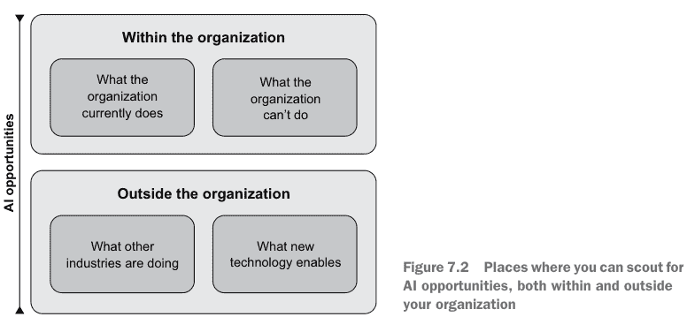

当你审视组织内部时，你可以遵循两种方法：

- 1. 查看企业现在做的事情并问，“如果我能做得更好 / 更便宜 / 更快会怎样？”
- 2. 查看企业现在不做的事情并问，“AI 能否帮助我提供这种产品 / 服务？”

如果你回顾一下我们房地产团队的虚构对话，营销经理正在做 #1：他建议分析公司的现有流程，并思考 AI 如何帮助组织做得更好。这种方法通常会带你进入增量创新项目，让你的组织向前迈进一步，成为更具生产力、更有效和更高效的组织。

第二种类型的项目源于你的组织从未构建或提供过但有可能利用 AI 构建的活动、产品或服务。这就是 CTO 正在做的事情：他说他希望拥有一款由 AI 驱动的个人财务顾问，并开始思考如何构建它。这些项目更具颠覆性，有潜力定义改变游戏规则的产品类别。一个例子是第 2 章中描述的 Square Capital 的贷款资格算法。小企业贷款从未对银行特别有吸引力，因为利润潜力小、风险高、评估过程昂贵。Square 意识到 AI 是进入这一几乎未被触及市场的关键。

当谈到在组织外部寻找想法时，我们在经验中发现了两种有效的方法：观察其他行业在做什么以及新技术在实现什么。我们的对话中虚构的 CEO 同时做了这两件事：他观察了谷歌在新计算机视觉技术推动下所做的事情。最常见的是，观察其他行业意味着观察科技公司。如果你关注硅谷的数字公司，它们大多数领先于“传统”行业的大多数大型成熟组织 10 年。这使我们能够窥探未来，观察 AI 在应用于大规模问题时能做什么，并尝试了解可以学习并迁移到你感兴趣的行业的东西。一个例子是谷歌在其数据中心的工作。谷歌在为其产品部署 AI 方面处于领先地位，这种经验启发了高晓松将该方法应用于优化能源消耗这一全新的、未被探索的领域。

另一个由新技术启发的创新有趣例子是 FaceApp，这是一款使用 AI 生成照片中面部高度逼真变换的应用程序。该应用程序可以将面部变换为微笑、变年轻、变老或改变性别。该应用程序在市场上已经有一段时间了，但在 NVIDIA 发布具有类似能力的开源 AI 模型几个月后，它走红了。很可能 FaceApp 背后的工程师利用了新技术来构建更强大的应用程序版本，从而获得了走红所需的关注。

如果你要与团队举行头脑风暴会议，我们刚刚讨论的四种方法，以及在图 7.3 中表示的方法，是一个很好的起点。很可能，在头脑风暴会议结束时，你会得到一些需要优先排序的想法。在下一节中，我们将介绍两个高层概念，这将帮助你对新想法的潜力进行初步的总体评估。

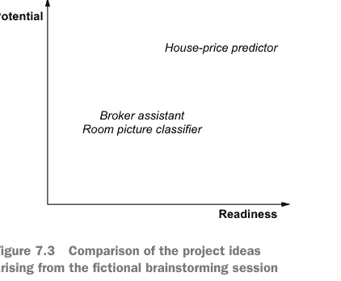

## 7.3 优先级排序：评估 AI 项目

我们都经历过这种情况：你与几个人开了一个头脑风暴会议，每个人都有一个想法，都认为这是最好的一个。我们的虚构团队可能也是这种情况。理想情况下，你希望测试每一个想法，但事实是，大多数时候，你必须决定优先考虑什么。在本节中，我们将帮助你做到这一点。

大多数人在这个阶段通常考虑的最简单的事情是项目预期的投资回报率（ROI）：在所有项目中，优先考虑潜在回报最高的项目似乎是个好主意。根据我们的经验，仅仅关注项目的 ROI 是一个短视的策略。选择项目时，还有另一个可能更重要的变量需要考虑：

你的准备度。如果不考虑你应对 AI 项目的准备程度，你可能会陷入困境。

对于每个项目，你可以通过考虑以下因素来估计你应对它的准备程度：

- 复杂性——我们的 AI 项目构建有多困难？我们能在一个月内做出概念验证，还是需要两年的研发？（你在阅读接下来的两章后会更好地理解这一点。）
- 技能——你是否已有 AI 项目的经验和实施新想法的 AI 人才？
- 数据——你是否拥有所需的所有数据？
- 测试——测试项目还需要什么？（例如，我们是否需要移动应用程序或网站？）

根据这些问题的答案，你可以比较你解决每个想法的准备程度并做出决策。为了使这个概念更具体，我们将讲述一个我们帮助其启动 AI 工作的庞大组织的故事。

我们称之为 ACME，假设它生产一种快速消费品，比如卫生纸。当我们开始头脑风暴时，该公司的生产主管非常兴奋地想要构建一个可以改善生产计划的算法。回报会非常巨大：毕竟，ACME 每天生产数百车卫生纸，能够更有效地安排生产将提高效率，潜在回报达数百万美元。然而，存在一些挑战：

- 该问题如此复杂，涉及的变量如此之多，以至于需要长时间、昂贵且有风险的研究工作。
- ACME 尚未拥有任何技术人才或 AI 经验。
- ACME 的 IT 部门仅在一年前升级了数据收集基础设施，因此它只有一年的数据。
- 测试该项目极其困难：你必须更改生产计划，而这在每天 literally 生产数吨商品的公司中说起来容易做起来难。

即使 ROI 可能非常巨大，我们也建议将该项目放在 ACME 列表的底部，并在他们拥有更多数据、更多经验和对 AI 更多的信心后再次拿起它。相反，我们专注于可能回报较小但我们知道可以在数周而不是数年内交付的较小项目。这种 ROI 与速度之间的权衡对于一家公司在其 AI 之旅的开始阶段尤其重要。

如果复杂性、技能、数据和测试的难易程度是评估你应对项目的准备程度的四个变量，那么你如何评估 ROI？有时你可以依靠你的商业敏锐度，但指导方针会有所帮助。

AI 项目的潜力与它在多大程度上利用了 AI 的两个主要优势：规模和准确性直接相关。

规模指的是让计算机接管任务的简单事实所带来的明显优势。最常见的优势是速度和成本效率，但你可能根据需求获得不同的收益。例如，规模可以帮助你通过自动化令人厌烦的任务来减少员工的无聊，或通过自动化生产线上的危险任务来提高他们的工作安全。显然，规模是每个软件应用程序的优势，但 AI 大大扩展了软件可以触及的内容（例如，我们已经看到传统软件通常无法解决计算机视觉问题）。

利用规模的项目通常是自动化任务，主要好处是削减成本或减少时间。一个例子是我们第 5 章中介绍的黄瓜分拣项目，它为日本农民节省了大量时间。

准确性指的是 ML 从数据中学习并创建比传统软件工程可以实现的误差更小的模型的 ability。一些问题与准确性和结果之间存在直接关系，以至于你可以将美元金额与每次预测准确性提升联系起来。一个明显、经典的例子是在金融领域：你预测苹果股票未来价格的能力越强，你赚的钱就越多。利润和准确性关联越紧密，AI 从数据中建模世界的能力就越能为你的项目带来积极结果。

在这本书中，你已经看到了一些项目，它们之所以成功主要是因为 AI 允许以更高的准确性做出决策。其中之一是第 3 章中的 Target 项目；这家美国零售商使用忠诚卡数据来定位即将生育的家庭。很可能，传统的替代方案是广泛定位特定年龄范围内的所有家庭。很明显，更好的定位准确性可以带来比现状高出数个数量级的回报。

最好的 AI 项目同时利用了 AI 的可扩展性和准确性。这些是具有高颠覆潜力的项目，可以彻底改变一个行业，就像第 2 章中 Square Capital 的案例。Square 使用小企业的财务数据来决定是否向他们发放贷款。Square 的成功直接与其理解企业财务对其偿还贷款能力的影响程度相关：准确性越高，他们在管理风险方面就越成功，并会向有信用的企业发放贷款。在 Square 的案例中，规模实际上是公司成功的关键原因，因为它使其能够为否则无法服务的长尾小企业贷款提供服务。

谷歌的数据中心项目利用了 AI 的可扩展性和准确性。在 AI 系统实施之前，数据中心的消耗由工程师使用其热力学知识进行优化。即使工程师也需要睡觉，因此一个可扩展的系统实时监控工厂并做出决策是极其有价值的。此外，谷歌的算法比人类工程师更准确，为公司取得的出色成果做出了贡献：40% 的节省是一大笔钱！

如果高可扩展性和高准确性是您项目的两个关键驱动因素，那么您很可能正在面对一些极高的投资回报潜力。一旦您认识到这一点，就可以根据每个具体项目的准备程度来决定未来几个月在AI实验中的精力应投向何处。

为了更清楚地说明这一过程，让我们再次审视我们虚构的房地产AI任务小组头脑风暴会议中提出的几个项目：

- *房间图片分类器*——一种根据房间自动分类图片的功能
- *房价预测器*——一种预测房屋出售价格的功能
- *经纪人助手*——一种能够简化经纪人工作甚至完全取代他们的聊天机器人

我们先来看看它们的*潜力*。房间图片分类器的规模因子很高，因为它能让人们在瞬间上传并分类图片，而无需手动整理。然而，准确性因子较低：我们并不在乎算法是否比人类更擅长区分浴室和厨房，只要它足够好用就行。

房价预测器的规模因子很高，因为目前估算售价是一项由经验丰富的房产经纪人承担的任务，他们通常很忙，可能需要数天时间才能给出预测。这个项目可以帮助客户在几秒内获得报价，而不是等上几天。准确性因子也非常高，因为预测房屋价值越准确，就越能帮助客户进行财务规划。

经纪人助手的规模价值也很高，因为它加快了客户的响应时间，让经纪人不必回答简单问题，从而专注于他们最擅长的工作。不过，准确性因子并不算高，因为经纪人本身已经非常擅长回答客户的问题。

现在，我们来评估一下您的*准备程度*。您已经拥有用于构建房间图片分类器的房屋图片数据。此外，该技术构建起来并不特别困难，甚至可以从第三方供应商处购买。不过，测试它需要将模型与您现有平台进行一些集成工作。

对于房价预测器，您已经拥有所需的所有数据。这是一个*核心业务数据*项目，数据结构良好，不会带来太多技术挑战，也不需要特别顶尖的技术人才（您会在下一章中更擅长评估项目的复杂度）。要测试它，您同样需要将网站与模型连接（或者采用其他巧妙方法——请继续关注下一节）。

经纪人助手是最难构建的项目，因为正如您在第5章中所学到的，文本数据是所有数据类型中最棘手的。您可能有一些相关数据，并且可以通过Facebook Messenger平台进行测试。

如果在“发明”阶段我们得出了一个项目清单，那么在“优先级排序”阶段，我们根据这些项目的规模和准确性因素对它们的潜力进行了初步合理的猜测，然后根据潜力和实施准备程度对它们进行了排序。现在我们知道，房价预测器是最值得专注的项目。

## 技术假设：

- 我们拥有构建模型的正确数据，并且能够长期保持数据的及时更新。
- 模型的准确性足够高，其估值能够真正发挥作用。

由于技术障碍往往有办法绕过，我们建议您先测试业务假设。对于没人想要的产品，任何补救都无济于事。

在编写任何代码或收集任何数据之前，就有办法测试业务假设。例如，您可以添加一个标有“5分钟内获取房屋报价”的按钮，并将请求转接给真人经纪人。我们可以将这种验证策略称为“礼宾式AI”：您用人力来测试打算用AI实现的新功能的吸引力。这只是一个临时解决方案，无法扩展到数百万用户，但您可以借此在小范围潜在用户中衡量客户的兴趣。

您还可以运行一个更简单的测试：插入一个虚假按钮，上面写着“立即获取房屋报价”，点击后会将用户重定向到一个简单网页，显示“很抱歉，此功能即将上线”或“维护中”。您可以在少量用户身上尝试这一办法，统计有多少人点击了您的诱饵按钮。伪造功能并非理想做法，但它能让您在几天内（几乎零预算）而不是几个月内验证AI项目的潜力。

这种测试的结果要么是积极的，要么是消极的。如果有大量用户点击“5分钟内获取报价”按钮，那么是时候进入下一章的内容并开始构建该功能了！在这种情况下，我们的市场经理提出的AI愿景似乎很有前景：完全有空间将您的房地产平台转变为一个全面的房地产投资金融顾问。

结果也可能是消极的。如果对这项新功能感兴趣的人不够多，也许没有人觉得自己需要闪电般的房屋估值服务。在这种情况下，请勿灰心：您的产品前实验帮您节省了大量金钱和时间，避免了去构建一个没人想要的东西。这意味着您的市场经理的AI愿景需要转向其他方向，您可以开始着手处理下一个AI项目；在我们的例子中，就是房间图片分类器。

假设您测试了房间图片分类器，并且大获成功。它的上线让您认识到，客户确实非常看重良好的房源浏览体验。带着这些额外的认知，您可以决定专注于打造用户体验最流畅的房地产平台。当您实施并发布该功能后，您就可以自由地投入未来的项目，并确信所有这些AI项目都在整体AI愿景中占有一席之地。图7.5展示了这种实验与经验循环如何帮助您逐步聚焦AI愿景。

当然，这只是一个简化的例子。现实世界更加复杂，充满失败尝试和束手无策的时刻。然而，核心观点依然成立：大多数成功的AI原生公司并非一开始就制定了完整战略，而是逐步连接各个点，直到AI使命逐渐浮现。

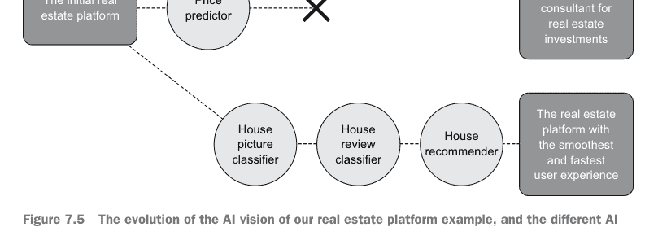

图7.5 房地产平台示例中AI愿景的演变，以及我们在达成愿景过程中讨论的不同AI项目。

如果您想把AI作为变革性技术加以运用，您也需要转变思维方式。我们鼓励每个组织，无论大小，采用数据驱动实验的思维模式，逐步投资AI，从每个项目中学习，并在此过程中塑造自己的愿景。最好的办法是先从AI项目入手，并努力从每个项目中汲取经验。如果您用心倾听，项目本身会指引AI愿景的方向，并将成为您愿景的基石。

更深入地探讨产品实验的方法论已超出本书范围，但您可以在网上或许多其他书籍中找到相关资源。很好的起点包括Eric Ries的《精益创业》（Crown Business，2011年）或Steve Blank的任何著作。我们想让您记住的是，开发新产品没有“免费的午餐”，即使使用像AI这样强大的技术也不例外。如果您尚未验证业务假设且想法本身有缺陷，哪怕最强大的AI也救不了您。

一旦业务假设得到验证，就该将您的想法转化为机器学习项目了。这正是我们接下来几节和几章要做的事情。

## 7.5 解构AI产品

假设我们的房地产公司已验证了构建一个机器人以简化用户与平台之间互动的想法。其目标是让平台感觉像一个有血有肉的经纪人，因此您可以提出诸如“曼哈顿金融区有哪些三居室房源？”这样的问题，并像真人经纪人一样获得经过筛选的结果列表。这差不多就是房地产界的苹果Siri。既然您已验证了这个想法，接下来就该与AI专家讨论构建产品了。以下是这种假设性对话可能的情形：

> 经理：嗨，John，我们想构建一个房地产界的Siri。这可行吗？
>
> 数据科学家（John）：听起来很酷，但我需要更多信息。输入数据是什么？

经理：我们的用户将直接与我们的应用或网站对话，并以美观的方式获得结果。
约翰：嗯，这意味着输入数据是语音，而输出可以是……任何东西？
经理：是的，输入是语音，输出是用户问题的答案。我们知道自然语言处理很难，所以想着可以通过降低这个应用的深度来降低复杂度：这个功能将帮助用户查询房屋，仅此而已。就目前来说。
约翰：好的，这有帮助，但我觉得我们在这里讨论的是两个不同的人工智能项目。
经理：你什么意思？
约翰：嗯，我们不能直接处理音频并直接给出答案；这里有一个中间步骤。我们首先需要将音频转录为文本；这是一个通用应用，称为语音转文字。然后，在获得用户的纯文本问题后，我们必须理解其意图。你可以将这个应用称为文本分类或意图检测。这是可行的，但必须分成两个部分。

让你的AI项目准备好被技术团队消化，可能并不像你期望的那样直接。正如我们的一些示例所示，许多适合AI处理的问题相对直接，可以用单一想法描述。例如，房价预测模型就是一个单一产品。在其他情况下，最终目标更为复杂，需要在将其转化为机器学习友好的术语之前进一步分解。在这种情况下，我们的经理发现他的AI项目实际上是两个分离良好的机器学习算法的总和。现在我们将教你如何判断你的AI项目是否是多个机器学习算法的组合。

让我们以一个你可能每天都会用到的东西为例：一个像苹果Siri这样的语音助手。假设我们希望我们的个人助手只做两件事：打电话和发消息。得益于你在本书中学到的知识，你知道处理任何机器学习问题的第一步是考虑涉及的数据。在我们的案例中，输入数据是使用助手的人通过麦克风录制的语音。输出是手机执行的一个动作：要么发送消息，要么给某个人打电话。传统软件将负责执行该动作：我们唯一需要实现的是利用语音来决定采取哪个动作，如图7.6所示。

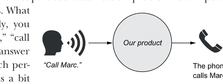

图7.6 语音助手产品的基本方案

基本上，我们所描述的是一个监督分类问题：输入是音频数据，输出是一个类别。这些类别会是什么呢？理论上，对于通讯录中的每个人，你应该有像“给马克发短信”、“给马克打电话”、“给马克发消息”、“回复马克”和“回电给马克”这样的类别。听起来有点疯狂，对吧？问题不仅在于我们有很多类别，还在于直接将音频文件映射到类别极其困难。事实上，如果你试图回忆本书中涵盖的所有应用，没有任何类似的东西。

让我们看看如果将问题分解成更小的步骤，使用本书涵盖的技术并从输入数据开始，会发生什么。我们在第3章中介绍了音频数据，当时我们提到可以使用深度学习构建语音识别系统，将音频数据转换为文本。这项技术相当成熟和可靠，尤其是对于英语和西班牙语等最流行的语言以及母语使用者（我们作者有时带着意大利语口音，Siri仍然难以理解我们）。这意味着我们可以相当有信心，如果用户说“给马克发短信”，可以构建一个系统，将该语音转录成书面文字。

经过这一步，我们处理的数据从根本上改变了：我们现在处理的是文本数据，而不再是音频。我们仍然需要判断用户是想打电话还是发短信，以及他们想与谁联系。让我们继续采用将问题分解为核心组成部分的方法，专注于第一部分。我们要构建一个能将书面句子映射到两个动作之一的东西：打电话或发短信。

当我们在第5章中介绍文本数据时，我们详细描述了如何使用机器学习将一段文本分类到各个类别中。在这种情况下，我们可以使用数十个带标签的句子来训练一个机器学习模型，如下所示：

- “给马克打电话” -> 打电话
- “你能给马克发一条消息吗？” -> 发短信
- “回复马克” -> 发短信
- “回电给马克” -> 打电话
- “给马克发短信” -> 发短信

你可能还记得第5章的内容，即使有几十种或几百种方式来表达同一个意图，词嵌入也能极大地简化我们的工作，并使我们能够解决这个任务。现在我们到了这一步：我们知道用户想采取什么动作，接下来我们需要从通讯录中确定选择哪个人。这相当容易，而且不是机器学习任务。因为我们拥有用户所说内容的转录文本，我们只需检查他们所说的所有单词，并在他们的通讯录中查找。当我们找到一个与用户所说内容匹配的名字时，我们就知道该给谁发短信或打电话。

正如你所看到的，一个看似不可能的问题，在分解成小任务之后会变得容易，每个小任务都可以通过机器学习与传统软件工程的结合来解决。图7.7是完整产品的架构图。

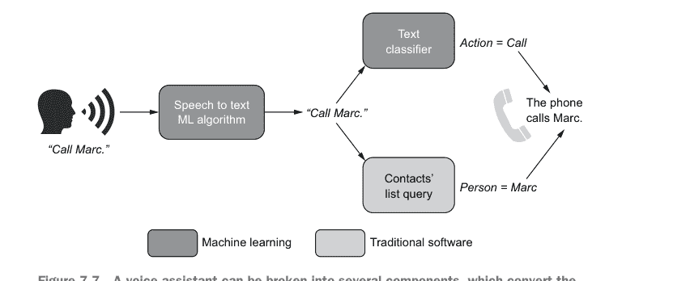

一个语音助手可以分解为多个组件，这些组件将用户的语音转换为软件命令。

你可以按照相同的过程来分解更复杂的项目。对于我们的下一个示例，我们将采用一个令人望而生畏的案例：构建一辆自动驾驶汽车。让我们想象一下，作为人类，你从旧金山的后院开车到洛杉矶需要采取的步骤，并理解计算机驾驶员必须处理什么。当你坐进驾驶座时，你会开始分解到达最终目的地的步骤：驶出车库，并入高速公路，选择一个广播电台，尽量在几个小时内不感到无聊，最后在你朋友位于洛杉矶的车道上停车。在你到达目的地之前，所有这些高层次目标都必须进一步分解：转哪些街道，选择哪条车道，等等。除此之外，你还必须遵守交通法规，并注意其他驾驶员在做什么，以免造成事故。

这种直觉将有助于开始分解一个实现自动驾驶的AI系统。道路路由实际上并不需要AI组件，因为我们可以直接复用谷歌地图中使用的相同导航算法。另一方面，在感知组件中会有大量的机器学习，该组件负责确定行人、骑自行车的人和其他车辆相对于车辆本身的位置。由于自动驾驶汽车中最常用的传感器是摄像头，自然的选择是使用深度学习进行图像分类和物体定位模型（正如我们在第4章中解释的那样）。对于这个组件，输入数据是从安装在汽车上的前置和侧置摄像头捕获的图像，输出是附近物体的位置。

仅仅知道车辆和行人在街上是不够的；你还需要预测其他道路参与者即将做什么，这样自动驾驶汽车才能做出最佳、最安全的决策。例如，除了知道行人在人行道上，你还希望AI帮助你预测他们是否即将过马路，并减速以确保安全。这个机器学习任务比之前的任务（对车辆周围的物体进行分类）更有点深奥，所以让我们看看如何用机器学习的术语来构建它。我们甚至不确定我们想从模型中得到什么：是简单到“可能移动”和“不可能移动”这样的分类就够了，还是模型也必须预测移动的方向？两种选择都是有效的（真实的项目可能会同时运行两者），但后者更有用——代价是更高的复杂度和更多的训练数据。从输入数据的角度来看，最相关的信息可能是位置（城市或高速公路）、周围环境（过街横道、人行道、办公室入口）以及实体类型（行人、骑自行车的人或车辆）。

所有这些信息都会输入到一个决策组件中，该组件决定如何安全地在交通中向目的地移动。例如，即使汽车需要向左变道以驶上高速公路，如果车道已被占用且突然的机动会导致碰撞，它也应该放弃。最合理的实现方式是将决策模块作为传统软件工程和机器学习相结合的方式。这是因为其中一些规则是硬性且明确的（红灯意味着“停车”），而许多其他行为则更为微妙（如果后方车辆紧跟，急刹车是危险的）。

最后，关于道路行为的决策，例如向右转或在红灯前停车，必须转化为对方向盘和油门的具体操作，从而真正使汽车移动（并停止！）。这项任务并不适合机器学习，因为我们有精确的数学规则来表达制动动作的力度应如何基于制动距离、乘客重量等因素。这意味着该组件是传统软件工程的理想候选。

图 7.8 是我们所讨论过的所有组件的概述，以及它们如何相互依赖以提供如此复杂的行为。描述显然并不详尽，但将这样一个复杂项目分解有助于你理解传统工程和机器学习如何最好地相互补充。即使是最令人绝望的复杂问题，只要你花时间审查可作为输入使用的数据，并将输出表述为可衡量的值，就能够解决。

现在，自动驾驶汽车有点像登月项目，技术密集度极高，并且有一些我们无法争辩的要求：自动驾驶汽车必须至少与人类驾驶员一样安全，毫无疑问。当你将商业机会转化为一个或多个 ML 项目时，你通常在定义 ML 项目的边界方面有更大的自由。例如，在我们最初的“房地产 Siri”案例中，你本可以轻松决定将用户体验从语音转换为文本；与其让人们与你的平台对话，他们可以用自然语言编写查询。这可能会给用户带来你期望的大部分价值，完全取消你 AI 项目的一半（你不再需要构建任何语音转文本技术！）。

从 AI 项目的想法开始，本节教会了你如何将其分解为可以单独处理的更小的子组件。下一节将通过向你展示如何为这些组件中的每一个开发工程师友好的描述，来完成这项准备工作。

## 7.6 将 AI 项目转化为 ML 友好术语

在上一节中，我们的数据科学家 John 帮助我们发现“房地产 Siri”AI 项目比我们想象的更复杂。然后我们了解到，将 AI 项目分解为最小的技术组件非常重要，以便它们成为单一的技术工作。让我们想象与 John 的另一次对话，这次提出更简单的房价预测器：

> AI 负责人：嗨 John，我们最近在网站上测试了一个新功能：房屋价格预测器。基本上，用户输入有关其房产的信息，我们会立即为他们提供价格估算。我们进行了与人工经纪人 10 分钟后回应的有限测试，人们很喜欢。现在，我们希望构建一个 AI 在几秒钟内完成。

> John：听起来很令人兴奋！所以我们需要预测的变量是房屋的售价，对吗？

> AI 负责人：没错。

> John：基于什么？你对我们 ML 模型应使用哪些特征有没有大致的想法？

> AI 负责人：是的，我们采访了我们最专业的经纪人，并列出了他们在执行此任务时考虑的一切。一些特征很简单，比如平方米数和卧室数量。一些则更复杂，比如公共交通的邻近度、社区的声誉等等。我可以与你分享他们所说的一切的报告。

> John：听起来我们已经有了很好的开端。构建此模型的最佳方法是使用过去的交易。这样，ML 模型将学习房屋实际售价。我们的是否有这样的数据集？

> AI 负责人：是的，我已经与 IT 核实过了。我们过去六年一直在收集交易信息。我们记录了数十万笔交易。

> John：我认为我们可以从中构建出很棒的东西。我们是否已经知道应该达到什么样性能才能认为项目成功？

> AI 负责人：我们估计用户会接受与实际价格相差 ±3% 的预测。

注意这次对话进行得多么顺利。之所以如此富有成效，是因为我们的 AI 负责人已经做了功课：他们已经知道数据科学团队需要他们提供什么来构建这个 AI 项目，并且已经进行了一些初步分析。这些是业务人员和技术人员之间顺畅合作的最佳要素。

当你不是编写 AI 算法的人时，很容易忘记它们的工作原理，并在与工程师的对话中陷入无果，浪费时间和产生挫败感。为了给你一个概念，这些是会让任何技术团队皱眉的 AI 项目的糟糕起点：

- "我们将使用互联网数据来预测人们会购买什么。"
- "我们将使用我们的客户数据来找到最好的客户。"

实际上，让我们重新表述。这些想法并不错误；它们只是太模糊了。它们可能很适合营销材料，但会让每个数据科学家叹气，因为它们没有提供任何关于技术的有用信息。一般来说，我们可以说每个 AI 应用都应具有以下特征：

- 一个客观且定义明确的输出
- 一个或多个将输入和输出关联起来数据集
- 一个可衡量、定义明确的成功指标

熟悉 ML 的技术人员习惯于以这些术语思考，通常可以毫不费力地根据这些关键点正确地构建 ML 问题。然而，根据我们的经验，我们发现非技术人员有时会在过程中迷失，并从对思维进行结构化的一点帮助中受益。因此，我们设计了图 7.9 中所示的 Framing Canvas：一个五步工具，你用关于正在进行的项目的信息填写它。它将引导你完成启动一个范围适当 AI 项目所需的所有要素。

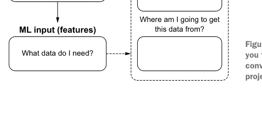

图 7.9 Framing Canvas 引导你完成将业务项目转化为 ML 项目所需的步骤。

为了引导你了解 Framing Canvas 的概念，我们将再次挑选两个案例研究和第 1 部分中的一个示例，并通过 Canvas 的视角审视它们。第一个部分是你的 *业务目标*。我们将在本节中使用的三个项目的业务目标如下：

- *降低客户流失*——我们在第 3 章中介绍了一个示例，我们考虑了一个识别哪些客户即将取消订阅服务（例如手机套餐）的模型。
- *提高我们数据中心冷却系统的效率*——在第 2 章末尾的案例研究中，Google 使用监督学习将能源账单削减了 40%。
- *通过为小企业提供次日贷款来解决小企业贷款市场*——这类似于第 2 章中描述的 Square Capital 的案例。

对于每个业务目标，重要的是要记住其 *关键绩效指标*，即用于评估其成功的量化指标。第一步是找到将用于跟踪项目投资回报率的参数。对于这三个项目，三个 KPI 可以如下：

- 客户流失率（每月或每年）
- PUE（电源使用效率，评估数据中心能源效率的参数）
- 已识别的合格小企业百分比

现在，我们需要为每个变量建立一个接受阈值。换句话说，我们需要为每个 KPI 识别一个代表最低可接受性能的值，低于该值产品就无法发布。

一个起点可以是 *现状解决方案*：查看你当前解决问题的方案，衡量其在你识别的 KPI 上的表现，并将其视为阈值。如果你正在推出新产品或服务，你可能会进行财务收益计算，告诉你模型在开始产生财务意义之前需要的性能水平。

另一个重要点是你必须选择如何衡量你的 KPI。我们已经讨论过各种关键指标，以及假阳性和假阴性对客户可能产生截然不同的影响。让我们假设你正在开发一个 AI 系统来处理脑部扫描并诊断肿瘤是否存在。显然，在这种情况下，假阳性和假阴性并不具有相同的权重：假阳性会让患者接受不必要的额外检查，而假阴性意味着生病的患者被错误地送回家，面临更严重的后果。

假阳性和假阴性在不太悲剧的情况下也具有不同的权重。例如，如果我们回到我们的三个示例，我们的流失预测器和我们的贷款资格估计器都需要我们深入思考我们想要优化哪个指标。在流失预测器的情况下，我们已经讨论了假阴性（由 ML 算法标记为“正常”但实际上会离开你服务的用户）和假阳性（由 ML 算法标记为“将要

“风险”但实际上是可以接受的)。在第一种情况下，你会错失挽留客户的机会，而在第二种情况下，你会采取本可以避免的挽留行动。两种错误都伴随着成本，在两者之间找到平衡是决定最佳 KPI 的方法。

贷款资格算法也是如此。在这种情况下，如果出现假阳性，我们就会把钱借给不会偿还贷款的企业，这对我们来说是一种成本。假阴性意味着我们拒绝了一家本会偿还我们的贷款的小企业，这对我们来说是一种机会成本，也错过了客户的机会。同样，你可以做数学计算，在两种错误之间找到一个甜蜜点，这将代表你的 KPI。

为了便于讨论，假设我们对三个玩具示例发现的指标是可以接受的：

- 召回率高于 90%
- 预测值与真实 PUE 的误差在 ±3% 以内，95% 的时间成立
- 精度高于 95%

图 7.9 左侧的 ML 输出块是 ML 进入方程的地方。在这里，你需要具体说明你希望 ML 做什么来帮助你实现目标。回到我们的三个示例，下面是三个项目可能的选择：

- 我们将预测每个客户的流失概率。
- 我们将预测制冷系统的未来性能。
- 我们将评估每个客户的贷款资格。

一旦你知道你的 ML 算法将交付什么以构建你的应用程序，你就可以开始思考其 ML 输入。我们在本书的第一部分将这些称为特征。记住，提出相关特征的一个良好起点是问自己“如果我必须接管算法的工作，我需要什么信息？” 这个列表可能并不详尽，你始终可以添加（或删除）项目，尤其是在数据科学家的帮助下，或者在你获得模型经验后。然而，填写这些特征的初稿为你提供了一个起点，以确保你设计的东西可以构建并且可以被开发人员理解。下面是如何用前面的示例填写这些框的一些示例：

- 产品使用情况、人口统计、订阅类型
- 外部温度、湿度、水压、数据中心负载
- 现金流、企业规模、位置、行业

下一步也是最后一步是思考数据源。在前两个步骤中，你确定了模型需要从中学习的信息类型；现在是时候思考从哪里获取这些数据了。你可以根据需要拥有任意多个数据源，并且可以在画布上绘制你想要的所有框，以说明你打算使用的所有信息来源。对于三个示例，这里是潜在的答案：

- 对于输出，先前已退订的客户。对于输入，CRM 数据。
- 数据中心设备的日志和天气数据。
- CRM 数据、交易数据、金融市场数据。

Framing Canvas 引导你完成一个流程，产生清晰定义的 ML 规范，你可以将其传递给技术人员进行实施。在下一节中，我们将根据我们在第 1 部分中介绍的案例研究，逐步介绍 Framing Canvas 的实际实施。

## 7.7 练习

你真正理解如何为 AI 项目建模的最好方法是，通过练习本书中介绍的案例研究来填写 Framing Canvas。我们建议你将 Framing Canvas 应用于这三个案例研究：

- 通过分析客户行为来改进定位（第 3 章的 Opower 案例研究）
- 使用计算机视觉自动化工业流程（第 4 章的黄瓜分拣案例研究）
- 帮助客户选择内容（第 6 章的 Netflix 案例研究）

对于每个案例，请按照我们在 7.3 节中所做的方式进行，并尝试思考如果你领导该项目会怎么做。首先写下项目业务目标的简明描述，并定义其 KPI 和相应的验收标准。以 ML 输入和输出的形式找到项目的 ML 友好定义，并集思广益你可能使用的潜在数据源。通过阅读案例研究本身，你应该拥有完成这些练习所需的所有信息。不要害怕走出常规。在此阶段的流程中，很少有选择是错误的，实验是测试它们的唯一方法。完成后，将你的想法与我们的评论和每个练习的完整画布进行比较。

### 7.7.1 改善客户定位

让我们从第一个练习案例研究开始：Opower 及其努力了解其客户的能源使用模式以完善定位活动。乍一看，业务目标很明显：“了解我们的客户如何使用能源。” 这是一个值得的目标，甚至可能成为一个令人兴奋的初创公司推介。然而，如果你停下来思考一下，你会意识到这仍然是一个相当抽象的陈述，需要在继续之前澄清。例如，如果你的业务目标是“了解我们的客户如何使用能源”，你甚至如何跟踪模型的成果和效益？

事实上，我们希望你一尝试为此目标定义 KPI 时就意识到这一点。相反，尝试以更具体的术语来关注你的项目。“了解我们客户的能源需求”对于高层决策来说足够聚焦，但不足以启动一个 AI 项目。那这样呢？

*根据能源消耗模式对客户进行分组。*

投入精力定义更具体的目标会立即得到回报，因为你会自然地定义适当的 KPI 来跟踪项目的成功。在 Opower 的案例中，一个明显的指标如下：

*从能源消耗模式中提取的行为是准确的。*

请注意，写下 KPI 可以作为对我们在上一步中找到的业务目标的合理性检查。作为经验法则，如果目标不容易衡量，还有一些工作要做。除了 KPI 之外，你还希望定义验收标准，告诉你项目何时足够好可以交付给客户。根据项目情况，在设定这些数字时，你可能会考虑多个因素：项目对组织的重要性、安全和财务风险等等。以下是我们认为此项目的良好起点：

*与行为访谈相比，少于 10% 的客户被错误分类。*

这是一个以模型准确性表示的经典 KPI。我们将在接下来的两个示例中看到定义 KPI 和验收标准的更多复合方式。

在 Framing Canvas 流程的这一点上，你应该在脑海中拥有足够的细节来开始 ML 特定问题。基于我们刚刚概述的业务目标，我们期望模型提供的 ML 输出是能源消费者的聚类。换句话说，我们希望模型将具有相似消费模式的客户归为一组。

当谈到 ML 输入时，这个项目的明显候选是 Opower 以秒级粒度收集的能源表数据。然而，我们也可以想象将人口统计、天气和位置数据添加到混合中，因为它们可能会提高 resulting 模型的准确性。这意味着数据将通过现有的能源表网络收集，并通过从第三方购买的外部数据源进行补充。

图 7.10 显示了此练习的完整 Framing Canvas。

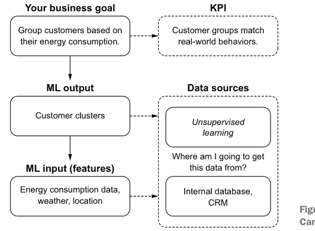

图 7.10 Opower 练习的完整 Framing Canvas

### 7.7.2 自动化工业流程

让我们继续第二个案例研究。正如你所回忆的，该项目是关于在小型农业设施中自动化黄瓜分拣。一个正确但相当宽泛的业务目标将是“提高农场的效率”。然而，从我们对前一个示例的讨论中，你已经学会更加具体，因此我们为该项目提出以下业务目标：

*根据质量等级自动化黄瓜分拣。*

一个不错的 KPI 如下：

*黄瓜在没有人工参与的情况下被分拣。*

这是一个相当雄心勃勃的目标，至少在项目启动时。然而，它为我们建立验收标准提供了一个良好的基础：

*少于 5% 的黄瓜被错误分类到更高等级的类别（这对声誉不利），并且少于 10% 的黄瓜被错误分类到较低等级的类别（这会损害收入）。*

或者，我们本可以以节省的人力资源或生产率的提高来表述 KPI 和验收标准。该项目的 ML 输出将只是以下内容：

*将黄瓜分类为用于销售的质量等级*

这是一个相当标准的图像分类问题，如第 4 章所述。对于该项目，ML 输入的最明显候选也是正确的：

*黄瓜从俯视角度和两侧拍摄的高分辨率彩色图片*

黄瓜重量也可能有助于提高分类准确性。数据源的直接解决方案如下：

*从安装在黄瓜挑选传送带上的摄像机收集的图片。照明、时机和方向可以调整以获得最佳效果。*

总之，本练习是图像分类问题的教科书应用，其中设置数据收集策略的一部分工作将涉及在传送带旁边实际设置摄像机。

图 7.11 显示了此练习的完整 Framing Canvas。

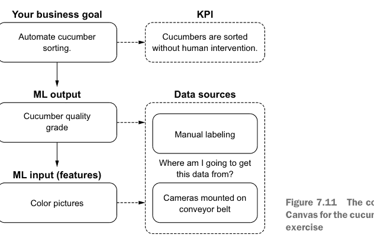

### 7.7.3 帮助客户选择内容

最后一个练习是关于 Netflix 个性化视频内容主页的。总的来说，愿景是关于“帮助消费者在 Netflix 平台上找到要观看的内容”。以下是业务目标：

> *减少观众在选择观看内容时花费的时间。*

为此目标寻找 KPI 的自然方式是比较个性化主页的性能与 Netflix 平台上随机选择的内容。这是一种立即跟踪项目影响的绝佳方式，而且会让组织其他部门很难忽视你的项目。这种选择如下所示：

> *浏览个性化主页的用户更快地选择要观看的内容。*

以下是相应的验收标准：

> *浏览个性化主页的用户在选择观看内容方面比随机列表快 20%。*

总的来说，你应该始终尝试将项目的成功与用户行为指标联系起来，因为这是衡量你工作影响的最直接方式。这个概念被广泛称为 *A/B testing*，因为你将新功能或产品的变体与现状进行比较。新 AI 模型的变体与现状进行比较。最适合 A/B 测试的项目是那些拥有持续的用户或项目流量的项目，因此你可以将它们分成两组：一组发送到旧系统，一组发送到新系统。通过比较两个用户组的性能，你将能最好地了解你的项目效果如何。

继续进入 Canvas 的 ML 输出部分，我们需要具体说明 ML 模型的输出将如何用于个性化主页。最直接的选项如下：

> *用户最有可能喜欢的五部电影的列表*

但请记住，正如你在第 6 章末尾看到的那样，实际实现将有多个不同的列表，以增加吸引用户注意力的机会。我们相信你已经认识到这个例子是推荐系统的典型应用，这意味着 ML 输入将如下所示：

> *目标用户以及平台上所有其他用户的观看历史。*
> *有关电影的信息（导演、年份、类型等）。*

你将从哪里收集这些数据？我们在这里没有太多选择：

> *观看历史从视频服务器收集。电影信息从内部数据库收集。*

事实上，这个例子很典型：你不必费很大劲去寻找数据资产，因为它们对组织的运营至关重要，因此很可能被仔细收集和管理。显而易见的是，任何视频流媒体平台都已经存储了有关电影类型、演员和导演的信息，以便在向用户展示电影时使用这些数据。将这些信息用于机器学习并不需要很大的跨度。同样，观看历史也很容易获得，因为它必须出于会计目的进行跟踪（例如支付版税）。图 7.12 显示了此练习的已完成 Framing Canvas。

我们在本章涵盖了很多内容。你了解了长期 AI 愿景与单个 AI 项目之间的区别，以及后者如何帮助你的组织塑造前者。我们还探讨了使 AI 项目对组织有价值的属性，并警告你在推出新项目时可能遇到的潜在风险和陷阱。最后，我们介绍了 Framing Canvas 作为一种重要工具，帮助你将“商业语言”提炼成“机器学习语言”。

下一章将向你展示如何采用这种对 ML 友好的定义，并组建一个团队和计划，供你的组织用于实施你的项目。

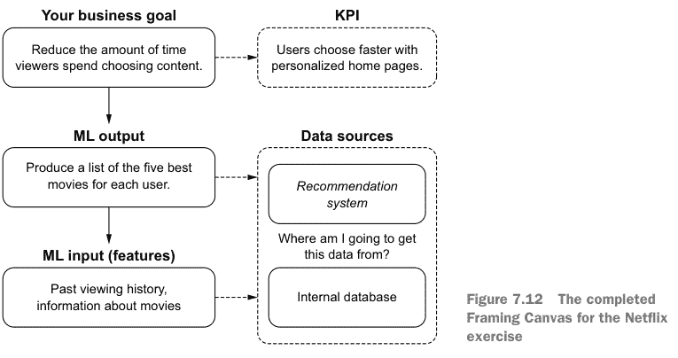

for organizations, and warned you about the potential risks and pitfalls encountered when rolling out a new project. Finally, we introduced the Framing Canvas as an important tool that helps you distill “business speak” into “machine learning speak.”

下一章将向你展示如何采用这种对 ML 友好的定义，并组建一个团队和计划，供你的组织用于实施你的项目。

## Summary

- 你的组织的 AI 愿景是一条清晰的路径，定义了它在 AI 时代将是什么样子，它将如何帮助员工更高效地工作，以及它将如何塑造你的产品以服务客户。
- AI 项目是一个明确的计划，使用 AI 构建新产品或功能，或优化现有流程。
- 一些复杂的 AI 项目需要分解为独立的 ML 任务，定义 KPI、输入和输出，以及你打算使用的数据来源。Framing Canvas 帮助你做到这一点。
- Framing Canvas 帮助你以 ML 术语表述 AI 项目的目标和愿景。

### Set—准备数据、技术和人员

#### 本章涵盖

- 识别数据潜在来源，无论组织内部还是外部
- 评估数据的质量和数量
- 组建有效的 AI 团队

本章承接第 7 章的内容。现在你已经知道如何使用 Framing Canvas 为你的项目创建对 ML 友好的愿景，是时候把你需要的其他要素准备好。将项目付诸实践需要三个主要要素：ML 模型、数据和人员。虽然选择合适的 ML 模型是技术团队的任务，但招募他们并制定数据策略以便他们开展工作是你的职责。本章重点介绍如何查找和管理数据，以及如何招募具备项目所需技能的优秀人才团队。

## 8.1 数据策略

我们撰写本书的目标之一是让你批判性地思考数据，并了解工程师如何使用数据构建 ML 模型。因为数据至关重要，因此制定连贯的数据策略对任何项目的成功都至关重要。在第 1 部分中，我们以一种理所当然的方式谈论数据，假设你已经可以随时使用它来构建模型。你可能已经猜到这种情况很少见；本章将填补空白，帮助你了解你需要多少数据、从哪里获取以及如何管理它。

我们必须区分组织的数据策略和 AI 项目的数据策略。当商业媒体或高管谈论数据策略时，他们通常指的是公司范围内获取、存储和使用数据的整体策略。该策略由公司的长期目标和对未来的愿景驱动。

本书关注的是你的项目的数据策略，该策略特定于单个 AI 计划。与宽泛的策略相比，项目特定的关注点更好，原因有两个。

首先，即使是单个项目的数据策略也会迫使你明确你需要收集哪些具体数据来构建项目、需要多少以及从哪里获取。例如，为了制定 AI 策略，你可能会说：“我们将构建基础设施来收集用户与平台交互的数据。”但为了构建 AI 项目，你需要说：“我们将使用用户点击、他们在每个页面花费的时间以及社交分享，并将其与 CRM 数据合并以推荐内容。”这种程度的规范有助于你思考构建项目真正需要收集什么。有人必须决定到底收集什么，如果你给 IT 团队的指示太宽泛，他们就会替你做出决定，而且往往是在不知道业务背景的情况下。

第二个更重要的原因是，组织范围的策略应以你计划追求的每个 AI 项目的需求为依据。在没有任何经验的情况下开始思考公司范围的数据策略，就像单身时开始思考家庭房子一样。你根本不知道自己需要什么。（你会有零个、一个还是五个孩子？哪个位置对你和你的伴侣更方便？你的伴侣的品味如何？你能负担得起吗？）正如单个 AI 项目帮助你形成更明智的 AI 愿景一样，通过将数据策略构建为项目所需的最小数据集，你可以确保收集到所需的数据。

如果你从 AI 项目开始，构建组织数据策略将是一个简单的练习，即将你在每个项目实施过程中获得的经验结合起来（如图 8.1 所示）。

要为 AI 项目构建数据策略，你需要知道从哪里获取数据以及需要多少。接下来的两个小节将深入探讨这两个主题。

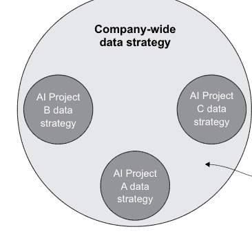

图8.1 组织数据策略结合了每个单独项目的需求（并为未来附带了一些额外内容）。

### 8.1.1 我从哪里获取数据？

数据一直是贯穿本书的基本概念。我们已经涵盖了各种类型的数据：结构化核心数据、图像、声音和自然语言。如果你想构建一个AI项目，一个更重要的区别会影响你：你拥有的数据和你没有的数据。

让我们先假设你的组织已经拥有构建AI项目所需的数据。由于这些数据是由你的组织产生并拥有的，我们称之为内部数据。第2章已经讨论了被称为核心业务数据的一种特定内部数据的价值：对组织盈亏有直接影响的数据。对于我们的房地产平台，这可以是房价数据；对于Square Capital，是客户的交易数据；或者对于Google，是其数据中心的消耗数据（基本上是其唯一的可变成本）。

你的组织很可能还会从业务流程中产生可能与主要收入或成本来源无直接关联的数据。我们称这种数据为辅助数据。在我们的房地产示例中，房屋图片和房屋评论可以被视为辅助数据：尽管仍然有趣且有用，但不如在售房屋的特征及其售价那样重要。

再举一个更具体的例子，让我们考虑一个电子商务平台，如美国的Amazon、Zappos或欧洲的Zalando。对于这些平台，核心业务数据是每位客户的购买记录，因为它们与公司收入直接相关。辅助数据可能是客户访问的页面、打开的邮件、产品评论等等。你可以用辅助数据构建出色的项目，但很可能不如用核心业务数据构建的项目那样有影响力。

在继续之前，我们想提醒你，拥有数据集并不意味着你可以毫无障碍地使用它。你可能计划使用客户数据，但没有这样做的权限——无论是客户拒绝了许可，还是像经常发生的那样，你的隐私政策并未考虑到你现在计划的用途。即使你确实拥有使用数据的权限，根据我们的经验，大多数人会低估从“我们有数据”到真正将数据导入数据科学家的笔记本电脑并准备好进行处理所需的时间和挑战。即使你100%确定你的组织拥有项目所需的数据，我们衷心建议你尽量考虑所有可能在实际使用中拖慢你速度的因素。

在我们参与的一个项目中，一家公司的法务部门使得导出我们所需数据变得非常困难，以至于我们真的不得不乘飞机、进入他们的办公楼、插入笔记本电脑、加密数据，然后用硬盘把数据带回家。在另一个项目中，我们知道公司拥有我们所需的数据，但仍然难以理解数据集中变量的含义。问题在于设计数据收集流程的人已经退休了，我们不得不花整整一个月的时间进行访谈，以理解我们所看到的数据。

现在让我们讨论你还没有项目所需数据的情况。你有三个选择：

- 开始收集数据并等待积累足够。
- 寻找开放数据或从互联网免费抓取。
- 从供应商处购买。

第一个选项最慢；有时也最昂贵，但在某些情况下你可能别无选择。假设你经营一家实体服装店，没有会员卡系统或任何其他方式来追踪谁买了什么。如果一位顾客走进来，你不会记录他的名字叫约翰，他刚刚买了一双耐克Air Jordan运动鞋，10码，129美元。如果你没有存储这些信息，你认为其他公司会有吗？显然，在这种情况下，你唯一的选择是建立新的流程来收集这些信息，然后等待收集到足够的数据。

另一方面，有时你的项目需要的数据要么无法收集，要么不愿费力去收集。在这种情况下，第二个选择是使用开放数据。

你能从互联网上获得多少免费数据，这真是令人惊叹。一个例子是政府经常开源的数据，你可以在项目中自由使用。例如，你可以使用你所在国家的收入数据，将营销重点放在最富有的地区。以下是一些寻找开放数据集的其他好地方：

- *kaggle.com*——公司和个人可以在这里举办机器学习竞赛并上传数据集的网站。
- *arxiv.org*——科学论文的免费存储库。当研究人员收集到新数据集时，他们会撰写并发布科学论文向科学界展示，并且通常也会发布他们的数据集。
- *github.com*——开源代码仓库。

使用第三方数据集时，你应该关注数据质量和法律问题。其中许多数据集是基于“尽力而为”的原则生成的，并根据支持新算法或应用领域的需求收集；通常不保证数据质量。此外，许多公开可用的数据集以非商业许可发布，这意味着它们不能用于商业目的；始终检查你是否可以将开放数据集用于你打算的用途。

第三个选项是从供应商处购买数据。这种策略有时可能极其昂贵，也可能使你陷入危险的境地，因为你可能最终永远依赖这些供应商。在决定走这条路之前，我们建议你先花足够的时间评估相关的长期成本，并确定是否有多个供应商可供购买。如果只有一个供应商，你需要找到一种保护自己的策略，以防他们倒闭或业务战略发生变化，不再向你出售数据。

在这两种情况下，我们鼓励你批判性地思考来自组织外部的数据集。根据定义，如果某些数据是公开可用的——无论是免费还是付费——这意味着其他所有人都可以获得它。通常，基于外部数据源的项目在市场上会更加困难，因为竞争对手很容易复制它们。一些最强大的AI项目建立在难以被他人复制的专有数据集基础上。

总而言之，你组织的围墙（或其数据中心的虚拟围墙）会对AI项目的数据策略产生重大影响，如图8.2所示。如果数据位于组织边界之内，你就拥有了一个独特且极具价值的数据集可供使用。否则，你必须要么免费获取，要么购买。在这两种情况下，都要考虑这些选择带来的风险。

当然，你也可以将内部和外部数据结合起来。实际上，这通常是个好主意。一个例子是我们的房地产房价预测器：我们本可以使用政府提供的各社区收入的免费数据来改进模型。你甚至可以使用OpenStreetMap或Google Maps的数据来检查各个社区的服务和公共交通情况，为房价预测器增加另一个维度。

在我们为一家大型组织构建的项目中，我们使用了各种数据。该公司拥有其门店的销售数据，但我们希望了解销售业绩与人口统计数据之间的相关性，因此我们收集了免费的人口普查数据。免费提供的人口普查数据大部分时候还可以，但对于某些城市，我们需要更细粒度的人口画像。于是我们求助于专业的外部供应商，并整合了他们的数据。请注意，虽然销售数据是更新的

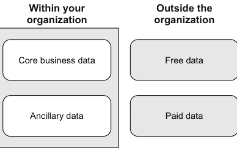

图8.2 组织的数字或物理围墙定义了数据类型之间的边界：组织内部是核心数据和辅助数据，组织外部是免费或付费数据。

每天，人口统计特征的变化要慢得多，因此依赖外部数据源并不成问题。

无论你的数据从哪里来，一条信息都可能决定项目的成败，那就是标签。请记住，如果你正在训练一个监督学习算法，计算机需要根据其他数字（特征）来学习生成一个数字（标签）。大多数时候，你可以通过其他特征来弥补缺失的特征，但如果没有标签，你可能会陷入大麻烦。换句话说，就数据而言，标签比特征重要得多。让我们以房价预测器为例。我们的标签是房屋的售价，而我们的特征可以是面积、房间数量、是否有花园等等。

假设你在设计房产网站界面时，没有想到添加一个字段让用户指定房屋是否有花园。因此，你的数据库中缺少该信息，无法使用它来构建模型。不过，你仍然可以从房屋挂牌表单中使用其他相关特征，包括面积、房间数量和位置。即使没有“花园”字段，你也很可能构建一个相当准确的模型。

另一方面，如果你忘记询问用户销售价格，那就完全无从下手了。没有标签，就不可能构建监督学习模型。

标签可以通过三种方式收集：

- 自然获取
- 巧取
- 付费获取

自然标签是由业务流程生成的。例如，如果你的房产平台在用户删除挂牌信息时询问他们的房屋销售价格，你就会自然地获得标签。谷歌在运行数据中心时自然地保存了其能源性能数据。亚马逊在数据库中存储你购买的每一样东西。这些信息都是为业务运行而存储的，如果需要，可以作为标签使用。

有时，标签不那么容易获取，但你仍然可以想办法巧妙获得。一个例子是亚马逊如何处理产品评价。当你写下对新吸尘器的喜爱评价时，还会加上星级评分（例如从 1 到 5 星）。这个分数可以作为情感分析系统的标签。基本上，你免费向亚马逊提供了输入（文本评价）和标签（星级评分），它可以用这些来构建情感分析技术。另一个例子是 Facebook，它在早期要求用户通过点击面部来标记照片中的朋友。Facebook 本可以直接让你写下照片里是谁，但通过点击面部，你为图像识别算法提供了一个近似的标签。最后，你肯定也意识到，在注册新的互联网服务时，你被要求完成繁琐的任务，比如在图像中找到汽车以证明你是人类。这项服务叫做 Google reCAPTCHA，到现在你可能已经猜到它是用来做什么的了：你免费为公司的机器学习算法提供了标签。

在某些情况下，你唯一的选项是付费让人们标注样本。数据标注的一种常见模式是使用众筹平台，如 Amazon Mechanical Turk，它为你提供了按需、按分钟付费的全球临时劳动力访问权限。在 Mechanical Turk 上，你唯一可以指望的是承包商会有互联网连接：因为他们通常未受过训练，你必须准备培训材料和标注界面，供工作人员选择训练样本的正确标签。图 8.3 展示了两个标注界面的示例，用于收集图像分类和物体定位任务的标签。

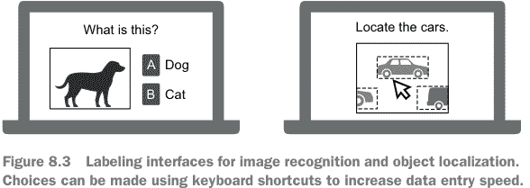

一般来说，众筹平台适合不需要大量培训的标注任务。如果你正在做一个需要高级人类推理的项目（比如在显微镜扫描中寻找癌细胞），你最好组建自己的高技能团队。

表 8.1 总结了三种标注策略所需的成本和时间。

表 8.1 三种标注策略的成本和时间需求

| 标注策略 | 成本 | 所需时间 |
| --- | --- | --- |
| 自然（免费）标签 | 零——你已经在收集这些标签。 | 零——你已经拥有它们。 |
| 巧取标签 | 低且固定——你只需要建立新的数据收集流程。 | 取决于你的流量。 |
| 付费标签 | 高且可变——你根据所需的标签数量支付。 | 取决于标注一个样本所需的时间和你拥有的标注员数量。 |

一旦你清楚地知道从哪里获取所需的数据，下一步就是弄清楚你需要多少数据。

### 8.1.2 我需要多少数据？

根据我们作为咨询顾问的经验，我们经常看到人们掉进 *大数据* 的陷阱。认为拥有大量数据是解锁惊人机会的灵丹妙药是很令人安心的。但正如你将在接下来的章节中看到的，数据 *质量* 通常比数据 *数量* 更重要。

构建 AI 产品所需的数据量很大程度上取决于产品本身。由于有太多变量在起作用，在实践中无法给出诸如“你需要来自 10,523 名客户的数据来构建一个准确率为 93% 的流失预测模型”这样精确的规则。我们可以提供的是指导原则，帮助你建立直觉，以应对你在商业世界中最常见的问题类型的数据需求。我们认为，按照项目将处理的数据类型来组织我们的呈现是有意义的，就像我们在本书的第一部分所做的那样。

让我们先讨论需要 *结构化数据* 的项目，例如预测房价（第 2 章）或客户流失（第 3 章）。你需要考虑三个因素：

- *目标*（你想预测的东西）是数字（*回归*）还是选择（*分类*）
- 对于分类问题，你感兴趣的类别数量
- 影响目标的特征数量

让我们先从特征开始。请记住，结构化数据是你打开 Excel 表格时看到的那种数据，它按行和列组织。思考数据需求的一个好方法是想象一下，如果你能在单个屏幕上查看你的数据集，你希望数据看起来非常瘦长，如图 8.4 所示。你希望行数比列数多得多。这是因为行代表样本，而列代表模型必须学习的特征。直观地说，模型需要学习的越多信息（特征越多），它需要看到的样本就越多，以掌握特征如何影响目标（这意味着需要更多的行）。

如果你没有足够的样本而特征太多，某些列甚至可能是无用的或具有误导性的！例如，考虑第 2 章中那样的房价数据集。添加一列卖方生肖不太可能提高价格预测的准确性。然而，机器学习模型无法先验地得出常识性结论：它们需要从数据中自己弄清楚。只要你有足够的行（样本），大多数模型族确实能够做到这一点，并会正确地“忽略”生肖列。但是，如果你的训练数据太少，模型仍然会尽力估计生肖如何影响价格，得出数值上正确但具有误导性的结论。

作为一个极端的例子，假设数据集中唯一的 100 万美元房屋是由双子座的人出售的。当然，这并不意味着双子座出售的房屋的价格预测应该高于白羊座出售的房屋。如果数据集包含许多百万美元的别墅（即样本很多），大多数模型都能避免这种错误，因为买家会有不同的生肖，它们的影响可以被正确估计。然而，如果你没有足够多的样本，模型可能会“认为”生肖是房屋价值的驱动因素。

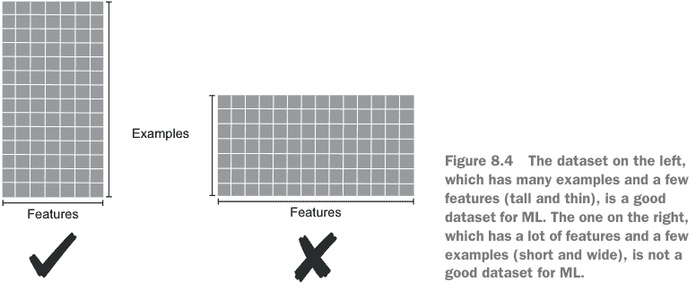

让我们现在深入探讨分类或回归问题的具体细节。在分类问题中，你试图预测一个示例是否属于两个或更多类别。本书中前几个分类示例如下：

+   - 第 2 章中 Square 的贷款资格算法，该算法为客户给出两种类别之一：要么有资格获得贷款，要么没有资格
+   - 第 3 章的流失预测，该预测将客户标记为即将放弃服务或不会放弃

假设你有适量的特征（比如 10 个），对于问题中拥有的每个类别，你至少应预算 1,000 个示例。例如，在仅有两个类别（忠诚 vs 不忠诚）的客户流失模型中，你可能希望至少计划 2,000 个示例。直观上，模型需要处理的类别越多，它就需要看到越多的示例才能学会区分所有类别。

对于回归模型，很难给出类似的经验法则，因为它们可以建模更复杂的情况和现象。许多回归模型基于 *时间序列数据*，一种特殊类型的数据，描述了测量值或数字如何随时间演变。一个例子是第 2 章中 Google 的数据中心案例研究，该研究全天收集环境测量数据。另一个你可能更熟悉的例子是金融数据（例如股票价格）。你可以在图 8.5 中看到时间序列数据是什么样子。

在时间序列数据中，你收集的数据点数量并不像你收集它们的时间跨度那么重要。原因很直观：假设你是第 2 章中来自 Google 的数据中心工程师 Jim Gao，你每秒从数据中心空调系统收集一个数据点。如果你从一月收集到三月的数据，你将拥有近 800 万个数据点（3 个月 × 每月 30 天 × 每天 24 小时 × 每小时 60 分钟 × 每分钟 60 秒）。有了这么多点，你可能会认为你有一个很棒的数据集，事实上你的模型可能非常准确……持续几天。

| Time | Indoor temperature (°C) | Outdoor temperature (°C) | ... |
|------|--------------------------|---------------------------|-----|
| 1:00 pm | 20.3 | 15.4 | ... |
| 1:01 pm | 20.7 | 15.8 | ... |
| 1:02 pm | 21.1 | 16.1 | ... |
| 1:03 pm | 20.9 | 15.9 | ... |
| ... | ... | ... | ... |

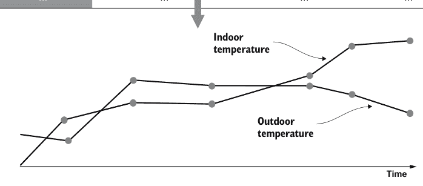

图 8.5 时间序列数据看起来像随时间推移的测量流（例如温度）。图中右侧的值比左侧的新。

但随着夏季临近气温升高会发生什么？模型不知道数据中心在一年中最热的几个月如何表现，因为它仅使用冬季数据进行训练。

谈论媒体中的 AI，最简单的图像分类任务（想想猫与狗）每个类别大约需要几百个示例（著名的 ImageNet 数据集每个类别大约有 700–800 张图像）。如果你选择彼此更相似的类别（比如狗的品种），所需样本数量会飙升至数千，因为模型需要更多示例来同化更细微的差异。如果你利用迁移学习，你是从在像 ImageNet 这样的大型数据集上训练好的现有模型开始训练的（如第 4 章所述），并且你可以在低至数百张图像（甚至对于非常简单的任务，几十张）上获得良好的性能。

为自然语言应用提供类似的指导更困难，只是因为任务的范围更 varied。对于像情感分析或主题分类这样更简单的任务，每个类别 300–500 个示例可能就足够了，假设你使用迁移学习和词嵌入。

现在你已经有了关于应该考虑收集多少数据的指导，你应该明白并非所有数据点在训练模型时都具有同等重要性

添加特别糟糕的示例甚至可能适得其反，降低模型的整体准确性。这是下一节的主题。

## 8.2 数据质量

关于 AI 的流行媒体讨论大多认为，基于 AI 的决策本质上比人类更理性，因为它们基于数学和数据。换句话说，他们坚持认为 AI 是数据驱动的，因此免受人类偏见和偏见的影响。本节中的三个故事旨在说服你并非如此。

机器学习就是在数据中寻找模式，而在有偏数据上训练会导致模型做出有偏决策。我们所说的 *有偏数据* 是什么意思？你已经在第 4 章中看到过一个例子，在那里我们告诉你研究人员收集了一组哈士奇和狼的图片，并着手构建一个模型来对两者进行分类。乍一看，模型表现很好，但研究人员发现它之所以如此，是因为它依赖于所有哈士奇图片背景都有雪，而狼的图片没有这一事实。

事实证明，即使是标准数据集也受到同样问题的困扰：当向神经网络展示没有羊的草原图片时，它喜欢产生羊的幻觉，如图 8.6 所示。同样，如果你向神经网络展示一个孩子抱着羊羔的图像，它很可能会将其分类为狗。这是因为训练数据集有偏见：羊只出现在绿色的田野中，而大多数被人类抱在怀里的动物是狗。因为 ML 模型主要是增强版的模式匹配机器

图 8.6 神经网络倾向于将绿色山丘的图片与羊联系起来，因为它们在训练数据集中大多出现在这里。（来源：https://aiweirdness.com/post/17145190032。）

在类固醇上，模型可能已经学到“羊”只是在山景中一小块白点，而“狗”是任何靠近人类的四条腿的东西。

根本问题是训练集 *不完整*：它缺少有助于模型在（自主）寻找图像中最重要特征的旅程中的重要因素组合。例如，通过添加人们抱着其他动物的图像，以及其他在不寻常地方的羊的图像（在海滩上、在房子里、在船上等等），问题就会得到解决。这样，模型将学会将羊与其背景分离，并正确“理解”羊的真正含义。

让我们开始谈论另一种更微妙、更阴险的数据偏见案例。该项目的目标是创建一个模型，可以通过查看患者身体的照片自动筛选皮肤癌患者。事实证明，当皮肤科医生拍摄患病患者的照片时，他们经常在癌症旁边放置一把尺子作为比例尺。这意味着大多数患病患者的照片中也有一把尺子在画面中。毋庸置疑，模型学会了捕捉尺子的存在，因为这比识别小块的深色皮肤容易得多。模型缺乏识别尺子是混淆线索的能力，因此在未来的患者身上完全无用。

我们喜欢这个案例，因为它证明了看似微不足道的细节如何影响训练数据集的质量，从而影响 resulting 模型。换句话说，今天的 AI 模型对世界的理解如此肤浅，以至于它们的错误可能愚蠢得令人震惊。

在癌症患者和尺子的案例中，至少有经验的工程师能够找到并指出问题。然而，一些偏见来源更难发现。假设所有患病患者的照片都是在荧光灯的房间里拍摄的，而所有健康受试者的照片都是在 LED 灯的房间里拍摄的。图片中的轻微颜色变化肉眼很难察觉，但对任何神经网络来说都是一个有吸引力的线索。结果，你面临潜在的灾难：你认为你的模型学会了发现癌症，但它实际上学会了分类 LED 灯。

这前两个故事的共同主题是，训练数据对你的模型行为有直接影响。就 AI 驱动的公正性和数据驱动的理性而言！在这两种情况下，问题都是数据集中缺乏 *反例*（比如在沥青上行走的羊、孩子拥抱小老虎，以及不同光照条件下的皮肤癌）。然而，数据质量也可能因为更深层次的错误假设而受损。让我们在最后一个例子中看看如何。

在第二次世界大战期间，盟军和轴心国一直在不断寻找改进其战斗机和轰炸机的方法。最重要的目标之一是使飞机更轻，以便它们能飞得更远。因为飞机需要发动机和油箱才能飞行，减少重量意味着移除可能在敌方火力下保护车辆、从而拯救飞行员生命的装甲。工程师们正在思考飞机上哪些区域最脆弱，因此需要更厚的装甲。

军方开始检查受损飞机的框架，并制作了如图 8.7 所示的图像。似乎机身和机翼受到了最严重的损坏。这

现在我们已经讨论了数据战略的主要方面，本章的其余部分将讨论一种不太技术性但同样具有挑战性的资源类型：人类。

## 8.3 招募 AI 团队

本节指导你招募一个团队，该团队具备实施 AI 项目所需的适当技能组合和经验。谈论三种主要技能类别会有所帮助：

- 软件工程——从各种来源提取数据、集成第三方组件和 AI，并管理基础设施
- 机器学习和数据科学——为特定问题选择合适的算法、进行调优并评估准确性
- 高级数学——开发前沿的深度学习算法

你可能会想找一个拥有所有这些技能的人，这种人物通常被称为独角兽：基本上并不存在。然而，你可以找到不同的人（或团队）擅长其中一种或多种技能。

在本书中，当谈论 AI 项目的技术实现时，我们经常提到数据科学家这一神话人物。该人物由《哈佛商业评论》在 2012 年定义为“21 世纪最性感的工作”，每个公司都在寻找这样的人，但没有人能准确描述它是什么。

问题在于，在许多人的观念中，数据科学家是样样通的通才：能够解决涉及数据的任何类型问题，从简单分析到复杂 ML 模型的设计。除了这些，我们还经常希望理想的数据科学家也具备商业头脑。对数据科学家能力的期望在理论上如此之高，以至于在实践中往往无法实现。

我们建议你在以下情况下寻找数据科学家：

- 你尚未确定组织的走向。拥有技能广泛的人可以帮助你在方向更清晰之前保持灵活性。
- 你在技术方面没有极其复杂的需求。如果你只需要有人能够分析中等规模的数据集（最多几 GB）以做出商业决策并构建一些 ML 模型，自称数据科学家的人通常是不错的选择。

如果你 specifically 试图组建一个能够处理更复杂的 AI 项目并将其部署到现实世界中使用的 AI 团队，你可能需要开始招募在不同技能方面专业化的人。我们可以识别出三种主要的人才类别，每种都有自己的技能组合：

- 软件工程师
- 机器学习工程师
- 研究员

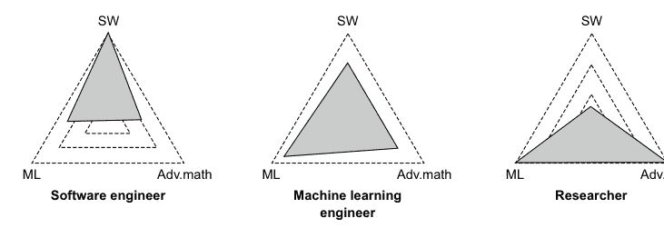

图 8.8 *典型的软件工程师、ML 工程师和研究员在软件工程（SW）、机器学习（ML）和数学方面的技能水平不同。*

图 8.8 帮助你可视化这三个角色各自如何构成三种核心 AI 技能：软件工程（SW）、机器学习/数据科学（ML）和高级数学。

让我们看看这三个人物如何融入 AI 项目的数据/模型/基础设施分解中。*软件工程师*主要在项目的基础设施方面工作，设置从内部或外部来源获取数据的系统，并将 ML 模型集成到你的现有产品或服务中。

还有一种特殊的人物被称为*数据工程师*。这个人通常在你处理海量数据（数十 TB）时被聘用，甚至计算数据库列的简单平均值都可能是一个挑战。因为你可能只会让数据工程师负责项目的基础设施而不负责其 ML 模型，我们将把他们视为处理极大数据集的一种特殊类型的软件工程师。

*机器学习工程师*拥有 AI 和机器学习的专业知识。他们对本书第 1 部分的内容倒背如流（而且还知道更多），他们的工作从清理和分析数据开始，以为你的 AI 项目选择最合适的模型结束。他们还将负责编写训练模型的代码并评估其性能。ML 团队工作的成果通常是一个训练好的模型，以及对其准确性和用于训练的数据的描述。ML 工程师处理模型的性能改进，并将指导你收集更多或更好的数据的努力。虽然一些 ML 工程师也知道如何有效部署模型，但这通常不是他们最喜欢的活动。在这三个人物中，ML 工程师最接近我们之前对数据科学家的描述。

最后，*研究员*是三者中最学术的角色。他们可以利用自己在特定领域的深入研究经验，为尚未在行业中得到充分探索的新颖问题找到解决方案。在项目的三个组成部分中，研究员坚定地处于*模型*阵营，他们可以利用自己对最新进展的了解构建推动可能性的边界的 AI 算法。大多数

研究员擅长构建模型，但缺乏软件工程技能，通常对部署他们的创作或找出所有错误不感兴趣。

研究员和 ML 工程师之间的主要区别在于，前者是科学家，而后者是工程师。这一区别可能看起来很随意，但他们拥有非常不同的技能组合。如果你的项目涉及我们在这本书中解释的任何问题或算法，你需要一名 ML 工程师。所有的研究工作都已为你完成，你只需要有人理解它并将其应用于你的特定问题。如果你正在涉足行业标准问题和数据源之外，你需要一位研究员在手，他对理论有更深入的理解，能够为新颖问题提出创新方法。

话虽如此，这三种人的技能组合肯定会重叠，在某些情况下甚至可以互换。你可以将这三个人物视为不同类型的厨师。如果你想吃一道基本菜肴，任何厨师都可以胜任。随着水平提高，厨师开始在特定菜系或学科上专业化，在米其林三星餐厅，你可能会找到糕点厨师、酱汁厨师、鱼类厨师等等。

让我们看看谁可能构建了我们在本书中设计的某些项目。价格预测器是一个相当标准的 ML 项目（网上也有很多例子），因此你可以选择数据科学家或机器学习工程师。我们在第 3 章中讨论的流失预测和追加销售分类器项目也是如此。第 4 章涵盖了媒体数据，这有点棘手。如果你有大量用户同时使用你的平台，你可能需要一名软件工程师来确保你的基础设施稳定，并且能够承受同时处理数百张图像的负载。算法是一个简单的分类器，任何熟练的 ML 工程师都可以胜任。在第 5 章中，我们研究了文本数据，并看到了不同难度级别的不同项目想法。对于像文本分类器或情感分析这样最简单的项目，你可以继续使用 ML 工程师，但如果你想推动最先进技术的边界并尝试构建超级强大的 brokerbot，你可能还必须聘请研究员。在第 6 章中，我们谈到了推荐系统。简单的模型可以由一名 ML 工程师构建，而如果你想构建特别复杂的模型，你可能会寻找研究员加入团队。有可能你需要推荐系统极其快速和稳定。如果同时有大量用户使用你的服务，并且速度至关重要，这就是这种情况。一个例子是 Facebook 的信息流，它需要在你——以及数百万人——滚动时几乎瞬间推荐内容。在这种情况下，软件工程师变得极其重要，因为他们是能够构建能够承受此类负载的基础设施的人。

要全面了解这些角色，请参阅表 8.2，其中突出了最适合每种人才类别的任务类型。

**表 8.2** 当任务与软件工程师、机器学习工程师和 AI 研究人员的经验及背景相符时，他们能发挥出最好的水平。

| 软件工程师 | 机器学习工程师 | AI 研究人员 |
|---|---|---|
| **常见背景**  统计学、数学、物理  **任务**  构建和测试机器学习算法，制定数据策略，监控结果  复杂的 IT 基础设施，需要极高的性能（例如自动驾驶汽车，或像 Facebook 这样流量巨大的服务），海量数据集（数据工程师） | **计算机科学**  **开发新算法，研究新解决方案**  与业务问题相关的机器学习问题，且可用最先进的机器学习技术解决，如本书中讨论的大多数示例 | **计算机科学、统计学**  实现应用程序，将其与现有基础设施集成，构建数据库  **项目匹配度**  复杂——当解决业务问题所需的技术尚未开发出来时（例如复杂的 NLP 任务） |

一如既往，请记住团队的最佳技能组合会随着项目的演变而改变，甚至随着项目不同组件的完成而改变。像这些因素将驱动您决定聘请专家顾问还是招聘全职团队成员。我们建议不要犯常见的错误，即在软件工程质量基础尚未夯实的情况下就聘请顶尖的 AI 研究员，因为新员工很可能因缺乏合适的生产环境基础设施而感到沮丧，最终会离职。一种常见的策略是优先招聘更通用的角色，让他们熟悉组织的整体背景。对于 AI 建模等专业知识，依靠顾问会更容易，因为他们的技能更容易在多个组织间迁移（毕竟，无论是分类黄瓜还是行人，图像分类模型都是一样的）。

最后，不要低估资历的重要性。虽然一些任务（如数据清洗）可以由初级人员完成，但 AI 项目很容易变得杂乱无章，如果没有资深人员的监督，你有风险最终得到不可维护的代码。现在省钱可能会在未来浪费更多的金钱和时间。

本章介绍了任何成功 AI 项目的主要要素：数据收集策略、软件基础设施以及与现有处理流程的集成，以及一支技术娴熟的团队。我们还警告了许多仍在摸索 AI 的公司所面临的陷阱。下一章提供了将这些要素整合成一个 AI 项目的配方。

# 摘要

- AI 项目的技术实现主要有三个组成部分：数据、模型和人才。
- 连贯的数据策略会考虑到自有数据和外部数据的相对优缺点。
- 除了数量外，收集和标记数据时其他主要关注点是偏见类型、覆盖范围和一致性。
- 优秀的 AI 团队包括拥有不同背景和技能的成员：软件工程师、机器学习工程师（或数据科学家）以及研究人员。

## 开始——AI 实施策略

#### 本章涵盖

- 构建 AI 算法、从供应商购买或使用开源之间的权衡
- 制定精益 AI 策略以最小化风险
- 利用 AI 的良性循环优势
- 从 AI 失败中吸取宝贵教训

前两章提供了您定义和实施 AI 项目所需的所有基础模块。现在是时候将所有内容整合起来了。在本章中，您将学习如何决定哪些组件应该自建，哪些应该从第三方购买，以及如何管理实施阶段。您还将熟悉缺乏经验的 AI 构建者面临的典型障碍。读完本章后，您将感到足够自信，能够在*明天*就启动您的项目。

## 9.1 购买或构建 AI

借用一位智者曾经说过的话，有时成功完成项目的最佳方式就是根本不要开始。作为 AI 的倡导者，您可以做出的最具影响力的决定之一，就是依赖 AI 供应商提供的产品和服务，避免构建 AI 项目所需的部分或全部技术。这一决定适用于项目的三个组成部分：数据、模型和基础设施。

本节将教您如何从战略角度思考“自建还是购买”的问题。实际上，我们认为当前 AI 服务市场的状况要求我们增加第三个选项：借用。在接下来的小节中，当我们介绍这三个选项时，需要牢记的核心概念是实施风险。当您决定购买或租赁现成的技术和基础设施时，您放弃了灵活性和知识产权，但显然也规避了自行投资技术带来的风险。

表 9.1 总结了购买（Buy）、借用（Borrow）和构建（Build）解决方案之间的主要差异。您可以随时回来参考此表，我们将在接下来的三个部分中详细解释。

#### 表 9.1 比较购买、借用和构建策略

| | 购买 (Buy) | 借用 (Borrow) | 构建 (Build) |
|---|---|---|---|
| 需要数据 | 否 | 是 | 是 |
| 需要模型开发 | 否 | 否 | 是（潜在使用开源模型） |
| 需要基础设施 | 否 | 否 | 是（潜在使用托管基础设施） |
| 风险 | 技术风险低，但受限于供应商的战略 | 机器学习平台同购买，开源技术风险 | 技术风险最高 |
| 所需的团队技能集 | Web 开发 | Web 开发 + 少量数据科学 | Web + 机器学习 |
| 前期成本 | 无 | 数据收集 | 数据收集和模型开发 |
| 可变成本 | 极少 | 中等 | 在基础设施/云投资中摊销 |

### 9.1.1 购买选项：交钥匙解决方案

实施 AI 技术最简单的选项是使用由 Google、Microsoft 或 Amazon 等技术提供商提供的交钥匙解决方案。这些“购买”解决方案也称为机器学习即服务（MLaaS）。

在 MLaaS 服务中，科技公司构建通用机器学习算法，并负责数据收集、训练和工业化。您支付费用以使用他们的技术来解读您的数据。

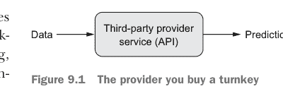

图 9.1 您购买交钥匙解决方案的提供商负责所有技术细节：您只需发送带有数据的请求并获取响应。

正如您在图 9.1 中看到的，您所要做的只是发送想要分析的数据，然后从他们的机器学习模型获得预测。从技术角度来看，您将使用应用程序编程接口（API）将数据发送给提供商并获取答案。例如，几乎每家科技巨头（Microsoft、Google、IBM）都提供计算机视觉 API：您发送一张图像，他们返回其内容。一些计算机视觉 API 特别高级，可以提供有趣的信息，例如根据图像中人物的面部表情估计其情绪。

几年前，我们的一个基于机器学习的副项目是为希望获得采访或讲座文字记录的记者和学生提供语音转录服务。在实现了 Web 应用程序并确认产品需求后，我们在寻找能够实际执行转录的 AI 提供商时，受到了选择过多的“宠坏”。Google、Amazon 和 Microsoft 都提供数十种语言的语音转录服务，还有几家专注于特定细分市场的较小提供商也是如此。

不幸的是，当使用 MLaaS 解决方案时，您面对的是传说中的“黑盒”：您无法控制模型的构建方式、其性能以及为其提供服务的 基础设施。好消息是，在这种情况下，您几乎什么都不需要做，因为提供商已经完成了所有艰苦的工作：收集数据、训练模型以及搭建用于服务的 基础设施（图 9.2）。剩下的任务是将解决方案集成到您的产品中，这是任何 Web 开发人员都能处理好的。这使得您有可能在几小时内而不是几周或几个月内获得您的 AI 应用的第一个快速原型。

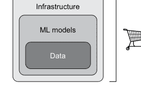

使用“购买”解决方案时，您为数据、在其上训练的机器学习模型以及模型运行的基础设施付费。

图 9.2 购买解决方案时，提供商负责所有三个组成部分（数据、模型和基础设施）。

为了让您了解作为交钥匙解决方案提供的服务类型，让我们看看在此撰写时 Google 的价格表（非详尽）：

- 每转录一分钟语音转换为文字的费用为 2 美分
- 每份文档 1 美元用于自然语言理解：从文档中提取结构化数据并执行情感分析

* 每百万字符的翻译费用为 $20
* 每张图片检测标志或人脸的费用为 $1

这里有两个主要的要点。首先，所有交钥匙解决方案都专注于解决通用问题。这是有道理的，因为对这些产品进行打磨和营销需要大量投资，供应商只有在认为市场上有广泛兴趣时才会进行投入。例如，谷歌永远不会提供“黄瓜分拣人工智能服务”，因为市场需求永远不足以收回开发成本。相反，为他们提供具有更广泛兴趣的服务（例如识别猫、狗或汽车等日常物体）更合理。

其次，从财务角度来看，购买（Buy）解决方案几乎没有固定成本，且变动成本高于其他策略。事实上，使用这些解决方案时，在数据收集、数据清洗、机器学习工程和部署方面不需要付出努力。你所需要做的就是集成一个 API：这对于普通网页开发人员来说只需几个小时即可完成任务。正如你在上一份价目表中看到的，所有费用都是按使用量付费的。

从技术角度来看，与这些解决方案相关的风险水平极低。因为你使用的是由知名科技公司构建的产品，所以你可以相当确信能获得最先进的性能。当然，只有当你的应用程序符合该服务最初设计任务时，这一点才成立。

注意：外包所有技术风险并不意味着购买解决方案没有风险。所有购买解决方案都有一个共同的重大威胁：由于你不拥有底层技术，你将受制于他人的议程。他们可能会决定停止你正在使用的产品，并让你自生自灭。

我们最喜欢的一个警示故事涉及旧金山的初创公司 Smyte。该公司开发了机器学习模型和一个平台，通过主动识别评论和互动中的恶意趋势，帮助在线社区对抗垃圾信息、欺诈和骚扰。当 Smyte 在 2018 年被 Twitter 收购时，客户醒来发现该平台已关闭，因为 Twitter 决定只专注于满足其内部需求。像 Meetup 和 Zendesk 这样的高知名度客户不得不四处寻找替代品，因为他们一直依赖的交钥匙解决方案突然停止响应他们的查询。

提供商关闭或更改产品的风险会导致对其服务的*锁定效应*。锁定效应还延伸到安全性和隐私领域，因为交钥匙解决方案仅限于在提供商的网络和云基础设施内运行，这在医疗保健和国防等注重安全的行业中可能无法接受。

然而，这些解决方案令人难以置信的速度和低廉的固定成本，使其成为用于快速原型的完美选择，以验证你的产品的市场需求。

### 9.1.2 借用选项：机器学习平台

如你所见，交钥匙解决方案几乎可以保证在许多通用人工智能任务上实现最先进的性能。那么，如果你的需求更具体，情况会怎样呢？例如，第 4 章中描述的黄瓜分类任务该怎么办？正如我们所说，你在亚马逊的人工智能平台上找不到“黄瓜质量分类”产品，因为该产品的市场将非常小众。

相反，你可以选择使用机器学习平台产品。与交钥匙解决方案相比，机器学习平台允许你上传自己的训练数据，以根据你的具体需求优化现成的模型。在黄瓜分类的情况下，你将能够利用谷歌的图像分类模型，并使用标记好的黄瓜数据集对其进行微调。从人工智能的角度来看，机器学习平台通常利用迁移学习的优势，让像您这样的客户能够利用提供商在建模方面的巨额投资，同时适应利基需求（如黄瓜分类）。

从集成的角度来看，机器学习平台与购买解决方案类似：模型托管在提供商的云中，你只需向它提交请求（图 9.3）。机器学习平台的价格比交钥匙解决方案高两倍到四倍，以反映其增加的复杂性。但定价模式相同：你只需为每个请求支付少量费用，并根据你想要训练的海量自定义数据量支付一定的费用。

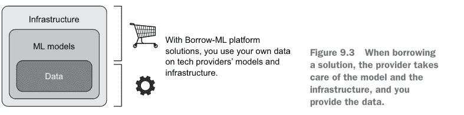

虽然机器学习平台本身不需要前期投资，但你需要为数据收集和可能的标记做预算，以便利用其可定制性。机器学习平台产品通常解决的广泛问题类别与交钥匙解决方案相同；例如，你可以上传自己的文本数据库来改进情感分析，或提交多语言语料库来提高翻译准确性。

我们为机器学习平台创建一个“借用”类别，因为你正在投资一个“借用”的平台：你仍然不拥有模型的知识产权。然而，你确实拥有训练数据，在许多情况下，这才是你真正的资产。

话虽如此，机器学习平台的锁定效应可能比交钥匙解决方案更强。后者非常通用，即使你的提供商关闭，你也很有可能找到竞争对手提供的类似服务。另一方面，机器学习平台中的“秘方”与你的训练数据之间的交互可能更难复制。

人工智能提供商通常宣传机器学习平台是适合使用第 2 章和第 3 章中描述的结构化业务数据的项目的理想选择。由于这些模型的计算需求通常适中，机器学习平台提供自动机器学习产品，尝试在您的数据上运行多个模型并自动选择最佳的一个。值得一提的是，如果一个简单到足以通过这些自动工具解决的问题，平均的机器学习工程师可能只需付出有限的努力就能获得类似的性能。

在我们帮助企业进行项目的过程中，我们发现对于处理结构化数据（通常是营销、销售或核心业务数据）的问题，最大的工作量远远在于数据的清洗和准备。

在一个案例中，我们需要为一个制药公司构建一个处理呼叫中心数据的算法。这些数据已经收集了 14 年，但没有人花心思从中获取价值：它只是一个用于报告的沉没成本。当一位开明的经理提出构建一个人工智能算法时，我们面临的首要挑战是试图梳理 14 年的历史，以理解数据背后的逻辑，并清洗异常值和潜在的数据输入错误。如果这还不够挑战的话，多年来该公司使用了两个 CRM 提供商，因此收集的数据在格式和字段上存在不一致。简而言之，让数据准备好使用花费了我们三个月的时间。一旦数据准备好，构建一个表现良好的模型大约只需要两周。

找到合适的模型并进行调整可能出奇地快。机器学习平台无法免除你为机器学习应用准备数据的初步工作，因此它们在时间和前期成本方面的节省微乎其微。然而，由于它们的商业模式是按使用量付费，所以确实会增加变动成本。

### 9.1.3 构建选项：卷起袖子

如果购买或借用解决方案都不适合你的项目，你就不得不走*构建*（Build）路线。通过构建自己的模型，你获得了对技术的完全灵活性和控制权。一般来说，构建自己的模型意味着你需要处理所有三个组件：数据、模型和基础设施（图 9.4）。

以下是找不到购买或借用解决方案的两种最常见情况：

- *你使用领域特定数据* — 例如，如果你在从事 3-D 核磁共振成像或其他医学诊断工具，你将使用三维黑白图像。你不太可能找到支持它们的交钥匙或机器学习平台产品。
- *你有非常特定的需求* — 例如，你可能想要构建一个能够识别肺部 X 光片中的癌症并突出癌症位置的机器学习算法。最后这一点是一个目标定位任务，是一个少数或没有提供商覆盖的利基应用。

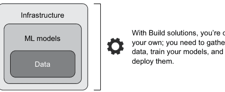

图 9.4 在构建解决方案时，你的团队必须照顾所有三个组件：数据、模型和基础设施。

从开发风险的角度来看，**构建（Build）** 策略的风险最大，因为你的团队需要为产品承担全部责任。幸运的是，你们通常不会孤军奋战，可以依赖两个重要的加速器来推进进度：开源模型和托管基础设施。让我们看看它们各自如何帮助你构建项目。

**开源模型**是免费可用的软件（通常还包括训练数据），用于解决特定问题。只要其许可证与你的预期用途（例如商业用途）兼容，你的工程师就可以直接复制代码，按需进行自定义，并将其用于你的产品中。如果你对开源世界不熟悉，可能会好奇为什么有人愿意免费提供他们的工作。好吧，开源模型的两大主要贡献者是大型科技公司和学术界。像 Google 和 Microsoft 这样的技术供应商发布尖端产品，以增强其作为 AI 领导者的声誉，并吸引用户转向他们的交钥匙（turnkey）产品和机器学习平台。学术界的研究人员发布软件是为了提高对其工作的关注度，从而吸引资金和认可。对于更小众的情况，你可能甚至找不到任何开源代码。在这种情况下，你最好的选择是让研究人员去挖掘学术社区中相关的科学论文。通常，论文中对该模型的描述就足以让你的机器学习工程师以较小的精力复现它，然后你就可以开始收集训练数据了。

开源代码通常是快速启动开发工作的绝佳方式。你的团队可以从一个可用的解决方案开始，并进行迭代以适应你的具体问题。与机器学习平台相比，调整模型的能力使团队中的机器学习工程师能够调试问题并试验更改以提高其准确性。

通常来说，如果你自己构建模型，你还必须为其提供并维护基础设施，这通常意味着管理你自己的云资源。**托管基础设施**通过让你使用供应商的云来运行自定义模型，从而将软件工程师从这一负担中解放出来。只要你的模型符合供应商的技术要求（例如在编程语言方面），你就可以使用他们的硬件和网络来运行你的模型。这是可行的，正如我们在第 8 章中解释的那样，构建 AI 的大部分魔力在于拥有合适的数据并创建一个良好的模型。管理执行过程的软件在过去几年中已经迅速标准化，从而变得商品化。

开源代码和托管基础设施可以大幅减少构建自有模型所需的投入，为你节省团队数年的工作量。最重要的是，它们还能给你带来信心提升。在项目初期，知道别人已经能够解决同样的问题，会消除许多关于其可行性的疑虑。到了项目后期，拥有将大部分部署工作外包给供应商的选项，能让团队更快地奔向终点线。

归根结底，你最终落地于哪种场景（构建、借用或购买）取决于每个 AI 项目的具体情况。下一节将指导你做出这一决策。

## 9.2 使用精益策略

如何选择购买、借用和构建这三种策略中哪一种最适合你的团队和你正在处理的项目？甚至是否存在一种单一策略，能够适应项目的所有阶段？本节引入了我们对这个问题的答案：**精益 AI 策略（Lean AI Strategy）**，这是我们开发的一个框架，旨在帮助你增量地构建 AI 产品。

“精益（lean）”一词源自**精益制造（lean manufacturing）**，这是一种诞生于日本制造业（特别是像丰田这样的汽车公司）的哲学，旨在在不牺牲效率的前提下最小化生产浪费。埃里克·莱斯（Eric Ries）在他的开创性著作《精益创业》（*The Lean Startup*，Crown Business, 2011）中将这一理念应用到创业界。Ries 介绍了一种管理创新的过程，鼓励通过持续实验来测试市场和技术假设。这一策略的核心洞察在于，即使是 CEO 和创始人对市场真正重视什么也知之甚少，因此他们最好快速构建产品的第一个迭代版本，看看客户是否喜欢，然后根据反馈进行改进。

精益 AI 策略拥有相同的目标：它是在实施 AI 项目的同时最小化风险和资源浪费（时间、资金和团队士气）的过程。遵循精益 AI 策略，你将学会为给定项目选择最佳的实施计划（构建、购买或借用）。

在项目开始时，第一步是理解与每个 AI 开发路径相关的技术风险。每个选项都伴随着一定的复杂度，从而带来短期风险，同时也赋予你一定程度的灵活性，这与长期负债有关。图 9.5 展示了这些风险与灵活性之间的关系。

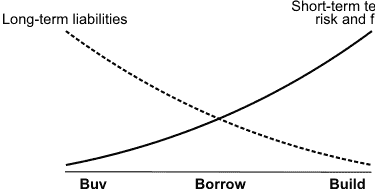

图 9.5 在风险和灵活性方面，构建与购买谱系上的各点堆叠在一起。

现在，想象你刚开始实施一个 AI 项目。这是不确定性最高的时刻，主要由于以下三个因素：

- **商业风险（Business risk）**——我的解决方案具有商业价值吗？
- **工作流程风险（Workflow risk）**——我能否成功地将我的解决方案整合到当前业务中？
- **技术风险（Technological risk）**——该技术能否工作得足够好？

第 7 章中介绍的方法旨在最小化商业风险和工作流程风险，但没有什么比得上与现实世界中真实人员的测试。为了

将你的新产品展示给真实用户，你通常至少需要构建一些技术。精益创业引入了最小可行产品（MVP）的概念：你能够构建的、同时仍能向客户交付价值的最小产品。在 AI 项目领域，用最小可行 AI（MVAI）来思考是有用的：可能驱动你第一个 MVP 的最小且风险最低的技术。

### 9.2.1 从购买解决方案开始

精益 AI 策略最重要的角色是让你走上构建 MVAI 的正确道路。鉴于高度的不确定性，专注于短期策略并推迟长期决策直到创意被客户验证为可行之后，是一个好主意。如果你查看图 9.6，这意味着从购买解决方案开始。

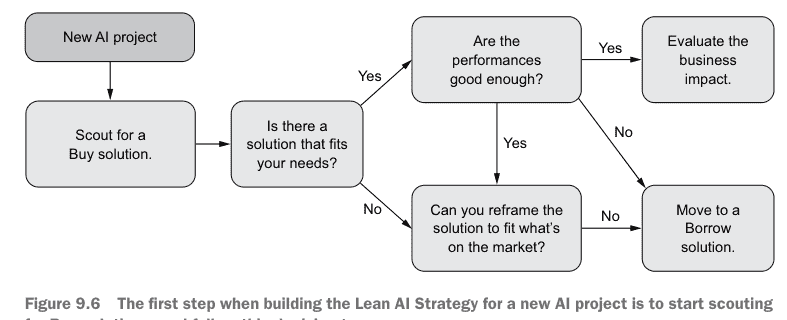

我们在第一部分教给你的技术词汇足以开始在 Google 上寻找购买解决方案。例如，假设你运营一家食品外卖初创公司，并希望将食品评论分类为正面和负面。正如你在第 5 章中回忆到的，这种应用程序称为情感分析。搜索购买解决方案的一个好查询是“Sentiment Analysis API”（情感分析 API），这将返回多个结果。在许多情况下，你会找到来自大型技术提供商（如 Google、Amazon 或 Microsoft）以及小型专业公司的交钥匙产品。在 AI 世界中，你真的应该考虑这两者。大型玩家具有规模优势，但小型玩家可能因为其数据收集和工程努力更贴近你项目的具体目标而占优。

如果你在不断增长的 AI 提供商提供的产品中找到你正在寻找的东西，那就太幸运了。采用其中一个很可能是开发你的 AI 项目初始迭代的最佳选择。

在其他情况下，你可能找不到适合你项目所需的精确 AI 任务的解决方案。这并不罕见；毕竟，提供商只投资于构建具有巨大潜在市场的产品。如果你的项目属于这种情况，你有两个选择：

- 重新构建你的 AI 项目，使其适应现有的购买提供内容。
- 在技术风险阶梯上向上移动，寻找借用（Borrow）解决方案。

你应该首先考虑选项 1。是否有办法重新措辞你的 AI 任务，以便你可以使用市场现有的内容而不损害你的价值主张？例如，假设你是一家电信公司，想要测试超快速的客户服务：用户写一条消息，AI 自动将客户路由到最佳的呼叫中心代理；例如，“我的互联网不起作用”将是技术问题，而“我想激活新优惠”将是商业诉求。除了拥有针对你特定项目的完整产品的专业 AI 公司外，你不太可能找到针对此精确任务的交钥匙产品。

另一方面，当今市场上可以找到几种非常准确的情感分析算法。虽然这些算法不能解决 100% 的任务，但如何使用它们将愤怒的客户直接路由到客户支持，而将中性客户路由到人工操作员进行手动分类呢？显然，这不是最终解决方案，但它允许你测试基本假设：

- **商业假设（Business assumptions）**——用户是否愿意通过自动系统与客户服务互动，还是完全忽略它？
- **工作流程假设（Workflow assumptions）**——新系统是否为操作员节省了时间？

如果你无法像我们在这个例子中那样缩小问题，是时候考虑切换到借用解决方案了。

当你尝试过购买解决方案但表现不足以满足项目要求时，你也可能考虑转向借用解决方案。但首先，你应该重新审视“足够好”意味着什么：即使 AI 并不完美，从人类角度来看有明显的错误，该项目对组织来说仍然可能是成功的。即使情况并非如此，也花点时间拍拍自己的背。得益于精益 AI 策略和对交钥匙模型的关注，你已经以很少或没有前期技术投入的方式发现了关于你项目的重要技术信息。接下来，让你的团队中的机器学习工程师尝试找出为什么购买产品不起作用的确切原因。请记住，购买产品是大量工程投资的成果，因此你的团队只在这单一情况下有望做得更好：缺乏针对特定问题的训练数据（例如，黄瓜分类，或 NLP 任务中的小众词汇）。例如，如果你发现一个购买模型在将文档从英语翻译成法语方面表现不佳，你不太可能超越 Google 并通过添加更多训练数据来改善情况。如果你确定缺乏任务特定的训练数据正在拖累你的项目，借用模型可以成为你解决问题的出路。

### 9.2.2 升级到借用（Borrow）方案

请记住，借用模型的力量在于允许你使用自己的训练数据来增强 AI 提供商的现有模型。我们将这些可定制的产品称为机器学习（ML）平台。如果你能很好地收集（并可能标注）与项目高度匹配的数据，你将会得到两全其美的结果：既利用了多年来对预置模型的投资，又能在特定任务上获得良好的性能。作为额外的好处，借用模型让你免于设计、部署和维护项目基础设施。通过使用借用方案，你还将开始积累内部 AI 专业知识，推动数据收集工作，并建立起关于构建、比较和评估各种 AI 模型性能的组织知识。

换言之，从购买（Buy）升级到借用（Borrow），让你可以在快速获得答案的同时迭代项目的 AI 组件，因为机器学习平台本质上是一键替换即插即用模型的工具。要找到合适的借用方案，请从你为购买方案所做的搜索开始，然后在此基础上继续。请记住，机器学习平台的选项可能比即插即用模型更加有限，因为为迁移学习添加定制点对 AI 提供商来说工作量更大。

如果你甚至无法为 AI 项目找到借用方案，你就不得不做出在评估购买选项时曾面临的相同决定：你是否能重新定义你的解决方案，使其适应市场上的现有产品？如果不能，你唯一的办法就是再次攀登技术风险阶梯，开始构建自己的模型，如 9.7 图所示。

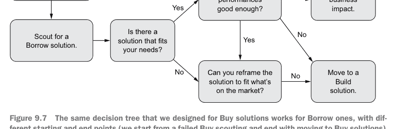

图 9.7 我们为购买方案设计的同一棵决策树同样适用于借用方案，只是起点和终点不同（我们从失败的购买探索开始，以转向购买方案结束）。

### 9.2.3 亲自动手：构建（Build）方案

如果你达到了精益 AI 战略的这一阶段，剩下的决定就不多了。你的项目不符合市场上任何购买或借用产品，而且你无法重新定义项目以使其符合。这意味着你的团队成员将不得不卷起袖子，开始自己构建模型（很可能利用第 8 章中描述的开源社区和托管基础设施）。

由于购买是精益 AI 战略的“终点”，我们要对可能将你的项目引向此处的每一条路径进行评论。最典型的情况发生在你项目所使用的数据不常见或非常特定的时候。考虑一下一个旨在通过鸟鸣声对鸟类物种进行分类的音频应用。不太可能有机器学习平台产品支持从动物声音进行的迁移学习，即插即用解决方案也不会提供这种功能。

在其他情况下，我们看到一些团队拥有可用的借用方案，但他们希望尝试构建自己的模型，期待降低成本或提高性能。虽然自行构建模型（并管理其运营的各个方面）确实可能降低可变成本，但许多团队犯了忽略为创建之前所享受的借用方案所做的巨大前期投资的错误。感知到的性能提升往往也是虚幻的：市场上任何借用模型都经过了广泛测试，以验证其在各种场景中的准确性。很容易对早期的积极结果感到兴奋，并低估将构建方案做到达标所需的工程工作量。

向构建方案迁移的最佳方法是将其视为一个副业，而不要将整个 AI 战略都押注在它上面。这将有助于通过持续监控内部工作并与借用方案进行对比来降低迁移的风险。

除了这些技术原因外，有时组织或业务问题会使构建成为唯一的选择。例如，即插即用模型和机器学习平台通常都在 AI 提供商的云资源内运行。这一因素使得它们对隐私或安全敏感的行业（如医疗或国防）来说是不可接受的，因为敏感数据必须与提供商共享系统才能运行。其他组织可能会决定投资于创建第一方知识产权（IP），即使这种选择不是实施给定项目的最便宜或最快的方式。

我们真的无法反驳这种战略观点，但请记住，在做出一个可用的原型后，你会有充足的时间来开发自己的知识产权。即使从长远来看你希望开发自己的模型，我们仍然鼓励你从遵循精益 AI 战略开始，并以购买方案启动你的工作。这可能只是一个垫脚石，但拥有一个可以快速使用的原型来测试你最紧迫的业务假设，将是无价的。

最后提醒一句，我们警告你不要太深入研发（R&D）的兔子洞。在你决定必须构建自己的模型后，很容易过度发挥，变得越来越有雄心。实验尖端的 AI 模型是令人兴奋的，对人类大有裨益。作为额外的收获，你的团队会非常振奋，投入 110% 的精力。然而，如果你正在读这本书，你和你的组织很可能还没有准备好着手进行一个多年的研发项目，以验证 AI 的新用途或全新的算法。考虑暂缓这些“登月计划”项目，等你的组织中的 AI 文化更加成熟后再去拾取它们。

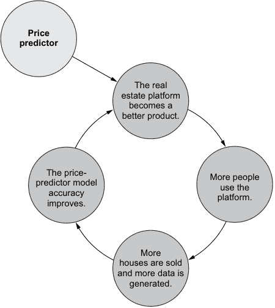

其洞察力在于，市场并非由一组同质人群组成；相反，它被划分为具有相似特征的个体群体：

- *创新者*——这些冒险者具有很高的社会地位，善于社交，且财务流动性高。这些就是在新 iPhone 发布前一天就在 Apple Store 前排长队的人。
- *早期采用者*——他们也是冒险者，善于社交，且购买力高。他们的选择比创新者更保守，所以他们可能不会在新 iPhone 发布前一天排长队，但可以肯定的是，他们会在第二天购买。
- *早期大多数*——这是一个庞大群体，社会地位和购买力参差不齐，他们在创新发布一段时间后才采用它。他们重视技术进步给生活带来的改进，但不想承担风险。这些人是新手机发布几个月后等待看其他人评论的人，或者是几乎分辨不出与旧款差异的人。
- *晚期大多数*——另一个庞大群体，主要是怀疑论者和风险厌恶者。他们更重视安全而非创新，在确信能获得回报之前不愿切换到新技术。这些人是使用落后两到三代智能手机的人。
- *落后者*——最后采用创新的人。这些人是仍然使用机械键盘手机的人，并在手机坏掉时更换促销中最便宜的型号。

1991 年，Geoffrey A. Moore 出版了*跨越鸿沟：面向主流客户营销和销售高科技产品*，该书建立在上述理论之上，并增加了一个简单却至关重要的洞察：在引入技术创新时，从早期采用者过渡到早期大多数并非易事，许多创新都因此失败。Moore 引入了*鸿沟*的概念：当一家公司已经触达了市场中的所有创新者和早期采用者，并需要触及早期大多数时，一段充满不确定性的艰难时期，如 9.11 图所示。这个鸿沟的存在是因为早期市场（创新者和早期采用者）和晚期市场（早期大多数、晚期大多数和落后者）是由完全不同的目标驱动的。前者重视创新及其带来的价值，而后者重视安全并厌恶风险，因此很难让他们看到你的创新产品的价值。

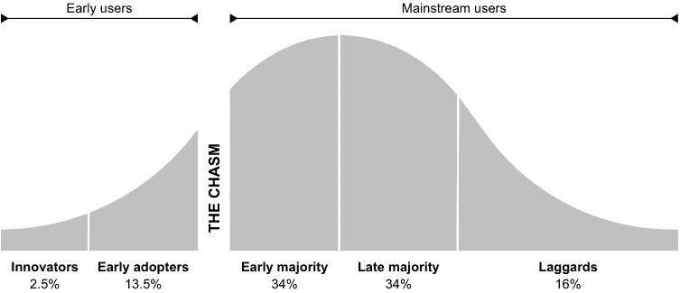

**图 9.11** 技术创新市场被划分为其五个客户群体。在早期采用者之后，我们到达一个鸿沟：从早期用户切换到主流用户时的高不确定性时刻。

现在，让我们回到我们的房地产平台，看看我们的基于机器学习的创新如何与我们引入的五个群体相关。假设你的第一个算法不如人类经纪人：假设其预测有 10% 的误差范围，而人类经纪人仅有 5% 的错误率。匆忙的房主不会担心错误率的增加，他们对立即获得数字而不必等待人类经纪人上门更感兴趣。或者，他们可能是急于尝试你提供的新 AI 功能的科技爱好者。他们是启动良性循环的创新者和早期采用者。

在这些开始使用你的产品后，你将开始获得更多数据。你可以利用这些新数据再次训练你的 AI 算法。假设你的算法性能得到改进，更接近血肉之躯的经纪人，例如误差范围降至 7%。既然你开始缩小与人类经纪人的准确性差距，即使不那么大胆的用户也会选择用那 2% 的准确性换取速度的提升。结果，再次将产生更多数据，你可以用来持续改进模型。

现在想象一下，凭借通过原始机器学习模型收集的新数据，你终于达到了人机平价的关键里程碑：你的算法与专家经纪人一样出色。在这个阶段，使用你的产品是理所当然的；用户获得的性能与专家经纪人相同，但只需一秒钟即可获得，无需安排拜访。这是吸引早期大众所需的性能水平：他们愿意使用新技术，只要它与现状相比没有劣势。

与其他任何商业冒险一样，正确地向人们传达你的技术性能至关重要，并且他们能够理解它。这并不简单，你不应该认为这是理所当然的。

如果你成功传达了技术的潜力，卖家会想要使用你的模型来为他们的房屋获得即时报价。你能猜出结果会怎样吗？你说对了：更多的数据。现在，你的算法可以从这些额外数据中受益，从而甚至超越人类准确性。恭喜，你现在拥有了一个超人类的人工智能房屋价格预测器。图 9.12 显示了技术性能与采用之间的自我强化关系。

如果你没有发布第一个原始产品，你就永远不会启动这一过程，从而导致超人类人工智能价格预测器的诞生。因此，考虑到人工智能良性循环很重要，即使它们不完美，也要发布人工智能产品。

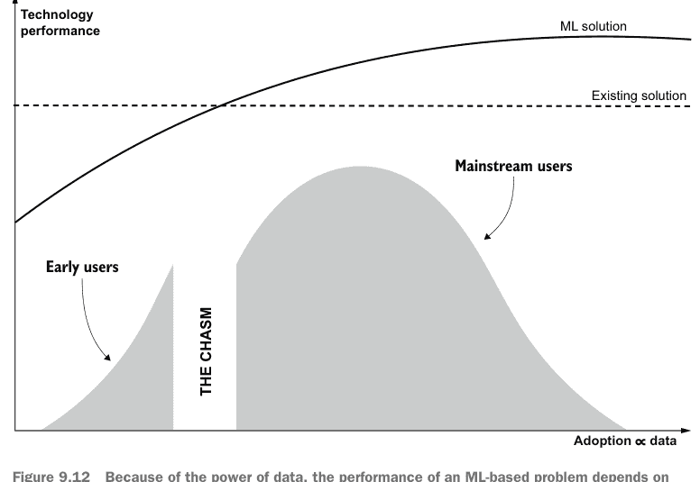

图 9.12 由于数据的力量，基于机器学习的问题的性能取决于市场采用。早期用户可能愿意在性能上做出妥协，但随着他们使用产品和数据增加，你将改进技术，直到你能够进入主流市场。

尽早发布，并设计你的策略，使每次产品迭代都有助于改进你的算法，直到你的优势大到无法被忽视。

如果你确信获取更多数据是让你在竞争中获得优势的关键，你可以考虑非常规的方法来获得最初的早期采用者。一个极端的策略是大幅折扣你的新服务，甚至免费赠送，以便你能迅速吸引早期采用者。启动人工智能良性循环如此重要，以至于你甚至可能计划付钱给人们，让他们开始使用你的产品。在人工智能良性循环启动后，你的技术开始快速改进，主流细分市场开始使用你的新服务并为其带来的价值付费后，你将弥补这些初始损失。

## 9.4 管理人工智能项目

精益人工智能战略帮助你决定是构建、借用还是购买技术解决方案。无论选择哪种选项，你仍然需要做一些开发工作。例如，即使你为房屋价格预测问题采用了借用解决方案，团队仍需要编写管道代码，将模型的输出连接到 Web 应用程序中。

业内最不为人知的秘密之一是管理工程师就像赶猫一样。本节将为你在人工智能项目实施阶段的日常运营提供一些指导输入。即使你不想亲自承担这一责任，或决定将整个工作外包给顾问，了解现代软件工程实践仍然很有用。

精益哲学也延伸到实施阶段：最好将开发分解为个人团队成员可以在一到两周内完成的块。这种快速迭代节奏使得能够跟上组织不断变化的需求，甚至来自产品客户和用户的反馈。

*精益*还意味着尽快发布软件——在许多情况下，只要 MVP 就绪。 我们见过许多团队无休止地追求完美，从而延迟了从用户那里获得有意义信息的关键时刻。

精益方法为你提供了一个概念框架，强调快速迭代、持续改进和对反馈的关注。但在人工智能任务组的日常活动中，这在实践中是如何运作的？ 本书不是关于项目管理的，但我们认为让你了解香肠是如何制作的很有用。

一种与精益人工智能战略原则很好地契合，并且今天被大多数硅谷公司使用的实践是 Scrum，一种敏捷开发的变体。将 Scrum 视为一个实用的实施和规则手册，帮助团队将精益人工智能战略的概念付诸实践。快速迭代是通过将工作限制在两周的周期中实现的，称为*sprints*。朝着总体目标的进展以*stories*的形式分解，*stories*代表一项自包含的工作项，为产品交付完整功能。在每个冲刺开始时，团队决定在接下来的两周内要处理哪些故事。

由于任务每两周决定和分配一次，有充足的机会来适应不断变化的需求，甚至模型或数据收集策略实施失败。在人工智能的许多领域，花费几周时间开发模型、清理数据和进行训练，只是为了发现该方法没有预期表现良好，这并不罕见。在这些情况下，保持快速迭代节奏对于确保团队最终收敛到解决方案至关重要。

精益是一个通用概念，对于许多类型的软件工程项目都非常有效，尤其是在涉及技术不确定性或不断变化的需求时。这也适用于人工智能项目，在许多情况下，你在尝试任务之前不会知道模型的性能如何。然而，对于某些方面，人工智能改变了游戏规则，本节将告诉你如何改变。我们决定专注于将人工智能项目推离轨道的两个主要方面：

- 你总是担心数据。
- 人工智能项目永远不会真正“完成”。

让我们谈谈第一个。数据收集（和清理）和模型开发通常由团队中的不同人员执行，只是因为所需技能不同。这造成了一种鸡生蛋还是蛋生鸡的问题：软件工程师依赖机器学习工程师取得进展，而机器学习工程师在实验时手头没有数据。

遵循增量迭代的原则，打破这种恶性循环的好方法是为数据收集和模型开发的多个周期设置时间限制。软件工程师一旦完成了训练数据集的最小部分，就能将其移交给机器学习工程师，让他们开发和尝试模型。与此同时，他们可以继续改进和扩展其代码的规模以提高性能，同时从机器学习人员那里获得有关最重要改进领域的反馈。该过程在下一个周期开始时重新开始，为你提供了一个随着时间推移衡量进展的好方法。

现在让我们讨论第二个问题：人工智能项目永远不会真正“完成”。如果你从事的是传统软件项目，明确的需求可以帮助你判断产品何时“完成”。如果你领导一个团队制作家庭报警系统，你绝对需要确保打开窗户会触发警报。作为人工智能倡导者，你没有这种奢侈。这是因为现代人工智能基于机器学习，因此永远无法达到我们与传统工程相关的 100% 完美。

在许多项目中，将组织范围的指标，如顶线增长，与模型的准确性联系起来很棘手。当你难以告诉团队你需要模型达到什么性能水平时，你就会知道自己处于这种情况。再次，增量迭代是成功让你摆脱这些情况的关键。你越早将项目的可工作原型推出，越快就能获得

组织使用它，从而观察模型准确率与组织改进（或用户满意度）之间的相关性。一个我们已经讨论过的绝佳例子是流失预测，因为我们可以立即看到模型改进如何提升用户留存率。即使准确率较低的模型原型也能成为组织的一大胜利，毫无疑问会帮助你传达你的理念。

我们在书中穿插了多个失败的 AI 项目示例和容易被误解的技术要点。然而，作为一丝不苟的写作者，我们无法在结束本章时不进行一次更完整的讨论，探讨当事物开始出错时该怎么做。

## 9.5 当 AI 失败时

在科技行业的工作经验告诉我们，如果一切都能按宣传的那样顺利运行，许多人就会失业。构建和维护软件非常困难，AI 也不例外。如果说有什么不同的，那就是 AI 带来了更多的挑战。本节的其余部分专门用于讲述 AI 项目失败的故事。我们这样做的两个重要原因是：

- 警示 AI 并非万能灵药
- 证明 AI 策略中的错误可能会带来灾难性后果

我们的目标并不是让你对承担项目感到恐惧，而是希望你能发现我们在这本书中介绍的一些策略如何可能拯救这些故事中的主人公。我们决定将这些内容放在第二部分末尾，这样你可以看到所有事物如何各得其所。

### 9.5.1 Anki

第一个例子是关于 Anki 的，这是一家机器人初创公司，在获得超过 2 亿美元的资金后于 2019 年倒闭。早在 2013 年，Anki 前景看好，享有罕见殊荣，被邀请登上年度苹果主题演讲的舞台。在那里，苹果 CEO 蒂姆·库克告诉数千名科技爱好者，这家新兴公司将“把 AI 和机器人带入我们的日常生活”。

快进六年，公司发言人告诉 Recode 媒体：

> 尽管我们过去取得了成功，但我们探索了所有财务途径来为我们的未来产品开发提供资金并扩展我们的平台。我们最终缺乏重大资金来支持硬件和软件业务，并通往我们的长期产品路线图。

在公司倒闭之际，其市场上最先进的产品是 Vector，一款售价 250 美元的机器人玩具，它开创了 Anki 版本的“情商”，即感知环境并向附近的人类表达情感的能力。然而，Anki 已经广告宣传其正在制定更雄心勃勃的计划，甚至包括类人女佣。

我们不想进行纸上谈兵的批评，但我们确实想指出我们在短期收益与长期战略之间看到的潜在失衡。在本书中，我们强调了运行有时限的 AI 项目并为组织带来快速回报的重要性。相反，Anki 将资源从产品开发转移到“未来的 AI”上，那个从未真正实现的“世界统治”总计划。“日常机器人”的基于 AI 的愿景已经就位，但它从未被分解为可以随时间实施的小片段。

### 9.5.2 Lighthouse AI

另一个失败故事来自 Lighthouse AI，一家筹集了 1700 万美元资金以构建 AI 驱动的家庭安全摄像头的公司。该摄像头使用 AI 从录制的视频中提取有用信息，允许你用自然语言询问你不在时发生了什么。例如，你可以问“孩子们昨天几点回家的？”，并得到视频片段作为回答。

听起来很有用，对吧？市场却不这么认为。正如 CEO Alex Teichman 在公司网站上所写：

> 我对 Lighthouse 团队取得的开创性工作感到无比自豪——通过先进的 AI 和 3-D 感知技术为我们的家庭提供有用且易于理解的智能 . . . 不幸的是，我们未能达到预期的商业成功，将在近期停止运营。

尽管该产品从技术角度来看确实令人印象深刻，但该公司似乎在投入这项事业之前没有进行足够的市场调研和实验。在承诺数百万美元的研发资金之前，你可以使用不同的策略来测试市场兴趣；例如，发起众筹活动或收集预订。很难说这种策略是否会是一个确定性的修复方案，但你肯定可以从这个例子中学到，即使最酷的技术也不足以创造市场。相反，确定对你项目的最大业务威胁（首先是人们不介意购买它），并设计有创意的策略来管理它们。

### 9.5.3 IBM Watson 在肿瘤学中的应用

现在让我们谈谈另一个宏大的 AI 失败案例：IBM Watson 在肿瘤学领域的灾难。2013 年，IBM 发布了一份新闻稿，夸耀其与世界领先的医疗中心之一的合作：

> 得克萨斯大学 MD 安德森癌症中心和 IBM 今日宣布，MD 安德森正在使用 IBM Watson 认知计算系统，以实现其消灭癌症的使命。

仅仅五年后，《STAT》（一份专注于健康行业的期刊）审查了 IBM 关于 MD 安德森项目的内部文件，并分享了一位参与试点医生的引语：

> 这个产品是个垃圾。我们购买它是为了营销，并希望你能实现愿景。我们无法用它来处理大多数病例。

这里发生了什么？这一次，市场需求确实很强：地球上每个人都希望看到癌症被根除。我们在该案例中看到的第一个问题是，对长期 AI 愿景的不当强调。“根除癌症”既令人向往，又不太可能由一家科技公司仅仅因为与一家医院达成交易就独自解决。

除此之外，当我们揭开 IBM Watson 肿瘤学内部运作机制时，你会发现一系列技术错误。该医疗技术建立在 IBM 为参与美国电视问答节目*Jeopardy*（危险边缘）而开发的技术之上，并在 2011 年战胜两名人类冠军后引起了一些关注。

*Jeopardy* 是一档竞猜节目，参与者收到答案，需要猜测对应的问题（基本上是一个反向竞猜）。IBM 如何将 Jeopardy 模型转化为帮助肿瘤学家的工具？它从寻找合适的数据集开始。其中之一是美国内科医师协会（ACP）的一组 5000 个医学问题。以下是该数据集中问答对的示例：

> *Q：与患者依从性最高的结直肠癌筛查测试*
>
> *A：粪便免疫化学检测*

> *Q：以外周淋巴结受累和细胞周期素 D1 过表达为特征的霍奇金淋巴瘤*
>
> *A：套细胞淋巴瘤*

> *Q：与肾癌相关的急性精索静脉曲张的机制*
>
> *A：睾丸静脉阻塞*

基本上，IBM Watson 使用文本数据作为模型的输入和输出。既然你在第 4 章学到文本数据仍然是 AI 中最棘手的领域，让我们看看 IBM 在将其技术转移到医院时遇到了哪些具体问题。在 MD 安德森医院，“急性淋巴细胞白血病”（一种血细胞癌症）和“过敏”通常都用缩写“ALL”来表示。显然，癌症和过敏是两种截然不同的医疗状况，但 Watson 无法区分两者，因为它们使用了相同的缩写。

另一个问题是 Watson 难以考虑患者的多个方面，导致潜在的灾难。例如，它建议对一名 65 岁且被诊断出肺癌并有严重出血证据的男性使用化疗和一种名为贝伐珠单抗（bevacizumab）的药物的组合，该药物可能导致“严重或致命的出血”，不应给予正在经历严重出血的患者。

我们能从中得到什么教训？我们已经知道了一些从这篇文章中显现出来的事情：文本数据很难处理，特别是在极其复杂的背景下。在我们引入的用于描述 AI 应用复杂度的宽度-深度框架（第 4 章）中，Watson 在宽度和深度上都得分极高。宽度很高，因为模型需要理解来自医学不同分支的大量词汇，以及所有潜在的缩写和简称。深度也是极其

高，因为我们要求算法生成一个描述可能复杂的药物组合的句子。

与这种类型的数据合作的挑战已被 Flatiron Health 的首席医疗官 Amy Abernethy 博士以及杜克癌症研究所前癌症研究主任所认识到。在一篇发表于 2017 年《国家癌症研究所期刊》的论文采访中，她表示：“MD Anderson 的经验告诉我们，解决非结构化数据中的数据质量问题，对人工智能来说是一个比最初预期的更大的挑战。”

简化问题的一种方法是减少深度，将问题表述为处理结构化数据的分类任务。另一种方法是减少宽度，将应用限制在特定类型的癌症上。通过同时采取这两种措施，而不是向算法提供充满医学术语的冗长句子，他们本可以使用一张包含以数值表示的患者信息的表格（例如，“血压 = 110 mm Hg”）。算法将通过从预先确定的几种建议疗法中选择一种来做出回应。这样的项目当然不如一个能够用自然语言响应的全知 AI 那样酷炫，但我们认为，有一个简单且有效的方法，比一个复杂且无效的方法更好。

### 9.5.4 情感日记

最后，让我们介绍两个来自我们咨询工作的例子，你在新闻中找不到。我们更改了一些细节以保护客户隐私并尊重保密协议，但教训仍然有效。

第一个例子实际上更像是一场避免的灾难。一家医疗保健公司希望开发一款应用程序，为接受生育治疗的夫妇提供情感支持。这些夫妇不仅因难以受孕而感到压力，女性还被开具了激素药物，这可能会对她的情绪产生强烈影响。

最初的想法是为这对夫妇建立一个“情感日记”应用程序。每天，它会提醒他们上传一张带着笑脸或悲伤表情的自拍。算法会识别他们的情绪并用适当的激励语句回应。在治疗结束时，该应用程序将创建一份他们所经历的情感旅程的“日记”，希望最终以孩子这一美好的礼物结束。

该公司已经开始收集各种技术提供商的报价，并制定了在各治疗中心推广该应用程序的营销计划。某天早上，我们发现微软提供了一个“情感检测 API”：一项简单的服务，允许你将自拍发送到微软服务器，服务器运行 AI 算法并返回对人物所表达情绪的评估。我们要求暂停该策略一天。第二天，我们带着一个与微软服务链接的原型应用程序回来，该应用程序已包含几句鼓励夫妇的语句。

我们带着这个简陋的原型去了一家生育中心与一些用户交谈。结论是一致的：女性们想把那部手机扔到墙上。我们认为会是支持性工具的东西，反而被视为对她们隐私和亲密关系的无礼侵犯。她们已经感到压力重重，对是否能成为母亲感到怀疑；她们最后想要的是一款想要自拍来发送俏皮激励语录的应用程序。

我们取消了该项目并重新回到起草板。快速原型制作和 API 的使用使我们能够在早期发现我们正要全速冲向一堵墙。

### 9.5.5 愤怒的电话

另一个例子是一家需要 AI 算法从语音录音中识别情绪的公司。在电话通话期间，该应用程序应指出任一说话者何时处于愤怒、悲伤、快乐或中性状态，并提供处理负面情绪的建议。我们的客户声称他们已经找到了可靠的技术提供商，我们在没有质疑技术的情况下就埋头执行。一起，我们起草了全面的战略、商业计划，并设计了一个集成了第三方技术的最小可行产品（MVP）。一旦我们发布了 MVP，我们就发现技术提供商的性能远不及他们所声称的（以及我们所期望的）。

显然，该软件是围绕德语说话者的数据集设计的。我们需要将其应用于意大利市场，而愤怒的德国人和愤怒的意大利人听起来相当不同。在承认供应商表现不佳后，我们深入研究科学文献以了解该任务的最先进性能。我们发现，即使是最先进的技术，也远不及其他 AI 任务中实现的 90% 以上准确率。吸取的教训是什么？测试、测试、再测试。始终质疑并验证你所读到的内容。即使技术提供商声称拥有出色的产品，也要花一两天时间研究最先进的技术并测试它是否能达到你需要的性能。

### 9.5.6 销售表现不佳

在另一个例子中，一家大型企业要求我们对销售数据进行聚类，以发现表现不佳的客户账户。该请求来自 IT 部门，该部门管理大量数据，希望证明数据收集工作的价值。我们进行了分析，发现了一批表现不佳的商店，通过改变销售策略，公司每年本可以多赚 850 万美元！大家都很兴奋，于是我们为 CEO 制作了一份精美的演示文稿。他在听了几分钟后打断我们说：“伙计们，你们没告诉我什么新东西。10 年前我们与这些你们称之为表现不佳的商店达成了特殊协议；我可以告诉你们，与它们的利润非常高。你们看错指标了。”

事实证明，这些商店有定制的数量折扣，这些折扣的记账方式不同，因此在我们使用的数据库中没有显示出来。从这个故事中我们学到了什么？在设计 AI 项目时，务必纳入业务视角。不要陷入以技术为先的设计 AI 项目的陷阱：在考虑算法之前，确保业务价值存在。

你可能已经注意到，这些初创项目的解决方案都不是投资更好的技术。他们需要的英雄不是一位超级熟练的数据科学家，而是一位开明的领导者，他理解我们在本书中介绍的原则，并拥有领域知识、批判精神和将 AI 引入组织的动力。

恭喜！你基本上（几乎）读完了本书的结尾！第二部分涵盖了大量材料，包含真实情况和故事，将帮助你在组织中找到并完成有影响力的 AI 项目。结合我们在第一部分奠定的基础，你现在已经准备好批判性地思考 AI 如何造福你的组织。深呼吸一下，准备好迎接最后一章，在那里我们将退一步讨论你所学习的 AI 工具将如何在未来塑造社会。

### Summary

- 在构建 AI 项目时，你必须决定是自己构建技术、从技术提供商处购买，还是通过使用第三方技术和你的数据混合来借用它。
- 精益 AI 战略通过指导你在构建/购买/借用决策过程中的决策，帮助你最大限度地降低实施风险。
- AI 良性循环允许你通过利用产品收集的新数据来持续改进你的 AI 模型。
- AI 不是万能药。无数公司在 AI 方面失败， often 因为战略不佳或市场对他们基于 AI 的产品缺乏兴趣。

## 10 What lies ahead

#### This chapter covers

- AI 对社会可能产生的负面影响
- AI 重塑人类最有前景的方式
- AI 在特定行业可能造成的破坏

这是本书的最后一章。到目前为止，你已经拥有了理解 AI 是什么以及最重要的算法家族可以用于什么的全部工具。我们还与你分享了我们和行业领导者在构建 AI 项目中所学到的经验教训。然而，正如没有山峰攀登是完整而不停下来俯瞰风景一样，我们的旅程如果没有对 AI 未来进行更广泛的审视就不算完整。得益于你对 AI 技术和组织方面的新知识，你现在拥有了突破炒作、批判性思考这种技术将在未来 5 到 10 年内如何塑造社会的思维方式。

本书关注的是 AI 在组织边界内的作用。对于这一最后一章，请允许我们在讨论范围扩大到整个社会时变得更具哲学性。为了提供尽可能平衡的展望

我们决定尽可能围绕威胁与机遇的框架来展开讨论，并回顾了几项你应该关注的行业特定趋势。请记住，我们讨论的观点仅代表我们自己的看法：我们鼓励你质疑这些观点并进行批判性思考。

## 10.1 AI 如何威胁社会

每当我们人类开发出突破性的技术，总是要过一段时间才会意识到其潜在的风险和弊端。你见过二战后那种过度乐观的核能广告吗？据说，我们当时都准备用上原子灯泡和富含铀的早餐麦片。20 世纪 40 年代的第一批喷气式飞机使用的是方形舷窗，因为那样更容易制造。直到几次坠机事故发生后，工程师们才意识到尖锐的转角常常会导致机身出现致命裂纹。似乎某种生理偏见让我们倾向于忽视新技术的负面效应。

我们不应在 AI 上重蹈覆辙。当今软件产品最重要的特性之一，就是它们极其易于扩展，可以轻松服务于数百万甚至数十亿用户。想象一下，如果一款具有误导性、存在缺陷或彻头彻尾危险的 AI 应用被分发给数十亿人，后果将不堪设想。

我们已经有了一些（幸运的是）有限的例子。2016 年，微软发布了一款聊天机器人，它可以根据人们发送给它的推文学习发推文。不到一天时间，它就变成了一个彻头彻尾的种族主义者。如果说这个实验能给我们什么启示，那就是 AI 可能会以极快的速度走向严重的错误方向，这正是了解技术弱点并在设计产品时将其纳入考量至关重要的原因。

在本节中，我们将重点讨论我们认为当基于 AI 的产品和服务开始形成关键规模时，社会和组织将面临的主要威胁。作为技术人员和乐观主义者，我们并非在这里危言耸听：我们的目标是为你提供知识和视角，帮助你形成自己的观点。

### 10.1.1 偏见与公平性

在第 8 章中，我们曾警告过你偏见（或不平衡）数据的危险，以及它如何常常导致开发出类似带有偏见的机器学习模型。本节将通过更深入的讨论来补充这一技术内容，探讨这一问题所涉及的社会和伦理影响。

总的来说，你应该关注两种类型的偏见：

- 训练分布偏见
- 标注偏见

你在第 8 章中已经看到了*训练分布偏见*的例子，当时我们讨论了一个难以区分绵羊和绿色田野的计算机视觉模型。由于它的大多数绵羊示例都带有草地背景，该模型学会了即使在根本没有羊的田野图片中也能幻觉出绵羊。你可能会觉得这种偏见没什么大不了的。它最多不过是让用户感到恼火并降低模型的准确率，对吧？再想想。

亚马逊开发了一个 AI 模型，帮助其人力资源部门自动筛选求职者。训练集是通过将现有员工的简历与在职绩效评估结果进行匹配获得的。不幸的是，众所周知，科技公司存在性别差距问题。根据麦肯锡公司和 Pivotal Ventures 在 2018 年的一项研究《重启代表：利用企业社会责任和慈善事业缩小科技领域的性别差距》，科技行业劳动力中仅有 26% 是女性。在高管职位中，这一数字降至 11%。

既然你现在对机器学习有了更多了解，你可能大概能猜到当 HR 数据被输入机器学习算法时发生了什么。由于当前劳动力中（因此也在训练数据集中）的“正面”示例大多是男性，模型会认为“是男性”是良好工作表现的一个预测因子。即使隐去名字以期实现算法的性别平衡也无助于解决问题，因为 AI 模型非常擅长捕捉微妙的线索。例如，英国足球俱乐部成员中只有 5.6% 是女性。这意味着模型很容易发现，任何在简历中列出足球经历的人，极有可能是男性。

语音识别是另一个训练偏见可能带来麻烦的领域。带字幕的电影是训练算法将口语对话转录为书面文字的绝佳数据来源。然而，事实证明，大多数好莱坞演员的发音都无可挑剔。移民和以英语为第二语言的人会发现，模型难以识别他们的声音，因为他们的口音在训练数据集中没有得到充分体现。只要这些系统部署在非关键的产品上，比如 Siri 语音助手，那问题还不算太大。但当它们开始成为我们生活中不可或缺的一部分（比如汽车或政府办公室）时会发生什么？如果这些算法无法理解移民带口音的英语，他们必然会受到歧视，并失去获取信息的途径。

影响 AI 系统的第二种偏见是标注偏见。关于 AI 的日常叙事中有一部分是，机器将比人类决策者更公正，因此歧视性更小。但实际上，机器学习模型只是学会了复现其训练数据集中出现的那些偏见。

这个问题的一个突出例子是 COMPAS（矫正罪犯管理概况替代制裁）系统，美国一些法院使用它来帮助法官决定刑事判决。这个基于机器学习的系统据称能估算被告未来再次犯罪的风险，并对那些可能性更高的人建议更严厉的刑罚。原则上，COMPAS 是一个好主意，可以减少司法系统中的种族和社会偏见。然而，独立非营利组织 ProPublica 在 2016 年发表的《机器偏见》一文报道，该系统对有色人种存在严重偏差。虽然我们无法直接了解 COMPAS 的设计或实现方式，但看起来很可能用于训练模型的数据集本身就带有对有色人种的偏见，因为它基于以往的司法判决。换句话说，使用源自人类决策的训练数据构建的模型，与最初做出那些决策的人类一样带有偏见。

偏见与公平往往在讨论 AI 伦理影响时同时出现，因此容易被混淆。你可以将偏见看作一个数学问题。一个数据集或算法可能偏向某些特定特征并倾向于它们，但这不一定是问题。另一方面，公平是一种社会建构。

假设我们正在构建一个算法，帮助一支足球队根据上个赛季表现最佳的球员来选拔队员。该算法很可能会偏向年轻健壮的球员，而不是年长超重的球员。这种行为肯定对身体健康、年轻的男性有偏见。但我们会说这不公平吗？大多数人不会。社会接受足球运动员必须年轻且身体健康这一事实，而一个具有这种行为的算法会被认为是有效的，而不是特别不公平。现在想象一个类似的算法，负责为科技公司的人力资源部门做出招聘决策。如果它不断选择年轻健康的男性而忽略其他人群，我们肯定不会认为它是公平的。

不过，并非所有希望都已破灭。通过选择如何分配标签，我们间接决定了我们希望算法鼓励的行为类型。如果我们正在为人力资源构建算法，并基于之前的人力资源决策来分配标签，那么我们就是在促进对人类决策的简单自动化，而之前的 HR 经理可能已经存在偏见。另一方面，如果我们能找到一种基于员工绩效来分配标签的方法，那么我们就是在促进对高绩效员工的选拔。同样的方法也可以推广到其他敏感且可能改变人生的决策中：

- 基于人们实际还款情况而非银行职员过往决策来做出贷款资格决定
- 基于人们的实际健康状况而非保险公司的过往决策来做出健康保险决定
- 基于以往被释放囚犯的历史行为而非法官过去的假释决定来评估囚犯出狱后再次犯罪的风险

请记住，更明智的设计选择和具备偏见意识的标注可能并不是完整的解决方案。许多其他形式的歧视也可能影响一个人的生活，从而以微妙的方式将偏见注入数据中。例如，即使我们考虑了实际员工表现，但如果女性仍然因为具有偏见的文化而获得更少的晋升机会，这种偏见就会泄漏到数据中，算法也会学到这一点。

这个问题的解决方案（也许不足为奇）是在使用数据构建和部署 AI 应用之前，先准确分析数据。研究人员正在努力构建复杂的机械模型，以自动发现数据中的偏见。与此同时，我们需要成为提出正确问题的人，并对数据中可能隐藏的社会偏见保持敏感。

偏见和公平性是我们投入如此多精力帮助您理解数据如何影响机器学习算法的最重要原因之一。因为我们希望你能成为 AI 时代的主动参与者，所以意识到这些威胁并致力于构建服务于所有人的技术至关重要。

### 10.1.2 AI 与就业

AI 对就业的影响是一个写满整本书的话题，但即便如此，我们仍未有经过验证的假设和得到回答的问题。这一小节远非完整的答案，但我们仍希望提供一些思考的素材，帮助你在这个复杂话题上形成自己的见解。

首先，请注意，贯穿全书，我们一直在谈论*任务*。正如你所学习的，现代机器学习非常擅长解决那些定义极其明确、输入非常具体且输出也非常具体的问题。这意味着我们需要将叙事从“AI 将取代人类工作”转变为“AI 将取代人类任务”。

现在，有些工作非常简单，可以简化为单一任务：这些工作面临完全消失的风险。卡车司机就是一个例子，他们大部分时间都花在驾驶这一唯一任务上。众所周知，自动驾驶技术在过去几年取得了令人惊叹的发展，很可能很快就能完全取代轮后的人类。这意味着有一天，机器将能够完成卡车司机花费 90% 时间所做的工作。不言而喻，这对他们的工作将产生什么影响。

我们应该问自己的问题是：如果一份工作可以简化为执行单一任务，因此适合当今的 AI，我们是否确定这份工作一开始就适合人类？我们毫不犹豫地部署机器来接管危险的工作，例如检查核电站或监控海上石油平台。然而，有些工作并没有带来身体风险，却会摧毁人们的灵魂。2010 年，中国深圳富士康电子工厂有 14 名工人跳窗身亡。我们认为，任何工作都不应如此摧残灵魂，以至于让人类结束自己的生命，如果这些工作由没有灵魂可被摧毁的机器接管，我们可能会过得更好。

毕竟，历史上有许多关于体力劳动被机器取代的故事。可以轻易地论证过去的技术革命，如蒸汽机或复印机，最终点燃了经济增长，并提高了地球上许多人的生活水平。

然而，这些含糊其辞的论点似乎无法说服那些工作岌岌可危的工人。据说，AI 将取代一些工作，但也会创造一些新工作。这是事实，不仅仅适用于数据科学家和机器学习工程师等高技能职位。事实上，一个新的发展趋势是培训人员执行机器学习任务中的数据标注工作。例如，对于硅谷拥有数百名工程师的每家自动驾驶汽车公司，都有成千上万的人工标注人员正在查看录制视频并创建训练数据集。然而，我们必须诚实：这些新工作不太可能像那些被 AI 淘汰的工作那样丰富或高薪。

我们的观点是，我们需要关注其他能够吸收自动化程度较高的行业流失工作的行业。具体而言，医疗保健和教育是两个重要行业，在过去十年中，即使数字化程度提高且流程更高效，成本仍在不断上升。例如，根据圣路易斯联邦储备银行的数据，上大学的花费增长速度几乎是工资增长速度的八倍。医疗保健方面情况似乎也不乐观：*《美国医学会杂志》*（JAMA）报告称，从 1996 年到 2015 年，美国的医疗保健支出增加了近一万亿。我们希望，由于交通和制造等行业的自动化而丢失的工作，能够被那些需要“人性化”且永远不适合完全自动化的行业所吸收。然而，这仅仅是我们的博学希望，因为这些现象背后的动态极其复杂。

我们开始这场对话时强调，AI 将取代任务，而不是工作。大多数工作受到的影响不会是被完全取代，而是以更微妙的方式受到影响。我们期待*AI 增强*或*AI 辅助*类工作的增长：即 AI 帮助人们更快、更好或更愉快地完成工作的职业。

在第 5 章关于 Translated 的案例研究中，我们看到了两个这样的例子。该公司使用 AI 帮助项目经理通过根据特定工作要求对成千上万份简历进行排名，从而为翻译任务选择最佳的翻译人员。它还向专业翻译提供初步翻译尝试，让他们可以自由纠正并集中精力挑选最恰当的词语。根据 Translated 的联合创始人 Marco Trombetti 的说法，翻译人员非常欣赏这项技术：

> 我们的技术不仅为我们创造了许多机会，也为翻译人员创造了机会，他们不再反复纠正同样枯燥的内容，而是将时间花在更具人性上，传达文本的实际含义，并更具说服力和创造性。

事实是，目前 AI 正在改善我们的工作方式，而不是将人类抛弃在街头。很容易想象在不久的将来，后者会发生，但我们已经提出了不止一个论据来支持这种观点，即现实并不那么非黑即白。

### 10.1.3 AI 过滤气泡

像 YouTube 和 Facebook 这样的在线平台已成为接收关于世界的新闻和评论的主要媒介。鉴于这些平台上的内容数量实际上无限，其算法决定了我们看到什么，没看到什么。从某种意义上说，推荐系统已经承担起信息主要守门人的角色。想一想：你在 YouTube 搜索结果第 10 页看到视频的几率有多大？无论好坏，算法决定了我们可以消费的内容。

事实上，个性化可以变得如此极端，以至于媒体消费者被困在一个*过滤气泡*中，其中他们消费的所有内容都被挑选出来以匹配他们的信仰和世界观。这一术语由互联网活动家 Eli Pariser 在 2010 年创造，当时他注意到他的朋友们的社交媒体信息流显示的是支持民主党或支持共和党的内容，但很少两者都有。更普遍地说，过滤气泡描述的是那些对用户偏好调整得如此准确的推荐系统，以至于它们完全停止呈现任何反事实内容。想象一下，加入几个“地平论”Facebook 群组，然后看到你的信息流中充满了与“地平论”相关的内容和热情的评论。没过多久，我们容易偏颇的大脑就会开始严重夸大社区中“地平论者”的数量。事实上，过滤气泡的另一个常用术语是*回音室*，因为自动推荐的内容和社交互动倾向于强化现有的心态，而不是用相反的观点挑战你。

YouTube 上也在发生类似的事情，其推荐引擎因专注于越来越极端的视频而被指责助长极端主义。《*纽约时报*》著名地报道说，开始观看关于素食主义的视频会产生关于纯素食主义的推荐，就像关于慢跑的视频会导致关于马拉松跑步的推荐一样。更令人担忧的是，同样的动态也适用于更敏感的领域，例如关于政治、人权或暴力的虚假信息或假新闻。确实，许多社区已经开始向 YouTube（和政府）表达他们的担忧，要求加强对网站发生的事情的监管。

从技术角度来看，你应该意识到这些问题中的任何一个都不是技术本身的固有缺陷。许多推荐算法基于相似性，无论是跨不同项目还是社区中的其他用户。YouTube 工程师并没有一个“仇恨言论”旋钮可以调整以增加网站参与度。相反，这些极端主义动态是驱动推荐系统采用的业务目标的直接后果。这些算法旨在为我们提供我们可能与之互动的内容，无论我们是否喜欢，我们倾向于查看我们同意的内容。随着我们的兴趣开始偏向某个主题，任何进一步的推荐都将开始专注于该主题，导致我们消费更多内容，进而导致更定制的推荐，依此类推。图 10.1 描绘了这种恶性循环。

推荐系统不具备抽象能力，无法理解向二十多岁的顾客推荐假牙是一个愚蠢的商业想法，但展示政治辩论的双方对于健康的社会至关重要。相反，它们将后者视为与前者相同，将人们引入越来越厚的过滤气泡中。

在 2016 年美国总统大选和 2016 年英国脱欧公投（也在 2016 年）之后，主要社交媒体平台加强了对激进化主义和极端主义的努力。而解决方案可能是在其中加入*更多的 AI*。依靠人类来监管当今主要社交媒体网络的庞大运营规模下的滥用和不道德行为，并不是真正可行的。相反，自然语言处理和视觉 AI 模型可用于自动处理和阻止禁止的内容。

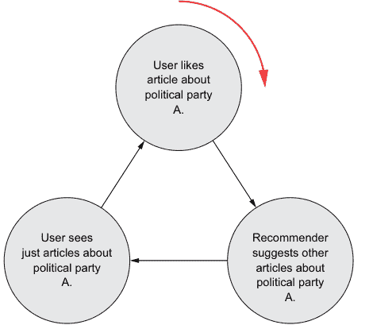

核心问题依然存在：要为公众提供健康的“信息饮食”，人们既需要阅读他们同意的内容，也需要阅读相反的观点。不幸的是，向用户展示他们不赞同的内容对业务没有好处，因此这个问题仍然悬而未决。

### 10.1.4 当 AI 失效：边缘案例与对抗性攻击

二战后，首批对民用运输开放航线的航空公司投入使用时，飞机既不可靠，坦白说，也是危险的“猛兽”。由于对军用飞机（显然，其使用寿命并不长）的经验有限，工程师对飞机在运行中如何故障缺乏很好的了解：发动机失灵、机身裂缝等等。在接下来的几十年里，他们积累了足够的知识、理论和经验，使航空旅行成为我们今天所享受的极其安全的交通方式。随着人类开始在关乎生死的场景（如医疗保健或自动驾驶交通）中依赖 AI，我们需要相应地加深对其局限性的理解。本节将向你介绍 AI 的两个重要失效模式：*边缘案例*和*对抗性攻击*。

当今基于机器学习的 AI，其强大力量源于它从海量数据中学习浅层统计相关性的能力。不幸的是，当今已知的任何算法或系统都不具备人类所具有的泛化和逻辑推理能力。用描述性语言来说，可以说 AI 算法对细节极其敏感，但在从其知识中得出显而易见的结论或处理非典型情况时却显得“笨拙”。以特斯拉的自动驾驶为例，它可以在高速公路上无缝行驶数百英里，但在 2017 年却发生了一起事故，因为它将一辆浅蓝色涂装的卡车误认为是一片蓝天，并径直冲了过去。人类不会把卡车上的天空图案误认为真正的天空，但当今最先进的技术之一却依然会犯这种错误。这些就是边缘案例：那些在训练数据中难以找到、模型可能会以愚蠢方式解读的罕见情境。

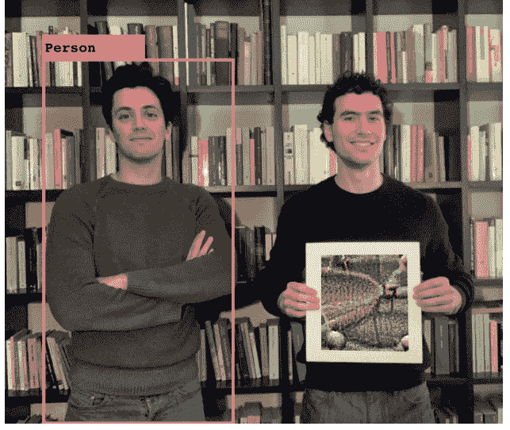

除了收集更全面、详尽的数据集并开发更鲁棒的模型外，我们在边缘案例方面能做的确实不多。然而，当谈到由 AI 模型引发的灾难时，边缘案例并不是我们要警惕的唯一问题。还存在另一种更微妙的风险：对抗性攻击。事实证明，精明的研究人员发现了“混淆”神经网络的方法，并生成了视觉噪声（见图 10.2），神经网络几乎 100% 的时候会将其误分类。换句话说，他们找到了方法，生成看似随机的色块，而模型会一致地将这些色块分类为真实物体，如汽车或披萨。可以想象，如果把图 10.2 的打印件贴在纸上，就能让该地区的自动驾驶汽车瘫痪。更微妙的是，看似无害的对抗性图像可以注入在线内容中，迫使其被分类为恶意内容。

关于制造对抗性攻击以及防御对抗性攻击的研究仍在进行中。边缘案例和对抗性攻击是同一枚硬币的两面：我们无法完全信任 ML 模型的输出，并需要找到方法来保护社会免受其错误的伤害。

保护自己免受这些问题影响的一个补丁方案是使用基于非 AI 的冗余系统。例如，在自动驾驶汽车的背景下，许多公司使用传统雷达来检查车辆路径上的物理障碍物。无论汽车的 AI 是否将摄像头信号解读为蓝天都不重要：如果雷达检测到物体，你最好停下来。虽然这些解决方案可以提供一些保证，但它们仍然是补丁。从根本上说，一些 AI 应用仍然不够鲁棒，无法部署在潜在危险的应用中。

### 10.1.5 当人造看起来像真实：AI 生成的虚假内容

第 4 章和第 5 章都以能够理解媒体和语言的 AI 模型开始，但也展示了能够*创造*这两者的算法——例如，通过将斑马的照片变成马的照片。这令人兴奋，因为它完善了 AI 的能力，使我们可以构建创造性的，而不仅仅是分析性的应用。然而，这些创作如今如此逼真且具有说服力，以至于它们成为了恶意行为者制造和传播他们自己现实的一种强大新武器。

20 世纪 30 年代苏联斯大林政权臭名昭著地修改照片，以去除政治对手，并通常支持政府的 prevailing 观点。当时，这些技术之所以有效，恰恰是因为甚至很少有人知道修改照片是可能的。随着 Photoshop 和电影特效让公众意识到这些操纵技术，它们失去了一部分效力。或许我们认为图片或视频真实的原因仅仅是因为我们知道修改它们需要一定的努力和细心。随着生成式网络的出现，这一入门门槛正迅速降至零。

换句话说，这是 AI 带来*规模*优势的另一情形：现在制作虚假内容变得如此容易且便宜，以至于社会需要面对其被用于不道德目的的风险。我们在第 5 章没有告诉你的是，OpenAI 最先进的文本生成模型 GPT-2 最初并未向公众发布。研究人员担心的是，模型生成的文本极具说服力，他们担心不良行为者会利用它向互联网传播无意义但诱人的内容（点击诱饵）。他们决定发布一个较弱版本的模型，并等待 NLP 社区赶上并开发能够区分此类虚假内容的模型。

其他参与者并没有这么有良心。事实上，生成式网络早期的著名成就之一是在 2017 年，当时匿名 Reddit 用户 Deepfakes 发布了几个以著名名人为特征的色情视频。结果发现，这些明星从未出演过这些视频。相反，Deepfakes 使用生成式网络将著名女演员的面部特征应用到现有素材上，大致复制并粘贴了她们面部和表情。Deepfakes 专注于名人，因为训练数据易于获取（很容易找到数千张名人的照片），但同样的技术也可以用于我们的亲人甚至政客。

避免虚假内容传播的解决方案是什么？好吧，因为规模是问题所在，规模也可以是解决方案。随着算法在生成虚假文本和虚假图像方面变得更好，能够识别它们的算法也在不断进步。这是一场利用可穿戴传感器之间的军备竞赛)? 如果每个人都能使用这种服务，我们还能挽救多少生命？

与规模概念紧密相连的是 AI 的良性循环。基于 AI 的产品更便宜，因此可以更大规模地部署和销售，导致更多数据的积累，从而进一步改善产品质量，使其对更具吸引力。

## 10.3 各行业中的 AI 机遇

在本节中，我们挑选出我们认为在不久的将来最有可能发生 AI 变革和颠覆的行业。当然，这份列表绝非详尽无遗：它旨在让你了解不同领域正在发生什么，并提供一些要素来发展你自己的批判性思维。我们鼓励你不要将本节视为绝对真理，而是将其作为一个起点，你可以凭借自己的背景和 newfound 的 AI 知识在此基础上构建。

在第 7 章中，我们试图找到客观标准来评估 AI 项目的潜力。我们得出的结论是，潜力与它在多大程度上利用 AI 的两大主要优势（规模和精度）直接相关。我们可以轻松地将同样的标准应用到整个行业。毕竟，行业颠覆可以被视为来自一家或多家公司的大量 AI 项目的复合效应。

在 AI 项目的背景下，精度衡量的是你的业务能从特定任务精度的提高中获益多少。要将精度因素应用到整个行业，需将其含义扩展到构成该行业的核心流程集合。例如，一个已高度数字化且效率很高的部门，从 AI 带来的精度提高中获益可能很小。另一方面，仍由低效和无效技术为特征的行业可能会受到 AI 的重大影响。

规模也是如此。在谈论单个 AI 项目时，规模因素衡量的是当任务通过 AI 自动化时带来的积极影响。现在当我们分析整个行业时，情况同样适用。如果一个行业经常通过手工进行的“陈旧”流程来运作，那么 AI 颠覆的潜力就很高。

在 AI 项目的背景下，我们还根据组织的准备程度对项目进行了评估和排序。同样的概念也适用于整个行业。如前所述，现代 AI 在很大程度上依赖于大型数据集的存在以训练 ML 模型。如果一个行业仍然依赖模拟流程（即纸笔作业），它将在 AI 产生重大影响之前不得不经历痛苦的数字化工作。另一方面，已经投资数字化和数据管理的行业可以立即开始应用 AI。请注意：这并不意味着技术准备程度低的行业对 AI 的潜力低。技术准备程度低仅仅告诉我们，颠覆发生所需的时间会更长。

### 10.3.1 社交媒体网络

从某种意义上说，我们可以认为社交媒体网络是当今人工智能投资激增的“大爆炸”。通过将数十亿人连接上网，它们使研究人员得以收集开发先进人工智能模型所需的海量数据集。同样庞大的用户群体也为基于人工智能的新产品（如自动人脸识别和推荐系统）提供了大规模的低风险试验场。

社交媒体用户生成的数据占据了我们在本书中探讨的各类数据的很大一部分：从关于广告、用户流失和激活的核心业务数据，到巨大的文本和图像数据集。我们可以将其分为两大类应用：

- 实现社交媒体平台的主要目的：让广告主触达正确的用户
- 提供服务

第5章已经介绍了情感分析，这是NLP工具箱中最基本的工具之一。社交媒体为大规模部署情感分析提供了理想的平台，因为与公众的互动对公司具有重要价值。然而，这已是旧闻。如今的社会平台使用人工智能算法对用户行为和兴趣进行建模，以实现个性化营销信息并优化广告活动。在这种情况下，人工智能的准确性将持续推动内容推荐和广告投放的效力。

我们在本章前面已经讨论过大规模个性化带来的威胁。在此背景下，我们想重点关注人工智能的规模潜力所提供的机遇。第一个应用是自动化的滥用预防与检测：Facebook和其他社交媒体巨头已经部署了能够检测不道德和辱骂性内容、并阻止其在其网络上分享的模型。

例如，每个主要社交网络都使用人工智能在暴力或色情内容被上传到平台并推送给数十亿用户*之前*自动将其识别。想象一个没有人工智能的世界：每当你发布一张图片或一段视频时，办公室里都得有个人来检查它是否合适。社交网络根本就不会存在（或者即使存在，也会充斥着各种人类的*堕落*）。计算机视觉算法使得这种检查能够大规模进行，并且在维护社区安全方面做得非常出色；例如，在Facebook上几乎找不到暴力或色情内容。

虽然内容个性化和审核已是旧闻，但我们求助于一位专家来展望人工智能与社交媒体的未来关系。我们采访了意大利社交媒体营销人员Luca La Mesa，他曾与许多知名组织合作，询问他预见的趋势。他提到的第一个积极的故事是Facebook的“安全核查”功能，该功能使用NLP模型扫描信息，并检测出自杀倾向的早期迹象。人类专家会手动审查被算法标记的案例，并在适当时通知有关部门。

但他还引用了一个更令人不安的事件，正如*《华盛顿邮报》*的Gillian Brockell所报道的那样。怀孕期间，她在社交媒体上发布了带有 `#30week-pregnant` 或 `#babysbump` 等标签的内容。算法捕捉到了她的帖子，并向她推送婴儿产品广告。不幸的是，Brockell失去了她的孩子，但即使她在谷歌上搜索“希克斯宫缩”或“宝宝不动”等词时，她仍然不断收到婴儿产品广告，这些广告只会给她带来悲伤。她唯一能阻止这一切的方法就是给Twitter写一封公开信。

从La Mesa告诉我们的情况来看，人工智能似乎总是将其规模优势更深地引入人际互动。如果说拦截暴力内容是人们期望这些平台具备的“必备”功能，那么Facebook的“安全核查”则是一个让许多人意想不到的出色补充。没有人预料到社交媒体平台能够提供这样的服务，而这之所以可能，是因为人工智能在处理文本数据方面的能力得到了大幅提升。La Mesa提到的负面例子再次证明，人工智能根本不适用于边缘情况。希望这些算法理解文本的深度能不断提高，类似Brockell这样的案例会越来越少。

### 10.3.2 医疗保健

医疗保健是一个极其复杂的行业，面临着许多具体挑战、多方利益相关者以及复杂的监管环境。在如此广泛的行业中，对具体应用进行细分会很有帮助。人工智能将在三个主要领域影响医疗保健：

- 诊断
- 药物发现
- 运营效率和新护理模式

表10.1列出了这三个领域在准确性、规模和技术成熟度方面的对比情况。

| 医疗保健中AI应用潜力与技术成熟度分析 | 准确性因素 | 规模因素 | 技术成熟度 |
|---|---|---|---|
| 诊断 | 高 | 高 | 低 |
| 药物发现 | 高 | 高 | 指数增长 |
| 基于价值的护理 | 高 | 高 | 低 |

利用人工智能改善医生诊断疾病的方式，可能是人工智能最令人向往的应用之一。世界上的医生供应有限，而且他们都是人类。和所有人类一样，医生依靠的是他们在生活中见过的有限病例、模糊的数据以及相当多的直觉。

试想一下：每次Netflix给你推荐一部电影，都会用到数百万个数据点，以及由世界级数据科学家多年打磨的尖端技术。而每次你的医生给你开治疗处方时，他们的决策基于多年的培训、也许数百个他们治疗过具有类似症状的患者，以及一组非常有限的数据（假设你没有在诊所里被关数周去做医学检查）。Netflix在推荐电影方面的成熟度远高于你的医生在推荐药物方面的成熟度。显然，更具数据驱动力的诊断和处方方法可以大有作为。

利用人工智能改善诊断无疑具有很高的准确性价值。我们都同意，如果有机会提高其准确性，人类将从中受益。这一具体应用还可能具有很大的规模价值。虽然人工智能很可能被用来辅助医生，而不是取代他们，但世界上有些地区根本没有足够的医生。在这些情况下，人工智能医生可以在大规模提供基础医疗方面大有可为。

对于世界上最富裕的国家来说也是如此，但涉及的是那些医生通常不会处理的疾病。一个例子是皮肤病。以痤疮为例：正如初创公司MD Algorithms所报告的那样，90%的痤疮患者从不看皮肤科医生。该公司抓住这一机遇，构建了计算机视觉算法，能够根据自拍照诊断患者患有哪种痤疮。

不幸的是，数据获取可能是阻碍这些应用应用的主要因素。大多数医疗保健流程仍然是非数字化的（你多少次看到医生拿着纸质报告和笔走进医院？）。即使近来对电子健康记录（EHRs）的推动已在某种程度上改善了状况，医疗行业仍必须正视数字化流程带来的影响。

除此之外，现有的一点数据也是分散的，因为包括医院、支付方、国家医疗保健服务和制药公司在内的不同利益相关者各自只掌握患者临床历史的一部分。换句话说，潜力巨大，但要让所有参与者协作将非常困难。

医疗保健领域第二个大的变革领域是药物发现。这种情况下变革的主要触发因素是观察到发现新药的价格呈指数增长。制药行业的研发成本在1950年至2010年间飙升了近一百倍。

另一方面，DNA测序的成本正在呈指数下降。2003年，首次人类全基因组测序花费约27亿美元。到2006年，成本已降至30万美元。2016年成本约为1000美元，并且仍无停止下降的迹象。这意味着现在可以廉价地生成大量基因组数据。

生物数据的广泛可用性是让人工智能能够窥探人类基因组并帮助设计新药的第一步。无论是小型初创公司还是大型机构都在赶上这趟列车，并且常常携手合作。2018年，辉瑞公司与一家由科技巨头支持的AI初创公司建立了战略合作伙伴关系。

像腾讯和谷歌这样的公司称之为 XtalPi。目标是预测小分子的药理特性并开发“基于计算的理性药物设计”。辉瑞并非孤例：诺华、GSK、赛诺菲、安进和默克等其他大型机构也宣布了与 AI 初创公司的合作。目标是将它们的领域知识、数据和资源与小型初创公司的 AI 技能相结合，以发现针对多种疾病的新药物候选物。

AI 辅助药物发现仍处于早期阶段，但回报极具前景。其准确性和规模化因素都极高，因为能够更有效地、更便宜、更快地开发药物将对公共卫生产生巨大影响。技术成熟度也在快速提升，正如 DNA 测序成本持续下降所显示的那样。

最后，AI 还可以解决医疗保健的商业层面，而不仅仅是医学层面。医疗保健 notoriously 是一个效率低下的行业，有许多利益相关者，他们的激励和做法并不总是符合患者的最佳利益。

随着人口老龄化和成本不断上升，政府的努力正转向以价值为基础的服务模式：一个以患者为中心的系统，医疗保健提供者在其中有动力提供成本最低的最佳护理。这与按服务付费模式形成对比，在该模式下，提供者按提供的服务数量比例获得报酬，从而产生导致浪费且不总是带来最佳患者结果的激励。

这样想：当你看医生时，大多数时候他们会给你开一大堆检查，由你、你的保险或你的国家医疗服务支付。通常，这些检查的结果除了让你去做……更多的检查之外几乎没有其他作用。

现在，每当你看医生并描述你的症状时，很可能世界上其他人有过非常相似的临床病史和非常相似的症状，并经历了一系列检查。如果你回忆我们在第 6 章中关于推荐系统的讨论，这看起来像是 AI 的一个潜在应用，它可以帮助医生朝着最佳可能的诊断或检查路径前进，节省金钱和时间，并可以说改善患者的护理质量。

显然，在我们走这条路之前，需要进行一些相当深层次的系统性变革。这种转变可能要等很久，不是由于技术限制，而是由于整个系统的准备度。然而，潜力如此之高，我们有信心这种转变无论如何都会发生。

### 10.3.3 能源

能源生产和分配正在经历一场由技术、经济和环境因素融合驱动的重大转型。可持续能源终于开始在商业上变得合理，因为规模经济降低了价格，而无需补贴。与此同时，电动汽车在许多国家变得越来越普及，智能传感器在建筑物和工厂中变得越来越便宜，使用也越来越频繁。

安装了许多传感器并投资于数据收集和自动化的建筑物。随着这些使能技术传播到其他建筑物、工厂和基础设施，AI 驱动的优化也将变得更加普遍。类似的技术也可以应用于住宅住房，在那里它们可以帮助家庭减少能源消耗。

能源优化的领域不仅限于减少使用的总能源量。能源公司以及因此环境也会受益于根据可再生能源的生产模式在全天分配负荷。例如，这可能意味着在白天太阳能充足时为电动汽车充电。

在一个气候变化日益——并且理所当然地——让公众担忧的世界里，AI 可以并且必须成为能源公司武器库中的一种武器。只要有正确的思维方式，这项技术就可以作为一层控制能源的生成和生产的层，实现新的效率水平，并为我们对抗气候变化的斗争做出贡献。

### 10.3.4 制造业

自 80 年代精益制造革命以来，制造业一直高度依赖数据。我们的资本主义世界推动持续改进和优化，而你无法改进你无法衡量的东西。因此，工厂是数据以数字格式开始被收集供计算机分析的最早地点之一。

正如你在书中所学到的，只要有大量数据的宝库，AI 项目的潜力就随之而来，因为准备度高且进入门槛低。最熟悉的例子围绕着提高生产效率，就像你在谷歌数据中心案例研究中所看到的那样。单台生产线机器可能有数十或数百个温度、压力和振动传感器，产生持续的数据流。

制造业中最古老和最成熟的 ML 应用之一是故障预测：使用传感器数据在设备即将损坏时发出早期警告。更先进的努力帮助用户了解是否可以建模关键生产参数（如压力或循环速度）对生产质量的影响。就像谷歌数据中心案例研究一样，这种数字孪生使工程师能够在数字上调整和优化工业流程，在他们对结果有信心后将积累的经验转移到物理工厂。

我们迄今为止讨论的所有这些应用都使用结构化数据，如传感器时间序列。然而，像我们在第 4 章中讨论的那样基于图像的 AI 模型有可能将工厂自动化推向下一个水平。一个主要候选是质量控制，就像第 4 章中黄瓜分类案例研究一样。基于深度网络的对象分类和检测模型用途广泛，只需在生产线上添加摄像头即可用于查找成品中的遮挡或缺陷。

更强大的 AI 算法也将改善工厂车间的机器人和自动化。阻碍制造业机器人使用增加的一个大限制是为制造新产品对它们进行编程所需的大量时间和精力。如果你回忆我们在第 7 章中的讨论，你会认识到这种重复性、狭窄的任务是基于机器学习的解决方案的理想候选。

很明显，制造业渴望可扩展的技术，使其能够更便宜、更快地生产商品。AI 是实现这一目的的终极工具，无论我们是试图预测故障还是自动化质量控制。在准确性方面，我们知道 AI 极其狭窄，在可预见的未来不可能达到人类处理异常的能力。这意味着人类将在很长一段时间内继续拥有奢侈品和定制商品的领域。毕竟，*手工制作* 已经是更高票价的免费通行证，随着大规模生产变得更加标准化和便宜，差距可能会进一步扩大。

### 10.3.5 金融

谈到 AI 在金融中的应用，我们需要区分两个不同的世界：商业银行和交易。*商业银行*是我们日常生活中打交道的银行：它们兑现支票、抵押房屋等等。*交易公司*在金融市场上买卖股票和债券，试图智胜其他投资者以赚钱。由于银行和金融高度基于数据和数字，这两者都是机器学习技术的早期采用者。第 2 章在我们讨论 Square 的商户贷款时就呈现了这一例子。

商业银行已经在多个核心能力中大量使用 AI 工具，如欺诈预防和风险评估。在未来几年，其他 AI 领域的改进将渗透到这些模型中，从而创造更健康的金融市场，进而降低借款人和公司的成本。在银行业的核心活动中，利润与决策准确性直接相关，因此 AI 的契合度非常明显。

另一方面，利用其规模以全新的方式使用 AI 也具有巨大潜力。用 AI 工具如视觉识别和 NLP 自动化内部流程既不花哨也不是新想法，但对于降低整个组织的成本将非常重要。与任何其他面向客户的组织一样，AI 对于破坏和改善今天主要由血肉员工处理的客户服务关系具有巨大潜力。同样适用于推荐系统等工具可以创建的精选和个性化营销产品。

同样的考虑也适用于一个相关行业：保险。随着 AI 模型提高其理解和结构化世界信息的能力，保险公司可以更好地了解他们为客户承保的风险

against, and thus offer more adequate and personalized rates. Think about automated analysis of health data to provide personalized health insurance, or real-time intelligence about the types of roads that you usually drive on. While all of these ideas are possible today, AI will provide the scaling secret sauce that will allow insurance companies to extend them more broadly to their customer base.

Finally, financial trading is a bit of an odd duck, and we won’t spend much time talking about it. Wall Street is a secretive and specialized world in which some of the nerdiest minds try their best to extract proprietary information that they can use to inform their trading decisions and “beat the market” with superior returns for their investment. This means that many of the AI tools that we have described in the book can in one way or another be used to make money on the financial markets. A familiar example is using visual object classification models on satellite data to count the number of cars leaving Ford factories, and thus predict how the automaker is doing before it releases its reports. This proprietary information can then be used to bet on the stock price going up or down, pocketing any profits. The same idea also applies to many of the other models we have presented in the book; for example, sentiment analysis on social media to understand how a company is perceived by its customers, and thus whether its future prospects are good.

Wall Street has already been using these tools for a decade or more, so what’s going to happen in the next few years? We don’t know! There is so much money at stake that these trading companies keep all their AI advances close to their chests. Two things are certain: the more accurate you are at making decisions and the faster you can make them, the more money you’ll make. For these reasons, AI and trading will always be best friends.

### 10.3.6 Education

Of all the industries we have analyzed so far in this section, education is probably the furthest behind in AI usage. In our opinion, the most exciting potential for their intersection lies in personalization: the ability to customize the learning itinerary of each student based on their strengths and weaknesses. Some massive open online courses (MOOCs) have been pioneering in this area just because of the incredible challenges arising out of the need to mentor and grade tens of thousands of students with limited budgets.

It turns out that constant and personalized feedback is the most important component of an effective learning strategy. Luckily, many of the AI models that we have discussed in this book are actually very good at classifying inputs as “good” or “bad.” Going beyond classic automatic grading systems, we can imagine vision-based models that can automatically grade painting techniques based on their similarity with the work of great artists of the past. Or even NLP-based models that can assess the vocabulary of young writers by comparing their homework with great literary masterpieces.

Of course, a lot of work remains to be done before AI-based models can provide the backbone of the school system as we know it today. However, several specific education segments are already taking advantage of AI tools. We already have automated music teachers that can alert students when they’re playing out of tune, or language-learning tools that can help eliminate accents. These niche sectors play to the strengths of especially advanced AI algorithms, like those in media, and are pushing education to be more friendly for “trial-and-error” learners. In other words, ultimate personalization becomes gamification, providing each student instant feedback.

One of the most exciting promises about AI in education is that it’s going to help provide the next billion students in the developing world with the same level of education that the developed world is enjoying today.

## 10.4 What about general AI?

Ever since the term artificial intelligence came up, people enjoyed betting on how long it would take before AI could match the performance of the human brain. As you will recall from our brief history lesson in chapter 1, this majestic goal is called general AI, exactly because it can tackle any task. Unsprisingly, the recent spate of successes by deep learning has fueled optimistic guesses, with prominent people in the community suggesting we will reach human-machine parity as soon as 2030.

Entire books have been written on artificial general intelligence (AGI), so we don’t dare try to cover the topic exhaustively. (We can recommend Superintelligence by Nick Bostrom, Oxford University Press, 2014.) Our goal for this section is to get you thinking about the most realistic and immediate opportunities for AGI.

After reading this book, we hope you realize that we’re still far away from the versatile, fast-learning marvel that is human intelligence. Modern AI is based on machine learning, and modern ML is basically still pattern-matching on steroids, even if it allows us to build valuable products. Many people believe (and we tend to agree) that the technology used to build the narrow AI applications described in this book is unsuitable for AGI.

This opinion is shared even by some of the godfathers of AI. For instance, Geoffrey Hinton, one of the fathers of deep learning, confessed in an interview that he’s “deeply suspicious” of the underlying principles that currently allow neural networks to learn, and doesn’t believe they’ll ever scale to true intelligence. Judea Pearl, another AI pioneer, argues that current machine learning is stuck at fitting curves, without understanding what the world around us means. In other words, we’re still busy teaching computers “what” is happening in the world, but we haven’t even started tackling the “why.”

The knowledge you received from this book likely brought you to the same conclusions about the future of AGI. In any case, we don’t think you should despair. We certainly don’t. An incredible number of real-world applications can be built with the ML and narrow AI tools that we already know how to use.

We reached out to Denis Rothman, AI expert and author of three successful books, and asked him for his opinion on AGI. We couldn’t phrase it better:

*Artificial intelligence as some super consciousness is not only a mirage, for the moment, but most importantly, AGI is useless.*

*Automation, with AI agents or not, will continue to increase exponentially in the years to come. AI agents that specialize in a variety of domains will provide increasing power to IoT.*

*If we now put this together, we get a network of connected automated agents enhanced with AI that will transform the world as it is today. This is not any better or worse than the first cars, trains, airplanes, and telephones.*

Now, some prominent names are still warning us about the danger of superintelligent AI. One of them is Elon Musk, who has often warned us about the dangers of a superhuman AI, going as far as speculating about its potential to end civilization. We’re so early in the development of AI that it’s difficult to foresee whether this apocalyptic scenario will actually happen. For now, the dangers seem focused on structural societal change and loss of jobs, as we discussed earlier. You can relax for now: Terminator is still nowhere to be seen.

### 10.5 Closing thoughts

Our goal for this book was to give you the knowledge and tools you need to bring the benefits of AI into your organization, even without technical skills. We worked hard to coach you into a leader who could begin and direct the discussion about finding the most promising areas for using AI in your organization. In the first part of the book, you learned the more technical information about the AI toolbox: various types of algorithms for working with the types of data you’re likely to encounter in today’s organizations. The industry case studies and examples scattered throughout the material have shown you how tech leaders think and plan their AI goals.

In the second part of the book, you learned how to roll up your sleeves. We showed you how to find and understand the most promising opportunities for using AI in your business, recruit the right team, and get started with the implementation.

Some of you already had an AI project in mind when you picked up the book. For you, we hope the book has given substance to your plans by teaching you the actual capabilities of today’s AI in a hype-free way. For those of you who did not have a project in mind, we hope we inspired you with the latest from industry and academia, and that your plans are now more concrete.

Either way, our best wish is that you feel confident and energized to jump back into your team, organization, or startup, and start working toward your first AI project. We wish you the best of luck.

# 摘要

- 围绕人工智能在社会中的角色，仍存在若干未解决的伦理挑战——最重要的包括公平性、安全性和可靠性。
- 人工智能的独特之处在于，自其发展之初起，大量的知识、软件和数据便可免费获取，这使得每个人都更容易参与到其增长过程中。
- 人工智能可以将专业知识和技能的变动成本压缩至接近零，从而使以极少资本创造大规模运作的新产品和新服务成为可能。
- 由于具有大规模效应，经济中最大的许多部门（如能源和医疗保健）将从人工智能的发展中获益最多。
