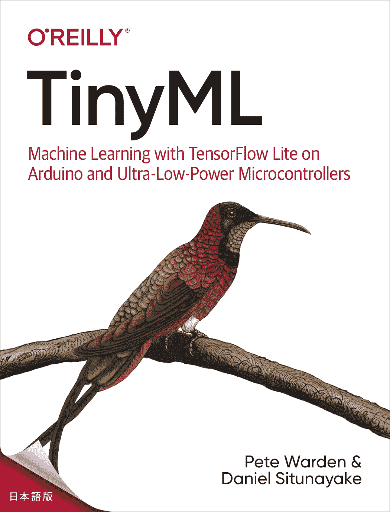

# TinyML

## 工作人员名单
* 收购编辑 Mike Loukides
* 开发编辑 Nicole Tache
* 生产编辑：Beth Kelly
* 复制编辑 Octal Publishing
* 校对 Rachel Head
* 索引 WordCo 公司
* 内页设计师 David Futato
* 插画师 Rebecca Demarest

## 印刷信息
* 2019 年 12 月：初版

## 修订
### 初版修订历史
* 2019-12-13：首次发布
* 2020-08-07：第二次发布

## 勘误
有关发行版的详细信息，请参阅[`oreilly.com/catalog/errata.csp?isbn=9781492052043`](http://oreilly.com/catalog/errata.csp?isbn=9781492052043)。

# 前言
本作品使用 AI 翻译。我们期待您的意见和反馈：translation-feedback@oreilly.com
自从有意识以来，电子相关的事物就激发了我的想象力。我们学会了从大地挖掘岩石，以神秘的方式提炼它们，按照晦涩的规律组合成微小部件，并赋予其生命的精髓，这种方法令人目眩神迷。
8 岁时，我的心中对电池、开关、灯丝灯泡当然感到着迷，对家用电脑内的处理器也同样着迷。随着岁月的流逝，我逐渐理解了使这些发明发挥作用的电子设备和软件原理。然而，始终让我惊讶的是，简单元素的系统组合在一起能够创造出精致而复杂的事物，而深度学习将这一切推向了新的高度。
本书的一个例子，在某种意义上，是一个理解事物看法的深度学习网络。它由数千个虚拟的“神经元”组成，每个神经元都遵循一些简单的规则并输出一个数值。单个神经元单独作用并无大用，但如果组合起来，并在训练中赋予人类知识的火花，就能够理解复杂的世界。
由沙、金属和塑料制成的小型计算机上运行的简单算法，能够体现人类理解的片段。这就是 TinyML 的本质。TinyML 是皮特创造的术语，在第 1 章中介绍。在本书的页面中，您可以发现自己构建此类事物所需的工具。
感谢您成为读者。这是一个复杂的主题，但我们努力保持事物的简单性，并解释您所需的所有概念。希望您能喜欢我们所写的内容，也期待看到您所创造的东西！
丹尼尔·西图纳亚克

# 本书使用的惯例
本书采用以下标记规则：
*斜体*
:
表示新术语、URL、电子邮件地址、文件名、文件扩展名。
`Constant width`
:
用于在程序列表或段落中指代变量名、函数名、数据库、数据类型、环境变量、语句、关键字等程序元素。
**`Constant width bold`**
:
显示用户应逐字输入的命令或其他文本。
*`Constant width italic`*
:
表示应由用户提供的值或根据上下文确定的值替换的文本。
### 提示
此元素表示提示或建议。
### 注
此元素表示一般注释。
### 警告
此元素表示警告或注意。

# 使用代码示例
补充资料（代码示例、练习题等）可从[*https://tinymlbook.com/supplemental*](https://tinymlbook.com/supplemental) 下载。
如果您对技术问题或代码示例的使用有疑问，请联系*bookquestions@oreilly.com。*
本书旨在帮助您完成工作。一般而言，如果本书提供了示例代码，您可以使用它用于自己的编程或文档。除非复制大量代码，否则无需征求我们的许可。例如，如果您使用本书中的一些代码片段进行编程，则无需许可。如果您出售或分发 O'Reilly 书籍的示例，则需要许可。引用本书并引用示例代码来回答问题无需许可。如果您要在产品的文档中大量使用本书的示例代码，则需要许可。
致谢是受欢迎的，但不是必需的。致谢通常包括标题、作者、出版社和 ISBN。例如「*TinyML*by Pete Warden and Daniel Situnayake (O'Reilly).Copyright Pete Warden and Daniel Situnayake, 978-1-492-05204-3"。
如果您认为代码示例的使用超出了合理使用或上述许可范围，请随时联系*permissions@oreilly.com*。

# O'Reilly 在线学习
### 注
[*O'Reilly Media 是*](http://oreilly.com)40 多年来一直提供有关技术和业务的培训、知识和见解，帮助企业取得成功。
O'Reilly 独特的专家和创新者网络通过书籍、文章和在线学习平台分享其知识和专业知识。O'Reilly 的在线学习平台可按需访问现场培训课程、详细的学习路径、交互式编码环境，以及来自 O'Reilly 和 200 多家出版商的庞大文本和视频收藏。详情请参阅[*http://oreilly.com。*](http://oreilly.com)

# 联系方式
有关本书的评论或问题，请发送给出版商：
* O'Reilly Media, Inc.
* Gravenstein Highway North 1005
* Sebastopol, CA 95472
* 800-998-9938（美国或加拿大境内）
* 707-829-0515（国际或本地）
* 707-829-0104（传真）
本书有一个网页，列出了勘误表、示例和附加信息。该页面为[*https://oreil.ly/tiny。*](https://oreil.ly/tiny)
Don't forget to update the link above.
有关本书的评论或技术问题，请发送至*tinyml-book@googlegroups.com*。
有关书籍和课程的新闻和详细信息，请参阅网站[*（http://www.oreilly.com）请参阅。*](http://www.oreilly.com)
在 Facebook 上发现[*：http://facebook.com/oreilly*](http://facebook.com/oreilly)
在 Twitter 上关注: http:[*//twitter.com/oreillymedia*](http://twitter.com/oreillymedia)
在 YouTube 上观看: http:[*//www.youtube.com/oreillymedia*](http://www.youtube.com/oreillymedia)

# 致谢
我要特别感谢 Nicole Tache 出色的编辑、Jennifer Wang 感人的魔杖示例，以及 Neil Tan 在 uTensor 库方面开创性的嵌入式 ML 工作。如果没有 Rajat Monga 和 Sarah Sirajuddin 的专业支持，这本书就不可能完成。此外，我还要感谢我的伴侣 Joan Radulicetta 和 Lauren Warden 的耐心。
本书是 TensorFlow 团队为核心，来自硬件、软件和研究各领域的数百人努力的成果。我只能提到其中少数几位，对未能提及的人表示歉意，但我想表达谢意：Mehmet Ali Anil、Alasdair Allan、Raziel Alvarez、Paige Bailey、Massimo Banzi、Raj Batra、Mary Bennion、Jeff Bier、Lukas Biewald、Ian Bratt、Laurence Campbell、Andrew Cavanaugh、Lawrence Chan、Vikas Chandra、Marcus Chang、Tony Chiang、Aakanksha Chowdhery、Rod Crawford、Robert David、蒂姆·戴维斯、洪扬·邓、沃尔夫·多布森、贾里德·杜克、延斯·埃洛夫松、约翰·尤弗罗辛、马蒂诺·法金、利莫尔·弗里德、努普尔·加尔格、尼古拉斯·吉利安、叶夫根尼·古谢夫、亚历山德罗·格兰德、宋·韩、贾斯汀·洪、莎拉·胡克、安德鲁·霍华德、马格努斯·胡滕、阿德瓦伊特·贾恩、纳特·杰弗里斯、迈克尔·琼斯马特·凯尔西、库尔特·凯茨尔、弗雷德里克·克努特松、尼克·克里格、尼克·莱恩、绶芬·李、迈克·梁、余晨·林、伦杰伊·刘、迈克·鲁基德斯、欧文·赖克、克里斯蒂安·马格利、比尔·马克、马修·马蒂纳、桑迪普·米斯特里、阿米特·米特拉、劳伦斯·莫罗尼、鲍里斯·马尔曼、伊恩·纳皮尔、梅格纳·纳特拉吉 Ben Nuttall, Dominic Pajak, Dave Patterson, Dario Pennisi, Jahnell Pereira, Raaj Prasad, Frederic Rechtenstein, Vikas Reddi, Rocky Rhodes, David Rim, Kazunori Sato, Nathan Seidle, Andrew Selle, Arpit Shah, Marcus Shawcroft, Zach Shelby, Suharsh Sivakumar, Ravishankar Sivalingam, Rex St.John, Dominic Symes, Olivier Temam, Phillip Torrone, Stephan Uphoff, Eben Upton, Lu Wang, Tiezhen Wang, Paul Whatmough, Tom White, Edd Wilder-James, Wei Xiao.
