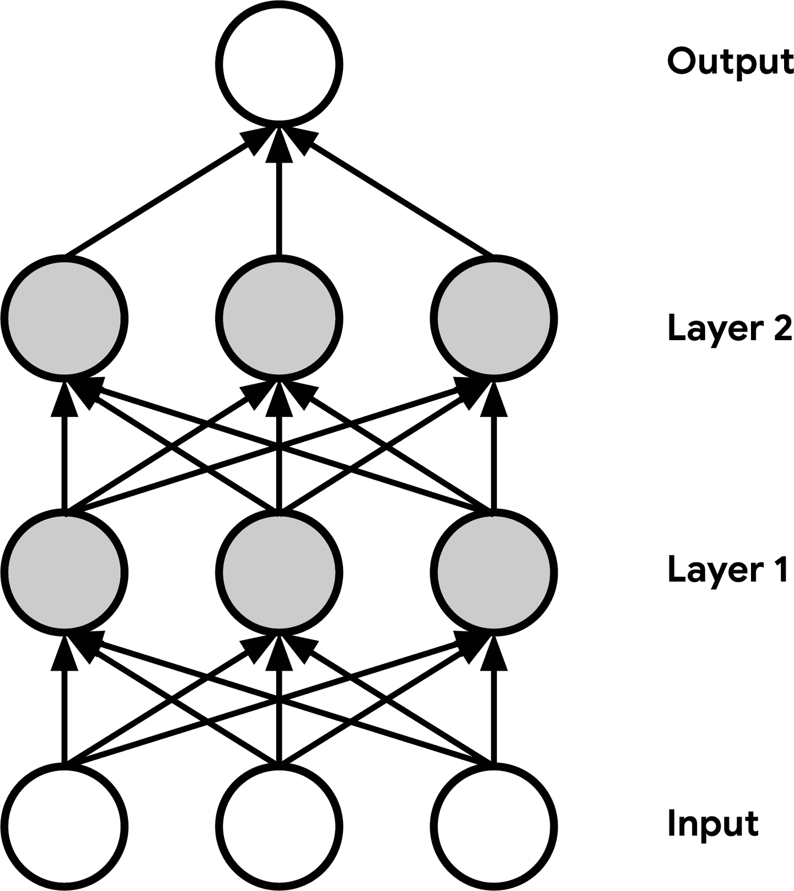
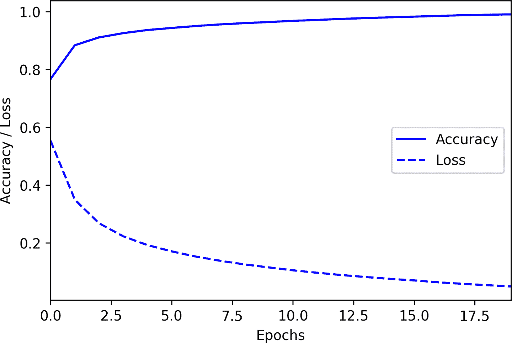
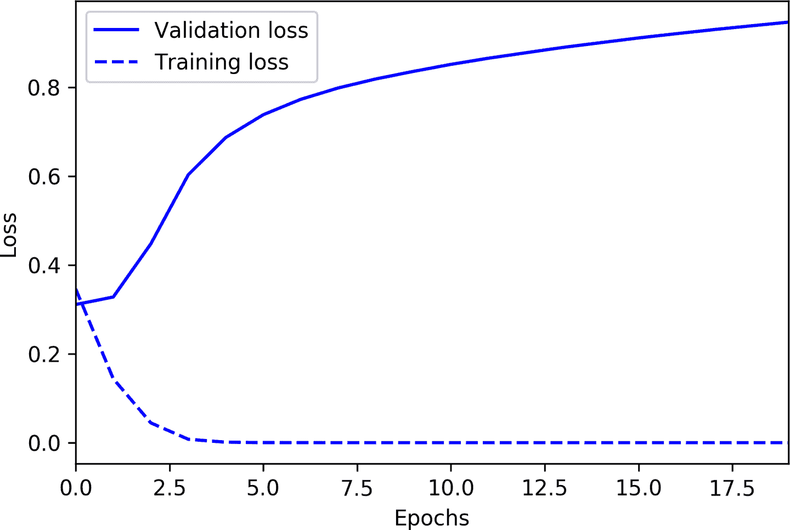

# 第 3 章 機械学習 マシンラーニングを使いこなす

この作品はAIを使って翻訳されている。ご意見、ご感想をお待ちしている：translation-feedback@oreilly.com

テクノロジーの分野で、マシンラーニングや人工知能（AI）にまつわるような神秘性を持つ分野はほとんどない。たとえあなたが他の領域で経験を積んだエンジニアであっても、機械学習は山のような前提知識を必要とする、密度の濃いテーマのように思えるかもしれない。MLについて読み始めると、学術論文や曖昧な`Python`ライブラリ、高度な数学を引き合いに出した説明に出会い、多くの開発者は落胆する。何から手をつければいいのかさえわからず、気が遠くなることもあるだろう。


実際のところ、機械学習は簡単に理解でき、テキストエディタさえあれば誰でも利用できる。いくつかの重要な考え方を学べば、自分のプロジェクトで簡単に使うことができる。神秘的なものの下には、様々なタイプの問題を解決するための便利なツールセットがある。魔法のように*感じる*こともあるかもしれないが、それはすべて単なるコードであり、それを扱うのに博士号は必要ない。

本書は、小さなデバイスを使ったマシン学習について書かれている。この章では、`ML`を始めるために必要なことを学ぶ。基本的な概念をカバーし、いくつかのツールを調べ、シンプルな機械学習モデルをトレーニングする。我々の焦点は小さなハードウェアにあるので、ディープラーニングの背後にある理論や、そのすべてを機能させる数学については長くかけない。後の章では、ツールや、組み込みデバイス用にモデルを最適化する方法について深く掘り下げていく。しかし、この章が終わる頃には、重要な用語に慣れ、一般的なワークフローを理解し、さらに学ぶにはどこに行けばいいかを知っているだろう。

この章では、以下を取り上げる：

* マシンラーニングとは何か？
* 解決できる問題の種類
* 主要な用語と考え方
* 機械学習の最もポピュラーなアプローチのひとつである`Deep Learning`で問題を解決するためのワークフローを紹介する。

### チップ

ディープラーニングの背後にある科学について解説した本や講座はたくさんあるので、ここでは割愛する。とはいえ、ディープラーニングは魅力的なトピックなので、ぜひ探求してみてほしい！私たちのお気に入りのリソースをいくつか「機械学習の学習」にリストアップしている。しかし、有用なものを作り始めるのに、すべての理論が必要なわけではないことを覚えておいてほしい。

# 機械学習とは何か？

ウィジェットを製造するマシンを所有しているとしよう。時々故障し、修理にお金がかかる。もしあなたが演算子中のマシンに関するデータを収集すれば、故障しそうなタイミングを予測し、ダメージが発生する前に演算子を停止させることができるかもしれない。インスタンスンスなら、生産率、温度、振動の大きさなどを記録できるだろう。これらの要素の組み合わせが、差し迫った問題を示しているのかもしれない。しかし、どうやってそれを突き止めるのか？

これは、機械学習が解決するために設計された問題の一例である。基本的に機械学習とは、過去の観察に基づいて物事を予測するためにコンピューターを使用するテクニックである。工場のマシンのパフォーマンスに関するデータを収集し、そのデータを分析して将来の状態を予測するコンピュータープログラムを作成する。

機械学習プログラムの作成は、通常のコードを書くプロセスとは異なる。従来のソフトウェアでは、プログラマは入力を受け取り、様々な規則を適用し、出力を返すアルゴリズムを設計する。アルゴリズムの内部演算子はプログラマによって計画され、コードの行を通して明示的に実装される。工場のマシンの故障を予測するには、プログラマはデータのどの測定値が問題を示しているかを理解し、それを意図的にチェックするコードを書く必要がある。

このアプローチは多くの問題でうまくいく。例えば、海面では水は100℃で沸騰することがわかっているので、現在の温度と高度から水が沸騰しているかどうかを予測するプログラミングを書くのは簡単だ。しかし多くの場合、ある状態を予測する要素の正確な組み合わせを知ることは難しい。工場のマシンの例で続けると、生産率、温度、振動レベルには、問題を示すかもしれないが、データを見ただけではすぐにはわからないさまざまな組み合わせがあるかもしれない。

機械学習プログラムを作成するために、プログラマは特殊化アルゴリズムにデータを送り込み、アルゴリズムに規則を発見させる。つまりプログラマは、複雑なデータを理解することなく、複雑なデータに基づいて予測を行うプログラムを作成することができるのだ。機械学習アルゴリズムは、`トレーニングと`呼ばれるプロセスを経て、我々が提供したデータに基づいてシステムの`モデルを`構築する。モデルはコンピュータープログラムの一種である。このモデルを通してデータを実行し、`推論と`呼ばれるプロセスで予測を行う。

マシン学習には様々なアプローチがある。最もポピュラーなもののひとつが、`ディープラーニングで`、これは人間の脳がどのように働くかを単純化した考えに基づいている。深層学習では、様々な入力と出力の関係をモデル化するために、模擬ニューロン（数字の配列で表される）の`ネットワークが`学習される。異なる`アーキテクチャ`（模擬ニューロンの配列）は、異なるタスクに有用である。例えば、画像データから意味を抽出するのが得意なアーキテクチャもあれば、シーケンスの次の値を予測するのに最適なアーキテクチャもある。

深層学習は、マイコンに適したタイプの問題を解決するための柔軟で強力なツールだからだ。ディープラーニングが、メモリや処理能力が限られたデバイスでも機能することは意外かもしれない。実際、本書では、本当に驚くべきことを行うディープラーニング・モデルを、小さなデバイスの制約内に収まるように作成する方法を学ぶことができる。

次のセクションでは、`Deep Learning`モデルの作成と使用に関する基本的なワークフローを説明する。

# ディープラーニングのワークフロー

前節では、ディープラーニングを使って工場のマシンが故障しそうなタイミングを予測するシナリオを概説した。本セクションでは、これを実現するために必要な作業を紹介する。

このプロセスには以下の作業が含まれる：

1. ゴールを決める
2. データセットを収集する
3. モデルアーキテクチャを設計する
4. モデルを訓練する
5. モデルを変換する
6. 推論を実行する
7. 評価とトラブルシューティング

ひとつずつ見ていこう。

## ゴールを決める

どのような種類のアルゴリズムを設計する場合でも、そのアルゴリズムに何をさせたいかを正確に確立することから始めることが重要だ。それはマシン学習でも同じだ。何を予測したいのかを決めることで、収集するデータと使用するモデルアーキテクチャを決めることができる。

この例では、工場のマシンが故障しそうかどうかを予測したい。これは`分類`問題として表すことができる。分類とは、入力データのセットを受け取り、このデータが既知の`クラス・`セットのそれぞれに当てはまる確率を返すマシン学習タスクである。この例では、2つのクラスがある：「正常」は、マシンが問題なく演算子していることを意味し、「異常」は、マシンが間もなく故障しそうな兆候を示していることを意味する。

つまり、我々の目標は、入力データを "正常 "か "異常 "のどちらかに分類するモデルを作成することである。

## データセットを収集する

我々の工場では、マシンの演算子温度から、ある日にカフェテリアで提供された食品の種類に至るまで、多くの利用可能なデータを持っている可能性が高い。先ほど設定した目標があれば、どのようなデータが必要かを特定し始めることができる。

### データを選択する

ディープラーニング・モデルは、ノイズの多いデータや無関係なデータを無視するように学習することができる。つまり、問題の解決に関連する情報のみを使ってモデルを訓練するのがベストだ。今日のカフェテリアの食事がマシンの機能に影響を与えるとは考えにくいので、おそらくデータセットから除外できるだろう。そうしないと、モデルは無関係な入力を否定する学習が必要になり、偽の関連付けを学習してしまう可能性がある。おそらく、我々のマシンは偶然にもピザが出される日にいつも故障しているのだろう。

データを含めるかどうかを決める際には、常に自分の専門知識と実験を組み合わせるようにすべきである。また、統計テクニックを使って、どのデータが重要かを特定することもできる。それでも特定のデータソースを含めるかどうか確信が持てない場合は、いつでも2つのモデルを訓練して、どちらが最もうまくいくかを見ることができる！

最も有望なデータとして、`生産率`、`温度`、`振動を`特定したとしよう。次のステップは、モデルを訓練するためにデータを収集することだ。

### チップ

選択したデータが、予測を行いたいときにも利用可能であることが本当に重要だ。例えば、我々は温度読み取りでモデルをトレーニングすることに決めたので、推論を実行する際には、まったく同じ物理的な場所からの温度読み取りを提供する必要がある。これは、モデルがどのように入力が出力を予測するかを理解するために学習するからである。もともとマシンの内部の温度データでモデルをトレーニングした場合、現在の室温でモデルを実行してもうまくいく可能性は低い。

### データを収集する

効果的なモデルを学習するために必要なデータ量を正確に知ることは難しい。変数間の関係の複雑さ、ノイズの量、クラスの区別のしやすさなど、多くの要因に左右される。しかし、データは多ければ多いほど良いという経験則がある！

システムで起こりうるあらゆる条件や事象を表すデータを収集することを目指すべきである。マシンがいくつかの異なる方法で故障する可能性がある場合、各タイプの故障に関するデータを必ず収集すべきである。変数が時間の経過とともに自然に変化する場合は、その全範囲を表すデータを収集することが重要である。例えば、マシンの温度が暖かい日に上昇する場合、冬と夏の両方のデータを必ず含めるべきである。このように多様性を持たせることで、一部のシナリオだけでなく、あらゆるシナリオをモデルで表現できるようになる。

私たちが工場について収集するデータは、おそらく`時系列の`セットとして記録されるであろう。例えば、1 分ごとの温度、1 時間ごとの生産率、1 秒ごとの振動レベルなどを記録することが考えられる。データを収集したら、これらの時系列をモデルに適した形に変換する必要がある。

### ラベリングデータ

データを収集するだけでなく、どのデータが「正常」および「異常」演算子を表すかを決定する必要がある。モデルが入力をどのように分類するかを学習できるように、この情報を学習プロセスで提供する。データをクラスと関連付けるプロセスは`ラベリングと`呼ばれ、「正常」クラスと「異常」クラスが`ラベルと`なる。

### 注

この種の訓練は、訓練中にデータの意味をアルゴリズムに指示するもので、`教師あり学習と`呼ばれる。結果として得られる分類モデルは、入力されたデータを処理し、どのクラスに属する可能性が高いかを予測することができるようになる。

収集した時系列データにラベルを付けるには、マシンが稼働していた期間と故障していた期間の記録が必要である。一般的には、マシンが壊れる直前の期間が異常演算子であると考えるかもしれない。しかし、データを表面的に見ただけでは、必ずしも異常運転を見抜くことはできないので、これを正しく把握するためには、いくつかの実験が必要になるかもしれない！

データにどのようにラベルを付けるかを決めたら、ラベルを含む時系列を生成し、これをデータセットに追加することができる。

### 最終データセット

表 3-1は、ワークフローのこの時点で集めたデータソースのリストである。

表 3-1. データソース

| データソース || インターバル || 読み取りサンプル |
| --- | --- | --- |
| 生産率 || 2 分に1 回 || 100 台 |
| --- | --- | --- |
| 温度 || 分に1 回 || 30°C |
| 振動（代表値に対する割合） || 10 秒に1 回 || 23% |
| ラベル（"正常 "または "異常"） || 10 秒に1 回 || 通常 |

表は、各データソースのインターバルを示している。例えば、温度は1 分に1 回記録される。また、データのラベルを含む時系列も生成した。ラベルの間隔は10 秒に1 回で、これは他の時系列の最小間隔と同じである。つまり、データの各データポイントのラベルを簡単に決定することができる。

データを収集したので、次はそれを使ってモデルを設計し、訓練する番だ。

## モデルアーキテクチャを設計する

深層学習モデルのアーキテクチャには多くの種類があり、幅広い問題を解決するように設計されている。モデルをトレーニングする際には、独自のアーキテクチャを設計するか、研究者が開発した既存のアーキテクチャをベースにするかを選択できる。多くの一般的な問題については、オンラインで無料で利用できる事前学習済みモデルを見つけることができる。

本書では、いくつかの異なるモデルアーキテクチャを紹介するが、ここで取り上げる以外にも膨大な数の可能性がある。モデルの設計は芸術であると同時に科学であり、モデルアーキテクチャは主要な研究分野である。新しいアーキテクチャは文字通り毎日発明されている。

アーキテクチャを決定する際には、解決しようとしている問題のタイプ、アクセスできるデータのタイプ、モデルに投入する前にデータを変換する方法（データの変換については後述する）について考える必要がある。実際、最も効果的なアーキテクチャは、扱うデータの種類によって異なるため、データとモデルのアーキテクチャは深く絡み合っている。ここでは両者を別々の見出しで紹介するが、常に一緒に考える必要がある。

一般的に、マイクロコントローラーはメモリーが限られており、プロセッサーの速度も遅いため、より大きなモデルはより多くのメモリーを必要とし、実行に時間がかかる。さらに、ある種のモデル・アーキテクチャの実行を高速化するハードウェア・アクセラレーションを備えたデバイスもあるので、あなたのモデルを、あなたが考えているデバイスの長所に合わせて調整するとよいだろう。

我々の場合、まず数層のニューロンを持つ単純なモデルをトレーニングし、有用な結果が得られるまで反復プロセスでアーキテクチャを改良していく。その方法は本書の後半で説明する。

`Deep Learning`モデルは入力を受け入れ、`テンソルの`形で出力を生成する。本書の目的では、テンソルは基本的に数値か他のテンソルを含むことができるリストである、^(1)テンソルは基本的に、数値か他のテンソルを含むことができるリストであり、配列と類似していると考えることができる。配列に似ていると考えることができる。次のサブセクションでは、データをこの形に変換する方法を説明する。

### データから特徴を生成する

我々のモデルは、ある種のテンソルを入力として受け入れることはわかった。しかし、先に説明したように、我々のデータは時系列の形で提供される。その時系列データをどのようにテンソルに変換し、モデルに渡すことができるだろうか？

今の課題は、データからどのように特徴を生成するかを決めることだ。マシン学習では、`特徴という`用語は、モデルが訓練される特定のタイプの情報を指す。異なるタイプのモデルは、異なるタイプの特徴に対して学習される。例えば、あるモデルは単一のスカラー値を唯一の入力特徴として受け入れるかもしれない。

画像を処理するように設計されたモデルは、画像データの多次元テンソルを入力として受け入れるかもしれないし、複数の特徴に基づいて予測するように設計されたモデルは、各特徴に対して1つずつ、複数のスカラー値を含むベクトルを受け入れるかもしれない。

我々のモデルは、生産率、温度、振動を予測に使うべきだと決めたことを思い出してほしい。異なる間隔を持つ時系列であるこれらは、そのままの形ではモデルには適さない。次のセクションでその理由を説明する。

#### ウィンドウ

以下の図では、時系列の各データが星印で表されている。学習にはラベルが必要なので、現在のラベルもデータに含まれている。我々の目標は、現在の条件に基づいて、任意の時点でマシンが正常に動作しているか、異常動作しているかを予測するために使用できるモデルを訓練することである：

```
Production:    *                       *            (every 2 minutes)
Temperature:   *           *           *            (every minute)
Vibration:     * * * * * * * * * * * * * * * * *    (every 10 seconds)
Label:         * * * * * * * * * * * * * * * * *    (every 10 seconds)
```

しかし、時系列はそれぞれ異なるインターバル（1 分に1 回、10 秒に1 回など）を持つため、ある瞬間に利用可能なデータだけを渡すと、利用可能なすべての種類のデータが含まれない可能性がある。例えば、以下の画像でハイライトされている瞬間には、振動しかない。この場合、予測モデルは振動に関する情報しか持っていないことになる：

```
                                              ┌─┐
Production:    *                       *      │ │
Temperature:   *           *           *      │ │
Vibration:     * * * * * * * * * * * * * * * *│*│
Label:         * * * * * * * * * * * * * * * *│*│
                                              └─┘
```

この問題の解決策のひとつは、時間的にあるウィンドウを選び、そのウィンドウ内のすべてのデータをひとつの値にまとめることである。例えば、1 分間のウィンドウを決め、その中に含まれるすべての値を見ることができる：


```
                                    ┌───────────┐
Production:    *                    │  *        │
Temperature:   *           *        │  *        │
Vibration:     * * * * * * * * * * *│* * * * * *│
Label:         * * * * * * * * * * *│* * * * * *│
                                    └───────────┘
```

对于每个时间序列，将窗口内的所有值取平均，对于当前窗口中没有数据点的序列则取最新值，就能得到一组单一的值。如何对该快照进行标记，可以根据窗口内是否存在“异常”标签来决定。如果存在“异常”，则窗口应标记为“异常”。否则，标记为“正常”：

```
                                    ┌───────────┐
Production:    *                    │  *        │  Average: 102
Temperature:   *           *        │  *        │  Average: 34°C
Vibration:     * * * * * * * * * * *│* * * * * *│  Average: 18%
Label:         * * * * * * * * * * *│* * * * * *│  Label:   "normal"
                                    └───────────┘
```

这三个值（除标签外）就是特征！可以作为每个时间序列包含一个元素的向量传递给模型：

```
[102 34 .18]
```

在训练期间，可以针对每 10 秒的数据计算新的`Windows`，将其传递给模型，并使用标签告知训练算法期望的输出。在推理期间，只要想使用模型预测异常行为，就查看数据，计算最新的窗口，通过模型运行并接收预测。

这是一种简化的做法，并不一定能真正奏效，但作为起点已经足够。你很快就会发现机器学习就是一切皆靠试错！

在进入训练之前，最后再确认一下输入值。

### 归一化

#### 归一化

通常，输入神经网络的数据会以张量形式出现，其中填充了浮点值（`float`）。`float`是一种用于表示小数的数据类型。为了使学习算法有效运行，这些浮点值需要彼此大小相近。实际上，用 0 到 1 范围内的数值表示所有值是理想的。

再看一下上一节的输入张量：

```
[102 34 .18]
```

温度在 100 以上，而振动以个位数表示。要将这些值传递给网络，需要对它们进行归一化，使其全部处于相似的范围内。

实现此目的的一种方法是计算整个数据集每个特征的平均值并从中减去。该操作会使数值向零靠拢。以下是一个示例：

```
Temperature series:
[108 104 102 103 102]

Mean:
103.8

Normalized values, calculated by subtracting 103.8 from each temperature:
[ 4.2 0.2 -1.8 -0.8 -1.8 ]
```

在归一化的不同实现中经常会遇到的一种情况是图像被输入到神经网络。计算机通常将图像保存为 8 位整数矩阵，其值在 0 到 255 之间。为了将这些值归一化到 0 到 1 之间，需要将每个 8 位值乘以`1/255`。这里以 3×3 像素的灰度图像为例，每个像素的值代表其亮度：

```
Original 8-bit values:
[[255 175 30]
 [0   45  24]
 [130 192 87]]

Normalized values:
[[1.         0.68627451 0.11764706]
 [0.         0.17647059 0.09411765]
 [0.50980392 0.75294118 0.34117647]]
```

### 用机器学习思考

到目前为止，我们一直在思考如何使用机器学习来解决问题。在本次工厂场景中，需要设定合适的目标，收集并标记合适的数据，设计传递给模型的特征，选择模型架构。无论要解决什么问题，都使用相同的方法。这是一个迭代过程，重要的是要注意，在找到可行的模型或判断任务过于困难之前，往往需要在 ML 工作流的各个阶段来回切换。

例如，假设要创建一个预测天气的模型。需要确定条件（例如预测明天是否下雨），收集数据集（如过去几年的天气预报），标记数据，设计提供给模型的特征（可能为过去两天的平均情况），并选择适合此类数据及其运行设备的模型架构。提出初步想法，进行测试，并在获得良好结果之前微调方法。

工作流的下一步是训练。

## 训练模型

训练是指使模型学习对给定输入集产生正确输出的过程。训练包括向模型提供训练数据，并在尽可能准确地进行预测之前对模型进行微小调整。

如前所述，模型是指由排列在层中的数字数组表示的模拟神经元网络。这些数值被称为权重和偏置，或网络的参数。

数据输入网络后，会通过与各层权重和偏置相关的连续数学运算进行转换。模型的输出是输入通过这些算子处理后的结果。`图 3-`1 展示了一个具有两层的简单网络。

模型的权重从随机值开始，偏置通常从 0 开始。在学习过程中，数据批次被提供给模型，模型的输出与期望输出（本例中为正确的标签“正常”或“异常”）进行比较。称为反向传播的算法会逐步调整权重和偏置，使模型的输出随时间接近期望值。训练以 epoch（意为迭代）为单位进行测量，直至决定停止。



通常，在模型性能不再提升时停止训练。当模型开始做出准确预测时，我们称其已收敛。要判断模型是否收敛，可以分析训练期间性能的图表。两个常见的性能指标是损失和准确率。损失指标数值估计模型与预期答案的偏离程度，准确率指标显示模型选择正确预测的时间百分比。完美的模型损失为 0.0，准确率为 100%，但实际模型很少完美。

`图 3-`2 展示了深度学习网络训练过程中的损失和准确率。可以看到，随着学习的进行，准确率提高，损失减少。

为了提高模型性能，可以更改模型架构并调整用于设置模型和学习过程的各种值。这些值统称为超参数，包括训练 epoch 数、各层的神经元数等变量。每次更改后，都可以重新训练模型，查看指标并决定是否进一步优化。希望通过时间和迭代，最终能获得精度可接受的模型！



### 注

重要的是要记住，没有保证能对所要解决的问题达到足够的精度。数据集并不总是包含进行准确预测所需的信息，而且即使使用最先进的深度学习也无法解决的问题也存在。尽管如此，即使不是 100%准确，你的模型也可能有用。以工厂为例，即使只能部分预测异常操作，也会带来很大帮助。

### 欠拟合与过拟合

模型无法收敛最常见的两个原因是欠拟合和过拟合。

神经网络学习将自己的行为适配到从数据中识别出的模式。如果模型拟合正确，它将对给定的输入集生成正确的输出。如果模型拟合不足，则尚未学习到足够表示模式以进行适当预测。这可能由多种原因造成，但最常见的是架构太小，无法捕捉应建模系统的复杂性，或未使用足够数据进行训练。

如果模型过拟合，则意味着它过度学习了训练数据。模型可以准确预测训练数据的微小变化，但无法将学习泛化到以前未见过的数据。很多情况下，这是因为模型完全记住了训练数据，或学习依赖于训练数据中存在但现实世界中不存在的捷径。

例如，假设正在训练一个将照片分类为狗或猫的模型。如果训练数据中所有狗的照片都在户外拍摄，而所有猫的照片都在室内拍摄，模型可能会学习利用照片中天空的存在来预测动物种类。也就是说，如果未来拍摄的狗自拍恰好在室内拍摄，就可能被错误分类。

对抗过拟合的方法有很多。其中之一是减小模型大小，使其没有足够的能力学习训练集的精确表示。在训练期间应用称为正则化的技术集，可以减少过拟合程度。为了最大化利用有限数据，可以使用称为数据增强的技术，对现有数据进行切片以生成新的人工数据点。然而，尽可能战胜过拟合的最佳方法是获得更大、更多样化的数据集。更多数据总是有帮助的！

### 训练、验证、测试

为了评估模型性能，可以查看模型在训练数据上的表现。然而，这只能了解故事的一部分。在训练期间，模型学习尽可能拟合训练数据。如前所述，有时模型会开始过拟合训练数据。也就是说，模型在训练数据上表现良好，但在现实生活中表现不佳。

为了理解何时会发生这种现象，需要使用训练中未使用过的新数据来验证模型。通常将数据集分为训练、验证、测试三部分。典型的分割方法是训练数据 60%、验证数据 20%、测试数据 20%。这种分割必须确保每个部分包含相同的分布信息，并保持数据的结构。例如，我们的数据是时间序列，可以将其分割为三个连续的时间块。如果数据不是时间序列，则可以随机采样数据点。

在训练期间，训练数据集用于训练模型。定期地，将验证数据集中的数据提供给模型并计算损失。由于模型从未见过这些数据，因此损失分数成为衡量模型如何工作的更可靠指标。通过随时间比较训练损失和验证损失（以及准确率或其他可用指标），可以看出模型是否过拟合。

`图 3-3 是`展示了一个过拟合的模型。可以看到，随着训练损失的减少，验证损失在增加。这意味着模型在训练数据预测上变得更好，但失去了对新数据的泛化能力。



在微调模型和训练过程以提高性能并避免过拟合时，希望验证指标会得到改善。

然而，这个过程有一个令人遗憾的副作用。为了改善验证指标而进行优化，会导致模型对训练数据和验证数据都过拟合！每次调整都会使模型对验证数据的拟合略微变好，最终可能再次出现与之前相同的过拟合问题。

为了确认这种情况没有发生，训练模型的最后一步是在测试数据上运行模型，检查是否能获得与验证时相似的性能。如果不行，则意味着模型已对训练数据和验证数据都进行了优化。在这种情况下，可能需要回到起点重新构思新的模型架构。因为如果继续微调以提高测试数据上的性能，也会对其过拟合。

如果模型在训练数据、验证数据和测试数据上都表现出令人满意的性能，则该过程的训练部分就结束了。接下来，使模型能够在设备上运行！

## 转换模型

本书使用`TensorFlow`构建和训练模型。`TensorFlow`模型本质上是一组指令，指示解释器如何转换数据以生成输出。想要使用模型时，只需将模型加载到内存中并使用`TensorFlow`解释器运行即可。

然而，`TensorFlow`的解释器设计用于在强大的桌面计算机或服务器上运行模型。我们需要在小型微控制器上运行模型，因此需要为我们的用例设计的另一个解释器。幸运的是，`TensorFlow`提供了用于在小型低功耗设备上运行模型的解释器和配套工具。该工具集称为`TensorFlow Lite`。

在`TensorFlow Lite`运行模型之前，首先需要将模型转换为`TensorFlow Lite`格式并作为文件保存到磁盘。这使用名为`TensorFlow Lite Converter`的工具完成。该转换器还可以应用特殊优化，旨在减小模型大小并加快执行速度。

`第 13 章`将深入探讨`TensorFlow Lite`的细节以及它如何帮助在小型设备上运行模型。目前需要知道的是，需要转换模型，并且转换过程快速简单。

## 执行推理

模型转换后，即可准备部署！使用`TensorFlow Lite for Microcontrollers C++`库加载模型并进行预测。

这是模型与应用程序代码相遇的部分，因此需要编写代码接收来自传感器的原始输入数据，并将其转换为模型学习时相同的形式。然后将转换后的数据传递给模型并执行推理。

结果得到包含预测值的输出数据。对于分类器模型，输出是“正常”和“异常”各类的分数。对于分类数据的模型，通常所有类别的分数总和为 1，分数最高的类别为预测值。分数之间的差异越大，预测的置信度越高。`表 3-`2 列出了输出示例。

表 3-2. 输出示例

| 正常分数 || 异常分数 || 说明 |
| --- | --- | --- |
| 0.1 || 0.9 || 异常状态的置信度高 |
| --- | --- | --- |
| 0.9 || 0.1 || 正常状态下的高置信度 |
| 0.7 || 0.3 || 平常时的轻微自信 |


| 0.49 || 0.51 || 两个州都没有明显领先，因此结论尚未得出。 |

我们的工厂机器示例中，各个推理仅考虑数据的快照——它基于各种传感器的读数，告知过去 10 秒内异常状态的概率。现实世界的数据往往杂乱无章，机器学习模型也不完美，因此瞬时故障可能导致错误分类。例如，暂时的传感器误动作可能导致温度值急剧上升。这种暂时且不可靠的输入可能会导致不反映现实的输出分类。

为了防止这种瞬时故障引发问题，可以对一定时期内模型的全部输出取平均值。例如，每 10 秒使用当前数据窗口运行模型，并对最后 6 次输出取平均，以给出每个类别的平滑分数。这样，一过性的问题将被忽略，只对应一致的行为。第 7 章中将此技术用于唤醒词检测。

确定每个类别的分数后，该做什么取决于应用程序的代码。也许，如果异常状态连续检测到 1 分钟，代码将发送关闭机器的信号并向维护团队发出警报。

## 评估与故障排除

部署我们的模型并使其在设备上运行后，我们开始检查其在现实世界中的性能是否接近我们期望的水平。我们已经证明我们的模型在测试数据上能做出准确的预测，但在实际问题中的表现可能不同。

出现这种情况的原因有很多。例如，用于训练的数据可能无法准确代表实际操作员可用的数据。也许由于当地气候，我们机器的温度通常比数据集收集时低。这可能会影响我们模型的预测，使其不如预期准确。

另一种可能性是，模型在不知不觉中对数据集进行了过拟合。训练模型」中，我们学习了如果数据集中偶然包含额外的信号，模型学会识别该信号时，这种情况偶然发生。

如果模型在生产环境中无法正常工作，则需要进行故障排除。首先排除可能影响到达模型的数据的硬件问题（例如传感器故障或意外噪声）。接下来，从模型部署的设备获取数据，并与原始数据集进行比较，以确认其处于同一水平。如果不是，则环境条件或传感器特性可能存在意外的差异。如果数据没有问题，则过拟合可能是问题。

排除硬件问题后，解决过拟合的最佳方法是使用更多数据进行训练。可以从已部署的硬件获取额外数据，并将其与原始数据集结合，对模型进行重新训练。在此过程中，应用正则化和数据增强技术，可以最大限度地利用现有数据。

要在现实世界中获得良好的性能，可能需要对模型、硬件和相关软件进行一定程度的迭代。如果出现问题，请像处理其他技术问题一样处理。故障排除应采用科学方法，排除可能的因素，分析数据以找出问题所在。

## 总结

在熟悉了机器学习从业者使用的基本工作流程后，让我们继续 TinyML 的冒险的下一步。

第 4 章中，我们将制作第一个模型并将其部署到一些小型硬件上！

^(1) *“张量”这个* 词的定义与数学和物理学定义不同，但在数据科学中已成为常识。
