# 第 4 章 TinyML 的“Hello World”：模型的构建与训练

本作品使用 AI 翻译。欢迎提供意见和反馈：translation-feedback@oreilly.com

本章中，我们学习了机器学习的基本概念以及机器学习项目遵循的通用工作流程。在本章和下一章中，我们将把所学知识付诸实践。从零开始构建和训练模型，并将其集成到简单的微控制器程序中。

在此过程中，您将实际使用最先进的机器学习从业者每天使用的强大开发工具。您还将学习如何将机器学习模型集成到 `C++` 程序中，并将其部署到微控制器上以控制流经电路的电流。这可能是您第一次体验硬件与 ML 的融合！

本章中编写的代码可以在 Mac、Linux、Windows 机器上进行测试，但要获得完整的体验，需要“所需的硬件”中提到的嵌入式设备之一：

*   [Arduino Nano 33 BLE 感应](https://oreil.ly/6qlMD)
*   [SparkFun Edge](https://oreil.ly/-hoL-)
*   [ST 迈克罗电子 STM32F746G Discovery Kit](https://oreil.ly/cvm4J)

创建机器学习模型使用 `Python`、`TensorFlow` 和 Google 的 `Colaboratory`。`Colaboratory` 是一个基于云的交互式笔记本，用于实验 `Python` 代码。它们是实际机器学习工程师最重要的工具，并且全部免费使用。

### 注

您是否对本章的标题感到好奇？作为编程传统，新技术通常与展示如何执行非常简单任务的示例代码一起引入。许多情况下，该简单任务是将单词 ["`Hello, world`" ](https://oreil.ly/zK06G) 输出到程序中[。](https://oreil.ly/zK06G)ML 没有明确的等价物，但我们使用“`hello world`”一词来指代端到端 TinyML 应用的简单且易读的示例。

在本章中，我们将执行以下操作：

1.  获取简单的数据集。
2.  训练深度学习模型。
3.  评估模型的性能。
4.  将模型转换为可在设备上运行。
5.  编写在设备上进行推理的代码。
6.  将代码构建为二进制文件。
7.  将二进制文件部署到微控制器。

所有使用的代码均在 [TensorFlow 的 GitHub 仓库中](https://oreil.ly/TQ4CC) 公开。

建议您通读本章的每个部分，然后再运行代码。方法将在本章中途说明。但在此之前，让我们先说明一下我们将要构建什么。

## 我们在做什么

第 3 章中，我们解释了深度学习网络如何对学习数据的模式进行建模并能够做出预测。在这里，我们将训练网络对非常简单的数据进行建模。您可能听说过[正弦](https://oreil.ly/jxAmF)函数。它用于三角学中表示直角三角形的性质。我们将学习的数据是[正弦波](https://oreil.ly/XDvJu)，即随时间绘制正弦函数结果的图形（参见图 4-1）。

我们的目标是训练一个模型来预测某个值 `x` 及其正弦 `y`。在实际应用中，如果需要 `x` 的正弦，可以直接计算它。然而，通过训练近似结果的模型，可以展示机器学习的原理。

我们项目的第二部分是在硬件设备上运行此模型。视觉上，正弦波是从 -1 到 1 平滑往返的令人愉悦的曲线。因此，它非常适合控制视觉上令人愉悦的光秀！使用此模型的输出，根据设备的

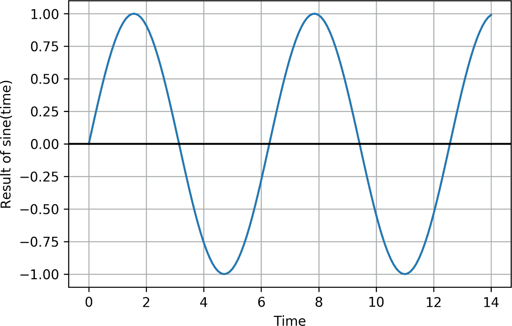

在线上，您可以看到此代码使 SparkFun Edge 的 LED 闪烁的[GIF 动画](https://oreil.ly/XhqG9)。图 4-2 是该动画的静态图像，显示设备的一些 LED 亮起。这可能不是机器学习的特别有用的应用，但遵循“hello world”的精神，它简单、有趣，并且有助于展示需要了解的基本原理。

基本代码运行后，我们将其部署到 SparkFun Edge、Arduino Nano 33 BLE Sense、ST Microelectronics STM32F746G Discovery kit 这三种不同的设备上。

### 注

`TensorFlow` 是一个积极开发的开源项目，不断演进，因此您可能会注意到此处列出的代码与在线托管的代码之间存在一些差异。即使代码更改了几行，基本原则也保持不变。

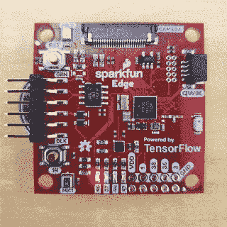

## 机器学习工具链

为了构建此项目的机器学习部分，我们使用实际机器学习从业者使用的相同工具。本节将介绍它们。

### Python 和 Jupyter Notebook

`Python` 是机器学习科学家和工程师喜欢使用的编程语言。`Python` 易于掌握，适用于各种应用，并且拥有丰富的用于数据和数学等有用任务的库。深度学习研究的大部分使用 `Python` 进行，研究人员经常公开其模型的 `Python` 源代码。

`Python` 与称为[`Jupyter` Notebook](https://jupyter.org/) 的东西结合使用时尤其出色。这是一种特殊的文件格式，可以混合文章、图形和代码，只需单击按钮即可运行。`Jupyter` Notebook 被广泛用作描述、解释和探索机器学习代码和问题的方法。

我们将在 `Jupyter` Notebook 内创建模型，在开发过程中可以在其中出色地可视化数据。这包括显示模型精度和收敛的图表。

如果您有编程经验，`Python` 易于阅读和学习。您应该能够毫无问题地跟上本教程。

### Google Colaboratory

要运行笔记本，我们使用名为 [Colaboratory](https://oreil.ly/ZV7NK)，简称 `Colab` 的工具。`Colab` 由 Google 制作，提供在线环境来运行 `Jupyter` Notebook。作为鼓励机器学习研究和开发的工具，它免费提供。

传统上，您需要在自己的计算机上创建笔记本。这需要安装许多依赖项，例如 `Python` 库，这很麻烦。此外，与他人共享完成的笔记本也很困难，因为依赖项版本可能不同，笔记本可能无法按预期运行。此外，机器学习计算量大，开发计算机上模型的训练可能需要很长时间。

使用 `Colab`，您可以在零成本下在 Google 的强大硬件上运行笔记本。您可以从任何网络浏览器编辑和查看笔记本，并与他人共享。此外，您可以设置 `Colab` 在比普通计算机更快的专用硬件上运行您的代码，以更快地进行训练。

### TensorFlow 和 Keras

[`TensorFlow`](https://tensorflow.org) 是构建、训练、评估和部署机器学习模型的工具集。最初由 Google 开发，`TensorFlow` 现在是由全球数千名贡献者构建和维护的开源项目。`TensorFlow` 是最受欢迎和广泛使用的机器学习框架。大多数开发人员通过 `Python` 库与 `TensorFlow` 交互。

`TensorFlow` 执行各种任务。本章中，我们使用 `TensorFlow` 的高级 API [`Keras`](https://oreil.ly/JgNtS) 来轻松构建和训练深度学习网络。此外，我们使用 [`TensorFlow Lite`](https://oreil.ly/LbDBK) 将 [`TensorFlow`](https://oreil.ly/LbDBK) 模型部署到移动设备和嵌入式设备，以便在设备上运行模型。

第 13 章中将更详细地介绍 `TensorFlow`。目前，只需知道 `TensorFlow` 是一个非常强大且行业标准的工具，从初学者到深度学习专家，它都能满足您的需求。

## 构建模型

接下来，我们将逐步介绍构建、训练和转换模型的流程。本章将介绍所有代码，但您也可以在 `Colab` 中边运行代码边跟随。

首先，[加载笔记本](https://oreil.ly/NN6Mj)。页面加载后，单击顶部的 "`Run in Google Colab`" 按钮。这将从 GitHub 将笔记本复制到 `Colab`，您可以运行和编辑它。


默认情况下，除了代码外，笔记本还包含代码运行时应显示的输出示例。由于本章将运行代码，因此请清除此输出，将笔记本恢复到原始状态。要执行此操作，请如图 4-4 所示，从 `Colab` 的菜单中单击 `Edit`，然后选择 `Clear all outputs`。

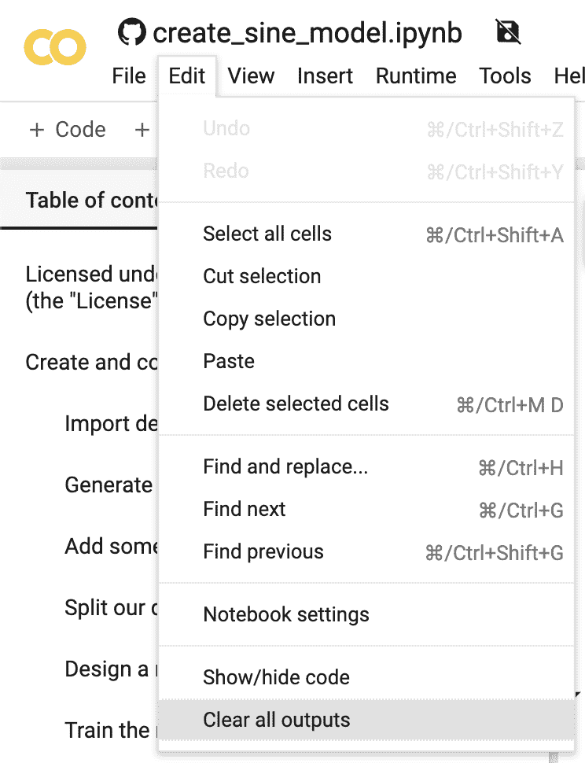

做得好！笔记本现在已准备就绪！

### 提示

如果您已经熟悉机器学习、`TensorFlow`、`Keras`，您可以跳到将模型转换为可在 `TensorFlow Lite` 中使用。书中请跳转到“将模型转换为 TensorFlow Lite 用”。在 `Colab` 中，请向下滚动到“`Convert to TensorFlow Lite`”标题。

### 导入依赖项

第一项工作是导入所需的依赖项。`Jupyter` Notebook 中，代码和文本放在单元格中。代码单元格包含可执行的 `Python` 代码，文本单元格包含格式化的文本。

第一个代码单元格位于 "`Import dependencies`" 下。它设置训练和转换模型所需的所有库。这是该代码：

```
# TensorFlow is an open source machine learning library
!pip install tensorflow==2.0
import tensorflow as tf
# NumPy is a math library
import numpy as np
# Matplotlib is a graphing library
import matplotlib.pyplot as plt
# math is Python's math library
import math
```

在 `Python` 中，使用 `import` 语句加载库以便在代码中使用。从代码和注释可以看出，该单元格执行以下操作：


*   使用 Python 的包管理器 `pip` 安装 TensorFlow 2.0 库。
*   导入 TensorFlow、NumPy、Matplotlib、Python 的 `math` 库。

导入库时，可以为其指定别名以便后续引用。例如，先前的代码使用 `import numpy as np` 导入 NumPy 并赋予其别名 `np`。在代码中使用该库时，可以作为 `np` 引用。

选择单元格后，点击左上角显示的按钮即可执行代码单元格内的代码。在 “Import dependencies” 部分，点击第一个代码单元格的任意位置使其处于选中状态。图 4-5 显示了选中单元格的外观。

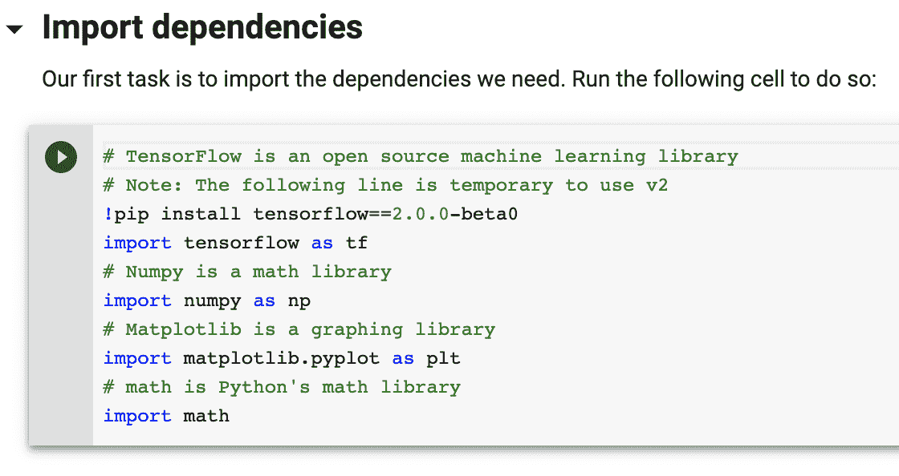

要执行代码，请点击左上角显示的按钮。代码执行时，按钮会像 图 4-6 的 那样以圆圈形式动画。

依赖项开始安装，会显示一些输出。最终会显示以下行，表示库已成功安装：

```
Successfully installed tensorboard-2.0.0 tensorflow-2.0.0 tensorflow-estimator-2.0.0
```

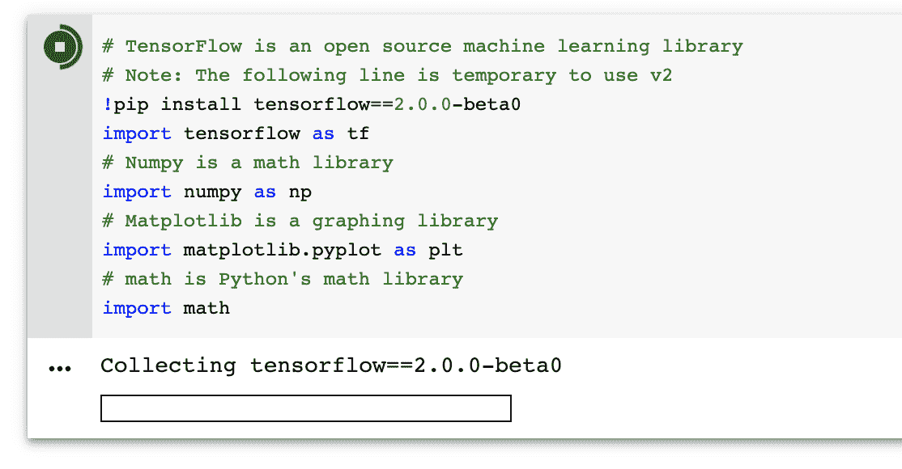

在 Colab 中执行单元格后，如 图 4-7 中 所示，单元格不再被选中时左上角会出现 `1`。该数字是计数器，每次单元格被执行时都会递增。

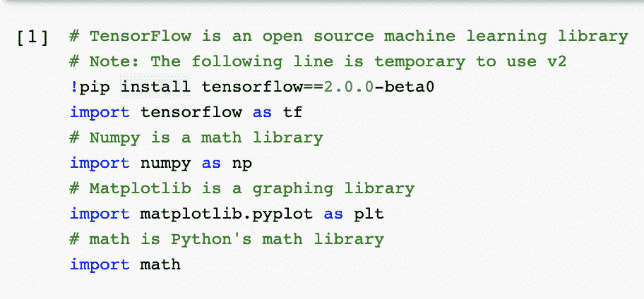

可以借此了解每个单元格被执行了多少次。

## 创建数据

深度学习网络通过学习来建模底层数据的模式。如前所述，我们将训练网络来建模由正弦函数生成的数据。结果可以得到一个接收值 `x` 并预测其正弦 `y` 的模型。

在此之前需要数据。在现实世界中，可能从传感器或生产日志中收集数据。但在本例中，我们使用简单的代码生成数据集。

下一个单元格就是发生此操作的地方。我们的计划是生成 1,000 个值，表示沿正弦波的随机点。请看 图 4-8，回忆一下正弦波是什么样的。

波的完整周期称为 *周期和*，从图中可以看出，在 -轴上大约每 6 个单位一个完整周期结束。从图中可以看出，在 `x`-轴上，大约每 6 个单位完成一个周期。实际上，正弦波的周期是 2×π，即 2π。

为了获得训练所需的正弦波数据，此代码生成 `x` 在 0 到 2π 之间的随机值。然后对每个值计算正弦波。


这使用 NumPy（`np`，先前导入的）生成随机数并计算其正弦：

```
# We'll generate this many sample datapoints
SAMPLES = 1000

# Set a "seed" value, so we get the same random numbers each time we run this
# notebook. Any number can be used here.
SEED = 1337
np.random.seed(SEED)
tf.random.set_seed(SEED)

# Generate a uniformly distributed set of random numbers in the range from
# 0 to 2π, which covers a complete sine wave oscillation
x_values = np.random.uniform(low=0, high=2*math.pi, size=SAMPLES)

# Shuffle the values to guarantee they're not in order
np.random.shuffle(x_values)

# Calculate the corresponding sine values
y_values = np.sin(x_values)

# Plot our data. The 'b.' argument tells the library to print blue dots.
plt.plot(x_values, y_values, 'b.')
plt.show()
```

除了前面已说明的内容外，此代码还有几点值得注意。首先，可以看到使用 `np.random.uniform()` 生成 `x` 的值。此方法返回指定范围内随机数的数组。NumPy 提供了许多对整个值数组进行运算的便捷方法，在处理数据时非常有用。

其次，在生成数据后会进行洗牌。这很重要，因为深度学习中使用的训练过程依赖于数据是否以真正随机的顺序提供。如果数据按顺序排列，所得到的模型的准确性会下降。

接下来，使用 NumPy 的 `sin()` 方法计算正弦值。NumPy 可以一次性计算 `x` 的所有值并返回数组。NumPy 真棒！

最后，你会看到调用 Matplotlib 别名 `plt` 的神秘代码：

```
# Plot our data. The 'b.' argument tells the library to print blue dots.
plt.plot(x_values, y_values, 'b.')
plt.show()
```

这段代码做什么？它绘制数据的图表。Jupyter Notebook 的优点之一是可以显示从执行代码输出的图表。Matplotlib 是从数据创建图表的优秀工具。将数据可视化是机器学习工作流程的重要部分，因此在训练模型时非常有用。

要生成数据并以图表形式显示，请执行单元格内的代码。代码单元格执行完毕后，其下方应显示类似 图 4-9 的漂亮图表。

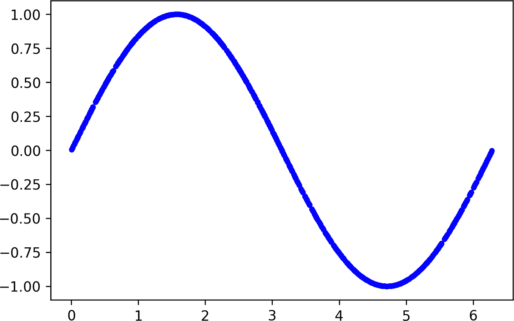

这就是我们的数据！是沿着干净平滑的正弦曲线随机选取的点。可以用它来训练模型。然而，这太简单了。深度学习网络令人兴奋的一点是其从噪声中筛选模式的能力。这使得即使使用杂乱的真实世界数据进行训练也能进行预测。为了展示这一点，让我们在数据点上添加随机噪声并绘制另一张图表：

```
# Add a small random number to each y value
y_values += 0.1 * np.random.randn(*y_values.shape)

# Plot our data
plt.plot(x_values, y_values, 'b.')
plt.show()
```

请执行此单元格查看结果，如 图 4-10 中 所示。

好多了！点被随机化，不再是平滑完整的曲线，而是表示以正弦波为中心的分布。这更能反映现实世界中数据通常非常杂乱的情况。

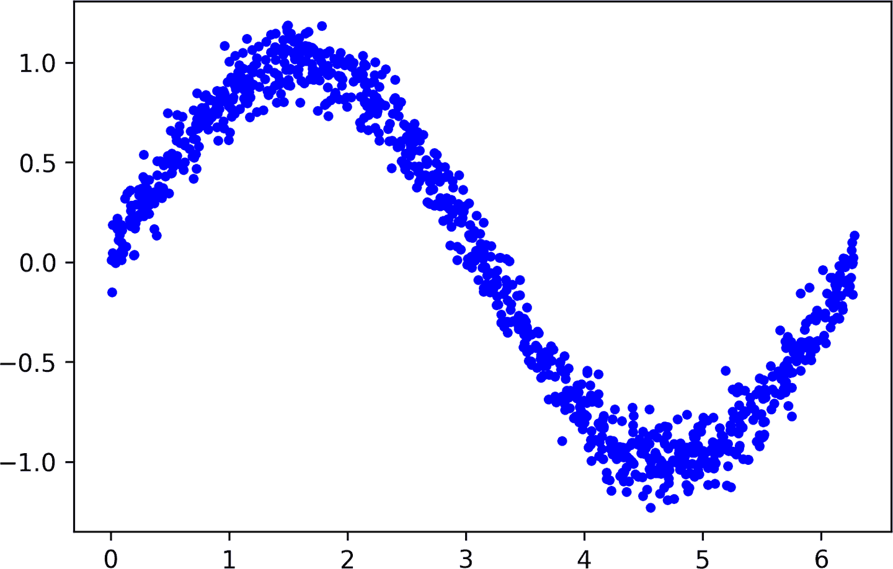

## 分割数据

在前一章中，你可能记得数据集经常被分割为 *训练*、*验证*、*测试* 三个部分。为了评估训练好的模型的准确性，需要将其预测值与实际数据进行比较，检查它们有多一致。

这种评估在训练期间（称为验证）和训练后（称为测试）进行。在每种情况下，重要的是使用尚未用于模型训练的新鲜数据。

为了确保用于评估的数据，在开始训练之前先设置一些数据。将数据的 20% 用于验证，再将 20% 用于测试。剩余的 60% 用于模型的训练。这是训练模型时典型的分割方法。

以下代码将数据分割，并以不同颜色绘制每个集合：

```
# We'll use 60% of our data for training and 20% for testing. The remaining 20%
# will be used for validation. Calculate the indices of each section.
TRAIN_SPLIT =  int(0.6 * SAMPLES)
TEST_SPLIT = int(0.2 * SAMPLES + TRAIN_SPLIT)

# Use np.split to chop our data into three parts.
# The second argument to np.split is an array of indices where the data will be
# split. We provide two indices, so the data will be divided into three chunks.
x_train, x_validate, x_test = np.split(x_values, [TRAIN_SPLIT, TEST_SPLIT])
y_train, y_validate, y_test = np.split(y_values, [TRAIN_SPLIT, TEST_SPLIT])

# Double check that our splits add up correctly
assert (x_train.size + x_validate.size + x_test.size) ==  SAMPLES

# Plot the data in each partition in different colors:
plt.plot(x_train, y_train, 'b.', label="Train")
plt.plot(x_validate, y_validate, 'y.', label="Validate")
plt.plot(x_test, y_test, 'r.', label="Test")
plt.legend()
plt.show()
```

为了分割数据，使用另一个便捷的 NumPy 方法：`split()`。此方法接收数据数组和索引数组，并在指定索引处分割数据。

执行此单元格查看分割结果。如 图 4-11 中 所示，按数据类型以不同颜色（阅读本书印刷版时为阴影）显示。

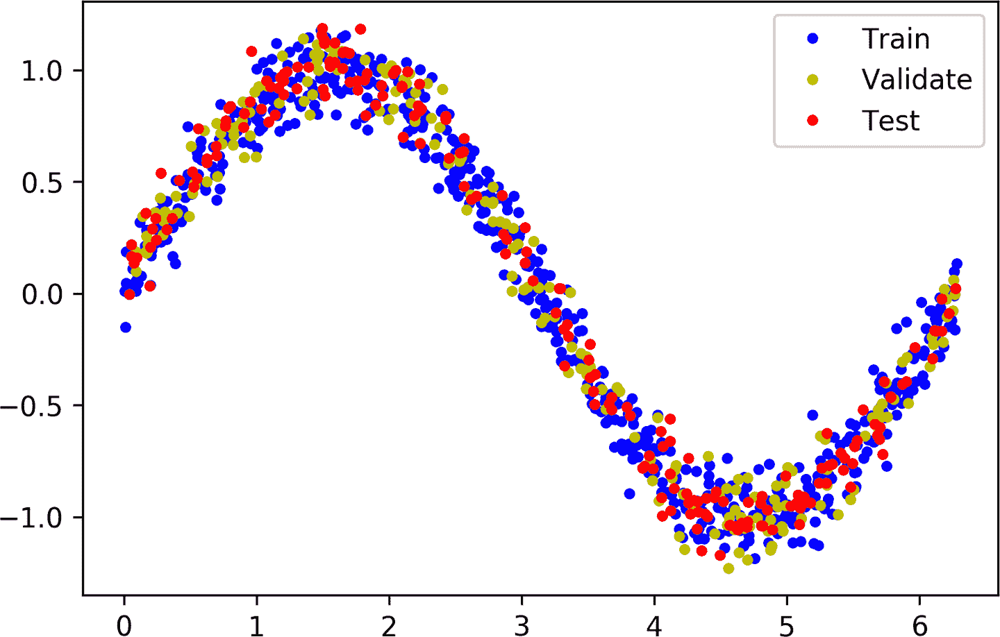

## 基本模型定义

现在我们有了数据，接下来创建适合训练的模型。

构建一个接收输入值（本例中为 `x`）并使用它预测数值输出值（`x` 的正弦）的模型。这类问题称为 *回归和*。回归模型可用于需要数值输出的各种任务。例如，回归模型可以根据加速度计数据预测人的跑步速度，单位为每小时英里。

为了创建模型，设计一个简单的神经网络。它使用神经元层来学习训练数据背后的模式并进行预测。

实现此功能的代码实际上非常简单。它使用 [*Keras*](https://oreil.ly/IpFqC) ，这是 TensorFlow 用于创建深度学习网络的高级 API：

```
# We'll use Keras to create a simple model architecture
from tf.keras import layers
model_1 = tf.keras.Sequential()

# First layer takes a scalar input and feeds it through 16 "neurons." The
# neurons decide whether to activate based on the 'relu' activation function.
model_1.add(layers.Dense(16, activation='relu', input_shape=(1,)))

# Final layer is a single neuron, since we want to output a single value
model_1.add(layers.Dense(1))

# Compile the model using a standard optimizer and loss function for regression
model_1.compile(optimizer='rmsprop', loss='mse', metrics=['mae'])

# Print a summary of the model's architecture
model_1.summary()
```

`Sequential` 表示神经元各层像 图 3-1 中看到的那样堆叠的模型。接下来定义两个层。这里定义第一个层：

```
model_1.add(layers.Dense(16, activation='relu', input_shape=(1,)))
```

第一个层的输入为 1 个（`x`），神经元为 16 个。这是 `Dense`（也称为 *全连接* 层）层，意味着在推理时，即预测时，输入会被馈送到每个神经元。然后每个神经元被 *激活* 到一定程度。每个神经元的激活量基于训练期间学习到的 *权重和* *偏置* 值以及 *激活函数*。神经元的激活以数值形式输出。

激活是通过用 Python 表示的简单公式计算的。这由 Keras 和 TensorFlow 处理，因此无需自行编码，但在深入学习深度学习时了解它会很有帮助：

```
activation = activation_function((input * weight) + bias)
```

要计算神经元激活，将输入乘以权重，然后将结果加上偏置。计算值传递给激活函数。所得数值即为神经元的激活。

激活函数是用于形成神经元输出的数学函数。我们的网络使用名为 *rectified linear unit*，缩写为 *ReLU 和* 的激活函数。这在 Keras 中通过参数 `activation=relu` 指定。

ReLU 是一个简单的函数，这里用 Python 表示：

```
def relu(input):
    return max(0.0, input)
```

ReLU 返回输入值和零中较大的值。如果输入值为负，ReLU 返回零。如果输入值大于或等于零，ReLU 返回该值本身。

图 4-12 是 显示了某一范围输入值下 ReLU 的输出。

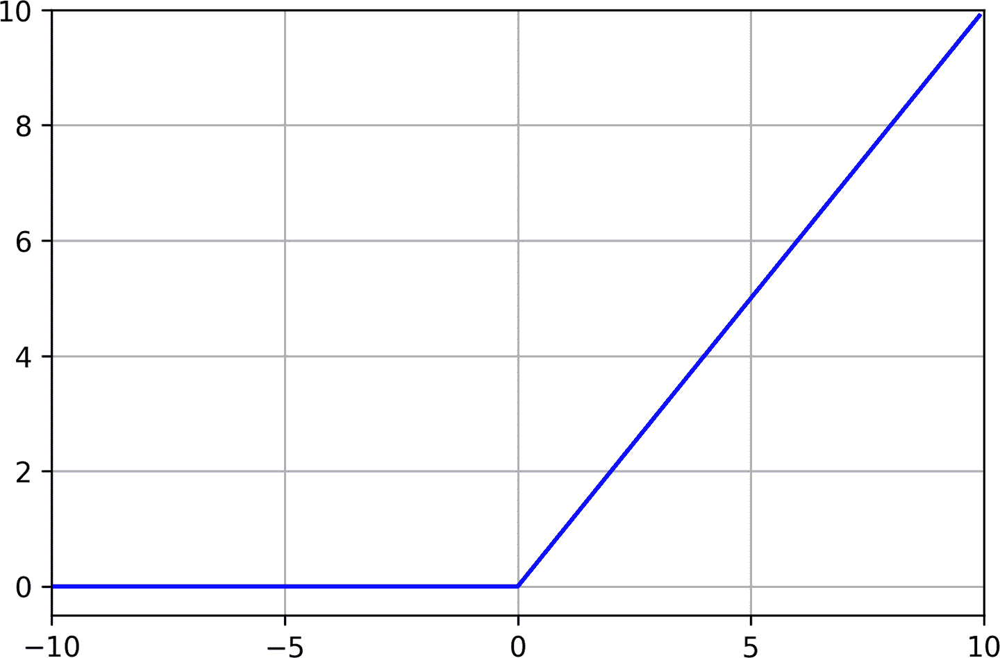

如果没有激活函数，神经元输出将始终是输入的一次函数。这意味着网络只能建模 `x` 与 `y` 的比率在整个值范围内相同的线性关系。正弦波是非线性的，因此网络无法建模正弦波。

ReLU 是非线性的，因此多个神经元层可以协同工作，建模复杂的非线性关系。在这种情况下，`y` 的值不会随着 `x` 的每次增量而增加相同量。

### 注

还有其他激活函数，但 ReLU 是最常用的。可以在 [Wikipedia 的激活函数文章中](https://oreil.ly/Yxe-N) 查看其他选择。每个激活函数都有不同的权衡，机器学习工程师会进行实验以找到给定架构的最佳选项。

第一个层的激活数作为下一行定义的第二个层的输入提供：

```
model_1.add(layers.Dense(1))
```


このレイヤーは1つのニューロンなので、16 個の入力を受け取る。このレイヤーの目的は、前のレイヤーのすべての活性化を1つの出力値にまとめることである。この層は出力層なので、活性化関数は指定しない。

このニューロンは複数の入力を持つため、それぞれに対応する重み値を持つ。ニューロンの出力は、Pythonで示された以下の式で計算される：

```
# Here, `inputs` and `weights` are both NumPy arrays with 16 elements each
output = sum((inputs * weights)) + bias
```

出力値は、各入力に対応する重みを掛け合わせ、その結果を合計し、ニューロンのバイアスを加えることで得られる。

ネットワークの重みとバイアスはトレーニング中に学習される。章で示したコードの`compile()`ステップでは、学習プロセスで使用されるいくつかの重要な引数を設定し、学習するモデルを準備する：

```
model_1.compile(optimizer='rmsprop', loss='mse', metrics=['mae'])
```

`optimizer`引数は、学習中にネットワークの入力モデルを調整するアルゴリズムを指定する。いくつかの選択肢があり、最適なものを発見するには実験が必要になることが多い。オプションについては[Keras 文档](https://oreil.ly/oT-pU)読もう。

`loss`引数は、ネットワークの予測値が現実からどの程度離れているかを計算するために、学習中に使用されるメソッドを指定する。このメソッドは*損失関数*呼び出しと呼ばれる。ここでは、`mse`、つまり*平均二乗エラー*を使用している。この損失関数は、数値を予測する回帰問題の場合に使用される。Kerasには様々な損失関数がある。[Keras 文档中](https://keras.io/losses)いくつかのオプションがリストされている。

`metrics`引数は、モデルの性能を判定するために使われるいくつかの追加関数を指定することができる。`mae`、つまり*平均絶対誤差*を指定する。これは回帰モデルの性能を測定するのに役立つ関数である。このメトリックはトレーニング中に測定され、トレーニング終了後にその結果にアクセスできる。

モデルをコンパイルしたら、次の線の出力でアーキテクチャの概要情報を表示することができる：

```
# Print a summary of the model's architecture
model_1.summary()
```

モデルを定義するためにColabでセルを実行する。次のような出力が表示される：

```
Model: "sequential"
_________________________________________________________________
Layer (type)                 Output Shape              Param #
=================================================================
dense (Dense)                (None, 16)                32
_________________________________________________________________
dense_1 (Dense)              (None, 1)                 17
=================================================================
Total params: 49
Trainable params: 49
Non-trainable params: 0
_________________________________________________________________
```

この表は、ネットワークの層、出力形状、*パラメータ*数を示している。ネットワークのサイズは、それがどれだけのメモリを消費するかによって決まるが、そのほとんどはパラメータの数、つまり重みとバイアスの合計数に依存する。これはモデルのサイズや複雑さを議論する際に有用なメトリックとなる。

我々のような単純なモデルの場合、重みの数は、各接続に重みがあると仮定して、モデル内のニューロン間の接続数を計算することで決定できる。

いま設計したネットワークは2つのレイヤーで構成されている。最初のレイヤーは、入力と各ニューロンとの間に16の接続を持つ。番目のレイヤーは1つのニューロンで、これも16の接続を持ち、1 番目のレイヤーの各ニューロンに1つずつ接続する。これで、接続の合計は32となる。

すべてのニューロンがバイアスを持つので、ネットワークは17のバイアスを持ち、合計 32 + 17\= 49のパラメータを持つことになる。

ここまでで、モデルを定義するコードを見てきた。次に、 。

# モデルを育てる

モデルを定義したら、次はそれをトレーニングし、そのパフォーマンスを評価する。メトリックを見ることで、それが十分であるか、あるいは設計を変更して再度トレーニングすべきかを判断することができる。

Kerasでモデルを学習するには、`fit()`メソッドを呼び出し、すべてのデータとその他の重要な引数を渡すだけだ。次のコードはその方法を示している：

```
history_1 = model_1.fit(x_train, y_train, epochs=1000, batch_size=16,
                     validation_data=(x_validate, y_validate))
```

セル内のコードを実行してトレーニングを開始する。いくつかのログが表示され始めるのがわかるだろう：

```
Train on 600 samples, validate on 200 samples
Epoch 1/1000
600/600 [==============================] - 1s 1ms/sample - loss: 0.7887 - mae: 0.7848 - val_loss: 0.5824 - val_mae: 0.6867
Epoch 2/1000
600/600 [==============================] - 0s 155us/sample - loss: 0.4883 - mae: 0.6194 - val_loss: 0.4742 - val_mae: 0.6056
```

モデルはトレーニング中だ。これには少し時間がかかるので、待っている間に`fit()`への呼び出しの詳細を説明しよう：

```
history_1 = model_1.fit(x_train, y_train, epochs=1000, batch_size=16,
                     validation_data=(x_validate, y_validate))
```

まず、`fit()`呼び出しの戻り値を`history_1`という名前の変数に代入していることに気づくだろう。この変数には、トレーニングの実行に関するたくさんの情報が含まれている。

次に、`fit()`関数の引数を見てみよう：

`x_train`、`y_train`

: 

`fit()`の最初の2つの引数は、学習データの`x`と`y`の値である。データの一部は検証用とテスト用に取っておくので、ネットワークの訓練には訓練セットだけが使われる。

`epochs`

: 

次の引数は、学習セット全体を学習中に何回ネットワークに通すかを指定する。エポック数が多ければ多いほど、より多くのトレーニングが行われることになる。学習回数が多ければ多いほど、ネットワークは良くなると思うかもしれない。しかし、ネットワークによっては、あるエポック数を超えると学習データをオーバーフィットし始めるものもある。

さらに、たとえオーバーフィッティングがなかったとしても、ネットワークはある一定量のトレーニングが終わると改善が止まる。トレーニングには時間とコンピューティングリソースがかかるため、ネットワークが改善されないのであれば、トレーニングしない方がよい！

まずは1,000エポックのトレーニングから始める。トレーニングが完了したら、メトリックを調べて、この数字が正しいかどうかを調べることができる。

`batch_size`

: 

引数は、ネットワークの精度を測定し、重みとバイアスを更新する前に、何個の学習データをネットワークに投入するかを指定する。必要であれば、のを指定することもできる。つまり、1つのデータポイントで推論を実行し、ネットワークの予測の損失を測定し、重みとバイアスを更新して次回予測をより正確にし、残りのデータでこのサイクルを続けるということだ。`batch_size` `1` `batch_size`

600 個のデータポイントがあるので、各エポックでは600 回ネットワークが更新されることになる。これは膨大な計算量であり、トレーニングに時間がかかる！代替案としては、複数のデータポイントを選択して推論を実行し、損失を総合的に測定して、それに応じてネットワークを更新する方法がある。

`batch_size`を`600`にセットすると、各バッチにすべての学習データが含まれることになる。これで、エポックごとに1 回だけネットワークを更新すればよくなり、はるかに速くなる。問題は、この結果、モデルの精度が落ちるということだ。バッチ・サイズの大きい学習モデルは、新しいデータに一般化する能力が低く、オーバーフィットしやすいという研究結果がある。

妥協点は、中間のバッチサイズを使うことである。我々のトレーニングコードでは、バッチサイズを16としている。つまり、16 個のデータポイントをランダムに選び、推論を実行し、合計で損失を計算し、バッチごとに1 回ネットワークを更新する。仮に600 点の訓練データがあれば、ネットワークは1エポックあたり38 回更新されることになり、600 回よりはるかに良い。

バッチサイズを選択するとき、トレーニング効率とモデルの精度の間で妥協することになる。理想的なバッチサイズはモデルによって異なる。まずは16か32のバッチサイズから始めて、何が最適か試してみるのがいいだろう。

`validation_data`

: 

ここで検証データセットを指定する。このデータセットからのデータは、学習プロセスを通してネットワークに流され、ネットワークの予測値が期待値と比較される。検証結果はログや`history_1`オブジェクトの一部として見ることができる。

## トレーニングメトリクス

トレーニングが終了していることを願う。そうでない場合は、トレーニングが終了するまでしばらく待つこと。

これから様々なメトリックをチェックして、ネットワークがどの程度学習したかを確認する。はじめに、トレーニング中に書かれたログを見てみよう。これは、ランダムな初期状態からトレーニング中にネットワークがどのように改善されたかを示す。

以下は、最初と最後のエポックのログである：

```
Epoch 1/1000
600/600 [==============================] - 1s 1ms/sample - loss: 0.7887 - mae: 0.7848 - val_loss: 0.5824 - val_mae: 0.6867
```

```
Epoch 1000/1000
600/600 [==============================] - 0s 124us/sample - loss: 0.1524 - mae: 0.3039 - val_loss: 0.1737 - val_mae: 0.3249
```

`loss`、`mae`、`val_loss`、`val_mae`は様々なことを教えてくれる：

`loss`

: 

これが損失関数の出力だ。平均二乗エラーを使用しており、正の数で表される。一般化すると、損失値は小さいほど良いので、ネットワークを評価する際には、この値に注目すると良いだろう。

最初のエポックと最後のエポックを比較すると、ネットワークはトレーニング中に明らかに改善され、〜0.7の損失から〜0.15の小さな値になった。この改善が十分かどうか、他の数値を見てみよう！

`mae`

: 

これは訓練データの平均絶対エラーである。これは、ネットワークの予測値と、トレーニングデータから予想される`y`値との平均差を示している。

訓練されていないネットワークに基づいていることから、初期化エラーはかなり悲惨なものになると予想できる。ネットワークの予測は平均で～0.78の誤差があり、これは許容値の範囲が-1から1までしかない場合には大きな数字である！

しかし、トレーニング後でさえ、平均絶対エラーは〜0.30である。これは我々の予測が平均で～0.30ずれていることを意味し、それでもかなりひどいものだ。

`val_loss`

: 

これは検証データに対する損失関数の出力である。最後のエポックでは、トレーニングの損失（～0.15）は検証の損失（～0.17）よりもわずかに低い。これはネットワークがオーバーフィットしている可能性を示唆している。

`val_mae`

: 

これは検証データの平均絶対誤差である。絶対値が〜0.32と、トレーニングセットの平均絶対誤差よりも悪い。これはネットワークがオーバーフィットしている可能性を示すもう1つのサインだ。

## 歴史をグラフ化する

ここまでのところ、我々のモデルが正確な予測をするのに優れた仕事をしていないことは明らかだ。今の課題は、その原因を突き止めることだ。そのために、`history_1`オブジェクトで収集したデータを利用しよう。

次のセルは、ヒストリーオブジェクトからトレーニングと検証の損失データを抽出し、グラフにプロットする：

```
loss = history_1.history['loss']
val_loss = history_1.history['val_loss']

epochs = range(1, len(loss) + 1)

plt.plot(epochs, loss, 'g.', label='Training loss')
plt.plot(epochs, val_loss, 'b', label='Validation loss')
plt.title('Training and validation loss')
plt.xlabel('Epochs')
plt.ylabel('Loss')
plt.legend()
plt.show()
```

`history_1`オブジェクトには、`history_1.history`という属性が含まれている。これは、トレーニング時と検証時のメトリック値を記録した辞書である。これを使用して、プロットするデータを収集する。x 軸にはエポック数を使用する。エポック数は、損失データポイントの数を見て決定する。セルを実行すると、図 4-13のグラフが表示される。

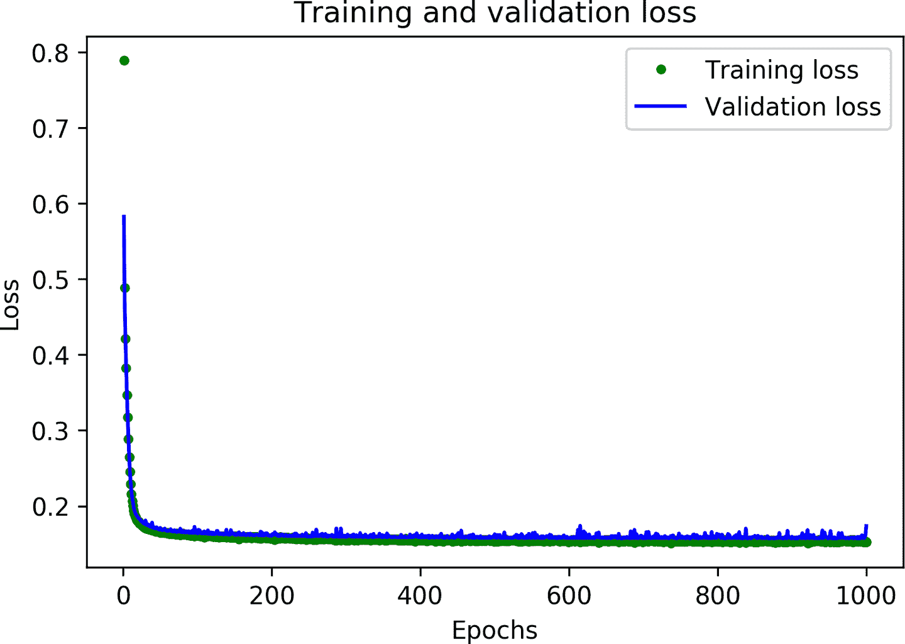

ご覧のように、最初の50エポックでは損失が急速に減少し、その後横ばいになっている。これは、モデルが改善され、より正確な予測を生み出していることを意味する。

我々のゴールは、モデルが改善されなくなったか、訓練損失が検証損失より小さくなった時に訓練を止めることである。これは、モデルが訓練データを予測することを非常によく学習し、新しいデータに一般化できなくなったことを意味する。

損失は最初の数エポックで急激に減少し、グラフの残りの部分を読むのはかなり難しくなっている。次のセルを実行することで、最初の100エポックを飛ばしてみよう：

```
# Exclude the first few epochs so the graph is easier to read
SKIP = 100

plt.plot(epochs[SKIP:], loss[SKIP:], 'g.', label='Training loss')
plt.plot(epochs[SKIP:], val_loss[SKIP:], 'b.', label='Validation loss')
plt.title('Training and validation loss')
plt.xlabel('Epochs')
plt.ylabel('Loss')
plt.legend()
plt.show()
```

図 4-14は、このセルでプロデューサが作成したグラフである。

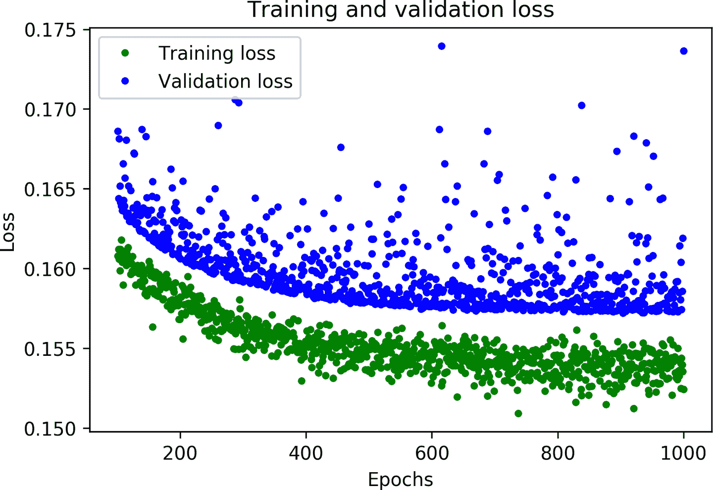

拡大してみると、損失は600エポックあたりまで減り続け、その時点ではほぼ安定していることがわかる。つまり、これほど長い間ネットワークを訓練する必要はないということだ。

しかし、最低損失値がまだ0.15 程度であることもわかる。これは比較的高いようだ。さらに、検証の損失値は一貫してさらに高い。

モデルのパフォーマンスをより深く理解するために、もう少しデータをプロットしてみよう。今回は平均絶対誤差をプロットしてみよう。そのために次のセルを実行する：


# 模型评估与改进

```
# Draw a graph of mean absolute error, which is another way of
# measuring the amount of error in the prediction.
mae = history_1.history['mae']
val_mae = history_1.history['val_mae']

plt.plot(epochs[SKIP:], mae[SKIP:], 'g.', label='Training MAE')
plt.plot(epochs[SKIP:], val_mae[SKIP:], 'b.', label='Validation MAE')
plt.title('Training and validation mean absolute error')
plt.xlabel('Epochs')
plt.ylabel('MAE')
plt.legend()
plt.show()
```

图 4-15 是其结果的图表。

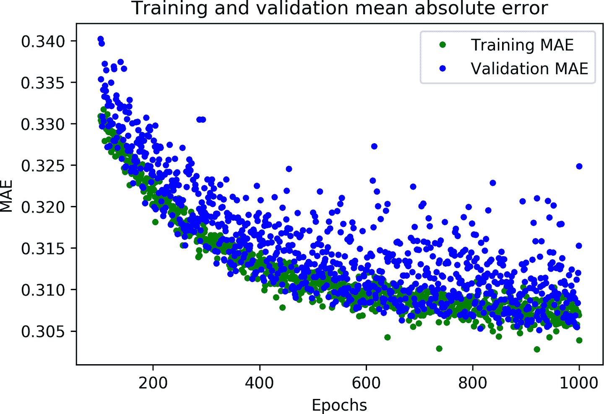

这个平均绝对误差的图表提供了进一步的提示。可以看出，平均而言，训练数据的误差低于验证数据。这意味着网络可能存在过拟合，或者过度学习了训练数据，从而无法对新数据进行有效预测。

此外，平均绝对误差的值约为 0.31，相当高，这意味着模型的某些预测至少偏差 0.31。由于期望值的范围为-1 到+1，因此 0.31 的误差意味着距离准确建模正弦波还很远。

为了更深入地理解发生了什么，可以将网络对训练数据的预测值相对于期望值进行绘图。

这将在下一个单元格中发生：

```
# Use the model to make predictions from our validation data
predictions = model_1.predict(x_train)

# Plot the predictions along with the test data
plt.clf()
plt.title('Training data predicted vs actual values')
plt.plot(x_test, y_test, 'b.', label='Actual')
plt.plot(x_train, predictions, 'r.', label='Predicted')
plt.legend()
plt.show()
```

通过调用 `model_1.predict(x_train)`，对训练数据中 `x` 的所有值执行推理。该方法返回预测值的数组。让我们将其与训练集的实际 `y` 值一起绘制到图表中。执行单元格后，将显示 图 4-16 的图表。

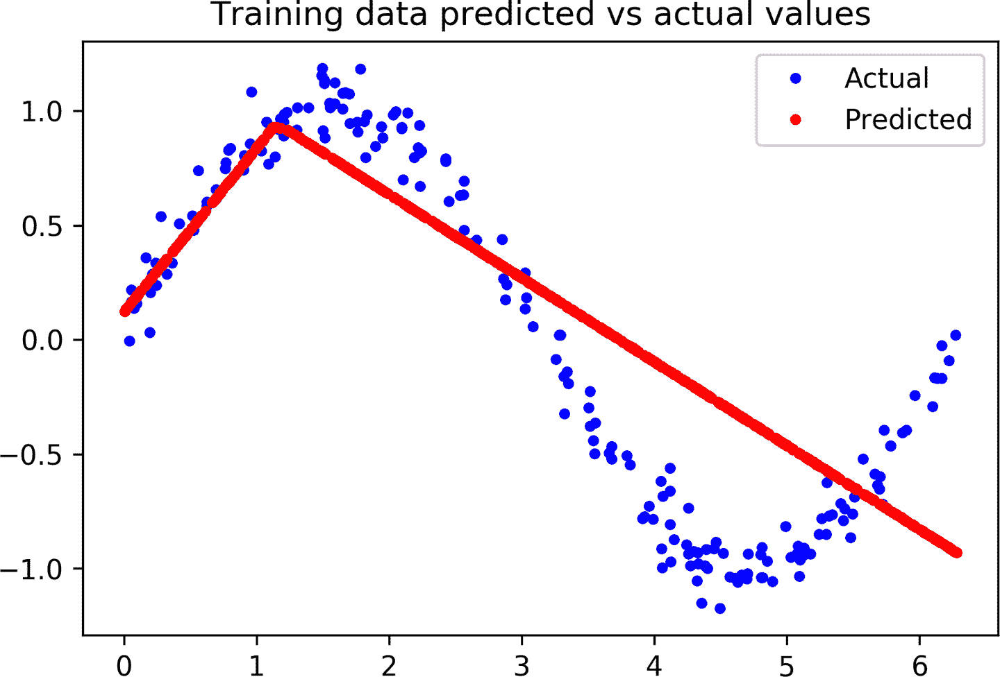

真糟糕！从这个图表可以看出，我们的网络以非常有限的方式学习了正弦函数的近似。预测非常线性，对数据的拟合也非常粗糙。

这种适应性的僵硬表明，模型没有足够的容量完全学习正弦波函数的复杂性，只能以过度简化的方式进行近似。通过增大模型，应该可以提高其性能。

## 改进模型

凭借着原始模型对于学习数据的复杂性来说太小的知识，我们可以尝试使其变得更好。设计模型、评估其性能并进行更改以期改善。

增大网络的一种简单方法是再添加一层神经元。每一层神经元代表一种将输入转换为期望输出的转换。神经元层越多，这些转换就越复杂。

执行下一个单元格，像之前一样重新定义模型，但在中间添加一个包含 16 个神经元的层：

```
model_2 = tf.keras.Sequential()

# First layer takes a scalar input and feeds it through 16 "neurons." The
# neurons decide whether to activate based on the 'relu' activation function.
model_2.add(layers.Dense(16, activation='relu', input_shape=(1,)))

# The new second layer may help the network learn more complex representations
model_2.add(layers.Dense(16, activation='relu'))

# Final layer is a single neuron, since we want to output a single value
model_2.add(layers.Dense(1))

# Compile the model using a standard optimizer and loss function for regression
model_2.compile(optimizer='rmsprop', loss='mse', metrics=['mae'])

# Show a summary of the model
model_2.summary()
```

如你所见，代码基本上与第一个模型相同，只是添加了一个 `Dense` 层。让我们执行单元格以查看 `summary()` 的结果：

```
Model: "sequential_1"
_________________________________________________________________
Layer (type)                 Output Shape              Param #
=================================================================
dense_2 (Dense)              (None, 16)                32
_________________________________________________________________
dense_3 (Dense)              (None, 16)                272
_________________________________________________________________
dense_4 (Dense)              (None, 1)                 17
=================================================================
Total params: 321
Trainable params: 321
Non-trainable params: 0
_________________________________________________________________
```

由于有两个包含 16 个神经元的层，新模型变得相当大。权重为 (1 * 16) + (16 * 16) + (16 * 1) = 288 个，偏置为 16 + 16 + 1 = 33 个，总共 288 + 33 = 321 个参数。原始模型总共只有 49 个参数，因此这是模型大小增加了 555%。希望这种额外的容量有助于表示数据的复杂性。

在下一个单元格中训练新模型。第一个模型很快就不再改进了，所以这次我们训练 600 个 epoch，数量较少。执行此单元格开始训练：

```
history_2 = model_2.fit(x_train, y_train, epochs=600, batch_size=16,
                     validation_data=(x_validate, y_validate))
```

训练结束后，查看最终日志，可以大致感受到情况是否有所改善：

```
Epoch 600/600
600/600 [==============================] - 0s 150us/sample - loss: 0.0115 - mae: 0.0859 - val_loss: 0.0104 - val_mae: 0.0806
```

太棒了！验证损失从 0.17 减少到 0.01，验证平均绝对误差从 0.32 减少到 0.08。这非常有希望。

为了看看情况如何，让我们运行下一个单元格。它已设置好生成与上次使用的相同图表。首先绘制损失图表：

```
# Draw a graph of the loss, which is the distance between
# the predicted and actual values during training and validation.
loss = history_2.history['loss']
val_loss = history_2.history['val_loss']

epochs = range(1, len(loss) + 1)

plt.plot(epochs, loss, 'g.', label='Training loss')
plt.plot(epochs, val_loss, 'b', label='Validation loss')
plt.title('Training and validation loss')
plt.xlabel('Epochs')
plt.ylabel('Loss')
plt.legend()
plt.show()
```

图 4-17 是显示结果。

接下来，绘制相同的损失图表，但跳过前 100 个 epoch，以便更清晰地看到细节：

```
# Exclude the first few epochs so the graph is easier to read
SKIP = 100

plt.clf()

plt.plot(epochs[SKIP:], loss[SKIP:], 'g.', label='Training loss')
plt.plot(epochs[SKIP:], val_loss[SKIP:], 'b.', label='Validation loss')
plt.title('Training and validation loss')
plt.xlabel('Epochs')
plt.ylabel('Loss')
plt.legend()
plt.show()
```

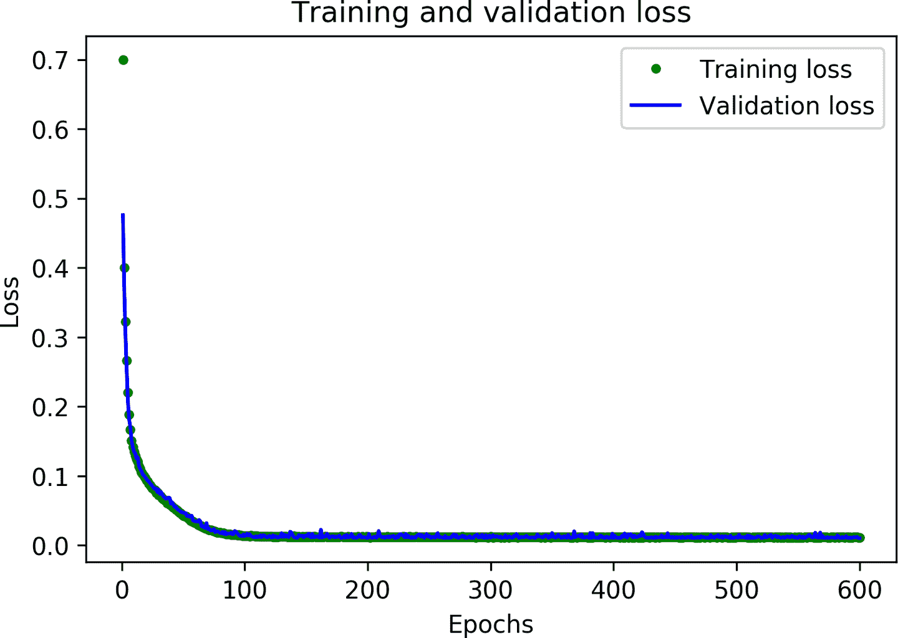

图 4-18 是显示其输出。

最后，对同一组 epoch 绘制平均绝对误差：

```
plt.clf()

# Draw a graph of mean absolute error, which is another way of
# measuring the amount of error in the prediction.
mae = history_2.history['mae']
val_mae = history_2.history['val_mae']

plt.plot(epochs[SKIP:], mae[SKIP:], 'g.', label='Training MAE')
plt.plot(epochs[SKIP:], val_mae[SKIP:], 'b.', label='Validation MAE')
plt.title('Training and validation mean absolute error')
plt.xlabel('Epochs')
plt.ylabel('MAE')
plt.legend()
plt.show()
```

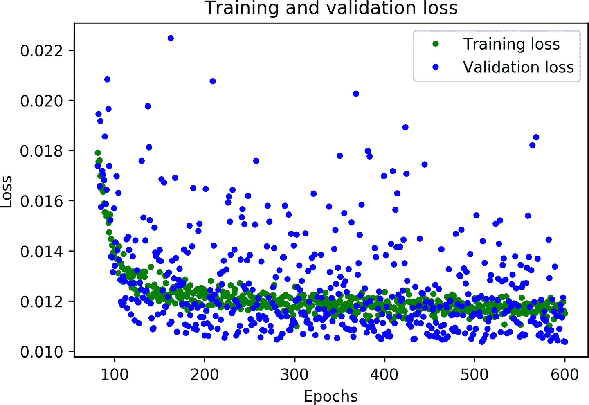

图 4-19 是其图表。

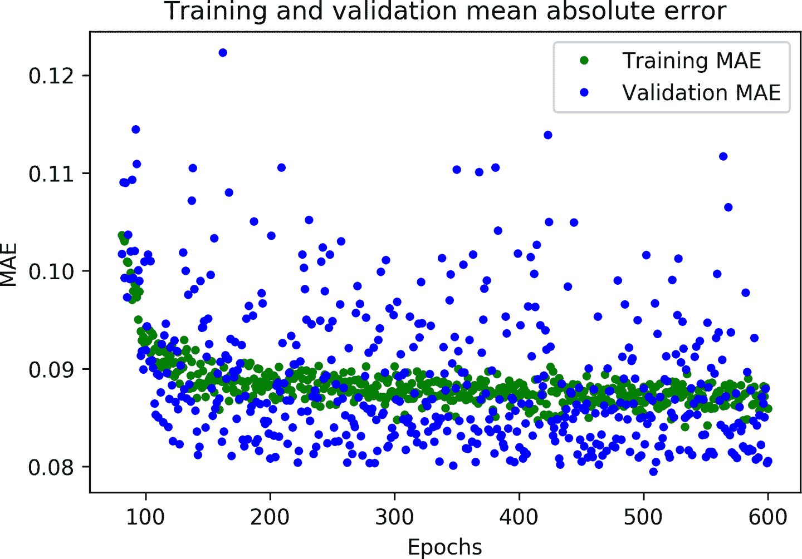

结果非常棒！从这些图表中可以看出两件令人兴奋的事情：

* 指标总体上验证优于训练，这意味着网络没有过拟合。
* 总体损失和平均绝对误差比之前的网络有了大幅改善。

你可能会好奇为什么验证指标比训练指标更好。原因在于验证指标是在每个 epoch 结束时计算的，而训练指标是在训练 epoch 进行过程中计算的。也就是说，验证是在训练稍长时间的模型上进行的。

根据验证数据，我们的模型似乎表现非常出色。然而，要确信这一点，需要执行最后的测试。

## 测试

之前，我们将 20% 的数据设置为测试用。如讨论的那样，保持验证数据和测试数据分开非常重要。因为我们会根据验证性能微调网络，所以存在过度拟合验证集、无法泛化到新数据的风险。通过保留新鲜数据用于模型的最终测试，可以避免这种情况发生。

使用测试数据后，需要抑制进一步调优模型的冲动。如果出于提高测试性能的目的而更改设置，可能会导致对测试集过拟合。这样一来，就没有新的数据可用于测试了。

也就是说，如果我们的模型在测试数据上表现不佳，那就意味着要回到起点。需要停止对当前模型的优化，构思全新的架构。

牢记这一点，下一个单元格将对测试数据评估模型：

```
# Calculate and print the loss on our test dataset
loss = model_2.evaluate(x_test, y_test)

# Make predictions based on our test dataset
predictions = model_2.predict(x_test)

# Graph the predictions against the actual values
plt.clf()
plt.title('Comparison of predictions and actual values')
plt.plot(x_test, y_test, 'b.', label='Actual')
plt.plot(x_test, predictions, 'r.', label='Predicted')
plt.legend()
plt.show()
```

首先，使用测试数据调用模型的 `evaluate()` 方法。它计算并输出损失和平均绝对误差指标，告知模型的预测与实际值相差多少。接下来，生成一组预测值，并将其与实际值一起绘制到图表中。

现在，运行单元格来了解模型的性能！首先，看看 `evaluate()` 的结果：

```
200/200 [==============================] - 0s 71us/sample - loss: 0.0103 - mae: 0.0718
```

这表明评估了 200 个数据点，即整个测试集。模型每个预测耗时 71 微秒。损失指标为 0.0103，非常优秀，且非常接近验证损失 0.0104。平均绝对误差 0.0718 也非常小，相当接近验证中的 0.0806。

这意味着我们的模型运行良好，且没有过拟合！如果模型对验证数据过拟合，测试集的指标会比验证结果差很多。

查看 图 4-20 中 显示的预测值与实际值的图表，就能一目了然地看出我们的模型工作得有多好。

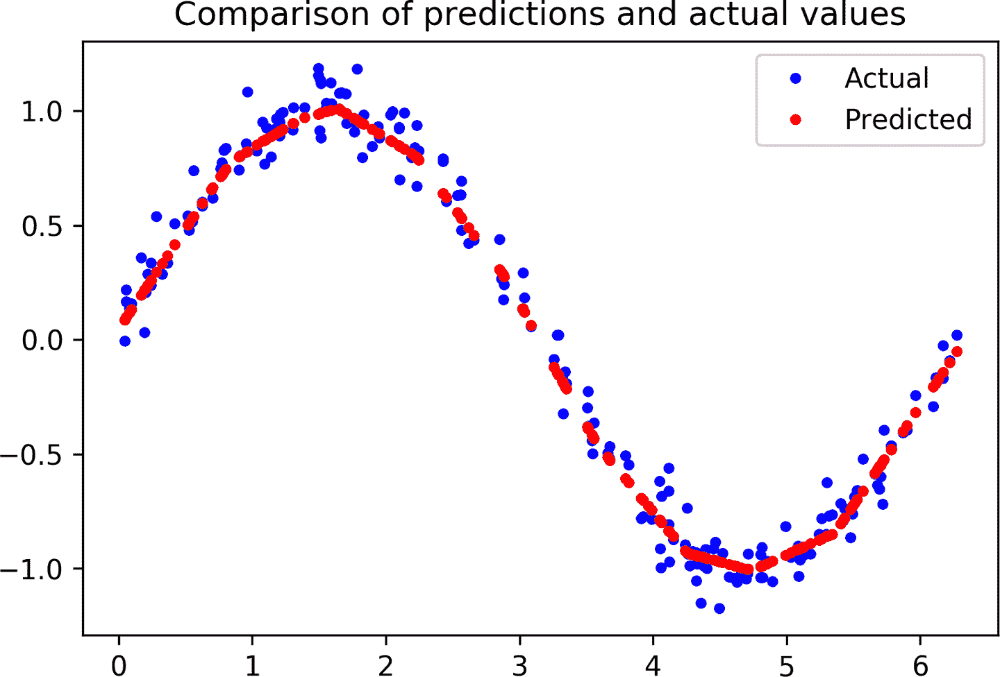

在大多数情况下，可以看到表示 *预测* 值的点沿着 *实际* 值的分布中心形成了一条平滑的曲线。我们的 Network 尽管数据集存在噪声，仍学会了近似正弦曲线！


しかし、よく見ると、いくつかの不完全な部分があることがわかる。予測された正弦波のピークと谷は、実際の正弦波のように完全に滑らかではない。ランダムに分布している学習データのばらつきが、モデルに学習されてしまったのだ。滑らかな正弦関数を学習する代わりに、モデルはデータの形状を正確に再現するように学習したのだ。

我々の目的では、このオーバーフィッティングは大きな問題ではない。我々の目標は、このモデルがLEDを緩やかにフェードオン／オフさせることであり、これを達成するために完璧に滑らかである必要はない。もしオーバーフィッティングのレベルが問題だと考えるなら、正則化のテクニックや、より多くのトレーニングデータを得ることで対処することができるだろう。

モデルには満足したので、デバイス上でデプロイできるようにしよう ！

# 将模型转换为 TensorFlow Lite 用

本章开头简要提到了 TensorFlow Lite。TensorFlow Lite 是一个用于在“边缘设备”（指从手机到微控制器板等所有设备）上运行 TensorFlow 模型的工具集。

第 13 章 将详细介绍 TensorFlow Lite for Microcontrollers。目前，可以认为 TensorFlow Lite 有两个主要组件：

TensorFlow Lite 转换器

: 

这是将 TensorFlow 模型转换为可在内存受限设备上使用的、空间高效的特殊格式，并可应用优化以进一步减小模型大小，使其在小型设备上也能高速运行。

TensorFlow Lite 解释器

: 

这是使用针对给定设备最有效的运算符来运行已正确转换的 TensorFlow Lite 模型。

在使用 TensorFlow Lite 之前需要转换模型。为此使用 TensorFlow Lite Converter 的 Python API。它接收 `Keras` 模型并以 `FlatBuffer` 格式写入磁盘。`FlatBuffer` 是一种为提高空间效率而设计的特殊文件格式。由于要部署到内存有限的设备上，这非常方便！关于 FlatBuffer 将在 第 12 章 中详细介绍。

TensorFlow Lite 转换器除了创建 `FlatBuffer` 外，还可以对模型应用优化。这些优化通常会减少模型的尺寸、执行时间或两者兼有。这有时会以精度下降为代价，但通常其影响非常小。关于优化将在 第 13 章 中详细介绍。

最有用的优化之一是 `量子化`。默认情况下，模型的权重和偏差以 32 位浮点数保存，以便在训练期间进行高精度计算。通过量化，可以降低这些数值的精度，使其适合 8 位整数。更妙的是，CPU 计算整数比浮点数更简单，因此量化后的模型运行速度更快。

量化的最棒之处在于，通常精度损失被最小化。也就是说，在部署到低内存设备时几乎总是物有所值。

在下一个单元格中，使用转换器创建并保存模型的新版本两个。第一个转换为 TensorFlow Lite FlatBuffer 格式，但不进行优化。第二个是量化的。

运行单元格，将模型转换为这两种变体：

```
# Convert the model to the TensorFlow Lite format without quantization
converter = tf.lite.TFLiteConverter.from_keras_model(model_2)
tflite_model = converter.convert()

# Save the model to disk
open("sine_model.tflite", "wb").write(tflite_model)

# Convert the model to the TensorFlow Lite format with quantization
converter = tf.lite.TFLiteConverter.from_keras_model(model_2)
# Indicate that we want to perform the default optimizations,
# which include quantization
converter.optimizations = [tf.lite.Optimize.DEFAULT]
# Define a generator function that provides our test data's x values
# as a representative dataset, and tell the converter to use it
def representative_dataset_generator():
  for value in x_test:
    # Each scalar value must be inside of a 2D array that is wrapped in a list
    yield [np.array(value, dtype=np.float32, ndmin=2)]
converter.representative_dataset = representative_dataset_generator
# Convert the model
tflite_model = converter.convert()

# Save the model to disk
open("sine_model_quantized.tflite", "wb").write(tflite_model)
```

为了创建尽可能高效运行的量化模型，需要提供 `代表的なデータセット`，即表示模型所训练的数据集输入值的全部范围的数值集合。

在前一个单元格中，可以使用测试数据集的 `x` 值作为代表数据集。定义一个名为 `representative_dataset_generator()` 的函数，使用 `yield` 运算符逐个返回値。

为了证明这些模型在转换和量化后仍然准确，使用两个模型进行预测并与测试结果进行比较。由于它们是 TensorFlow Lite 模型，因此需要使用 TensorFlow Lite 解释器。

TensorFlow Lite 解释器主要为效率而设计，因此使用起来比 `Keras` API 稍微复杂一些。对于 `Keras` 模型进行预测，只需调用 `predict()` 方法并传递输入数组即可。在 TensorFlow Lite 中，需要执行以下操作：

1. 实例化 `Interpreter` 对象。
2. 调用一些为模型分配内存的方法。
3. 将输入写入输入张量。
4. 调用模型。
5. 从输出张量读取输出。

这听起来很麻烦，但现在不用太担心。先执行下面的单元格，使用两个模型进行预测并绘制图表：

```
# Instantiate an interpreter for each model
sine_model = tf.lite.Interpreter('sine_model.tflite')
sine_model_quantized = tf.lite.Interpreter('sine_model_quantized.tflite')

# Allocate memory for each model
sine_model.allocate_tensors()
sine_model_quantized.allocate_tensors()

# Get indexes of the input and output tensors
sine_model_input_index = sine_model.get_input_details()[0]["index"]
sine_model_output_index = sine_model.get_output_details()[0]["index"]
sine_model_quantized_input_index = sine_model_quantized.get_input_details()[0]["index"]
sine_model_quantized_output_index = \
  sine_model_quantized.get_output_details()[0]["index"]

# Create arrays to store the results
sine_model_predictions = []
sine_model_quantized_predictions = []

# Run each model's interpreter for each value and store the results in arrays
for x_value in x_test:
  # Create a 2D tensor wrapping the current x value
  x_value_tensor = tf.convert_to_tensor([[x_value]], dtype=np.float32)
  # Write the value to the input tensor
  sine_model.set_tensor(sine_model_input_index, x_value_tensor)
  # Run inference
  sine_model.invoke()
  # Read the prediction from the output tensor
  sine_model_predictions.append(
      sine_model.get_tensor(sine_model_output_index)[0])
  # Do the same for the quantized model
  sine_model_quantized.set_tensor\
  (sine_model_quantized_input_index, x_value_tensor)
  sine_model_quantized.invoke()
  sine_model_quantized_predictions.append(
      sine_model_quantized.get_tensor(sine_model_quantized_output_index)[0])


# See how they line up with the data
plt.clf()
plt.title('Comparison of various models against actual values')
plt.plot(x_test, y_test, 'bo', label='Actual')
plt.plot(x_test, predictions, 'ro', label='Original predictions')
plt.plot(x_test, sine_model_predictions, 'bx', label='Lite predictions')
plt.plot(x_test, sine_model_quantized_predictions, 'gx', \
  label='Lite quantized predictions')
plt.legend()
plt.show()
```

运行此单元格后，将得到 图 4-21 的 图表。

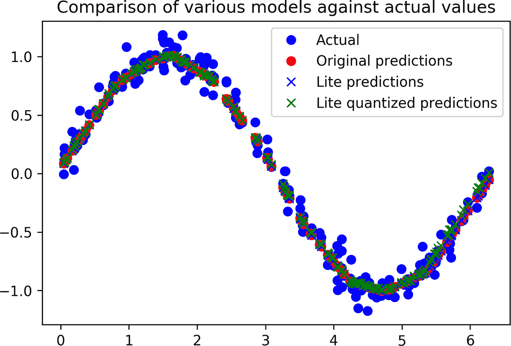

从图表中可以看出，原模型、转换后模型和量化模型的预测都非常接近，几乎无法区分。情况良好！

由于量化会使模型变小，让我们比较转换后的两个模型以查看大小差异。执行以下单元格计算大小并进行比较：

```
import os
basic_model_size = os.path.getsize("sine_model.tflite")
print("Basic model is %d bytes" % basic_model_size)
quantized_model_size = os.path.getsize("sine_model_quantized.tflite")
print("Quantized model is %d bytes" % quantized_model_size)
difference = basic_model_size - quantized_model_size
print("Difference is %d bytes" % difference)
```

应该会显示如下输出：

```
Basic model is 2736 bytes
Quantized model is 2512 bytes
Difference is 224 bytes
```

量化后的模型比原始版本小 224 字节。约 2.4 千字节，该模型已经非常小，权重和偏差只占整体大小的一小部分。模型不仅包含权重，还包含构成深度学习网络架构的所有逻辑，称为 `計算グラフ`。对于真正的小型模型，这可能比模型权重更大，这意味着量化几乎没有效果。

更复杂的模型具有更多权重，因此量化带来的空间节省会更大。对于最复杂的模型，预计接近 4 倍。

无论确切大小如何，量化模型比原始版本执行时间更短。

## 转换为 C 文件

准备可在 TensorFlow Lite for Microcontrollers 中使用的模型的最后一步是将模型转换为可包含在应用程序中的 C 源文件。

到目前为止，本章一直使用 TensorFlow Lite 的 Python API。也就是说，可以使用 `Interpreter` 构造函数从磁盘加载模型文件。

然而，大多数微控制器没有文件系统，即使有，考虑到有限的空间，从磁盘加载模型所需的额外代码也是浪费的。相反，作为一种优雅的解决方案，提供 C 源文件形式的模型，可将其包含在二进制文件中并直接加载到内存中。

在文件中，模型被定义为字节数组。幸运的是，有一个方便的 Unix 工具 `xxd`，可以将给定文件转换为所需格式。

下一个单元格对量化后的模型运行 `xxd`，将输出写入名为 `sine_model_quantized.cc` 的文件并打印到屏幕上：

```
# Install xxd if it is not available
!apt-get -qq install xxd
# Save the file as a C source file
!xxd -i sine_model_quantized.tflite > sine_model_quantized.cc
# Print the source file
!cat sine_model_quantized.cc
```

输出非常长，因此在此不会全部重现，但这里包含开头和结尾的片段：

```
unsigned char sine_model_quantized_tflite[] = {
  0x1c, 0x00, 0x00, 0x00, 0x54, 0x46, 0x4c, 0x33, 0x00, 0x00, 0x12, 0x00,
  0x1c, 0x00, 0x04, 0x00, 0x08, 0x00, 0x0c, 0x00, 0x10, 0x00, 0x14, 0x00,
  // ...
  0x00, 0x00, 0x08, 0x00, 0x0a, 0x00, 0x00, 0x00, 0x00, 0x00, 0x00, 0x09,
  0x04, 0x00, 0x00, 0x00
};
unsigned int sine_model_quantized_tflite_len = 2512;
```

要在项目中使用此模型，可以复制并粘贴源代码，或从笔记本下载文件。

## 总结

现在模型的构建已完成。TensorFlow 深度学习网络可以接收 0 到 2π 之间的数值，并输出其正弦的足够近似值。


这是使用 Keras 训练小型模型的第一次尝试。在今后的项目中，将训练仍是小型、但*更加*精致的模型。

先去第 5 章，编写在微控制器上运行模型 的代码。

# 第 5 章. TinyML 的“哈喽·世界”：应用程序的构建

本作品使用 AI 翻译。期待您的意见和感想：translation-feedback@oreilly.com

模型只是机器学习应用程序的一部分。仅凭它，只是一堆信息，什么大不了的事也做不了。要使用模型，需要用代码将其包裹起来。代码中，设置模型执行所需的环境，提供输入，并利用其输出生成行为。图 5-1 显示了右侧的模型如何融入基本 TinyML 应用程序。

本章将构建一个使用正弦模型创建小型灯光秀的嵌入式应用程序。设置一个连续循环，将 `x` 的值输入到模型中，执行推理，并使用结果切换 LED 的开/关，或如果设备有 LCD 显示屏则控制动画。

这个[应用程序](https://oreil.ly/mqkw3)已经写好了。这是一个 C++ 11 程序，代码避免复杂的逻辑，旨在展示完整 TinyML 应用程序尽可能小的实现。这种简洁有助于学习 TensorFlow Lite for Microcontrollers 的使用方式。也可作为模板。通过阅读本章，您将理解 TensorFlow Lite for Microcontrollers 程序的一般结构，并能够在自己的项目中重用该结构。

本章将解释应用程序的代码并说明其工作原理。下一章将详细介绍构建和部署到多个设备。即使不熟悉 C++，也不必惊慌。代码相对简单，会详细说明。到本章结束时，您应该熟悉运行模型所需的所有代码，并且在过程中还能学到一些 C++。

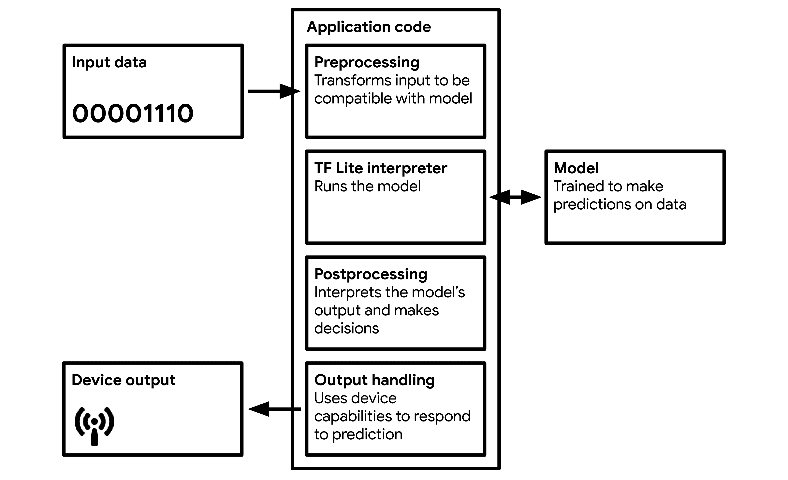

### 提示

由于 TensorFlow 是一个活跃开发的开源项目，这里发布的代码与在线代码可能存在一些差异。即使代码有几行变化，基本原则也不会改变。

## 通过测试逐步了解

在弄脏应用程序代码之前，先编写测试是个好主意。测试是指展示特定逻辑部分的短小代码片段。因为它们由可运行的代码组成，运行测试可以证明该代码按预期工作。编写测试后，通常会将其自动运行，作为持续验证项目在代码更改后是否仍按预期工作的方法。此外，测试对于了解操作流程也非常有帮助。

`hello_world` 示例包含在 [`hello_world_test.cc`](https://oreil.ly/QW0SS) 中定义的测试，它加载模型，使用它执行推理，并检查预测是否符合预期。该测试仅包含执行此操作所需的精确代码作为容器，没有其他内容。因此，它是开始学习 TensorFlow Lite for Microcontrollers 的最佳位置。本节将通过测试解释其每个部分的作用。读完代码后，运行测试以证明其正确性。

那么，我们按章节来看。如果您在电脑前，请打开 [`hello_world_test.cc`](https://oreil.ly/s0f6Q) 一起查看。

### 包含依赖项

第一部分位于许可证头之下（[Apache 2.0](https://oreil.ly/Xa5_x) 开源许可证下，任何人都可以注明使用或共享此代码），如下所示：

```
#include "tensorflow/lite/micro/examples/hello_world/sine_model_data.h"
#include "tensorflow/lite/micro/kernels/all_ops_resolver.h"
#include "tensorflow/lite/micro/micro_error_reporter.h"
#include "tensorflow/lite/micro/micro_interpreter.h"
#include "tensorflow/lite/micro/testing/micro_test.h"
#include "tensorflow/lite/schema/schema_generated.h"
#include "tensorflow/lite/version.h"
```

`#include` 指令是指定 C++ 代码依赖的其他代码的方法。当某个代码文件被 `#include` 引用时，该文件定义的逻辑和变量即可使用。本节使用 `#include` 导入以下项目：

`TensorFlow/lite/micro/examples/hello_world/sine_model_data.h`

:

将此正弦模型进行训练、转换并使用 `xxd` 转换为 C++。

`TensorFlow/lite/micro/kernels/all_ops_resolver.h`

:

使解释器能够加载我们在模型中使用的运算符的类。

`TensorFlow/lite/micro/micro_error_reporter.h`

:

记录错误和输出以帮助调试的类。

`TensorFlow/lite/micro/micro_interpreter.h`

:

TensorFlow Lite for Microcontrollers 解释器运行我们的模型

`TensorFlow/lite/micro/testing/micro_test.h`

:

用于编写测试的轻量级框架，可以将此文件作为测试运行。

`TensorFlow/lite/schema/schema_generated.h`

:

定义 TensorFlow Lite FlatBuffer 数据结构的模式，用于理解 `sine_model_data.h` 中的模型数据。

`tensorflow/lite/version.h`

:

模式的当前版本号，可用于确认模型是否以兼容的版本定义

在深入代码时，我们将详细介绍这些依赖项。

### 注

按照惯例，设计为使用 `#include` 指令的 C++ 代码以两种文件形式编写：称为 *源文件* 的 `.cc` 文件和称为 *头文件* 的 `.h` 文件。头文件定义代码与程序其他部分连接的接口。头文件包含变量和类声明等作为容器，但几乎不包含逻辑。源文件实现执行计算并实现事物的实际逻辑。依赖关系通过 `#include` 指定其头文件。例如，现在讨论的测试包含 [`micro_interpreter.h`](https://oreil.ly/60uYt)。查看此文件会发现类已定义，但逻辑很少。相反，逻辑包含在 [`micro_interpreter.cc`](https://oreil.ly/twN7J) 中。

### 测试设置

下一部分是 TensorFlow Lite for Microcontrollers 测试框架中使用的代码。如下所示：

```
TF_LITE_MICRO_TESTS_BEGIN

TF_LITE_MICRO_TEST(LoadModelAndPerformInference) {
```

在 C++ 中，可以定义带有特殊名称的代码块，并通过在其他地方包含其名称来重用。这种代码块称为 *宏*。这里的两个语句 `TF_LITE_MICRO_TESTS_BEGIN` 和 `TF_LITE_MICRO_TEST` 是宏的名称。它们在 [`micro_test.h`](https://oreil.ly/NoGm4) 文件中定义。

这些宏是 TensorFlow Lite for Microcontrollers 测试框架执行所需的装置，用于包装代码的其余部分。无需担心它们具体如何工作。只需知道可以使用这些宏作为设置测试的快捷方式即可。

第二个宏名为 `TF_LITE_MICRO_TEST`，接受参数。在此情况下，传递的参数是 `LoadModelAndPerformInference`。该参数是测试的名称，运行测试时，它会与测试结果一起输出，以便了解测试是否通过。

### 准备记录数据

文件中剩余的代码是测试的实际逻辑。让我们先看第一部分：

```
// Set up logging
tflite::MicroErrorReporter micro_error_reporter;
tflite::ErrorReporter* error_reporter = &micro_error_reporter;
```

第一行定义了 `MicroErrorReporter` 实例。`MicroErrorReporter` 类在 [`micro_error_reporter.h`](https://oreil.ly/AkZrm) 中定义。它提供在推理期间记录调试信息的机制。调用此类以显示调试信息，并用于显示 TensorFlow Lite for Microcontrollers 解释器遇到的错误。

### 注

您可能注意到，像 `tflite::MicroErrorReporter` 这样的类型名前面带有 `tflite::` 前缀。这是一个 *命名空间*，只是帮助组织 C++ 代码的方法。TensorFlow Lite 将所有有用的内容定义在命名空间 `tflite` 下。也就是说，即使其他库实现了同名类，也不会与 TensorFlow Lite 提供的类冲突。

第一个声明很清楚，但第二行的 `*` 和 `&` 字符呢？既然已经有 `MicroErrorReporter`，为什么还要声明 `ErrorReporter` 呢？

```
tflite::ErrorReporter* error_reporter = &micro_error_reporter;
```

要解释这里发生了什么，需要一些背景知识。

`MicroErrorReporter` 是类的子类，提供 TensorFlow Lite 中此类调试日志机制应如何工作的模板。`ErrorReporter` 重写了 `MicroErrorReporter` 的一个方法，并将其替换为专门为微控制器编写的逻辑。

前面的代码行创建了一个名为 `error_reporter` 的变量，其类型为 `ErrorReporter`。它也是一个指针，声明中使用了 `*`。

指针是专门的变量，不是保存值，而是保存可以找到值的内存位置的引用。在 C++ 中，某个类（如 `ErrorReporter`）的指针可以指向其子类（如 `MicroErrorReporter`）的值。

如前所述，`MicroErrorReporter` 重写了 `ErrorReporter` 的一个方法。细节省略，但重写该方法的过程中，会产生使其他一些方法不可见的副作用。

要访问 `ErrorReporter` 未重写的 方法，需要将 `MicroErrorReporter` 实例视为 `ErrorReporter`。通过创建指向 `micro_error_reporter` 变量的 `ErrorReporter` 指针来实现这一点。赋值时，`micro_error_reporter` 前面的与号 (`&`) 表示正在赋值指针而不是值。

呼！看起来很复杂。C++ 可能有点难以处理。对于本次目的，只需知道 `error_reporter` 用于显示调试信息，以及它是一个指针即可。

### 映射模型

立即设置显示调试信息的机制是为了记录剩余代码中出现的问题。以下代码利用了它：

```
// Map the model into a usable data structure. This doesn't involve any
// copying or parsing, it's a very lightweight operation.
const tflite::Model* model = ::tflite::GetModel(g_sine_model_data);
if (model->version() != TFLITE_SCHEMA_VERSION) {
error_reporter->Report(
    "Model provided is schema version %d not equal "
    "to supported version %d.\n",
    model->version(), TFLITE_SCHEMA_VERSION);
    return 1;
}
```

第一行将模型数据数组（在 [`sine_model_data.h`](https://oreil.ly/m68Wj) 中定义）传递给名为 `GetModel()` 的方法。该方法返回一个 `Model` 指针，并将其赋给 `model` 变量。正如预期的那样，此变量表示模型。

类型 `Model` 是一个 *结构体*，在 C++ 中与类非常相似。它在 [`schema_generated.h`](https://oreil.ly/SGNtU) 中定义，保存模型数据并可查询有关其的信息。

`model` 准备就绪后，调用获取模型版本号的方法：

```
if (model->version() != TFLITE_SCHEMA_VERSION) {
```

接下来，将模型版本号与表示当前使用 TensorFlow Lite 库版本的 `TFLITE_SCHEMA_VERSION` 进行比较。如果数字匹配，则模型是用兼容版本的 TensorFlow Lite 转换器转换的。检查模型版本是良好的习惯，因为如果不一致，可能会出现调试困难的奇怪行为。

### 注

在前面的代码行中，`version()` 是属于 `model` 的方法。请注意从 `model` 指向 `version()` 的箭头 (`->`)。这是 C++ 的 *箭头运算符*，用于在想要访问持有指针的对象的成员时使用。如果对象本身（而不仅仅是指针），则使用点号 (`.`) 访问其成员。

如果版本号不匹配，则继续进行，但使用 `error_reporter` 记录警告：

```
error_reporter->Report(
    "Model provided is schema version %d not equal "
    "to supported version %d.\n",
    model->version(), TFLITE_SCHEMA_VERSION);
```


为了记录此警告，调用 `error_reporter` 的 `Report()` 方法。`error_reporter` 也是一个指针，因此使用 `->` 运算符访问 `Report()`。

`Report()` 方法的设计使其行为类似于常用的 C++ 方法 `printf()`。作为第一个参数，传递想要记录到日志中的字符串。该字符串包含两个 `%d` 格式说明符，在消息被记录时作为变量被插入的占位符发挥作用。接下来的两个参数是模型版本和 TensorFlow Lite 架构版本。它们按顺序插入字符串以替换 `%d` 字符。

### 注
`Report()` 方法支持各种格式说明符，可根据变量类型作为占位符发挥作用。`%d` 用作整数占位符，`%f` 用作浮点数占位符，`%s` 用作字符串占位符。

## 创建 AllOpsResolver
到目前为止进展顺利！代码可以记录错误，并将模型加载到方便的结构体中，并检查其是否为兼容版本。由于也在复习 C++ 概念，虽然有点慢，但事情变得可以理解了。接下来，创建 `AllOpsResolver` 的实例：

// This pulls in all the operation implementations we need
tflite::ops::micro::AllOpsResolver resolver;

在 [`all_ops_resolver.h`](https://oreil.ly/O0qgy) 中定义的这个类，用于 TensorFlow Lite for Microcontrollers 解释器访问运算符。

在 第 3 章 中，我们学习了机器学习模型由连续执行的各种数学运算符组成，用于将输入转换为输出。`AllOpsResolver` 类知道 TensorFlow Lite for Microcontrollers 中可用的所有运算符，并可以将其提供给解释器。

## 定义张量竞技场
创建解释器所需的材料几乎齐全。最后需要的是为模型运行期间所需的临时内存分配一个区域：

// Create an area of memory to use for input, output, and intermediate arrays.
// Finding the minimum value for your model may require some trial and error.
const int tensor_arena_size = 2 × 1024;
uint8_t tensor_arena[tensor_arena_size];

正如注释中所说，这个内存区域用于存储模型的输入、输出和中间张量。我们称之为张量竞技场。在我们的例子中，分配了一个 2,048 字节的数组。用表达式指定。 `2 × 1024`.

那么张量竞技场应该有多大呢？这是一个好问题。遗憾的是，没有简单的答案。由于模型架构不同，输入、输出和中间张量的大小和数量也不同，因此很难知道需要多少内存。然而，微控制器的 RAM 是有限的，因此为了为程序的其余部分保留空间，需要尽可能小。

这可以通过试错来完成。之所以用表达式 `n` `× 1024` 表示数组的大小。 `n` 表示。为了找到正确的数组大小，从一个相当大的数字开始开始，可以确保其正常工作。本书示例中使用的最大数字是 `70 × 1024`。接下来，直到模型无法运行为止，逐步减少数字。最后能正常工作的数字就是正确的数字！

## 创建解释器
既然已经声明了 `tensor_arena`，就可以准备设置解释器了。如下所示：

// Build an interpreter to run the model with
tflite::MicroInterpreter interpreter(model, resolver, tensor_arena,
                                     tensor_arena_size, error_reporter);

// Allocate memory from the tensor_arena for the model's tensors
interpreter.AllocateTensors();

首先，声明一个名为 `interpreter` 的 `MicroInterpreter`。该类是 TensorFlow Lite for Microcontrollers 的核心，是运行我们提供的模型数据的神奇代码。将迄今为止创建的大部分对象传递给构造函数，并调用 `AllocateTensors()`。

在前一节中，通过定义一个名为 `tensor_arena` 的数组来分配内存区域。`AllocateTensors()` 方法遍历模型中定义的所有张量，并从 `tensor_arena` 为每个张量分配内存。在执行推理之前调用 `AllocateTensors()` 很重要。否则推理会失败。

## 检查输入张量
创建解释器后，需要向模型提供输入。为此，将输入数据写入模型的输入张量：

// Obtain a pointer to the model's input tensor
TfLiteTensor* input = interpreter.input(0);

要获取输入张量的指针，请调用解释器的 `input()` 方法。模型可以有多个输入张量，因此需要将指定想要哪个张量的索引传递给 `input()` 方法。对于此模型，输入张量只有一个，因此其索引为 `0`。

在 TensorFlow Lite 中，张量由 `TfLiteTensor` 结构体表示。该结构体在 [`c_api_internal.h`](https://oreil.ly/Qvhre) 中定义。该结构体提供用于操作和学习张量的 API。下面的代码使用此函数验证张量是否看起来正确。由于将大量使用张量，让我们查看这段代码以熟悉 `TfLiteTensor` 结构体的行为：

// Make sure the input has the properties we expect
TF_LITE_MICRO_EXPECT_NE(nullptr, input);
// The property "dims" tells us the tensor's shape. It has one element for
// each dimension. Our input is a 2D tensor containing 1 element, so "dims"
// should have size 2.
TF_LITE_MICRO_EXPECT_EQ(2, input->dims->size);
// The value of each element gives the length of the corresponding tensor.
// We should expect two single element tensors (one is contained within the
// other).
TF_LITE_MICRO_EXPECT_EQ(1, input->dims->data[0]);
TF_LITE_MICRO_EXPECT_EQ(1, input->dims->data[1]);
// The input is a 32 bit floating point value
TF_LITE_MICRO_EXPECT_EQ(kTfLiteFloat32, input->type);

首先注意到的是两个宏：`TF_LITE_MICRO_EXPECT_NE` 和 `TF_LITE_MICRO_EXPECT_EQ`。这些宏是 TensorFlow Lite for Microcontrollers 测试框架的一部分，可以对变量的值进行断言，并证明变量具有特定的期望值。

例如，`TF_LITE_MICRO_EXPECT_NE` 宏被设计为保证调用的两个变量不相等（因此，名称中的 `_NE` 部分是 Not Equal 的缩写）。如果变量不相等，代码将继续执行。如果相等，则会记录错误并将测试标记为失败。

首先检查的是输入张量是否实际存在。这保证其不等于 `nullptr`。 是表示不指向任何数据的指针的 C++ 特殊值：

```
TF_LITE_MICRO_EXPECT_NE(nullptr, input);
```

接下来检查的是输入张量的形状。如 第 3 章 中所述，所有张量都有表示其维度的形状。我们模型输入是一个标量值（意味着单个数值）。然而，由于 [Keras 层接受输入的方式](https://oreil.ly/SFiRV)，该值必须在包含一个数值的 2D 张量中提供。如果输入为 0，则如下所示：

```
[[0]]
```

请注意输入标量 0 被两个向量包围。

`TfLiteTensor` 结构体包含描述张量维度的 `dims` 成员。该成员是 `TfLiteIntArray` 类型的结构体，在 [`c_api_internal.h`](https://oreil.ly/Qvhre) 中定义。`size` 成员表示张量的维度数。输入张量应为 2 维，因此可以断言 `size` 的值为 `2`：

```
TF_LITE_MICRO_EXPECT_EQ(2, input->dims->size);
```

可以进一步检查 `dims` 结构体，以确认张量的结构符合预期。`data` 变量是一个数组，每个维度有一个元素。每个元素是表示该维度大小的整数。我们期望一个包含每个维度一个元素的 2 维张量，因此可以保证两个维度都包含一个元素：

```
TF_LITE_MICRO_EXPECT_EQ(1, input->dims->data[0]);
TF_LITE_MICRO_EXPECT_EQ(1, input->dims->data[1]);
```

现在可以确信输入张量的形状是正确的。最后，由于张量可能由各种类型的数据（整数、浮点数、布尔值等）组成，因此让我们确认输入张量的类型是否正确。

张量结构体的 `type` 变量会告诉我们张量的数据类型。在这里，提供的是由常量 `kTfLiteFloat32` 表示的 32 位浮点数：

```
TF_LITE_MICRO_EXPECT_EQ(kTfLiteFloat32, input->type);
```

完美。现在可以保证输入张量对于输入数据（一个浮点值）具有正确的大小和形状。现在可以准备执行推理了！

## 对输入执行推理
要执行推理，需要向输入张量添加值，并指示解释器启动模型。然后检查模型是否成功运行。如下所示：

// Provide an input value
input->data.f[0] = 0.;

// Run the model on this input and check that it succeeds
TfLiteStatus invoke_status = interpreter.Invoke();
if (invoke_status != kTfLiteOk) {
 error_reporter->Report("Invoke failed\n");
}
TF_LITE_MICRO_EXPECT_EQ(kTfLiteOk, invoke_status);

TensorFlow Lite 的 `TfLiteTensor` 结构体具有 `data` 变量，可用于设置输入张量的内容。这里可以看到它的使用：

```
input->data.f[0] = 0.;
```

`data` 变量是 `TfLitePtrUnion`，是一个联合。联合是 C++ 的特殊数据类型，可以将不同数据类型存储在内存的同一位置。由于给定的张量可能包含许多不同的数据类型（例如浮点数、整数、布尔值），因此联合是存储它的理想数据类型。

`TfLitePtrUnion` 联合在 [`c_api_internal.h`](https://oreil.ly/v4h7K) 中声明：

// A union of pointers that points to memory for a given tensor.
typedef union {
  int32_t* i32;
  int64_t* i64;
  float* f;
  TfLiteFloat16* f16;
  char* raw;
  const char* raw_const;
  uint8_t* uint8;
  bool* b;
  int16_t* i16;
  TfLiteComplex64* c64;
  int8_t* int8;
} TfLitePtrUnion;

你会看到有很多成员，每个成员代表特定类型。每个成员都是指针，可以指向数据应存储的内存位置。像之前那样调用 `interpreter.AllocateTensors()` 时，会设置适当的指针，使张量指向为存储数据而分配的内存块。每个张量都有特定数据类型，因此只有对应类型的指针会被设置。

也就是说，要存储数据，只需使用 `TfLitePtrUnion` 的适当指针即可。例如，如果张量的类型为 `kTfLiteFloat32`，则使用 `data.f`。

由于指针指向内存块，因此可以使用方括号（`[]`）在指针名称后指示程序将数据存储在何处。在此示例中如下所示：

```
input->data.f[0] = 0.;
```

要赋的值记为 `0.`，这是 `0.0` 的简写。通过指定小数点，可以明确地告诉 C++ 编译器该值是浮点数而不是整数。

你可以看到该值被赋给 `data.f[0]`。这意味着将其作为分配的内存块的第一项进行赋值。考虑到只有一个值，这就是所需的一切。

设置好输入张量后，让我们执行推理。这是一行代码：

```
TfLiteStatus invoke_status = interpreter.Invoke();
```

调用 `interpreter` 上的 `Invoke()` 时，TensorFlow Lite 解释器会运行模型。模型由解释器执行的数学运算图组成，用于将输入数据转换为输出。该输出存储在模型的输出张量中，但稍后会详细介绍。

`Invoke()` 方法返回 `TfLiteStatus` 对象，可以知道推理是否成功或出现问题。其值是 `kTfLiteOk` 或 `kTfLiteError`。检查是否有错误，如果有则报告：

```
if (invoke_status != kTfLiteOk) {
    error_reporter->Report("Invoke failed\n");
}
```

最后，为了使测试通过，状态必须为 `kTfLiteOk`：

```
TF_LITE_MICRO_EXPECT_EQ(kTfLiteOk, invoke_status);
```

推理已执行！接下来获取输出并确认其看起来良好。

## 读取输出
与输入类似，此模型的输出是 `TfLiteTensor`，获取其指针也很简单：


```
TfLiteTensor* output = interpreter.output(0);
```

输出与输入相同，是浮点标量值，位于二维张量中。为了测试，我们需要双重检查输出张量是否具有预期的大小、维度和类型：

```
TF_LITE_MICRO_EXPECT_EQ(2, output->dims->size);
TF_LITE_MICRO_EXPECT_EQ(1, input->dims->data[0]);
TF_LITE_MICRO_EXPECT_EQ(1, input->dims->data[1]);
TF_LITE_MICRO_EXPECT_EQ(kTfLiteFloat32, output->type);
```

嗯，一切看起来不错。那么，获取输出值并确认其满足我们的高标准。首先，将其赋给 `float` 变量：

// Obtain the output value from the tensor
float value = output->data.f[0];
```

每次执行推理时，输出张量都会被新值覆盖。也就是说，如果你想在继续执行推理的同时在程序中保留输出值，就需要像刚才那样从输出张量中复制。

接下来，使用 `TF_LITE_MICRO_EXPECT_NEAR` 来证明该值接近预期值：

// Check that the output value is within 0.05 of the expected value
TF_LITE_MICRO_EXPECT_NEAR(0., value, 0.05);
```

如前所述，`TF_LITE_MICRO_EXPECT_NEAR` 断言第 1 个参数与第 2 个参数之差小于第 3 个参数的值。在此语句中，我们测试输出在 0 的 0.05 范围内。这就是输入为 0 的数学正弦值。

### 注

期待数值*接近*期望值而非精确值的原因有两个。第一，我们的模型只是*近似*实际的正弦值，所以不会得到精确值。第二，计算机的浮点运算存在误差。例如，笔记本电脑的 CPU 可能与 Arduino 的结果略有不同。通过设置灵活的期望值，可以提高测试在任何平台上通过的可能性。

如果此测试通过，就顺利了。剩余的测试将通过再执行几次推理来进一步证明模型正在工作。要再次执行推理，需要做的就是为输入张量赋予新值，然后像下面这样调用。调用 `interpreter.Invoke()` 并从输出张量中读取输出：

// Run inference on several more values and confirm the expected outputs
input->data.f[0] = 1.;
interpreter.Invoke();
value = output->data.f[0];
TF_LITE_MICRO_EXPECT_NEAR(0.841, value, 0.05);

input->data.f[0] = 3.;
interpreter.Invoke();
value = output->data.f[0];
TF_LITE_MICRO_EXPECT_NEAR(0.141, value, 0.05);

input->data.f[0] = 5.;
interpreter.Invoke();
value = output->data.f[0];
TF_LITE_MICRO_EXPECT_NEAR(-0.959, value, 0.05);
```

请注意，我们正在重用相同的 `input` 和 `output` 张量指针。由于我们已经拥有指针，因此无需调用 `interpreter.input(0)` 或 `interpreter.output(0)`。

此时已证明 TensorFlow Lite for Microcontrollers 成功加载模型、分配适当的输入张量和输出张量、执行推理并返回预期结果。最后，使用宏来表示测试结束：

```
}

TF_LITE_MICRO_TESTS_END
```

至此，测试说明结束。接下来让我们运行测试！

## 运行测试

即使这段代码最终要在微控制器上运行，你也可以在开发机器上构建和运行测试。因此，编写和调试代码变得非常简单。与微控制器相比，个人电脑拥有用于日志输出和代码单步执行的便捷工具。此外，将代码部署到设备上需要花费时间，因此在本地运行代码要快得多。

构建嵌入式应用程序（或者说实话，任何类型的软件）的一个良好工作流程是尽可能多地使用可以在常规开发机器上运行的测试来编写逻辑。肯定会有需要实际硬件才能运行的部分，但你能在本地运行的测试越多，你的生活就越轻松。

实际上，这意味着在设备上运行之前，先编写代码来预处理输入、在模型上执行推理并使用测试集处理输出。第 7 章 将介绍一个比此示例复杂得多的语音识别应用程序。你将看到每个组件的详细单元测试是如何编写的。

### 获取代码

到目前为止，我们一直在 Colab 和 GitHub 之间进行所有操作都在云端完成。要运行测试，需要将代码拉取到开发计算机上进行编译。

为此，你需要以下软件工具：

* 类似 `Terminal` 的终端模拟器
* `bash` Shell
* [`Git`](https://git-scm.com/)
* `Make`，版本 3.82 及以上

获取所有工具后，打开终端并输入以下命令下载 TensorFlow 源代码。执行此命令后，将创建包含源代码的目录：

```
git clone https://github.com/tensorflow/tensorflow.git
```

接下来，进入刚才创建的 `TensorFlow` 目录：

```
cd tensorflow
```

现在你已准备好运行代码！

### 使用 Make 运行测试

如工具列表所示，我们使用 `Make` 来运行测试。`Make` 是一个用于自动化软件构建任务的工具。它自 1976 年起就已使用，在计算机术语中几乎可以说是永恒的。开发人员使用写入名为 `Makefile` 的文件的专用语言来指示 `Make` 构建和运行代码。TensorFlow Lite for Microcontrollers 拥有在 [`micro/tools/make/Makefile`](https://oreil.ly/6Kvx5) 中定义的 `Makefile`。

要使用 `Make` 运行测试，请从通过 `Git` 下载的 `TensorFlow` 目录的根目录执行以下命令。首先指定要使用的 `Makefile`，然后指定要构建的组件的目标：

```
make -f tensorflow/lite/micro/tools/make/Makefile test_hello_world_test
```

`Makefile` 设置为指定目标以运行测试，该目标由前缀 `test_` 后跟要构建的组件名称组成。在我们的例子中，该组件是 `hello_world_test`，因此完整的目标名称是 `test_hello_world_test`。

试着运行此命令。应该会开始出现大量输出！首先，必要的库和工具将被下载。接下来，测试文件连同所有依赖文件一起被构建。`Make` 文件指示 C++ 编译器构建代码、创建二进制文件并运行它。

需要等待一段时间直到处理完成。当文本滚动停止时，最后几行应该如下所示：

```
Testing LoadModelAndPerformInference
1/1 tests passed
~~~ALL TESTS PASSED~~~
```

很好！此输出表明测试按预期通过。可以看到在源文件顶部定义的测试名称 `LoadModelAndPerformInference`。即使它尚未在微控制器上，我们的代码也成功执行了推理。

为了看看测试失败时会发生什么，让我们引入一个错误。打开测试文件 `hello_world_test.cc`。它应该位于从目录根目录的相对路径下：

```
tensorflow/lite/micro/examples/hello_world/hello_world_test.cc
```

为了使测试失败，让我们给模型一个不同的输入。这将改变模型的输出，因此检查输出值的断言将失败。找到以下行：

```
input->data.f[0] = 0.;
```

将赋值更改为如下：

```
input->data.f[0] = 1.;
```

保存文件并使用以下命令再次运行测试（请勿忘记从 `TensorFlow` 目录的根目录执行）：

```
make -f tensorflow/lite/micro/tools/make/Makefile test_hello_world_test
```

代码将被重新构建并运行测试。最终输出应该如下所示：

```
Testing LoadModelAndPerformInference
0.0486171 near value failed at tensorflow/lite/micro/examples/hello_world/\
  hello_world_test.cc:94
0/1 tests passed
~~~SOME TESTS FAILED~~~
```

此输出包含有关失败原因的有用信息，例如测试失败的文件和行号（`hello_world_test.cc:94`）。如果这是由实际错误引起的，此输出将有助于追踪问题。

# 项目文件结构

通过运行测试，你学会了如何使用 TensorFlow Lite for Microcontrollers 库在 C++ 中执行推理。接下来，让我们看看实际应用程序的源代码。

如前所述，我们构建的程序由一个连续循环组成，该循环将 `x` 的值输入模型、执行推理，并根据平台生成某种可见输出（例如 LED 闪烁模式）。

由于此应用程序复杂且跨多个文件，让我们看看其结构以及所有内容是如何组合在一起的。

应用程序的根目录位于 `tensorflow/lite/micro/examples/hello_world`。以下文件包含在其中：

构建

: 

此文件列出了使用应用程序源代码可以构建的各种内容。此时无需过多关注。

`Makefile.inc`

: 

包含有关应用程序内构建目标的信息的 `Makefile`，例如我们之前运行的测试 `hello_world_test` 和主应用程序二进制文件 `hello_world`。它定义了哪些源文件是其一部分。

`README.md`

: 

包含有关应用程序构建和运行说明的自述文件。

`constants.h`、`constants.cc`

: 

包含各种常量（程序生命周期内不变的变量）的文件对，对定义程序行为至关重要。

`create_sine_model.ipynb`

: 

前章中使用的 Jupyter 笔记本。

`hello_world_test.cc`

: 

执行使用我们的模型进行推理的测试。

`main.cc`

: 

程序的入口点，应用程序部署到设备时首先执行。

`main_functions.h`、`main_functions.cc`

: 

定义 `setup()` 函数的文件对。该函数执行程序所需的所有初始化。`loop()` 函数包含程序的核心逻辑，设计为在循环中重复调用。这些函数在程序启动时由 `main.cc` 调用。

`output_handler.h`、`output_handler.cc`

: 

定义每次执行推理时显示输出的函数的文件组。`output_handler.cc` 的默认实现将结果显示在屏幕上。通过覆盖此实现，可以使不同设备具有不同的行为。

`output_handler_test.cc`

: 

证明 `output_handler.h` 和 `output_handler.cc` 的代码正常工作的测试。

`sine_model_data.h`、`sine_model_data.cc`

: 

定义表示模型的数组的文件对，该数组在本章开头部分使用 `xxd` 导出。

除了这些文件之外，该目录还包含以下子目录（可能还有更多）：

* `Arduino/`
* `disco_f76ng/`
* `sparkfun_edge/`

由于微控制器平台的功能和 API 不同，项目结构允许在为该设备构建应用程序时提供设备特定的源文件版本，以替代默认值。例如，`arduino` 目录包含 `main.cc`、`constants.cc`、`output_handler.cc` 的自定义版本，用于将应用程序定制为在 Arduino 上运行。稍后将详细介绍这些自定义实现。

# 浏览源代码

现在我们了解了应用程序源代码是如何组织的，让我们深入代码。首先从 [`main_functions.cc`](https://oreil.ly/BYS5k) 开始，然后从那里分支到其他文件。

### 注

这段代码的许多部分你可能已经在 `hello_world_test.cc` 中见过。如前所述，我们不会深入探讨其工作原理。

## 从 `main_functions.cc` 开始

此文件包含程序的核心逻辑。`#include` 中有熟悉的语句和新的语句：

```
#include "tensorflow/lite/micro/examples/hello_world/main_functions.h"
#include "tensorflow/lite/micro/examples/hello_world/constants.h"
#include "tensorflow/lite/micro/examples/hello_world/output_handler.h"
#include "tensorflow/lite/micro/examples/hello_world/sine_model_data.h"
#include "tensorflow/lite/micro/kernels/all_ops_resolver.h"
#include "tensorflow/lite/micro/micro_error_reporter.h"
#include "tensorflow/lite/micro/micro_interpreter.h"
#include "tensorflow/lite/schema/schema_generated.h"
#include "tensorflow/lite/version.h"
```

这些在 `hello_world_test.cc` 中大量出现。新出现的是 `constants.h` 和 `output_handler.h`，这在之前的 文件列表中已学过。


ファイルの次の部分では、`main_functions.cc`内で使われるグローバル変数をセットアップしている：

```
namespace {
tflite::ErrorReporter* error_reporter = nullptr;
const tflite::Model* model = nullptr;
tflite::MicroInterpreter* interpreter = nullptr;
TfLiteTensor* input = nullptr;
TfLiteTensor* output = nullptr;
int inference_count = 0;

// Create an area of memory to use for input, output, and intermediate arrays.
// Finding the minimum value for your model may require some trial and error.
constexpr int kTensorArenaSize = 2 × 1024;
uint8_t tensor_arena[kTensorArenaSize];
}  // namespace
```

これらの変数は`namespace` 。これは、`main_functions.cc`内のどこからでもアクセスできるにもかかわらず、プロジェクト内の他のファイルからはアクセスできないことを意味する。これにより、2つの異なるファイルで同じ名前の変数が定義された場合の問題を防ぐことができる。

これらの変数はすべて、テストで見慣れたものであるはずだ。おなじみのTensorFlowオブジェクトをすべて保持する変数と、`tensor_arena`をセットアップする。唯一新しいのは、`inference_count`を保持する`int`で、これはプログラミングが実行した推論の回数を記録する。

ファイルの次の部分では、`setup()`という名前の関数を宣言している。この関数は、プログラミングが最初に開始されるときに呼び出されるが、その後は二度と呼び出されない。この関数は、推論を開始する前に必要な1 回限りのハウスキーピングを行うために使用する。

`setup()`の最初の部分は、テストとほとんど同じである。ロギングをセットアップし、モデルをロードし、インタプリタをセットアップし、メモリを確保する：

```
void setup() {
  // Set up logging.
  static tflite::MicroErrorReporter micro_error_reporter;
  error_reporter = &micro_error_reporter;

  // Map the model into a usable data structure. This doesn't involve any
  // copying or parsing, it's a very lightweight operation.
  model = tflite::GetModel(g_sine_model_data);
  if (model->version() != TFLITE_SCHEMA_VERSION) {
    error_reporter->Report(
        "Model provided is schema version %d not equal "
        "to supported version %d.",
        model->version(), TFLITE_SCHEMA_VERSION);
    return;
  }

  // This pulls in all the operation implementations we need.
  static tflite::ops::micro::AllOpsResolver resolver;

  // Build an interpreter to run the model with.
  static tflite::MicroInterpreter static_interpreter(
      model, resolver, tensor_arena, kTensorArenaSize, error_reporter);
  interpreter = &static_interpreter;

  // Allocate memory from the tensor_arena for the model's tensors.
  TfLiteStatus allocate_status = interpreter->AllocateTensors();
  if (allocate_status != kTfLiteOk) {
    error_reporter->Report("AllocateTensors() failed");
    return;
  }
```

ここまではお馴染みの領域だ。しかし、ここからは少し事情が変わってくる。まず、入力テンソルと出力テンソルの両方へのポインタを取得する：

```
  // Obtain pointers to the model's input and output tensors.
  input = interpreter->input(0);
  output = interpreter->output(0);
```

推論が実行される前に、どうやって出力とやりとりするのか不思議に思うかもしれない。`TfLiteTensor`は、出力を格納するために割り当てられたメモリ領域を指すメンバ`data`を持つ単なる構造体であることを思い出してほしい。出力がまだ書き込まれていなくても、構造体とそのメンバ`data`は存在する。

最後に、`setup()`関数を終了するために、`inference_count`変数を`0`にセットする：

```
  // Keep track of how many inferences we have performed.
  inference_count = 0;
}
```

この時点で、マシンラーニングのインフラはすべてセットアップされ、すぐに使える状態になっている。推論を実行し、結果を得るために必要なツールはすべて揃っている。次に定義するのはアプリケーション・ロジックだ。プログラムは実際に何をするのか？

私たちのモデルは、正弦波の全サイクルを表す0から2πまでの任意の数の正弦を予測するように訓練された。私たちのモデルを実証するために、この範囲の数値を入力し、それらの正弦を予測し、そしてその値を何らかの方法で出力することができる。これをシーケンスで行うことで、全範囲でモデルが機能することを示すことができる。これは良い計画のように思える！

そのためには、ループで実行されるコードを書く必要がある。まず、`loop()`という関数を宣言する。この関数に入れたコードは、何度も何度も繰り返し実行される：

```
void loop() {
```

まず、`loop()`関数の中で、モデルに渡す値を決めなければならない（これを`x`の値と呼ぼう）。これは2つの定数を用いて決定する：`kXrange`は`x`の可能な最大値を2πと定義し、`kInferencesPerCycle`は0から2πまでステップを踏みながら実行したい推論の数を定義する。次の数行のコードは、`x`の値を計算する：

```
// Calculate an x value to feed into the model. We compare the current
// inference_count to the number of inferences per cycle to determine
// our position within the range of possible x values the model was
// trained on, and use this to calculate a value.
float position = static_cast<float>(inference_count) /
                    static_cast<float>(kInferencesPerCycle);
float x_val = position * kXrange;
```

コードの最初の2 行は、`inference_count`（これまでに行った推論の数）を`kInferencesPerCycle`で割って、範囲内の現在の「位置」を求めるだけである。次の行は、その値に`kXrange`を掛けて、範囲内の最大値（2π）を表す。その結果`x_val`、これがモデルに渡す値である。

### 注

`static_cast<float>()`は、`inference_count`と`kInferencesPerCycle`という整数値を浮動小数点数に変換するために使われる。これは除算を正しく行うためである。C++では、2つの整数を除算した場合、結果は整数となり、結果の小数部分は取り除かれる。私たちは、小数部を含む浮動小数点数にしたいので、除算される数値を浮動小数点数に変換する必要がある。

今回使用する2つの定数、`kInferencesPerCycle`と`kXrange`は、`constants.h`と`constants.cc`というファイルで定義されている。定数の名前の前に`k`を付けるのはC++の慣例であり、コード内で使用する際に定数であることが容易に識別できるようにするためである。定数を別のファイルで定義しておくと便利で、必要な場所でインクルードして使うことができる。

モデルの入力テンソルに`x`の値を書き込み、推論を実行し、その結果（`y`の値と呼ぼう）を出力テンソルから取り出す：

```
// Place our calculated x value in the model's input tensor
input->data.f[0] = x_val;

// Run inference, and report any error
TfLiteStatus invoke_status = interpreter->Invoke();
if (invoke_status != kTfLiteOk) {
  error_reporter->Report("Invoke failed on x_val: %f\n",
                         static_cast<double>(x_val));
  return;
}

// Read the predicted y value from the model's output tensor
float y_val = output->data.f[0];
```

これで正弦値が得られた。各数値に対して推論を実行するのにかかる時間はわずかで、このコードはループで実行されているので、時間の経過とともにサイン値のシーケンスを生成することになる。これはLEDの点滅やアニメーションを制御するのに最適だ。次の仕事は、それを何らかの形で出力することだ。

以下の行は、`output_handler.cc`で定義されている`HandleOutput()`関数を呼び出している：

```
// Output the results. A custom HandleOutput function can be implemented
// for each supported hardware target.
HandleOutput(error_reporter, x_val, y_val);
```

`x`と`y`の値と`ErrorReporter`のインスタンスを渡す。次に何が起こるかを見るために、`output_handler.cc`を調べてみよう。

## output_handler.ccで出力を処理する

`output_handler.cc`は、`HandleOutput()`関数を定義している。その実装は非常にシンプルだ：

```
void HandleOutput(tflite::ErrorReporter* error_reporter, float x_value,
                  float y_value) {
  // Log the current X and Y values
  error_reporter->Report("x_value: %f, y_value: %f\n", x_value, y_value);
}
```

この関数が行うことは、`ErrorReporter`インスタンスを使用して、`x`と`y`の値をログに記録することだけである。これは、開発用コンピューターで実行するなどして、アプリケーションの基本的な機能をテストするために使用できる、最低限の実装に過ぎない。

しかし、私たちの目標は、このアプリケーションを複数の異なるマイクロコントローラー・プラットフォームにデプロイし、各プラットフォームの特殊化ハードウェアを使って出力を表示することだ。Arduinoのようなデプロイプを計画している個々のプラットフォームごとに、`output_handler.cc`のカスタム・リプレースを提供し、プラットフォームのAPIを使って出力を制御する（例えば、いくつかのLEDを点灯させるなど）。

前述したように、これらの置換ファイルは、`arduino/`、`disco_f76ng/`、`sparkfun_edge/`という各プラットフォーム名のサブディレクトリにある。プラットフォーム別の実装については後で説明する。とりあえず、`main_functions.cc`に戻ろう。

## main_functions.ccをまとめる

`loop()`関数で最後にすることは、カウンタをインクリメントすることである。カウンタが`kInferencesPerCycle`で定義されている1サイクルあたりの推論回数の上限に達している場合は、0にリセットする：

```
// Increment the inference_counter, and reset it if we have reached
// the total number per cycle
inference_count += 1;
if (inference_count >= kInferencesPerCycle) inference_count = 0;
```

次にループが反復されるとき、これは`x`の値を1ステップ移動させるか、あるいは範囲の最後に達していれば0に巻き戻す効果を持つ。

これで`loop()`関数は終了した。実行されるたびに新しい`x`値が計算され、推論が実行され、その結果が`HandleOutput()`によって出力される。`loop()`が継続的に呼び出されると、0から2πの範囲の`x`値の進行に対して推論が実行され、それが繰り返される。

しかし、`loop()`関数を何度も何度も実行させているのは何だろう？その答えは`main.cc`というファイルにある。

## main.ccを理解する

[C++標準では](https://oreil.ly/BfmkW)、すべてのC++プログラムに`main()`という名前のグローバル関数を含めることが規定されている。我々のプログラムでは、この関数は`main.cc`ファイルで定義されている。この`main()`関数の存在が、`main.cc`がプログラムのエントリ・ポイントである理由である。`main()`のコードは、マイクロコントローラーが起動するたびに実行される。

`main.cc`ファイルは非常に短く、甘い。まず、`main_functions.h`の`#include`文があり、そこで定義されている`setup()`と`loop()`関数を取り込んでいる：

```
#include "tensorflow/lite/micro/examples/hello_world/main_functions.h"
```

次に、`main()`関数を宣言する：

```
int main(int argc, char* argv[]) {
  setup();
  while (true) {
    loop();
  }
}
```

`main()`が実行されると、まず`setup()`関数を呼び出す。これは一度だけだ。その後、`while`のループに入り、`loop()`関数を何度も何度も呼び出し続ける。

このループは無限に続く。やばい！もしあなたがサーバやウェブプログラミングのバックグラウンドを持っているなら、これはあまりいいアイデアとは思えないかもしれない。このループはわれわれの単一スレッドの実行をブロックしてしまうし、プログラムを終了する方法もない。

しかし、マイコン用のソフトウェアを書く場合、このような無限ループは実はよくあることだ。マルチタスクはなく、実行されるアプリケーションは1つだけなので、ループが延々と続くことはあまり問題ではない。マイクロコントローラーが電源に接続されている限り、推論を行い、データを出力し続けるだけだ。

ここまでで、マイコン・アプリケーションの全体像を説明した。次のセクションでは、アプリケーション・コードを開発マシンで動かして試してみよう。

## アプリケーションを実行する

アプリケーション・コードをテストを実行するには、まずそれをビルドする必要がある。以下のMakeコマンドを入力して、プログラムの実行バイナリを作成する：

```
make -f tensorflow/lite/micro/tools/make/Makefile hello_world
```

ビルドが完了したら、オペレーティング・システムに応じて、以下のコマンドを使ってアプリケーション・バイナリを実行することができる：


```
# macOS:
tensorflow/lite/micro/tools/make/gen/osx_x86_64/bin/hello_world

# Linux:
tensorflow/lite/micro/tools/make/gen/linux_x86_64/bin/hello_world

# Windows
tensorflow/lite/micro/tools/make/gen/windows_x86_64/bin/hello_world
```

如果找不到正确的路径，请列出 `tensorFlow/lite/micro/tools/make/gen/` 中的目录。

运行二进制文件时，如果一切顺利，应该会看到如下输出滚动：

```
x_value: 1.4137159*2¹, y_value: 1.374213*2^-2

x_value: 1.5707957*2¹, y_value: -1.4249528*2^-5

x_value: 1.7278753*2¹, y_value: -1.4295994*2^-2

x_value: 1.8849551*2¹, y_value: -1.2867725*2^-1

x_value: 1.210171*2², y_value: -1.7542461*2^-1
```

非常令人兴奋！这些是 `output_handler.cc` 中 `HandleOutput()` 函数写入的日志。`x_value` 会逐渐递增，直到达到 2π，然后回到 0 重新开始。

兴奋够了之后，可以按 `Ctrl-C` 结束程序。

### 注

你会注意到数值是以带有 2 的幂指数的形式输出的，例如 `1.4137159*2¹`。这是在许多不支持硬件浮点运算的微控制器上记录浮点数的一种高效方法。

例如，`1.4137159*2¹` 的值等于 `2.8274318`。如果你感兴趣，输出这些数值的代码位于 [`debug_log_numbers.cc`](https://oreil.ly/sb06c)。

# 总结

现在我们已经确认程序在开发机器上可以运行。下一章我们将尝试在一些微控制器上运行此程序！
