# 第 6 章 TinyML 的“Hello World”：部署到微控制器

本作品使用 AI 翻译。欢迎提供意见和反馈：translation-feedback@oreilly.com

现在是时候动手了。本章将把代码部署到三种不同的设备上：

* [Arduino Nano 33 BLE 感应](https://oreil.ly/6qlMD)
* [SparkFun Edge](https://oreil.ly/-hoL-)
* [ST 麦克电子 STM32F746G Discovery 套件](https://oreil.ly/cvm4J)

我们将说明每个设备的构建和部署过程。

### 注

TensorFlow Lite 会定期添加对新设备的支持，因此如果您想使用的设备未在此列出，值得检查示例的 [`README.md`](https://oreil.ly/ez0ef)。

如果在此过程中遇到问题，也可以查看最新的部署说明。

每个设备都有从 LED 阵列到完整的 LCD 显示屏各自独特的输出功能。因此，此示例为每个设备都包含了 `HandleOutput()` 的自定义实现。此外，还说明了各自的逻辑是如何工作的。即使没有所有设备，通读这段代码也应该很有趣，所以强烈建议一看。

# 什么是微控制器？

根据之前的经验，你可能不太了解微控制器如何与其他电子元件交互。既然我们即将开始玩硬件，在继续之前介绍一些概念是有价值的。

在 Arduino、SparkFun Edge 或 STM32F746G Discovery 套件之类的微控制器板上，实际的微控制器只是安装在电路板上的众多电子元件之一。图 6-1 显示了 SparkFun Edge 上的微控制器。

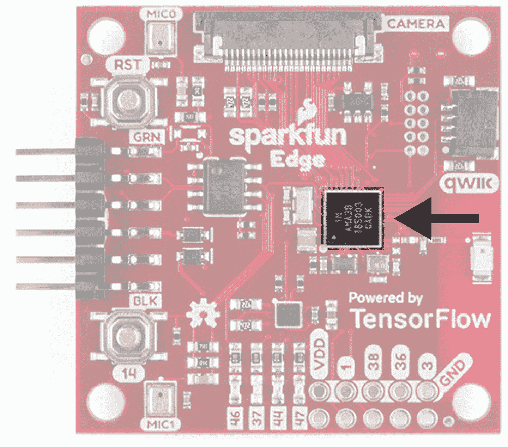

微控制器通过引脚连接到电路板。典型的微控制器有数十个引脚，承担各种角色。有些为微控制器供电，有些则连接到各种重要部件。一些引脚是为在微控制器上运行的程序进行数字信号的输入输出而保留的。这些被称为 GPIO 引脚，是通用输入输出的缩写。这些引脚既可以作为输入来判断是否施加了电压，也可以作为输出来为其他组件供电或通信。

GPIO 引脚是数字的。也就是说，在输出模式下，它们就像完全打开或关闭的开关一样。在输入模式下，它们可以检测到来自其他组件施加的电压是否高于或低于某个阈值。

除了 GPIO 之外，一些微控制器还具有模拟输入引脚，可以精确测量施加在其上的电压水平。

通过调用专用函数，在微控制器上运行的程序可以控制指定引脚是输入模式还是输出模式。其他函数用于切换输出引脚的开/关，或读取输入引脚的当前状态。

对微控制器有了一些了解后，让我们详细看看第一个设备 Arduino。

# Arduino

[Arduino](https://www.arduino.cc/) 板有非常多种，每种都有不同的功能。并非所有板都支持 TensorFlow Lite for Microcontrollers。本书推荐的板是 [Arduino Nano 33 BLE Sense](https://oreil.ly/9g1bJ)。它不仅与 TensorFlow Lite 兼容，还配备了麦克风和加速度传感器（将在后续章节中使用）。建议购买带引脚的板。使用引脚可以无需焊接即可轻松连接其他组件。

大多数 Arduino 板都内置 LED，可用于可视化输出正弦波值。图 6-2 显示了突出显示 LED 的 Arduino Nano 33 BLE Sense 板。

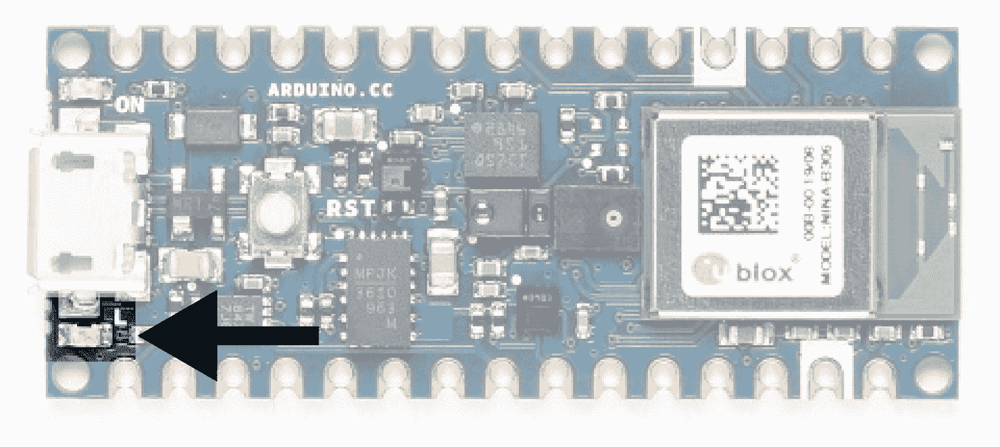

## 处理 Arduino 上的输出

可用的 LED 只有一个，所以需要创造性地思考。一个选择是根据最近预测的正弦值改变 LED 的亮度。考虑到值的范围为 -1 到 1，可以用完全关闭的 LED 表示 0，用完全点亮的 LED 表示 -1 和 1，用部分调光的 LED 表示中间值。程序在循环中执行推理时，LED 会反复点亮和熄灭。

使用 `kInferencesPerCycle` 常量可以改变在一个正弦波周期内执行的推理次数。由于一次推理所需的时间是固定的，因此通过微调 `constants.cc` 中定义的 `kInferencesPerCycle` 可以调整 LED 的衰减速度。

该文件的 Arduino 专属版本位于 [`hello_world/arduino/constants.cc`](https://oreil.ly/YNsvq)。该文件与 `hello_world/constants.cc` 具有相同的命名，因此在为 Arduino 构建应用程序时，它会替代原始实现。

要使内置 LED 变暗，可以使用一种称为脉冲宽度调制（PWM）的技术。极快地切换输出引脚的开和关，输出电压将取决于引脚处于关闭状态和打开状态所花费的时间比例。如果引脚在每个状态下花费 50% 的时间，输出电压将为最大值的 50%。如果打开状态为 75%，关闭状态为 25%，输出电压将为最大值的 75%。

PWM 只能在特定 Arduino 设备的特定引脚上使用，但使用起来非常简单，只需调用一个将所需输出电平设置为引脚的函数即可。

为 Arduino 实现输出处理的代码位于 [`hello_world/arduino/output_handler.cc`](https://oreil.ly/OpLMB)，它将替代原始文件 `hello_world/output_handler.cc`。

让我们看看源码：

```
#include "tensorflow/lite/micro/examples/hello_world/output_handler.h"
#include "Arduino.h"
#include "tensorflow/lite/micro/examples/hello_world/constants.h"
```

首先，包含一些头文件。`output_handler.h` 指定此文件的接口。`Arduino.h` 提供 Arduino 平台的接口。用于控制板。需要访问 `kInferencesPerCycle`，因此还包含 `constants.h`。

接下来，定义函数并指示首次运行时要做什么：

```
// Adjusts brightness of an LED to represent the current y value
void HandleOutput(tflite::ErrorReporter* error_reporter, float x_value,
                  float y_value) {
// Track whether the function has run at least once
static bool is_initialized = false;

// Do this only once
if (!is_initialized) {
  // Set the LED pin to output
  pinMode(LED_BUILTIN, OUTPUT);
  is_initialized = true;
}
```

在 C++ 中，在函数内声明为 `static` 的变量即使函数多次执行也会保留其值。在这里，`is_initialized` 变量用于跟踪下一个 `if (!is_initialized)` 块中的代码是否以前执行过。

初始化块调用 Arduino 的 [`pinMode()`](https://oreil.ly/6Kxep) 函数。此函数指示微控制器给定引脚是输入模式还是输出模式。在使用引脚之前这是必要的。该函数使用 Arduino 平台定义的两个常量 `LED_BUILTIN` 和 `OUTPUT` 调用。`LED_BUILTIN` 表示连接到平台内置 LED 的引脚，`OUTPUT` 表示输出模式。

将内置 LED 的引脚设置为输出模式后，将 `is_initialized` 设置为 `true`，以防止此块代码再次执行。

接下来，计算 LED 所需的亮度：

```
// Calculate the brightness of the LED such that y=-1 is fully off
// and y=1 is fully on. The LED's brightness can range from 0-255.
int brightness = (int)(127.5f * (y_value + 1));
```

在 Arduino 中，可以用 0 到 255 之间的数值设置 PWM 输出电平。0 表示完全关闭，255 表示完全点亮。`y_value` 是 -1 到 1 之间的数值。上面的代码将 `y_value` 映射到 0 到 255 的范围，使得 `y = -1` 时 LED 完全关闭，`y = 0` 时 LED 半亮，`y = 1` 时 LED 完全点亮。

下一步是实际设置 LED 的亮度：

```
// Set the brightness of the LED. If the specified pin does not support PWM,
// this will result in the LED being on when y > 127, off otherwise.
analogWrite(LED_BUILTIN, brightness);
```

Arduino 平台的 [`analogWrite()`](https://oreil.ly/nNseR) 函数接受引脚号（此处为 `LED_BUILTIN`）和 0 到 255 之间的值。前面一行计算的 `brightness`。调用此函数后，LED 将以该电平点亮。

### 注

不幸的是，根据 Arduino 板的型号，内置 LED 连接的引脚可能不支持 PWM。也就是说，调用 `analogWrite()` 时无法改变亮度。相反，如果传递给 `analogWrite()` 的值大于 127，LED 会点亮；如果小于或等于 126，则熄灭。也就是说，LED 不是变暗或消失，而是闪烁。这没有那么酷，但正弦波预测仍然得到证明。

最后，使用 `ErrorReporter` 实例记录亮度值：

```
// Log the current brightness value for display in the Arduino plotter
error_reporter->Report("%d\n", brightness);
```

在 Arduino 平台上，`ErrorReporter` 设置为通过串行端口记录数据。串行是一种微控制器与主机计算机通信的非常常见的方法，常用于调试。它是一种通过打开和关闭输出引脚来逐位传输数据的通信协议。可用于发送和接收从原始二进制数据到文本或数值的任何内容。

Arduino IDE 包含用于捕获和显示通过串行端口接收的数据的工具。其中一个工具串行绘图器可以显示通过串行接收的值的图表。通过从代码输出亮度值的流，可以在图表中查看它们。图 6-3 是 显示了这种情况。

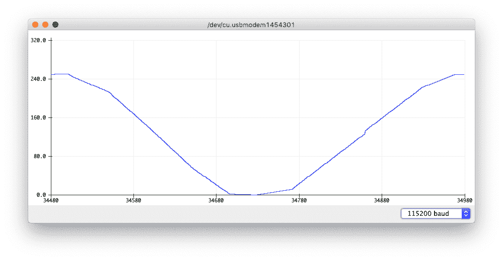

串行绘图器的使用将在本节后面说明。

### 注

你可能会想知道 `ErrorReporter` 如何通过 Arduino 的串行接口输出数据。代码实现可以在 [`micro/arduino/debug_log.cc`](https://oreil.ly/fkF8H) 找到。它取代了 [`micro/debug_log.cc`](https://oreil.ly/nxXgJ) 的原始实现。与 `output_handler.cc` 被覆盖的方式类似，通过将 TensorFlow Lite for Microcontrollers 的任何源文件添加到以平台名称命名的目录中，可以提供平台特定的实现。

## 运行示例

下一步是为 Arduino 构建项目并将其部署到设备上。

### 提示

由于本书撰写时与构建步骤可能有所变化，因此请查看 [`README.md`](https://oreil.ly/s2mj1) 以获取最新步骤。

你需要以下所有东西：

* 兼容的 Arduino 板（推荐 Arduino Nano 33 BLE Sense）
* 合适的 USB 电缆
* [Arduino IDE](https://oreil.ly/c-rv6)（继续之前需要下载并安装）


本书的项目作为示例代码准备在 TensorFlow Lite Arduino 库中。从 Arduino IDE 选择工具菜单的“库管理”即可轻松安装。在显示的窗口中，搜索名为 `Arduino_TensorFlowLite` 的库并安装。应该可以使用最新版本，但如果出现问题，本书中测试运行的版本是 `1.14-ALPHA`。

### 注

该库可以从 TensorFlow Lite 团队 [下载](https://oreil.ly/blgB8) ，也可以使用 TensorFlow Lite for Microcontrollers Makefile 自行生成。这种情况下，请参阅 附录 A。

安装库后，如 图 6-4 所示，`hello_world` 示例将显示在 File 菜单的 Examples→`Arduino_TensorFlowLite` 中。

`hello_world` 点击加载示例。它将作为新窗口显示，并有每个源文件的标签。第一个标签中的文件 `hello_world` 等同于前面描述的 `main_functions.cc`。

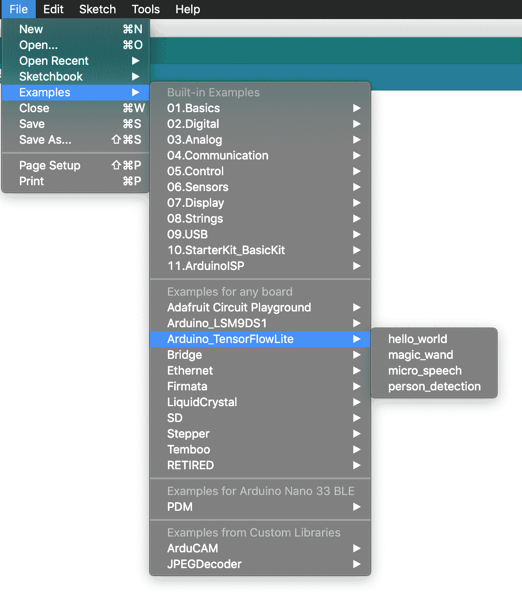

要运行示例，请通过 USB 连接 Arduino 设备。如 图 6-5 所示，请确认工具菜单的板子下拉列表中已选择正确的设备类型。

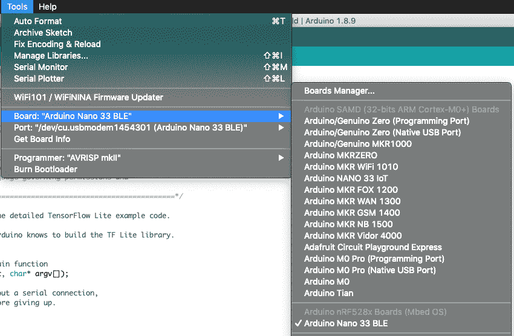

如果设备名称未在列表中显示，则需要安装支持包。为此，请点击 Boards Manager。在显示的窗口中搜索设备并安装相应支持包的最新版本。

接下来，如 图 6-6 所示，请确认 Tools 菜单的 Port 下拉列表中已选择设备的端口。

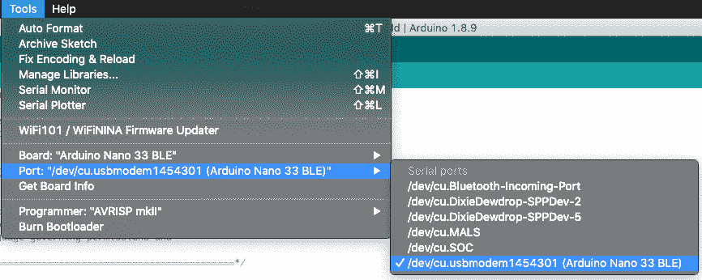

最后，点击 Arduino 窗口中的上传按钮（在 图 6-7 中以白色高亮显示），编译代码并上传到 Arduino 设备。


上传成功完成后，您应该会看到 Arduino 板的 LED 根据连接的引脚是否支持 PWM 开始淡入/淡出或闪烁。

恭喜：你正在设备上运行 ML！

### 注

由于 Arduino 板的型号不同，硬件也不同，执行推理的速度也会不同。如果 LED 闪烁或一直亮着，则可能需要增加每个周期的推理次数。这是 `arduino_constants.cpp` 中的常量 `kInferencesPerCycle`。

在 “自行修改” 中介绍了如何编辑示例代码。

还可以对亮度值进行图表绘制并显示。为此，如 图 6-8 所示，从 Arduino IDE 的工具菜单中选择并打开串行绘图器。

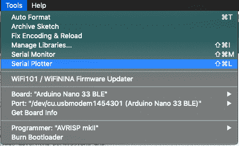

如 图 6-9 所示，绘图器显示随时间变化的值。


要查看从 Arduino 串行端口接收的原始数据，请从工具菜单打开串行监视器。你会看到如 图 6-10 那样数字流飞过。

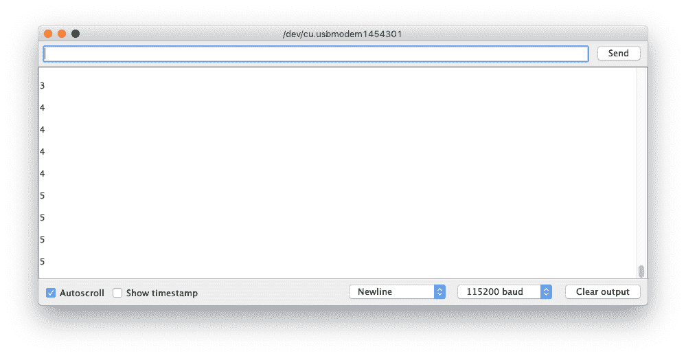

## 自行修改

部署应用程序后，修改代码玩玩也很有趣。可以在 Arduino IDE 中编辑源文件。保存时，会提示将示例重新保存到新位置。完成更改后，点击 Arduino IDE 的上传按钮即可构建和部署。

为了产生变化，这里尝试一些实验：

* 通过调整每个周期的推理次数，使 LED 闪烁变慢或变快。
* 修改 `output_handler.cc`，在串行端口记录基于文本的动画。
* 使用正弦波控制其他组件，如附加 LED 或声音生成器。

# SparkFun Edge

[`SparkFun Edge`](https://oreil.ly/-hoL-) 开发板是专门为在小型设备上体验机器学习而设计的平台。它搭载了搭载 Arm Cortex M4 处理器核心的高效能 Ambiq Apollo 3 微控制器。

如 图 6-11 所示，它配备了 4 个 LED 阵列。可以使用它们可视化输出正弦值。

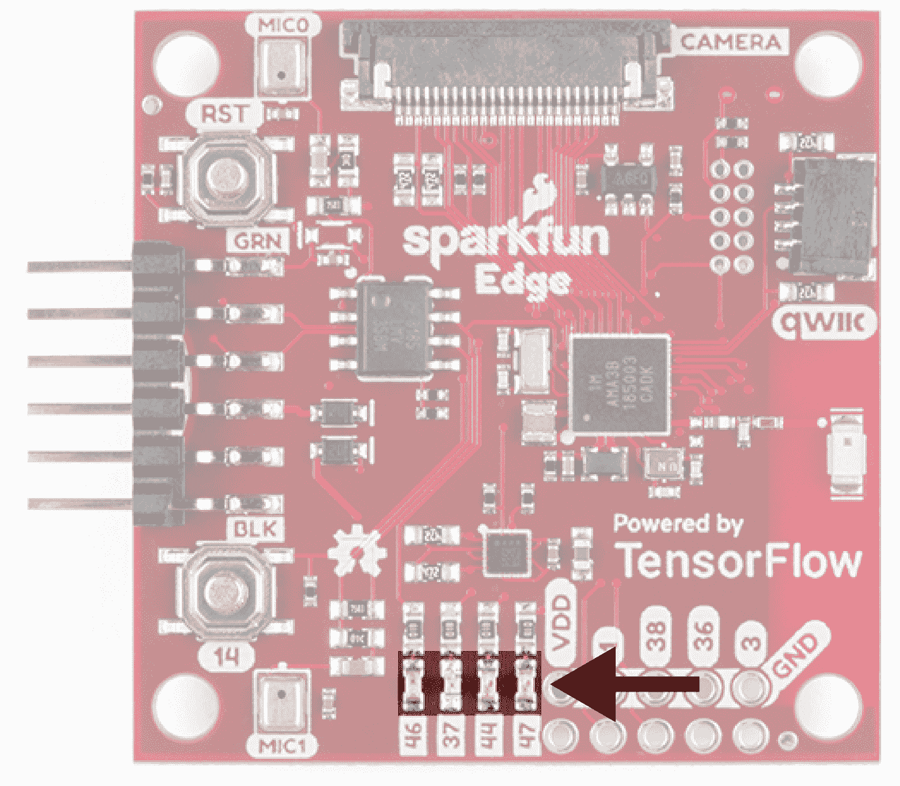

## 在 SparkFun Edge 上处理输出

可以使用板上的 LED 阵列制作简单的动画。

LED（红、绿、蓝、黄）在物理上按以下顺序排列：

```
                         [ R G B Y ]
```

下表显示了 `y` 值不同时 LED 的点亮方式：

| 范围 || 点亮的 LED |
| --- | --- |
| `0.75 <= y <= 1` || `[ 0 0 1 1 ]` |
| --- | --- |
| `0 < y < 0.75` || `[ 0 0 1 0 ]` |
| `y = 0` || `[ 0 0 0 0 ]` |
| `-0.75 < y < 0` || `[ 0 1 0 0 ]` |
| `-1 <= y <= 0.75` || `[ 1 1 0 0 ]` |

由于每个推理需要一定的时间，因此可以通过微调 `constants.cc` 中定义的 `kInferencesPerCycle` 来调整 LED 的循环速度。

图 6-12 是正在运行程序的 [`アニメーション.gif`](https://oreil.ly/cXdPY) 的静止图像。

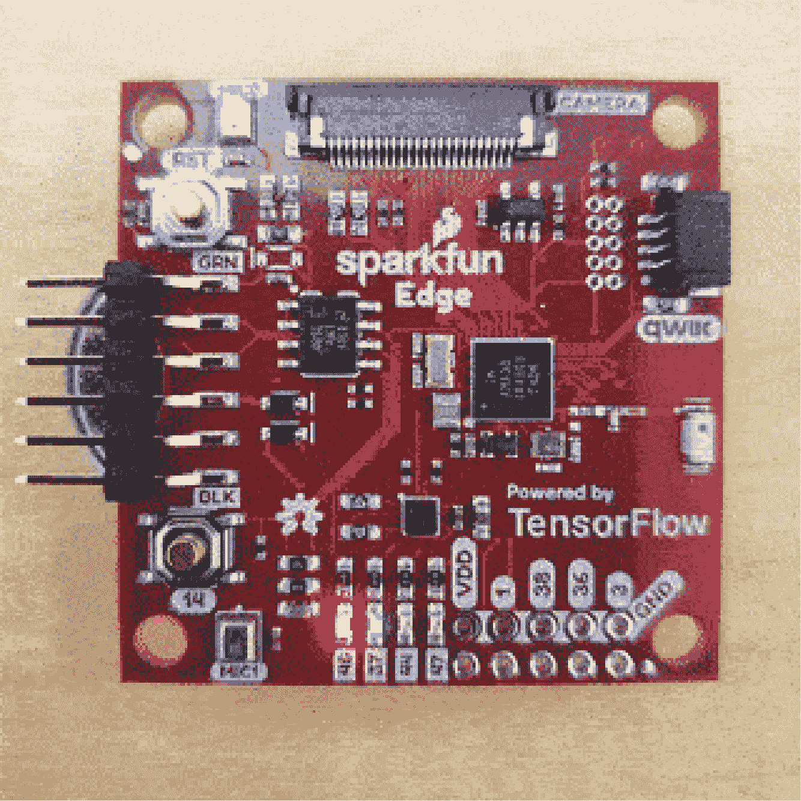

实现 SparkFun Edge 输出处理的代码位于 [`hello_world/sparkfun_edge/output_handler.cc`](https://oreil.ly/tegLK)，它将代替原始文件 `hello_world/output_handler.cc` 使用。

让我们开始逐步查看：

```
#include "tensorflow/lite/micro/examples/hello_world/output_handler.h"
#include "am_bsp.h"
```

首先，包含一些头文件。`output_handler.h` 指定此文件的接口。另一个文件 `am_bsp.h` 来自称为 `Ambiq Apollo3 SDK` 的东西。Ambiq 是 SparkFun Edge 的 Apollo3 微控制器的制造商。SDK（`软件开发工具包` 的缩写）是一组定义可用于管理微控制器功能的常量和函数的源文件。

由于计划控制板上的 LED，因此需要能够打开和关闭微控制器的引脚。为此使用 SDK。

### 注

Makefile 在最终构建项目时会自动下载 SDK。有兴趣的人可以在 [SparkFun 网站](https://oreil.ly/RHHqI) 上阅读详细信息，或下载代码进行研究。

接下来，定义 `HandleOutput()` 函数并说明其首次运行时执行的操作：

```
void HandleOutput(tflite::ErrorReporter* error_reporter, float x_value,
                  float y_value) {
  // The first time this method runs, set up our LEDs correctly
  static bool is_initialized = false;
  if (!is_initialized) {
    // Set up LEDs as outputs
    am_hal_gpio_pinconfig(AM_BSP_GPIO_LED_RED, g_AM_HAL_GPIO_OUTPUT_12);
    am_hal_gpio_pinconfig(AM_BSP_GPIO_LED_BLUE, g_AM_HAL_GPIO_OUTPUT_12);
    am_hal_gpio_pinconfig(AM_BSP_GPIO_LED_GREEN, g_AM_HAL_GPIO_OUTPUT_12);
    am_hal_gpio_pinconfig(AM_BSP_GPIO_LED_YELLOW, g_AM_HAL_GPIO_OUTPUT_12);
    // Ensure all pins are cleared
    am_hal_gpio_output_clear(AM_BSP_GPIO_LED_RED);
    am_hal_gpio_output_clear(AM_BSP_GPIO_LED_BLUE);
    am_hal_gpio_output_clear(AM_BSP_GPIO_LED_GREEN);
    am_hal_gpio_output_clear(AM_BSP_GPIO_LED_YELLOW);
    is_initialized = true;
  }
```

呼，设置很麻烦！我们使用 `am_bsp.h` 提供的 `am_hal_gpio_pinconfig()` 函数来设置连接到板载 LED 的引脚，使其处于输出模式（由常量 `g_AM_HAL_GPIO_OUTPUT_12` 表示）。每个 LED 的引脚号由 `AM_BSP_GPIO_LED_RED` 等常量表示。

接下来，使用 `am_hal_gpio_output_clear()` 清除所有输出，使所有 LED 熄灭。与 Arduino 实现类似，使用名为 `static` `is_initialized` 的变量使此块代码仅执行一次。接下来，确定 `y` 值负时点亮哪个 LED：

```
// Set the LEDs to represent negative values
if (y_value < 0) {
  // Clear unnecessary LEDs
  am_hal_gpio_output_clear(AM_BSP_GPIO_LED_GREEN);
  am_hal_gpio_output_clear(AM_BSP_GPIO_LED_YELLOW);
  // The blue LED is lit for all negative values
  am_hal_gpio_output_set(AM_BSP_GPIO_LED_BLUE);
  // The red LED is lit in only some cases
  if (y_value <= -0.75) {
    am_hal_gpio_output_set(AM_BSP_GPIO_LED_RED);
  } else {
    am_hal_gpio_output_clear(AM_BSP_GPIO_LED_RED);
  }
```

首先，为了防止 `y` 值刚变为负的情况，清除用于表示正值的两个 LED。接下来，调用 `am_hal_gpio_output_set()` 点亮蓝色 LED。蓝色 LED 在值为负时始终点亮。最后，如果值小于 -0.75，则点亮红色 LED。否则熄灭。

接下来，对 `y` 的正值执行相同的操作：

```
  // Set the LEDs to represent positive values
} else if (y_value > 0) {
  // Clear unnecessary LEDs
  am_hal_gpio_output_clear(AM_BSP_GPIO_LED_RED);
  am_hal_gpio_output_clear(AM_BSP_GPIO_LED_BLUE);
  // The green LED is lit for all positive values
  am_hal_gpio_output_set(AM_BSP_GPIO_LED_GREEN);
  // The yellow LED is lit in only some cases
  if (y_value >= 0.75) {
    am_hal_gpio_output_set(AM_BSP_GPIO_LED_YELLOW);
  } else {
    am_hal_gpio_output_clear(AM_BSP_GPIO_LED_YELLOW);
  }
}
```

LED 就到此为止。最后要做的事是记录当前输出值给通过串行端口监听的人：

```
// Log the current X and Y values
error_reporter->Report("x_value: %f, y_value: %f\n", x_value, y_value);
```

### 注

我们的 `ErrorReporter` 通过 [`micro/sparkfun_edge/debug_log.cc`](https://oreil.ly/ufEv9) 的自定义实现，该实现替换了 [`micro/debug_log.cc`](https://oreil.ly/ACaFt) 的原始实现，能够通过 SparkFun Edge 的串行接口输出数据。

## 运行示例

现在可以构建示例代码并部署到 SparkFun Edge。

### 提示

由于本书撰写时与构建步骤可能已发生变化，请检查 [`README.md`](https://oreil.ly/EcPZ8) 以获取最新步骤。

要构建和部署代码，需要以下内容：

* SparkFun Edge 板
* USB 编程器（推荐使用 SparkFun 串行基本 breakout。）
* 兼容的 USB 电缆
* Python 3 及一些依赖项

首先，打开终端，克隆 TensorFlow 仓库并进入其目录：

```
git clone https://github.com/tensorflow/tensorflow.git
cd tensorflow
```

接下来，执行一些用于构建二进制文件并下载到设备的命令。为了节省输入时间，这些命令可以从 [`README.md`](https://oreil.ly/PYmUu) 复制并粘贴。

### 构建二进制文件

以下命令将下载所有必要的依赖项并编译 SparkFun Edge 的二进制文件：

```
make -f tensorflow/lite/micro/tools/make/Makefile \
  TARGET=sparkfun_edge hello_world_bin
```

### 注

二进制文件是包含编程的文件，可直接在 SparkFun Edge 硬件上运行。

二进制文件将作为 `.bin` 文件创建在以下位置：

```
tensorflow/lite/micro/tools/make/gen/ \
  sparkfun_edge_cortex-m4/bin/hello_world.bin
```

可以使用以下命令检查文件是否存在：


```
test -f tensorflow/lite/micro/tools/make/gen/ \
  sparkfun_edge_cortex-m4/bin/hello_world.bin \
  &&  echo "Binary was successfully created" || echo "Binary is missing"
```

执行此命令后，控制台会显示 `Binary was successfully created`。

如果显示 `Binary is missing`，则表示构建过程中存在问题。如果是这样，可能在 `make` 命令的输出中找到问题的线索。

### 对二进制文件进行签名

将二进制文件部署到设备上需要使用加密密钥进行签名。那么让我们执行一些命令，以便对二进制文件进行签名，使其可以刷新到 SparkFun Edge。这里使用的脚本来自在执行 Makefile 时下载的 Ambiq SDK。

输入以下命令，设置可用于开发的虚拟加密密钥：

```
cp tensorflow/lite/micro/tools/make/downloads/AmbiqSuite-Rel2.0.0/ \
  tools/apollo3_scripts/keys_info0.py \
  tensorflow/lite/micro/tools/make/downloads/AmbiqSuite-Rel2.0.0/ \
  tools/apollo3_scripts/keys_info.py
```

接下来，执行以下命令创建签名后的二进制文件。必要时，将 `python3` 替换为 `python`：

```
python3 tensorflow/lite/micro/tools/make/downloads/ \
  AmbiqSuite-Rel2.0.0/tools/apollo3_scripts/create_cust_image_blob.py \
  --bin tensorflow/lite/micro/tools/make/gen/ \
  sparkfun_edge_cortex-m4/bin/hello_world.bin \
  --load-address 0xC000 \
  --magic-num 0xCB -o main_nonsecure_ota \
  --version 0x0
```

这样就创建了 `main_nonsecure_ota.bin` 文件。执行此命令是为了创建最终版本的可用文件，以便在下一步中使用的脚本刷新设备：

```
python3 tensorflow/lite/micro/tools/make/downloads/ \
  AmbiqSuite-Rel2.0.0/tools/apollo3_scripts/create_cust_wireupdate_blob.py \
  --load-address 0x20000 \
  --bin main_nonsecure_ota.bin \
  -i 6 \
  -o main_nonsecure_wire \
  --options 0x1
```

这样，在执行命令的目录中应该会生成一个名为 `main_nonsecure_wire.bin` 的文件。这就是要刷新到设备的文件。

### 刷新二进制文件

SparkFun Edge 将当前运行的程序保存在 1 兆字节的闪存中。如果想让板载运行新程序，则需要将该程序发送到板上，板会将其保存在闪存中并覆盖先前保存的程序。

该过程称为刷新。让我们说明其步骤。

#### 将编程器安装到基板上

要下载新程序到板上，请使用 SparkFun USB-C Serial Basic 串行编程器。该设备使计算机能够通过 USB 与微控制器通信。

要将该设备安装到板上，请执行以下步骤：

1. SparkFun Edge 侧面有一个 6 针排针。
2. 将 SparkFun USB-C Serial Basic 插入这些引脚，并确保每个设备上标有 BLK 和 GRN 的引脚正确对齐。

图 6-13 中显示了正确的放置方式。

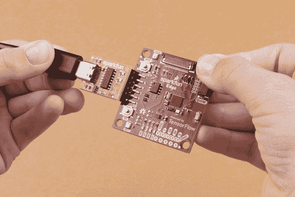

#### 将编程器连接到计算机

接下来，通过 USB 将板连接到计算机。要对板进行编程，需要确定计算机为该设备分配的名称。最好的方法是列出连接前后计算机上的所有设备，以确认哪个设备是新的。

### 警告

有人报告了编程器操作系统默认驱动程序相关的问题，因此强烈建议在继续之前安装[驱动程序](https://oreil.ly/Wkxaf)。

在通过 USB 连接设备之前，执行以下命令：

```
# macOS:
ls /dev/cu*

# Linux:
ls /dev/tty*
```

应该会输出类似以下的列表：

```
/dev/cu.Bluetooth-Incoming-Port
/dev/cu.MALS
/dev/cu.SOC
```

将编程器连接到计算机的 USB 端口，然后再次执行命令：

```
# macOS:
ls /dev/cu*

# Linux:
ls /dev/tty*
```

应该会输出额外的项目，如下例所示。新的项目名称可能不同。此新项目即为设备的名称：

```
/dev/cu.Bluetooth-Incoming-Port
/dev/cu.MALS
/dev/cu.SOC
/dev/cu.wchusbserial-1450
```

该名称用于引用设备。然而，根据编程器连接到的 USB 端口，该名称可能会发生变化，因此如果从计算机上拔下板并重新连接，可能需要重新检查名称。

### 提示

有用户报告列表中会出现两个设备。如果出现两个设备，正确的一个以 "wch "开头。

确定设备名称后，将其保存在 shell 变量 `DEVICENAME` 中以便以后使用：

```
export DEVICENAME=<your device name here>
```

这是在以后执行需要设备名称的命令时使用的变量。

#### 运行脚本刷新板

要刷新板，需要将其置于接收新二进制文件的特殊“引导加载程序”状态。然后可以运行脚本将二进制文件发送到板上。

首先，创建一个指定波特率的环境变量。波特率是指向设备发送数据的速度：

```
export BAUD_RATE=921600
```

将以下命令粘贴到终端中。命令中的 `${DEVICENAME}` 和 `${BAUD_RATE}` 将被替换为上一节中设置的值。必要时，请勿忘记将 `python3` 替换为 `python`：

```
python3 tensorflow/lite/micro/tools/make/downloads/ \
  AmbiqSuite-Rel2.0.0/tools/apollo3_scripts/ \
  uart_wired_update.py -b ${BAUD_RATE} \
  ${DEVICENAME} -r 1 -f main_nonsecure_wire.bin -i 6
```

接下来，将板重置为引导加载程序状态并刷新板。在板上，找到标有 `RST` 和 `14` 的按钮，如图 6-14 所示。

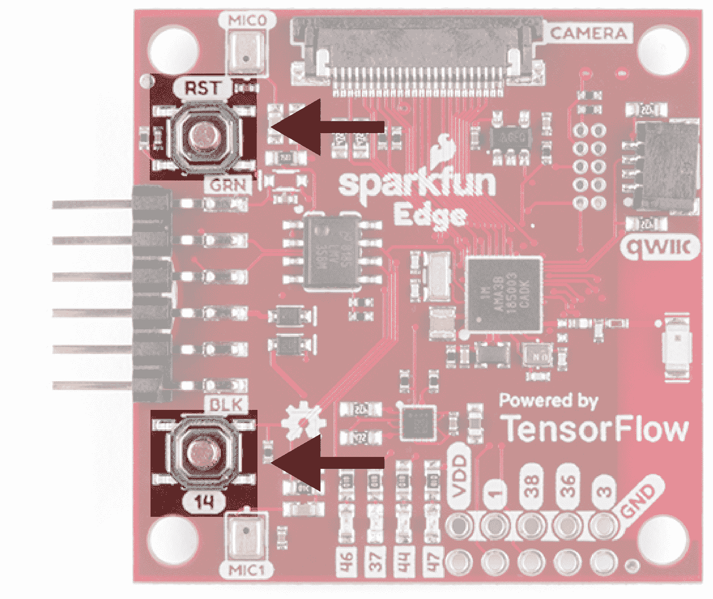

执行以下步骤：

1. 确认板已连接到编程器，并且整体通过 USB 连接到计算机。
2. 在板上，按住标有 `14` 的按钮。继续按住。
3. 在按住标有 `14` 的按钮的同时，按下标有 `RST` 的按钮以重置板。
4. 在计算机上按 Enter 键运行脚本。继续按住 `14` 按钮。

此时屏幕上应该显示如下内容：

```
Connecting with Corvette over serial port /dev/cu.usbserial-1440...
Sending Hello.
Received response for Hello
Received Status
length =  0x58
version =  0x3
Max Storage =  0x4ffa0
Status =  0x2
State =  0x7
AMInfo =
0x1
0xff2da3ff
0x55fff
0x1
0x49f40003
0xffffffff
[...lots more 0xffffffff...]
Sending OTA Descriptor =  0xfe000
Sending Update Command.
number of updates needed =  1
Sending block of size  0x158b0  from  0x0  to  0x158b0
Sending Data Packet of length  8180
Sending Data Packet of length  8180
[...lots more Sending Data Packet of length  8180...]
```

继续按住按钮 `14`，直到显示 `Sending Data Packet of length 8180`。显示后可以松开按钮（继续按住也没问题）。

编程将在终端中继续输出行。最终会显示如下内容：

```
[...lots more Sending Data Packet of length  8180...]
Sending Data Packet of length  8180
Sending Data Packet of length  6440
Sending Reset Command.
Done.
```

这表明刷新成功。

### 提示

如果编程输出以错误结束，请检查是否打印了 `Sending Reset Command.`。如果是，则即使出现错误，刷新也可能已成功。否则，可能刷新失败。请再次执行此步骤（可以省略环境变量的设置）。

## 测试编程

现在二进制文件应该已部署到设备上。按下标有 `RST` 的按钮重新启动板。应该可以看到设备的四个 LED 按顺序闪烁。干得好！

## 查看调试数据

调试信息在程序运行时由板记录。要查看它，只需使用波特率 115200 监控板的串行端口输出。以下命令在 macOS 和 Linux 上应该可以工作：

```
screen ${DEVICENAME} 115200
```

你会看到大量输出在飞快滚动！要停止滚动，请先按 Ctrl-A，然后立即按 Esc。之后可以使用箭头键探索输出。输出包含对 `x` 的各种值执行的推理结果：

```
x_value: 1.1843798*2², y_value: -1.9542645*2^-1
```

要使用 `screen` 停止显示调试输出，请按 Ctrl-A，然后立即按 K 键，再按 Y 键。

### 注

`screen` 程序是一个方便的实用程序，用于连接到其他计算机。这次我们使用它来监听 SparkFun Edge 板通过串行端口记录的数据。如果使用 Windows，也可以使用此程序执行相同的操作。也可以使用 [`CoolTerm`](https://oreil.ly/sPWQP) 实现相同的功能。

## 自行更改

现在基本应用程序已部署，让我们尝试玩弄或更改它。应用程序代码可以在 `tensorflow/lite/micro/examples/hello_world` 文件夹中找到。编辑并保存，然后重复之前的步骤，将更改后的代码部署到设备上。

有一些事情可以尝试：

* 通过调整每个周期的推理次数来减慢或加快 LED 闪烁。
* 修改 `output_handler.cc` 以将基于文本的动画记录到串行端口。
* 使用正弦波控制其他组件，如附加 LED 或声音生成器。

# STMicroelectronics STM32F746G Discovery Kit

[STM32F746G 是](https://oreil.ly/cvm4J) 是一款配备相对强大的 Arm Cortex-M7 处理器核心的微控制器开发板。

该板运行 Arm 的 [Mbed OS](https://os.mbed.com)，这是一种为简化嵌入式应用程序的构建和部署而设计的嵌入式操作系统。也就是说，本节中的许多指令可用于为其他 Mbed 设备构建。

STM32F746G 配有 LCD 屏幕，可以创建更精致的视觉显示。

## 处理 STM32F746G 的输出

现在可以使用整个 LCD 来玩，所以可以绘制漂亮的动画。让我们将屏幕的 `x 轴`设为推理次数，`y 轴`设为预测的当前值。

在该值应出现的位置绘制一个点，并使其在屏幕上移动，以便在 0 到 2π 的输入范围内循环。图 6-15 是其线框图。

由于每次推理需要一定的时间，因此可以通过微调 `constants.cc` 中定义的 `kInferencesPerCycle` 来调整点的移动速度和流畅度。

图 6-16 是编程运行时 [动画*.gif 的*](https://oreil.ly/1EM7C) 静态图像。

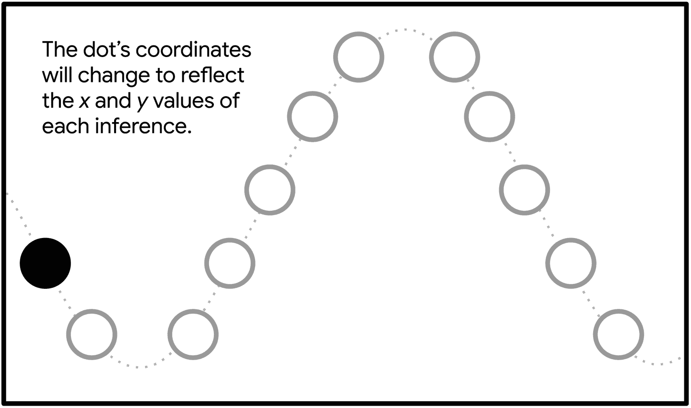

图 6-16 是编程运行时 [动画*.gif 的*](https://oreil.ly/1EM7C) 静态图像。

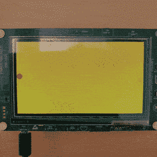

实现 STM32F746G 输出处理的代码位于 [`hello_world/disco_f746ng/output_handler.cc`](https://oreil.ly/bj4iL)，它代替原始文件 `hello_world/output_handler.cc` 使用。

让我们看看它：

```
#include "tensorflow/lite/micro/examples/hello_world/output_handler.h"
#include "LCD_DISCO_F746NG.h"
#include "tensorflow/lite/micro/examples/hello_world/constants.h"
```

首先是头文件。`output_handler.h` 指定了此文件的接口。`LCD_DISCO_F746NG.h` 由板制造商提供，声明了用于控制 LCD 屏幕的接口。此外，还包含了 `constants.h`，因为需要访问 `kInferencesPerCycle` 和 `kXrange`。

接下来，设置大量变量。`LCD_DISCO_F746NG` 在 `LCD_DISCO_F746NG.h` 中定义，提供控制 LCD 的方法：

```
// The LCD driver
LCD_DISCO_F746NG lcd;
```

`LCD_DISCO_F746NG` 类的详细信息发布在 [Mbed 的](https://oreil.ly/yiPHS) 网站上。

接下来，定义控制视觉外观和感觉的常量：


// The colors we'll draw
const uint32_t background_color = 0xFFF4B400;  // Yellow
const uint32_t foreground_color = 0xFFDB4437;  // Red
// The size of the dot we'll draw
const int dot_radius = 10;
```

颜色以十六进制值提供，如 `0xFFF4B400`。`AARRGGBB` 中 `AA` 表示 alpha 值（或不透明度，`FF` 为完全不透明），`RR`、`GG`、`BB` 表示红色、绿色、蓝色的量。

### 小贴士

`0xFFF4B400`。完全不透明的颜色，红色较多，绿色也相当多，因此呈现出漂亮的橙黄色。

也可以通过 Google 搜索来查询值。

接下来，声明一些定义动画形状和大小的变量：

```
// Size of the drawable area
int width;
int height;
// Midpoint of the y axis
int midpoint;
// Pixels per unit of x_value
int x_increment;
```

在变量之后，定义 `HandleOutput()` 函数，指示首次执行时要做什么：

```
// Animates a dot across the screen to represent the current x and y values
void HandleOutput(tflite::ErrorReporter* error_reporter, float x_value,
                  float y_value) {
  // Track whether the function has run at least once
  static bool is_initialized = false;

  // Do this only once
  if (!is_initialized) {
    // Set the background and foreground colors
    lcd.Clear(background_color);
    lcd.SetTextColor(foreground_color);
    // Calculate the drawable area to avoid drawing off the edges
    width = lcd.GetXSize() - (dot_radius * 2);
    height = lcd.GetYSize() - (dot_radius * 2);
    // Calculate the y axis midpoint
    midpoint = height / 2;
    // Calculate fractional pixels per unit of x_value
    x_increment = static_cast<float>(width) / kXrange;
    is_initialized = true;
  }
```

里面写了很多内容！首先，使用 `lcd` 的方法设置背景色和前景色。名为 `lcd.SetTextColor()` 的奇怪方法不仅设置文本的颜色，还设置所有绘制物体的颜色：

```
// Set the background and foreground colors
lcd.Clear(background_color);
lcd.SetTextColor(foreground_color);
```

接下来，为了掌握绘制圆的位置，计算实际可绘制的范围。如果弄错了，可能会尝试超出屏幕边缘绘制，导致意外的结果：

```
width = lcd.GetXSize() - (dot_radius * 2);
height = lcd.GetYSize() - (dot_radius * 2);
```

随后，确定负 `y` 值在屏幕上绘制的中央位置。还计算屏幕宽度的多少像素相当于 `x` 值的 1 个单位。为了得到浮点数结果，使用 `static_cast`：

```
// Calculate the y axis midpoint
midpoint = height / 2;
// Calculate fractional pixels per unit of x_value
x_increment = static_cast<float>(width) / kXrange;
```

与之前相同，使用名为 `is_initialized` 的 `static` 变量，使此块代码只执行一次。

初始化完成后，开始输出。首先清除之前的绘制：

```
// Clear the previous drawing
lcd.Clear(background_color);
```

接下来，计算 `x_value`，在显示器的 x 轴上绘制点的位置：

```
// Calculate x position, ensuring the dot is not partially offscreen,
// which causes artifacts and crashes
int x_pos = dot_radius + static_cast<int>(x_value * x_increment);
```

接下来是 `y`。这有点复杂，因为想要在 `midpoint` 上方绘制正值，在下方绘制负值：

```
// Calculate y position, ensuring the dot is not partially offscreen
int y_pos;
if (y_value >= 0) {
  // Since the display's y runs from the top down, invert y_value
  y_pos = dot_radius + static_cast<int>(midpoint * (1.f - y_value));
} else {
  // For any negative y_value, start drawing from the midpoint
  y_pos =
      dot_radius + midpoint + static_cast<int>(midpoint * (0.f - y_value));
}
```

一旦确定点的位置，就只需绘制点：

```
// Draw the dot
lcd.FillCircle(x_pos, y_pos, dot_radius);
```

最后，使用 `ErrorReporter` 将 `x` 和 `y` 值记录到串行端口：

```
// Log the current X and Y values
error_reporter->Report("x_value: %f, y_value: %f\n", x_value, y_value);
```

### 注释

`ErrorReporter` 可以通过 STM32F746G 的串行接口输出数据。这是由 [`micro/disco_f746ng/debug_log.cc`的](https://oreil.ly/eL1ft) 自定义实现所实现的，该实现取代了 [`micro/debug_log.cc`中](https://oreil.ly/HpJ-t) 的原始实现。

## 运行示例

接下来构建项目！STM32F746G 搭载了 Arm 的 Mbed OS，因此使用 Mbed 工具链将应用程序部署到设备上。

### 小贴士

由于构建步骤可能与本书撰写时有所不同，请检查 [`README.md`](https://oreil.ly/WuhIz) 以获取最新步骤。

开始之前，需要以下内容：

* STM32F746G Discovery Kit 板
* Mini USB 电缆
* Arm Mbed CLI（遵循 [Mbed 设置指南](https://oreil.ly/TkRwd)）
* Python 3 和 `pip`

与 Arduino IDE 类似，Mbed 需要以某种方式结构化源文件。TensorFlow Lite for Microcontrollers Makefile 知道这种方法，并会生成适合 Mbed 的目录。

为此，执行以下命令：

```
make -f tensorflow/lite/micro/tools/make/Makefile \
  TARGET=mbed TAGS="CMSIS disco_f746ng" generate_hello_world_mbed_project
```

结果会创建新的目录：

```
tensorflow/lite/micro/tools/make/gen/mbed_cortex-m4/prj/ \
  hello_world/mbed
```

该目录包含以正确方式结构化、使 Mbed 能够构建的示例的所有依赖项。

首先，移动到该目录，以便在那里执行命令：

```
cd tensorflow/lite/micro/tools/make/gen/mbed_cortex-m4/prj/ \
  hello_world/mbed
```

接下来，使用 Mbed 下载依赖项并构建项目。

首先，使用以下命令指定当前目录是 Mbed 项目的根目录：

```
mbed config root .
```

接下来，指示 Mbed 下载依赖项并准备构建：

```
mbed deploy
```

默认情况下，Mbed 使用 C++98 构建项目。然而，TensorFlow Lite 需要 C++11。执行以下 Python 代码片段以更改 Mbed 配置文件，使其使用 C++11。只需在命令行中输入或粘贴即可：

```
python -c 'import fileinput, glob;
for filename in glob.glob("mbed-os/tools/profiles/*.json"):
  for line in fileinput.input(filename, inplace=True):
    print(line.replace("\"-std=gnu++98\"","\"-std=c++11\", \"-fpermissive\""))'
```

最后，执行以下命令进行编译：

```
mbed compile -m DISCO_F746NG -t GCC_ARM
```

结果应该在以下路径生成二进制文件：

```
cp ./BUILD/DISCO_F746NG/GCC_ARM/mbed.bin
```

使用像 STM32F746G 这样的 Mbed 兼容板的好处之一是部署非常简单。只需将 STM 板连接并复制文件即可。在 macOS 上，可以使用以下命令执行此操作：

```
cp ./BUILD/DISCO_F746NG/GCC_ARM/mbed.bin /Volumes/DIS_F746NG/
```

或者，在文件浏览器中查找 `DIS_F746NG` 卷并拖放文件。复制文件后，闪存过程将开始。完成后，设备的屏幕上应该显示动画。

除了此动画外，程序运行期间调试信息也会记录到板上。要查看它，请以 9600 波特率建立与板的串行连接。

在 macOS 和 Linux 上，执行以下命令应该会列出设备：

```
ls /dev/tty*
```

应该如下所示：

```
/dev/tty.usbmodem1454203
```

确定设备后，使用以下命令连接。将 `/dev/tty.devicename` 替换为 `/dev` 中显示的设备名称：

```
screen /<dev/tty.devicename> 9600
```

你会看到大量输出在飞过。要停止滚动，请按 Ctrl-A，然后立即按 Esc。之后，可以使用箭头键探索输出。输出包含针对 `x` 的各种值的推理结果：

```
x_value: 1.1843798*2², y_value: -1.9542645*2^-1
```

要停止在 `screen` 中显示调试输出，请按 Ctrl-A，然后立即按 K 键，然后按 Y 键。

## 自己修改

现在应用程序已部署，玩玩也很有趣！应用程序代码可以在 `tensorflow/lite/micro/tools/make/gen/mbed_cortex-m4/prj/hello_world/mbed` 文件夹中找到。编辑并保存，然后重复之前的步骤将修改后的代码部署到设备上即可。

有一些事情可以尝试：

* 通过调整每个周期推理的次数来减慢或加快点的移动。
* 修改 `output_handler.cc`，将基于文本的动画记录到串行端口。
* 使用正弦波控制 LED 或声音生成器等其他组件。

# 总结

在前三章中，我们从头到尾完成了模型的训练、转换为 TensorFlow Lite、创建应用程序以及部署到小型设备。接下来的章节将探索更精致、更令人兴奋的示例，以将嵌入式机器学习付诸实践。

首先，创建一个使用 18KB 小型模型来识别语音命令的应用程序。
