# 第 7 章. 唤醒词检测：构建应用程序

本作品使用 AI 翻译。欢迎提供意见和反馈：translation-feedback@oreilly.com

TinyML 可能是新现象，但其最广泛的应用可能已经在你的家中、汽车中或口袋里使用。你知道那是什么吗？

近年来，数字助理正在兴起。这些产品提供语音用户界面（UI），无需屏幕或键盘即可即时访问信息。在 Google Assistant、Apple 的 Siri 和 Amazon Alexa 之间，这些数字助理几乎无处不在。几乎所有手机都内置了某种类型，从旗舰机型到面向新兴市场的语音优先设备。此外，它们还被集成到智能扬声器、计算机和汽车中。

在大多数情况下，语音识别、自然语言处理以及生成对用户查询的响应等繁重工作都在云端进行，由运行大型 ML 模型的强大服务器执行。用户提问时，语音作为流发送到服务器。服务器理解其含义，查找所需信息并返回适当的响应。

然而，助理的魅力之一是始终在线，随时准备帮助你。说“嘿，Google”或“Alexa”，即可启动助理，无需按按钮即可传达所需内容。也就是说，无论你坐在客厅、驾驶高速公路，还是在大自然中拿着手机，都必须 24/7 全天候聆听你的声音。

在服务器上进行语音识别很容易，但持续将语音流从设备发送到数据中心是不现实的。从隐私角度来看，每秒将语音发送到远程服务器是绝对的灾难。即使勉强可行，也需要巨大的带宽，会在几小时内耗尽移动数据计划。此外，网络通信消耗能量，持续发送数据会迅速耗尽设备电池。此外，由于所有请求都要往返服务器，助理会感觉滞后，响应缓慢。

助理真正需要的语音只是唤醒词（例如“嘿 Google”）之后的语音。如果能在不发送数据的情况下检测到该词，并在听到时开始流式传输会怎样？这可以保护用户隐私，节省电池寿命和带宽，并在无需等待网络的情况下唤醒助理。

这就是 TinyML 大显身手的地方。可以训练一个监听唤醒词的小型模型，并在低功耗芯片上运行。将它集成到手机中，就能持续监听唤醒词。听到魔咒后，手机会通知操作系统（OS），OS 开始捕获语音并将其发送到服务器。


ウェイクワード検出はTinyMLに最適なアプリケーションだ。プライバシー、効率、スピード、オフライン推論を実現するのに理想的だ。小さくて効率的なモデルが、大きくてリソースを消費するモデルを「目覚めさせる」このアプローチは、 カスケーディングと呼ばれている。

この章では、学習済みの音声検出モデルを使用して、小さなマイクロコントローラーで常時ウェイクワードを検出する方法を検討する。第 8 章では、このモデルがどのように学習され、どのように独自のモデルを作成するかを検討する。

# 正在构建什么

音声コマンドのデータセットで訓練された18KBのモデルを使用して、音声を分類する組み込みアプリケーションを構築する。このモデルは、"yes "と "no "という単語を認識するように訓練されており、未知の単語と沈黙や背景ノイズを区別することもできる。

このアプリケーションは、マイクで周囲の音を聞き、単語を検出すると、デバイスの機能に応じてLEDを点灯させたり、データをスクリーンに表示したりする。このコードを理解することで、どんな電子機器プロジェクトでも音声コマンドで制御できるようになる。

### 注

第 5 章与同様、このアプリケーションのソースコードは[TensorFlow GitHub 仓库中](https://oreil.ly/Bql0J)公開されている。

第 5 章与同じようなパターンで、テスト、アプリケーション・コード、そしてサンプルを様々なデバイスで動作させるロジックの順に説明する。

以下のデバイスにアプリケーションをデプロイする手順を説明する：

*   [Arduino Nano 33 BLE Sense](https://oreil.ly/6qlMD)
*   [SparkFun Edge](https://oreil.ly/-hoL-)
*   [STMicroelectronics STM32F746G Discovery Kit](https://oreil.ly/cvm4J)

### 注

TensorFlow Liteは定期的に新しいデバイスのサポートを追加しているので、使用したいデバイスがここにリストされていない場合は、サンプルの[`README.md`](https://oreil.ly/OE3Pn)確認すること。また、以下の手順で問題が発生した場合は、`README.md`で最新のデプロイ手順を確認することもできる。

これは「hello world」の例よりもかなり複雑なアプリケーションなので、まずその構造から見ていこう。

# 应用程序架构

これまでの数章で、機械学習アプリケーションは次のような順序で処理を行うことを学んだはずだ：

1.  入力を得る
2.  モデルへの入力に適した特徴を抽出するために、入力を前処理する。
3.  処理された入力に対して推論を実行する
4.  モデルの出力を後処理して意味を持たせる
5.  得られた情報を使って物事を実現する

`hello world` の例は、非常に単純な方法でこれらのステップに従った。単純なカウンタによって生成された1つの浮動小数点数を入力とした。その出力は別の浮動小数点数で、それを直接使って視覚出力を制御した。

私たちのウェークワードアプリケーションは、以下の理由でより複雑になる：

*   オーディオデータを入力とする。見てわかるように、これはモデルに入力する前に重い処理を必要とする。
*   そのモデルは分類器で、クラスの確率を出力する。この出力を解析して意味を持たせる必要がある。
*   これは、生きたデータに対して継続的に推論を実行するように設計されている。推論のストリームを理解するためにコードを書く必要がある。
*   モデルはより大きく、より複雑だ。私たちはハードウェアの能力の限界に挑戦することになる。

この複雑さの多くは、これから使用するモデルに起因するものなので、もう少し詳しく学んでみよう。

## 模型介绍

先に述べたように、本章で使用するモデルは、「はい」と「いいえ」という単語を認識するように訓練されており、未知の単語と静寂や背景ノイズを区別することもできる。

このモデルは、[名为 Speech Commands 的数据集](https://oreil.ly/qtOSI)で学習された。これは、オンラインでクラウドソーシングされた、30 個の短い単語からなる1 秒間の発話 65,000 個からなる。

データセットには30 種類の単語が含まれているが、モデルは「はい」と「いいえ」、「未知」の単語（データセットの他の28 単語を意味する）、そして沈黙の4つのカテゴリーだけを区別するように訓練された。

モデルは一度に1 秒分のデータを取り込む。このモデルは4つの確率スコアを出力する。4つのクラスそれぞれに1つずつで、そのデータが4つのクラスのどれに属する可能性が高いかを予測する。

しかし、このモデルは生のオーディオサンプルデータを取り込まない。その代わりに、*スペクトログラムを*扱う。*スペクトログラムは*、周波数情報のスライスで構成される2 次元配列で、それぞれが異なる時間窓から取得される。

図 7-1は、誰かが "yes "と言っている1 秒間の音声クリップから生成されたスペクトログラムを視覚的に表したものである。図 7-2は同じことを "no "という単語についても示している。

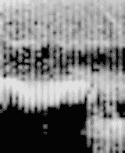

前処理で周波数情報を分離することで、モデルの作業が容易になる。トレーニング中に、生のオーディオデータのインタプリタ方法を学習する必要はなく、代わりに、最も有用な情報を抽出する高レイヤーの抽象化で作業することができる。

スペクトログラムがどのように生成されるかは、この章の後半で説明する。今のところ、モデルがスペクトログラムを入力として受け取ることだけを知っていればよい。スペクトログラムは2 次元配列なので、2 次元テンソルとしてモデルに入力する。

多次元テンソルをうまく扱うように設計されたニューラルネットワークアーキテクチャの一種があり、そのテンソルには、隣接する値のグループ間の関係に情報が含まれている。これは *畳み込みニューラルネットワーク*（`CNN`）と呼ばれている。

この種のデータの最も一般的な例は画像で、隣接するピクセルのグループは、形状、パターン、またはテクスチャーを表すかもしれない。学習中、`CNN`はこれらの特徴を識別し、それらが何を表しているかを学習することができる。

`CNN`は、単純な画像の特徴（行やエッジなど）がどのように組み合わさって、より複雑な特徴（目や耳など）になるかを学習することができ、さらにそれらの特徴がどのように組み合わされて、人の顔の写真のような入力画像になるかを学習することができる。つまり、`CNN`は入力画像の異なるクラス、例えば人の写真と犬の写真を区別することを学習することができる。

`CNN`はピクセルの2 次元格子である画像に適用されることが多いが、あらゆる多次元ベクトル入力に使うことができる。`CNN`はスペクトログラム・データの処理に非常に適していることがわかった。

第 8 章では、このモデルがどのようにトレーニングされたかを見ていく。それまでは、アプリケーションのアーキテクチャの話に戻ろう。

## すべての可動部品

前述したように、我々のウェイクワード・アプリケーションは「hello world」の例よりも複雑である。図 7-3にそれを構成するコンポーネントを示す。

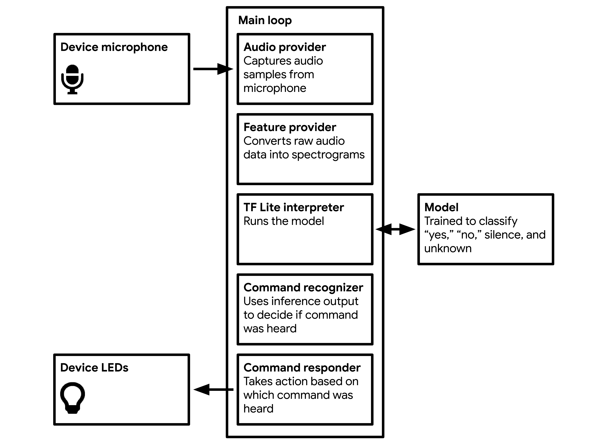

それぞれのパーツが何をするのかを調べてみよう：

メインループ
: 
`hello world` の例のように、我々のアプリケーションは連続ループで実行される。後続の処理はすべてこの中にコンテナとして含まれており、マイクロコントローラーが実行できる速さ（1 秒間に複数回）で継続的に実行される。

オーディオ・プロバイダー
: 
オーディオ・プロバイダは、マイクから生のオーディオ・データをキャプチャする。オーディオをキャプチャするメソッドはデバイスによって異なるため、このコンポーネントはオーバーライドしてカスタマイズすることができる。

フィーチャー・プロバイダー
: 
機能プロバイダーは、生のオーディオデータを、我々のモデルが必要とするスペクトログラム形式に変換する。これはメインループの一部としてローリングベースで行われ、インタプリタにオーバーラップする1 秒間のWindowsシーケンスを提供する。

TF Lite インタプリタ
: 
インタプリタはTensorFlow Liteモデルを実行し、入力スペクトログラムを確率のセットに変換する。

モデル
: 
モデルはデータ配列として含まれ、インタプリタによって実行される。この配列は[`tiny_conv_micro_features_model_data.cc`に](https://oreil.ly/XIUz9)ある。

コマンド認識装置
: 
推論は1 秒間に複数回実行されるため、`RecognizeCommands` クラスは結果を集約し、平均して既知の単語が聞こえたかどうかを判断する。

コマンド・レスポンダー
: 
コマンドを聞いた場合、コマンド・レスポンダはデバイスの出力機能を使ってユーザに知らせる。デバイスによっては、LEDを点滅させたり、LCDディスプレイにデータを表示したりする。異なるデバイス・タイプに対してオーバーライドすることができる。

GitHubにあるサンプルのファイルには、これらの各コンポーネントのテストが含まれている。次に、これらのコンポーネントがどのように動作するのかを学ぶために、これらのコンポーネントを見ていくことにしよう 。

# テストを通して歩く

第 5 章と同様に、テストを使ってアプリケーションの動作を学ぶことができる。すでに述べたように、C++とTensorFlow Liteの基本はたくさんあるので、すべての行を説明する必要はないだろう。その代わりに、各テストの最も重要な部分に焦点を当て、何が起こっているのかを説明しよう。

[GitHubリポジトリで](https://oreil.ly/YiSbu)発見できる以下のテストについて調べてみよう：

[`micro_speech_test.cc`](https://oreil.ly/FiBEN)
: 
スペクトログラムデータに対して推論を実行し、結果を解釈する方法を示す。

[`audio_provider_test.cc`](https://oreil.ly/bQOKd)
: 
オーディオ・プロバイダの使い方を示す

[`feature_provider_mock_test.cc`](https://oreil.ly/V9rK8)
: 
オーディオ・プロバイダの*モック*（偽の実装）を使用して、偽のデータを渡すことで、フィーチャー・プロバイダの使用方法を示す。

[`recognize_commands_test.cc`](https://oreil.ly/P9pCG)
: 
コマンドが発見されたかどうかを判断するために、モデルの出力をどのように解釈するかを示す。

[`command_responder_test.cc`](https://oreil.ly/OqftF)
: 
出力をトリガするためにコマンドレスポンダを呼び出す方法を示す。

この例には他にも多くのテストがあるが、そのうちのいくつかを調べることで、重要な可動部分を理解することができるだろう。

## 基本的な流れ

テスト `micro_speech_test.cc`は、`hello world` の例でおなじみの基本的な流れに従っている。モデルをロードし、インタプリタをセットアップし、テンソルをアロケートする。

しかし、顕著な違いがある。`hello world`の例では、`AllOpsResolver` 、モデルの実行に必要と思われるすべてのDeep Learning 演算子を取り込んだ。これは信頼性の高いアプローチだが、与えられたモデルがおそらく数十の利用可能な演算子のすべてを使うことはないため、無駄が多い。デバイスにデプロイした場合、これらの不要な演算子は貴重なメモリを消費することになるので、必要なものだけを取り込むのがベストだ。

そのために、まずテストファイルの先頭で、モデルが必要とするオペレーションを定義する：

```
namespace tflite {
namespace ops {
namespace micro {
TfLiteRegistration* Register_DEPTHWISE_CONV_2D();
TfLiteRegistration* Register_FULLY_CONNECTED();
TfLiteRegistration* Register_SOFTMAX();
}  // namespace micro
}  // namespace ops
}  // namespace tflite
```

次に、通常通りロギングをセットアップし、モデルをロードする：

```
// Set up logging.
tflite::MicroErrorReporter micro_error_reporter;
tflite::ErrorReporter* error_reporter = &micro_error_reporter;
// Map the model into a usable data structure. This doesn't involve any
// copying or parsing, it's a very lightweight operation.
const tflite::Model* model =
    ::tflite::GetModel(g_tiny_conv_micro_features_model_data);
if (model->version() != TFLITE_SCHEMA_VERSION) {
  error_reporter->Report(
      "Model provided is schema version %d not equal "
      "to supported version %d.\n",
      model->version(), TFLITE_SCHEMA_VERSION);
}
```

モデルがロードされたら、`MicroMutableOpResolver` を宣言し、そのメソッド`AddBuiltin()` を使って、先にリストアップしたオペレーションを追加する：

```
tflite::MicroMutableOpResolver micro_mutable_op_resolver;
micro_mutable_op_resolver.AddBuiltin(
    tflite::BuiltinOperator_DEPTHWISE_CONV_2D,
    tflite::ops::micro::Register_DEPTHWISE_CONV_2D());
micro_mutable_op_resolver.AddBuiltin(
    tflite::BuiltinOperator_FULLY_CONNECTED,
    tflite::ops::micro::Register_FULLY_CONNECTED());
micro_mutable_op_resolver.AddBuiltin(tflite::BuiltinOperator_SOFTMAX,
                                      tflite::ops::micro::Register_SOFTMAX());
```

あるモデルに対して、どのオペレーションを含めるべきか、どうやって知るのか、不思議に思っていることだろう。一つの方法は、`MicroMutableOpResolver` を使ってモデルを実行してみることである。ただし、`AddBuiltin()` はまったく呼び出さない。推論は失敗し、それに付随するエラーメッセージによって、どのopsが欠落しており、どのopsを追加する必要があるかがわかる。

### 注

`MicroMutableOpResolver` 。[`tensorflow/lite/micro/micro_mutable_op_resolver.h`で](https://oreil.ly/TGVZz)定義されているので、`include` の文に追加する必要がある。

`MicroMutableOpResolver` がセットアップされた後は、通常通りインタプリタとその作業メモリをセットアップするだけだ：

```
// Create an area of memory to use for input, output, and intermediate arrays.
const int tensor_arena_size = 10 * 1024;
uint8_t tensor_arena[tensor_arena_size];
// Build an interpreter to run the model with.
tflite::MicroInterpreter interpreter(model, micro_mutable_op_resolver, tensor_arena,
                                     tensor_arena_size, error_reporter);
interpreter.AllocateTensors();
```


# 测试

## 模型测试

在我们的 "hello world " 应用程序中，模型只分配了 2 * 1,024 字节。`tensor_arena` 只分配了这么多字节。我们的语音模型更大、更复杂，处理输入输出，因此需要更多的空间（10 1,024）。这是通过试错决定的。

接下来，检查输入张量的大小。但是这次有点不同：

// Get information about the memory area to use for the model's input.
TfLiteTensor* input = interpreter.input(0);
// Make sure the input has the properties we expect.
TF_LITE_MICRO_EXPECT_NE(nullptr, input);
TF_LITE_MICRO_EXPECT_EQ(4, input->dims->size);
TF_LITE_MICRO_EXPECT_EQ(1, input->dims->data[0]);
TF_LITE_MICRO_EXPECT_EQ(49, input->dims->data[1]);
TF_LITE_MICRO_EXPECT_EQ(40, input->dims->data[2]);
TF_LITE_MICRO_EXPECT_EQ(1, input->dims->data[3]);
TF_LITE_MICRO_EXPECT_EQ(kTfLiteUInt8, input->type);

因为输入处理的是频谱图，所以输入张量总共有 4 个维度。第一个维度只是一个包含一个元素的包装器。第二和第三个维度表示频谱图的“行”和“列”。输入张量最内层的第四个维度大小为 1，用于保存频谱图的各个“像素”。稍后将详细介绍频谱图的结构。

接下来，获取存储在常量 `g_yes_micro_f2e59fea_nohash_1_data` 中的“yes”频谱图样本。该常量在 [`micro_features/yes_micro_features_data.cc`](https://oreil.ly/rVn8O) 文件中定义。频谱图以一维数组形式存在，只需迭代它并将其复制到输入张量中：

// Copy a spectrogram created from a .wav audio file of someone saying "Yes"
// into the memory area used for the input.
const uint8_t* yes_features_data = g_yes_micro_f2e59fea_nohash_1_data;
for (int i = 0; i < input->bytes; ++i) {
  input->data.uint8[i] = yes_features_data[i];
}

输入赋值后，执行推理并检查输出张量的大小和形状：

// Run the model on this input and make sure it succeeds.
TfLiteStatus invoke_status = interpreter.Invoke();
if (invoke_status != kTfLiteOk) {
  error_reporter->Report("Invoke failed\n");
}
TF_LITE_MICRO_EXPECT_EQ(kTfLiteOk, invoke_status);

// Get the output from the model, and make sure it's the expected size and
// type.
TfLiteTensor* output = interpreter.output(0);
TF_LITE_MICRO_EXPECT_EQ(2, output->dims->size);
TF_LITE_MICRO_EXPECT_EQ(1, output->dims->data[0]);
TF_LITE_MICRO_EXPECT_EQ(4, output->dims->data[1]);
TF_LITE_MICRO_EXPECT_EQ(kTfLiteUInt8, output->type);

我们的输出有两个维度。第一个只是包装器。另一个有 4 个元素。这是一个结构，用于保存 4 个类别（沉默、未知、“yes”、“no”）各自匹配的概率。

下一段代码块检查概率是否符合预期。由于输出张量的给定元素始终代表特定类别，因此知道应检查每个类别的哪个索引。顺序在训练期间定义：

// There are four possible classes in the output, each with a score.
const int kSilenceIndex = 0;
const int kUnknownIndex = 1;
const int kYesIndex = 2;
const int kNoIndex = 3;

// Make sure that the expected "Yes" score is higher than the other classes.
uint8_t silence_score = output->data.uint8[kSilenceIndex];
uint8_t unknown_score = output->data.uint8[kUnknownIndex];
uint8_t yes_score = output->data.uint8[kYesIndex];
uint8_t no_score = output->data.uint8[kNoIndex];
TF_LITE_MICRO_EXPECT_GT(yes_score, silence_score);
TF_LITE_MICRO_EXPECT_GT(yes_score, unknown_score);
TF_LITE_MICRO_EXPECT_GT(yes_score, no_score);

由于传递了“是”的频谱图，因此预计变量 `yes_score` 的概率高于 `silence_score`、`unknown_score`、`no_score`。

对“是”满意后，用“否”的频谱图做同样的事情。首先复制输入并执行推理：

// Now test with a different input, from a recording of "No".
const uint8_t* no_features_data = g_no_micro_f9643d42_nohash_4_data;
for (int i = 0; i < input->bytes; ++i) {
  input->data.uint8[i] = no_features_data[i];
}
// Run the model on this "No" input.
invoke_status = interpreter.Invoke();
if (invoke_status != kTfLiteOk) {
  error_reporter->Report("Invoke failed\n");
}
TF_LITE_MICRO_EXPECT_EQ(kTfLiteOk, invoke_status);

推理结束后，确认“不”获得了最高分数：

// Make sure that the expected "No" score is higher than the other classes.
silence_score = output->data.uint8[kSilenceIndex];
unknown_score = output->data.uint8[kUnknownIndex];
yes_score = output->data.uint8[kYesIndex];
no_score = output->data.uint8[kNoIndex];
TF_LITE_MICRO_EXPECT_GT(no_score, silence_score);
TF_LITE_MICRO_EXPECT_GT(no_score, unknown_score);
TF_LITE_MICRO_EXPECT_GT(no_score, yes_score);

就这样结束了！

要运行此测试，请从 TensorFlow 仓库的根目录执行以下命令：

```
make -f tensorflow/lite/micro/tools/make/Makefile \
  test_micro_speech_test
```

接下来，让我们看看音频提供程序，它是所有音频数据的来源。

## 音频提供程序

音频提供程序将设备的麦克风硬件连接到我们的代码。所有设备都有不同的音频捕获机制。因此，[`audio_provider.h`是](https://oreil.ly/89FGG)定义了请求音频数据的接口，开发者可以根据想要支持的平台编写自己的实现。

### 芯片

此示例包含 Arduino、STM32F746G、SparkFun Edge、macOS 的音频提供程序实现。如果您想在此示例中支持新设备，可以阅读现有实现并学习其方法。

音频提供程序的核心部分是 `audio_provider.h` 中定义的 `GetAudioSamples()` 函数。它如下所示：

```
TfLiteStatus GetAudioSamples(tflite::ErrorReporter* error_reporter,
                             int start_ms, int duration_ms,
                             int* audio_samples_size, int16_t** audio_samples);
```

如 `audio_provider.h` 中所述，此函数预计返回 16 位脉冲编码调制（PCM）音频数据的数组。这是数字音频中非常常见的格式。

此函数指定 `ErrorReporter` 实例、开始时间 (`start_ms`)、持续时间 (`duration_ms`)、两个指针进行调用。

这些指针是 `GetAudioSamples()` 提供数据的机制。调用方声明适当类型的变量，并在函数调用时传递该变量的指针。在函数实现内部，指针被解引用并设置变量的值。

第一个指针 `audio_samples_size` 中包含音频数据的 16 位样本总数。第二个指针 `audio_samples` 接收包含音频数据本身的数组。

通过查看测试可以实际看到这一点。[`audio_provider_test.cc`中有](https://oreil.ly/9XgFg)两个测试，但要学习音频提供程序的使用方法，只需查看第一个测试即可：

```
TF_LITE_MICRO_TEST(TestAudioProvider) {
  tflite::MicroErrorReporter micro_error_reporter;
  tflite::ErrorReporter* error_reporter = &micro_error_reporter;

  int audio_samples_size = 0;
  int16_t* audio_samples = nullptr;
  TfLiteStatus get_status =
      GetAudioSamples(error_reporter, 0, kFeatureSliceDurationMs,
                      &audio_samples_size, &audio_samples);
  TF_LITE_MICRO_EXPECT_EQ(kTfLiteOk, get_status);
  TF_LITE_MICRO_EXPECT_LE(audio_samples_size, kMaxAudioSampleSize);
  TF_LITE_MICRO_EXPECT_NE(audio_samples, nullptr);

  // Make sure we can read all of the returned memory locations.
  int total = 0;
  for (int i = 0; i < audio_samples_size; ++i) {
    total += audio_samples[i];
  }
}
```

此测试展示了 `GetAudioSamples()` 如何使用一些值和一些指针进行调用。此测试验证函数调用后指针是否正确赋值。

### 注

你会注意到使用了常量 `kFeatureSliceDurationMs` 和 `kMaxAudioSampleSize`。这些是在模型训练时选择的值，可以在 [`micro_features/micro_model_settings.h`中](https://oreil.ly/WLuug)找到。

`audio_provider.cc` 的默认实现只是返回一个空数组。为了证明它是正确的大小，测试只是简单地循环预期样本数。

音频提供程序除了 `GetAudioSamples()` 外，还有一个 `LatestAudioTimestamp()` 函数调用。它返回音频数据最后捕获时间的毫秒数。此信息对于特征提供程序确定要获取的音频数据是必要的。

要运行音频提供程序的测试，请使用以下命令：

```
make -f tensorflow/lite/micro/tools/make/Makefile \
  test_audio_provider_test
```

音频提供程序被特征提供程序用作新鲜音频样本的来源。

## 特征提供程序

特征提供程序将从音频提供程序获取的原始音频转换为模型可以输入的频谱图。它在主循环中调用。

其接口在 [`feature_provider.h`中](https://oreil.ly/59uTO)定义，如下所示：

```
class FeatureProvider {
 public:
  // Create the provider, and bind it to an area of memory. This memory should
  // remain accessible for the lifetime of the provider object, since subsequent
  // calls will fill it with feature data. The provider does no memory
  // management of this data.
  FeatureProvider(int feature_size, uint8_t* feature_data);
  ~FeatureProvider();

  // Fills the feature data with information from audio inputs, and returns how
  // many feature slices were updated.
  TfLiteStatus PopulateFeatureData(tflite::ErrorReporter* error_reporter,
                                   int32_t last_time_in_ms, int32_t time_in_ms,
                                   int* how_many_new_slices);

 private:
  int feature_size_;
  uint8_t* feature_data_;
  // Make sure we don't try to use cached information if this is the first call
  // into the provider.
  bool is_first_run_;
};
```

要了解它是如何使用的，请查看 [`feature_provider_mock_test.cc`的](https://oreil.ly/N3YPu)测试。


機能プロバイダーが動作するためのオーディオ・データが存在するために、これらのテストでは、オーディオ・データを提供するように設定された、モックとして知られるオーディオ・プロバイダーの特殊化された偽バージョンを使用する。これは[`audio_provider_mock.cc`で](https://oreil.ly/aQSP8)定義されている。

### 注
モック・オーディオ・プロバイダーは、[`Makefile.inc`の](https://oreil.ly/51m0b) `FEATURE_PROVIDER_MOCK_TEST_SRCS` で発見できるテスト用のビルド手順で、本物と置き換えられている。

`feature_provider_mock_test.cc`ファイルには2つのテストが含まれている。最初のテストはこれだ：

```
TF_LITE_MICRO_TEST(TestFeatureProviderMockYes) {
  tflite::MicroErrorReporter micro_error_reporter;
  tflite::ErrorReporter* error_reporter = &micro_error_reporter;

  uint8_t feature_data[kFeatureElementCount];
  FeatureProvider feature_provider(kFeatureElementCount, feature_data);

  int how_many_new_slices = 0;
  TfLiteStatus populate_status = feature_provider.PopulateFeatureData(
      error_reporter, /* last_time_in_ms= */ 0, /* time_in_ms= */ 970,
      &how_many_new_slices);
  TF_LITE_MICRO_EXPECT_EQ(kTfLiteOk, populate_status);
  TF_LITE_MICRO_EXPECT_EQ(kFeatureSliceCount, how_many_new_slices);

  for (int i = 0; i < kFeatureElementCount; ++i) {
    TF_LITE_MICRO_EXPECT_EQ(g_yes_micro_f2e59fea_nohash_1_data[i],
                            feature_data[i]);
  }
}
```

`FeatureProvider` を作成するには、`feature_size` と`feature_data` の引数を渡してコンストラクタを呼び出す：

```
FeatureProvider feature_provider(kFeatureElementCount, feature_data);
```

最初の引数は、スペクトログラムのデータ要素の合計数を示す。第 2 引数は、スペクトログラム・データを格納する配列へのポインタである。

スペクトログラムの要素数はモデルの学習時に決定され、[`micro_features/micro_model_settings.h`で](https://oreil.ly/FdUCq) `kFeatureElementCount` として定義されている。

音声の過去 1 秒間の特徴を得るために、`feature_provider.PopulateFeatureData()` ：

```
TfLiteStatus populate_status = feature_provider.PopulateFeatureData(
      error_reporter, /* last_time_in_ms= */ 0, /* time_in_ms= */ 970,
      &how_many_new_slices);
```

`ErrorReporter` インスタンス、このメソッドが最後に呼び出されたときの整数（`last_time_in_ms` ）、現在の時刻（`time_in_ms` ）、そして新しい特徴スライスをいくつ受け取ったかで更新される整数へのポインター（`how_many_new_slices` ）を渡す。スライスはスペクトログラムの1 行で、時間のかたまりを表す。

常に最後の1 秒間の音声が欲しいので、フィーチャー・プロバイダーは、最後に呼び出された時刻（`last_time_in_ms` ）と現在時刻（`time_in_ms` ）を比較し、その間にキャプチャされた音声からスペクトログラムデータを作成し、そして `feature_data`配列を更新して、スライスを追加し、1 秒以上前のスライスを削除する。

`PopulateFeatureData()` が実行されると、モックのオーディオ・プロバイダに音声をリクエストする。モックは "yes "を表す音声を与え、機能プロバイダーはそれを処理して結果を提供する。

`PopulateFeatureData()` を呼び出した後、その結果が期待通りかどうかをチェックする。生成されたデータを、モック・オーディオ・プロバイダーから与えられた「yes」入力に対して正しい既知のスペクトログラムと比較する：

```
TF_LITE_MICRO_EXPECT_EQ(kTfLiteOk, populate_status);
TF_LITE_MICRO_EXPECT_EQ(kFeatureSliceCount, how_many_new_slices);
for (int i = 0; i < kFeatureElementCount; ++i) {
  TF_LITE_MICRO_EXPECT_EQ(g_yes_micro_f2e59fea_nohash_1_data[i],
                          feature_data[i]);
}
```

モック・オーディオ・プロバイダーは、どの開始時刻と終了時刻が渡されるかによって、"yes "または "no "の音声を提供することができる。 `feature_provider_mock_test.cc`の 2 番目のテストは、1 番目のテストとまったく同じことをするが、"no "を表す音声を提供する。

テストを実行するには、以下のコマンドを使用する：

```
make -f tensorflow/lite/micro/tools/make/Makefile \
  test_feature_provider_mock_test
```

## 機能提供者が音声をスペクトログラムに変換する方法
フィーチャー・プロバイダーは[`feature_provider.cc`に](https://oreil.ly/xzLzE)実装されている。どのように機能するかを説明しよう。

これまで説明してきたように、この関数の仕事は、1 秒間のオーディオのスペクトログラムを表す配列に値を入れることである。これはループで呼び出されるように設計されているので、無駄な作業を避けるために、現在から最後に呼び出された時までの間だけ、新しいフィーチャーを生成する。もし1 秒未満前に呼び出されたなら、前の出力の一部を保持し、足りない部分のみを生成する。

我々のコードでは、各スペクトログラムは40 列 49 行の2 次元配列として表現され、各行は43の周波数バケットに分割された30ミリ秒（ms）の音声サンプルを表す。

各列を作成するために、オーディオ入力の30msスライスを高速フーリエ変換（FFT）アルゴリズムに通す。このテクニックは、サンプルのオーディオの周波数分布を分析し、256の周波数バケットの配列を作成する。これらは6つのグループに平均化され、43のバケットが残る。

これを行うコードは[`micro_features/micro_features_generator.cc`という](https://oreil.ly/HVU2G)ファイルにあり、フィーチャー・プロバイダーによって呼び出される。

2Dアレイ全体を構築するために、オーディオの連続する30msのスライス49 枚を、各スライスが最後のスライスと10msずつ重なるように、FFTを実行した結果を組み合わせる。図 7-4はこの様子を示している。

30msのサンプルウィンドウが、1 秒間のサンプルを完全にカバーするまで、毎回 20msずつ前進しているのがわかるだろう。こうして出来上がったスペクトログラムは、モデルに取り込む準備が整った。

このプロセスは`feature_provider.cc`で理解できる。まず、`PopulateFeatureData()` が最後に呼び出された時間に基づいて、実際に生成する必要があるスライスを決定する：

```
// Quantize the time into steps as long as each window stride, so we can
// figure out which audio data we need to fetch.
const int last_step = (last_time_in_ms / kFeatureSliceStrideMs);
const int current_step = (time_in_ms / kFeatureSliceStrideMs);

int slices_needed = current_step - last_step;
```

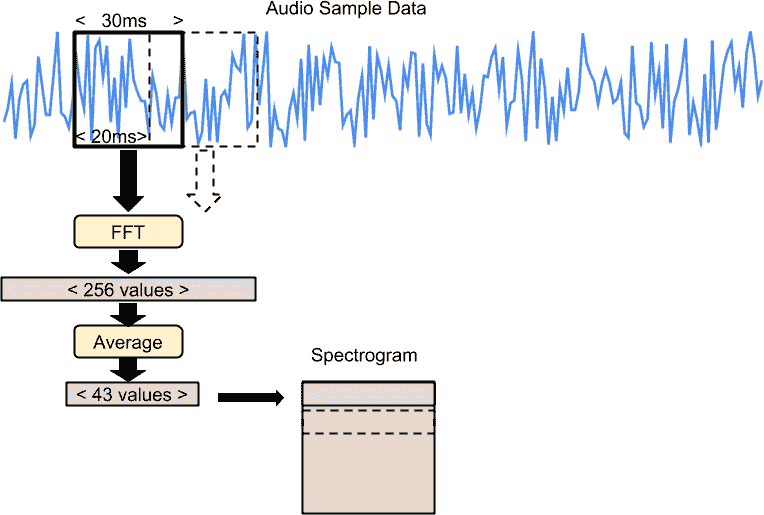

以前に実行されていないか、1 秒以上前に実行された場合は、最大数のスライスが生成される：

```
if (is_first_run_) {
  TfLiteStatus init_status = InitializeMicroFeatures(error_reporter);
  if (init_status != kTfLiteOk) {
    return init_status;
  }
  is_first_run_ = false;
  slices_needed = kFeatureSliceCount;
}
if (slices_needed > kFeatureSliceCount) {
  slices_needed = kFeatureSliceCount;
}
*how_many_new_slices = slices_needed;
```

結果の数値は`how_many_new_slices` に書き込まれる。

次に、既存のスライスをいくつ残すべきかを計算し、新しいスライスのために配列内のデータを移動させる：

```
const int slices_to_keep = kFeatureSliceCount - slices_needed;
const int slices_to_drop = kFeatureSliceCount - slices_to_keep;
// If we can avoid recalculating some slices, just move the existing data
// up in the spectrogram, to perform something like this:
// last time = 80ms          current time = 120ms
// +-----------+             +-----------+
// | data@20ms |         --> | data@60ms |
// +-----------+       --    +-----------+
// | data@40ms |     --  --> | data@80ms |
// +-----------+   --  --    +-----------+
// | data@60ms | --  --      |  <empty>  |
// +-----------+   --        +-----------+
// | data@80ms | --          |  <empty>  |
// +-----------+             +-----------+
if (slices_to_keep > 0) {
  for (int dest_slice = 0; dest_slice < slices_to_keep; ++dest_slice) {
    uint8_t* dest_slice_data =
        feature_data_ + (dest_slice * kFeatureSliceSize);
    const int src_slice = dest_slice + slices_to_drop;
    const uint8_t* src_slice_data =
        feature_data_ + (src_slice * kFeatureSliceSize);
    for (int i = 0; i < kFeatureSliceSize; ++i) {
      dest_slice_data[i] = src_slice_data[i];
    }
  }
}
```

### 注
経験豊富なC++作者なら、データのコピーなどに標準ライブラリを使わない理由を不思議に思うかもしれない。その理由は、バイナリ・サイズを小さく保つために、不必要な依存関係を避けようとしているからだ。組み込みプラットフォームはメモリが非常に少ないため、アプリケーションのバイナリを小さくすることは、より大きく、より正確なDeep Learningモデルのためのスペースを確保することを意味する。

データを移動させた後、必要な新しいスライスごとに1 回反復するループを開始する。このループでは、まず、`GetAudioSamples()` を使って、オーディオ・プロバイダにそのスライスのオーディオをリクエストする：

```
for (int new_slice = slices_to_keep; new_slice < kFeatureSliceCount;
     ++new_slice) {
  const int new_step = (current_step - kFeatureSliceCount + 1) + new_slice;
  const int32_t slice_start_ms = (new_step * kFeatureSliceStrideMs);
  int16_t* audio_samples = nullptr;
  int audio_samples_size = 0;
  GetAudioSamples(error_reporter, slice_start_ms, kFeatureSliceDurationMs,
                  &audio_samples_size, &audio_samples);
  if (audio_samples_size < kMaxAudioSampleSize) {
    error_reporter->Report("Audio data size %d too small, want %d",
                           audio_samples_size, kMaxAudioSampleSize);
    return kTfLiteError;
  }
```

ループの反復を完了するために、そのデータを`GenerateMicroFeatures()` に渡す。これは`micro_features/micro_features_generator.h` で定義されている。これはFFTを実行し、オーディオ周波数情報を返す関数である。

また、新しいデータが書き込まれるべきメモリー位置を指すポインター、`new_slice_data` も渡す：

```
  uint8_t* new_slice_data = feature_data_ + (new_slice * kFeatureSliceSize);
  size_t num_samples_read;
  TfLiteStatus generate_status = GenerateMicroFeatures(
      error_reporter, audio_samples, audio_samples_size, kFeatureSliceSize,
      new_slice_data, &num_samples_read);
  if (generate_status != kTfLiteOk) {
    return generate_status;
  }
}
```

各スライスについてこの処理が終わると、1 秒分の最新のスペクトログラムができあがる。

### チップ
FFTを生成する関数は`GenerateMicroFeatures()` 。興味があれば、[`micro_features/micro_features_generator.cc`で](https://oreil.ly/L0juB)定義を読むことができる。

スペクトログラムを使う独自のアプリケーションを作る場合は、このコードをそのまま再利用できる。モデルをトレーニングする際には、同じコードを使ってデータをスペクトログラムに前処理する必要がある。

スペクトログラムができたら、モデルを使って推論を行うことができる。この後、結果を解釈する必要がある。このタスクは、次に説明するクラス、`RecognizeCommands` に属する。

## コマンド・レコグナイザー
モデルが、音声の最後の1 秒間に既知の単語が話されている確率のセットを出力した後、これが検出の成功を示しているかどうかを判断するのは、`RecognizeCommands` クラスの仕事である。

あるカテゴリの確率がある閾値以上であれば、その単語が話されたことになる、という単純なことのように思える。しかし、現実の世界では、物事はもう少し複雑になる。


正如前面所解释的那样，我们每秒执行多次推理，每个推理针对一个 1 秒的数据窗口。也就是说，对于任意一个单词，都会在多个窗口中多次执行推理。

图 7-5 中，“note ”这个单词被说出的波形被捕获 1 秒窗口的框所包围。

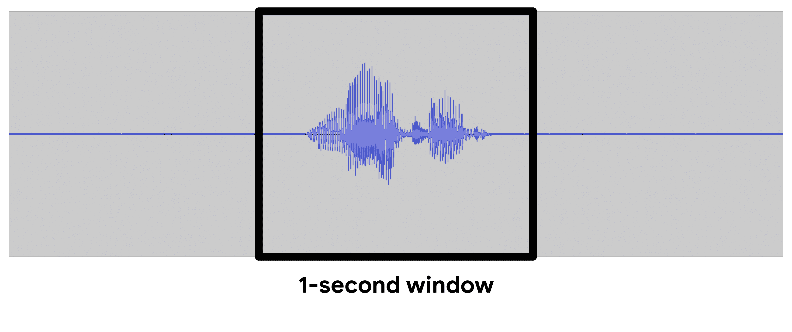

我们的模型被训练用来检测“no ”这个单词，并且理解“noted ”这个单词不是同一个词。对这个 1 秒窗口执行推理时，（如果顺利）“no ”这个单词会以低概率输出。然而，如果像图 7-6 那样，这个窗口位于语音流稍早的位置会怎样？

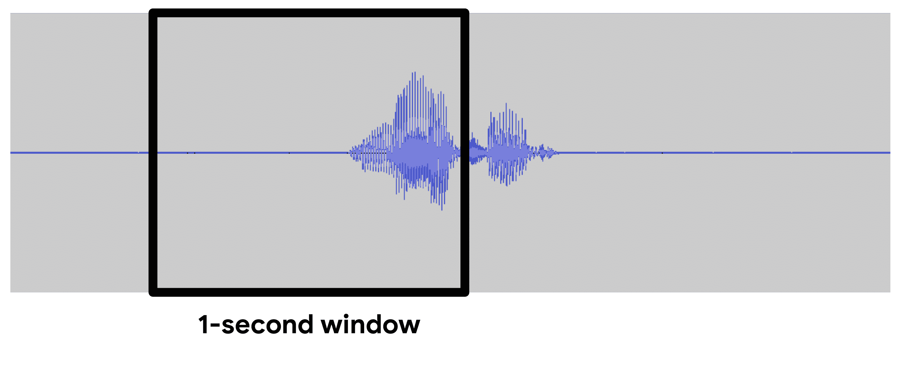

在这种情况下，只有“noted ”这个单词的第一个音节出现在窗口内。“noted ”的第一个音节听起来像“no ”，因此模型很可能会将其解释为“no ”的概率很高。

这个问题，连同其他问题一起，意味着不能仅依赖一次推理来判断某个单词是否被说出。因此有了`RecognizeCommands`！

识别器计算过去几次推理中每个单词的平均分数，并判断它是否足够高以计为检测。为此，需要输入每次推理的结果。

其接口在[`recognize_commands.h`中](https://oreil.ly/5W3Ea)：

```
class RecognizeCommands {
 public:
  explicit RecognizeCommands(tflite::ErrorReporter* error_reporter,
                             int32_t average_window_duration_ms = 1000,
                             uint8_t detection_threshold = 200,
                             int32_t suppression_ms = 1500,
                             int32_t minimum_count = 3);

  // Call this with the results of running a model on sample data.
  TfLiteStatus ProcessLatestResults(const TfLiteTensor* latest_results,
                                    const int32_t current_time_ms,
                                    const char** found_command, uint8_t* score,
                                    bool* is_new_command);
```

类`RecognizeCommands` 定义了一个带有一些默认值定义的构造函数：

*   平均化窗口长度 (`average_window_duration_ms`)
*   计为检测的平均分数最小值 (`detection_threshold`)
*   从听到命令到识别第二个命令的等待时间 (`suppression_ms`)
*   窗口内所需的最小推理次数以计入结果(`3`)

这个类有一个`ProcessLatestResults()` 方法。这个方法必须传递一个包含模型输出的`TfLiteTensor` 指针（`latest_results`），并与当前时间（`current_time_ms`）一起调用。

此外，它接受三个用于输出的指针。首先，输出检测到的单词名称(`found_command`)。此外，还输出该命令的平均分数 (`score`)，以及该命令是新的还是在一定时间内已在过去的推理中听到过 (`is_new_command`)。

将多个推理的结果平均化是处理时间序列数据时方便且常见的技术。在接下来的几页中，让我们查看[`recognize_commands.cc`的代码](https://oreil.ly/lAh-0)，了解一下它是如何工作的。不需要理解每一行，但这有助于理解它可能成为你项目中有用的工具。

首先，确认输入张量的形状和类型是否正确：

```
TfLiteStatus RecognizeCommands::ProcessLatestResults(
    const TfLiteTensor* latest_results, const int32_t current_time_ms,
    const char** found_command, uint8_t* score, bool* is_new_command) {
  if ((latest_results->dims->size != 2) ||
      (latest_results->dims->data[0] != 1) ||
      (latest_results->dims->data[1] != kCategoryCount)) {
    error_reporter_->Report(
        "The results for recognition should contain %d elements, but there are "
        "%d in an %d-dimensional shape",
        kCategoryCount, latest_results->dims->data[1],
        latest_results->dims->size);
    return kTfLiteError;
  }

  if (latest_results->type != kTfLiteUInt8) {
    error_reporter_->Report(
        "The results for recognition should be uint8 elements, but are %d",
        latest_results->type);
    return kTfLiteError;
  }
```

接下来，检查`current_time_ms`，并确认它在平均化窗口的最新结果之后：

```
if ((!previous_results_.empty()) &&
    (current_time_ms < previous_results_.front().time_)) {
  error_reporter_->Report(
      "Results must be fed in increasing time order, but received a "
      "timestamp of %d that was earlier than the previous one of %d",
      current_time_ms, previous_results_.front().time_);
  return kTfLiteError;
}
```

然后，将最新结果添加到用于平均化的列表中：

```
// Add the latest results to the head of the queue.
previous_results_.push_back({current_time_ms, latest_results->data.uint8});
// Prune any earlier results that are too old for the averaging window.
const int64_t time_limit = current_time_ms - average_window_duration_ms_;
while ((!previous_results_.empty()) &&
       previous_results_.front().time_ < time_limit) {
  previous_results_.pop_front();
```

如果平均化窗口内的结果少于最小数量（默认由`minimum_count_`定义为`3`），则无法提供有效平均。在这种情况下，设置输出指针以指示`found_command`为最新的顶级命令，分数为 0，命令不是新的：

```
// If there are too few results, assume the result will be unreliable and
// bail.
const int64_t how_many_results = previous_results_.size();
const int64_t earliest_time = previous_results_.front().time_;
const int64_t samples_duration = current_time_ms - earliest_time;
if ((how_many_results < minimum_count_) ||
    (samples_duration < (average_window_duration_ms_ / 4))) {
  *found_command = previous_top_label_;
  *score = 0;
  *is_new_command = false;
  return kTfLiteOk;
}
```

否则，对窗口内的所有分数进行平均：

```
// Calculate the average score across all the results in the window.
int32_t average_scores[kCategoryCount];
for (int offset = 0; offset < previous_results_.size(); ++offset) {
  PreviousResultsQueue::Result previous_result =
      previous_results_.from_front(offset);
  const uint8_t* scores = previous_result.scores_;
  for (int i = 0; i < kCategoryCount; ++i) {
    if (offset == 0) {
      average_scores[i] = scores[i];
    } else {
      average_scores[i] += scores[i];
    }
  }
}
for (int i = 0; i < kCategoryCount; ++i) {
  average_scores[i] /= how_many_results;
}
```

现在，我们已经有了足够的信息来确定哪个类别是赢家。确定这一点是一个简单的过程：

```
// Find the current highest scoring category.
int current_top_index = 0;
int32_t current_top_score = 0;
for (int i = 0; i < kCategoryCount; ++i) {
  if (average_scores[i] > current_top_score) {
    current_top_score = average_scores[i];
    current_top_index = i;
  }
}
const char* current_top_label = kCategoryLabels[current_top_index];
```

逻辑的最后一部分是判断该结果是否是有 检测。为此，确认其分数高于检测阈值（默认为 200），并且没有在最后一次有效检测后过早发生：

```
// If we've recently had another label trigger, assume one that occurs too
// soon afterwards is a bad result.
int64_t time_since_last_top;
if ((previous_top_label_ == kCategoryLabels[0]) ||
    (previous_top_label_time_ == std::numeric_limits<int32_t>::min())) {
  time_since_last_top = std::numeric_limits<int32_t>::max();
} else {
  time_since_last_top = current_time_ms - previous_top_label_time_;
}
if ((current_top_score > detection_threshold_) &&
    ((current_top_label != previous_top_label_) ||
     (time_since_last_top > suppression_ms_))) {
  previous_top_label_ = current_top_label;
  previous_top_label_time_ = current_time_ms;
  *is_new_command = true;
} else {
  *is_new_command = false;
}
*found_command = current_top_label;
*score = current_top_score;
```

如果结果有效，则将`is_new_command`设置为`true`。这是调用方可以用来判断单词是否真正被检测到的。

([`recognize_commands_test.cc`中](https://oreil.ly/rOkMb)的)测试运行平均化窗口中保存的输入和结果的各种不同组合。

让我们来看一个展示`RecognizeCommands`如何使用的测试之一，`RecognizeCommandsTestBasic`。首先，创建类的实例：

```
TF_LITE_MICRO_TEST(RecognizeCommandsTestBasic) {
  tflite::MicroErrorReporter micro_error_reporter;
  tflite::ErrorReporter* error_reporter = &micro_error_reporter;

  RecognizeCommands recognize_commands(error_reporter);
```

接下来，创建一个包含伪推理结果的张量。这用于`ProcessLatestResults()`，以判断命令是否被听到：

```
TfLiteTensor results = tflite::testing::CreateQuantizedTensor(
    {255, 0, 0, 0}, tflite::testing::IntArrayFromInitializer({2, 1, 4}),
    "input_tensor", 0.0f, 128.0f);
```

接下来，设置一些由`ProcessLatestResults()`输出设置的变量：

```
const char* found_command;
uint8_t score;
bool is_new_command;
```

最后，指定这些变量的指针和包含结果的张量，调用`ProcessLatestResults()`。确保函数返回`kTfLiteOk`以表示输入已成功处理：

```
TF_LITE_MICRO_EXPECT_EQ(
    kTfLiteOk, recognize_commands.ProcessLatestResults(
                   &results, 0, &found_command, &score, &is_new_command));
```

文件中的其他测试进行更彻底的检查，以确保函数正常工作。详情请阅读这些测试。

要运行所有测试，请使用以下命令：

```
make -f tensorflow/lite/micro/tools/make/Makefile \
  test_recognize_commands_test
```

判断命令是否被检测到后，就该立即将结果与世界（或至少是板载 LED）共享了。实现这一点的就是命令响应器。

## 命令响应器


拼图的最后一块——命令响应器会生成通知单词已被检测到的输出。

命令响应器被设计为可以按设备类型进行覆盖。有关设备特定的实现，本章后半部分会进行说明。

先来看看一个非常简单的参考实现，它只是将检测结果作为文本记录到日志中。可以在 [`command_responder.cc`](https://oreil.ly/kMjg2) 中找到：

```
void RespondToCommand(tflite::ErrorReporter* error_reporter,
                      int32_t current_time, const char* found_command,
                      uint8_t score, bool is_new_command) {
  if (is_new_command) {
    error_reporter->Report("Heard %s (%d) @%dms", found_command, score,
                           current_time);
  }
}
```

就这么多！该文件实现的函数只有一个，即 `RespondToCommand()`。其参数包括 `error_reporter`、当前时间（`current_time`）、最后检测到的命令（`found_command`）、该命令获得的分数（`score`），以及该命令是否新出现（`is_new_command`）。

在此程序的主循环中，需要注意的是，即使未检测到命令，每次执行推理时都会调用此函数。也就是说，需要检查 `is_new_command` 来判断是否需要做些什么。

位于 [`command_responder_test.cc`](https://oreil.ly/loLZo) 的该函数测试同样简单。由于无法测试是否生成了正确的输出，因此只是调用该函数：

```
TF_LITE_MICRO_TEST(TestCallability) {
  tflite::MicroErrorReporter micro_error_reporter;
  tflite::ErrorReporter* error_reporter = &micro_error_reporter;

  // This will have external side-effects (like printing to the debug console
  // or lighting an LED) that are hard to observe, so the most we can do is
  // make sure the call doesn't crash.
  RespondToCommand(error_reporter, 0, "foo", 0, true);
}
```

要运行此测试，请在终端中输入以下内容：

```
make -f tensorflow/lite/micro/tools/make/Makefile \
  test_command_responder_test
```

就到这里！我们已经看到了应用程序的所有组成部分。现在让我们看看它们在编程中是如何组合起来的。

# 倾听唤醒词

下面的代码可以在 [`main_functions.cc`](https://oreil.ly/n2eD1) 中找到。它定义了本次编程的核心 `setup()` 和 `loop()` 函数。让我们一起阅读！

你已经是 TensorFlow Lite 的熟练使用者了，所以这段代码的许多部分看起来应该很熟悉。那么让我们聚焦于新内容。

首先，列出想要使用的操作：

```
namespace tflite {
namespace ops {
namespace micro {
TfLiteRegistration* Register_DEPTHWISE_CONV_2D();
TfLiteRegistration* Register_FULLY_CONNECTED();
TfLiteRegistration* Register_SOFTMAX();
}  // namespace micro
}  // namespace ops
}  // namespace tflite
```

接下来，设置全局变量：

```
namespace {
tflite::ErrorReporter* error_reporter = nullptr;
const tflite::Model* model = nullptr;
tflite::MicroInterpreter* interpreter = nullptr;
TfLiteTensor* model_input = nullptr;
FeatureProvider* feature_provider = nullptr;
RecognizeCommands* recognizer = nullptr;
int32_t previous_time = 0;

// Create an area of memory to use for input, output, and intermediate arrays.
// The size of this will depend on the model you're using, and may need to be
// determined by experimentation.
constexpr int kTensorArenaSize = 10 * 1024;
uint8_t tensor_arena[kTensorArenaSize];
}  // namespace
```

除了通常的 TensorFlow 嫌疑对象外，请注意还声明了 `FeatureProvider` 和 `RecognizeCommands`。此外，还声明了名为 `g_previous_time` 的变量。它记录了最近接收到新音频样本的时间。

接下来，在 `setup()` 函数中，加载模型、设置解释器、添加操作并分配张量：

```
void setup() {
  // Set up logging.
  static tflite::MicroErrorReporter micro_error_reporter;
  error_reporter = &micro_error_reporter;

  // Map the model into a usable data structure. This doesn't involve any
  // copying or parsing, it's a very lightweight operation.
  model = tflite::GetModel(g_tiny_conv_micro_features_model_data);
  if (model->version() != TFLITE_SCHEMA_VERSION) {
    error_reporter->Report(
        "Model provided is schema version %d not equal "
        "to supported version %d.",
        model->version(), TFLITE_SCHEMA_VERSION);
    return;
  }

  // Pull in only the operation implementations we need.
  static tflite::MicroMutableOpResolver micro_mutable_op_resolver;
  micro_mutable_op_resolver.AddBuiltin(
      tflite::BuiltinOperator_DEPTHWISE_CONV_2D,
      tflite::ops::micro::Register_DEPTHWISE_CONV_2D());
  micro_mutable_op_resolver.AddBuiltin(
      tflite::BuiltinOperator_FULLY_CONNECTED,
      tflite::ops::micro::Register_FULLY_CONNECTED());
  micro_mutable_op_resolver.AddBuiltin(tflite::BuiltinOperator_SOFTMAX,
                                       tflite::ops::micro::Register_SOFTMAX());

  // Build an interpreter to run the model with.
  static tflite::MicroInterpreter static_interpreter(
      model, micro_mutable_op_resolver, tensor_arena, kTensorArenaSize,
      error_reporter);
  interpreter = &static_interpreter;

  // Allocate memory from the tensor_arena for the model's tensors.
  TfLiteStatus allocate_status = interpreter->AllocateTensors();
  if (allocate_status != kTfLiteOk) {
    error_reporter->Report("AllocateTensors() failed");
    return;
  }
```

在分配张量之后，检查输入张量的形状和类型是否正确：

```
  // Get information about the memory area to use for the model's input.
  model_input = interpreter->input(0);
  if ((model_input->dims->size != 4) || (model_input->dims->data[0] != 1) ||
      (model_input->dims->data[1] != kFeatureSliceCount) ||
      (model_input->dims->data[2] != kFeatureSliceSize) ||
      (model_input->type != kTfLiteUInt8)) {
    error_reporter->Report("Bad input tensor parameters in model");
    return;
  }
```

接下来有趣的事情开始了。首先实例化 `FeatureProvider`，并将其指向输入张量：

```
  // Prepare to access the audio spectrograms from a microphone or other source
  // that will provide the inputs to the neural network.
  static FeatureProvider static_feature_provider(kFeatureElementCount,
                                                 model_input->data.uint8);
  feature_provider = &static_feature_provider;
```

接下来，创建 `RecognizeCommands` 实例并初始化 `previous_time` 变量：

```
  static RecognizeCommands static_recognizer(error_reporter);
  recognizer = &static_recognizer;

  previous_time = 0;
}
```

接下来是 `loop()` 函数。与之前的示例一样，此函数会被无限次反复调用。在循环中，首先使用特征提供程序创建频谱图：

```
void loop() {
  // Fetch the spectrogram for the current time.
  const int32_t current_time = LatestAudioTimestamp();
  int how_many_new_slices = 0;
  TfLiteStatus feature_status = feature_provider->PopulateFeatureData(
      error_reporter, previous_time, current_time, &how_many_new_slices);
  if (feature_status != kTfLiteOk) {
    error_reporter->Report("Feature generation failed");
    return;
  }
  previous_time = current_time;
  // If no new audio samples have been received since last time, don't bother
  // running the network model.
  if (how_many_new_slices == 0) {
    return;
  }
```

如果从上一次迭代以来没有新数据，则无需执行推理。

输入准备好后，只需调用解释器即可：

```
  // Run the model on the spectrogram input and make sure it succeeds.
  TfLiteStatus invoke_status = interpreter->Invoke();
  if (invoke_status != kTfLiteOk) {
    error_reporter->Report("Invoke failed");
    return;
  }
```

模型的输出张量被每个类别的概率填充。为了解释它，使用 `RecognizeCommands` 实例。获取指向输出张量的指针，并设置一些变量以接收 `ProcessLatestResults()` 的输出：

```
  // Obtain a pointer to the output tensor
  TfLiteTensor* output = interpreter->output(0);
  // Determine whether a command was recognized based on the output of inference
  const char* found_command = nullptr;
  uint8_t score = 0;
  bool is_new_command = false;
  TfLiteStatus process_status = recognizer->ProcessLatestResults(
      output, current_time, &found_command, &score, &is_new_command);
  if (process_status != kTfLiteOk) {
    error_reporter->Report("RecognizeCommands::ProcessLatestResults() failed");
    return;
  }
```

最后，为了在检测到单词时通知用户，调用命令响应器的 `RespondToCommand()` 方法：

```
  // Do something based on the recognized command. The default implementation
  // just prints to the error console, but you should replace this with your
  // own function for a real application.
  RespondToCommand(error_reporter, current_time, found_command, score,
                   is_new_command);
}
```

就到这里了！对 `RespondToCommand()` 的调用是循环的最后一步。从特征生成开始的所有处理将不断重复检查音频中是否包含已知单词，并在确认单词后发出某种输出。

`setup()` 和 `loop()` 函数由在 `main.cc` 中定义的 `main()` 函数调用。该函数在应用程序启动时开始循环：


```
int main(int argc, char* argv[]) {
  setup();
  while (true) {
    loop();
  }
}
```

# 运行应用程序

这个示例包含与 macOS 兼容的音频提供程序。如果您能访问 Mac，则可以在开发机器上运行示例。首先，使用以下命令进行构建：

```
make -f tensorflow/lite/micro/tools/make/Makefile micro_speech
```

构建完成后，可以使用以下命令运行示例：

```
tensorflow/lite/micro/tools/make/gen/osx_x86_64/bin/micro_speech
```

可能会出现请求麦克风访问权限的弹出窗口。如果允许，程序将开始。

请说“是”和“否”。应该会看到如下输出：

```
Heard yes (201) @4056ms
Heard no (205) @6448ms
Heard unknown (201) @13696ms
Heard yes (205) @15000ms
Heard yes (205) @16856ms
Heard unknown (204) @18704ms
Heard no (206) @21000ms
```

检测到的每个单词后面显示的数字是分数。默认情况下，命令识别组件仅在分数高于 200 时才认为匹配有效，因此显示的分数都将高于 200。

分数后面的数字是程序启动以来的毫秒数。

如果没有显示输出，请确认在 Mac 的声音菜单中已选择内置麦克风，并且其输入音量已足够提高。

我们已经知道该程序可以在 Mac 上运行。现在让我们在嵌入式硬件上运行它。

# 部署到微控制器

本节将代码部署到三种不同的设备：

* [Arduino Nano 33 BLE Sense](https://oreil.ly/ztU5E)
* [SparkFun Edge](https://oreil.ly/-hoL-)
* [ST 麦克电子 STM32F746G Discovery 套件](https://oreil.ly/cvm4J)

将分别介绍每个设备的构建和部署流程。

由于每个设备都有自己的音频捕获机制，因此 `audio_provider.cc` 的实现各不相同。输出也是如此，每个设备都有 `command_responder.cc` 的变体。

`audio_provider.cc` 的实现复杂且特定于设备，与机器学习没有直接关系。因此，本章不予说明。但是，附录 B 中 有 Arduino 实现的逐步讲解。如果您需要在自己的项目中捕获音频，欢迎在自己的代码中重用这些实现。

在部署步骤的同时，我们还将介绍每个设备的 `command_responder.cc` 实现。首先是 Arduino。

## Arduino

在撰写本文时，内置麦克风的 Arduino 板只有 [Arduino Nano 33 BLE Sense](https://oreil.ly/hjOzL)，因此本节将使用它。如果使用其他 Arduino 板并自行安装麦克风，则需要实现自己的 `audio_provider.cc`。

Arduino Nano 33 BLE Sense 还内置了 LED，用于指示单词已被识别。

图 7-7 是 强调了 LED 的电路板照片。

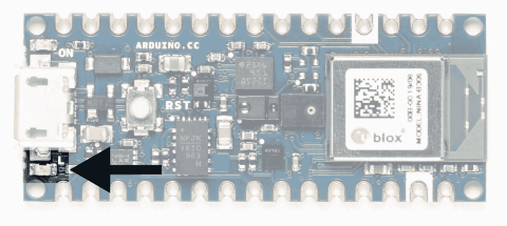

那么，让我们看看如何使用此 LED 来指示检测到单词。

### Arduino 对命令的响应

所有 Arduino 板都内置了 LED，并且有一个方便的常量 `LED_BUILTIN`，因此可以使用它来获取引脚号。引脚号因板而异。为了保持代码的可移植性，我们将输出使用的 LED 限制为一个。

我们要做的是这样：为了表明推理正在执行，每次推理时都让 LED 闪烁。但是，如果听到“是”这个词，则让 LED 亮起几秒钟。

“否”这个词呢？好吧，这只是一个演示，所以我们就不太在意了。但是，所有检测到的命令都会记录到串行端口，因此您可以连接设备并检查所有匹配项。

用于 Arduino 的替代命令响应器位于 [`arduino/command_responder.cc` 中](https://oreil.ly/URkYi)。让我们看看它的源代码。首先，包含命令响应器的头文件和 Arduino 平台库的头文件：

```
#include "tensorflow/lite/micro/examples/micro_speech/command_responder.h"
#include "Arduino.h"
```

接下来，开始函数的实现：

```
// Toggles the LED every inference, and keeps it on for 3 seconds if a "yes"
// was heard
void RespondToCommand(tflite::ErrorReporter* error_reporter,
                      int32_t current_time, const char* found_command,
                      uint8_t score, bool is_new_command) {
```

下一步是将内置 LED 的引脚设置为输出模式，以便可以打开和关闭它。这是在仅执行一次的 `if` 语句中完成的，这要归功于名为 `is_initialized` 的 `static bool`。`static` 变量在函数调用之间保持其状态：

```
static bool is_initialized = false;
if (!is_initialized) {
  pinMode(LED_BUILTIN, OUTPUT);
  is_initialized = true;
}
```

接下来，设置一些 `static` 变量，以便记录最后检测到“YES”的时间以及执行的推理次数：

```
static int32_t last_yes_time = 0;
static int count = 0;
```

有趣的部分从这里开始。如果参数 `is_new_command` 为 `true`，我们就知道听到了什么，因此使用 `ErrorReporter` 实例记录日志。但是，如果听到的内容是“是”，则通过检查 `found_command` 字符数组的第一个字符来判断，并保存当前时间并点亮 LED：

```
if (is_new_command) {
  error_reporter->Report("Heard %s (%d) @%dms", found_command, score,
                         current_time);
  // If we heard a "yes", switch on an LED and store the time.
  if (found_command[0] == 'y') {
    last_yes_time = current_time;
    digitalWrite(LED_BUILTIN, HIGH);
  }
}
```

接下来，实现在恰好 3 秒后关闭 LED 的行为：

```
// If last_yes_time is non-zero but was >3 seconds ago, zero it
// and switch off the LED.
if (last_yes_time != 0) {
  if (last_yes_time < (current_time - 3000)) {
    last_yes_time = 0;
    digitalWrite(LED_BUILTIN, LOW);
  }
  // If it is non-zero but <3 seconds ago, do nothing.
  return;
}
```

当 LED 关闭时，将 `last_yet_time` 设置为 `0`，并在下一次听到“yes”之前不进入此 `if` 语句。`return`。此导入语句很重要。它可确保如果听到“是”，后续的输出代码不会执行，LED 会保持亮起。

到目前为止的实现中，如果听到“yes”的声音，LED 会亮起约 3 秒钟。下一部分将切换 LED 在每次推理时的亮灭。但是，在“是”模式期间，如前所述的 `return`。

这是最后一块代码：

```
// Otherwise, toggle the LED every time an inference is performed.
++count;
if (count & 1) {
  digitalWrite(LED_BUILTIN, HIGH);
} else {
  digitalWrite(LED_BUILTIN, LOW);
}
```

通过在每次推理时递增 `count` 变量，我们记录执行的推理总数。在 `if` 条件内部，使用 `&` 运算符对 `count` 变量和数字 `1` 执行二进制 AND 运算。

通过对 `count` 和 `1` 执行 AND 操作，我们过滤掉 `count` 的所有位，除了最低位。如果最低位为 `0`，即 `count` 为奇数，则结果为 `0`。在 C++ 的 `if statement` 中，这被评估为 `false`。

否则，结果为 `1`，表示偶数。`1` 被评估为 `true`，因此 LED 在偶数时点亮，在奇数时熄灭。这就是切换的原因。

完成了！我们已经实现了 Arduino 的命令响应器。让我们实际运行它。

### 运行示例

部署此示例所需的物品如下：

* Arduino Nano 33 BLE Sense 板
* Micro USB 电缆
* Arduino IDE

#### 提示

由于自本书撰写以来构建步骤可能已更改，请检查 [`README.md` 中](https://oreil.ly/7VozJ) 最新步骤。

本书的项目可作为 TensorFlow Lite Arduino 库的示例代码使用。如果尚未安装库，请打开 Arduino IDE，从 Tools 菜单中选择 Manage Libraries。在出现的窗口中，搜索名为 `Arduino_TensorFlowLite` 的库并安装它。应该可以使用最新版本，但如果出现问题，本书中测试的版本为 1.14-ALPHA。

#### 注

该库可以从 TensorFlow Lite 团队 [下载](https://oreil.ly/blgB8) 或使用 TensorFlow Lite for Microcontrollers Makefile 自行生成。如果您希望使用后者，请参阅 附录 A。

安装库后，如 图 7-8 所示，`micro_speech` 示例将显示在 File 菜单的 Examples → `Arduino_TensorFlowLite` 中。

点击 `micro_speech` 加载示例。会出现一个新窗口，显示每个源文件的标签。第一个标签中的文件 `micro_speech` 等同于前面描述的 `main_functions.cc`。

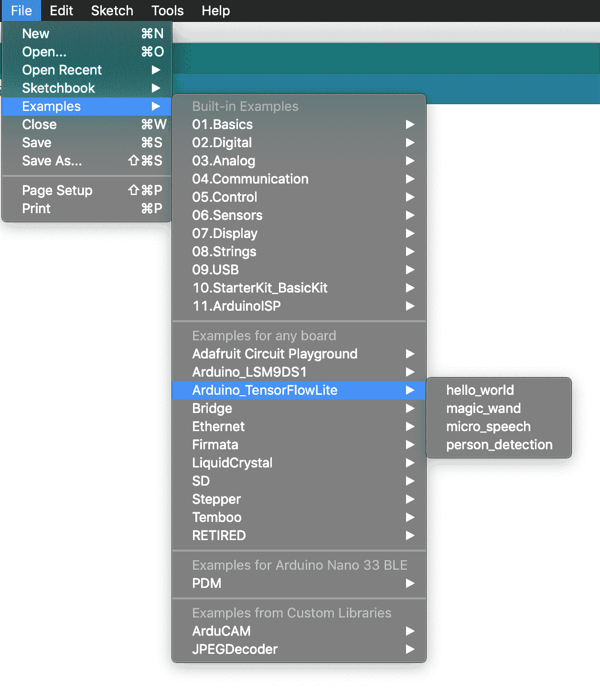

#### 注

由于我们在 “运行示例”中 已经解释了 Arduino 示例的结构，这里不再重复说明。

要运行示例，请通过 USB 连接 Arduino 设备。确保在工具菜单的板下拉列表中选择了正确的设备类型，如 图 7-9 中所示。

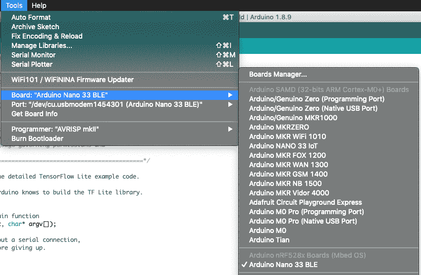

如果设备名称未显示在列表中，则需要安装支持包。为此，请点击 Boards Manager。在出现的窗口中搜索设备并安装相应的支持包的最新版本。接下来，如 图 7-10 所示，请确保在 [Tools] 菜单的 [Port] 下拉列表中选择了设备的端口。

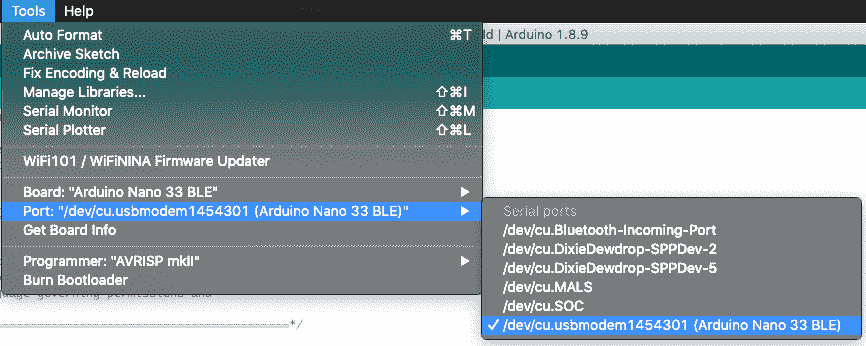

最后，在 Arduino 窗口中点击上传按钮（图 7-11 中 以白色突出显示），编译代码并上传到 Arduino 设备。


上传成功完成后，您应该会看到 Arduino 板的 LED 开始闪烁。

要测试程序，请说“是”。检测到“是”后，LED 将保持常亮约 3 秒钟。

#### 提示

如果程序无法识别您的“是”，请尝试连续说几次。

您也可以在 Arduino 的串行监视器中查看推理结果。为此，请从工具菜单打开串行监视器。在这里，说“yes”、“no”或其他单词。应该会看到类似 图 7-12 的 内容。

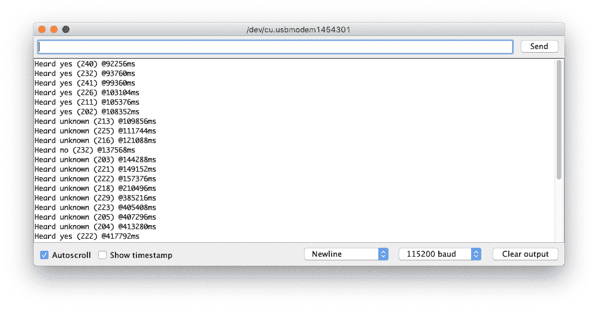

#### 注

您可能会注意到我们使用的模型很小也不完整，更擅长检测“是”而不是“否”。这是一个例子，说明优化小模型大小可能会导致准确性问题。本主题将在 第 8 章 中讨论。

### 自行修改

部署应用程序后，让我们尝试修改代码！您可以在 Arduino IDE 中编辑源文件。保存时，系统会提示您将示例重新保存到新位置。完成后，点击 Arduino IDE 的上传按钮进行构建和部署。

以下是一些可以尝试的想法：

* 将示例更改为在说“否”而不是“是”时点亮 LED。
* 使应用程序对“是”和“否”的特定序列做出反应，就像秘密代码短语一样。
* 使用“yes”和“no”命令控制其他组件，如额外的 LED 或舵机。

## SparkFun Edge

SparkFun Edge 配备了麦克风和四种颜色的 LED：红、蓝、绿、黄。图 7-13 中 显示了 LED 被强调的 SparkFun Edge。

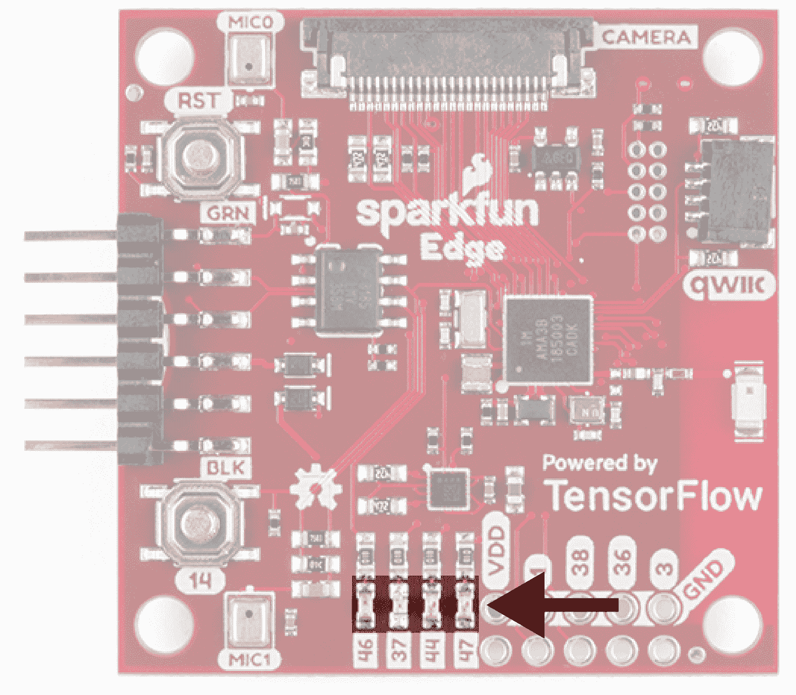

### SparkFun Edge 对命令的响应

为了明确程序正在运行，让我们切换蓝色 LED 在每次推理时的亮灭。如果听到“是”，则点亮黄色 LED；如果听到“否”，则点亮红色 LED；如果听到未知命令，则点亮绿色 LED。

SparkFun Edge 的命令响应器实现在 [`sparkfun_edge/command_responder.cc` 中](https://oreil.ly/i-3eJ)。该文件以一些包含开始：

```
#include "tensorflow/lite/micro/examples/micro_speech/command_responder.h"
#include "am_bsp.h"
```


`command_responder.h` 包含是对应此文件的头文件。`am_bsp.h` 是前章中看到的 Ambiq Apollo3 SDK。

在函数定义内部，最初要做的是将连接到 LED 的引脚作为输出进行设置：

// This implementation will light up the LEDs on the board in response to
// different commands.
void RespondToCommand(tflite::ErrorReporter* error_reporter,
                      int32_t current_time, const char* found_command,
                      uint8_t score, bool is_new_command) {
  static bool is_initialized = false;
  if (!is_initialized) {
    am_hal_gpio_pinconfig(AM_BSP_GPIO_LED_RED, g_AM_HAL_GPIO_OUTPUT_12);
    am_hal_gpio_pinconfig(AM_BSP_GPIO_LED_BLUE, g_AM_HAL_GPIO_OUTPUT_12);
    am_hal_gpio_pinconfig(AM_BSP_GPIO_LED_GREEN, g_AM_HAL_GPIO_OUTPUT_12);
    am_hal_gpio_pinconfig(AM_BSP_GPIO_LED_YELLOW, g_AM_HAL_GPIO_OUTPUT_12);
    is_initialized = true;
  }
```

调用 Apollo 3 SDK 的 `am_hal_gpio_pinconfig()` 函数，将由常量 `g_AM_HAL_GPIO_OUTPUT_12` 表示的全部四个 LED 引脚设置为输出模式。使用 `is_initialized` `static` 变量，使其仅执行一次！

接下来是切换蓝色 LED 开关的代码。与 Arduino 实现一样，使用 `count` 变量来实现：

```
static int count = 0;
// Toggle the blue LED every time an inference is performed.
++count;
if (count & 1) {
  am_hal_gpio_output_set(AM_BSP_GPIO_LED_BLUE);
} else {
  am_hal_gpio_output_clear(AM_BSP_GPIO_LED_BLUE);
}
```

此代码使用 `am_hal_gpio_output_set()`、`am_hal_gpio_output_clear()` 函数来切换蓝色 LED 引脚的开/关。

通过每次推理时递增 `count` 变量，来记录已执行的推理总数。在 `if` 条件内部，使用 `&` 运算符对 `count` 变量和数值 `1` 进行二进制 AND 运算。

通过执行 `count` 与 `1` 的 AND，将 `count` 的除最低位之外的所有位进行过滤。如果最低位为 `0`，即 `count` 为奇数，则结果为 `0`。在 C++ 的 `if statement` 中，这会被评估为 `false`。

否则，结果为 `1`，表示偶数。`1` 被评估为 `true`，因此 LED 在偶数时点亮，在奇数时熄灭。这就是切换的原因。

接下来，根据最近听到的单词点亮合适的 LED。默认情况下，所有 LED 都熄灭，因此如果最近没有听到某个单词，所有 LED 都会保持熄灭：

```
am_hal_gpio_output_clear(AM_BSP_GPIO_LED_RED);
am_hal_gpio_output_clear(AM_BSP_GPIO_LED_YELLOW);
am_hal_gpio_output_clear(AM_BSP_GPIO_LED_GREEN);
```

接下来，使用简单的 `if`，根据听到的哪个命令来点亮合适的 LED：

```
if (is_new_command) {
  error_reporter->Report("Heard %s (%d) @%dms", found_command, score,
                         current_time);
  if (found_command[0] == 'y') {
    am_hal_gpio_output_set(AM_BSP_GPIO_LED_YELLOW);
  }
  if (found_command[0] == 'n') {
    am_hal_gpio_output_set(AM_BSP_GPIO_LED_RED);
  }
  if (found_command[0] == 'u') {
    am_hal_gpio_output_set(AM_BSP_GPIO_LED_GREEN);
  }
}
```

如前所述，`is_new_command` 仅在 `RespondToCommand()` 因纯粹的新命令而被调用时为 `true`。因此，如果没有听到新命令，LED 将保持熄灭。否则，使用 `am_hal_gpio_output_set()` 函数点亮合适的 LED。

## 运行示例

到目前为止，已说明了示例代码如何点亮 SparkFun Edge 的 LED。接下来，让我们启动并运行此示例。

### 提示

由于自本书撰写以来构建步骤可能已发生变化，请检查最新的步骤，[`README.md`](https://oreil.ly/U3Cgo)。

要构建和部署代码，需要以下内容：

* SparkFun Edge 板
* USB 编程器（推荐使用 SparkFun 串行基本 breakout。）
* 兼容的 USB 电缆
* Python 3 及一些依赖项

### 注

在 第 6 章 中介绍了如何确认是否安装了正确版本的 Python。如果您已经这样做了，很好。如果没有，返回 “运行示例” 进行确认是值得的。

在终端克隆 TensorFlow 仓库并进入该目录：

```
git clone https://github.com/tensorflow/tensorflow.git
cd tensorflow
```

接下来，执行一些用于构建二进制文件并将其下载到设备的命令。为了节省输入时间，这些命令可以从 [`README.md`](https://oreil.ly/xY-Rj) 复制并粘贴。

### 构建二进制文件

以下命令将下载所有必要的依赖项并编译适用于 SparkFun Edge 的二进制文件：

```
make -f tensorflow/lite/micro/tools/make/Makefile \
  TARGET=sparkfun_edge TAGS=cmsis-nn micro_speech_bin
```

二进制文件将作为 `.bin` 文件创建在以下位置：

```
tensorflow/lite/micro/tools/make/gen/ \
  sparkfun_edge_cortex-m4/bin/micro_speech.bin
```

可以使用以下命令检查文件是否存在：

```
test -f tensorflow/lite/micro/tools/make/gen/ \
  sparkfun_edge_cortex-m4/bin/micro_speech.bin \
  &&  echo "Binary was successfully created" || echo "Binary is missing"
```

执行此命令后，控制台应显示 `Binary was successfully created`。如果显示 `Binary is missing`，则表示构建过程中出现问题。如果是这样，`make` 命令的输出中很可能包含问题的线索。

### 对二进制文件进行签名

要将二进制文件部署到设备，需要使用加密密钥对其进行签名。那么让我们执行一些命令来对二进制文件进行签名，以便可以将其刷新到 SparkFun Edge。这里使用的脚本是 Makefile 执行时下载的 Ambiq SDK 的脚本。

输入以下命令，设置可用于开发的虚拟加密密钥：

```
cp tensorflow/lite/micro/tools/make/downloads/AmbiqSuite-Rel2.0.0/ \
  tools/apollo3_scripts/keys_info0.py \
  tensorflow/lite/micro/tools/make/downloads/AmbiqSuite-Rel2.0.0/ \
  tools/apollo3_scripts/keys_info.py
```

接下来，执行以下命令创建签名二进制文件。如有必要，将 `python3` 替换为 `python`：

```
python3 tensorflow/lite/micro/tools/make/downloads/ \
  AmbiqSuite-Rel2.0.0/tools/apollo3_scripts/create_cust_image_blob.py \
  --bin tensorflow/lite/micro/tools/make/gen/ \
  sparkfun_edge_cortex-m4/bin/micro_speech.bin \
  --load-address 0xC000 \
  --magic-num 0xCB -o main_nonsecure_ota \
  --version 0x0
```

这样就创建了 `main_nonsecure_ota.bin` 文件。执行此命令以创建最终版本的可用文件，以便在下一步中使用脚本刷新设备：

```
python3 tensorflow/lite/micro/tools/make/downloads/ \
  AmbiqSuite-Rel2.0.0/tools/apollo3_scripts/create_cust_wireupdate_blob.py \
  --load-address 0x20000 \
  --bin main_nonsecure_ota.bin \
  -i 6 -o main_nonsecure_wire \
  --options 0x1
```

这样，执行命令的目录中应该会出现一个名为 `main_nonsecure_wire.bin` 的文件。这就是要刷新到设备的文件。

### 刷新二进制文件

SparkFun Edge 将当前正在运行的程序存储在 1 兆字节的闪存中。如果想让板子运行新程序，需要将该程序发送到板子上，板子会将其保存在闪存中并覆盖之前保存的程序。

#### 将编程器连接到板子

要将新程序下载到板子上，使用 SparkFun USB-C Serial Basic 串行编程器。此设备使计算机能够通过 USB 与微控制器通信。

要将此设备连接到板子，请执行以下步骤：

1. SparkFun Edge 侧面有一个 6 引脚的排针。
2. 将 SparkFun USB-C Serial Basic 插入这些引脚，确保每个设备上标有 BLK 和 GRN 的引脚如 图 7-14 所示正确对齐。

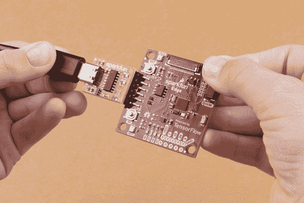

#### 将编程器连接到计算机

将板子通过 USB 连接到计算机。要对板子进行编程，需要发现计算机为设备分配的名称。最好的方法是列出连接板子前后计算机的所有设备，确认哪个设备是新的。

#### 警告

有人报告了操作系统默认驱动程序在编程器上存在问题，因此强烈建议在继续之前安装 [驱动程序](https://oreil.ly/kohTX)。

在通过 USB 连接设备之前，执行以下命令：

```
# macOS:
ls /dev/cu*

# Linux:
ls /dev/tty*
```

应该会输出类似以下列表：

```
/dev/cu.Bluetooth-Incoming-Port
/dev/cu.MALS
/dev/cu.SOC
```

将编程器连接到计算机的 USB 端口，然后再次执行命令：

```
# macOS:
ls /dev/cu*

# Linux:
ls /dev/tty*
```

输出中应该会像以下示例那样添加一个项目。新的项目可能有不同的名称。此新项目是设备的名称：

```
/dev/cu.Bluetooth-Incoming-Port
/dev/cu.MALS
/dev/cu.SOC
/dev/cu.wchusbserial-1450
```

此名称用于引用设备。但是，根据编程器连接的 USB 端口，此名称可能会发生变化，因此如果从计算机上拔下板子并重新连接，可能需要重新检查名称。

#### 提示

有些用户报告列表中会出现两个设备。如果显示两个设备，正确的是以 "wch" 开头的。

确认设备名称后，将其放入 shell 变量以便以后使用：

```
export DEVICENAME=<your device name here>
```

这是当以后执行需要设备名称的命令时使用的变量。

#### 运行脚本刷新板子

要刷新板子，需要将其置于专门的“引导加载程序”状态，以便准备接收新二进制文件。然后运行脚本将二进制文件发送到板子。

首先，创建一个指定波特率的环境变量。波特率是指向设备发送数据的速度：

```
export BAUD_RATE=921600
```

将以下命令粘贴到终端！命令中的 `${DEVICENAME}` 和 `${BAUD_RATE}` 将被替换为上一节中设置的值。必要时不要忘记将 `python3` 替换为 `python`：

```
python3 tensorflow/lite/micro/tools/make/downloads/ \
  AmbiqSuite-Rel2.0.0/tools/apollo3_scripts/uart_wired_update.py \
  -b ${BAUD_RATE} ${DEVICENAME} \
  -r 1 -f main_nonsecure_wire.bin \
  -i 6
```

接下来，将板子重置为引导加载程序状态并刷新板子。在板子上，找到标有 `RST` 和 `14` 的按钮，如 图 7-15 所示。执行以下步骤：

1. 确认板子已连接到编程器，并且整体通过 USB 连接到计算机。
2. 在板子上，按住标有 `14` 的按钮。继续按住。
3. 在按住标有 `14` 的按钮的同时，按下标有 `RST` 的按钮以重置板子。
4. 在计算机上按 Enter 键运行脚本。继续按住 `14` 按钮。

这样屏幕上应该会显示如下内容：


## 编程

```
Connecting with Corvette over serial port /dev/cu.usbserial-1440...
Sending Hello.
Received response for Hello
Received Status
length =  0x58
version =  0x3
Max Storage =  0x4ffa0
Status =  0x2
State =  0x7
AMInfo =
0x1
0xff2da3ff
0x55fff
0x1
0x49f40003
0xffffffff
[...lots more 0xffffffff...]
Sending OTA Descriptor =  0xfe000
Sending Update Command.
number of updates needed =  1
Sending block of size  0x158b0  from  0x0  to  0x158b0
Sending Data Packet of length  8180
Sending Data Packet of length  8180
[...lots more Sending Data Packet of length  8180...]
```

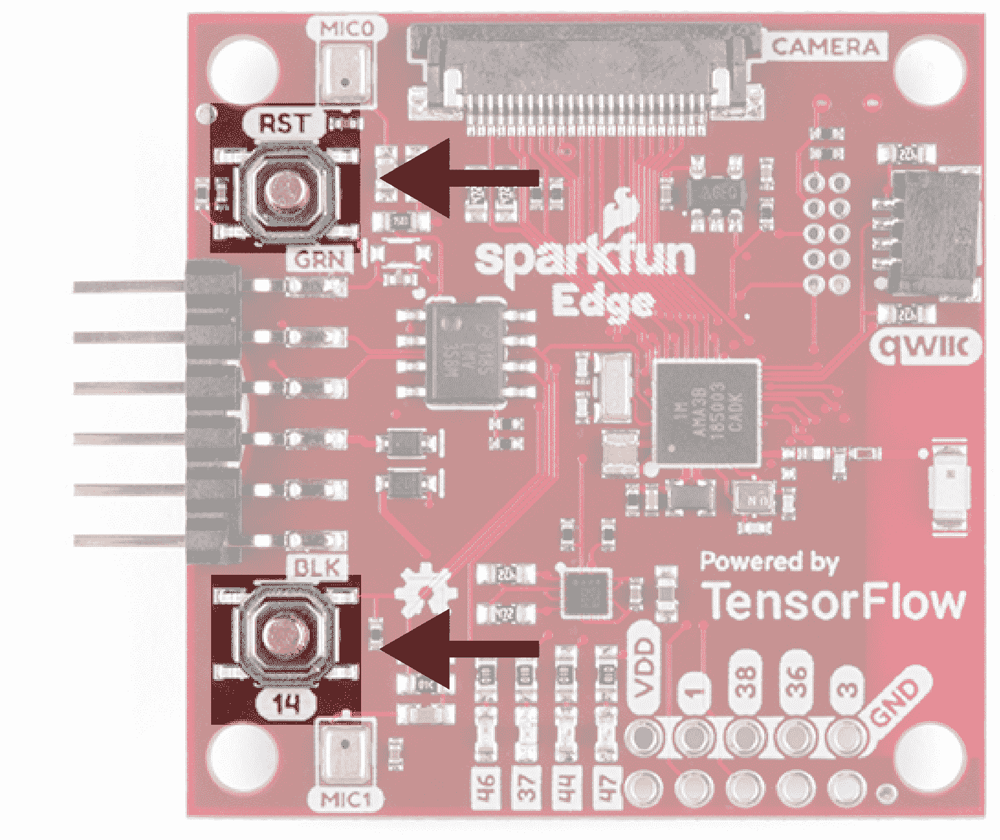

直到显示 `Sending Data Packet of length 8180` 为止，持续按下按钮 `14`。显示后可以松开按钮（不过继续按住也没关系）。编程会继续在终端输出行。最终，会显示如下内容：

```
[...lots more Sending Data Packet of length  8180...]
Sending Data Packet of length  8180
Sending Data Packet of length  6440
Sending Reset Command.
Done.
```

这表明闪烁成功。

### 小贴士

如果编程输出以错误结束，请检查是否打印了 `Sending Reset Command.`。如果打印了，则即使出现错误，闪烁很可能已成功。否则，可能闪烁失败。请再次执行此步骤（可以省略环境变量的设置）。

### 测试编程

要确认编程正在运行，请按下 `RST` 按钮。应该能看到蓝色 LED 在闪烁。

要测试编程，请说“是”。检测到“是”时，橙色 LED 会闪烁。该模型还被训练为识别说出“否”和未知单词时。红色 LED 会闪烁 "no"，绿色 LED 会闪烁 "unknown"。

如果编程无法识别你的“是”，请连续说几次：“是、是、是”。

我们使用的模型很小也不完整，你可能会注意到它更擅长检测 "ノー" 而不是 "イエス"，并且经常被识别为 "不明"。这是一个例子，说明将模型大小优化得过小可能会导致精度问题。将在第 8 章中讨论此主题。

### 查看调试数据

此编程还会记录到串行端口的成功识别。要查看此数据，只需使用波特率 115200 监视板子的串行端口输出即可。在 macOS 和 Linux 上，以下命令应该可以工作：

```
screen ${DEVICENAME} 115200
```

初始化后，应该会显示如下输出：

```
Apollo3 Burst Mode is Available

                               Apollo3 operating in Burst Mode (96MHz)
```

说 "yes "或 "no "，尝试发出一些命令。每个命令的调试信息应该会显示在板子上：

```
Heard yes (202) @65536ms
```

要停止使用 `screen` 显示调试输出，请按下 Ctrl-A 键后立即按 K 键，然后按 Y 键。

### 自行更改

现在基本应用程序已部署，可以试着玩玩并进行更改。应用程序代码可在 `tensorflow/lite/micro/examples/micro_speech` 文件夹中找到。编辑并保存，然后重复上述步骤将更改后的代码部署到设备。

* `RespondToCommand()` 的 `score` 参数显示预期分数。可以使用 LED 作为仪表来指示匹配强度。
* 使应用程序像秘密代码短语一样，对“是”和“否”的特定序列做出反应。
* 使用 `yes` 和 `no` 命令控制其他组件，如额外的 LED 或舵机。

## ST 微电子 STM32F746G Discovery 套件

STM32F746G 配有华丽的 LCD 显示屏，因此可以像图 7-16 所示那样使用它来显示检测到的唤醒词。

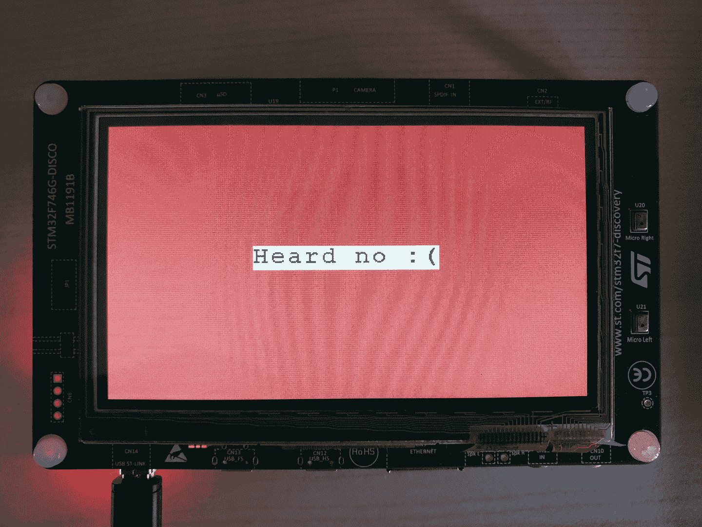

### 对 STM32F746G 命令做出响应

STM32F746G 的 LCD 驱动程序提供了用于在显示屏上写入文本的方法。在此练习中，使用这些方法根据听到哪个命令显示以下消息之一：

* "イエスと聞いた！"
* 「聞いていない :("
* "未聴"
* 「沈黙を聞く

此外，还根据听到哪个命令设置不同的背景颜色。

首先，包含一些头文件：

```
#include "tensorflow/lite/micro/examples/micro_speech/command_responder.h"
#include "LCD_DISCO_F746NG.h"
```

第一个 `command_responder.h` 声明了此文件的接口。第二个 `LCD_DISCO_F746NG.h` 提供了控制设备 LCD 显示屏的接口。可以在[Mbed 的](https://oreil.ly/6oirs)网站上详细阅读。

接下来，实例化 `LCD_DISCO_F746NG` 对象。此对象包含用于控制 LCD 的方法：

```
LCD_DISCO_F746NG lcd;
```

在接下来的几行中声明 `RespondToCommand()` 函数，并检查它是否被新命令调用：

```
// When a command is detected, write it to the display and log it to the
// serial port.
void RespondToCommand(tflite::ErrorReporter *error_reporter,
                      int32_t current_time, const char *found_command,
                      uint8_t score, bool is_new_command) {
  if (is_new_command) {
    error_reporter->Report("Heard %s (%d) @%dms", found_command, score,
                           current_time);
```

如果确定是新命令，则 `error_reporter` 会记录到串行端口。

接下来，使用一个大的 `if` 来决定每个命令被发现时发生什么。首先是 "yes "：

```
if (*found_command == 'y') {
  lcd.Clear(0xFF0F9D58);
  lcd.DisplayStringAt(0, LINE(5), (uint8_t *)"Heard yes!", CENTER_MODE);
```

`lcd.Clear()` 从屏幕上清除以前的内容，并像重新粉刷一样设置新的背景色。`0xFF0F9D58` 是丰富的绿色。

在绿色背景上，使用 `lcd.DisplayStringAt()` 绘制文本。第一个参数指定 `x` 坐标，第二个参数指定 `y` 坐标。为了将文本放置在显示屏的几乎中央，使用辅助函数 `LINE()` 来确定对应于屏幕上第五行文本的 `y` 坐标。

第三个参数是要显示的字符串，第四个参数决定文本的对齐方式。在这里，使用常量 `CENTER_MODE` 指定将文本居中对齐。

为了涵盖其余三种可能性，“否”、“未知”、“沉默”（在 `else` 块中捕获），继续 `if` 语句：

```
} else if (*found_command == 'n') {
  lcd.Clear(0xFFDB4437);
  lcd.DisplayStringAt(0, LINE(5), (uint8_t *)"Heard no :(", CENTER_MODE);
} else if (*found_command == 'u') {
  lcd.Clear(0xFFF4B400);
  lcd.DisplayStringAt(0, LINE(5), (uint8_t *)"Heard unknown", CENTER_MODE);
} else {
  lcd.Clear(0xFF4285F4);
  lcd.DisplayStringAt(0, LINE(5), (uint8_t *)"Heard silence", CENTER_MODE);
}
```

就这样！LCD 库可以轻松地以高层次控制显示屏，因此输出结果所需的代码并不多。部署此示例，看看它实际运行的情况。

### 运行示例

现在，你可以使用 Mbed 工具链将应用程序部署到设备上。

### 小贴士

由于自本书撰写以来构建步骤可能已发生变化，请检查最新的步骤 [`README.md`](https://oreil.ly/1INIO)。

开始之前，需要以下内容：

* STM32F746G Discovery Kit 板
* Mini USB 电缆
* Arm Mbed CLI（[遵循 Mbed 设置指南](https://oreil.ly/tR57j)）
* Python 3 和 `pip`

与 Arduino IDE 类似，Mbed 需要以特定方式结构化源文件。TensorFlow Lite for Microcontrollers Makefile 知道这一点，并会生成适合 Mbed 的目录。

为此，运行以下命令：

```
make -f tensorflow/lite/micro/tools/make/Makefile \
  TARGET=mbed TAGS="cmsis-nn disco_f746ng" generate_micro_speech_mbed_project
```

结果将创建一个新目录：

```
tensorflow/lite/micro/tools/make/gen/mbed_cortex-m4/prj/ \
  micro_speech/mbed
```

此目录包含以正确方式结构化的示例的所有依赖项，以便 Mbed 可以构建它。

首先，进入目录，以便在其中运行命令：

```
cd tensorflow/lite/micro/tools/make/gen/mbed_cortex-m4/prj/micro_speech/mbed
```

接下来，使用 Mbed 下载依赖项并构建项目。

首先，使用以下命令告诉 Mbed 当前目录是 Mbed 项目的根目录：

```
mbed config root .
```

接下来，指示 Mbed 下载依赖项并准备构建：

```
mbed deploy
```

默认情况下，Mbed 使用 C++98 构建项目。但是 TensorFlow Lite 需要 C++11。运行以下 Python 代码片段以更改 Mbed 配置文件以使用 C++11。只需在命令行中输入或粘贴即可：

```
python -c 'import fileinput, glob;
for filename in glob.glob("mbed-os/tools/profiles/*.json"):
  for line in fileinput.input(filename, inplace=True):
    print(line.replace("\"-std=gnu++98\"","\"-std=c++11\", \"-fpermissive\""))'
```

最后，运行以下命令进行编译：

```
mbed compile -m DISCO_F746NG -t GCC_ARM
```

结果应该在以下路径生成二进制文件：

```
./BUILD/DISCO_F746NG/GCC_ARM/mbed.bin
```

STM32F746G 板子的好处是部署非常简单。要部署，只需将 STM 板子连接并复制文件即可。在 macOS 上，可以使用以下命令执行此操作：

```
cp ./BUILD/DISCO_F746NG/GCC_ARM/mbed.bin /Volumes/DIS_F746NG/
```

或者，在文件浏览器中查找 `DIS_F746NG` 卷并拖放文件。

复制文件后，刷新过程将开始。

### 测试编程

完成后，说 "yes "。应该能看到显示屏上显示适当的文本，背景颜色发生变化。

如果编程无法识别你的“是”，请像“是、是、是”一样连续说几次。

我们使用的模型很小也不完整，你可能会注意到它更擅长检测 "ノー" 而不是 "イエス"，并且经常被识别为 "不明"。这是一个例子，说明将模型大小优化得过小可能会导致精度问题。将在第 8 章中讨论此主题。

### 查看调试数据

此编程还会记录到串行端口的成功识别。要查看输出，请以波特率 9600 建立与板子的串行连接。

在 macOS 和 Linux 上，运行以下命令应该会列出设备：

```
ls /dev/tty*
```

如下所示：

```
/dev/tty.usbmodem1454203
```

确定设备后，使用以下命令连接。将 `/dev/tty.devicename` 替换为 `/dev` 中显示的设备名称：

```
screen /dev/<tty.devicename 9600>
```

说 "yes "或 "no "，尝试发出一些命令。每个命令的调试信息应该会显示在板子上：

```
Heard yes (202) @65536ms
```

要停止使用 `screen` 显示调试输出，请按 Ctrl-A，然后立即按 K 键，然后按 Y 键。

### 注

如果不知道如何在平台上进行串行连接，可以尝试在 Windows、macOS、Linux 上运行的[试试 CoolTerm](https://oreil.ly/FP7gK)。板子应该会显示在 CoolTerm 的 Port 下拉列表中。将波特率设置为 9600。

### 自行更改

现在应用程序已部署，试着玩玩并进行更改也很有趣。应用程序代码可在 `tensorflow/lite/micro/tools/make/gen/mbed_cortex-m4/prj/micro_speech/mbed` 文件夹中找到。编辑并保存，然后重复上述步骤将修改后的代码部署到设备。

有一些事情可以尝试：


* `RespondToCommand()` 参数 `score` 显示预测分数。创建在 LCD 显示屏上视觉显示分数的指示器。
* 如同秘密代码短语一样，使应用程序对“是”和“否”的特定序列做出反应。
* 使用 `yes` 和 `no` 命令控制额外的 LED 或舵机等其他组件。

# 总结
到目前为止所介绍的应用程序代码主要集中于从硬件获取数据并提取适合推理的特征。实际将数据发送到模型并执行推理的部分相对较小，与第 6 章中介绍的示例非常相似。

这是机器学习项目的典型例子。由于模型已经训练好，我们的工作只是持续提供适当类型的数据。如果使用 TensorFlow Lite 进行嵌入式开发，编程时间的大部分将花费在获取传感器数据、将其处理为特征以及响应模型输出上。推理本身很快也很简单。

然而，嵌入式应用程序只是整个包的一部分。第 8 章 将学习如何训练自己的语音模型以识别各种单词。也将详细解释其工作原理。
