# 第 8 章. 训练唤醒词检测模型
本作品使用 AI 翻译。欢迎提供意见和反馈：translation-feedback@oreilly.com

第 7 章 中，我们围绕一个训练用于识别“是”和“否”的模型构建了应用程序。本章将训练一个能够识别不同单词的*新*模型。

我们的应用程序代码相当通用。只需捕获和处理音频，将其发送到 TensorFlow Lite 模型，然后根据输出执行某些操作。大多数情况下，我们不关心模型正在寻找哪个单词。也就是说，如果训练新模型，只需将其放入应用程序中即可立即运行。

训练新模型时需要考虑以下事项：

インプット
:
新模型必须使用与应用程序代码相同的预处理、相同形状和格式的输入数据进行训练。

出力
:
新模型的输出必须采用相同的格式：每个类别一个概率张量。

トレーニングデータ
:
无论选择哪个新单词，都需要大量录音，人们说出该单词的声音来训练新模型。

最適化
:
该模型必须针对内存有限的微控制器进行优化，以便在上面高效运行。

幸运的是，我们现有的模型是使用 TensorFlow 团队发布的脚本训练的，可以使用该脚本训练新模型。此外，还可以免费获得可用于训练数据的语音数据集。

下一节将介绍使用此脚本训练模型的过程。然后在“在项目中使用模型” 中，将新模型集成到现有应用程序代码中。之后，在“模型如何工作” 中学习模型实际如何工作。最后，在“使用自己的数据训练” 中查看如何使用自己的数据集训练模型。

# 培养新模型
这是一个示例脚本，旨在展示如何使用 TensorFlow 构建和训练语音[识别](https://oreil.ly/E292V)模型。

使用此脚本可以非常轻松地学习语音识别模型。特别是可以做到以下几点：

* 下载包含 20 种口语的语音数据集。
* 选择用于训练模型的单词子集。
* 指定用于音频的预处理类型。
* 从几种模型架构中选择。
* 使用量化为微控制器优化模型。

运行脚本后，它会下载数据集、训练模型并输出表示训练后模型的文件。接下来，使用其他工具将此文件转换为 TensorFlow Lite 的正确格式。

#### 注
模型创建者通常会创建这种类型的训练脚本。这使得可以轻松尝试模型架构和超参数的各种变体，并与其他人分享自己的工作。

运行训练脚本最简单的方法是在 Colaboratory（Colab）笔记本中运行。

## 在 Colab 中训练
Google Colab 是训练模型的理想场所。可以利用云强大的计算资源，并且已设置用于监控训练过程的工具。而且完全免费。

本节介绍如何使用 Colab 笔记本训练新模型。使用的笔记本位于 TensorFlow 仓库中。

如图 8-1 所示，打开[笔记本](https://oreil.ly/0Z2ra)，点击“Run in Google Colab”按钮。

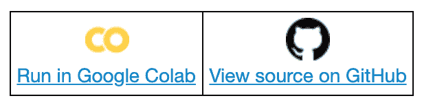

#### 提示
在撰写本文时，GitHub 上存在一个 bug，会在显示 Jupyter 笔记本时间歇性地出现错误消息。如果显示“Sorry, something went wrong.是否重新加载？”的消息，请按照"Building Our Model "的说明进行操作。

此笔记本解释了训练模型的过程。此笔记本执行以下步骤：

* 设置参数
* 安装正确的依赖项
* 使用 TensorBoard 监控训练
* 运行训练脚本
* 将训练输出转换为模型，以便可以像这样使用。

### 启用 GPU 训练
第 4 章 中，我们使用少量数据训练了一个非常简单的模型。现在训练的模型更精细，数据集更大，训练需要更长时间。在平均现代计算机的 CPU 上，训练可能需要 3 到 4 小时。

为缩短模型训练时间，可以使用称为*GPU 加速*的东西。*GPU* 是图形处理单元，是计算机中设计用于快速处理图像数据以便平滑渲染用户界面和视频游戏等内容的硬件部分。大多数计算机都配备了它。

图像处理中许多任务是并行执行的。深度学习网络的训练也是如此。也就是说，可以使用 GPU 硬件加速深度学习训练。通常，使用 GPU 运行训练比 CPU 快 5 到 10 倍。

由于训练过程中需要音频预处理，可能无法实现如此大幅的加速，但即使如此，使用 GPU 也会使模型训练明显更快。

幸运的是，Colab 支持使用 GPU 进行训练。默认情况下未启用，但打开开关很简单。为此，请转到 Colab 的运行时菜单，如图 8-2 所示，点击“Change runtime type”。

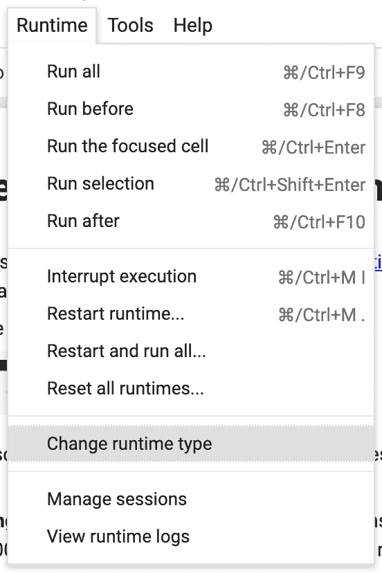

选择此选项后，将打开如图 8-3 所示的“Notebook settings”框。

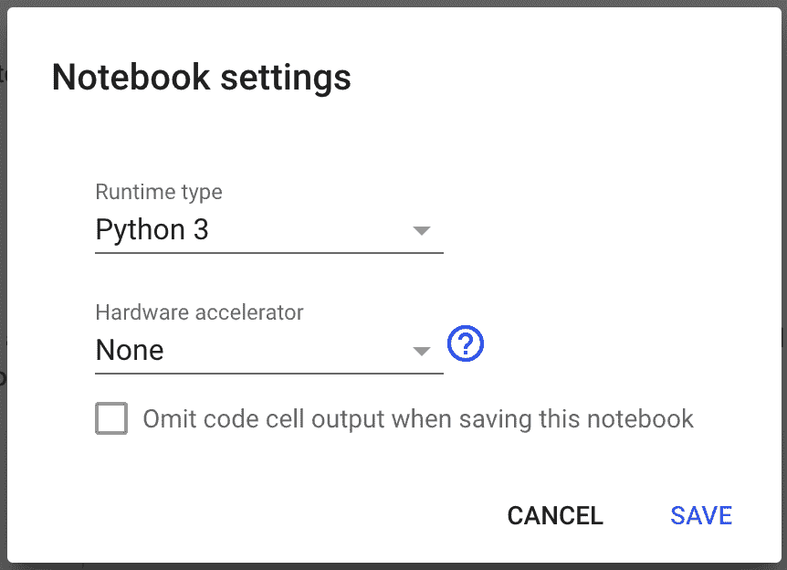

如图 8-4 所示，从“Hardware accelerator”下拉列表中选择 GPU，然后点击“SAVE”。

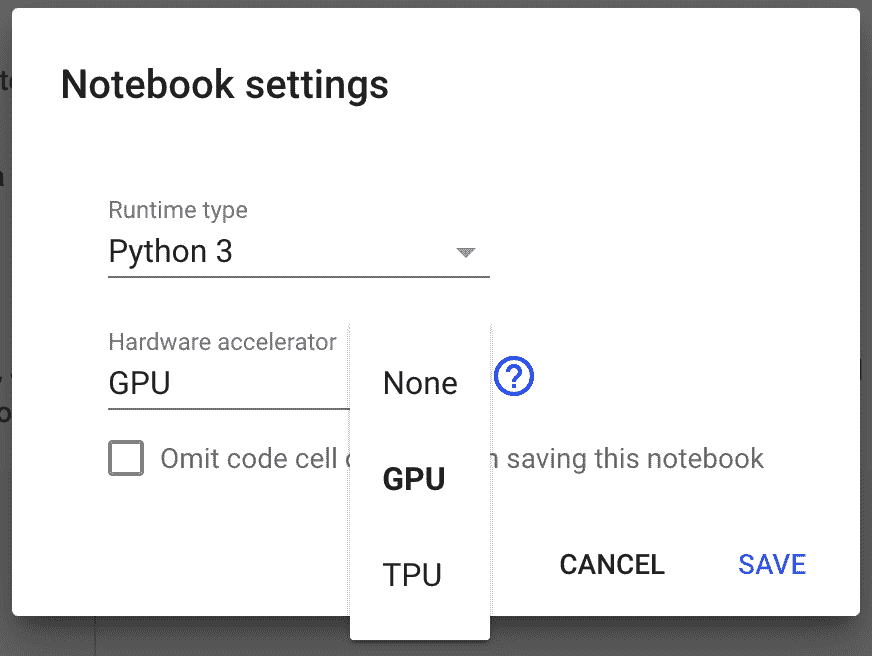

从现在起，Colab 将在配备 GPU 的后端计算机（称为*运行时*）上运行 Python。

下一步是在笔记本中设置要训练的单词。

### 设置训练
学习脚本由一组命令行标志控制，从模型架构到用于分类的训练单词。

为了便于运行脚本，笔记本的第一个单元格将一些重要值存储在环境变量中。当脚本运行时，这些值将被分配给脚本的命令行标志。

第一个`WANTED_WORDS` 可以选择用于训练模型的单词：

```
os.environ["WANTED_WORDS"] = "yes,no"
```

默认选择“yes”和“no”，但可以自由组合数据集中以下单词：

* 常用命令：*是*、*否*、*上*、*下*、*左*、*右*、*开*、*关*、*停止*、*Go*、*后退*、*前进*、*跟随*、*学习*
* 0 到 9 的数字：*零*、*1*、*2*、*3*、*4*、*5*、*6*、*7*、*8*、*9*
* 喜欢的词：*床*,*鸟*,*猫*,*狗*,*快乐*,*家*,*马文*,*希拉*,*树*,*哇*

要选择单词，只需将其放入逗号分隔的列表中。让我们尝试为新模型训练选择单词“on”和“off”：

```
os.environ["WANTED_WORDS"] = "on,off"
```

未包含在列表中的单词在模型训练时将被归类为“未知”。

#### 注
在这里选择两个或更多单词是可以的。只需稍微修改应用程序代码即可。有关此方法，请参阅“在项目中使用模型”。

`TRAINING_STEPS` 和`LEARNING_RATE` 变量：

```
os.environ["TRAINING_STEPS"]="15000,3000"
os.environ["LEARNING_RATE"]="0.001,0.0001"
```

第 3 章 中，我们学习了模型的权重和偏差会逐步调整，随着时间的推移，模型输出会接近期望值。`TRAINING_STEPS` 指的是训练数据批次通过网络运行并更新权重和偏差的次数。`LEARNING_RATE` 设置调整率。

如果学习率较高，则权重和偏差每次迭代都会被调整，因此收敛更快。然而，这样的较大跳跃意味着可能会持续跳过理想值，因此难以到达理想值。如果学习率较低，则跳跃会变小。收敛需要更多步骤，但最终结果可能更好。给定模型的最佳学习率是通过反复试验确定的。

在上述变量中，训练步数和学习率被定义为逗号分隔的列表，定义每个训练阶段的学习率。以先前的值为例，模型以学习率 0.001 训练 15,000 步，以学习率 0.0001 训练 3,000 步。总共 18,000 步。

也就是说，使用较高的学习率进行多次迭代，使网络快速收敛。然后使用较低的学习率进行较少次数的迭代，对权重和偏差进行微调。

目前保持这些值不变，但了解这些值的作用是好的。试运行单元格。以下输出将显示：

```
Training these words: on,off
Training steps in each stage: 15000,3000
Learning rate in each stage: 0.001,0.0001
Total number of training steps: 18000
```

这是模型如何被训练的概述。

### 安装依赖项
接下来，获取运行脚本所需的几个依赖项。

运行以下两个单元格以执行以下操作：

* 安装包含训练所需 ops 的 TensorFlow `pip` 包的特定版本。
* 克隆 TensorFlow GitHub 仓库的对应版本，以便可以访问训练脚本。

### 加载 TensorBoard
为了监控训练过程，我们使用[TensorBoard](https://oreil.ly/wginD)。这是一个用户界面，可以显示训练的进展、图表、统计数据和其他见解。

训练完成后，将类似于图 8-5 的屏幕截图。这些图表的含义将在本章后面解释。

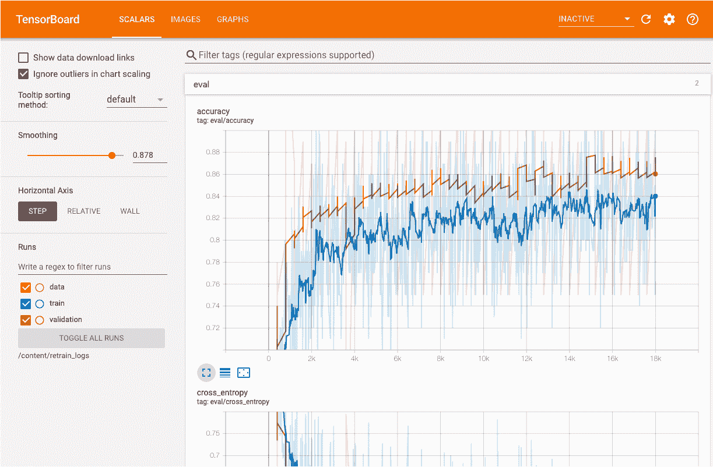

运行下一个单元格加载 TensorBoard。它将在 Colab 中显示，但在开始训练之前不会显示任何内容。

### 开始训练
下一个单元格运行启动训练的脚本。你会看到有很多命令行参数：

```
!python tensorflow/tensorflow/examples/speech_commands/train.py \
--model_architecture=tiny_conv --window_stride=20 --preprocess=micro \
--wanted_words=${WANTED_WORDS} --silence_percentage=25 --unknown_percentage=25 \
--quantize=1 --verbosity=WARN --how_many_training_steps=${TRAINING_STEPS} \
--learning_rate=${LEARNING_RATE} --summaries_dir=/content/retrain_logs \
--data_dir=/content/speech_dataset --train_dir=/content/speech_commands_train
```

有些参数使用之前定义的環境变量来设置要创建的模型，例如`--wanted_words=${WANTED_WORDS}`。还有一些参数设置脚本的输出，例如`--train_dir=/content/speech_commands_train`。

保持参数不变，运行单元格。你会看到输出流出。在语音命令数据集下载期间，它会暂停一段时间：

```
>> Downloading speech_commands_v0.02.tar.gz 18.1%
```

完成后，会显示更多输出。可能会出现警告，但只要单元格继续运行就可以忽略。在此点，回滚到 TensorBoard，应如下图 8-6 所示。如果未显示图表，请点击 SCALARS 选项卡。

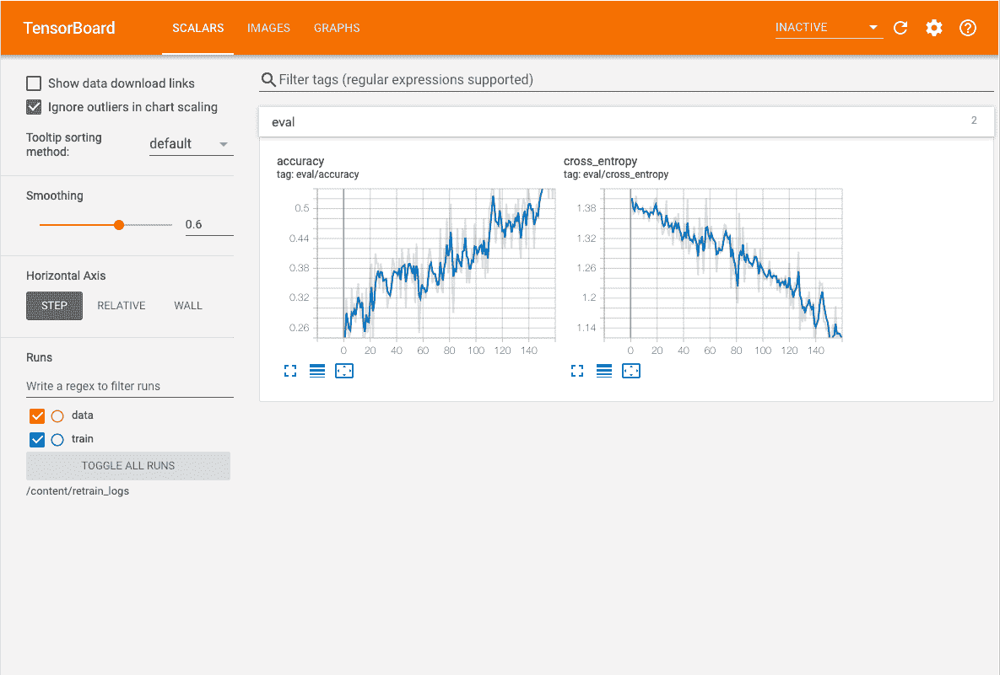

耶！这意味着训练已开始。现在运行的单元格将在训练期间继续运行。单元格不再输出日志，但有关训练运行的数据将在 TensorBoard 中显示。


图 8-7 中示すように、TensorBoardが "accuracy "と "cross\_entropy "の2つのグラフを表示していることがわかる。どちらのグラフもx 軸に現在のステップを示している。accuracy "グラフはy 軸にモデルの精度を示し、単語をどれだけ正しく検出できたかを示す。cross\_entropy」グラフはモデルの損失を示し、モデルの予測値が正しい値からどれだけ離れているかを数値化したものである。

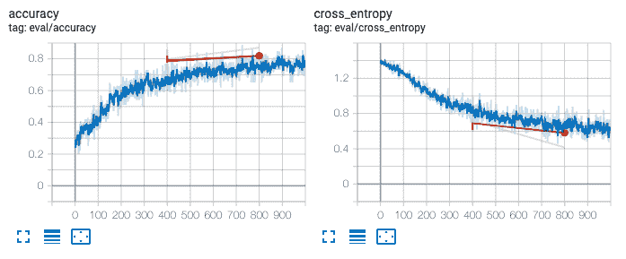

### 注

交叉熵是机器学习模型中用于测量损失的常见方法，该模型进行分类以预测输入属于哪个类别。

图表上的锯齿线对应训练数据集的成绩，直线反映验证数据集的成绩。由于验证是定期进行的，因此图表上的验证数据点较少。

新数据会随着时间推移反映到图表中，但要显示它需要调整图表的比例。为此，如图 8-8 所示，点击每个图表下方最右侧的按钮。


点击如图 8-9 中所示的按钮，也可以放大每个图表。


除了图表之外，TensorBoard 还可以显示输入到模型中的输入。点击 IMAGES 选项卡时，会显示如图 8-10 的视图。这是训练期间输入到模型中的频谱图的示例。

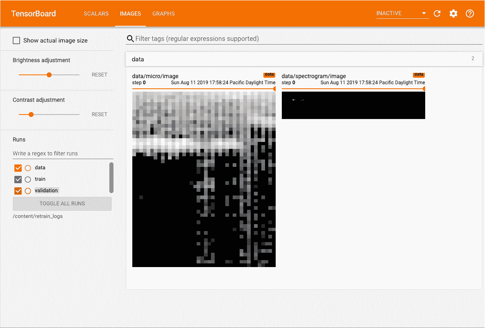

## 等待训练完成

模型的训练需要 1 到 2 小时。幸运的是，TensorBoard 的漂亮图表会让我们愉快。

随着训练的进行，你会注意到指标倾向于在范围内跳动。这是正常现象，但图表会变得模糊难以阅读。为了更清晰地查看训练进度，可以使用 TensorFlow 的平滑功能。

图 8-11 是应用了默认平滑后的图表。

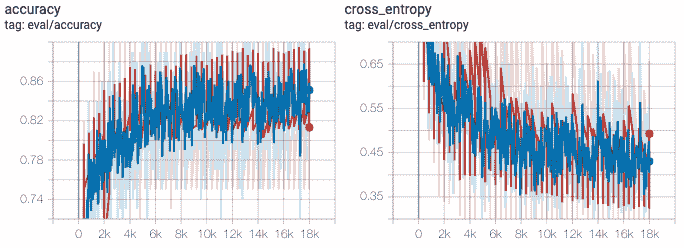

通过调整如图 8-12 中所示的平滑滑块，可以增加平滑量，使趋势更清晰。

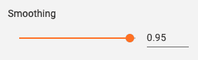

图 8-13 是以更高的平滑度显示同一图表。原始数据以浅色显示在其下方。

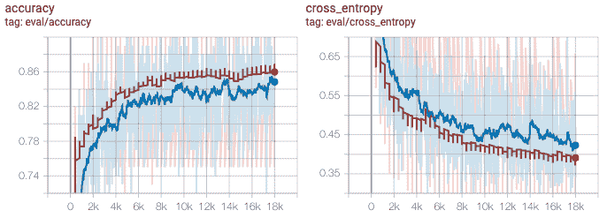

### 持续运行 Colab

为了防止被遗弃的项目消耗资源，Colab 会在运行时未被主动使用时将其关闭。由于训练需要时间，因此需要防止这种情况。需要考虑以下几点。

首先，如果你没有主动与 Colab 浏览器标签页交互，Web 用户界面会从正在执行训练脚本的后端运行时断开连接。这会在几分钟后发生，TensorBoard 的图表将不再用最新的训练指标更新。训练在后台运行。

如果运行时断开连接，如图 8-14 所示，Colab 用户界面会显示重新连接按钮。点击此按钮重新连接运行时。


运行时断开连接不是大问题，但需要注意 Colab 的下一个超时。*如果连续 90 分钟不与 Colab 交互，运行时实例将被回收*。这是一个问题。训练进度连同保存在实例中的数据都将全部丢失！

为避免这种情况，至少每 90 分钟需要与 Colab 交互一次。打开标签页，确认运行时已连接，看看漂亮的图表。只要在 90 分钟内进行此操作，连接就会保持打开。

#### 警告

即使关闭 Colab 标签页，运行时仍会在后台最多运行 90 分钟。只要在浏览器中打开原始 URL，就能重新连接到运行时，像以前一样继续。

但是，关闭标签页会使 TensorBoard 消失。如果在重新打开标签页时训练仍在运行，则在训练结束前无法再次显示 TensorBoard。

最后，*Colab 运行时的最大寿命为 12 小时*。在训练完成前，Colab 会关闭实例并重置。如果训练可能需要这么长时间，请避免使用 Colab，使用「运行脚本的其他方法」中描述的替代解决方案之一。幸运的是，航迹语模型的训练不需要这么长时间。

当图表显示 18,000 步的数据时，训练就完成了！接下来，只需执行一些命令来准备部署模型。别担心——这部分会*很快*结束。

## 冻结图表

正如本书前半部分所学，训练是指反复微调模型的权重和偏差，直到获得有用的预测的过程。训练脚本将权重和偏差写入*检查点*文件。检查点每 100 步写入一次。也就是说，即使训练在中途失败，也可以在不丢失进度的情况下从最新的检查点恢复。

`train.py` 脚本使用参数 `--train_dir` 调用，以指定保存检查点文件的位置。在我们的 Colab 中，它设置为 `/content/speech_commands_train`。

要查看检查点文件，请打开 Colab 左侧面板中的文件浏览器。为此，点击如图 8-15 中所示的按钮。


在此面板中点击 Files 选项卡，查看运行时的文件系统。打开 `speech_commands_train/` 目录后，如图 8-16 所示，会显示检查点文件。每个文件名的数字表示检查点保存的步数。

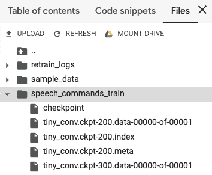

TensorFlow 模型主要由两部分组成：

*   训练产生的权重和偏差。
*   将模型输入与这些权重和偏差结合以生成模型输出的运算符图。

在此阶段，模型的运算符在 Python 脚本中定义，学习到的权重和偏差位于最新的检查点文件中。需要将这两者集成到一个具有特定格式的模型文件中，用于执行推理。创建此模型文件的过程称为*冻结*，*创建重量的*冻结*图的静态表示。

为冻结模型，运行脚本。脚本可在下一单元格的“冻结图表”部分找到。脚本调用如下：

```
!python tensorflow/tensorflow/examples/speech_commands/freeze.py \
  --model_architecture=tiny_conv --window_stride=20 --preprocess=micro \
  --wanted_words=${WANTED_WORDS} --quantize=1 \
  --output_file=/content/tiny_conv.pb \
  --start_checkpoint=/content/speech_commands_train/tiny_conv. \
  ckpt-${TOTAL_STEPS}
```

为指示脚本冻结正确的运算图，传递一些与训练时使用的相同参数。还传递最终检查点文件（文件名以总训练步数结尾的文件）的路径。

运行此单元格以冻结图表。冻结的图表输出为名为 `tiny_conv.pb` 的文件。

该文件是一个完全训练好的 TensorFlow 模型。可以用 TensorFlow 加载并执行推理。这很棒，但它仍然不是 TensorFlow Lite，而是通常在 TensorFlow 中使用的格式。下一步是将模型转换为 TensorFlow Lite 格式。

## 转换为 TensorFlow Lite

转换也是一个简单的步骤，只需执行一个命令即可。既然有了冻结的图表文件，就可以使用 TensorFlow Lite 转换器的命令行界面 `toco` 。

在“转换模型”部分，运行第一个单元格：

```
!toco
  --graph_def_file=/content/tiny_conv.pb --output_file= \
  /content/tiny_conv.tflite \
  --input_shapes=1,49,40,1 --input_arrays=Reshape_2
  --output_arrays='labels_softmax' \
  --inference_type=QUANTIZED_UINT8 --mean_values=0 --std_dev_values=9.8077
```

参数指定要转换的模型、TensorFlow Lite 模型文件的输出位置以及取决于模型架构的其他值。由于模型在训练期间被量化，因此还提供指示转换器如何将低精度值映射到实数的参数（`inference_type`、`mean_values`、`std_dev_values`）。

你可能会对 `input_shapes` 参数的 width、height、channels 参数前面的 `1` 感到好奇。这是批大小。为了提高训练效率，会一次性发送多个输入，但在实时应用程序中运行一次只能处理一个样本。因此，批大小固定为 `1`。

转换后的模型写入 `tiny_conv.tflite`。TensorFlow Lite 模型就完成了！

为查看该模型有多小，运行下一单元格中的代码：

```
import os
model_size = os.path.getsize("/content/tiny_conv.tflite")
print("Model is %d bytes" % model_size)
```

输出显示模型超小：`Model is 18208 bytes`。

下一步是将该模型转换为可部署到微控制器的形式。

## 创建 C 数组

在`C 文件转换`」中，使用 `xxd` 命令将 TensorFlow Lite 模型转换为 C 数组。让我们在下一个单元格中做同样的事情：

```
# Install xxd if it is not available
!apt-get -qq install xxd
# Save the file as a C source file
!xxd -i /content/tiny_conv.tflite > /content/tiny_conv.cc
# Print the source file
!cat /content/tiny_conv.cc
```

输出的最后会输出文件内容。C 语言数组及其长度表示的整数，如下所示（显示的确切值可能略有不同）：

```
unsigned char _content_tiny_conv_tflite[] = {
  0x1c, 0x00, 0x00, 0x00, 0x54, 0x46, 0x4c, 0x33, 0x00, 0x00, 0x00, 0x00,
  0x00, 0x00, 0x0e, 0x00, 0x18, 0x00, 0x04, 0x00, 0x08, 0x00, 0x0c, 0x00,
  // ...
  0x00, 0x09, 0x06, 0x00, 0x08, 0x00, 0x07, 0x00, 0x06, 0x00, 0x00, 0x00,
  0x00, 0x00, 0x00, 0x04
};
unsigned int _content_tiny_conv_tflite_len = 18208;
```

此代码也写入名为 `tiny_conv.cc` 的文件，可以使用 Colab 的文件浏览器下载。由于 Colab 运行时的有效期为 12 小时后，因此建议立即将此文件下载到计算机。

接下来，将此新训练的模型与 `micro_speech` 项目集成，以便部署到一些硬件上。

# 在我们的项目中使用模型

使用新模型需要做三件事：

1.  在[`micro_features/tiny_conv_micro_features_model_data.cc`中](https://oreil.ly/EAR0U)，用新模型替换原始模型数据。
2.  更新[`micro_features/micro_model_settings.cc`的](https://oreil.ly/bqw67)标签名，使用新的“on”和“off”标签。
3.  更新设备特定的 `command_responder.cc`，使其对新标签采取必要的操作。

## 交换模型

要替换模型，请在文本编辑器中打开 `micro_features/tiny_conv_micro_features_model_data.cc`。

#### 注

如果你正在使用 Arduino 示例，文件将作为 Arduino IDE 的选项卡显示。如果你在 SparkFun Edge 上工作，可以直接在 TensorFlow 仓库的本地副本中编辑文件。如果你在 STM32F746G 上工作，请在 Mbed 项目目录中编辑文件。

`tiny_conv_micro_features_model_data.cc` 文件中有如下数组声明：

```
const unsigned char
    g_tiny_conv_micro_features_model_data[] DATA_ALIGN_ATTRIBUTE = {
        0x18, 0x00, 0x00, 0x00, 0x54, 0x46, 0x4c, 0x33, 0x00, 0x00, 0x0e, 0x00,
        0x18, 0x00, 0x04, 0x00, 0x08, 0x00, 0x0c, 0x00, 0x10, 0x00, 0x14, 0x00,
        //...
        0x00, 0x09, 0x06, 0x00, 0x08, 0x00, 0x07, 0x00, 0x06, 0x00, 0x00, 0x00,
        0x00, 0x00, 0x00, 0x04};
const int g_tiny_conv_micro_features_model_data_len = 18208;
```

如果常量 `g_tiny_conv_micro_features_model_data_len` 的值已更改，则也需要替换数组的内容。

为此，打开上一节末尾下载的 `tiny_conv.cc` 文件。将数组内容（而不是其定义）复制并粘贴到 `tiny_conv_micro_features_model_data.cc` 中定义的数组中。确保覆盖数组内容而不是数组声明。


在 `tiny_conv.cc` 的最底部发现了表示数组长度的变量 `_content_tiny_conv_tflite_len`。返回到 `tiny_conv_micro_features_model_data.cc`，将 `g_tiny_conv_micro_features_model_data_len` 的值替换为该变量的值。这样文件更新就完成了。

## 更新标签

接下来，打开 `micro_features/micro_model_settings.cc`。该文件包含类别标签的数组：

```
const char* kCategoryLabels[kCategoryCount] = {
    "silence",
    "unknown",
    "yes",
    "no",
};
```

为了适配新模型，只需将 "yes" 和 "no" 替换为 "on" 和 "off" 即可。由于标签需要与模型输出张量元素按顺序匹配，因此按训练脚本中提供的相同顺序列出非常重要。

这是期望的代码：

```
const char* kCategoryLabels[kCategoryCount] = {
    "silence",
    "unknown",
    "on",
    "off",
};
```

如果使用多个标签训练模型，则将它们全部添加到列表中即可。

这样模型的切换就完成了。剩下的步骤只是更新使用标签的输出代码。

## 更新 command_responder.cc

此项目包含用于 Arduino、SparkFun Edge、STM32F746G 的 `command_responder.cc` 的不同设备特定实现。以下各节将说明如何分别进行更新。

### Arduino

位于 `arduino/command_responder.cc` 的 Arduino 命令响应器在听到 "yes" 这个词时会点亮 LED 3 秒钟。让我们将其更新为在听到 "on" 或 "off" 时点亮 LED。文件中，`if` 语句如下：

```
// If we heard a "yes", switch on an LED and store the time.
if (found_command[0] == 'y') {
  last_yes_time = current_time;
  digitalWrite(LED_BUILTIN, HIGH);
}
```

`if` 语句测试命令的第一个字符是否为 "y"。将这个 "y" 改为 "o" 后，由于两者都以 "o" 开头，因此 LED 会在 "on" 或 "off" 时点亮：

```
if (found_command[0] == 'o') {
  last_yes_time = current_time;
  digitalWrite(LED_BUILTIN, HIGH);
}
```

修改代码后，部署并试试看。

### SparkFun Edge

位于 `sparkfun_edge/command_responder.cc` 的 SparkFun Edge 命令响应器会根据 "yes" 或 "no" 点亮不同的 LED。在此文件中，以下 `if` 语句：

```
if (found_command[0] == 'y') {
  am_hal_gpio_output_set(AM_BSP_GPIO_LED_YELLOW);
}
if (found_command[0] == 'n') {
  am_hal_gpio_output_set(AM_BSP_GPIO_LED_RED);
}
if (found_command[0] == 'u') {
  am_hal_gpio_output_set(AM_BSP_GPIO_LED_GREEN);
}
```

将其更新为 "on" 和 "off" 分别点亮不同的 LED 很简单：

```
if (found_command[0] == 'o' && found_command[1] == 'n') {
  am_hal_gpio_output_set(AM_BSP_GPIO_LED_YELLOW);
}
if (found_command[0] == 'o' && found_command[1] == 'f') {
  am_hal_gpio_output_set(AM_BSP_GPIO_LED_RED);
}
if (found_command[0] == 'u') {
  am_hal_gpio_output_set(AM_BSP_GPIO_LED_GREEN);
}
```

由于两个命令都以相同的字符开头，因此需要查看第二个字符来区分。现在，说 "on" 时黄色 LED 会点亮，说 "off" 时红色会点亮。

完成后，按照 示例运行 中所做的相同步骤部署并运行代码。

### STM32F746G

位于 `disco_f746ng/command_responder.cc` 的 STM32F746G 命令响应器会根据听到的命令显示不同的单词。在文件中，找到以下 `if`：

```
if (*found_command == 'y') {
  lcd.Clear(0xFF0F9D58);
  lcd.DisplayStringAt(0, LINE(5), (uint8_t *)"Heard yes!", CENTER_MODE);
} else if (*found_command == 'n') {
  lcd.Clear(0xFFDB4437);
  lcd.DisplayStringAt(0, LINE(5), (uint8_t *)"Heard no :(", CENTER_MODE);
} else if (*found_command == 'u') {
  lcd.Clear(0xFFF4B400);
  lcd.DisplayStringAt(0, LINE(5), (uint8_t *)"Heard unknown", CENTER_MODE);
} else {
  lcd.Clear(0xFF4285F4);
  lcd.DisplayStringAt(0, LINE(5), (uint8_t *)"Heard silence", CENTER_MODE);
}
```

将其更新为对 "on" 和 "off" 做出反应很简单：

```
if (found_command[0] == 'o' && found_command[1] == 'n') {
  lcd.Clear(0xFF0F9D58);
  lcd.DisplayStringAt(0, LINE(5), (uint8_t *)"Heard on!", CENTER_MODE);
} else if (found_command[0] == 'o' && found_command[1] == 'f') {
  lcd.Clear(0xFFDB4437);
  lcd.DisplayStringAt(0, LINE(5), (uint8_t *)"Heard off", CENTER_MODE);
} else if (*found_command == 'u') {
  lcd.Clear(0xFFF4B400);
  lcd.DisplayStringAt(0, LINE(5), (uint8_t *)"Heard unknown", CENTER_MODE);
} else {
  lcd.Clear(0xFF4285F4);
  lcd.DisplayStringAt(0, LINE(5), (uint8_t *)"Heard silence", CENTER_MODE);
}
```

这里同样，因为两个命令以相同的字符开头，所以查看第二个字符以消除歧义。接下来，为每个命令显示适当的文本。

## 运行脚本的其他方法

如果无法使用 Colab，有两种推荐的其他方法来训练模型：

*   配备 GPU 的云虚拟机（VM）如下所示。
*   本地工作站

使用 GPU 训练所需的驱动程序只能在 Linux 上使用。没有 Linux，训练大约需要 4 小时。因此，建议使用配备 GPU 的虚拟机（）或具有类似功能的 Linux 工作站。

虚拟机或工作站的设置超出了本书的范围。但是有一些建议。如果使用虚拟机，可以启动 [Google Cloud Deep Learning VM 镜像](https://oreil.ly/PVRtP)，其中预先配置了 GPU 训练所需的所有依赖项。如果使用 Linux 工作站，则 [TensorFlow GPU Docker 镜像](https://oreil.ly/PFYVr) 包含所需的一切。

要训练模型，需要安装 TensorFlow 的 nightly build。要卸载现有版本并替换为已验证的版本，请使用以下命令：

```
pip uninstall -y tensorflow tensorflow_estimator
pip install -q tf-estimator-nightly==1.14.0.dev2019072901 \
  tf-nightly-gpu==1.15.0.dev20190729
```

接下来，打开命令行并移动到保存代码的目录。使用以下命令克隆 TensorFlow 并检出已验证的特定提交：

```
git clone -q https://github.com/tensorflow/tensorflow
git -c advice.detachedHead=false -C tensorflow checkout 17ce384df70
```

现在可以运行 `train.py` 脚本来训练模型。这将训练一个识别 "yes" 和 "no" 的模型，并将检查点文件输出到 `/tmp`：

```
python tensorflow/tensorflow/examples/speech_commands/train.py \
  --model_architecture=tiny_conv --window_stride=20 --preprocess=micro \
  --wanted_words="on,off" --silence_percentage=25 --unknown_percentage=25 \
  --quantize=1 --verbosity=INFO --how_many_training_steps="15000,3000" \
  --learning_rate="0.001,0.0001" --summaries_dir=/tmp/retrain_logs \
  --data_dir=/tmp/speech_dataset --train_dir=/tmp/speech_commands_train
```

训练后，运行以下脚本冻结模型：

```
python tensorflow/tensorflow/examples/speech_commands/freeze.py \
  --model_architecture=tiny_conv --window_stride=20 --preprocess=micro \
  --wanted_words="on,off" --quantize=1 --output_file=/tmp/tiny_conv.pb \
  --start_checkpoint=/tmp/speech_commands_train/tiny_conv.ckpt-18000
```

接下来，将模型转换为 TensorFlow Lite 格式：

```
toco
  --graph_def_file=/tmp/tiny_conv.pb --output_file=/tmp/tiny_conv.tflite \
  --input_shapes=1,49,40,1 --input_arrays=Reshape_2 \
  --output_arrays='labels_softmax' \
  --inference_type=QUANTIZED_UINT8 --mean_values=0 --std_dev_values=9.8077
```

最后，将此文件转换为可编译为嵌入式系统的 C 源文件：

```
xxd -i /tmp/tiny_conv.tflite > /tmp/tiny_conv_micro_features_model_data.cc
```

## 模型的工作原理

现在我们知道了如何训练自己的模型，让我们来探索它是如何工作的。到目前为止，我们一直把机器学习模型当作黑盒子对待。也就是说，输入训练数据后，它最终会找到预测结果的方法。使用模型时并不必须理解内部发生了什么，但这有时有助于调试问题，而且本身也很有趣。本节将提供一些关于模型如何得出预测的见解。

### 可视化输入

图 8-17 是，显示了实际输入到神经网络的内容。它是一个单通道的 2D 数组，因此可以作为单色图像可视化。我们处理的是 16KHz 的音频采样数据。此过程是机器学习中称为“特征生成”的一个例子，其目的是将难以处理的输入格式（在本例中是表示 1 秒音频的 16,000 个数值）转换为机器学习模型更容易理解的形式。研究过深度学习机器构想用例的人可能从未遇到过这种情况，因为图像通常可以在不需要太多预处理的情况下相对容易地作为网络的输入。


为了直观地理解我们的模型为什么更容易处理预处理后的输入，让我们看看图 8-18 起到图 8-21 所示的几段语音录音的原始表示。

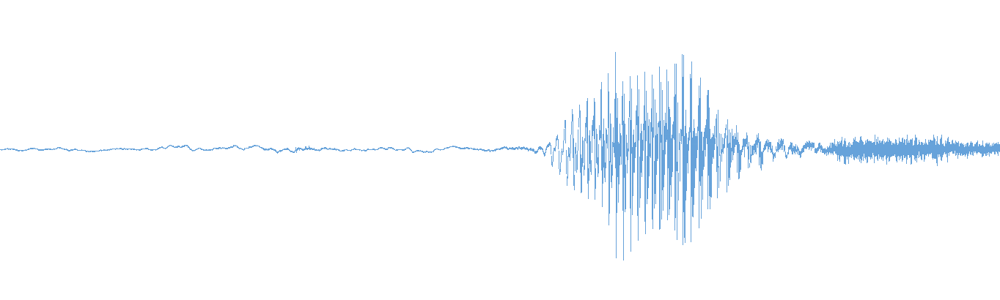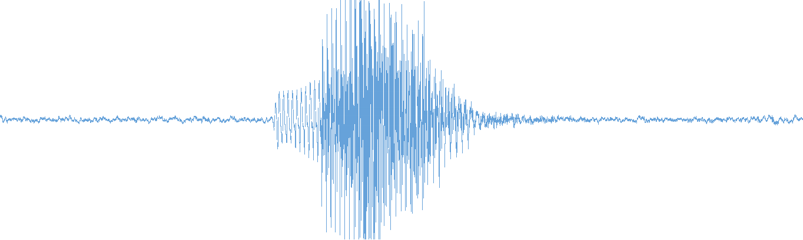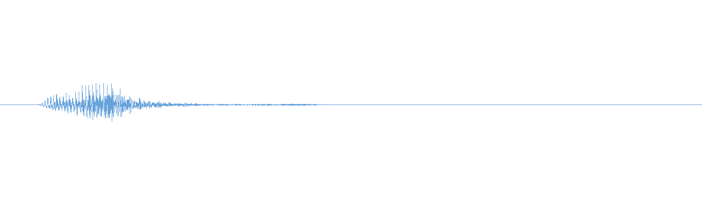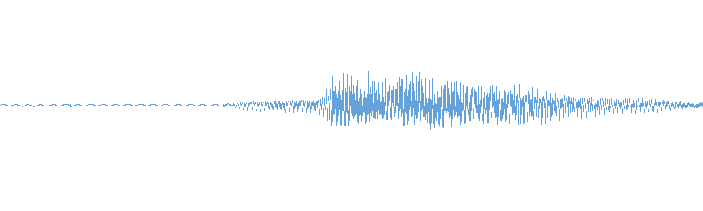

如果没有标签，很难区分哪对波形代表同一个词。图 8-22 起到图 8-25 显示了将相同的 1 秒录音进行特征生成后的结果。

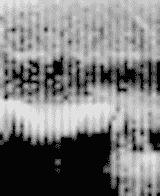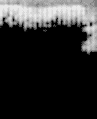

这些仍然不容易解释，但可以看到“YES”的频谱图都呈现出类似反转 L 形的形状，而“NO”的特征形状不同。我们希望你能直观地理解，我们可以比原始波形更容易区分频谱图的差异，模型也可以更容易做到这一点。

另一个方面是生成的频谱图比采样数据小得多。每个频谱图由 1,960 个数值组成，而波形有 16,000 个。频谱图是对音频数据的总结，可以减少神经网络的工作量。实际上，像 [DeepMind 的 WaveNet](https://oreil.ly/IH9J3) 这样专门设计的模型可以接受原始采样数据作为输入，但由此产生的模型往往比我们使用的手工设计特征的神经网络组合需要更多的计算，因此在资源受限的环境（如嵌入式系统）中，更倾向于采用这里使用的方法。

### 特征生成是如何工作的？


如果有音频处理的经验，你可能对类似 [MFCC（梅尔频率倒谱系数）的](https://oreil.ly/HTAev) 这样的方法很熟悉。这是生成我们所处理的这类频谱图的一种通用方法，但实际上本例中使用的是相关但不同的方法。该方法与 Google 全公司生产环境中使用的方法相同，因此经过了大量实际验证，但并未作为研究文献发表。这里将大致说明其工作原理，但要了解详情，最好参考 [代码本身](https://oreil.ly/NeOnW)。

该过程从为给定的时间切片（此处为 30ms 的音频数据）生成傅里叶变换（也称为快速傅里叶变换或 FFT）开始。该 FFT 是针对用 [窗函数](https://oreil.ly/jhn8c) 过滤的数据生成的，该窗函数是一种钟形函数，可减少 30ms 窗口两端样本的影响。傅里叶变换为每个频率生成具有实部和虚部的复数，但我们只关心总能量，因此将两个分量的平方相加并应用平方根以获得每个频率桶的大小。

如果有 `N` 个样本，傅里叶变换会产生 `N/2` 个频率的信息。以每秒 16,000 样本的速率，30ms 需要 480 个样本，由于 FFT 算法需要 2 的幂次输入，因此将其零填充到 512 个样本，得到 256 个频率桶。这过大，因此为了缩小，将相邻频率平均为 40 个下采样桶。然而，这种下采样不是线性的，而是使用基于人类感知的梅尔频率尺度，对低频加权以使用更多桶，而将高频合并到更宽的桶中。图 8-26 是该过程的图示。

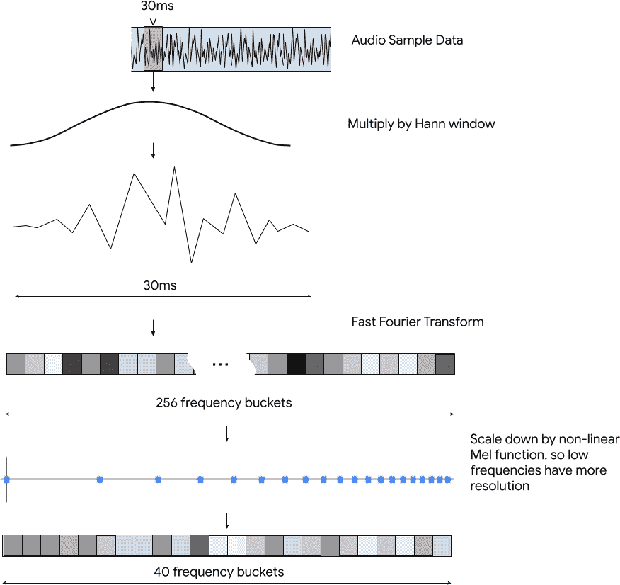

该特征生成器的独特之处在于包含了一个降噪步骤。它通过保持每个频率桶值的运行平均值并从当前值中减去该平均值来工作。这基于背景噪声随时间相当恒定并出现在特定频率的假设。通过减去运行平均值，可以在一定程度上消除噪声的影响，同时保留感兴趣的快速变化语音。棘手的是，特征生成器需要保持状态来跟踪每个桶的运行平均值。

降噪初始化的另一部分是使用奇数频率桶和偶数频率桶的不同系数。其结果是产生了最终生成的特征图像中可见的特征性梳状图案（图 8-22～图 8-25）。起初我以为这是个 bug，但与原始实现者交谈后得知，它实际上是为提高性能而故意添加的。有关该方法的详细信息，请参阅 Yuxuan Wang 等人撰写的 ["Trainable Frontend for Robust and Far-Field Keyword Spotting "](https://oreil.ly/QZ4Yb) 的第 4.3 节。此外，我们在模型上经验性地测试发现，去除奇数桶和偶数桶的处理差异会导致评估精度显著下降。

接下来，使用按通道振幅归一化（`PCAN`）自动增益，根据运行平均噪声提升信号。最后，对所有桶值应用对数尺度，以防止相对较大的频率掩盖频谱的安静部分。

重复该处理共 49 次，每次将 30ms 窗口向前推进 20ms，以覆盖 1 秒的音频输入数据。这会生成一个值 2D 数组，宽度为 40 个元素（每个频率桶一个），高度为 49 行（每个时间切片一行）。

实现听起来可能很复杂，但不用担心。我们实现的全部代码都是开源的，欢迎在自己的音频项目中重复使用。

## 理解模型架构

本节使用的神经网络模型被定义为一个小型计算图。定义它的代码可在训练时在 [`create_tiny_conv_model()`](https://oreil.ly/fMARv) 函数中找到，图 8-27 是其可视化结果。

该模型由卷积层、全连接层和最后的 softmax 层组成。图中卷积层被标记为 `DepthwiseConv2D`，这只是 TensorFlow Lite 转换器的一个怪癖（具有单通道输入图像的卷积层可以表示为深度方向卷积）。此外，还有一个 `Reshape_1` 层，但它不是实际的运算符，而只是一个输入占位符。

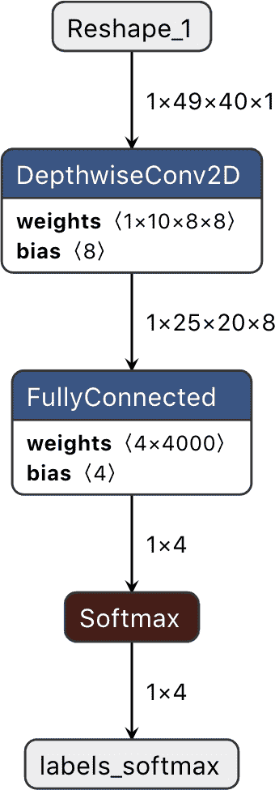

卷积层用于从输入图像中查找二维模式。每个滤波器是一个矩形值数组，作为跨输入滑动的窗口移动，输出图像表示在每个点输入与滤波器匹配的程度。可以认为卷积运算符将一系列矩形滤波器在图像上移动，并将每个滤波器的每个像素的结果对应于该滤波器与图像该补丁的相似程度。在本例中，每个滤波器宽度为 8 像素，高度为 10 像素，共 8 个。图 8-28 从 图 8-35 到展示了它们的外观。


这些滤波器各自可以被视为输入图像的小补丁。运算符试图将这个小补丁与输入图像中相似的部分匹配。在图像与补丁相似的地方，输出图像的对应部分会写入较高的值。直观地说，每个滤波器都是模型从训练输入中学习到的模式，用于区分应处理的不同的类。

由于有 8 个滤波器，因此有 8 个不同的输出图像，每个都对应于输入上每个滤波器的匹配值。这些滤波器输出实际上合成为一个具有 8 个通道的输出图像。也就是说，不是每次将每个滤波器滑动 1 个像素，而是每次滑动 2 个像素。由于跳过了每隔一个位置，输出图像的大小是输入图像的一半。

可视化时，可以看出输入图像为纵向 49 像素、横向 40 像素，单通道。当在输入图像上滑动卷积滤波器时，由于在水平和垂直方向上每隔 1 个像素跳过一次，因此卷积的输出为一半大小，即纵向 25 像素、横向 20 像素。然而由于有 8 个滤波器，图像的深度为 8 个通道。

下一个运算符是全连接层。这是不同类型的模式匹配处理。与在输入上滑动小窗口不同，它为输入张量的所有值都有权重。结果是在比较所有值后，显示输入与权重有多接近。可以将其视为全局模式匹配，存在期望作为输入获得的理想结果，输出显示该理想（保存在权重中的）值与实际输入有多接近。在该模型中，每个类都有权重，因此存在“沉默”、“未知”、“是”、“否”的理想模式，并生成 4 个输出值。输入 `25 * 20 * 8` 有 4,000 个值，因此每个类由 4,000 个权重表示。

最后一层是 softmax。它有效地有助于放大最高输出与最近竞争对手之间的差异，相对排名不会改变（从全连接层产生最大值的类仍然最高），有助于生成更有用的分数。该分数通常非正式地称为概率，但严格来说，如果不进行更多校准，就不能确定地这样使用，因为输入数据的组合实际上是什么。例如，如果检测器有更多单词，像“antidisestablishmentarianism”这样不常见的单词可能比像“ok”这样的单词更难出现，但这可能不会反映在原始分数中，具体取决于训练数据的分布。

除了这些主要层之外，还在全连接层和卷积层的结果中添加了用于微调输出的偏差，并在每个之后使用整流线性单元（`ReLU`）激活函数。`ReLU` 确保输出不会小于零，并将负结果设置为零最小值。这种类型的激活函数是使深度学习更有效的突破之一。

## 理解模型输出

模型的最终结果是 softmax 层的输出。它是 4 个数值，分别对应“沉默”、“未知”、“是”、“否”。这些值是每个类别的分数，分数最高的为模型的预测值，分数表示模型对预测的置信度。例如，如果模型输出为 `[10, 4, 231, 80]`，则分数为 231，预测第三个类别“是”是最可能的结果。（我们以 0 到 255 之间的量化形式给出这些值，但由于它们是相对分数，通常不需要转换为等效的实数值。）

一个棘手的问题是，该结果分析的是最后 1 秒的整个语音。如果每秒只运行一次，则可能会出现前一秒和当前秒各一半的语音。任何模型在只听到单词的一部分时都无法很好地识别单词，因此在这种情况下，单词检测会失败。为克服这一点，需要以每秒一次以上的频率运行模型，以尽可能提高在 1 秒窗口中捕获整个单词的可能性。实际上，发现为了获得良好的结果，需要每秒运行 10 到 15 次。

如果有这么多结果如此快速地发送过来，该如何判断分数何时足够高呢？我们实现了一个后处理类，随着时间的推移对分数进行平均化，并且只有在短时间内出现多个高分数且为同一单词时才触发识别。该实现是 [`RecognizeCommands`](https://oreil.ly/FuYfL) class。它接收来自模型的原始结果，并使用累积和平均化算法来判断某个类别是否超过了阈值。这些后处理后的结果被发送到 [`CommandResponder`](https://oreil.ly/b8ArK)，根据平台的输出能力采取行动。

模型参数全部从训练数据中学习，但命令识别器使用的算法是手工创建的，因此用于触发识别所需的分数值以及获得积极结果所需的时间窗口等[阈值](https://oreil.ly/tfNfr)全部是手工选择的。也就是说，没有保证它是最佳的。如果在自己的应用程序中结果不佳，可以尝试自行微调。

更精细的语音识别模型通常使用能够处理流式数据的模型（如递归神经网络），而不是本章介绍的单层卷积网络。流式处理被集成到模型设计中意味着不需要后处理即可获得准确的结果。

# 使用自己的数据进行训练

不太可能想要的产品只对“是”和“否”做出反应，因此你应该希望训练一个对感兴趣语音敏感的模型。之前使用的训练脚本设计为可以使用自己的数据创建自定义模型。此过程中最困难的部分是收集足够大的数据集并确保其适合你的问题。有关数据收集和清理的一般方法，请参阅第 16 章，本章将介绍几种使用自己的音频模型进行训练的方法。

## 语音命令数据集

`train.py` 脚本默认下载 Speech Commands 数据集。这是一个由 100,000 多个 1 秒 WAV 文件组成的开源集合，涵盖了各种说话者的各种短单词。它由 Google 分发，但发音是由世界各地的志愿者收集的。有关详细信息，请参阅 Aakanksha Chowdhery 等人撰写的 ["Visual Wake Words Dataset "](https://oreil.ly/EC6nd)。

该数据集除了“是”和“否”之外，还包含 8 个命令词（on、off、up、down、left、right、stop、go）和 0 到 9 的 10 个数字。这些单词各有数千个示例。也有像 Marvin 这样示例更少的单词。命令词的意图是提供足够的发音来训练一个合理的识别模型。其他单词旨在构成未知类别，以便模型在未训练的单词被说出时能够区分它，而不是将其误认为命令。

由于训练脚本使用此数据集，因此可以轻松地使用示例丰富的命令词组合来训练模型。更新参数 `--wanted_words` 为训练集中包含的单词的逗号分隔列表，然后从零开始训练，应该就能创建有用的模型。需要注意的主要点是将其限制为 10 个命令词和/或数字，否则将无法获得足够样本进行准确学习，并且如果需要两个以上的单词，则应减小 `--silence_percentage` 和 `--unknown_percentage` 的值。后两个参数控制在训练期间混合多少静音样本和未知样本。静音样本实际上不是完全静音，而是从数据集的 `background` 文件夹中的 WAV 中随机选择的 1 秒录制背景噪声片段。未知样本是从包含在训练集中但不在 `wanted_words` 列表中的单词中选择的发音。数据集包含相对发音较少的杂项单词就是这个原因。这在语音识别中尤其成问题，因为生产运算符通常需要在训练中从未遇到过的单词和噪声很多的环境中运行。仅英语就有数千个不同的单词，为了有用，模型必须能够忽略未训练的单词。因此，未知类别实际上非常重要。

以下是使用现有数据集学习各种单词的示例：

```
python tensorflow/examples/speech_commands/train.py \
  --model_architecture=tiny_conv --window_stride=20 --preprocess=micro \
  --wanted_words="up,down,left,right" --silence_percentage=15 \
  --unknown_percentage=15 --quantize=1
```

## 使用自己的数据集进行训练


训练脚本的默认设置使用 Speech Commands，但如果您拥有自己的数据集，则可以使用 `--data_dir` 参数来代替使用它。指向的目录与 Speech Commands 一样，为每个想要识别的类别提供一个子文件夹，每个文件夹中都有一组 WAV 文件。此外，还需要准备一个专门的 *背景* 子文件夹。该子文件夹包含应用程序预计会遇到的背景噪声的 WAV 录音。此外，如果默认的 1 秒不适合使用案例，则可以选择识别时间并使用 `--sample_duration_ms` 参数指定。接下来，可以使用 `--wanted_words` 参数设置想要识别的类别。与其名称相反，这些类别可以是任何类型的音频事件，从玻璃破碎声到笑声。各类别的 WAV 文件只要足够，学习过程应该就能像语音情况一样工作。

如果在根目录 `/tmp/my_wavs` 中有名为 *glass* 和 *laugh* 的 WAV 文件夹，那么训练自己的模型的方法如下：

```
python tensorflow/examples/speech_commands/train.py \
  --model_architecture=tiny_conv --window_stride=20 --preprocess=micro \
  --data_url="" --data_dir=/tmp/my_wavs/ --wanted_words="laughter,glass" \
  --silence_percentage=25 --unknown_percentage=25 --quantize=1
```

最难的是发现足够的数据。例如，实际的玻璃破碎声与电影中熟悉的音效有很大不同。也就是说，需要发现现有的录音或自行录音。学习过程可能需要每个类别数千个示例，并且需要涵盖实际应用中可能出现的所有变体，因此此数据收集过程会令人沮丧且耗费成本和时间。

将在大规模公开数据集上训练的模型使用另一组数据对不同类别的权重进行微调*的*。这种方法不需要像从零开始在次级数据集上学习那样多的示例，并且经常能获得高精度的结果。不幸的是，用于语音模型的迁移学习仍在研究中。

## 录制自己的音频

如果需要捕获感兴趣的词语的语音，有一个工具可以提示说话者并将结果分割成带标签的文件会轻松很多。Speech Commands 数据集是使用 [Open Speech Recording 应用录制](https://oreil.ly/UWsG3) 的。该应用是一个托管应用，允许用户使用常见的网页浏览器录制自己的发言。用户首先会看到一个网页，被问及是否同意被录音。同意后，会被发送到一个带有录音控件的新页面。按下录音按钮时，会显示提示词，并为每个词语录制您发出的语音。当所有请求的词语都录制完毕后，会被要求将结果发送到服务器。

`README` 中有在 Google Cloud 上运行的说明，但由于它是用 Python 编写的 Flask 应用，因此应该可以移植到其他环境。如果使用 Google Cloud，则需要更新 [`app.yaml`](https://oreil.ly/dV2kv) 文件以指向自己的存储桶，并指定一个随机的会话密钥（仅用于哈希，所以任何值都可以）。要自定义要记录的词语，需要在 [客户端 JavaScript 中](https://oreil.ly/XcJIe) 编辑一些数组。

录制的 文件以 OGG 压缩音频的形式保存在 Google Cloud 的存储桶中，但训练需要 WAV，因此需要进行转换。此外，录制的音频很可能包含错误，例如忘记说词语或说得太小，因此提前尽可能自动过滤此类错误会很方便。设置 `BUCKET_NAME` 变量为存储桶名称后，首先使用以下 bash 命令将文件复制到本地机器：

```
mkdir oggs
gsutil -m cp gs://${BUCKET_NAME}/* oggs/
```

压缩 OGG 格式的一个优点是，安静或无声的音频文件非常小：

```
find ${BASEDIR}/oggs -iname "*.ogg" -size -5k -delete
```

将 OGG 转换为 WAV 的最简单方法是使用提供命令行工具的 [FFmpeg 项目](https://ffmpeg.org/)。以下是将整个 OGG 文件目录转换为所需格式的命令集：

```
mkdir -p ${BASEDIR}/wavs
find ${BASEDIR}/oggs -iname "*.ogg" -print0 | \
  xargs -0 basename -s .ogg | \
  xargs -I {} ffmpeg -i ${BASEDIR}/oggs/{}.ogg -ar 16000 ${BASEDIR}/wavs/{}.wav
```

Open Speech Recording 应用程序会录制每个词语超过 1 秒。这样可以确保即使用户的发言时间比预期早或晚一些也能被捕获。训练需要 1 秒的录音，并且在词语位于每次录音的中央时效果最佳。我们创建了一个小型开源实用程序，通过查看每次录音随时间的音量来尝试正确居中，并将语音修剪为恰好 1 秒。在终端中输入以下命令使用它：

```
git clone https://github.com/petewarden/extract_loudest_section \
  /tmp/extract_loudest_section_github
pushd /tmp/extract_loudest_section_github
make
popd
mkdir -p ${BASEDIR}/trimmed_wavs
/tmp/extract_loudest_section/gen/bin/extract_loudest_section \
  ${BASEDIR}'/wavs/*.wav' ${BASEDIR}/trimmed_wavs/
```

这样就创建了一个包含正确格式和所需长度的文件夹，但训练过程需要按标签将 WAV 整理到子文件夹中。由于标签编码在每个文件的名称中，因此有一个 [Python 脚本示例](https://oreil.ly/BpQBJ) 可以使用这些文件名将文件排序到适当的 文件夹中。

## 数据增强

数据增强是有效扩展训练数据并提高精度的另一种方法。实际上，这意味着在将录制的语音用于训练之前对其进行语音转换。这些转换包括音量更改、混入背景噪声、轻微修剪剪辑的开始或结束。训练脚本默认执行所有这些转换，但您可以使用命令行参数调整转换的频率和强度。

### 警告

这种增强有助于进一步发展小型数据集，但不能创造奇迹。如果转换过于强烈，训练输入会被扭曲，人类可能无法再识别。

以下是使用一些命令行参数控制增强的方法：

```
python tensorflow/examples/speech_commands/train.py \
  --model_architecture=tiny_conv --window_stride=20 --preprocess=micro \
  --wanted_words="yes,no" --silence_percentage=25 --unknown_percentage=25 \
  --quantize=1 --background_volume=0.2 --background_frequency=0.7 \
  --time_shift_ms=200
```

## 模型架构

之前训练的“是”/“否”模型设计得小巧快速。仅为 18KB，每次运行所需的算术运算为 40 万次。为了适应这一限制，牺牲了精度。如果您设计自己的应用程序，特别是想要识别两个以上类别时，您可能希望进行不同的权衡。通过修改 `models.py` 文件并使用 `--model_architecture` 参数，您可以指定自己的模型架构。您需要编写类似 `create_tiny_conv_model0` 的自定义模型创建函数来指定模型所需的层。然后更新 `create_model0` 的 `if` 语句，为您的架构命名，并在命令行 architecture 参数传递时调用新的创建函数。您可以参考现有创建函数，例如如何处理 dropout。如果添加了自己的模型代码，调用方法如下：

```
python tensorflow/examples/speech_commands/train.py \
 --model_architecture=my_model_name --window_stride=20 --preprocess=micro \
  --wanted_words="yes,no" --silence_percentage=25 \--unknown_percentage=25 \
  --quantize=1
```

# 总结

在小内存占用下识别语音在现实世界中是一个棘手的问题，解决它需要处理比更简单的示例更多的组件。大多数生产机器学习应用程序都需要考虑特征生成、模型架构选择、数据增强、发现最佳训练数据以及将模型结果转换为实用信息的方法等问题。

根据产品的实际需求，有很多需要考虑的权衡，但我希望您在尝试从训练过渡到部署时能理解其中的一些选择。

下一章将探讨如何使用一种比音频更复杂*看起来*，但惊人地易于处理的数据类型来执行推理。
