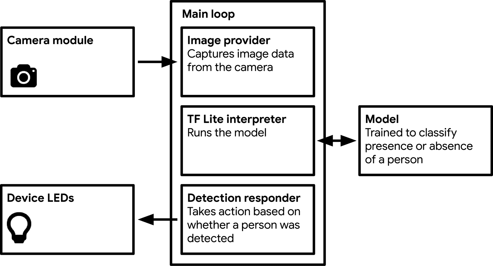
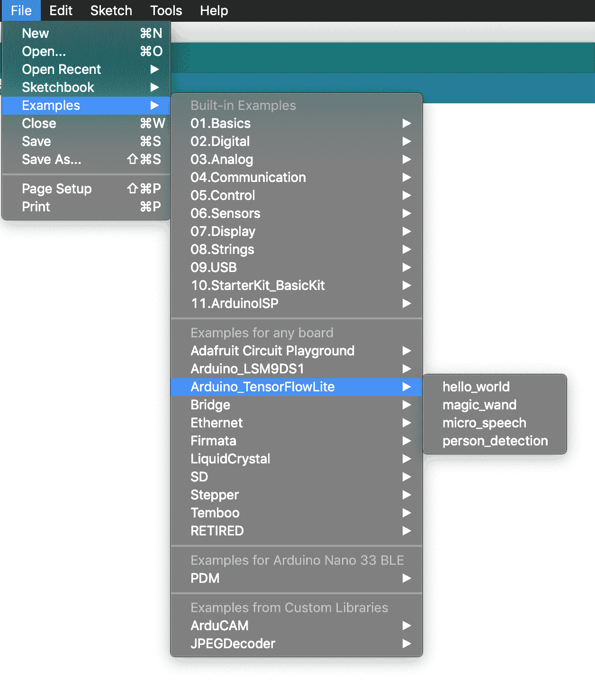
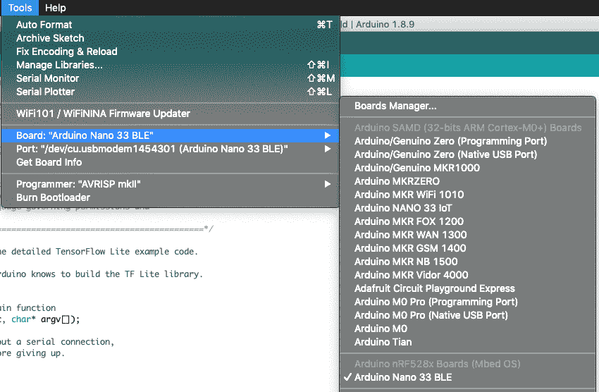
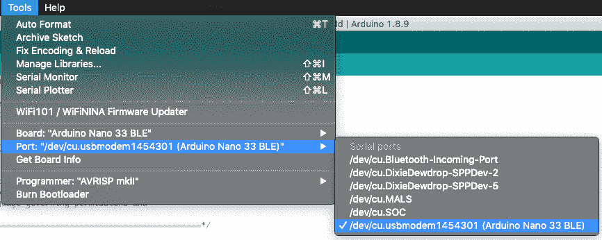
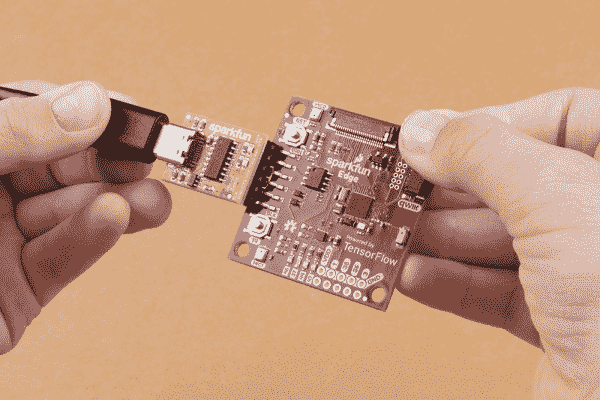
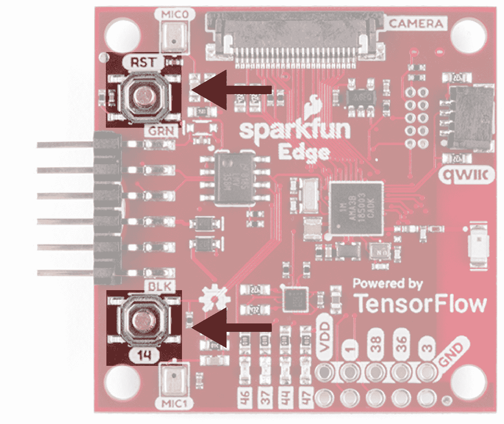

# 第 9 章 人物检测 构建人物检测应用程序

这部作品是用 AI 翻译的。我们期待您的意见和反馈：translation-feedback@oreilly.com

如果问到日常生活中影响最大的感官是什么，许多人会回答视觉。^(1)

视觉是一个非常有用的感官。多亏了视觉，无数自然生物能够在环境中导航、发现食物来源并避免危险。对于人类来说，视觉有助于识别朋友、解释符号信息并理解周围的世界。

直到最近，机器才没有视觉的力量。我们的大多数机器人只是用触觉传感器和接近传感器探查世界，从一系列碰撞中获得对其结构的知识。如果是人类，可以在不与对象交互的情况下，一眼就能描述出对象的形状、特征和用途。机器人没有这种好运。视觉信息太混乱、无结构且难以解释。

随着卷积神经网络的演进，制作*看*得见的程序变得简单了。受哺乳动物视觉皮层结构启发的 CNN 将极其复杂的输入过滤为已知模式和形状的映射，学习视觉世界的含义。通过准确组合这些片段，可以知道给定的数字图像中存在哪些实体。

今天，视觉模型被用于各种任务。自动驾驶汽车使用视觉发现道路上的危险。工厂机器人使用摄像头检测缺陷部件。研究人员正在训练模型从医学图像中诊断疾病。而且您的智能手机很可能正在使用面部识别来检查照片中的面部是否完美对焦。

具有视觉的机器可能会自动化以前无法触及的家务，改变我们的家庭和城市。然而，视觉是一种亲密的感官。我们中的许多人不希望自己的行为被记录或生活被流向云端。

想象一下具有内置摄像头“看”得见的家电。能够发现入侵者的安全系统、可以知道被遗忘的炉灶、房间无人时自动关闭电源的电视等。所有这些都与隐私密切相关。即使人类从未观看视频，内置互联网连接摄像头的常连接设备的安全含义对大多数消费者来说也不具吸引力。

但有了 TinyML，一切都改变了。想象一下智能炉灶，如果长时间无人照看就会关闭燃烧器。无需连接到互联网，使用小型微控制器“知道”附近是否有厨师，就可以获得智能设备的全部好处，而无需隐私权衡。

更进一步，具有视觉的小型设备可以进入视觉机器从未涉足的领域。由于功耗极低，基于微控制器的视觉可以在小电池上运行数月甚至数年。安装在丛林或珊瑚礁中，即使不在线也能计数濒危动物。

同样的技术也使得构建视觉传感器作为自包含的电子组件成为可能。该传感器如果视野中有特定对象则输出“1”，如果没有则输出“0”，但不会共享摄像头收集的图像数据。这种类型的传感器可以集成到从智能家居系统到家用汽车的任何产品中。对于自行车来说，如果后面有车来就可以闪烁灯光。空调可以知道人何时回家。而且由于图像数据不会离开内置传感器，即使产品连接到互联网也能保证安全。

本章介绍的应用程序使用预训练的人物检测模型在安装摄像头的微控制器上运行，以了解人类是否进入视野。第 10 章 将介绍该模型如何工作，以及如何训练您自己的模型来检测您想要的东西。

读完本章后，您将了解如何在微控制器上处理摄像头数据、如何使用视觉模型执行推理以及如何解释输出。实际操作后，您可能会对它的简单性感到惊讶！

## 我们在做什么

我们将构建一个嵌入式应用程序，使用模型对摄像头拍摄的图像进行分类。该模型经过训练，可以识别摄像头输入中是否存在人。也就是说，该应用程序可以检测人的存在与否，并据此生成输出。

这基本上就是前面描述的智能视觉传感器。当检测到人时，此示例代码会点亮 LED，但您可以扩展它来控制各种项目。

### 注

与 第 7 章 中处理的应用程序一样，此应用程序的源代码可以在 [TensorFlow GitHub 仓库](https://oreil.ly/9aLhs) 中找到。

与前一章一样，我们首先解释测试和应用程序代码，然后解释在各种设备上运行示例的逻辑。

我们提供将应用程序部署到以下微控制器平台的步骤：

*   [Arduino Nano 33 BLE Sense](https://oreil.ly/6qlMD)

*   [SparkFun Edge](https://oreil.ly/-hoL-)

### 注

TensorFlow Lite 定期为新设备添加支持，因此如果您想要的设备不在此列表中，查看示例的 [`README.md`](https://oreil.ly/6gRlo) 是值得的。此外，如果在以下步骤中遇到问题，也可以查看 `README.md` 以获取最新的部署说明。


与之前的章节不同，运行此应用程序需要额外添加一些硬件。由于两个板上都没有内置摄像头，因此建议购买摄像头模块。此信息可在各设备的部分中找到。

先从应用程序的结构开始看起。比想象中简单得多。

# 应用程序架构

到目前为止，我们了解到嵌入式机器学习应用程序执行以下序列：

1. 获取输入。
2. 为了提取适合作为模型输入的特征，对输入进行预处理。
3. 对处理后的输入执行推理。
4. 对模型的输出进行后处理使其具有意义。
5. 利用由此获得的信息使事情发生。

在第 7 章中，我们将其应用于以语音为输入的唤醒词检测。这次输入的是图像数据。听起来可能更复杂，但实际上比语音简单得多。

图像数据通常表示为像素值的数组。我们从嵌入式摄像头模块获取图像数据，它们都以这种格式提供数据。我们的模型也假设输入是像素值数组。因此，在将数据输入模型之前几乎不需要预处理。

考虑到几乎不需要预处理，我们的应用程序会相当简单。拍摄来自摄像头的数据的快照，将其输入模型，判断检测到哪个输出类别。然后以简单的方式显示结果。

在继续之前，让我们先多了解一下本次使用的模型。

## 模型介绍

在第 7 章中，我们了解到卷积神经网络是一种设计用于很好处理多维张量的神经网络，其中信息包含在相邻值组之间的关系中。特别适合处理图像数据。

我们的目标人物检测模型是一个在[Visual Wake Words 数据集上](https://oreil.ly/EC6nd)训练的卷积神经网络。该数据集由 115,000 张图像组成，每张图像都标注了是否包含人物。

该模型为 250KB，比我们的语音模型大得多。不仅占用更多内存，这个额外大小还意味着执行一次推理需要花费大量时间。

该模型接受 96×96 像素的灰度图像作为输入。每张图像作为形状为`(96, 96, 1)`的 3 维张量提供，最后一个维度包含表示一个像素的 8 位值。该值指定像素的色调，范围从 0（完全黑色）到 255（完全白色）。

摄像头模块返回各种分辨率的图像，因此需要将其调整为 96×96 像素。此外，还需要将全彩图像转换为灰度，以便模型使用。

96×96 像素可能看起来分辨率很小，但对于从每张图像中检测人物来说已经绰绰有余。处理图像的模型通常接受惊人小的分辨率。随着模型输入尺寸的增大，收益递减，而输入尺寸越大，网络的复杂性就会大幅增加。因此，即使是最先进的图像分类模型，通常也最多在 320×320 像素下运行。

一个表示输入中有人存在的概率，另一个表示无人存在的概率。概率范围为 0 到 255。

我们的目标人物检测模型使用`MobileNet`架构。该架构是一种设计用于在智能手机等设备上进行图像分类的知名且经过验证的架构。在第 10 章中，我们将学习该模型是如何适配到微控制器的，以及如何训练自己的模型。暂时，让我们继续探索我们的应用程序如何工作。

## 所有可动部件

图 9-1 显示了目标人物检测应用程序的结构。



正如前面所述，由于可以将图像数据直接传递给模型，因此不需要预处理。

保持事情简单的一个方面是，不对模型的输出进行平均化。我们的唤醒词模型每秒执行多次，因此为了获得稳定的结果需要对输出进行平均化。人物检测模型更大，执行推理需要时间。因此，不需要对输出进行平均化。

代码有五个主要部分：

主循环

: 

与其它示例类似，此应用程序在连续循环中运行。然而，我们的模型更大更复杂，因此执行推理需要时间。根据设备，预期的是每几秒一次推理，而不是每秒几次。

图像提供者

: 

此组件从摄像头捕获图像数据并将其写入输入张量。由于捕获图像的方法因设备而异，因此可以覆盖此组件进行自定义。

TensorFlow Lite 解释器

: 

解释器运行 TensorFlow Lite 模型，将输入图像转换为概率集合。

模型

: 

模型作为数据数组包含在内，由解释器执行。该模型为 250KB，对于 TensorFlow GitHub 仓库来说太大而无法提交。因此，在项目构建时由`Makefile`下载。如果想查看，可以从[`tf_lite_micro_person_data_grayscale.zip`从](https://oreil.ly/Ylq9m)下载。

检测响应器

: 

检测响应器接收模型输出的概率，并使用设备的输出功能将其显示出来。此响应器可以根据设备类型进行覆盖。此代码示例中点亮 LED，但也可以扩展以实现几乎任何功能。

为了了解这些部件如何组合起来，让我们看看各自的测试。

# 通过测试逐步了解

此应用程序简单且良好。所有内容都可以在[GitHub 仓库中](https://oreil.ly/31vB5)找到：

[`人物检测测试.cc`](https://oreil.ly/r4ny8)

: 

展示如何对表示一张图像的数组执行推理。

[`image_provider_test.cc`](https://oreil.ly/Js6M3)

: 

展示如何使用图像提供者捕获图像

[`detection_responder_test.cc`](https://oreil.ly/KBVLF)

: 

展示如何使用检测响应器输出检测结果。

首先，检查`person_detection_test.cc`，看看如何对图像数据执行推理。这是第三个示例，所以这段代码应该感觉很熟悉。你正在顺利地走向嵌入式 ML 开发者的道路！

## 基本流程

首先是`person_detection_test.cc`。首先从导入模型所需的运算符开始：

```
namespace tflite {
namespace ops {
namespace micro {
TfLiteRegistration* Register_DEPTHWISE_CONV_2D();
TfLiteRegistration* Register_CONV_2D();
TfLiteRegistration* Register_AVERAGE_POOL_2D();
}  // namespace micro
}  // namespace ops
}  // namespace tflite
```

接下来，定义适合模型大小的张量竞技场。按照惯例，这个数值是通过反复试验确定的：

```
const int tensor_arena_size = 70 * 1024;
uint8_t tensor_arena[tensor_arena_size];
```

接下来，进行典型的设置工作以准备解释器，例如使用`MicroMutableOpResolver`注册所需的 ops：

```
// Set up logging.
tflite::MicroErrorReporter micro_error_reporter;
tflite::ErrorReporter* error_reporter = &micro_error_reporter;

// Map the model into a usable data structure. This doesn't involve any
// copying or parsing, it's a very lightweight operation.
const tflite::Model* model = ::tflite::GetModel(g_person_detect_model_data);
if (model->version() != TFLITE_SCHEMA_VERSION) {
error_reporter->Report(
    "Model provided is schema version %d not equal "
    "to supported version %d.\n",
    model->version(), TFLITE_SCHEMA_VERSION);
}

// Pull in only the operation implementations we need.
tflite::MicroMutableOpResolver micro_mutable_op_resolver;
micro_mutable_op_resolver.AddBuiltin(
    tflite::BuiltinOperator_DEPTHWISE_CONV_2D,
    tflite::ops::micro::Register_DEPTHWISE_CONV_2D());
micro_mutable_op_resolver.AddBuiltin(tflite::BuiltinOperator_CONV_2D,
                                     tflite::ops::micro::Register_CONV_2D());
micro_mutable_op_resolver.AddBuiltin(
    tflite::BuiltinOperator_AVERAGE_POOL_2D,
    tflite::ops::micro::Register_AVERAGE_POOL_2D());

// Build an interpreter to run the model with.
tflite::MicroInterpreter interpreter(model, micro_mutable_op_resolver,
                                     tensor_arena, tensor_arena_size,
                                     error_reporter);
interpreter.AllocateTensors();
```

下一步是检查输入张量。检查输入张量是否具有预期的维度数，以及这些维度是否大小合适：

```
// Get information about the memory area to use for the model's input.
TfLiteTensor* input = interpreter.input(0);

// Make sure the input has the properties we expect.
TF_LITE_MICRO_EXPECT_NE(nullptr, input);
TF_LITE_MICRO_EXPECT_EQ(4, input->dims->size);
TF_LITE_MICRO_EXPECT_EQ(1, input->dims->data[0]);
TF_LITE_MICRO_EXPECT_EQ(kNumRows, input->dims->data[1]);
TF_LITE_MICRO_EXPECT_EQ(kNumCols, input->dims->data[2]);
TF_LITE_MICRO_EXPECT_EQ(kNumChannels, input->dims->data[3]);
TF_LITE_MICRO_EXPECT_EQ(kTfLiteUInt8, input->type);
```

从这里可以看出，输入严格来说是一个 5 维张量。第一个维度只是包含一个元素的包装器。接下来的两个维度表示图像像素的行和列。最后一个维度保存用于表示每个像素的颜色通道数。

表示预期尺寸的常量`kNumRows`、`kNumCols`、`kNumChannels`在[`model_settings.h`中](https://oreil.ly/ae2OI)定义：

```
constexpr int kNumCols = 96;
constexpr int kNumRows = 96;
constexpr int kNumChannels = 1;
```

如你所见，该模型接受 96×96 像素的位图。图像为灰度，每个像素有一个颜色通道。

接下来，使用`for`循环将测试图像复制到输入张量中：

```
// Copy an image with a person into the memory area used for the input.
const uint8_t* person_data = g_person_data;
for (int i = 0; i < input->bytes; ++i) {
    input->data.uint8[i] = person_data[i];
}
```

存储图像数据的变量`g_person_data`在`person_image_data.h`中定义。为了不向仓库增加更大的文件，数据本身在首次运行测试时作为模型的一部分与`tf_lite_micro_person_data_grayscale.zip`一起下载。

输入张量输入完成后，执行推理。与之前一样简单：

```
// Run the model on this input and make sure it succeeds.
TfLiteStatus invoke_status = interpreter.Invoke();
if (invoke_status != kTfLiteOk) {
    error_reporter->Report("Invoke failed\n");
}
TF_LITE_MICRO_EXPECT_EQ(kTfLiteOk, invoke_status);
```

在这里检查输出张量，确认其具有预期的大小和形状：

```
TfLiteTensor* output = interpreter.output(0);
TF_LITE_MICRO_EXPECT_EQ(4, output->dims->size);
TF_LITE_MICRO_EXPECT_EQ(1, output->dims->data[0]);
TF_LITE_MICRO_EXPECT_EQ(1, output->dims->data[1]);
TF_LITE_MICRO_EXPECT_EQ(1, output->dims->data[2]);
TF_LITE_MICRO_EXPECT_EQ(kCategoryCount, output->dims->data[3]);
TF_LITE_MICRO_EXPECT_EQ(kTfLiteUInt8, output->type);
```

模型输出有 4 个维度。前三个只是第四个维度的包装器，每个类别对应一个元素，该类别是模型训练过的。

类别总数、以及其他有用值与常量`kCategoryCount`一起位于`model_settings.h`中：

```
constexpr int kCategoryCount = 3;
constexpr int kPersonIndex = 1;
constexpr int kNotAPersonIndex = 2;
extern const char* kCategoryLabels[kCategoryCount];
```


`kCategoryCount` が示すように、出力には3つのカテゴリーがある。最初のカテゴリはたまたま未使用のカテゴリであり、無視することができる。定数 `kPersonIndex` に格納されているインデックスからわかるように、「person」カテゴリーは2 番目である。「not a person」カテゴリーは3 番目で、そのインデックスは `kNotAPersonIndex` で示されている。

正如 `kCategoryCount` 所示，输出包含三个类别。第一个类别恰好是未使用的类别，可以忽略。正如存储在常量 `kPersonIndex` 中的索引所示，“person”类别是第二个。“not a person”类别是第三个，其索引由 `kNotAPersonIndex` 表示。

また、カテゴリー・ラベルの配列 `kCategoryLabels` は [`model_settings.cc`](https://oreil.ly/AB0zS) に実装されている：

此外，类别标签数组 `kCategoryLabels` 在 [`model_settings.cc`](https://oreil.ly/AB0zS) 中实现：

```
const char* kCategoryLabels[kCategoryCount] = {
    "unused",
    "person",
    "notperson",
};
```

次のコードの塊は、「人物」と「人物なし」のスコアを記録し、「人物」のスコアの方が大きいことを主張する：

下一段代码块记录“人物”和“无人物”的分数，并断言“人物”的分数更大：

```
uint8_t person_score = output->data.uint8[kPersonIndex];
uint8_t no_person_score = output->data.uint8[kNotAPersonIndex];
error_reporter->Report(
    "person data.  person score: %d, no person score: %d\n", person_score,
    no_person_score);
TF_LITE_MICRO_EXPECT_GT(person_score, no_person_score);
```

`output->data.uint8[kPersonIndex]` `output->data.uint8[kNotAPersonIndex]` 出力テンソルの唯一のデータコンテンツは、クラス得点を表す3つの `uint8` 値であり、最初の値は未使用である。 `uint8` 型として、これらは最小値 0、最大値 255を持つ。

`output->data.uint8[kPersonIndex]` `output->data.uint8[kNotAPersonIndex]` 输出张量的唯一数据内容是表示类别分数的三个 `uint8` 值，第一个值未使用。作为 `uint8` 类型，它们最小值为 0，最大值为 255。

### 注

もし "person "と "no person "のスコアが同じような場合は、モデルが予測にあまり自信を持っていないことを意味する。この場合、結論は出ないと考えた方がいいだろう。

### 注

如果“person”和“no person”的分数相似，则意味着模型对预测不太有信心。在这种情况下，最好认为没有得出结论。

次に、`g_no_person_data` ：

接下来是 `g_no_person_data`：

```
const uint8_t* no_person_data = g_no_person_data;
for (int i = 0; i < input->bytes; ++i) {
    input->data.uint8[i] = no_person_data[i];
}
```

推論が実行された後、「人ではない」スコアの方が高いと断言する：

推理执行后，断言“不是人”的分数更高：

```
person_score = output->data.uint8[kPersonIndex];
no_person_score = output->data.uint8[kNotAPersonIndex];
error_reporter->Report(
    "no person data.  person score: %d, no person score: %d\n", person_score,
    no_person_score);
TF_LITE_MICRO_EXPECT_GT(no_person_score, person_score);
```

おわかりのように、ここでは派手なことは何も行われていない。スカラーやスペクトログラムの代わりに画像を入力することはあるが、推論のプロセスはこれまで見てきたものと同様だ。

正如您所见，这里没有进行任何花哨的操作。虽然输入的是图像而不是标量或频谱图，但推理过程与之前看到的相同。

テストを実行するのも同様に簡単だ。TensorFlowリポジトリのルートから以下のコマンドを実行するだけだ：

运行测试同样简单。只需从 TensorFlow 仓库的根目录执行以下命令：

```
make -f tensorflow/lite/micro/tools/make/Makefile \
  test_person_detection_test
```

テストを最初に実行すると、モデルと画像データがダウンロードされる。ダウンロードしたファイルを見たい場合は、 `tensorflow/lite/micro/tools/make/downloads/person_model_grayscale` で発見できる。

首次运行测试时，模型和图像数据将被下载。如果想查看下载的文件，可以在 `tensorflow/lite/micro/tools/make/downloads/person_model_grayscale` 找到。

次は、画像プロバイダーのインタフェースをチェックする。

接下来，检查图像提供者的接口。

## イメージ・プロバイダー

## 图像提供者

画像プロバイダはカメラからデータを取得し、モデルの入力テンソルに書き込むのに適した形式で返す。 [`image_provider.h`](https://oreil.ly/5Vjbe) ファイルでインタフェースが定義されている：

图像提供者从摄像头获取数据，并以适合写入模型输入张量的格式返回。接口在 [`image_provider.h`](https://oreil.ly/5Vjbe) 文件中定义：

```
TfLiteStatus GetImage(tflite::ErrorReporter* error_reporter, int image_width,
                      int image_height, int channels, uint8_t* image_data);
```

実際の実装はプラットフォーム固有なので、 [`person_detection/image_provider.cc`](https://oreil.ly/QoQ3O) にダミーデータを返すリファレンス実装がある。

由于实际实现是平台特定的，因此在 [`person_detection/image_provider.cc`](https://oreil.ly/QoQ3O) 中有一个返回虚拟数据的参考实现。

[`image_provider_test.cc`](https://oreil.ly/Nbl9x) のテストでは、このリファレンス実装を呼び出し、その使用方法を示している。最初の仕事は、画像データを保持するための配列を作成することだ。これは次の行で行われる：

在 [`image_provider_test.cc`](https://oreil.ly/Nbl9x) 的测试中，调用此参考实现并展示其使用方法。第一项工作是创建用于保存图像数据的数组。这在下一行完成：

```
uint8_t image_data[kMaxImageSize];
```

定数 `kMaxImageSize` は、古くからの友人である [`model_settings.h`](https://oreil.ly/5naFK) から来ている。

常量 `kMaxImageSize` 来自老朋友 [`model_settings.h`](https://oreil.ly/5naFK)。

この配列をセットアップしたら、`GetImage()` 関数を呼び出して、カメラから画像をキャプチャすることができる：

设置好此数组后，可以调用 `GetImage()` 函数从摄像头捕获图像：

```
TfLiteStatus get_status =
    GetImage(error_reporter, kNumCols, kNumRows, kNumChannels, image_data);
TF_LITE_MICRO_EXPECT_EQ(kTfLiteOk, get_status);
TF_LITE_MICRO_EXPECT_NE(image_data, nullptr);
```

この関数には、`ErrorReporter` インスタンス、必要な列数、行数、チャンネル数、`image_data` 配列へのポインタを指定して呼び出す。関数はこの配列に画像データを書き込む。この関数の戻り値をチェックすることで、キャプチャ処理が成功したかどうかを判断することができる。この戻り値には、問題があれば `kTfLiteError` 、そうでなければ `kTfLiteOk` がセットされる。

调用此函数时指定 `ErrorReporter` 实例、所需的列数、行数、通道数以及指向 `image_data` 数组的指针。函数将图像数据写入此数组。通过检查此函数的返回值，可以判断捕获过程是否成功。如果有问题，返回值将设置为 `kTfLiteError`，否则为 `kTfLiteOk`。

最後に、テストは返されたデータをウォークスルーし、すべてのメモリロケーションが読み取り可能であることを示す。厳密には画像には行、列、チャンネルがあるが、実際にはデータは1 次元配列に平坦化される：

最后，测试遍历返回的数据，表明所有内存位置都是可读的。严格来说，图像具有行、列和通道，但实际上数据被展平为一维数组：

```
uint32_t total = 0;
for (int i = 0; i < kMaxImageSize; ++i) {
    total += image_data[i];
}
```

このテストを実行するには、以下のコマンドを使用する：

要运行此测试，请使用以下命令：

```
make -f tensorflow/lite/micro/tools/make/Makefile \
  test_image_provider_test
```

この章の後半で、`image_provider.cc` のデバイス固有の実装を検証する。今は、検出レスポンダのインタフェースを見てみよう。

本章后半部分将验证 `image_provider.cc` 的设备特定实现。现在，让我们看看检测响应器的接口。

## ディテクション・レスポンダー

## 检测响应器

最後のテストでは、検出レスポンダがどのように使われるかを示す。これは推論の結果を伝えるコードである。そのインタフェースは [`detection_responder.h`](https://oreil.ly/cTptj) で定義され、テストは [`detection_responder_test.cc`](https://oreil.ly/Igx7a) にある。

最后一个测试展示了检测响应器的使用方式。这是传递推理结果的代码。其接口在 [`detection_responder.h`](https://oreil.ly/cTptj) 中定义，测试位于 [`detection_responder_test.cc`](https://oreil.ly/Igx7a)。

インタフェースはいたってシンプルだ：

接口非常简单：

```
void RespondToDetection(tflite::ErrorReporter* error_reporter,
                        uint8_t person_score, uint8_t no_person_score);
```

私たちは「人」と「人ではない」の両方のカテゴリーの得点を呼び出し、そこからどうするかを決めるだけだ。

我们只需调用“人”和“非人”两个类别的分数，然后决定下一步怎么做。

[`detection_responder.cc`](https://oreil.ly/5Wjjt) のリファレンス実装は、これらの値を記録するだけである。`detection_responder_test.cc` のテストでは、この関数を数回呼び出している：

[`detection_responder.cc`](https://oreil.ly/5Wjjt) 的参考实现仅记录这些值。`detection_responder_test.cc` 的测试多次调用此函数：

```
RespondToDetection(error_reporter, 100, 200);
RespondToDetection(error_reporter, 200, 100);
```

テストを実行して出力を見るには、以下のコマンドを使用する：

要运行测试并查看输出，请使用以下命令：

```
make -f tensorflow/lite/micro/tools/make/Makefile \
  test_detection_responder_test
```

ここまで、すべてのテストと、それらが行使するインタフェースについて見てきた。では、次はプログラミングそのものを見ていこう。

到目前为止，我们已经查看了所有测试以及它们使用的接口。那么，接下来让我们看看编程本身。

# 人を検出する

# 检测人

アプリケーションのコア関数は [`main_functions.cc`](https://oreil.ly/64oHW) にある。これらの関数は短くて簡単で、そのロジックの多くをテストで見てきた。

应用程序的核心函数位于 [`main_functions.cc`](https://oreil.ly/64oHW)。这些函数简短易懂，其大部分逻辑我们在测试中已经看到过。

まず、モデルが必要とするすべてのオペレーションを引き込む：

首先，引入模型所需的所有操作：

```
namespace tflite {
namespace ops {
namespace micro {
TfLiteRegistration* Register_DEPTHWISE_CONV_2D();
TfLiteRegistration* Register_CONV_2D();
TfLiteRegistration* Register_AVERAGE_POOL_2D();
}  // namespace micro
}  // namespace ops
}  // namespace tflite
```

次に、重要な可動部分を保持するために、たくさんの変数を宣言する：

接下来，声明许多变量以保存关键的可移动部件：

```
tflite::ErrorReporter* g_error_reporter = nullptr;
const tflite::Model* g_model = nullptr;
tflite::MicroInterpreter* g_interpreter = nullptr;
TfLiteTensor* g_input = nullptr;
```

その後、テンソル演算のためにワーキングメモリを確保する：

然后，为张量运算分配工作内存：

```
constexpr int g_tensor_arena_size = 70 * 1024;
static uint8_t tensor_arena[kTensorArenaSize];
```

`setup()` 関数では、他のことが起こる前に実行され、エラー・レポーターを作成し、モデルをロードし、インタプリタ・インスタンスをセットアップし、モデルの入力テンソルへの参照を取得する：

在 `setup()` 函数中，在其他事情发生之前执行，创建错误报告器、加载模型、设置解释器实例并获取模型输入张量的引用：

```
void setup() {
  // Set up logging.
  static tflite::MicroErrorReporter micro_error_reporter;
  g_error_reporter = &micro_error_reporter;

  // Map the model into a usable data structure. This doesn't involve any
  // copying or parsing, it's a very lightweight operation.
  g_model = tflite::GetModel(g_person_detect_model_data);
  if (g_model->version() != TFLITE_SCHEMA_VERSION) {
    g_error_reporter->Report(
        "Model provided is schema version %d not equal "
        "to supported version %d.",
        g_model->version(), TFLITE_SCHEMA_VERSION);
    return;
  }

  // Pull in only the operation implementations we need.
  static tflite::MicroMutableOpResolver micro_mutable_op_resolver;
  micro_mutable_op_resolver.AddBuiltin(
      tflite::BuiltinOperator_DEPTHWISE_CONV_2D,
      tflite::ops::micro::Register_DEPTHWISE_CONV_2D());
  micro_mutable_op_resolver.AddBuiltin(tflite::BuiltinOperator_CONV_2D,
                                       tflite::ops::micro::Register_CONV_2D());
  micro_mutable_op_resolver.AddBuiltin(
      tflite::BuiltinOperator_AVERAGE_POOL_2D,
      tflite::ops::micro::Register_AVERAGE_POOL_2D());

  // Build an interpreter to run the model with.
  static tflite::MicroInterpreter static_interpreter(
      model, micro_mutable_op_resolver, tensor_arena, kTensorArenaSize,
      error_reporter);
  interpreter = &static_interpreter;

  // Allocate memory from the tensor_arena for the model's tensors.
  TfLiteStatus allocate_status = interpreter->AllocateTensors();
  if (allocate_status != kTfLiteOk) {
    error_reporter->Report("AllocateTensors() failed");
    return;
  }

  // Get information about the memory area to use for the model's input.
  input = interpreter->input(0);
}
```

コードの次の部分は、プログラミングのメインループで継続的に呼び出される。まず、画像プロバイダーを使って画像を取り込み、入力テンソルへの参照を渡して、画像が直接そこに書き込まれるようにする：

代码的下一部分在编程的主循环中持续调用。首先，使用图像提供者获取图像，并传递输入张量的引用，使图像直接写入其中：

```
void loop() {
  // Get image from provider.
  if (kTfLiteOk != GetImage(g_error_reporter, kNumCols, kNumRows, kNumChannels,
                            g_input->data.uint8)) {
    g_error_reporter->Report("Image capture failed.");
  }
```

次に推論を実行し、出力テンソルを取得し、そこから「人」と「人なし」のスコアを読み取る。これらのスコアは検出レスポンダの `RespondToDetection()` 関数に渡される：

然后执行推理，获取输出张量，并从中读取“人”和“无人物”的分数。这些分数传递给检测响应器的 `RespondToDetection()` 函数：

```
  // Run the model on this input and make sure it succeeds.
  if (kTfLiteOk != g_interpreter->Invoke()) {
    g_error_reporter->Report("Invoke failed.");
  }

  TfLiteTensor* output = g_interpreter->output(0);

  // Process the inference results.
  uint8_t person_score = output->data.uint8[kPersonIndex];
  uint8_t no_person_score = output->data.uint8[kNotAPersonIndex];
  RespondToDetection(g_error_reporter, person_score, no_person_score);
}
```

`RespondToDetection()` が結果を出力し終えると、`loop()` 関数が戻り、プログラムのメインループから再び呼び出される準備が整う。

`RespondToDetection()` 输出结果后，`loop()` 函数返回，准备好从程序主循环再次调用。

ループ自体は、 [`main.cc`](https://oreil.ly/_PR3L) にあるプログラムの `main()` 関数内で定義されている。`setup()` 関数を一度呼び出し、`loop()` 関数を繰り返し無期限に呼び出す：

循环本身在程序的 `main()` 函数内定义，该函数位于 [`main.cc`](https://oreil.ly/_PR3L)。它调用一次 `setup()` 函数，然后无限重复调用 `loop()` 函数：


```
int main(int argc, char* argv[]) {
  setup();
  while (true) {
    loop();
  }
}
```

这就是编程的全部！这个例子之所以出色，是因为它展示了处理精致的机器学习模型可以惊人地简单。模型包含了所有的复杂性，只需提供数据即可。

在继续之前，你可以在本地运行并尝试编程。图像提供者的参考实现只返回虚拟数据，因此无法获得有意义的识别结果，但至少可以看到正在运行的代码。

首先，使用此命令构建程序：

```
make -f tensorflow/lite/micro/tools/make/Makefile person_detection
```

构建完成后，可以使用以下命令运行示例：

```
tensorflow/lite/micro/tools/make/gen/osx_x86_64/bin/ \
person_detection
```

按下 Ctrl-C 结束之前，你可以看到程序的输出在滚动：

```
person score:129 no person score 202
person score:129 no person score 202
person score:129 no person score 202
person score:129 no person score 202
person score:129 no person score 202
person score:129 no person score 202
```

下一节将介绍在各平台上捕获相机图像并输出结果的设备特定代码。还将介绍如何部署和运行此代码。

# 部署到微控制器

本节将我们的代码部署到两个常见的设备上：

* [Arduino Nano 33 BLE Sense](https://oreil.ly/6qlMD)
* [SparkFun Edge](https://oreil.ly/-hoL-)

这里有一个很大的不同。两个设备都没有内置摄像头，因此建议根据使用的设备购买摄像头模块。每个设备都有 `image_provider.cc` 的实现，用于与摄像头模块接口并捕获图像。此外，设备特定的输出代码也在 `detection_responder.cc` 中。

这非常简单，因此在创建自己的基于概念的 ML 应用程序时将成为一个很好的模板。

首先让我们研究 Arduino 的实现。

## Arduino

Arduino 板 Arduino Nano 33 BLE Sense 可以访问庞大的兼容第三方硬件和库的生态系统。我们使用为 Arduino 设计的第三方摄像头模块，以及用于与摄像头模块接口并理解摄像头模块输出数据的 Arduino 库。

### 购买哪个摄像头模块

在本例中，我们使用的是 [Arducam Mini 2MP Plus](https://oreil.ly/LAwhb) 摄像头模块。它可以轻松连接到 Arduino Nano 33 BLE Sense，并由 Arduino 板供电。它具有大镜头，可以拍摄高质量的 2 兆像素图像，但使用板载图像重新缩放功能获得更小的分辨率。尽管在功耗方面并不特别高效，但由于画质高，非常适合构建记录野生动物等图像捕获应用程序。

### 在 Arduino 上捕获图像

将 Arducam 模块通过一些引脚连接到 Arduino 板。要获取图像数据，请向 Arducam 发送捕获图像的命令。Arducam 会执行此操作并将图像保存在内部数据缓冲区中。接下来，发送命令从 Arducam 的内部缓冲区读取图像数据并将其保存在 Arduino 的内存中。为此，我们使用 Arducam 的官方库。

Arducam 摄像头模块具有 2 兆像素的图像传感器，分辨率为 1920×1080。我们的目标检测模型的输入大小只有 96×96，因此不需要所有数据。实际上，Arduino 本身没有足够的内存来保存 2 兆像素的图像，其大小为数兆字节。

幸运的是，Arducam 的硬件具有将输出调整为相当小的 160×120 像素分辨率的功能。我们的代码通过仅保留中央的 96×96 像素，将其轻松裁剪为 96×96 像素。然而，使问题复杂化的是，Arducam 的调整后输出使用图像的通用压缩格式 [使用 JPEG](https://oreil.ly/gwWDh) 进行编码。这意味着在使用 Arducam 的输出之前需要对其进行解码。这可以使用开源库来完成。

最后的任务是将 Arducam 的彩色图像输出转换为灰度。将灰度数据写入模型的输入张量。

图像提供者已实现在 [`arduino/image_provider.cc` 中](https://oreil.ly/kGx0-)。此代码特定于 Arducam 摄像头模块，因此我们不会详细介绍。相反，我们将逐步概述高层上发生了什么。

`GetImage()` 函数是图像提供者与世界之间的接口。在应用程序的主循环中调用它以获取图像数据的帧。第一次调用时，需要初始化摄像头。这是通过调用 `InitCamera()` 函数完成的：

```
  static bool g_is_camera_initialized = false;
  if (!g_is_camera_initialized) {
    TfLiteStatus init_status = InitCamera(error_reporter);
    if (init_status != kTfLiteOk) {
      error_reporter->Report("InitCamera failed");
      return init_status;
    }
    g_is_camera_initialized = true;
  }
```

`InitCamera()` 函数在 `image_provider.cc` 中定义。此函数是设备特定的，因此此处不予说明。它设置 Arduino 的硬件以便与 Arduino 通信，并确认通信正常。最后，它指示 Arducam 输出 160×120 像素的 JPEG 图像。

`GetImage()` 接下来调用的函数是 `PerformCapture()`：

```
TfLiteStatus capture_status = PerformCapture(error_reporter);
```

这里也省略细节。它只是向摄像头模块发送命令，指示其捕获图像并将图像数据存储在内部缓冲区中。然后等待图像捕获完成的确认。此时，图像数据在 Arduino 的内部缓冲区中等待，但 Arduino 本身还没有图像数据。

接下来调用的函数是 `ReadData()`：

```
  TfLiteStatus read_data_status = ReadData(error_reporter);
```

`ReadData()` 函数使用更多命令从 Arducam 获取图像数据。函数执行后，摄像头获取的 JPEG 编码图像数据将存储在全局变量 `jpeg_buffer` 中。

获得 JPEG 编码图像后，下一步是将其解码为原始图像数据。这是在 `DecodeAndProcessImage()` 函数中完成的：

```
  TfLiteStatus decode_status = DecodeAndProcessImage(
      error_reporter, image_width, image_height, image_data);
```

此函数使用名为 `JPEGDecoder` 的库解码 JPEG 数据并直接写入模型的输入张量。在此过程中，它会裁剪图像，丢弃 160×120 像素数据的一部分，仅保留图像几乎中央的 96×96 像素。此外，它还会将图像的 16 位彩色表示缩小为 8 位灰度。

图像被捕获并存储在输入张量中后，即可准备好执行推理。接下来，说明模型的输出如何显示。

### 在 Arduino 上响应检测

Arduino Nano 33 BLE Sense 内置 RGB LED。这是一个单一组件，可以单独控制红色、绿色和蓝色 LED。检测响应器的实现在每次推理执行时闪烁蓝色 LED。当检测到人时绿色 LED 会亮起，未检测到人时红色 LED 会亮起。

实现位于 [`arduino/detection_responder.cc` 中](https://oreil.ly/-WsSN)。让我们大致看一下。

`RespondToDetection()` 函数接收两个分数：“人”和“非人”。第一次调用时，设置并输出蓝色、绿色和黄色 LED：

```
void RespondToDetection(tflite::ErrorReporter* error_reporter,
                        uint8_t person_score, uint8_t no_person_score) {
  static bool is_initialized = false;
  if (!is_initialized) {
    pinMode(led_green, OUTPUT);
    pinMode(led_blue, OUTPUT);
    is_initialized = true;
  }
```

接下来，为了指示推理完成，切换所有 LED 并短暂闪烁蓝色 LED：

```
  // Note: The RGB LEDs on the Arduino Nano 33 BLE
  // Sense are on when the pin is LOW, off when HIGH.

  // Switch the person/not person LEDs off
  digitalWrite(led_green, HIGH);
  digitalWrite(led_red, HIGH);

  // Flash the blue LED after every inference.
  digitalWrite(led_blue, LOW);
  delay(100);
  digitalWrite(led_blue, HIGH);
```

与 Arduino 的内置 LED 不同，这些 LED 在 `LOW` 时点亮，在 `HIGH` 时熄灭。这只是 LED 如何连接到板上的因素。

接下来，根据哪个类别分数更高，点亮或熄灭相应的 LED：

```
  // Switch on the green LED when a person is detected,
  // the red when no person is detected
  if (person_score > no_person_score) {
    digitalWrite(led_green, LOW);
    digitalWrite(led_red, HIGH);
  } else {
    digitalWrite(led_green, HIGH);
    digitalWrite(led_red, LOW);
  }
```

最后，使用 `error_reporter` 实例将分数输出到串行端口：

```
  error_reporter->Report("Person score: %d No person score: %d", person_score,
                         no_person_score);
}
```

就这样！此函数的核心是一个基本的 `if`。使用类似的逻辑可以轻松控制其他类型的输出。将这种复杂的视觉输入转换为一个布尔输出是令人兴奋的：“人”或“无人”。

### 运行示例

因为需要将 Arducam 连接到 Arduino 板。此外，还需要安装和配置用于与 Arducam 接口并解码 JPEG 输出的库。但不用担心！

部署此示例所需的内容如下：

* Arduino Nano 33 BLE Sense 板
* Arducam Mini 2MP Plus
* 跳线电缆（可选使用面包板）
* Micro USB 电缆
* Arduino IDE

首先的工作是使用跳线电缆将 Arduino 和 Arducam 连接起来。这不是一本电子工程书，所以不会详细介绍电缆的使用。相反，表 9-1 显示了引脚的连接方式。引脚在每个设备上都有标签。

表 9-1. Arduino Nano 33 BLE Sense 上的 Arduam Mini 2MP Plus 连接

| Arducam 引脚 || Arduino 引脚 |
| --- | --- |
| CS || D7（无标签，D6 的正右方） |
| --- | --- |
| MOSI || D11 |
| MISO || D12 |
| SCK || D13 |
| GND || GND（标有 GND 的任意引脚均可） |
| VCC || 3.3 V |
| SDA || A4 |
| SCL || A5 |

硬件设置完成后，可以继续进行软件安装。

**提示**

由于本书撰写时与构建步骤可能有所变化，请查看 [`README.md`](https://oreil.ly/CR5Pb) 以获取最新步骤。

本书的项目可作为 TensorFlow Lite Arduino 库的示例代码使用。如果尚未安装库，请打开 Arduino IDE，从 Tools 菜单中选择 Manage Libraries。在出现的窗口中搜索名为 `Arduino_TensorFlowLite` 的库并安装。应该可以使用最新版本，但如果出现问题，本书中测试的版本为 1.14-ALPHA。

**注**

此库可以从 TensorFlow Lite 团队 [下载](https://oreil.ly/blgB8) 或使用 TensorFlow Lite for Microcontrollers Makefile 自行生成*。*如果希望后者，请参阅 附录 A。

安装库后，如 图 9-2 所示，`person_detection` 示例将显示在 File 菜单的 Examples→`Arduino_TensorFlowLite` 中。



点击 `person_detection` 加载示例。会显示一个新窗口，显示每个源文件的标签。第一个标签中的文件 `person_detection` 等同于前面描述的 `main_functions.cc`。

**注**

由于在 「运行示例」中 已经说明了 Arduino 示例的结构，这里不再重复。

除了 TensorFlow 库外，还需要安装两个库：

* Arducam 库使我们的代码能够与硬件接口。
* `JPEGDecoder` 库使我们能够解码 JPEG 编码的图像。


Arduino 库可以从 [从 GitHub 获取](https://oreil.ly/93OKK)。要安装，请下载或克隆仓库。然后将 `ArduCAM` 子目录复制到 `Arduino/libraries` 目录。要找到机器上的 `libraries` 目录，请在 Arduino IDE 的 Preferences 窗口中检查 Sketchbook 的位置。

下载库后，需要编辑库文件以确保其配置为 Arducam Mini 2MP Plus。为此，请打开 `Arduino/libraries/ArduCAM/memorysaver.h`。

应该会显示 `#define` 列表。请确认除 `#define OV2640_MINI_2MP_PLUS` 外的所有内容都已注释掉，如下所示：

```
 //Step 1: select the hardware platform, only one at a time
 //#define OV2640_MINI_2MP
 //#define OV3640_MINI_3MP
 //#define OV5642_MINI_5MP
 //#define OV5642_MINI_5MP_BIT_ROTATION_FIXED
 #define OV2640_MINI_2MP_PLUS
 //#define OV5642_MINI_5MP_PLUS
 //#define OV5640_MINI_5MP_PLUS
```

保存文件后，Arducam 库的配置就完成了。

### 提示

本示例使用 Arducam 库的提交 #e216049 开发。如果在库中遇到问题，请下载此特定提交，以确保使用完全相同的代码。

下一步是安装 JPEGDecoder 库。这可以通过 Arduino IDE 完成。选择 `Tools` 菜单中的 `Manage Libraries` 选项，搜索 `JPEGDecoder`。安装库的版本 1.8.0。

安装库后，需要对其进行配置以禁用与 Arduino Nano 33 BLE Sense 不兼容的可选组件。打开 `Arduino/libraries/JPEGDecoder/src/User_Config.h`，并确认 `#define LOAD_SD_LIBRARY` 和 `#define LOAD_SDFAT_LIBRARY` 都已注释掉，如本文件摘录所示：

```
 // Comment out the next #defines if you are not using an SD Card to store
 // the JPEGs
 // Commenting out the line is NOT essential but will save some FLASH space if
 // SD Card access is not needed. Note: use of SdFat is currently untested!

 //#define LOAD_SD_LIBRARY // Default SD Card library
 //#define LOAD_SDFAT_LIBRARY // Use SdFat library instead, so SD Card SPI can
                              // be bit bashed
```

保存文件后，库的安装就完成了。现在可以准备运行人物检测应用程序了！

将 Arduino 设备通过 USB 连接。如下图所示 图 9-3，请确认在工具菜单的板子下拉列表中选择了正确的设备类型。



如果设备名称未在列表中显示，则需要安装支持包。为此，请点击 `Boards Manager`。在出现的窗口中搜索设备，并安装相应支持包的最新版本。

在 `Tools` 菜单的 `Port` 下拉列表中，确认已选择设备的端口。



最后，在 Arduino 窗口中点击上传按钮（图 9-5 中以白色高亮显示），编译代码并上传到 Arduino 设备。


上传成功完成后，程序会立即运行。

要测试，首先将设备的摄像头对准非人物体或遮住镜头。接下来，当蓝色 LED 闪烁时，设备会从摄像头捕获帧并开始推理。用于人物检测的推理模型相对较大，因此推理需要较长时间。截至撰写时约为 19 秒，但此后 TensorFlow Lite 可能已得到加速。

推理完成后，其结果会转换为另一个 LED 点亮。由于摄像头对准的是非人物体，因此红色 LED 应该会点亮。

现在，让我们将设备的摄像头对准自己！当蓝色 LED 下次闪烁时，设备会捕获另一张图像并开始推理。大约 19 秒后，绿色 LED 应该会点亮。

请记住，图像数据在每次推理之前都会在蓝色 LED 闪烁时作为快照捕获。此时摄像头所对准的内容将被输入模型。在下一次图像被捕获、蓝色 LED 再次闪烁之前，摄像头指向何处并不重要。

如果出现看似不正确的结果，请确认处于光线良好的环境中。还需检查摄像头的方向是否正确、引脚是否向下、拍摄的图像方向是否正确。此外，请记住这是一个以精度换取小巧的小型模型。它工作得非常好，但并不总是 100% 准确。

推理结果也可以在 Arduino Serial Monitor 中查看。为此，请从工具菜单打开串行监视器。会显示详细日志，说明应用程序运行期间发生了什么。此外，如果在 "Show timestamp " 框中打勾，可以查看每个过程所需的时间：

```
14:17:50.714 -> Starting capture
14:17:50.714 -> Image captured
14:17:50.784 -> Reading 3080 bytes from ArduCAM
14:17:50.887 -> Finished reading
14:17:50.887 -> Decoding JPEG and converting to greyscale
14:17:51.074 -> Image decoded and processed
14:18:09.710 -> Person score: 246 No person score: 66
```

从此日志可以看出，摄像头模块图像数据的捕获和读取约需 170 毫秒，JPEG 解码和转换为灰度约需 180 毫秒，推理执行约需 18.6 秒。

### 自行修改

在部署了基本应用程序后，让我们尝试修改代码。编辑并保存 Arduino IDE 中的文件，然后重复之前的步骤将修改后的代码部署到设备上。

有几件事可以尝试：

*   修改检测响应器，使其忽略“人”和“无人”分数差异不大的模糊输入。
*   使用人物检测结果控制其他组件，如额外的 LED 或舵机。
*   构建智能安全摄像头，保存或发送图像。

## SparkFun Edge

SparkFun Edge 板针对低功耗进行了优化。与同样高效的摄像头模块结合使用时，它成为构建电池供电推理应用程序的理想平台。通过板上的排线电缆适配器连接摄像头模块非常简单。

### 购买哪个摄像头模块

本示例使用 SparkFun 公司的 [Himax HM01B0 breakout 摄像头模块](https://oreil.ly/H24xS)。它基于 320×320 像素的图像传感器，功耗极低：在 30 帧/秒（FPS）下捕获时，功耗低于 2mW。

### 在 SparkFun Edge 上捕获图像

要使用 Himax HM01B0 摄像头模块开始捕获图像，首先需要初始化摄像头。完成后，每当需要新图像时都可以从摄像头读取帧。帧是表示摄像头当前所能看到内容的字节数组。

对于此摄像头，将大量使用作为构建过程一部分下载的 Ambiq Apollo3 SDK 以及位于 `sparkfun_edge/himax_driver` 中的 HM01B0 驱动程序。

图像提供程序实现在 ` sparkfun_edge/image_provider.cc` 中。此代码特定于 SparkFun 板和 Himax 摄像头模块，因此不详细介绍。相反，让我们逐步说明高层发生了什么。

`GetImage()` 函数是图像提供程序与世界的接口。它在应用程序的主循环中被调用，以获取图像数据的帧。首次调用时，需要初始化摄像头。这通过调用 `InitCamera()` 函数来完成：

```
 // Capture single frame.  Frame pointer passed in to reduce memory usage.  This
 // allows the input tensor to be used instead of requiring an extra copy.
 TfLiteStatus GetImage(tflite::ErrorReporter* error_reporter, int frame_width,
                       int frame_height, int channels, uint8_t* frame) {
   if (!g_is_camera_initialized) {
     TfLiteStatus init_status = InitCamera(error_reporter);
     if (init_status != kTfLiteOk) {
       am_hal_gpio_output_set(AM_BSP_GPIO_LED_RED);
       return init_status;
     }
```

如果 `InitCamera()` 返回除 `kTfLiteOk` 之外的状态，则会点亮板上的红色 LED（使用 `am_hal_gpio_output_set(AM_BSP_GPIO_LED_RED)`）以指示问题。这有助于调试。

`InitCamera()` 函数在 `image_provider.cc` 中定义。此函数非常特定于设备，因此此处不作说明。如果想在自己的代码中使用，可以直接复制粘贴。

调用 Apollo3 SDK 的函数，设置微控制器的输入输出，使其能够与摄像头模块通信。还启用摄像头用于发送新图像数据的机制——中断。一旦所有设置完成，就使用摄像头驱动程序打开摄像头的电源并将其配置为持续捕获图像。

摄像头模块具有自动曝光功能，帧被捕获时会自动校准曝光设置。为了在推理前进行校准，`GetImage()` 函数的下一部分使用摄像头驱动程序的 `hm01b0_blocking_read_oneframe_scaled()` 函数捕获一些帧。捕获的数据不做任何处理。这只是为了给摄像头模块的自动曝光功能提供处理材料：

```
     // Drop a few frames until auto exposure is calibrated.
     for (int i = 0; i < kFramesToInitialize; ++i) {
       hm01b0_blocking_read_oneframe_scaled(frame, frame_width, frame_height,
                                            channels);
     }
     g_is_camera_initialized = true;
   }
```

设置完成后，只需调用 `GetImage()` 中的 `hm01b0_blocking_read_oneframe_scaled()` 来捕获图像：

```
 hm01b0_blocking_read_oneframe_scaled(frame, frame_width, frame_height,
                                      channels);
```

在应用程序的主循环中调用 `GetImage()` 时，`frame` 变量是指向输入张量的指针，因此数据会由摄像头驱动程序直接写入分配给输入张量的内存区域。还指定了宽度、高度和通道数。

通过此实现，可以从摄像头模块获取图像数据。接下来，让我们看看如何对模型的输出做出反应。

### 在 SparkFun Edge 上响应检测

检测响应器的实现与唤醒词示例中的命令响应器非常相似。每次执行推理时，设备会切换蓝色 LED。检测到人时绿色 LED 点亮，未检测到人时黄色 LED 点亮。

实现位于 ` sparkfun_edge/detection_responder.cc`。让我们大致看一下。

`RespondToDetection()` 函数接收“人”和“非人”两个分数。首次调用时，设置蓝色、绿色和黄色 LED 为输出：

```
 void RespondToDetection(tflite::ErrorReporter* error_reporter,
                         uint8_t person_score, uint8_t no_person_score) {
   static bool is_initialized = false;
   if (!is_initialized) {
     // Setup LED's as outputs.  Leave red LED alone since that's an error
     // indicator for sparkfun_edge in image_provider.
     am_hal_gpio_pinconfig(AM_BSP_GPIO_LED_BLUE, g_AM_HAL_GPIO_OUTPUT_12);
     am_hal_gpio_pinconfig(AM_BSP_GPIO_LED_GREEN, g_AM_HAL_GPIO_OUTPUT_12);
     am_hal_gpio_pinconfig(AM_BSP_GPIO_LED_YELLOW, g_AM_HAL_GPIO_OUTPUT_12);
     is_initialized = true;
   }
```

此函数每次推理调用一次，因此以下代码片段会在每次执行推理时切换蓝色 LED 的点亮和熄灭：

```
 // Toggle the blue LED every time an inference is performed.
 static int count = 0;
 if (++count & 1) {
     am_hal_gpio_output_set(AM_BSP_GPIO_LED_BLUE);
 } else {
     am_hal_gpio_output_clear(AM_BSP_GPIO_LED_BLUE);
 }
```

最后，如果检测到人，则点亮绿色 LED；如果未检测到，则点亮蓝色 LED。此外，使用 `ErrorReporter` 实例记录分数：


```
am_hal_gpio_output_clear(AM_BSP_GPIO_LED_YELLOW);
am_hal_gpio_output_clear(AM_BSP_GPIO_LED_GREEN);
if (person_score > no_person_score) {
    am_hal_gpio_output_set(AM_BSP_GPIO_LED_GREEN);
} else {
    am_hal_gpio_output_set(AM_BSP_GPIO_LED_YELLOW);
}

error_reporter->Report("person score:%d no person score %d", person_score,
                        no_person_score);
```

就这样结束了！这个函数核心是基本的 `if`。使用类似的逻辑，你也可以轻松控制其他类型的输出。将这种复杂的视觉输入转换为一个布尔输出是令人兴奋的："人" 或 "无人"。

### 运行示例

在了解了 SparkFun Edge 实现的工作原理后，让我们实际运行一下。

#### 提示

由于本书撰写时与构建步骤可能已发生变化，请检查最新的步骤 [`README.md`](https://oreil.ly/kaSXN)。

构建和部署代码需要以下内容：

* 在 SparkFun Edge 板上安装了 [Himax HM01B0 扩展板](https://oreil.ly/jNtyv)。
* USB 编程器（推荐使用 SparkFun Serial Basic Breakout。）
* 兼容的 USB 电缆
* Python 3 及一些依赖项

#### 注

如果不确定是否安装了正确的 Python 版本，请参阅 「运行示例」 中的确认方法。

在终端中，克隆 TensorFlow 仓库并进入该目录：

```
git clone https://github.com/tensorflow/tensorflow.git
cd tensorflow
```

接下来，执行一些用于构建二进制文件并下载到设备的命令。为了节省输入时间，这些命令可以从 [`README.md`](https://oreil.ly/kaSXN) 复制并粘贴。

#### 构建二进制文件

以下命令将下载所有必要的依赖项并为 SparkFun Edge 编译二进制文件：

```
make -f tensorflow/lite/micro/tools/make/Makefile \
  TARGET=sparkfun_edge person_detection_bin
```

二进制文件将作为 `*.bin` 文件创建在以下位置：

```
tensorflow/lite/micro/tools/make/gen/
  sparkfun_edge_cortex-m4/bin/person_detection.bin
```

可以使用以下命令检查文件是否存在：

```
test -f tensorflow/lite/micro/tools/make/gen \
  /sparkfun_edge_cortex-m4/bin/person_detection.bin \
  &&  echo "Binary was successfully created" || echo "Binary is missing"
```

执行此命令后，控制台应显示 `Binary was successfully created`。

如果显示 `Binary is missing`，则表示构建过程中出现问题。如果是这样，`make` 命令的输出中可能包含导致失败的提示。

#### 签名二进制文件

要将二进制文件部署到设备，需要使用加密密钥进行签名。让我们执行一些命令，为二进制文件签名以便将其刷新到 SparkFun Edge。这里使用的脚本是 Makefile 执行时下载的 Ambiq SDK 中的脚本。

输入以下命令，设置可用于开发的虚拟加密密钥：

```
cp tensorflow/lite/micro/tools/make/downloads/AmbiqSuite-Rel2.0.0 \
  /tools/apollo3_scripts/keys_info0.py \
tensorflow/lite/micro/tools/make/downloads/AmbiqSuite-Rel2.0.0 \
  /tools/apollo3_scripts/keys_info.py
```

接下来，执行以下命令创建签名后的二进制文件。如有必要，将 `python3` 替换为 `python`：

```
python3 tensorflow/lite/micro/tools/make/downloads/ \
  AmbiqSuite-Rel2.0.0/tools/apollo3_scripts/create_cust_image_blob.py \
  --bin tensorflow/lite/micro/tools/make/gen/ \
  sparkfun_edge_cortex-m4/bin/person_detection.bin \
  --load-address 0xC000 \
  --magic-num 0xCB \
  -o main_nonsecure_ota \
  --version 0x0
```

这样就创建了 `main_nonsecure_ota.bin` 文件。执行此命令以创建最终版本的可用文件，该文件可在下一步中使用的脚本中用于刷新设备：

```
python3 tensorflow/lite/micro/tools/make/downloads/ \
  AmbiqSuite-Rel2.0.0/tools/apollo3_scripts/create_cust_wireupdate_blob.py \
  --load-address 0x20000 \
  --bin main_nonsecure_ota.bin \
  -i 6 \
  -o main_nonsecure_wire \
  --options 0x1
```

这样，执行命令的目录中应该会出现一个名为 `main_nonsecure_wire.bin` 的文件。这就是要刷新到设备的文件。

#### 刷新二进制文件

SparkFun Edge 将当前运行的程序存储在 1 兆字节的闪存中。如果想让板载运行新程序，则需要将该程序发送到板上，板会将其保存在闪存中并覆盖先前保存的程序。

正如本书前面所述，此过程称为刷新。

#### 将编程器连接到板上

要下载新程序到板上，请使用 SparkFun USB-C Serial Basic 串行编程器。该设备使计算机能够通过 USB 与微控制器通信。

要将该设备连接到板上，请执行以下步骤：

1. SparkFun Edge 侧面有一个 6 针排针。
2. 如 图 9-6 中 所示，将 SparkFun USB-C Serial Basic 插入这些排针，并确保每个设备的 BLK 和 GRN 标记的引脚正确对齐。



#### 将编程器连接到计算机

通过 USB 将板连接到计算机。要对板进行编程，需要发现计算机为设备分配的名称。最好的方法是列出连接前后计算机上的所有设备，以确定哪个设备是新的。

##### 警告

有人报告了编程器操作系统的默认驱动程序存在问题，因此在继续之前强烈建议先安装 [驱动程序](https://oreil.ly/yI-NR)。

在通过 USB 连接设备之前，执行以下命令：

```
# macOS:
ls /dev/cu*

# Linux:
ls /dev/tty*
```

应输出类似以下列表：

```
/dev/cu.Bluetooth-Incoming-Port
/dev/cu.MALS
/dev/cu.SOC
```

接下来，将编程器连接到计算机的 USB 端口，然后再次执行以下命令：

```
# macOS:
ls /dev/cu*

# Linux:
ls /dev/tty*
```

应输出如下示例中的额外项目。新的项目名称可能不同。此新项目是设备的名称：

```
/dev/cu.Bluetooth-Incoming-Port
/dev/cu.MALS
/dev/cu.SOC
/dev/cu.wchusbserial-1450
```

此名称用于引用设备。但是，根据编程器连接的 USB 端口，此名称可能会发生变化，因此如果将板从计算机上拔下并重新连接，可能需要再次检查名称。

##### 提示

有用户报告列表中显示了两个设备。如果显示两个设备，正确的是以 "wch" 开头的 `/dev/wchusbserial-14410.`

确认设备名称后，将其保存到 shell 变量中以便以后使用：

```
export DEVICENAME=<your device name here>
```

这是在以后运行需要设备名称的命令时使用的变量。

#### 运行脚本刷新板

要刷新板，需要将其置于专门的“引导加载程序”状态，以便准备接收新的二进制文件。然后运行脚本将二进制文件发送到板上。

首先，创建一个指定波特率的环境变量。波特率是指向设备发送数据的速度：

```
export BAUD_RATE=921600
```

将以下命令粘贴到终端！命令中的 `${DEVICENAME}` 和 `${BAUD_RATE}` 将被替换为上一节中设置的值。必要时不要忘记将 `python3` 替换为 `python`。

```
python3 tensorflow/lite/micro/tools/make/downloads/ \
  AmbiqSuite-Rel2.0.0/tools/apollo3_scripts/uart_wired_update.py -b \
  ${BAUD_RATE} ${DEVICENAME} -r 1 -f main_nonsecure_wire.bin -i 6
```

接下来，将板重置为引导加载程序状态并刷新板。在板上，找到标有 `RST` 和 `14` 的按钮，如 图 9-7 中 所示。

执行以下步骤：

1. 确保板已连接到编程器，并且整体通过 USB 连接到计算机。
2. 在板上，按住标有 `14` 的按钮。继续按住。
3. 在按住标有 `14` 的按钮的同时，按下标有 `RST` 的按钮以重置板。
4. 在计算机上按 Enter 键运行脚本。继续按住 `14` 按钮。



此时屏幕应显示如下内容：

```
Connecting with Corvette over serial port /dev/cu.usbserial-1440...
Sending Hello.
Received response for Hello
Received Status
length =  0x58
version =  0x3
Max Storage =  0x4ffa0
Status =  0x2
State =  0x7
AMInfo =
0x1
0xff2da3ff
0x55fff
0x1
0x49f40003
0xffffffff
[...lots more 0xffffffff...]
Sending OTA Descriptor =  0xfe000
Sending Update Command.
number of updates needed =  1
Sending block of size  0x158b0  from  0x0  to  0x158b0
Sending Data Packet of length  8180
Sending Data Packet of length  8180
[...lots more Sending Data Packet of length  8180...]
```

继续按住按钮 `14`，直到显示 `Sending Data Packet of length 8180`。显示后可以松开按钮（也可以继续按住）。

编程将继续在终端输出行。最终应显示如下内容：

```
[...lots more Sending Data Packet of length  8180...]
Sending Data Packet of length  8180
Sending Data Packet of length  6440
Sending Reset Command.
Done.
```

这表明刷新成功。

##### 提示

如果编程输出以错误结束，请检查是否打印了 `Sending Reset Command.`。如果是，则即使出现错误，刷新也可能已成功。否则，刷新可能已失败。请再次执行此过程（可以省略环境变量的设置）。

### 测试编程

首先，按下 `RST` 按钮以确认程序正在运行。

程序运行期间，蓝色 LED 会在每次推理时点亮和熄灭一次。用于人物检测的概念模型相对较大，因此执行推理需要时间，总共约需 6 秒。

首先，将设备的摄像头对准非人物体或遮住镜头。接下来，当蓝色 LED 切换时，设备会从摄像头捕获帧并开始推理。约 6 秒后，推理结果会转换为另一个 LED 的点亮。考虑到摄像头对准的是非人物体，橙色 LED 应该会点亮。

现在，将设备的摄像头对准自己。接下来当蓝色 LED 闪烁时，设备会捕获另一帧并开始推理。这次绿色 LED 应该会点亮。

请记住，图像数据在每次推理之前，每当蓝色 LED 切换时都会作为快照捕获。此时摄像头对准的内容将被输入到模型中。摄像头指向的位置在下一次帧被捕获且蓝色 LED 再次点亮之前无关紧要。

如果结果似乎不准确，请确保处于光线良好的环境中。另外，请记住这是一个以精度换取小巧的小型模型。它工作得非常好，但并不总是 100% 准确。

### 查看调试数据

程序将检测结果记录到串行端口。要查看它，请使用波特率 115200 监控板的串行端口输出。在 macOS 和 Linux 上，以下命令应该可以工作：

```
screen ${DEVICENAME} 115200
```

初始化时，应显示如下输出：

```
Apollo3 Burst Mode is Available

                               Apollo3 operating in Burst Mode (96MHz)
```

当板捕获帧并执行推理时，应显示调试信息：

```
Person score: 130 No person score: 204
Person score: 220 No person score: 87
```

要停止使用 `screen` 显示调试输出，请按 Ctrl-A，然后立即按 K 键，然后按 Y 键。

### 自行修改


现在，基本应用程序已经部署好了，不妨试着玩玩或做些修改。应用程序的代码可以在 `tensorflow/lite/micro/examples/person_detection` 文件夹中找到。编辑并保存后，重复前述步骤，将修改后的代码部署到设备上。

试试以下几件事：

* 修改检测响应器，使其忽略“有人”和“无人”分数差异不大的模糊输入。
* 使用人员检测结果控制其他组件，如额外的 LED 或舵机。
* 构建智能安防摄像头，保存或发送图像。但仅限于拍到人物的图像。

# 总结

本章使用的推理模型令人惊讶。它无需预处理即可接受未经处理的原始输入，并提供“是，有人”“没有人”这样美丽而简单的输出。这就是机器学习的魔力。它可以从噪声中过滤信息，只保留我们关心的信号。作为开发者，利用这些信号为用户提供出色的体验变得非常简单。

构建机器学习应用程序时，使用此类预训练模型很常见。与代码库几乎等价的模型可以封装特定功能，并在项目之间轻松共享。为了找到适合任务的模型，探索和评估模型是很常见的。

第 10 章中，我们将检验人物检测模型的工作原理。此外，还将学习如何训练自己的推理模型来检测各种类型的对象。

^(1) [2018 年的 YouGov 民意调查](https://oreil.ly/KvzGk)显示，70%的受访者表示“如果失去视力会最感到孤独”。
