# 第 10 章 人物检测 训练人物检测模型

本作品使用 AI 翻译。我们期待您的意见和反馈：translation-feedback@oreilly.com

第 9 章中介绍了如何部署用于识别图像中人物的预训练模型，但并未说明该模型的来源。如果您的产品有不同的需求，您可能希望能够训练自己的版本。

# 选择机器

训练此图像模型需要比之前的示例更多的计算能力，因此如果希望在合理的时间内完成训练，就需要使用配备高端图形处理单元（GPU）的机器。除非预计会运行大量训练作业，否则建议从租用云实例开始，而不是购买专用机器。不幸的是，之前章节中用于小型模型的 Google 免费服务 Colaboratory 无法使用，因此需要为机器访问付费。有很多优秀的服务提供商，但这里以 Google Cloud Platform 为例进行说明。如果您使用 Amazon Web Services (AWS) 或 Microsoft Azure，TensorFlow 得到支持，训练步骤相同，但机器设置需要遵循教程。

# 设置 Google Cloud Platform 实例

您可以从 Google Cloud Platform 租用预装 TensorFlow 和 NVIDIA 驱动程序的虚拟机，并支持 Jupyter Notebook 的 Web 界面，非常方便。然而，设置路径有点复杂。截至 2019 年 9 月，创建机器所需的步骤如下：

1. 登录到[`console.cloud.google.com`上](https://oreil.ly/Of6oo)。如果还没有 Google 账号，则需要创建，并且需要设置计费以支付创建的实例费用。如果还没有项目，则需要创建。
2. 打开屏幕左上角的汉堡菜单（像图 10-1 的那样有三条横线的图标主菜单），向下滚动直到找到“Artificial Intelligence（人工智能）”部分。
3. 在此部分中，如图 10-1 所示，选择 AI 平台→笔记本。

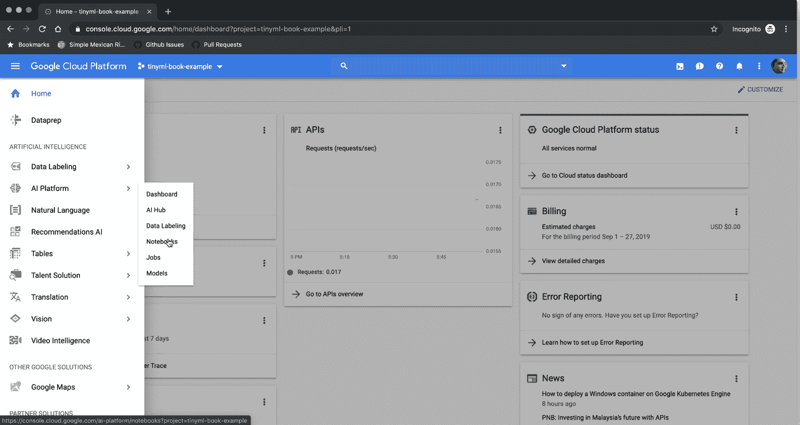
4. 可能出现提示询问是否启用 Compute Engine API，如图 10-2 中所示。此过程可能需要几分钟。

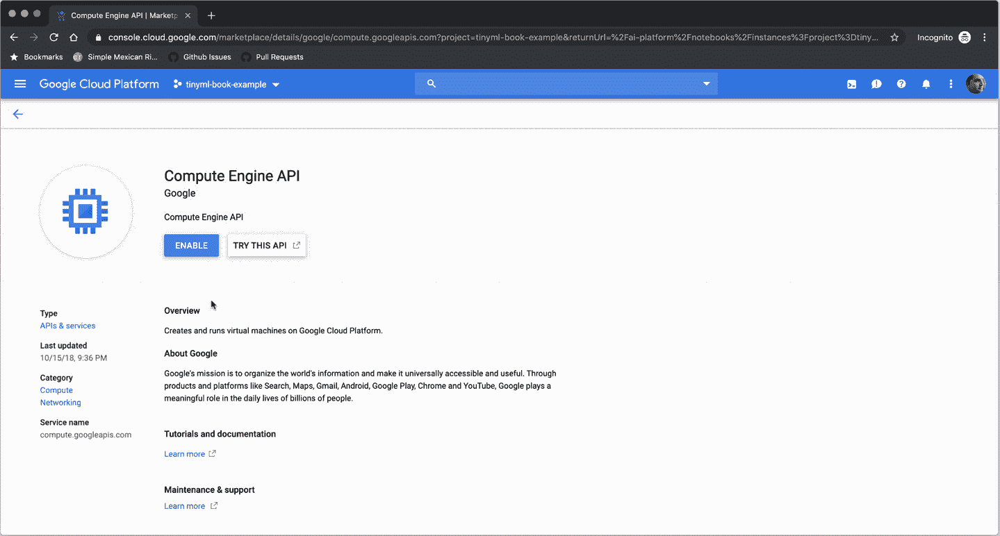
5. “笔记本实例”屏幕打开。在顶部菜单栏中选择“NEW INSTANCE”。在打开的子菜单中，如图 10-3 所示，选择“Customize instance”。

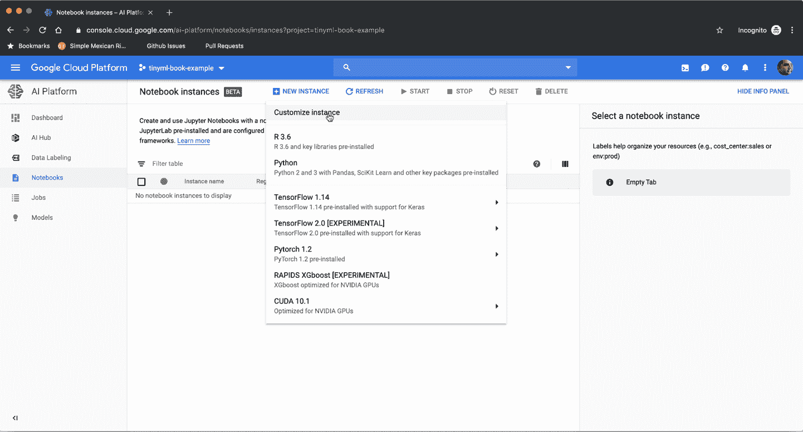
6. 在 New notebook instance 页面上的“instance name”框中，如图 10-4 所示为机器命名，然后向下滚动以设置环境。

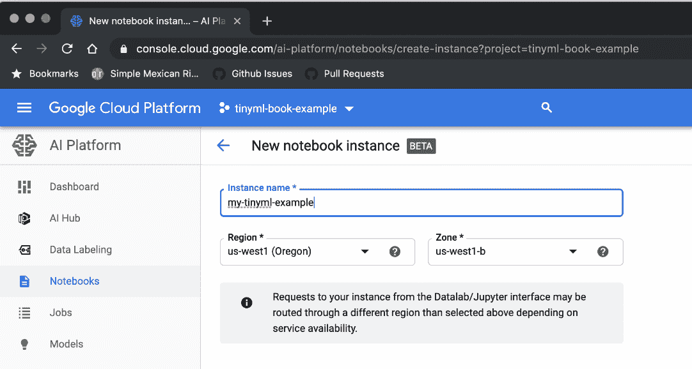
7. 截至 2019 年 9 月，应选择正确的 TensorFlow 版本为 TensorFlow 1.14。到您阅读本文时，推荐版本可能已提升至 2.0 及以上，但可能存在不兼容性，因此最好先从 1.14 或 1.x 分支的其他版本开始选择。
8. 在“机器配置”部分中，如图 10-5 所示，选择至少 4 个 CPU 和 15GB RAM。

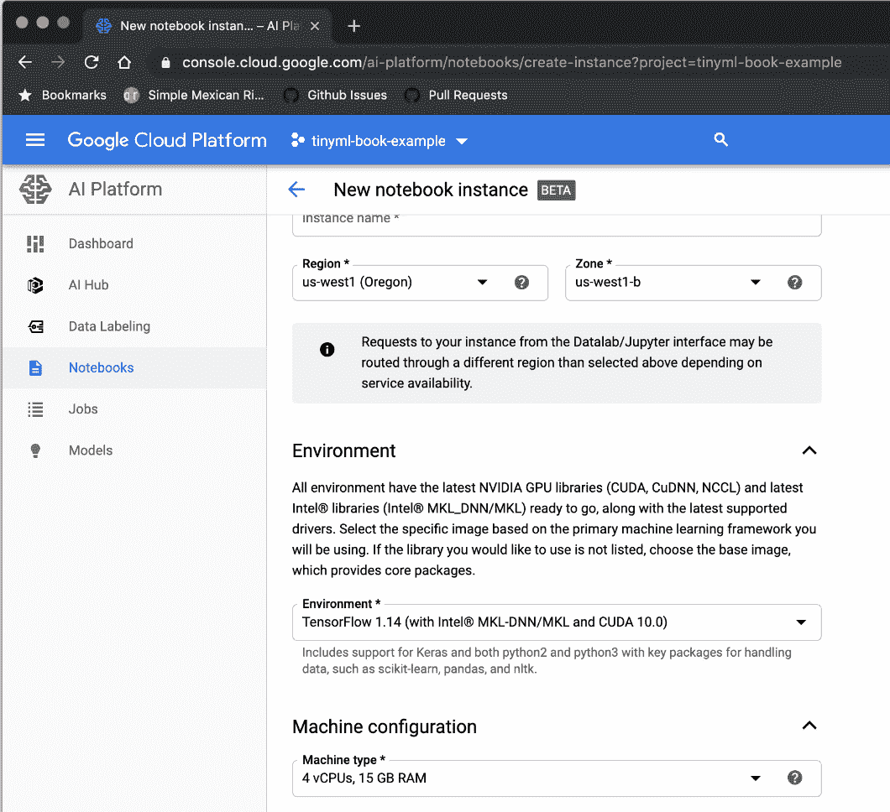
9. 选择合适的 GPU 对训练速度影响最大。并非所有区域都提供相同类型的硬件，这很麻烦。在我们的案例中，区域使用“us-west1（俄勒冈州）”，区域使用“us-west-1b”。详细的定价信息可在[Google Cloud Platform 价格计算器中](https://oreil.ly/t2XO0)获得，在此示例中，如图 10-6 所示选择 1 个 NVIDIA Tesla V100 GPU。该 GPU 每月费用为 1,300 美元，但人物检测模型可在约 1 天内训练，因此模型训练成本约为 45 美元。

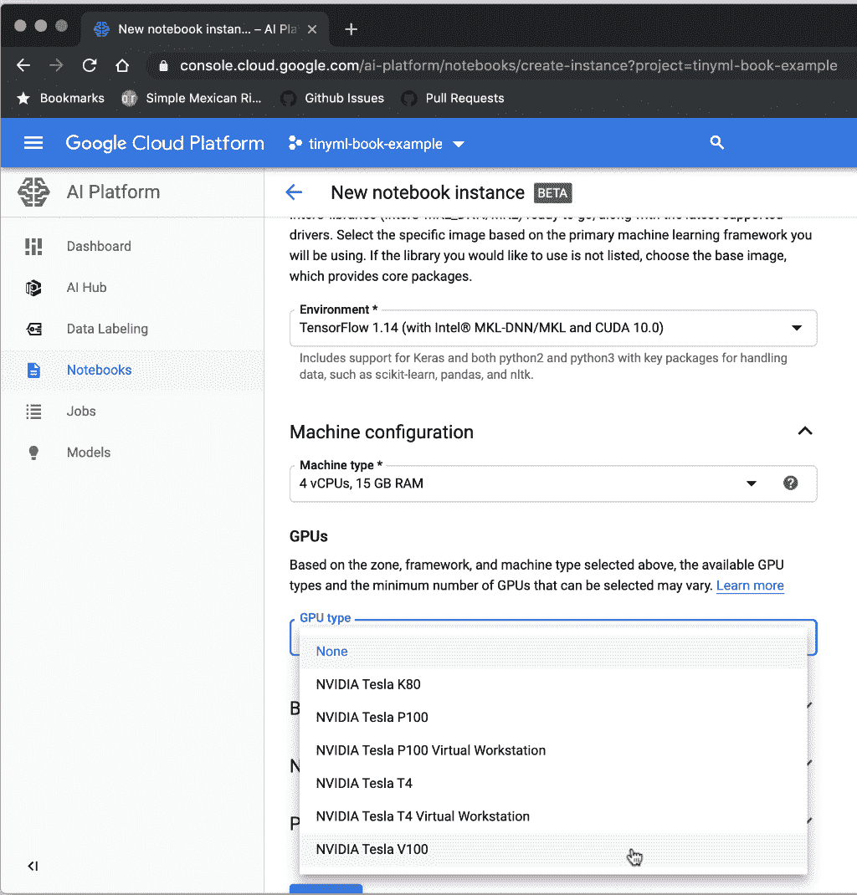

#### 提示

这些高端机器运行成本很高，因此在不积极用于训练时请停止实例。否则，您将为处于空闲状态的机器付费。

10. 如图 10-7 中所示，自动安装 GPU 驱动程序会让生活更轻松。


11. 由于要在此机器上下载数据集，建议将启动磁盘从默认的 100GB 稍微调大一些。

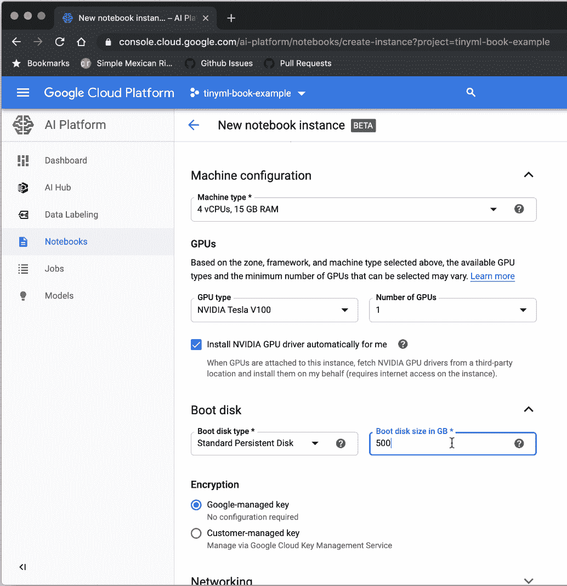
12. 设置所有选项后，点击页面底部的 CREATE 按钮，返回“Notebook instances”屏幕。列表中应有您为机器命名的新实例。在实例设置完成前的几分钟内，实例旁边会显示一个旋转器。完成后，如图 10-9 的所示，点击“OPEN JUPYTERLAB”链接。

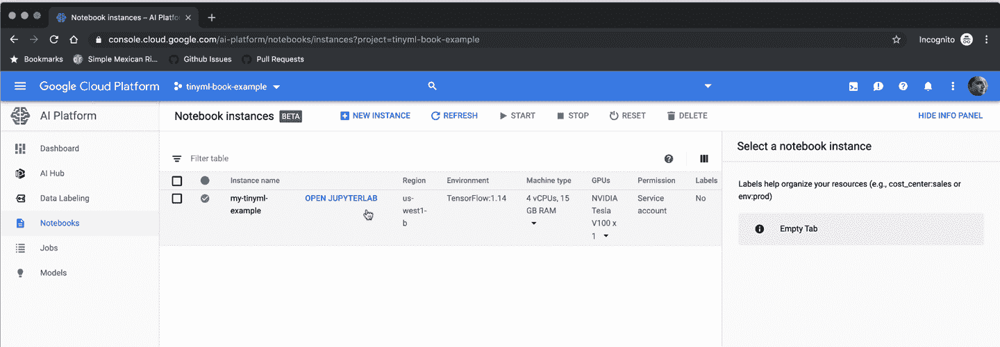
13. 在打开的屏幕中，选择创建 Python 3 笔记本（参见图 10-10）。

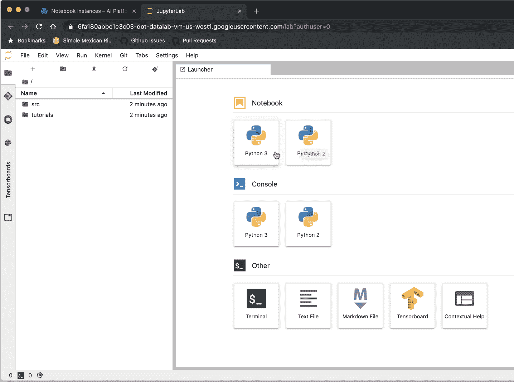

这将 Jupyter Notebook 连接到实例。您可能不熟悉 Jupyter，但它为机器上运行的 Python 解释器提供 Web 界面，并将命令和结果保存到可共享的笔记本中。要开始使用 Jupyter，请在右侧面板中输入 `print("Hello World!")` 并按 Shift+Return。如图 10-11 的所示，下方应立即显示“Hello World!”。如果是这样，机器实例的设置就成功了。使用此笔记本作为本教程其余部分输入命令的位置。

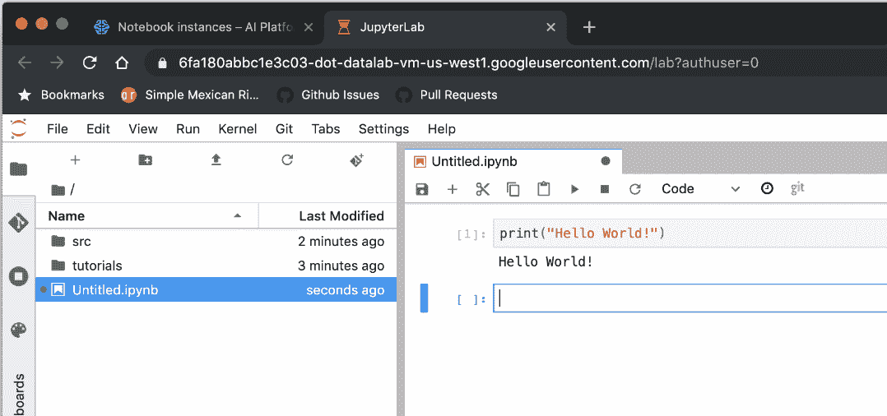

此后许多命令都假设从 Jupyter Notebook 执行，因此以 `!` 开头表示作为 Shell 命令而非 Python 语句执行。如果您直接从终端执行（例如在打开 Secure Shell 连接后与实例通信），可以删除初始的 `!`。

# 选择训练框架

Keras 是在 TensorFlow 中创建模型时推荐的接口，但在创建人物检测模型时，它尚未支持所有所需功能。因此，这里介绍如何使用旧接口 `tf.slim` 训练模型。`tf.slim` 仍被广泛使用，但已弃用，因此未来的 TensorFlow 版本可能不再支持此方法。我们计划将来在线发布 Keras 指令。最新信息请查看[tinymlbook.com/persondetector](https://oreil.ly/sxP6q)。

Slim 的模型定义包含在[TensorFlow 模型仓库中](https://oreil.ly/iamdB)，因此开始时需要从 GitHub 下载：

```
! cd ~
! git clone https://github.com/tensorflow/models.git
```

#### 注

以下指南假设从主目录执行，因此模型仓库的代码位于 `~/models` 中，除非另有说明，否则所有命令均从主目录执行。也可以将仓库放在其他位置，但需要更新所有对仓库的引用。

使用 Slim 时，需要让 Python 发现模块并安装一个依赖项。下面介绍如何在 iPython Notebook 中执行此操作：

```
! pip install contextlib2
import os
new_python_path = (os.environ.get("PYTHONPATH") or '') + ":models/research/slim"
%env PYTHONPATH=$new_python_path
```

这种 `EXPORT` 。`PYTHONPATH` 的更新仅对当前 Jupyter 会话有效，因此如果直接使用 bash，则需要将其添加到持久启动脚本中，如下所示：

```
echo 'export PYTHONPATH=$PYTHONPATH:models/research/slim' >> ~/.bashrc
source ~/.bashrc
```

如果在运行 Slim 脚本时遇到导入错误，请确认 `PYTHONPATH` 设置正确且已安装 `contextlib2`。有关 `tf.slim` 的通用信息可在[仓库的 README 中](https://oreil.ly/azuvk)找到。

# 构建数据集

训练人物检测模型需要大量按是否包含人物进行标记的图像集合。广泛用于图像分类器的 ImageNet 1,000 类数据集不包含人物标签，但幸运的是[COCO 数据集](http://cocodataset.org/#home)包含。

该数据集旨在训练定位模型，因此图像并未标记为“人”“非人”等学习类别。相反，每个图像都附带该图像中所有对象的边界框列表。“人物”是这些对象类别之一，因此要获得所需的分类标签，需要查找包含人物边界框的图像。为了确保边界框不会小到无法识别，还需要排除非常小的边界框。Slim 包含一个方便的脚本，可下载数据并将边界框转换为标签：

```
! python download_and_convert_data.py \
  --dataset_name=visualwakewords \
  --dataset_dir=data/visualwakewords
```

此下载约 40GB，容量很大，因此需要一些时间，并确保驱动器至少有 100GB 的空闲空间以便解压缩和进一步处理。完成过程可能需要约 20 分钟。处理完成后，`data/visualwakewords` 中将有一组保存标记图像信息的 TFRecords。此数据集由 Aakanksha Chowdhery 创建，被称为[Visual Wake Words 数据集](https://oreil.ly/EC6nd)。该数据集旨在帮助基准测试和测试嵌入式计算机推理，并代表在严格资源限制下必须完成的非常常见的任务。我们希望该数据集能推动针对此任务及类似任务的更好模型开发。

# 训练模型

使用 `tf.slim` 进行训练的好处之一是，通常需要更改的参数作为命令行参数可用，可以调用标准的 `train_image_classifier.py` 脚本来训练模型。可以使用以下命令构建示例中使用的模型：

```
! python models/research/slim/train_image_classifier.py \
    --train_dir=vww_96_grayscale \
    --dataset_name=visualwakewords \
    --dataset_split_name=train \
    --dataset_dir=data/visualwakewords \
    --model_name=mobilenet_v1_025 \
    --preprocessing_name=mobilenet_v1 \
    --train_image_size=96 \
    --use_grayscale=True \
    --save_summaries_secs=300 \
    --learning_rate=0.045 \
    --label_smoothing=0.1 \
    --learning_rate_decay_factor=0.98 \
    --num_epochs_per_decay=2.5 \
    --moving_average_decay=0.9999 \
    --batch_size=96 \
    --max_number_of_steps=1000000
```

在单 GPU V100 实例上，完成全部 100 万步需要 2 到 3 天，但如果想快速实验，几小时后应该就能获得相当准确的模型。以下是一些额外的考虑：


# 训练设置

- 检查点和摘要保存在通过参数给定的文件夹中。保存在通过 `--train_dir` 参数给定的文件夹中。这里需要查找结果。
- `--dataset_dir` 参数必须与 Visual Wake Words 构建脚本保存 TFRecords 的位置一致。
- 使用的架构由参数定义。由 `--model_name` 参数定义。`mobilenet_v1` 前缀指示脚本使用 MobileNet 的第一个版本。也尝试过之后的版本，但由于中间激活缓冲区使用了更多的 RAM，目前仍坚持使用原版。`025` 是使用的深度乘数，主要影响权重参数的数量。这一较低的设置使模型可设置在 250KB 的闪存中。
- `--preprocessing_name` 控制输入图像在输入模型之前如何被修改。`mobilenet_v1` 版本中，将图像的宽度和高度缩小到 `--train_image_size` 指定的大小（为了减少计算量，这里为 96 像素）。此外，将像素值从 0～255 的整数缩放为 -1.0～+1.0 的浮点数（不过在 pass:\[training\] 之后进行量化）。
- SparkFun Edge 板上使用的 [HM01B0 相机是](https://oreil.ly/RGciN) 单色的，因此为了获得最佳结果，需要使用单色图像训练模型。为了启用该预处理，请传递 `--use_grayscale` 标志。
- `--learning_rate`、`--label_smoothing`、`--learning_rate_decay_factor`、`--num_epochs_per_decay`、`--moving_average_decay`、`--batch_size` 的参数都控制学习过程中权重如何更新。深度网络的训练仍然有点像黑暗艺术，这些精确的值是通过实验为此特定模型发现的。通过微调这些参数可以加快学习速度或略微提高精度，但如何更改并没有太多参考，而且很容易出现导致学习精度不收敛的组合。
- `--max_number_of_steps` 定义训练持续到何时。事先设定此阈值没有好方法。需要通过实验判断模型精度何时不再提高，以及何时应停止学习。在我们这里，默认设置为 100 万步。因为对于此特定模型，已知这是停止的良好点。

启动脚本时，应显示如下输出：

```
INFO:tensorflow:global step 4670: loss = 0.7112 (0.251 sec/step)
  I0928 00:16:21.774756 140518023943616 learning.py:507] global step 4670: loss
  = 0.7112 (0.251 sec/step)
INFO:tensorflow:global step 4680: loss = 0.6596 (0.227 sec/step)
  I0928 00:16:24.365901 140518023943616 learning.py:507] global step 4680: loss
  = 0.6596 (0.227 sec/step)
```

请忽略行的重复。这只是 TensorFlow 日志输出与 Python 交互时的副作用。每行包含有关训练过程的两个重要信息。全局步数是训练进展的计数。由于设置为 100 万步，在此情况下已完成约 5%。结合步/秒的估计，可以方便地估算整个训练过程的大致持续时间。在此情况下，每秒完成约 4 步，因此 100 万步需要约 70 小时，即 3 天。另一个重要信息是损失。它是衡量部分训练模型的预测值与正确值有多接近的指标，值越小越好。它显示出很大的波动，但如果模型正在学习，平均而言训练过程中应会下降。由于噪声很大，短时间内数值会大幅波动，但如果进展顺利，等待约 1 小时后检查应能看到明显下降。尝试 TensorBoard 的主要原因之一是可以以图表形式查看此类波动。

# TensorBoard

TensorBoard 是可视化 TensorFlow 训练会话数据的 Web 应用程序，默认包含在大多数云实例中。如果使用 Google Cloud AI Platform，可以从笔记本界面左侧的选项卡打开命令调色板，向下滚动并选择 “Create a new tensorboard ” 来启动新的 TensorBoard 会话。然后会提示输入摘要日志的保存位置。输入在训练脚本中用于 `--train_dir` 的路径。之前的示例中，文件夹名为 `vww_96_grayscale`。常见的错误是在路径末尾添加斜杠，这会导致 TensorBoard 无法发现目录。

在其他环境中从命令行启动 TensorBoard 时，需要将路径传递给 TensorBoard 命令行工具的参数 `--logdir`，浏览器为 [`http://localhost:6006`](http://localhost:6006)（或运行机器的地址）。

移动到 TensorBoard 地址或通过 Google Cloud 打开会话时，应显示类似 图 10-12 的 的页面。脚本每 5 分钟仅保存一次摘要，因此图表显示有用的内容可能需要一些时间。 图 10-12 是 显示训练超过一天后的结果。最重要的图表称为 `clone_loss`，它显示与日志输出中显示的相同损失值的进展。如示例所示，它波动很大，但总体趋势随时间下降。如果数小时训练后看不到此类进展，则是模型未收敛到良好解的良好迹象，可能数据集或训练参数存在问题，需要调试。

打开 TensorBoard 时，默认显示 `SCALARS` 选项卡，但在训练期间有用的其他部分是 `IMAGES` （图 10-13）。它显示模型当前正在学习的图像的随机选择，包括失真和其他预处理。在此图中，可以看到图像被翻转，并在发送到模型之前转换为灰度。此信息不如损失图重要，但有助于确认数据集符合预期，并且很有趣可以看到样本随着训练的进行而更新。

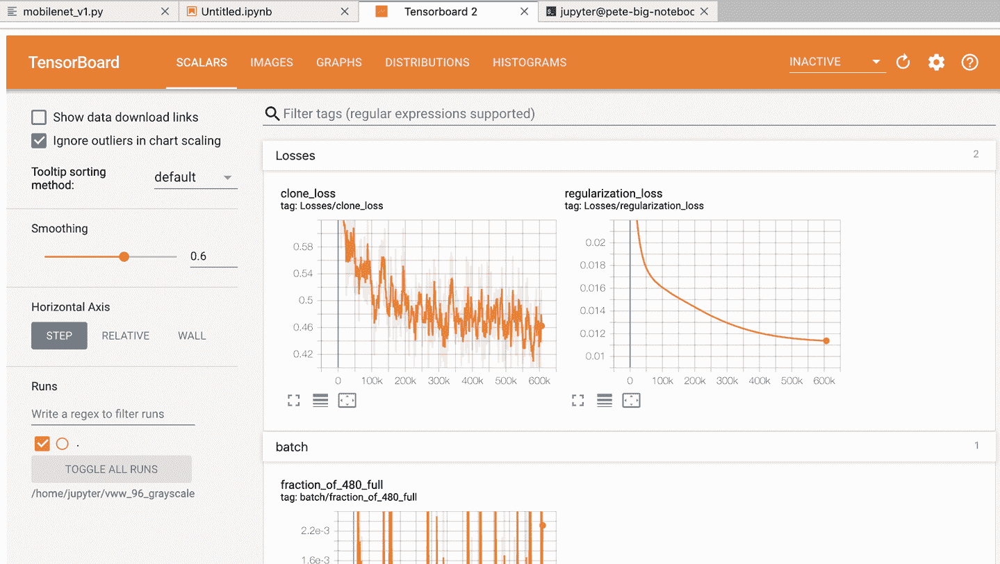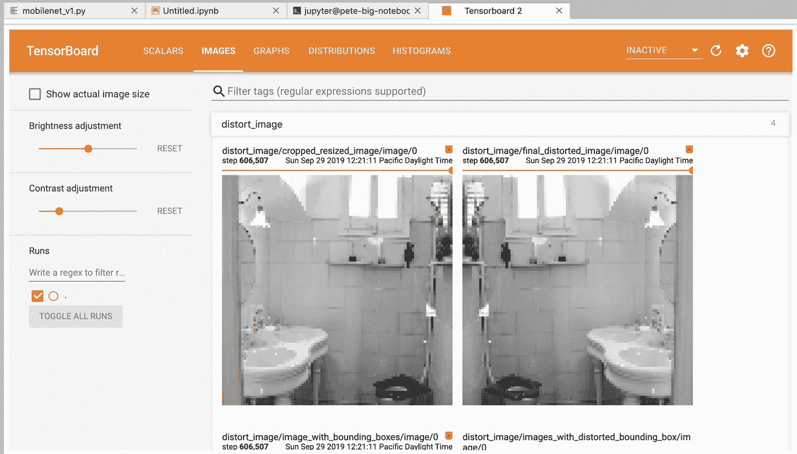

# 评估模型

损失函数与模型训练得有多好相关，但不是可以直接理解的指标。我们真正关心的是模型正确检测了多少人，但需要运行另一个脚本来计算。这不需要等待模型完全训练完成。可以检查 `--train_dir` 文件夹中检查点的精度。为此，请运行以下命令：

```
! python models/research/slim/eval_image_classifier.py \
    --alsologtostderr \
    --checkpoint_path=vww_96_grayscale/model.ckpt-698580 \
    --dataset_dir=data/visualwakewords \
    --dataset_name=visualwakewords \
    --dataset_split_name=val \
    --model_name=mobilenet_v1_025 \
    --preprocessing_name=mobilenet_v1 \
    --use_grayscale=True \
    --train_image_size=96
```

需要确保 `--checkpoint_path` 指向有效的检查点数据集。检查点分为三个文件保存，因此其值必须是共同前缀。例如，如果存在检查点文件 `model.ckpt-5179.data-00000-of-00001`，则前缀为 `model.ckpt-5179`。脚本将生成如下输出：

```
INFO:tensorflow:Evaluation [406/406]
I0929 22:52:59.936022 140225887045056 evaluation.py:167] Evaluation [406/406]
eval/Accuracy[0.717438412]eval/Recall_5[1]
```

这里重要的数值是精度。它显示正确分类的图像比例，转换为百分比后，此处为 72%。按照示例脚本，完全训练的模型在 100 万步后预计可达到约 84% 的精度，并显示约 0.4 的损失。

# 将模型导出到 TensorFlow Lite

模型训练到令人满意的精度后，需要将结果从 TensorFlow 训练环境转换为可在嵌入式设备上运行的形式。如前一章所述，这可能是一个复杂的过程，而 `tf.slim` 也增加了一些皱褶。

## 导出到 GraphDef Protobuf 文件

Slim 每次运行脚本时都会从 `model_name` 生成架构，因此要在 Slim 外部使用模型，需要以通用格式保存。这里使用 Slim 和 TensorFlow 都能理解的 GraphDef protobuf 序列化格式：

```
! python models/research/slim/export_inference_graph.py \
    --alsologtostderr \
    --dataset_name=visualwakewords \
    --model_name=mobilenet_v1_025 \
    --image_size=96 \
    --use_grayscale=True \
    --output_file=vww_96_grayscale_graph.pb
```

如果成功，新的 `vww_96_grayscale_graph.pb` 文件应出现在主目录中。该文件包含模型中运算的布局，但尚未包含权重数据。

## 冻结权重

将学习到的权重与运算图一起保存的过程称为冻结。这是在从检查点文件加载值后，将图中的所有变量转换为常量。以下命令使用第 100 万次训练步的检查点，但可以指定有效的检查点路径。图冻结脚本存储在 TensorFlow 主仓库中，因此在运行此命令之前需要从 GitHub 下载：

```
! git clone https://github.com/tensorflow/tensorflow
! python tensorflow/tensorflow/python/tools/freeze_graph.py \
    --input_graph=vww_96_grayscale_graph.pb \
    --input_checkpoint=vww_96_grayscale/model.ckpt-1000000 \
    --input_binary=true --output_graph=vww_96_grayscale_frozen.pb \
    --output_node_names=MobilenetV1/Predictions/Reshape_1
```

之后应出现 `vww_96_grayscale_frozen.pb` 文件。

## 量化和转换为 TensorFlow Lite

量化是一个棘手且复杂的过程，仍是研究领域，因此将迄今学习到的浮点图转换为 8 位实体需要相当多的代码。关于量化是什么以及如何工作，请参阅 第 15 章。代码的大部分用于准备要输入到已训练网络的样本图像，以便能够衡量典型使用中激活层的范围。推断引擎所需的量化和转换为 TensorFlow Lite FlatBuffer 文件依赖于 `TFLiteConverter` 类：

```
import tensorflow as tf
import io
import PIL
import numpy as np

def representative_dataset_gen():

  record_iterator = tf.python_io.tf_record_iterator
      (path='data/visualwakewords/val.record-00000-of-00010')

  count = 0
  for string_record in record_iterator:
    example = tf.train.Example()
    example.ParseFromString(string_record)
    image_stream = io.BytesIO
        (example.features.feature['image/encoded'].bytes_list.value[0])
    image = PIL.Image.open(image_stream)
    image = image.resize((96, 96))
    image = image.convert('L')
    array = np.array(image)
    array = np.expand_dims(array, axis=2)
    array = np.expand_dims(array, axis=0)
    array = ((array / 127.5) - 1.0).astype(np.float32)
    yield([array])
    count += 1
    if count > 300:
        break

converter = tf.lite.TFLiteConverter.from_frozen_graph \
    ('vww_96_grayscale_frozen.pb', ['input'],  ['MobilenetV1/Predictions/ \
    Reshape_1'])
converter.inference_input_type = tf.lite.constants.INT8
converter.inference_output_type = tf.lite.constants.INT8
converter.optimizations = [tf.lite.Optimize.DEFAULT]
converter.representative_dataset = representative_dataset_gen

tflite_quant_model = converter.convert()
open("vww_96_grayscale_quantized.tflite", "wb").write(tflite_quant_model)
```

## 转换为 C 源文件

转换器会写入文件，但大多数嵌入式设备没有文件系统。要从程序访问序列化数据，需要将其编译到可执行文件中并存储在闪存中。最简单的方法是像前一章那样将文件转换为 C 数据数组：


```
# Install xxd if it is not available
! apt-get -qq install xxd
# Save the file as a C source file
! xxd -i vww_96_grayscale_quantized.tflite > person_detect_model_data.cc
```

这样，你可以将现有的 `person_detect_model_data.cc` 文件替换为你训练的版本，从而在嵌入式设备上运行自己的模型。

# 其他类别的训练

COCO 数据集有 60 多种对象类型，因此自定义模型的一种简单方法是，在构建训练数据集时，用 `person` 以外的其中一种来代替。以下是以查找汽车为例：

```
! python models/research/slim/datasets/build_visualwakewords_data.py \
   --logtostderr \
   --train_image_dir=coco/raw-data/train2014 \
   --val_image_dir=coco/raw-data/val2014 \
   --train_annotations_file=coco/raw-data/annotations/instances_train2014.json \
   --val_annotations_file=coco/raw-data/annotations/instances_val2014.json \
   --output_dir=coco/processed_cars \
   --small_object_area_threshold=0.005 \
   --foreground_class_of_interest='car'
```

与人物检测器时相同的步骤，只需将新路径（`coco/processed_cars`）替换到 `data/visualwakewords` 所在的位置即可。

如果 COCO 中不存在你感兴趣的类型的对象，那么可以使用迁移学习，在你收集的自定义数据集上进行学习。 目前还没有可以分享的示例，但请查看有关此方法的最新信息 [tinymlbook.com](http://tinymlbook.com)。

# 理解架构

[MobileNets 是](https://oreil.ly/tK57G) ，是为能够用尽可能少的权重参数和算术运算实现高精度计算而设计的一组架构。目前有多个版本，我们使用的是原始的 v1。架构的核心概念是深度可分离卷积。这是对经典二维卷积的变形，可以在不牺牲太多精度的情况下更高效地工作。通常的卷积是对输入的所有通道应用特定大小的滤波器来计算输出值。也就是说，每个输出涉及的计算次数为滤波器的宽度×高度×输入通道数。深度方向的卷积将这一大计算拆分为不同的部分。首先，每个输入通道由一个或多个矩形滤波器进行滤波，生成中间值。接下来，这些值使用逐点卷积进行组合。这样需要的计算次数急剧减少，实际上可以获得与普通卷积类似的结果。

MobileNet v1 由 14 层具有平均池化的深度可分离卷积层堆叠而成，其后是全连接层，最后是 softmax。指定宽度乘数为 0.25，将每个激活层的通道数与标准模型相比减少 75%，可将每次推理的计算次数减少到约 6000 万。简而言之，它与普通卷积神经网络的运算符非常相似，每个层都学习输入的模式。初始层起到边缘识别滤波器的作用，找到图像中的低级结构，后续层将该信息合成更抽象的模式，有助于最终的对象分类。

# 总结

使用机器学习进行图像识别需要大量数据和大量处理能力。本章学习了如何在仅提供数据集的情况下从零开始训练模型，以及如何将该模型转换为适合嵌入式设备的形式。

这种经验应该成为解决产品所需机器构想问题良好的基础。计算机看到并理解自己周围的世界仍然具有一点神秘的魅力！
