# 第 11 章. 构建魔法棒应用程序

本作品使用 AI 翻译。欢迎提供意见和反馈：translation-feedback@oreilly.com

到目前为止，我们的应用程序示例一直处理人类容易理解的数据。我们的大脑的大部分区域都用于语音和构想的理解，因此解释视觉或语音数据并理解发生了什么并不困难。

然而，许多数据并不那么容易理解。机器及其传感器会产生大量难以映射到人类感官的信息流。即使以视觉形式表示，我们的大脑也很难把握数据的趋势和模式。

例如，图 11-1 和 图 11-2 中 显示的两个图表显示了运动的人将手机放在前口袋中获得的传感器数据。相关传感器是加速度传感器，以三维测量加速度（稍后会详细介绍）。图 11-1 的图表是跑步者的加速度计数据，图 11-2 的图表是同一个人下楼梯时的数据。

正如你所见，尽管数据代表了简单而熟悉的活动，但区分两种活动是困难的。想象一下试图区分复杂工业机器的操作员。那台机器可能有数百个传感器来测量各种模糊的特性。

在许多情况下，可以编写手工制作的算法来理解这种数据。例如，人类步行的专家可能会识别出上楼梯的迹象，并将该知识表示为代码中的函数。这种类型的函数称为启发式，广泛用于从工业自动化到医疗设备等各种应用中。

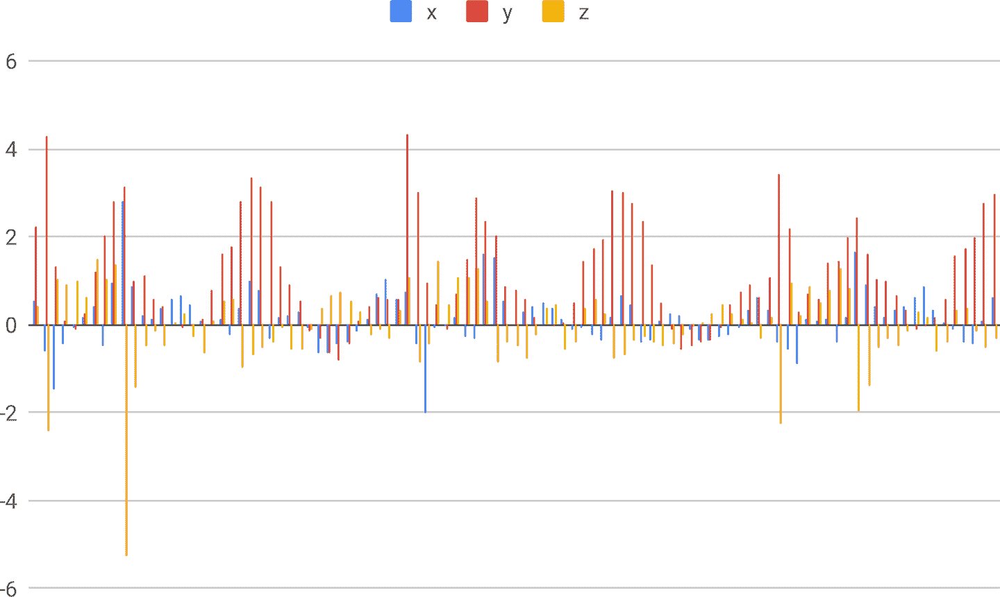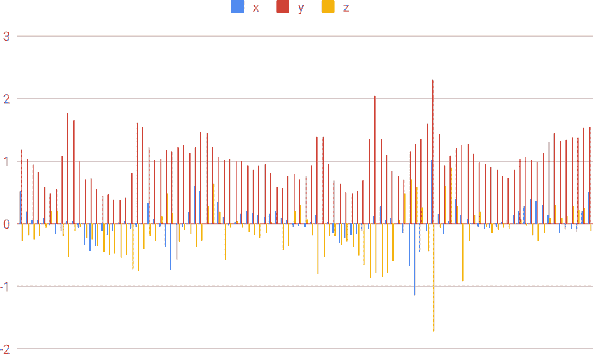

创建启发式需要两件事。第一是领域知识。启发式算法是将人类知识或理解公式化，因此要编写它，需要事先理解数据意味着什么。为了理解这一点，想象一个从体温判断是否发烧的启发式。创建它的人一定对表明发烧的体温变化有了解。

构建启发式的第二个条件是编程和数学专业知识。判断某人的体温是否过高相当简单，但其他问题可能复杂得多。根据多个数据流的复杂模式来判断系统状态可能需要统计分析或信号处理等高级技术知识。例如，考虑创建一个基于加速度传感器数据区分行走还是奔跑的启发式。要构建它，可能需要知道如何数学地过滤加速度传感器数据以获得步数估计值。

启发式非常有用，但由于需要领域知识和编程专业知识，其构建伴随着困难。首先，领域知识并不总是可用。例如，小公司可能没有资源进行必要的基础研究来了解一种状态与另一种状态的区别。同样，即使有领域知识，也不是每个人都具备设计启发式算法并以代码实现所需的专业知识。

机器学习为这些要求提供了捷径。用标记数据训练的模型可以学习识别表示某一类或另一类的信号。例如，模型可以在没有人具体告诉它哪个温度重要时学习人类体温变化表示发烧。所需只是标记为“发烧”或“未发烧”的体温数据。此外，机器学习所需的工程技能肯定比实现高级启发式所需的技能更容易掌握。

机器学习开发者可以代替从零开始设计启发式算法，通过发现合适的模型架构、收集和标记数据集并在训练和评估中迭代来创建模型。领域知识仍然非常有用，但不再是使其发挥作用的前提条件。而且在某些情况下，成品模型可能比手工编码的最佳算法更准确。

事实上，最近的论文中 ^(1) 显示，简单的卷积神经网络可以从一次心跳中以 100% 的精度检测患者的充血性心力衰竭。这比任何诊断技术都表现更好。即使不理解细节，这篇论文也是引人入胜的阅读。

通过训练 Deep Learning 模型来理解复杂数据并将其嵌入到微控制器的程序中，可以创建智能传感器来理解复杂环境并以高水平告知发生了什么。这在数十个领域具有重要意义。这里有一些潜在的应用示例：

* 在连接性差的偏远地区进行环境监测
* 能够实时适应问题的自动化工业流程
* 对复杂外部刺激做出反应的机器人
* 无需医疗专业人员的疾病诊断
* 理解身体动作的计算机接口

本章将构建最后一个类别的项目，即数字“魔法棒”。这根魔杖可以通过主人挥动来施放各种咒语。输入是人类无法理解的复杂多维传感器数据。输出是简单的分类，如果最近发生了某种类别的动作则发出警报。让我们看看深度学习如何将奇怪的数值数据转换为有意义的信息并产生神奇的效果。

## 我们在做什么

我们的“魔法棒”可以用来说出几种咒语。为此，只需像 图 11-3 所示那样，用名为“Wing”、“Ring”、“Slope”的三个手势之一挥动魔杖即可。

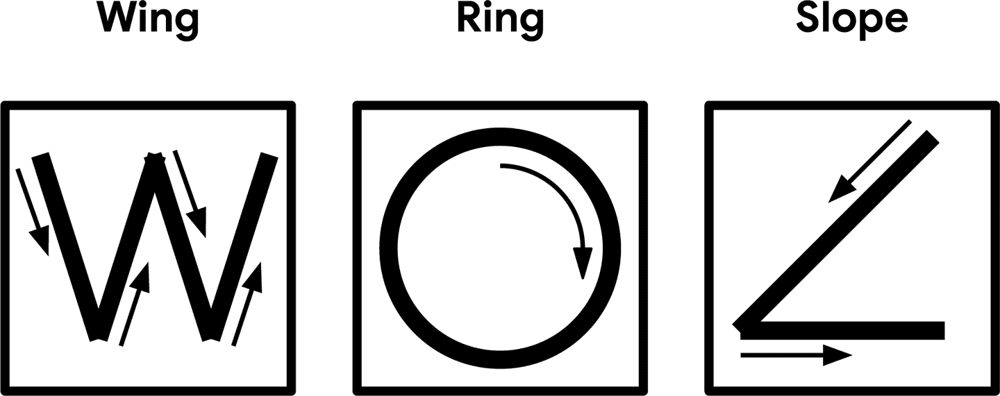

魔杖会对咒语做出反应并点亮 LED。如果闪电魔法不够刺激，还可以向串行端口输出信息。

为了理解物理手势，魔法棒应用程序使用设备的加速度传感器收集有关穿过空间的运动的信息。加速度传感器测量当前经历的加速度程度。例如，想象一下在红灯处停车并准备开走的汽车上安装加速度传感器。

信号变绿后，汽车开始前进，直到达到限速。在此期间，加速度计输出表示汽车加速度的值。汽车达到恒定速度后，汽车不再加速，因此加速度计输出零。

SparkFun Edge 和 Arduino Nano 33 BLE Sense 两块板都内置了三轴加速度传感器，这些传感器焊接在板上的组件中。它们可以测量三个方向的加速度，因此可用于跟踪设备在 3D 空间中的运动。要制作魔法棒，只需将微控制器板安装在棒的末端，以便像施法一样挥动。然后将加速度传感器的输出输入到 Deep Learning 模型中，以分类是否执行了已知手势。

我们将说明如何将此应用程序部署到以下微控制器平台：

* [Arduino Nano 33 BLE Sense](https://oreil.ly/6qlMD)
* [SparkFun Edge](https://oreil.ly/-hoL-)

[ST Microelectronics 的 STM32F746G Discovery Kit 中](https://oreil.ly/SSsVJ) 不包含加速度传感器（对于安装在魔法棒末端的来说太大），因此这里不予考虑。

###### 注

TensorFlow Lite 定期为新设备添加支持，因此如果您想要的设备未在此列出，值得查看示例的 [`README.md`](https://oreil.ly/dkZfA)。此外，如果遇到问题，也可以查看部署步骤的更新。

## 应用架构

我们的应用程序再次遵循现在熟悉的模式：获取输入、执行推理、处理输出并利用所得信息推进事物。

三轴加速度传感器输出表示设备 x 轴、y 轴、z 轴加速度的三个值。SparkFun Edge 板的加速度传感器可以以每秒 25 次（25Hz）的频率执行此操作。我们的模型直接将这些值作为输入，因此不需要预处理。

数据被捕获并执行推理后，此应用程序将判断是否检测到有效手势，将输出输出到终端并点亮 LED。

### 模型介绍

我们的手势检测模型是一个约 20KB 的卷积神经网络，以原始加速度传感器值作为输入。一次摄取 128 组 `x`、`y`、`z` 值，按 25Hz 速率相当于约 5 秒的数据。每个值是 32 位浮点数，表示该方向的加速度。

该模型是用许多人执行的手势训练的。表示每个手势（“Wing”、“Ring”、“Slope”）和表示未识别手势。概率分数总和为 1，超过 0.8 则认为有信心。

由于每秒执行多次推理，因此需要在手势执行期间的一次推理错误不会扭曲结果。为此，只有在手势被一定数量的推理确认后才认为检测到该手势。每个手势的执行时间不同，因此所需推理次数因手势而异，最佳次数通过实验确定。同样，推理执行速度因设备而异，因此这些阈值也按设备设置。

在 第 12 章 中，我们将探讨如何使用自己的手势数据训练模型，并更深入地了解模型的工作原理。在此之前，让我们继续了解此应用程序。

### 所有可动部件

图 11-4 显示了魔法棒应用程序的结构。

正如你所见，这与人物检测应用程序一样简单。我们的模型接受原始加速度计数据，因此不需要预处理。

代码的六个主要部分与人物检测示例具有相同的结构。让我们按顺序查看：

主循环

: 

我们的应用程序以连续循环运行。模型小而简单且不需要预处理，因此每秒可以执行多次推理。

加速度计处理器

: 

此组件从加速度传感器获取数据并将其写入模型的输入张量。使用缓冲区来保存数据。

TF Lite 解释器

: 

解释器与之前的示例类似，运行 TensorFlow Lite 模型。

模型

: 

模型作为数据数组包含，由解释器执行。重量仅为 19.5KB，非常小。

手势预测

: 

此组件接收模型的输出，并基于概率和连续正预测次数的阈值确定是否检测到手势。

输出处理器

: 

输出处理器根据识别的手势点亮 LED 并向串行端口输出。

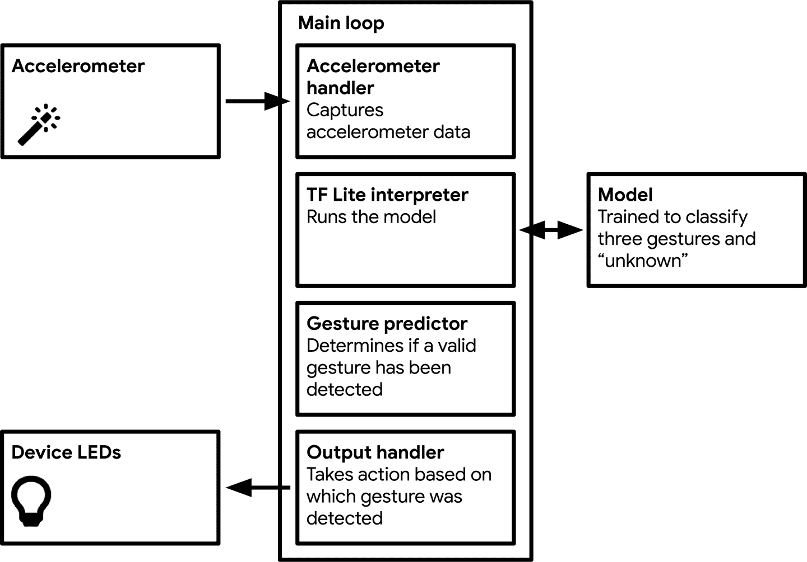

## 通过测试逐步了解

应用程序的测试可以在 [GitHub 仓库中](https://oreil.ly/h4iYb) 找到：

[`magic_wand_test.cc`](https://oreil.ly/X0AJP)

: 

展示了如何对加速度传感器数据的样本执行推理。


### [`加速度センサー・ハンドラー・テスト.cc`](https://oreil.ly/MwM7g)

使用加速度传感器处理器获取最新数据的方法。

### [`gesture_predictor_test.cc`](https://oreil.ly/cGbim)

说明如何使用手势预测器来解释推理结果。

### [`output_handler_test.cc`](https://oreil.ly/MYwUW)

说明输出处理器用于显示推理结果的用法。

首先，让我们来看一下 `magic_wand_test.cc`。它展示了我们模型推理的端到端过程。

## 基本流程

在 `magic_wand_test.cc` 中说明基本流程。

首先，列出模型所需的算子：

```
namespace tflite {
namespace ops {
namespace micro {
TfLiteRegistration* Register_DEPTHWISE_CONV_2D();
TfLiteRegistration* Register_MAX_POOL_2D();
TfLiteRegistration* Register_CONV_2D();
TfLiteRegistration* Register_FULLY_CONNECTED();
TfLiteRegistration* Register_SOFTMAX();
}  // namespace micro
}  // namespace ops
}  // namespace tflite
```

测试本身（像往常一样）从设置推理所需的一切并获取指向模型输入张量的指针开始：

// Set up logging
tflite::MicroErrorReporter micro_error_reporter;
tflite::ErrorReporter* error_reporter = &micro_error_reporter;

// Map the model into a usable data structure. This doesn't involve any
// copying or parsing, it's a very lightweight operation.
const tflite::Model* model =
    ::tflite::GetModel(g_magic_wand_model_data);
if (model->version() != TFLITE_SCHEMA_VERSION) {
error_reporter->Report(
    "Model provided is schema version %d not equal "
    "to supported version %d.\n",
    model->version(), TFLITE_SCHEMA_VERSION);
}

static tflite::MicroMutableOpResolver micro_mutable_op_resolver;
micro_mutable_op_resolver.AddBuiltin(
    tflite::BuiltinOperator_DEPTHWISE_CONV_2D,
    tflite::ops::micro::Register_DEPTHWISE_CONV_2D());
micro_mutable_op_resolver.AddBuiltin(
    tflite::BuiltinOperator_MAX_POOL_2D,
    tflite::ops::micro::Register_MAX_POOL_2D());
micro_mutable_op_resolver.AddBuiltin(
    tflite::BuiltinOperator_CONV_2D,
    tflite::ops::micro::Register_CONV_2D());
micro_mutable_op_resolver.AddBuiltin(
    tflite::BuiltinOperator_FULLY_CONNECTED,
    tflite::ops::micro::Register_FULLY_CONNECTED());
micro_mutable_op_resolver.AddBuiltin(tflite::BuiltinOperator_SOFTMAX,
                                    tflite::ops::micro::Register_SOFTMAX());

// Create an area of memory to use for input, output, and intermediate arrays.
// Finding the minimum value for your model may require some trial and error.
const int tensor_arena_size = 60 * 1024;
uint8_t tensor_arena[tensor_arena_size];

// Build an interpreter to run the model with
tflite::MicroInterpreter interpreter(model, micro_mutable_op_resolver, tensor_arena,
                                    tensor_arena_size, error_reporter);

// Allocate memory from the tensor_arena for the model's tensors
interpreter.AllocateTensors();

// Obtain a pointer to the model's input tensor
TfLiteTensor* input = interpreter.input(0);
```

接下来，检查输入张量并确认其具有预期的形状：

// Make sure the input has the properties we expect
TF_LITE_MICRO_EXPECT_NE(nullptr, input);
TF_LITE_MICRO_EXPECT_EQ(4, input->dims->size);
// The value of each element gives the length of the corresponding tensor.
TF_LITE_MICRO_EXPECT_EQ(1, input->dims->data[0]);
TF_LITE_MICRO_EXPECT_EQ(128, input->dims->data[1]);
TF_LITE_MICRO_EXPECT_EQ(3, input->dims->data[2]);
TF_LITE_MICRO_EXPECT_EQ(1, input->dims->data[3]);
// The input is a 32 bit floating point value
TF_LITE_MICRO_EXPECT_EQ(kTfLiteFloat32, input->type);
```

输入形状为 `(1, 128, 3, 1)`。第一个维度只是第二个维度的包装器，后者保存 128 个三轴加速度传感器的读数。每个读数有 3 个元素，每个轴一个，每个值都被包装在一个单元素张量中。输入全部为 32 位浮点值。

确认输入形状后，将数据写入输入张量：

// Provide an input value
const float* ring_features_data = g_circle_micro_f9643d42_nohash_4_data;
error_reporter->Report("%d", input->bytes);
for (int i = 0; i < (input->bytes / sizeof(float)); ++i) {
    input->data.f[i] = ring_features_data[i];
}
```

常量 `g_circle_micro_f9643d42_nohash_4_data` 在 `circle_micro_features_data.cc` 中定义。它作为容器存储表示一个人尝试画圆手势的浮点值数组。`for` 循环遍历此数据并将每个值写入输入。写入与输入张量可容纳的数量相同数量的 `float` 值。

接下来，以熟悉的方式运行推理：

// Run the model on this input and check that it succeeds
TfLiteStatus invoke_status = interpreter.Invoke();
if (invoke_status != kTfLiteOk) {
  error_reporter->Report("Invoke failed\n");
}
TF_LITE_MICRO_EXPECT_EQ(kTfLiteOk, invoke_status);
```

然后，检查输出张量并确认其具有预期的形状：

// Obtain a pointer to the output tensor and make sure it has the
// properties we expect.
TfLiteTensor* output = interpreter.output(0);
TF_LITE_MICRO_EXPECT_EQ(2, output->dims->size);
TF_LITE_MICRO_EXPECT_EQ(1, output->dims->data[0]);
TF_LITE_MICRO_EXPECT_EQ(4, output->dims->data[1]);
TF_LITE_MICRO_EXPECT_EQ(kTfLiteFloat32, output->type);
```

它是一个单元素包装器和一组 4 个值，表示 4 个概率（"wing"、"ring"、"slope"、"unknown"）。它们各自为 32 位浮点数。

接下来，可以测试数据以确认推理结果符合预期。由于传递了圆手势的数据，因此预计“ring”得分最高：

// There are four possible classes in the output, each with a score.
const int kWingIndex = 0;
const int kRingIndex = 1;
const int kSlopeIndex = 2;
const int kNegativeIndex = 3;

// Make sure that the expected "Ring" score is higher than the other
// classes.
float wing_score = output->data.f[kWingIndex];
float ring_score = output->data.f[kRingIndex];
float slope_score = output->data.f[kSlopeIndex];
float negative_score = output->data.f[kNegativeIndex];
TF_LITE_MICRO_EXPECT_GT(ring_score, wing_score);
TF_LITE_MICRO_EXPECT_GT(ring_score, slope_score);
TF_LITE_MICRO_EXPECT_GT(ring_score, negative_score);
```

然后，用“slope”手势重复这一系列过程：

```
  // Now test with a different input, from a recording of "Slope".
  const float* slope_features_data = g_angle_micro_f2e59fea_nohash_1_data;
  for (int i = 0; i < (input->bytes / sizeof(float)); ++i) {
    input->data.f[i] = slope_features_data[i];
  }

  // Run the model on this "Slope" input.
  invoke_status = interpreter.Invoke();
  if (invoke_status != kTfLiteOk) {
    error_reporter->Report("Invoke failed\n");
  }
  TF_LITE_MICRO_EXPECT_EQ(kTfLiteOk, invoke_status);

  // Make sure that the expected "Slope" score is higher than the other classes.
  wing_score = output->data.f[kWingIndex];
  ring_score = output->data.f[kRingIndex];
  slope_score = output->data.f[kSlopeIndex];
  negative_score = output->data.f[kNegativeIndex];
  TF_LITE_MICRO_EXPECT_GT(slope_score, wing_score);
  TF_LITE_MICRO_EXPECT_GT(slope_score, ring_score);
  TF_LITE_MICRO_EXPECT_GT(slope_score, negative_score);
```

就这样！我们看到了如何从原始加速度传感器数据执行推理。与之前的示例一样，能够避免预处理意味着可以保持事物的简单性。

要运行此测试，请使用以下命令：

```
make -f tensorflow/lite/micro/tools/make/Makefile test_magic_wand_test
```

## 加速度传感器处理器

下一个测试展示了加速度传感器处理器的接口。该组件的任务是将每次推理的加速度计数据输入到输入张量中。

由于这些都取决于设备的加速度传感器的工作方式，因此为每个设备提供了不同的加速度传感器处理器实现。稍后将介绍这些实现，但现在 [`accelerometer_handler_test.cc`](https://oreil.ly/MwM7g) 中的测试将展示处理器应如何被调用。

第一个测试非常简单：

```
TF_LITE_MICRO_TEST(TestSetup) {
  static tflite::MicroErrorReporter micro_error_reporter;
  TfLiteStatus setup_status = SetupAccelerometer(&micro_error_reporter);
  TF_LITE_MICRO_EXPECT_EQ(kTfLiteOk, setup_status);
}
```

`SetupAccelerometer()` 函数执行获取加速度传感器值所需的一次性设置。此测试展示了函数如何被调用（带有指向 `ErrorReporter` 的指针）并返回指示设置成功的 `TfLiteStatus`。

下一个测试展示了加速度传感器处理器如何用于用数据填充输入张量：

```
TF_LITE_MICRO_TEST(TestAccelerometer) {
  float input[384] = {0.0};
  tflite::MicroErrorReporter micro_error_reporter;
  // Test that the function returns false before insufficient data is available
  bool inference_flag =
      ReadAccelerometer(&micro_error_reporter, input, 384, false);
  TF_LITE_MICRO_EXPECT_EQ(inference_flag, false);

  // Test that the function returns true once sufficient data is available to
  // fill the model's input buffer (128 sets of values)
  for (int i = 1; i <= 128; i++) {
    inference_flag =
        ReadAccelerometer(&micro_error_reporter, input, 384, false);
  }
  TF_LITE_MICRO_EXPECT_EQ(inference_flag, true);
}
```


## 输入张量的模拟

首先，为了模拟模型的输入张量，准备一个名为 `input` 的 `float` 数组。由于有 128 个 3 轴读数，因此总长度为 384 个（128 * 3）。将数组的所有值初始化为 `0.0`。

接下来调用 `ReadAccelerometer()`。在这里，指定 `ErrorReporter` 实例、写入数据的数组（`input`）以及想要获取的数据总量（384 字节）。最后一个参数是布尔值标志，指示在 `ReadAccelerometer()` 进一步读取数据之前是否清除缓冲区。这需要在手势被成功识别后执行。

被调用时，`ReadAccelerometer()` 函数会尝试向传递的数组写入 384 字节的数据。如果加速度传感器刚刚开始收集数据，可能 384 字节的数据尚未可用。在这种情况下，函数什么也不做，并返回 `false` 作为返回值。可以利用这一点避免在数据不可用时执行推理。

[`accelerometer_handler.cc` 中](https://oreil.ly/MwM7g) 的加速度传感器处理器的虚拟实现模拟了每次调用时都可以进行另一次读取。通过再调用 127 次，可以获得足够的数据以返回 `true`。

要运行这些测试，请使用以下命令：

```
make -f tensorflow/lite/micro/tools/make/Makefile \
  test_gesture_accelerometer_handler_test
```

## 手势预测

推理完成后，输出张量会被概率填充，指示执行了哪个手势。然而，机器学习并不是一门精确的科学，因此一次推理也可能出现假阳性。

为了减少假阳性的影响，可以规定手势必须在至少一定数量的连续推理中被检测到才会被识别。考虑到每秒可以执行多次推理，可以快速判断结果是否有效。这就是手势预测器的任务。

定义一个以模型输出张量作为输入的单一函数 `PredictGesture()`。为了判断是否检测到手势，该函数执行两件事：

1. 检查手势的概率是否满足最低阈值
2. 检查手势是否在一定次数的推理中持续被检测到

所需的最小推理次数因手势而异。此外，由于更快的设备可以更频繁地执行推理，因此也因设备而异。针对 SparkFun Edge 板调整的默认值在 [`constants.cc` 中](https://oreil.ly/ktGgw)：

```
const int kConsecutiveInferenceThresholds[3] = {15, 12, 10};
```

值是按照手势在模型输出张量中出现的相同顺序定义的。对于 Arduino 等其他平台，该文件有设备特定的版本，其中包含根据各自性能调整的值。

查看 [`gesture_predictor.cc` 的](https://oreil.ly/f3I6U) 代码，看看它们是如何使用的。

首先，定义变量来跟踪最后看到的手势以及同一手势连续记录了多少次：

```
// How many times the most recent gesture has been matched in a row
int continuous_count = 0;
// The result of the last prediction
int last_predict = -1;
```

接下来，定义 `PredictGesture()` 函数，判断是否有任何手势类别在最近的推理中概率超过 0.8：

```
// Return the result of the last prediction
// 0: wing("W"), 1: ring("O"), 2: slope("angle"), 3: unknown
int PredictGesture(float* output) {
  // Find whichever output has a probability > 0.8 (they sum to 1)
  int this_predict = -1;
  for (int i = 0; i < 3; i++) {
    if (output[i] > 0.8) this_predict = i;
  }
```

使用 `this_predict` 保存预测的手势的索引。

变量 `continuous_count` 用于跟踪最近检测到的手势连续被预测了多少次。如果没有任何手势类别满足概率阈值 0.8，则重置正在进行的检测过程。通过将 `continuous_count` 设置为 `0`，将 `last_predict` 设置为 `3`（“未知”类别的索引），重置正在进行的检测过程，并表明最近的结果不是已知的手势：

```
  // No gesture was detected above the threshold
  if (this_predict == -1) {
    continuous_count = 0;
    last_predict = 3;
    return 3;
  }
```

接下来，如果最近的预测与之前的预测一致，则递增 `continuous_count`。否则，将其重置为 `0`。同时，将最新预测存储到 `last_predict` 中：

```
  if (last_predict == this_predict) {
    continuous_count += 1;
  } else {
    continuous_count = 0;
  }
  last_predict = this_predict;
```

`PredictGesture()` 的下一部分使用 `continuous_count` 检查当前手势是否仍满足阈值。如果不满足，则返回表示未知手势的 `3`：

```
  // If we haven't yet had enough consecutive matches for this gesture,
  // report a negative result
  if (continuous_count < kConsecutiveInferenceThresholds[this_predict]) {
    return 3;
  }
```

超过这一点，就意味着确认了一个有效手势。在这种情况下，重置所有变量：

```
  // Otherwise, we've seen a positive result, so clear all our variables
  // and report it
  continuous_count = 0;
  last_predict = -1;
  return this_predict;
}
```

函数通过返回当前预测值结束。它从主循环传递给输出处理器，输出处理器将结果显示给用户。

手势预测器的测试在 [`gesture_predictor_test.cc` 中](https://oreil.ly/5BZzt)。第一个测试展示了预测的成功：

```
TF_LITE_MICRO_TEST(SuccessfulPrediction) {
  // Use the threshold from the 0th gesture
  int threshold = kConsecutiveInferenceThresholds[0];
  float probabilities[4] = {1.0, 0.0, 0.0, 0.0};
  int prediction;
  // Loop just too few times to trigger a prediction
  for (int i = 0; i <= threshold - 1; i++) {
    prediction = PredictGesture(probabilities);
    TF_LITE_MICRO_EXPECT_EQ(prediction, 3);
  }
  // Call once more, triggering a prediction
  // for category 0
  prediction = PredictGesture(probabilities);
  TF_LITE_MICRO_EXPECT_EQ(prediction, 0);
}
```

向 `PredictGesture()` 函数输入一组强烈表明第一个类别匹配的概率。然而，在以这些概率调用 `threshold` 次之前，它会返回表示“未知”的结果 `3`。当调用 `threshold` 次时，会返回针对类别 `0` 的正预测。

下一个测试展示了当某个类别的高概率连续执行被另一个类别的高概率中断时会发生什么：

```
TF_LITE_MICRO_TEST(FailPartWayThere) {
  // Use the threshold from the 0th gesture
  int threshold = kConsecutiveInferenceThresholds[0];
  float probabilities[4] = {1.0, 0.0, 0.0, 0.0};
  int prediction;
  // Loop just too few times to trigger a prediction
  for (int i = 0; i <= threshold - 1; i++) {
    prediction = PredictGesture(probabilities);
    TF_LITE_MICRO_EXPECT_EQ(prediction, 3);
  }
  // Call with a different prediction, triggering a failure
  probabilities[0] = 0.0;
  probabilities[2] = 1.0;
  prediction = PredictGesture(probabilities);
  TF_LITE_MICRO_EXPECT_EQ(prediction, 3);
}
```

在这种情况下，输入一组类别 `0` 的连续高概率，但数量不足以满足阈值。接下来，修改概率使类别 `2` 最高。结果预测类别 `3`，表示“未知”手势。

最后的测试展示了 `PredictGesture()` 如何忽略低于阈值的概率。在循环中，输入恰好满足 `0` 的阈值的预测次数。然而，类别 `0` 的概率最高，但其值为 0.7，低于 `PredictGesture()` 内部阈值 0.8。结果为类别 `3` “未知”预测：

```
TF_LITE_MICRO_TEST(InsufficientProbability) {
  // Use the threshold from the 0th gesture
  int threshold = kConsecutiveInferenceThresholds[0];
  // Below the probability threshold of 0.8
  float probabilities[4] = {0.7, 0.0, 0.0, 0.0};
  int prediction;
  // Loop the exact right number of times
  for (int i = 0; i <= threshold; i++) {
    prediction = PredictGesture(probabilities);
    TF_LITE_MICRO_EXPECT_EQ(prediction, 3);
  }
}
```

要运行这些测试，请使用以下命令：

```
make -f tensorflow/lite/micro/tools/make/Makefile \
  test_gesture_predictor_test
```

## 输出处理器

输出处理器非常简单，只接收 `PredictGesture()` 返回的类索引并将结果显示给用户。[`output_handler_test.cc` 中](https://oreil.ly/QWkeL) 的测试展示了其接口：

```
TF_LITE_MICRO_TEST(TestCallability) {
  tflite::MicroErrorReporter micro_error_reporter;
  tflite::ErrorReporter* error_reporter = &micro_error_reporter;
  HandleOutput(error_reporter, 0);
  HandleOutput(error_reporter, 1);
  HandleOutput(error_reporter, 2);
  HandleOutput(error_reporter, 3);
}
```

要运行此测试，请使用以下命令：

```
make -f tensorflow/lite/micro/tools/make/Makefile \
  test_gesture_output_handler_test
```

## 检测手势

所有这些组件都 [`main_functions.cc` 中汇总](https://oreil.ly/ggNtD)，其中包含程序的核心逻辑。首先，设置常规变量和一些额外变量：

```
namespace tflite {
namespace ops {
namespace micro {
TfLiteRegistration* Register_DEPTHWISE_CONV_2D();
TfLiteRegistration* Register_MAX_POOL_2D();
TfLiteRegistration* Register_CONV_2D();
TfLiteRegistration* Register_FULLY_CONNECTED();
TfLiteRegistration* Register_SOFTMAX();
}  // namespace micro
}  // namespace ops
}  // namespace tflite

// Globals, used for compatibility with Arduino-style sketches.
namespace {
tflite::ErrorReporter* error_reporter = nullptr;
const tflite::Model* model = nullptr;
tflite::MicroInterpreter* interpreter = nullptr;
TfLiteTensor* model_input = nullptr;
int input_length;

// Create an area of memory to use for input, output, and intermediate arrays.
// The size of this will depend on the model you're using, and may need to be
// determined by experimentation.
constexpr int kTensorArenaSize = 60 * 1024;
uint8_t tensor_arena[kTensorArenaSize];

// Whether we should clear the buffer next time we fetch data
bool should_clear_buffer = false;
}  // namespace
```

变量 `input_length` 存储模型的输入张量的长度，变量 `should_clear_buffer` 是指示下次执行时是否应清除加速度传感器处理器的缓冲区的标志。缓冲区的清除在检测成功后进行，为后续推理提供干净的状态。

接下来，`setup()` 函数执行所有常规的 housekeeping 操作，以便准备好执行推理：


```
void setup() {
  // Set up logging. Google style is to avoid globals or statics because of
  // lifetime uncertainty, but since this has a trivial destructor it's okay.
  static tflite::MicroErrorReporter micro_error_reporter; //NOLINT
  error_reporter = &micro_error_reporter;

  // Map the model into a usable data structure. This doesn't involve any
  // copying or parsing, it's a very lightweight operation.
  model = tflite::GetModel(g_magic_wand_model_data);
  if (model->version() != TFLITE_SCHEMA_VERSION) {
    error_reporter->Report(
        "Model provided is schema version %d not equal "
        "to supported version %d.",
        model->version(), TFLITE_SCHEMA_VERSION);
    return;
  }

  // Pull in only the operation implementations we need.
  // This relies on a complete list of all the ops needed by this graph.
  // An easier approach is to just use the AllOpsResolver, but this will
  // incur some penalty in code space for op implementations that are not
  // needed by this graph.
  static tflite::MicroMutableOpResolver micro_mutable_op_resolver; // NOLINT
  micro_mutable_op_resolver.AddBuiltin(
      tflite::BuiltinOperator_DEPTHWISE_CONV_2D,
      tflite::ops::micro::Register_DEPTHWISE_CONV_2D());
  micro_mutable_op_resolver.AddBuiltin(
      tflite::BuiltinOperator_MAX_POOL_2D,
      tflite::ops::micro::Register_MAX_POOL_2D());
  micro_mutable_op_resolver.AddBuiltin(
      tflite::BuiltinOperator_CONV_2D,
      tflite::ops::micro::Register_CONV_2D());
  micro_mutable_op_resolver.AddBuiltin(
      tflite::BuiltinOperator_FULLY_CONNECTED,
      tflite::ops::micro::Register_FULLY_CONNECTED());
  micro_mutable_op_resolver.AddBuiltin(tflite::BuiltinOperator_SOFTMAX,
                                       tflite::ops::micro::Register_SOFTMAX());

  // Build an interpreter to run the model with
  static tflite::MicroInterpreter static_interpreter(model,
                                                     micro_mutable_op_resolver,
                                                     tensor_arena,
                                                     kTensorArenaSize,
                                                     error_reporter);
  interpreter = &static_interpreter;

  // Allocate memory from the tensor_arena for the model's tensors
  interpreter->AllocateTensors();

  // Obtain pointer to the model's input tensor
  model_input = interpreter->input(0);
  if ((model_input->dims->size != 4) || (model_input->dims->data[0] != 1) ||
      (model_input->dims->data[1] != 128) ||
      (model_input->dims->data[2] != kChannelNumber) ||
      (model_input->type != kTfLiteFloat32)) {
    error_reporter->Report("Bad input tensor parameters in model");
    return;
  }

  input_length = model_input->bytes / sizeof(float);

  TfLiteStatus setup_status = SetupAccelerometer(error_reporter);
  if (setup_status != kTfLiteOk) {
    error_reporter->Report("Set up failed\n");
  }
}
```

更有趣的是在 `loop()` 函数中发生的事情：

```
void loop() {
  // Attempt to read new data from the accelerometer
  bool got_data = ReadAccelerometer(error_reporter, model_input->data.f,
                                    input_length, should_clear_buffer);
  // Don't try to clear the buffer again
  should_clear_buffer = false;
  // If there was no new data, wait until next time
  if (!got_data) return;
  // Run inference, and report any error
  TfLiteStatus invoke_status = interpreter->Invoke();
  if (invoke_status != kTfLiteOk) {
    error_reporter->Report("Invoke failed on index: %d\n", begin_index);
    return;
  }
  // Analyze the results to obtain a prediction
  int gesture_index = PredictGesture(interpreter->output(0)->data.f);
  // Clear the buffer next time we read data
  should_clear_buffer = gesture_index < 3;
  // Produce an output
  HandleOutput(error_reporter, gesture_index);
}
```

首先，尝试从加速度传感器读取值。尝试后，将 `should_clear_buffer` 设置为 `false`，暂时停止尝试清除。

如果获取新数据失败，`ReadAccelerometer()` 会返回 `false` 的值，并从 `loop()` 函数返回，以便下次调用时可以重试。

如果 `ReadAccelerometer()` 返回的值为 `true`，则使用刚刚输入的输入张量执行推理。将结果传递给 `PredictGesture()` 后，会得到检测到的手势的索引。如果索引小于 `3`，则该手势有效，因此设置 `should_clear_buffer` 标志，以便下次调用 `ReadAccelerometer()` 时清除缓冲区。然后调用 `HandleOutput()` 向用户报告结果。

在 `main.cc` 中，`main()` 函数启动程序，执行 `setup()` 函数，并循环调用 `loop()` 函数：

```
int main(int argc, char* argv[]) {
  setup();
  while (true) {
    loop();
  }
}
```

就这样结束了！要在开发计算机上构建程序，请使用以下命令：

```
make -f tensorflow/lite/micro/tools/make/Makefile magic_wand
```

然后，要运行程序，请输入如下内容：

```
./tensorflow/lite/micro/tools/make/gen/osx_x86_64/bin/magic_wand
```

由于没有加速度传感器数据，程序不会生成任何输出，但可以确认构建和运行。

接下来，将说明获取加速度传感器数据并生成输出的各平台代码。也将介绍如何部署和运行应用程序。

# 部署到微控制器

本节将代码部署到两个设备：

*   [Arduino Nano 33 BLE Sense](https://oreil.ly/6qlMD)

*   [SparkFun Edge](https://oreil.ly/-hoL-)

让我们从 Arduino 实现开始。

## Arduino

Arduino Nano 33 BLE Sense 支持三轴加速度传感器和蓝牙，是制作魔杖的理想小型轻量设备。

让我们看看应用程序主要文件的 Arduino 特定实现。

### Arduino 常量

常量 `kConsecutiveInferenceThresholds` 在 [`arduino/constants.cc`](https://oreil.ly/5bBt0) 文件中被重新定义：

```
// The number of expected consecutive inferences for each gesture type.
// Established with the Arduino Nano 33 BLE Sense.
const int kConsecutiveInferenceThresholds[3] = {8, 5, 4};
```

如本章前文所述，该常量存储了被视为检测到每个手势所需的连续正推理次数。该次数取决于每秒执行的推理次数，因设备而异。默认值是为 SparkFun Edge 调整的，因此 Arduino 实现需要自己的一组数值。通过更改这些阈值，可以使推理更难或更容易触发，但设置过低会导致误检测。

### 在 Arduino 上获取加速度传感器数据

Arduino 加速度传感器处理器位于 [`arduino/accelerometer_handler.cc`](https://oreil.ly/jV_Qm)。它从加速度传感器获取数据并写入模型的输入缓冲区。

本次使用的模型使用 SparkFun Edge 板的数据进行训练。Edge 的加速度传感器以 25Hz 的频率提供数据，即每秒 25 次读取。为了正确运行，需要提供以相同速率捕获的数据。最终，Arduino Nano 33 BLE Sense 板的加速度传感器以 119Hz 的速率返回测量值。也就是说，不仅需要捕获数据，还需要根据模型进行 *下采样*。

听起来很专业，但下采样其实很简单。要降低信号的采样率，只需丢弃部分数据即可。让我们在下面的代码中看看其工作原理。

首先，实现包含其自身的头文件和一些其他文件：

```
#include "tensorflow/lite/micro/examples/magic_wand/
  accelerometer_handler.h"

#include <Arduino.h>
#include <Arduino_LSM9DS1.h>

#include "tensorflow/lite/micro/examples/magic_wand/constants.h"
```

`Arduino.h` 文件提供对 Arduino 平台基本功能的访问。`Arduino_LSM9DS1.h` 是 [Arduino_LSM9DS1](https://oreil.ly/eb3Zs) 库的一部分，用于与板载加速度传感器通信。

接下来，设置一些变量：

```
// A buffer holding the last 200 sets of 3-channel values
float save_data[600] = {0.0};
// Most recent position in the save_data buffer
int begin_index = 0;
// True if there is not yet enough data to run inference
bool pending_initial_data = true;
// How often we should save a measurement during downsampling
int sample_every_n;
// The number of measurements since we last saved one
int sample_skip_counter = 1;
```

这些变量包括用于存放数据的缓冲区 `save_data`、缓冲区中的当前位置以及跟踪是否有足够数据开始推理的变量。最有趣的两个变量 `sample_every_n` 和 `sample_skip_counter` 用于下采样过程。让我们再详细看看这一点。

文件接下来，`SetupAccelerometer()` 函数由程序的主循环调用，将板准备好进行数据捕获：

```
TfLiteStatus SetupAccelerometer(tflite::ErrorReporter* error_reporter) {
  // Wait until we know the serial port is ready
  while (!Serial) {
  }

  // Switch on the IMU
  if (!IMU.begin()) {
    error_reporter->Report("Failed to initialize IMU");
    return kTfLiteError;
  }
```

为了输出一切准备就绪的消息，首先要做的是确认设备的串行端口已准备就绪。然后打开 *惯性测量单元*（IMU）。IMU 是包含加速度传感器的电子组件。`IMU` 对象来自 `Arduino_LSM9DS1` 库。

下一步是开始考虑下采样。首先向 IMU 库发出查询以确定板的采样率。确定该数值后，将其除以 `kTargetHz`，该值作为目标采样率在 [`constants.h`](https://oreil.ly/rQaSw) 中定义：


```
  // Determine how many measurements to keep in order to
  // meet kTargetHz
  float sample_rate = IMU.accelerationSampleRate();
  sample_every_n = static_cast<int>(roundf(sample_rate / kTargetHz));
```

因此，除法结果为 4.76。因此，除法结果为 4.76。这样就能知道为了达到目标采样率 25Hz，需要保留 119Hz 采样中的多少：每 4.76 个采样保留 1 个。

由于难以保留小数部分的采样数，因此使用 `roundf()` 函数将其四舍五入为最接近的数字 5。要对信号进行下采样，需要每 5 次保留 1 次测量。结果有效采样率为 23.8Hz，这对于我们的模型正常工作来说是足够接近的近似值。将该值保存到 `sample_every_n` 变量中以供以后使用。

由于下采样参数已确定，因此发送一条消息告知用户应用程序已准备就绪，并从 `SetupAccelerometer()` 函数返回：

```
  error_reporter->Report("Magic starts!");

  return kTfLiteOk;
}
```

接下来，定义 `ReadAccelerometer()`。此函数捕获新数据并将其写入模型的输出张量。从用于在手势成功识别后清除内部缓冲区、为后续手势清理 slater 的代码开始：

```
bool ReadAccelerometer(tflite::ErrorReporter* error_reporter, float* input,
                       int length, bool reset_buffer) {
  // Clear the buffer if required, e.g. after a successful prediction
  if (reset_buffer) {
    memset(save_data, 0, 600 * sizeof(float));
    begin_index = 0;
    pending_initial_data = true;
  }
```

接下来，使用 IMU 库在循环中检查是否有可用数据。如果有可用数据，则读取它：

```
  // Keep track of whether we stored any new data
  bool new_data = false;
  // Loop through new samples and add to buffer
  while (IMU.accelerationAvailable()) {
    float x, y, z;
    // Read each sample, removing it from the device's FIFO buffer
    if (!IMU.readAcceleration(x, y, z)) {
      error_reporter->Report("Failed to read data");
      break;
    }
```

Arduino Nano 33 BLE Sense 板的加速度传感器配备了名为 [*FIFO 缓冲区和*](https://oreil.ly/kFEa0) 的东西。这是加速度传感器本身的专用内存缓冲区，可保存最新的 32 个测量值。由于 FIFO 缓冲区是加速度传感器硬件的一部分，因此即使在应用程序代码执行期间，它仍会继续累积测量值。如果没有 FIFO 缓冲区，可能会丢失大量数据，并且无法获得手势的准确记录。

调用 `IMU.accelerationAvailable()` 时，正在查询加速度传感器的 FIFO 缓冲区是否有新数据。使用循环不断从缓冲区读取所有数据，直到没有剩余为止。

接下来，实现一个超简单的下采样算法：

```
    // Throw away this sample unless it's the nth
    if (sample_skip_counter != sample_every_n) {
      sample_skip_counter += 1;
      continue;
    }
```

这里，`n` 是存储在 `sample_every_n` 中的数字。为此，保留一个名为 `sample_skip_counter` 的计数器，可以知道从上次保留的样本以来读取了多少个样本。对每个要读取的测量值，检查它是否是第 `n` 个。如果不是，则不将数据写入任何位置而 `continue` 循环，实际上将其丢弃。通过这种简单的处理，数据被下采样。

如果执行进展到此点之后，则打算保留数据。为此，将数据写入 `save_data` 缓冲区的连续位置：

```
    // Write samples to our buffer, converting to milli-Gs
    // and flipping y and x order for compatibility with
    // model (sensor orientation is different on Arduino
    // Nano BLE Sense compared with SparkFun Edge)
    save_data[begin_index++] = y * 1000;
    save_data[begin_index++] = x * 1000;
    save_data[begin_index++] = z * 1000;
```

该模型以 `x`、`y`、`z` 的顺序接受加速度传感器的测量值。你会注意到这里在 `x` 之前将 `y` 的值写入缓冲区。这是由于该模型使用在 SparkFun Edge 板上获取的数据进行训练。此差异意味着 SparkFun Edge 的 x 轴等同于 Arduino 的 y 轴，反之亦然。通过在代码中交换这些轴的数据，可以确保向模型提供其能够理解的数据。

循环最后几行设置了一些在循环中使用的状态变量，进行一些杂务处理：

```
    // Since we took a sample, reset the skip counter
    sample_skip_counter = 1;
    // If we reached the end of the circle buffer, reset
    if (begin_index >= 600) {
      begin_index = 0;
    }
    new_data = true;
  }
```

获取此新数据后，还会进行一些额外检查。这次确认是否有足够的数据执行推理。如果没有，或者本次没有捕获到新数据，则什么也不做就返回函数：

```
  // Skip this round if data is not ready yet
  if (!new_data) {
    return false;
  }

  // Check if we are ready for prediction or still pending more initial data
  if (pending_initial_data && begin_index >= 200) {
    pending_initial_data = false;
  }

  // Return if we don't have enough data
  if (pending_initial_data) {
    return false;
  }
```

通过在没有新数据时返回 `false`，可以让调用函数知道无需费力执行推理。

到此为止，应该已经获得了新数据。将包含新样本的适当量数据复制到输入张量中：

```
  // Copy the requested number of bytes to the provided input tensor
  for (int i = 0; i < length; ++i) {
    int ring_array_index = begin_index + i - length;
    if (ring_array_index < 0) {
      ring_array_index += 600;
    }
    input[i] = save_data[ring_array_index];
  }

  return true;
}
```

完成！现在输入张量已填入数据，准备执行推理。推理执行后，结果会传递给手势预测，以判断是否找到有效手势。结果会传递给输出处理器。

### 在 Arduino 上对手势做出反应

输出处理器在 [`arduino/output_handler.cc` 中](https://oreil.ly/kdVLW) 定义。它仅根据检测到的手势在串行端口上记录信息，并在每次执行推理时切换板载 LED。

第一次执行此函数时，LED 被设置为输出：

```
void HandleOutput(tflite::ErrorReporter* error_reporter, int kind) {
  // The first time this method runs, set up our LED
  static bool is_initialized = false;
  if (!is_initialized) {
    pinMode(LED_BUILTIN, OUTPUT);
    is_initialized = true;
  }
```

接下来，每次推理时切换 LED 的点亮和熄灭：

```
  // Toggle the LED every time an inference is performed
  static int count = 0;
  ++count;
  if (count & 1) {
    digitalWrite(LED_BUILTIN, HIGH);
  } else {
    digitalWrite(LED_BUILTIN, LOW);
  }
```

最后，根据匹配的手势打印漂亮的 ASCII 艺术：

```
  // Print some ASCII art for each gesture
  if (kind == 0) {
    error_reporter->Report(
        "WING:\n\r*         *         *\n\r *       * *       "
        "*\n\r  *     *   *     *\n\r   *   *     *   *\n\r    * *       "
        "* *\n\r     *         *\n\r");
  } else if (kind == 1) {
    error_reporter->Report(
        "RING:\n\r          *\n\r       *     *\n\r     *         *\n\r "
        "   *           *\n\r     *         *\n\r       *     *\n\r      "
        "    *\n\r");
  } else if (kind == 2) {
    error_reporter->Report(
        "SLOPE:\n\r        *\n\r       *\n\r      *\n\r     *\n\r    "
        "*\n\r   *\n\r  *\n\r * * * * * * * *\n\r");
  }
```

现在看起来难以阅读，但如果将应用程序部署到板上，你就可以欣赏输出的全部辉煌。

### 运行示例

部署此示例所需的内容如下：

*   Arduino Nano 33 BLE Sense 板
*   Micro USB 电缆
*   Arduino IDE

#### 提示

由于自本书撰写以来构建步骤可能已发生变化，请检查 [`README.md` 中的](https://oreil.ly/Zkd3x) 最新步骤。

本书的项目可作为 TensorFlow Lite Arduino 库的示例代码使用。如果尚未安装库，请打开 Arduino IDE，从工具菜单中选择库管理。在显示的窗口中，搜索名为 `TensorFlowLite` 的库并安装它。应该可以使用最新版本，但如果出现问题，本书中测试的版本是 1.14-ALPHA。

#### 注

该库可以从 TensorFlow Lite 团队 [下载](https://oreil.ly/blgB8) ，也可以使用 TensorFlow Lite for Microcontrollers `Makefile`自行生成。如果希望后者，请参阅 附录 A。

安装库后，如 图 11-5 所示，`magic_wand` 示例将显示在 `File` 菜单的 `Examples` → `Arduino_TensorFlowLite` 中。

点击 `magic_wand` 加载示例。会显示一个新窗口，显示每个源文件的标签。第一个标签的文件 `magic_wand` 等同于前面描述的 `main_functions.cc`。

#### 注

由于在 “运行示例”中 已经解释了 Arduino 示例的结构，这里不再重复说明。

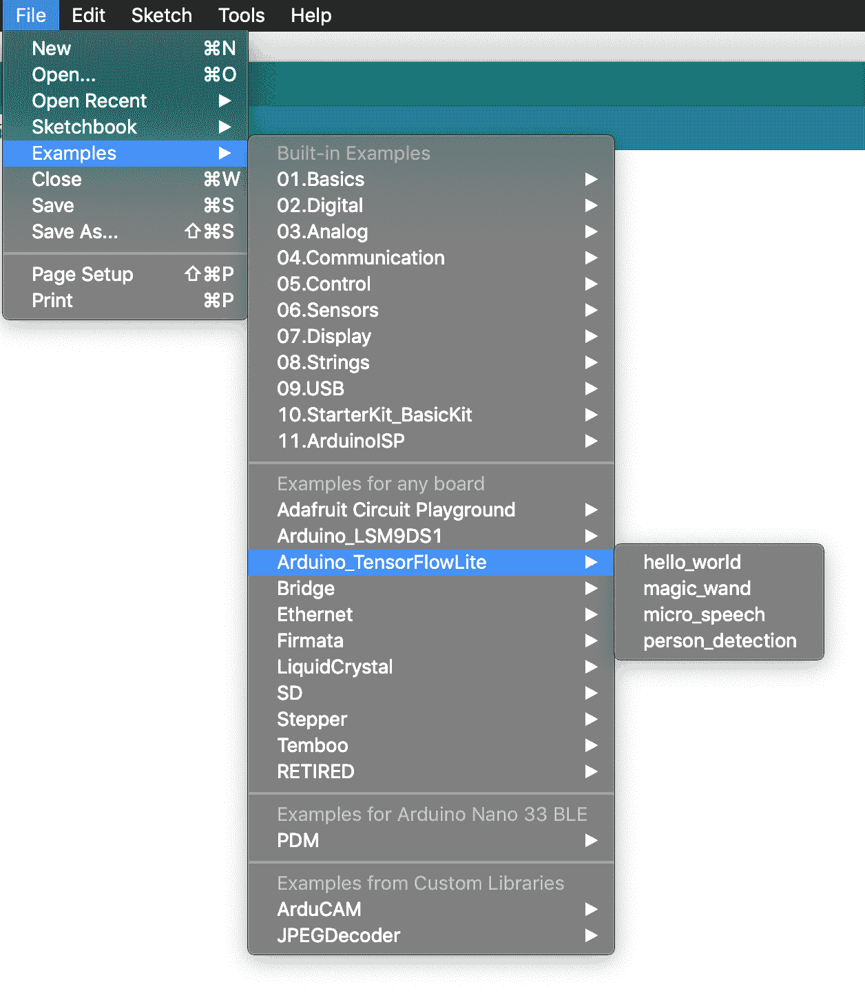

除了 TensorFlow 库之外，还需要安装并修补 `Arduino_LSM9DS1` 库。默认情况下，此库不会启用示例所需的 FIFO 缓冲区，因此需要对代码进行少量修改。

在 Arduino IDE 中选择 `Tools` → `Manage Libraries`，搜索 `Arduino_LSM9DS1`。为确保以下步骤能够正常执行，需要安装驱动版本 1.0.0。

#### 注

到你重读本章时，驱动程序可能已被修复。最新的部署步骤可在 [`README.md` 中](https://oreil.ly/pk61J) 找到。

驱动程序安装在 `Arduino/libraries` 目录的子目录 `Arduino_LSM9DS1` 中。

打开 `Arduino_LSM9DS1/src/LSM9DS1.cpp` 驱动源文件，移动到名为 `LSM9DS1Class::begin()` 的函数。在函数末尾，在 `return 1` 语句之前插入以下行：

```
// Enable FIFO (see docs https://www.st.com/resource/en/datasheet/DM00103319.pdf)
// writeRegister(LSM9DS1_ADDRESS, 0x23, 0x02);
// Set continuous mode
writeRegister(LSM9DS1_ADDRESS, 0x2E, 0xC0);
```

接下来，查找名为 `LSM9DS1Class::accelerationAvailable()` 的函数。你会看到以下行：

```
if (readRegister(LSM9DS1_ADDRESS, LSM9DS1_STATUS_REG) & 0x01) {
  return 1;
}
```

将这些行注释掉，并替换为以下内容：

```
// Read FIFO_SRC. If any of the rightmost 8 bits have a value, there is data.
if (readRegister(LSM9DS1_ADDRESS, 0x2F) & 63) {
  return 1;
}
```


ファイルを保存する。これでパッチは完了だ！

保存文件。至此，补丁已完成！

サンプルを実行するには、ArduinoデバイスをUSB 経由で接続する。図 11-6に示すように、ToolsメニューのBoardドロップダウン・リストから正しいデバイス・タイプが選択されていることを確認する。

要运行示例，请通过 USB 连接 Arduino 设备。如图 11-6 中所示，请确认 Tools 菜单的 Board 下拉列表中已选择正确的设备类型。

リストにデバイス名が表示されない場合は、サポートパッケージをインストールする必要がある。これを行うには、Boards Managerをクリックし、表示されるウィンドウでお使いのデバイスを検索し、対応するサポートパッケージの最新バージョンをインストールする。

如果列表中未显示设备名称，则需要安装支持包。为此，请单击 Boards Manager，在出现的窗口中搜索您使用的设备，并安装相应支持包的最新版本。

次に、図 11-7に示すように、ToolsメニューのPortドロップダウンでデバイスのポートが選択されていることを確認する。

接下来，如图 11-7 中所示，请确认 Tools 菜单的 Port 下拉菜单中已选择设备的端口。

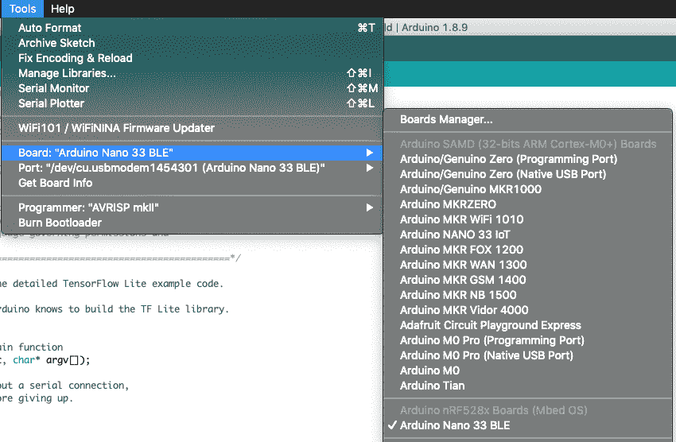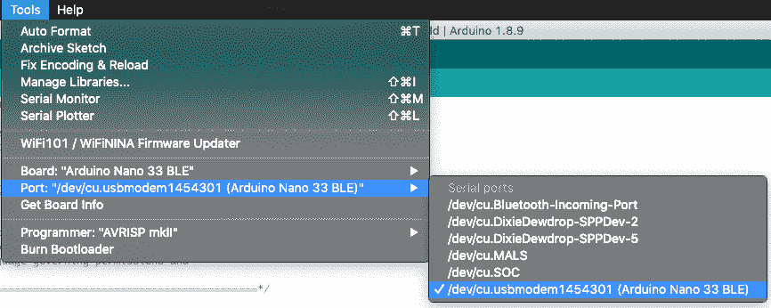

最後に、Arduinoウィンドウのアップロードボタン（図 11-8で白くハイライトされている）をクリックしてコードをコンパイルし、Arduinoデバイスにアップロードする。

最后，单击 Arduino 窗口的上传按钮（在图 11-8 中中以白色高亮显示），编译代码并上传到 Arduino 设备。


アップロードが正常に完了すると、ArduinoボードのLEDが点滅し始めるのが見えるはずだ。

上传成功完成后，您应该可以看到 Arduino 板上的 LED 开始闪烁。

いくつかのジェスチャーを試すには、ツールメニューからシリアルモニターを選択する。初期化すると以下のような出力が表示されるはずだ：

要尝试一些手势，请从工具菜单中选择串行监视器。初始化后应显示如下输出：

```
Magic starts!
```

ジェスチャーをしてみよう。図 11-9に示すように、部品が上を向き、USBアダプターが左を向くように、片手でボ ードを持ち上げる。

让我们试试手势。如图 11-9 中所示，请用一只手抬起板子，使元件朝上，USB 适配器朝左。

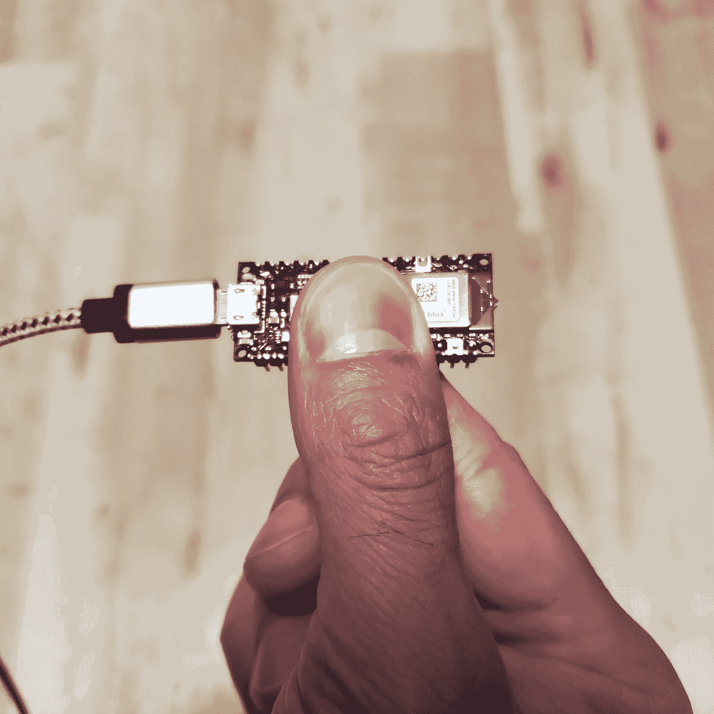

図 11-10は、各ジェスチャーの実行方法を示した図である。このモデルは、ボードを杖に取り付けたときに収集されたデータで学習されたため、動作させるには何度か試す必要があるかもしれない。

图 11-10 是展示了如何执行每个手势的图。由于该模型是用在将板子安装到魔杖时收集的数据训练的，因此可能需要尝试几次才能使其工作。


一番簡単なのは "翼 "だ。ジェスチャーを実行するのに1 秒程度かかるくらい、素早く手を動かすこと。成功すれば、次のような出力が表示され、赤いLEDが点灯するはずだ：

最简单的是“翼”。手部动作要快，大约需要 1 秒钟来执行手势。如果成功，应会显示如下输出，并且红色 LED 会亮起：

```
WING:
*         *         *
 *       * *       *
  *     *   *     *
   *   *     *   *
    * *       * *
     *         *
```

おめでとう。Arduinoを使って初めて魔法の呪文を唱えたのだ！

恭喜你！你用 Arduino 首次施展了魔法咒语！

#### 注

#### 注

この時点で、手から最も遠いマジック・ワンドの先端にボードを取り付けるという独創的な方法を選ぶこともできる。長さ1フィート（30cm）程度の棒や定規など、家庭にあるものなら何でもよい。

在此阶段，您也可以选择一种创造性的方法，将板子安装在距离手最远的魔杖尖端。任何家用物品都可以，例如长度约 1 英尺（30 厘米）的棒或尺子。

デバイスがしっかりと取り付けられていることを確認し、同じ向きで、部品が上を向き、USBアダプターが左を向くようにする。ぐらつきがあると加速度センサーの読み取り値に影響する。

确保设备牢固安装，方向相同，元件朝上，USB 适配器朝左。晃动会影响加速度传感器的读数。

次に、手（または杖の先）で時計回りの円をなぞる「リング」のジェスチャーを試してみよう。ここでも、ジェスチャーを行うのに1 秒程度を目安にする。まるで魔法のように、次のようなものが現れるはずだ：

接下来，尝试“环”手势，用手（或魔杖尖端）顺时针画一个圆。这里也以大约 1 秒为执行手势的时间。就像魔法一样，应该会出现如下内容：

```
RING:
          *
       *     *
     *         *
    *           *
     *         *
       *     *
          *
```

最後のジェスチャーは、三角形の角を空中でなぞる。ここで紹介するアスキーアートのデモンストレーションが、このジェスチャーを最もよく表している：

最后的手势是在空中描画三角形的角落。以下介绍的 ASCII 艺术演示最能代表这个手势：

```
SLOPE:
        *
       *
      *
     *
    *
   *
  *
 * * * * * * * *
```

優れた魔法の呪文のように、毎回完璧に実行できるようになるには、少し練習する必要があるかもしれない。[`README.md` で](https://oreil.ly/O1LqD)ジェスチャーのデモンストレーションビデオを見ることができる。

就像优秀的魔法咒语一样，可能需要一些练习才能每次都完美执行。可以在[`README.md` 中](https://oreil.ly/O1LqD)观看手势演示视频。

## 自分で変更を加える

## 自行修改

基本的なアプリケーションをデプロイしたところで、コードを変更して遊んでみよう。Arduino IDEでファイルを編集して保存し、前の手順を繰り返して変更したコードをデバイスにデプロイする。

在部署了基本应用程序后，让我们修改代码并尝试一下。在 Arduino IDE 中编辑并保存文件，然后重复之前的步骤将修改后的代码部署到设备上。

いくつか試してみてほしいことがある：

有一些事情希望你尝试一下：

* [`Arduino/constants.cc` の](https://oreil.ly/H49iS)しきい値を実験して、ジェスチャーをやりやすくしたり、やりにくくしたりする（その代償として偽陽性や偽陰性が増える）。
* 实验[`Arduino/constants.cc` 的](https://oreil.ly/H49iS)阈值，使手势更容易或更难执行（代价是假阳性和假阴性会增加）。
* 身体的なジェスチャーを使ってタスクを実行できるようなプログラミングをコンピュータに書く。
* 编写程序让计算机能够使用身体手势执行任务。
* 検出結果をBluetoothで送信するようにプログラミングを拡張する。[Arduino](https://oreil.ly/xW4SN) IDEからダウンロードできる[ArduinoBLEライブラリに](https://oreil.ly/xW4SN)、その方法を示す例が含まれている。
* 扩展编程以通过 Bluetooth 发送检测结果。[Arduino](https://oreil.ly/xW4SN) IDE 可下载的[ArduinoBLE 库中](https://oreil.ly/xW4SN)包含展示此方法的示例。

## スパークファン・エッジ

## SparkFun Edge

SparkFun Edgeは、3 軸加速度センサー、バッテリーマウント、ブルートゥースをサポートしている。ワイヤレスで操作できるため、魔法の杖に最適だ。

SparkFun Edge 支持三轴加速度传感器、电池安装和蓝牙。由于可以无线操作，因此非常适合作为魔杖。

### SparkFun Edgeで加速度計のデータを取得する

### 使用 SparkFun Edge 获取加速度计数据

加速度センサーのデータを取得するコードは[`sparkfun_edge/accelerometer_handler.cc` に](https://oreil.ly/yZi0v)ある。その多くはデバイス固有のものだが、実装の詳細は飛ばして、重要なことに集中しよう。

获取加速度传感器数据的代码位于[`sparkfun_edge/accelerometer_handler.cc` 中](https://oreil.ly/yZi0v)。其中大部分是设备特定的，但让我们跳过实现细节，专注于重要内容。

加速度センサーのデータを取り込む最初のステップは、ハードウェアの設定である。`SetupAccelerometer()` 関数は、加速度センサーが必要とする様々な低レベルのパラメータをセットすることで、これを開始する：

获取加速度传感器数据的第一步是硬件设置。`SetupAccelerometer()` 函数通过设置加速度传感器所需的各种低级参数来启动此过程：

```
TfLiteStatus SetupAccelerometer(tflite::ErrorReporter* error_reporter) {
  // Set the clock frequency.
  am_hal_clkgen_control(AM_HAL_CLKGEN_CONTROL_SYSCLK_MAX, 0);

  // Set the default cache configuration
  am_hal_cachectrl_config(&am_hal_cachectrl_defaults);
  am_hal_cachectrl_enable();

  // Configure the board for low power operation.
  am_bsp_low_power_init();

  // Collecting data at 25Hz.
  int accInitRes = initAccelerometer();
```

`initAccelerometer()` という名前の関数呼び出しがあることに気づくだろう。これは[SparkFun Edge BSPの加速度センサー・サンプルで](https://oreil.ly/JC0b6)定義されており、プロジェクトのビルド時に依存関係としてプルダウンされる。この関数は、ボードの加速度センサーをオンにして設定するためのさまざまなタスクを実行する。

你会注意到有一个名为 `initAccelerometer()` 的函数调用。它在[SparkFun Edge BSP 的加速度传感器示例中](https://oreil.ly/JC0b6)定义，并在项目构建时作为依赖项拉取。该函数执行各种任务以打开并配置板载加速度传感器。

加速度センサーが動作した後、[FIFOバッファを](https://oreil.ly/kFEa0)有効にする。これは加速度センサー自体にある特殊化されたメモリー・バッファで、直近の32 個のデータポイントを保持する。このバッファを有効にすることで、アプリケーション・コードが推論実行中に忙しくなっても、加速度センサーの測定値を収集し続けることができる。関数の残りは、バッファをセットアップし、何か問題が発生した場合にエラーを記録する：

加速度传感器工作后，启用[FIFO 缓冲区](https://oreil.ly/kFEa0)。这是一个加速度传感器本身的专用内存缓冲区，可保存最近的 32 个数据点。通过启用此缓冲区，即使应用程序代码在推理执行期间很忙，加速度传感器也能继续收集测量值。函数的其余部分设置缓冲区并在出现问题时记录错误：

```
  // Enable the accelerometer's FIFO buffer.
  // Note: LIS2DH12 has a FIFO buffer which holds up to 32 data entries. It
  // accumulates data while the CPU is busy. Old data will be overwritten if
  // it's not fetched in time, so we need to make sure that model inference is
  // faster than 1/25Hz * 32 = 1.28s
  if (lis2dh12_fifo_set(&dev_ctx, 1)) {
    error_reporter->Report("Failed to enable FIFO buffer.");
  }

  if (lis2dh12_fifo_mode_set(&dev_ctx, LIS2DH12_BYPASS_MODE)) {
    error_reporter->Report("Failed to clear FIFO buffer.");
    return 0;
  }

  if (lis2dh12_fifo_mode_set(&dev_ctx, LIS2DH12_DYNAMIC_STREAM_MODE)) {
    error_reporter->Report("Failed to set streaming mode.");
    return 0;
  }

  error_reporter->Report("Magic starts!");

  return kTfLiteOk;
}
```

初期化が終わったら、`ReadAccelerometer()` 関数を呼び出して最新のデータを取得することができる。これは推論のたびに行われる。

初始化完成后，可以调用 `ReadAccelerometer()` 函数获取最新数据。这在每次推理时都会进行。

まず、`reset_buffer` 引数が`true` の場合、`ReadAccelerometer()` はデータバッファのリセットを実行する。これは有効なジェスチャーが検出された後に実行され、以降のジェスチャーに対してまっさらな状態を提供するためである。このプロセスの一環として、`am_util_delay_ms()` を使用して、コードを10ミリ秒待たせる。この遅延がないと、新しいデータを読み取るときにコードがハングアップすることが多い（この記事を書いている時点では原因は不明だが、TensorFlowオープンソースプロジェクトでは、より良い修正方法を見つけた場合のプルリクエストを歓迎している）：

首先，如果 `reset_buffer` 参数为 `true`，`ReadAccelerometer()` 会执行数据缓冲区的重置。这是在检测到有效手势后执行的，以便为后续手势提供干净的状态。作为此过程的一部分，使用 `am_util_delay_ms()` 使代码等待 10 毫秒。如果没有此延迟，在读取新数据时代码经常会挂起（截至本文撰写时原因不明，但 TensorFlow 开源项目欢迎在找到更好的修复方法时的拉取请求）：

```
bool ReadAccelerometer(tflite::ErrorReporter* error_reporter, float* input,
                       int length, bool reset_buffer) {
  // Clear the buffer if required, e.g. after a successful prediction
  if (reset_buffer) {
    memset(save_data, 0, 600 * sizeof(float));
    begin_index = 0;
    pending_initial_data = true;
    // Wait 10ms after a reset to avoid hang
    am_util_delay_ms(10);
  }
```

メイン・バッファをリセットした後、`ReadAccelerometer()` 、加速度センサーのFIFOバッファに新しいデータがあるかどうかをチェックする。まだ何もない場合は、関数からリターンする：

在重置主缓冲区后，`ReadAccelerometer()` 检查加速度传感器的 FIFO 缓冲区是否有新数据。如果还没有，则从函数返回：

```
  // Check FIFO buffer for new samples
  lis2dh12_fifo_src_reg_t status;
  if (lis2dh12_fifo_status_get(&dev_ctx, &status)) {
    error_reporter->Report("Failed to get FIFO status.");
    return false;
  }

  int samples = status.fss;
  if (status.ovrn_fifo) {
    samples++;
  }

  // Skip this round if data is not ready yet
  if (samples == 0) {
    return false;
  }
```

つまり、データが利用可能になり次第、このポイントを通過することができる。

也就是说，一旦数据可用，就可以通过此点。

関数の次の部分では、新しいデータをループし、別の大きなバッファにストアする。まず、`axis3bit16_t` 型の特殊化構造体をセットアップし、加速度計データを格納する。次に、`lis2dh12_acceleration_raw_get()` を呼び出し、次に利用可能な測定値で埋める。この関数はエラーになるとゼロを返し、その時点でエラーを表示する：

函数的下一部分循环处理新数据并将其存储到另一个大缓冲区中。首先，设置一个 `axis3bit16_t` 类型的专用结构体来存储加速度计数据。接下来，调用 `lis2dh12_acceleration_raw_get()` 用下一个可用测量值填充它。该函数在出错时返回零，此时会显示错误：

```
  // Load data from FIFO buffer
  axis3bit16_t data_raw_acceleration;
  for (int i = 0; i < samples; i++) {
    // Zero out the struct that holds raw accelerometer data
    memset(data_raw_acceleration.u8bit, 0x00, 3 * sizeof(int16_t));
    // If the return value is non-zero, sensor data was successfully read
    if (lis2dh12_acceleration_raw_get(&dev_ctx, data_raw_acceleration.u8bit)) {
      error_reporter->Report("Failed to get raw data.");
```

測定値が正常に取得された場合、それをモデルが期待する測定単位であるミリGsに変換し、`save_data[]` に書き込む。これは、推論に使用する値を格納するバッファとして使用する配列である。加速度センサーの各軸の値は、連続して格納される：

如果测量值成功获取，则将其转换为模型期望的测量单位毫 Gs，并写入 `save_data[]`。这是一个用于存储用于推理的值的缓冲区数组。加速度传感器的每个轴的值连续存储：

```
    } else {
      // Convert each raw 16-bit value into floating point values representing
      // milli-Gs, a unit of acceleration, and store in the current position of
      // our buffer
      save_data[begin_index++] =
          lis2dh12_from_fs2_hr_to_mg(data_raw_acceleration.i16bit[0]);
      save_data[begin_index++] =
          lis2dh12_from_fs2_hr_to_mg(data_raw_acceleration.i16bit[1]);
      save_data[begin_index++] =
          lis2dh12_from_fs2_hr_to_mg(data_raw_acceleration.i16bit[2]);
      // Start from beginning, imitating loop array.
      if (begin_index >= 600) begin_index = 0;
    }
  }
```

`save_data[]` 配列は3 軸の値を200セット格納できるので、`begin_index` カウンタが600に達したら0に戻す。

`save_data[]` 数组可以存储 200 组三轴值，因此当 `begin_index` 计数器达到 600 时将其重置为 0。

これで、すべての新しいデータを`save_data[]` のバッファに取り込むことができた。次に、予測を行うのに十分なデータがあるかどうかをチェックする。モデルをテストする際、バッファサイズの合計の3 分の1 程度が、信頼できる予測を行うための最低限のデータ量であることがわかった。したがって、少なくともこれだけのデータがあれば、`pending_initial_data` フラグを`false` に設定する（デフォルトは`true` ）：

现在，所有新数据都已摄入到 `save_data[]` 缓冲区中。接下来，检查是否有足够的数据进行预测。在测试模型时，发现缓冲区总大小的三分之一左右是进行可靠预测所需的最低数据量。因此，如果至少有这么多数据，则将 `pending_initial_data` 标志设置为 `false`（默认为 `true`）：

```
  // Check if we are ready for prediction or still pending more initial data
  if (pending_initial_data && begin_index >= 200) {
    pending_initial_data = false;
  }
```

次に、推論を実行するにはまだデータが不十分な場合、`false` を返す：

接下来，如果数据仍不足以执行推理，则返回 `false`：

```
  // Return if we don't have enough data
  if (pending_initial_data) {
    return false;
  }
```

ここまでくれば、推論を実行するのに十分なデータがバッファにあることになる。関数の最後の部分は、要求されたデータをバッファから`input` 、モデルの入力テンソルへのポインタである引数にコピーする：

到此为止，缓冲区中已有足够的数据执行推理。函数的最后一部分将请求的数据从缓冲区复制到 `input` 参数中，该参数是指向模型输入张量的指针：


```
  // Copy the requested number of bytes to the provided input tensor
  for (int i = 0; i < length; ++i) {
    int ring_array_index = begin_index + i - length;
    if (ring_array_index < 0) {
      ring_array_index += 600;
    }
    input[i] = save_data[ring_array_index];
  }
  return true;
```

变量`length`是传递给`ReadAccelerometer()`的参数，用于决定应复制的数据量。`length`我们的模型作为输入接收 128 个三轴读数，因此`main_functions.cc`中的代码以 384 (128 * 3)调用`ReadAccelerometer()`。

此时，输入张量会被新鲜的加速度传感器数据填满。推理被执行，其结果由手势预测器解释，然后结果被传递给输出处理器并显示给用户。

## 在 SparkFun Edge 上对手势做出反应

[`sparkfun_edge/output_handler.cc`中](https://oreil.ly/ix1o1)的输出处理器非常简单。首次运行时，它会设置 LED 输出：

```
void HandleOutput(tflite::ErrorReporter* error_reporter, int kind) {
  // The first time this method runs, set up our LEDs correctly
  static bool is_initialized = false;
  if (!is_initialized) {
    am_hal_gpio_pinconfig(AM_BSP_GPIO_LED_RED, g_AM_HAL_GPIO_OUTPUT_12);
    am_hal_gpio_pinconfig(AM_BSP_GPIO_LED_BLUE, g_AM_HAL_GPIO_OUTPUT_12);
    am_hal_gpio_pinconfig(AM_BSP_GPIO_LED_GREEN, g_AM_HAL_GPIO_OUTPUT_12);
    am_hal_gpio_pinconfig(AM_BSP_GPIO_LED_YELLOW, g_AM_HAL_GPIO_OUTPUT_12);
    is_initialized = true;
  }
```

接下来，每次推理时让黄色 LED 闪烁：

```
  // Toggle the yellow LED every time an inference is performed
  static int count = 0;
  ++count;
  if (count & 1) {
    am_hal_gpio_output_set(AM_BSP_GPIO_LED_YELLOW);
  } else {
    am_hal_gpio_output_clear(AM_BSP_GPIO_LED_YELLOW);
  }
```

随后，检查检测到哪个手势。对每个手势点亮相应的 LED，清除所有其他手势，并通过串行端口输出漂亮的 ASCII 艺术。这就是处理“翼”手势的代码：

```
  // Set the LED color and print a symbol (red: wing, blue: ring, green: slope)
  if (kind == 0) {
    error_reporter->Report(
        "WING:\n\r*         *         *\n\r *       * *       "
        "*\n\r  *     *   *     *\n\r   *   *     *   *\n\r    * *       "
        "* *\n\r     *         *\n\r");
    am_hal_gpio_output_set(AM_BSP_GPIO_LED_RED);
    am_hal_gpio_output_clear(AM_BSP_GPIO_LED_BLUE);
    am_hal_gpio_output_clear(AM_BSP_GPIO_LED_GREEN);
```

在串行端口监视器中，输出如下：

```
WING:
*         *         *
 *       * *       *
  *     *   *     *
   *   *     *   *
    * *       * *
     *         *
```

每个手势使用不同的串行输出和 LED。

## 运行示例

到目前为止，我们已经了解了 SparkFun Edge 代码的工作方式。接下来，让我们在硬件上运行这段代码。

### 提示

由于本书撰写时与构建步骤可能已发生变化，请检查[`README.md`](https://oreil.ly/Ts6MT)以获取最新步骤。

构建并部署代码需要以下内容：

* 安装了 [Himax HM01B0 扩展板](https://oreil.ly/f23oa) 到 SparkFun Edge 板上。
* USB 编程器（推荐使用 SparkFun 串行基础 breakout。）
* 兼容的 USB 电缆
* Python 3 及一些依赖项

### 注

如果不确定是否安装了正确的 Python 版本，请参阅「运行示例」 中的确认方法。

打开终端窗口，克隆 TensorFlow 仓库并进入该目录：

```
git clone https://github.com/tensorflow/tensorflow.git
cd tensorflow
```

接下来，执行一些用于构建二进制文件并将其下载到设备的命令。为了节省输入时间，这些命令可以从[`README.md`中](https://oreil.ly/MQmWw)复制并粘贴。

### 构建二进制文件

以下命令将下载所有必要的依赖项并编译适用于 SparkFun Edge 的二进制文件：

```
make -f tensorflow/lite/micro/tools/make/Makefile \
 TARGET=sparkfun_edge magic_wand_bin
```

二进制文件将作为 `*.bin` 文件创建在以下位置：

```
tensorflow/lite/micro/tools/make/gen/
 sparkfun_edge_cortex-m4/bin/magic_wand.bin
```

可以使用以下命令检查文件是否存在：

```
test -f tensorflow/lite/micro/tools/make/gen/sparkfun_edge_ \
  cortex-m4/bin/magic_wand.bin &&  echo "Binary was successfully created" || \
  echo "Binary is missing"
```

运行此命令后，控制台将显示 `Binary was successfully created`。

`Binary is missing`如果显示，则构建过程出现问题。如果是这样，`make` 命令的输出中可能包含失败原因的提示。

### 对二进制文件进行签名

要将二进制文件部署到设备，需要用加密密钥对其进行签名。让我们运行一些命令来对二进制文件进行签名，以便能够将其刷新到 SparkFun Edge。这里使用的脚本来自在 Makefile 执行时下载的 Ambiq SDK。

输入以下命令，设置可用于开发的虚拟加密密钥：

```
cp tensorflow/lite/micro/tools/make/downloads/AmbiqSuite-Rel2.0.0/ \
  tools/apollo3_scripts/keys_info0.py
  tensorflow/lite/micro/tools/make/downloads/AmbiqSuite-Rel2.0.0/ \
  tools/apollo3_scripts/keys_info.py
```

接下来，运行以下命令创建签名后的二进制文件。必要时，将 `python3` 替换为 `python`：

```
python3 tensorflow/lite/micro/tools/make/downloads/ \
  AmbiqSuite-Rel2.0.0/tools/apollo3_scripts/create_cust_image_blob.py \
  --bin tensorflow/lite/micro/tools/make/gen/ \
  sparkfun_edge_cortex-m4/bin/micro_vision.bin \
  --load-address 0xC000 \
  --magic-num 0xCB \
  -o main_nonsecure_ota \
  --version 0x0
```

这样就创建了 `main_nonsecure_ota.bin` 文件。运行此命令以创建最终版本的可用文件，该文件可在下一步用于刷新设备的脚本中使用：

```
python3 tensorflow/lite/micro/tools/make/downloads/ \
AmbiqSuite-Rel2.0.0/tools/apollo3_scripts/create_cust_wireupdate_blob.py \
--load-address 0x20000 \
--bin main_nonsecure_ota.bin \
-i 6 \
-o main_nonsecure_wire \
--options 0x1
```

这样，运行命令的目录中应该会出现名为 `main_nonsecure_wire.bin` 的文件。这就是要刷新到设备的文件。

### 刷新二进制文件

SparkFun Edge 将当前正在运行的程序存储在 1 兆字节的闪存中。如果想让板子运行新程序，则需要将该程序发送到板子，板子将其保存到闪存中并覆盖之前保存的程序。此过程称为刷新。

### 将编程器连接到板子

要下载新程序到板子，请使用 SparkFun USB-C Serial Basic 串行编程器。此设备使计算机能够通过 USB 与微控制器通信。

要将此设备连接到板子，请执行以下步骤：

1. SparkFun Edge 侧面有一个 6 针排针。
2. 将 SparkFun USB-C Serial Basic 插入这些引脚，确保每个设备上标有 BLK 和 GRN 的引脚正确对齐。

图 11-11 中 显示了正确的放置方式。

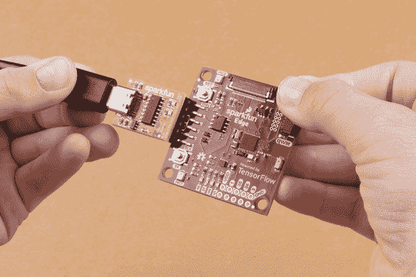

### 将编程器连接到计算机

接下来，通过 USB 将板子连接到计算机。要对板子进行编程，需要确定计算机为设备分配的名称。最好的方法是列出连接前和连接后计算机的所有设备，确认哪个是新的。

#### 警告

有人报告了编程器操作系统默认驱动程序相关的问题，因此强烈建议在继续之前安装[驱动程序](https://oreil.ly/vLavS)。

在通过 USB 连接设备之前，运行以下命令：

```
# macOS:
ls /dev/cu*

# Linux:
ls /dev/tty*
```

应该会输出类似以下列表：

```
/dev/cu.Bluetooth-Incoming-Port
/dev/cu.MALS
/dev/cu.SOC
```

将编程器连接到计算机的 USB 端口，然后再次运行命令：

```
# macOS:
ls /dev/cu*

# Linux:
ls /dev/tty*
```

应该会像以下示例一样输出额外项目。新的项目名称可能不同。此新项目即为设备名称：

```
/dev/cu.Bluetooth-Incoming-Port
/dev/cu.MALS
/dev/cu.SOC
/dev/cu.wchusbserial-1450
```

此名称用于引用设备。然而，名称可能会根据编程器连接到的 USB 端口而变化，因此如果从计算机上拔下板子并重新连接，可能需要重新检查名称。

#### 提示

有用户报告列表中会出现两个设备。如果出现两个设备，正确的那个以 "wch " 开头。

确认设备名称后，将其保存到 shell 变量中以便以后使用：

```
export DEVICENAME=<your device name here>
```

这是在以后运行需要设备名称的命令时使用的变量。

### 运行脚本刷新板子

要刷新板子，需要将其置于接收新二进制文件的特殊“引导加载程序”状态。然后可以运行脚本向板子发送二进制文件。

首先，创建一个指定波特率的环境变量。波特率是指向设备发送数据的速度：

```
export BAUD_RATE=921600
```

将以下命令粘贴到终端。命令中的 `${DEVICENAME}` 和 `${BAUD_RATE}` 将被替换为上一节中设置的值。必要时，请勿忘记将 `python3` 替换为 `python`：

```
python3 tensorflow/lite/micro/tools/make/downloads/ \
  AmbiqSuite-Rel2.0.0/tools/apollo3_scripts/uart_wired_update.py -b \
  ${BAUD_RATE} ${DEVICENAME} -r 1 -f main_nonsecure_wire.bin -i 6
```

接下来，将板子重置为引导加载程序状态并刷新板子。

在板子上，找到标有 `RST` 和 `14` 的按钮，如图 11-12 中所示。

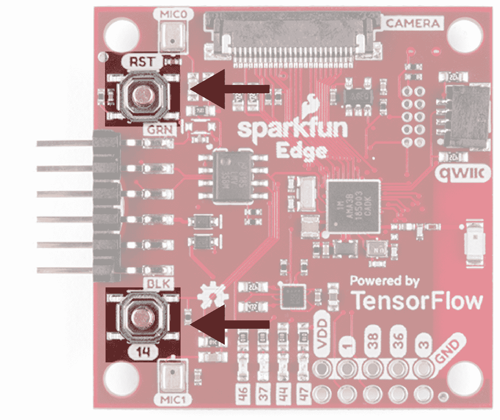

执行以下步骤：

1. 确认板子已连接到编程器，并且整体通过 USB 连接到计算机。
2. 在板子上，按住标有 `14` 的按钮。*继续按住。*
3. 在保持 `14` 按钮按住的同时，按下标有 `RST` 的按钮以重置板子。
4. 在计算机上按 Enter 键运行脚本。*继续按住 `14` 按钮。*

这样屏幕上应该会显示如下内容：


```
Connecting with Corvette over serial port /dev/cu.usbserial-1440...
Sending Hello.
Received response for Hello
Received Status
length =  0x58
version =  0x3
Max Storage =  0x4ffa0
Status =  0x2
State =  0x7
AMInfo =
0x1
0xff2da3ff
0x55fff
0x1
0x49f40003
0xffffffff
[...lots more 0xffffffff...]
Sending OTA Descriptor =  0xfe000
Sending Update Command.
number of updates needed =  1
Sending block of size  0x158b0  from  0x0  to  0x158b0
Sending Data Packet of length  8180
Sending Data Packet of length  8180
[...lots more Sending Data Packet of length  8180...]
```

直到显示 `Sending Data Packet of length 8180` 为止，持续按下按钮 `14`。显示后可以松开按钮（不过继续按住也没关系）。

编程会持续在终端输出行。最终会显示如下内容：

```
[...lots more Sending Data Packet of length  8180...]
Sending Data Packet of length  8180
Sending Data Packet of length  6440
Sending Reset Command.
Done.
```

这表示闪烁成功。

#### 小贴士

如果编程输出以错误结束，请检查是否打印了 `Sending Reset Command.`。如果打印了，则尽管有错误，闪烁很可能已成功。否则，可能闪烁失败。请再次执行此步骤（可以省略环境变量的设置）。

## 测试编程

首先，按下 `RST` 按钮，确认编程正在运行。编程运行时，黄色 LED 会在每次推理时重复点亮和熄灭一次。

接下来，使用以下命令开始打印设备的串行输出：

```
screen ${DEVICENAME} 115200
```

初始化时应显示如下输出：

```
Magic starts!
```

试试手势。如图 11-13 所示，用一只手抬起板子，使元件朝上，USB 适配器朝左。

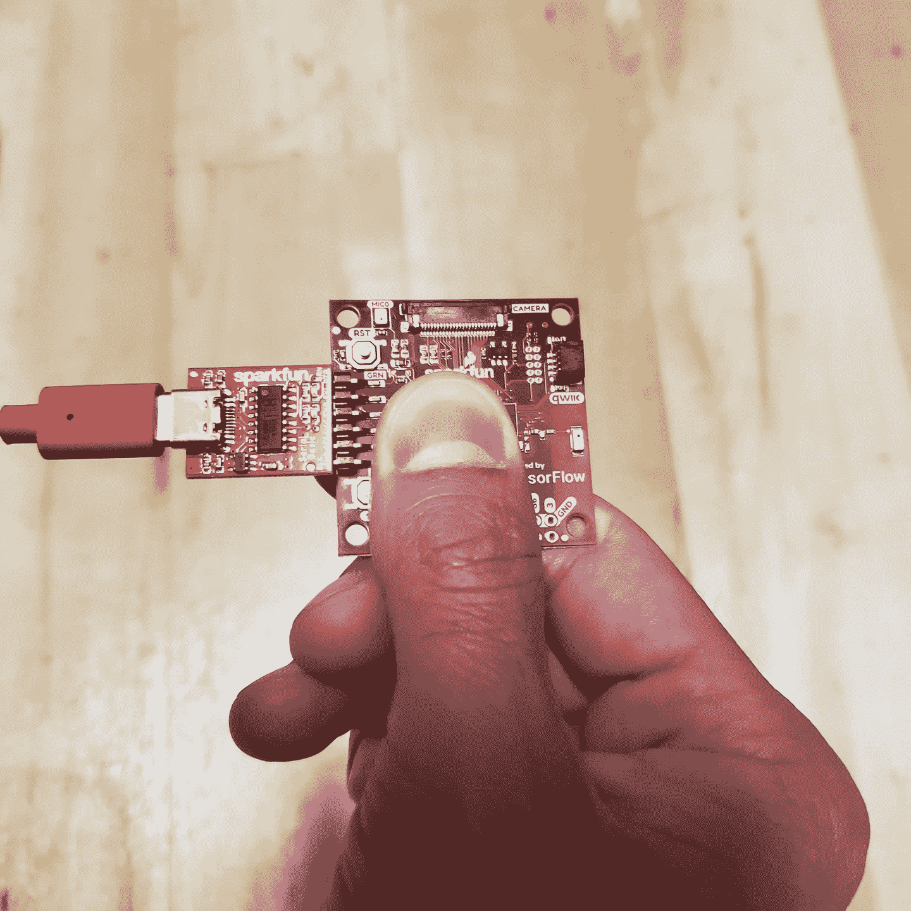

图 11-14 显示了如何执行每个手势。由于该模型是用板子安装在魔杖上时收集的数据训练的，可能需要尝试几次才能使其工作。


最简单的是“翼”。手部动作大约需要 1 秒左右，快速移动手即可。如果成功，红色 LED 会点亮，并应显示如下输出：

```
WING:
*         *         *
 *       * *       *
  *     *   *     *
   *   *     *   *
    * *       * *
     *         *
```

恭喜你，使用 SparkFun Edge 首次施展了魔法咒语！

#### 注

在此阶段，你也可以选择一种独创的方法，将板子安装在距离手最远的魔杖尖端。任何家里的东西都可以，比如长度约 1 英尺（30 厘米）的棒或尺子。

确保设备牢固安装，方向一致，元件朝上，USB 适配器朝左。另外，由于晃动会影响加速度传感器的读数，请选择硬质的魔杖，而不是柔软的。

接下来，尝试“环”手势，用手（或魔杖尖端）顺时针画一个圆。这里也以约 1 秒为手势执行时间。就像魔法一样，应该会出现如下内容：

```
RING:
          *
       *     *
     *         *
    *           *
     *         *
       *     *
          *
```

最后一个手势是在空中描绘三角形的角。这里介绍的 ASCII 艺术演示最能代表这个手势：

```
SLOPE:
        *
       *
      *
     *
    *
   *
  *
 * * * * * * * *
```

就像优秀的魔法咒语一样，可能需要一些练习才能每次都完美执行。可以在 `README.md` 中观看手势演示视频。

## 自行修改

现在基本应用程序已部署，可以尝试玩玩或修改它。应用程序代码可在 `tensorFlow/lite/micro/examples/magic_wand` 文件夹中找到。编辑并保存，然后重复之前的步骤，将修改后的代码部署到设备上。

有几件事请你尝试：

*   尝试实验 [`constants.cc`](https://oreil.ly/s5bdg) 中的阈值，使手势更容易或更难（代价是假阳性和假阴性会增加）。
*   编写程序让计算机使用身体手势执行任务。
*   扩展编程以通过 Bluetooth 发送检测结果。此方法在 [Ambiq SDK 的](https://oreil.ly/Bci3a) `AmbiqSuite-Rel2.0.0/boards/apollo3_evb/examples/uart_ble_bridge` 中有示例。魔杖应用程序构建后，SDK 将下载到 `TensorFlow/tensorFlow/lite/micro/tools/make/downloads/AmbiqSuite-Rel2.0.0`。

# 总结

本章我们看到了一个有趣的例子，即模糊的传感器数据被嵌入式机器学习应用程序解释为更有用的形式。通过在噪声中寻找模式，嵌入式机器学习模型使设备能够理解周围世界并发出事件警报，即使原始数据对人类来说难以消化。

在第 12 章中，我们将探讨魔杖模型的工作原理，并学习如何收集数据并训练自己的魔法咒语。

^(1)Mihaela Porumb et al., "A convolutional neural network approach to detect congestive heart failure.".*Biomedical Signal Processing and Control*(Jan 2020).[*https://oreil.ly/4HBFt*](https://oreil.ly/4HBFt).
