# 第 12 章. 训练魔杖模型

本作品使用 AI 翻译。我们期待您的意见和反馈：translation-feedback@oreilly.com

在第 11 章中，我们使用了一个 20KB 的预训练模型来解释加速度传感器的原始数据，并用它来识别执行了哪一系列手势。本章将介绍该模型是如何训练的，然后解释它实际如何工作。

唤醒词和人物检测模型都需要在训练时使用大量数据。这是因为要解决的问题很复杂。人们说“是”“否”的方式有无数种变体，可以想象出使人的声音独一无二的所有变体，如口音、语调、音高等。同样，图像中人的形象也是无限的。可能是脸、整个人或一只手，也可能以任何姿势站立。

为了准确分类如此多样化的输入验证，模型也需要在同样多样化的训练数据集上进行训练。这就是为什么唤醒词和人物检测的训练数据集规模庞大且训练耗时。

魔杖手势识别问题则更简单。在这种情况下，我们不是试图对大量自然声音或人类外貌和姿势进行分类，而是试图理解三种特定且有意选择的差异。每个手势的做法因人而异，但我们希望用户尽力做出尽可能准确和一致的手势。

也就是说，由于预期验证输入的变异性较小，因此无需大量数据即可非常轻松地训练出准确的模型。实际上，用于模型训练的数据集仅包含每个手势约 150 个示例，大小仅为 1.5MB。获取足够的数据通常是机器学习项目中最困难的部分。

本章的第一部分将学习如何训练魔杖应用程序中使用的原始模型。第二部分将解释该模型实际如何工作。最后，你将看到如何捕获自己的数据并训练一个识别不同手势的新模型。

## 训练模型

为了训练模型，使用 TensorFlow 仓库中的训练脚本。可在 `magic_wand/train` 中找到。

脚本执行以下任务：

*   准备用于训练的原始数据。
*   生成合成数据。^(1)
*   为训练、验证和测试分割数据。
*   执行数据增强。
*   定义模型架构。
*   执行训练过程。
*   将模型转换为 TensorFlow Lite 格式。

脚本附带一个 Jupyter 笔记本，展示其用法。该笔记本可在 Colaboratory（Colab）上的 GPU 运行时中运行。对于我们的小型数据集，训练只需几分钟。

首先，让我们解释一下在 Colab 中训练的流程。

### 在 Colab 中训练

如图 8-1 所示，打开 `magic_wand/train/train_magic_wand_model.ipynb` 的 Jupyter 笔记本，点击“Run in Google Colab”按钮。

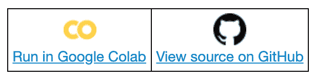

#### 注

在撰写本文时，GitHub 上存在一个间歇性显示错误消息的 bug，可能会在显示 Jupyter 笔记本时出现。如果出现“Sorry, something went wrong.是否重新加载？”的消息，请按照"构建我们的模型 "的说明进行操作。

该笔记本解释了模型训练的过程。包含以下步骤：

*   安装依赖项
*   数据的下载与准备
*   加载 TensorBoard 以可视化训练过程
*   训练模型
*   生成 C 源文件

### 启用 GPU 训练

该模型的训练应该非常快，但使用 GPU 运行时会更快。要启用此选项，请如图 12-2 所示，从 Colab 的运行时菜单中选择“Change runtime type”。

将打开如图 12-3 所示的“笔记本设置”对话框。

从“硬件加速器”下拉列表中，如图 12-4 所示选择 GPU，然后点击“SAVE”。

现在可以运行笔记本了。

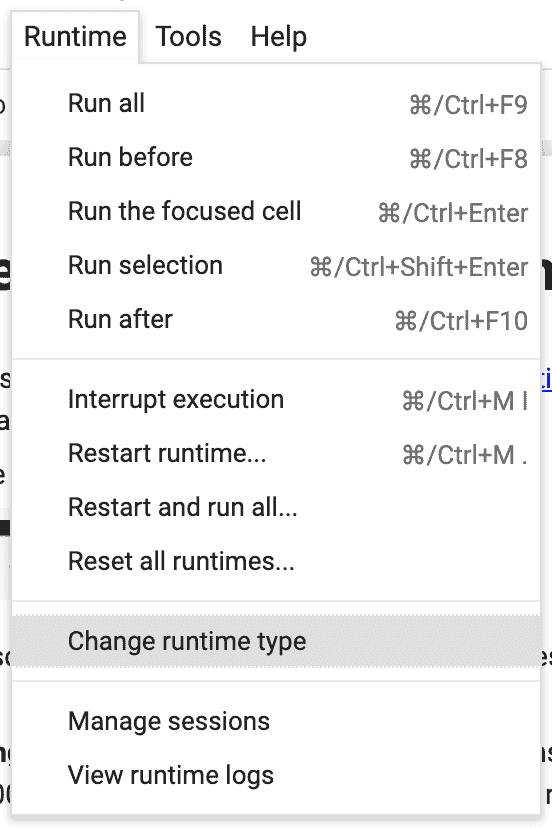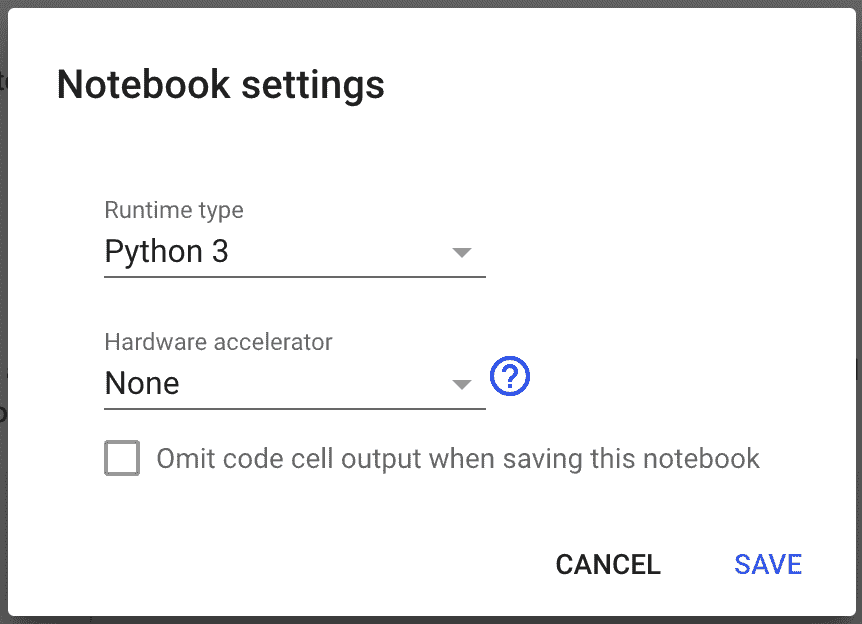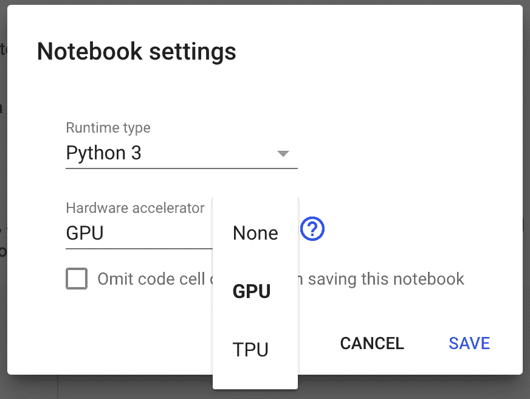

### 安装依赖项

第一步是安装必要的依赖项。在“Install dependencies”部分，运行单元格以安装正确版本的 TensorFlow 并获取训练脚本的副本。

### 准备数据

接下来，在“Prepare the data”部分，运行单元格下载数据集并将其分割为训练集、验证集和测试集。

第一个单元格下载数据集并解压到学习脚本目录中。数据集由四个目录组成，每个手势（“翼”、“环”、“斜坡”）各一个，以及一个用于没有明确手势的数据的“负样本”目录。每个目录包含表示手势捕获过程结果的原始数据文件：

```
data/
├── slope
│   ├── output_slope_dengyl.txt
│   ├── output_slope_hyw.txt
│   └── ...
├── ring
│   ├── output_ring_dengyl.txt
│   ├── output_ring_hyw.txt
│   └── ...
├── negative
│   ├── output_negative_1.txt
│   └── ...
└── wing
    ├── output_wing_dengyl.txt
    ├── output_wing_hyw.txt
    └── ...
```

每个手势有 10 个文件，后面会解释。每个文件包含由命名个人演示的手势，文件名最后部分对应用户 ID。例如，文件 `output_slope_dengyl.txt` 包含 ID 为 `dengyl` 的用户演示的“斜坡”手势数据。

每个文件包含约 15 个手势的单独表现，每行一个加速度传感器读数，每个表现前面都有行 `-,-,-`：

```
 -,-,-
-766.0,132.0,709.0
-751.0,249.0,659.0
-714.0,314.0,630.0
-709.0,244.0,623.0
-707.0,230.0,659.0
```

每个表现由每秒 25 行、最多数秒数据的日志组成。手势本身在该窗口内的某一点执行，其余时间设备保持静止。

由于测量值获取方式，文件中也包含垃圾字符。第一个训练脚本 [`data_prepare.py`](https://oreil.ly/SCZe9) 在第二个训练单元格中运行，用于清理这些脏数据：

```
# Prepare the data
!python data_prepare.py
```

该脚本设计为从文件夹读取未加工的数据文件，忽略乱码，并以清理后的形式写入训练脚本目录 `data/complete_data` 中的另一位置。错误、损坏和其他问题经常会进入大型数据集。


# データ準備とトレーニング

データのクリーニングに加えて、スクリプトはいくつかの*合成データを*生成する。
これは、実世界から取得したデータではなく、アルゴリズムによって生成されたデータを指す。
この場合、`data_prepare.py`の `generate_negative_data()` 関数は、特定のジェスチャーに対応しない加速度センサーの動きと等価性のある合成データを作成する。
このデータは "unknown "カテゴリの学習に使われる。

合成データの作成は、実世界のデータを取得するよりもはるかに速いため、トレーニングプロセスを補強するのに役立つ。
しかし、実世界の変動は予測不可能なので、合成データからデータセット全体を作成することはあまりできない。
我々の場合、「未知」のカテゴリーをより堅牢にするのには役立つが、既知のジェスチャーを分類するのには役立たないだろう。

下一个单元格中接下来要执行的脚本是[`data_split_person.py`](https://oreil.ly/1U0FW)である：

```
# Split the data by person
!python data_split_person.py
```

このスクリプトは、データをトレーニングセット、検証セット、テストセットに分割する。
データには作成者がラベル付けされているため、1つのセットをトレーニングに、もう1つのセットを検証に、そして最後のセットをテストに使うことができる。
データは次のように分割される：

```
train_names = [
    "hyw", "shiyun", "tangsy", "dengyl", "jiangyh", "xunkai", "negative3",
    "negative4", "negative5", "negative6"
]
valid_names = ["lsj", "pengxl", "negative2", "negative7"]
test_names = ["liucx", "zhangxy", "negative1", "negative8"]
```

トレーニングに6 人分、検証に2 人分、テストに2 人分のデータを使う。
さらに、特定のユーザとは関係のないネガティブ・データも混ぜている。
合計データは、3つのセットでだいたい60％／20％／20％の割合で分けられているが、これはマシン学習ではごく標準的な割合だ。

人別に分けることで、モデルが新しいデータにも一般化できるようにしようとしている。
モデルはトレーニングデータセットに含まれていない個人のデータで検証・テストされるため、各人がどのように各ジェスチャーを行うかという個人差に対して堅牢である必要がある。

また、人ごとではなく、ランダムにデータを分割することも可能だ。
この場合、トレーニング、検証、テストの各データセットには、各個人のジェスチャーのサンプルが含まれることになる。
結果として得られるモデルは、たった6 人のデータではなく、すべての人のデータでトレーニングされたことになり、人々の様々なジェスチャースタイルにより多く触れることになる。

しかし、検証セットとトレーニングセットにはすべての個人のデータも含まれているため、モデルが今まで見たことのない新しいジェスチャースタイルに一般化できるかどうかをテストする方法はない。
このようにして開発されたモデルは、検証時やテスト時に高い精度を報告するかもしれないが、新しいデータでも同じように機能する保証はない。

続行する前に、"Prepare data "セクションで両方のセルを実行したことを確認する。

## TensorBoardをロードする

データが準備できたら、次のセルを実行してTensorBoardをロードし、トレーニング・プロセスをモニターできるようにする：

```
# Load TensorBoard
%load_ext tensorboard
%tensorboard --logdir logs/scalars
```

トレーニングログは、トレーニングスクリプトのディレクトリの`logs/scalars`サブディレクトリに書き出されるので、これをTensorBoardに渡す。

## トレーニングを開始する

TensorBoardがロードされたら、いよいよトレーニングを開始する。以下のセルを実行する：

```
!python train.py --model CNN --person true
```

[`train.py`](https://oreil.ly/S3w0X)スクリプトは、モデルアーキテクチャをセットアップし、[`data_load.py`](https://oreil.ly/aCZgu)を使用してデータをロードし、学習プロセスを開始する。

データがロードされると、`load_data.py`は、[`data_augmentation.py`](https://oreil.ly/zL6wm)で定義されたコードを使用してデータの拡張も行う。
この関数`augment_data()`関数はジェスチャーを表すデータを受け取り、それぞれオリジナルから少し変更された新しいバージョンを作成する。
この変更には、データポイントの時間的なシフトやワープ、ランダムノイズの追加、加速度の増加などが含まれる。
この拡張されたデータは、モデルを訓練するために元のデータと一緒に使用され、私たちの小さなデータセットを最大限に活用するのに役立つ。

トレーニングが進むにつれて、今走ったセルの下にいくつかの出力が表示されるようになる。そこで、最も注目すべき部分をピックアップしてみよう。まず、Kerasはモデルのアーキテクチャを示す素晴らしい表を生成する：

```
_________________________________________________________________
Layer (type)                 Output Shape              Param #
=================================================================
conv2d (Conv2D)              (None, 128, 3, 8)         104
_________________________________________________________________
max_pooling2d (MaxPooling2D) (None, 42, 1, 8)          0
_________________________________________________________________
dropout (Dropout)            (None, 42, 1, 8)          0
_________________________________________________________________
conv2d_1 (Conv2D)            (None, 42, 1, 16)         528
_________________________________________________________________
max_pooling2d_1 (MaxPooling2 (None, 14, 1, 16)         0
_________________________________________________________________
dropout_1 (Dropout)          (None, 14, 1, 16)         0
_________________________________________________________________
flatten (Flatten)            (None, 224)               0
_________________________________________________________________
dense (Dense)                (None, 16)                3600
_________________________________________________________________
dropout_2 (Dropout)          (None, 16)                0
_________________________________________________________________
dense_1 (Dense)              (None, 4)                 68
=================================================================
```

これは、使用されているすべてのレイヤーと、その形状、パラメータ数（重みとバイアスを表す別の言葉）を示している。
このモデルは畳み込みモデルなので、`Conv2D` のレイヤーを使っていることがわかる。
この表には示されていないが、このモデルの入力形状は`(None, 128, 3)` である。
このモデルのアーキテクチャについては後で詳しく見る。

出力はモデルのサイズの推定値も示してくれる：

```
Model size: 16.796875 KB
```

これはモデルの学習可能なパラメータによって占有されるメモリ量を表している。
モデルの実行グラフを保存するのに必要な余分なスペースは含まれていないため、実際のモデルファイルは若干大きくなるが、正しい大きさの順序を知ることができる。
これは間違いなく小さなモデルである！

やがてトレーニングのプロセスそのものが始まるのがわかるだろう：

```
1000/1000 [==============================] - 12s 12ms/step - loss: 7.6510 - accuracy: 0.5207 - val_loss: 4.5836 - val_accuracy: 0.7206
```

この時点で、TensorBoardを見て、トレーニングのプロセスを確認することができる。

## 結果を評価する

学習が完了したら、セルの出力を見ていくつかの有益な情報を得ることができる。まず、最終エポックでの検証精度が0.9743と非常に有望であることがわかる：

```
Epoch 50/50
1000/1000 [==============================] - 7s 7ms/step - loss: 0.0568 -

accuracy: 0.9835 - val_loss: 0.1185 - val_accuracy: 0.9743
```

これは素晴らしいことだ。特に、1 人ごとのデータ分割を使用しているため、検証データはまったく異なる個人のセットから得られたことになる。
しかし、モデルを評価するために検証精度に頼ることはできない。モデルのハイパーパラメータとアーキテクチャは、検証データセット上で手作業でチューニングされたものであるため、オーバーフィットしている可能性がある。

モデルの最終的なパフォーマンスをよりよく理解するために、Kerasの`model.evaluate()` 関数を呼び出して、テスト・データセットに対して評価することができる。次の行はその結果を示している：

```
6/6 [==============================] - 0s 6ms/step - loss: 0.2888 - accuracy: 0.9323
```

検証の数字ほど素晴らしくはないが、このモデルは0.9323という十分な精度を示しており、損失はまだ低い。
このモデルは93%の確率で正しいクラスを予測する。

次の数行は、 によって計算された結果の*混同行列を示して*いる。 [`tf.math.confusion_matrix()`](https://oreil.ly/xlIKj)関数によって計算された：

```
tf.Tensor(
[[ 75   3   0   4]
 [  0  69   0  15]
 [  0   0  85   3]
 [  0   0   1 129]], shape=(4, 4), dtype=int32)
```

混同行列は、分類モデルの性能を評価するのに役立つツールである。
これは、テストデータセットにおける各入力の予測クラスが、実際の値とどの程度一致しているかを示す。

混同行列の各列は、予測されたラベルに対応し、順番に（"wing"、"ring"、"slope"、"unknown "の順に）対応する。
各行は上から順に実際のラベルに対応する。
混同行列から、予測の大部分が実際のラベルと一致していることがわかる。
最も顕著なのは、かなりの数の入力が「unknown」と誤分類されていることで、特に「ring」カテゴリーに属するものがそうである。

混同行列は、モデルの弱点がどこにあるかを教えてくれる。
この場合、モデルが "ring "と "unknown "の違いをよりよく学習するためには、"ring "ジェスチャーのトレーニングデータをより多く取得することが有益かもしれないことを教えてくれる。

`train.py`が行う最後の点は、モデルをTensorFlow Lite 形式に変換することで、浮動小数点型と量子化型の両方のバリエーションがある。
以下の出力は、各バリアントのサイズを示している：

```
Basic model is 19544 bytes
Quantized model is 8824 bytes
Difference is 10720 bytes
```

我々の20KBのモデルは、量子化後は8.8KBに縮小される。
これは*非常に*小さなモデルであり、素晴らしい結果だ。

## C 配列を作成する

次の「Cソース・ファイルの作成」では、これをCソース・ファイルに変換する。
このセルを実行して出力を見てみよう：

```
# Install xxd if it is not available
!apt-get -qq install xxd
# Save the file as a C source file
!xxd -i model_quantized.tflite > /content/model_quantized.cc
# Print the source file
!cat /content/model_quantized.cc
```

このファイルの内容をプロジェクトにコピー＆ペーストすれば、新しく学習したモデルをアプリケーションで使えるようになる。
後で、新しいデータを収集し、新しいジェスチャーを理解するようにアプリケーションに教える方法を学ぶ。
とりあえず、先に進もう。

## スクリプトを実行する他の方法

Colabを使いたくない場合や、モデルトレーニングスクリプトに変更を加えてローカルでテストを実行したい場合は、自分の開発マシンから簡単にスクリプトを実行することができる。
やり方は[`README.md`](https://oreil.ly/6-KPf)発見できる。

次は、モデル自体がどのように機能するかを説明する。

# モデルの仕組み

これまでのところ、我々のモデルは畳み込みニューラルネットワーク（CNN）であり、約 5 秒間の時間に相当する128 個の3 軸加速度センサーの読み取りシーケンスを、4つの確率の配列に変換する。

CNNは、隣接する値の間に重要な情報が含まれている場合に使われる。
説明の最初の部分では、データを見て、なぜCNNがそのデータを理解するのに適しているかを学ぶ。

## 入力を視覚化する

時系列の加速度計データでは、隣り合う加速度計の読み取りが、デバイスの動きに関する手がかりとなる。
例えば、ある軸の加速度がゼロからプラスに急激に変化し、その後ゼロに戻った場合、デバイスはその方向に動き始めた可能性がある。
図 12-5はこの仮想的な例を示している。

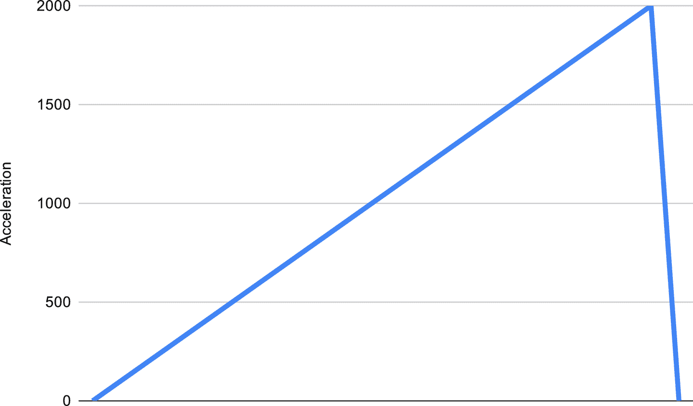

どのようなジェスチャーも、一連の動作から構成されている。
例えば、図 12-6に示す「翼」のジェスチャーを考えてみよう。

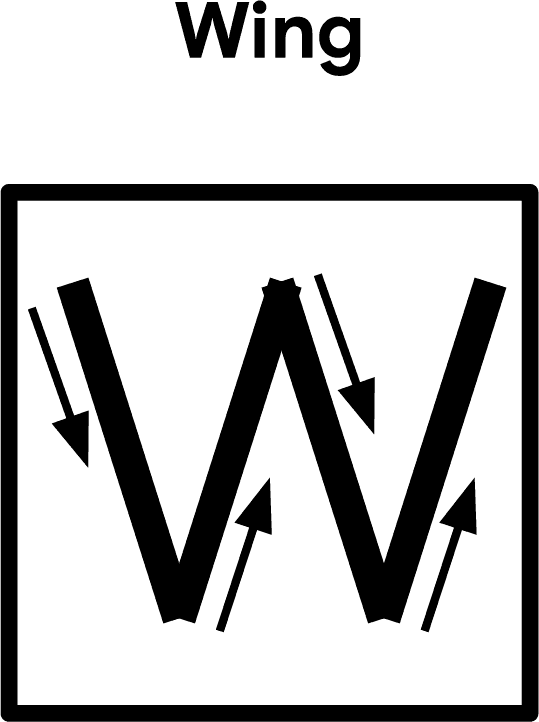

デバイスはまず下に、そして右に動かされ、次に上に、そして右に動かされ、次に下に、そして右に動かされ、再び上に、そして右に動かされる。
図 12-7は、"翼 "ジェスチャー中にキャプチャされた実データのサンプルで、単位はミリGsである。

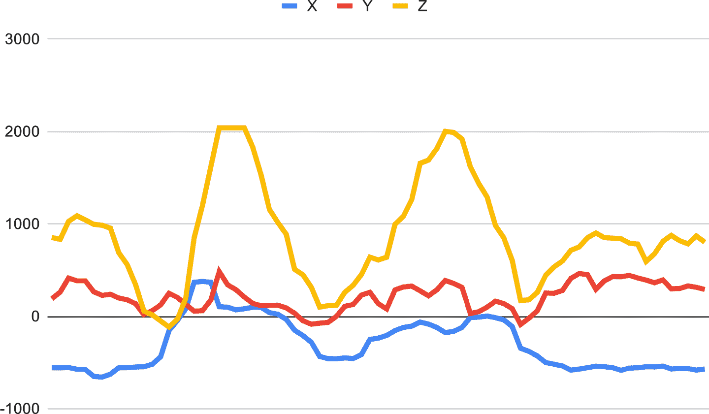

このグラフを見て構成要素に分解することで、どのジェスチャーが行われているかを理解することができる。
z 軸の加速度から、「翼」のジェスチャーの形状から予想される方法でデバイスが上下に動かされていることがよくわかる。
より微妙な点では、x 軸の加速度が、ジェスチャーの幅を横切るデバイスの動きを示すように、z 軸の変化とどのように相関しているかがわかる。
一方、y 軸はほぼ安定していることがわかる。

同様に、複数のレイヤーを持つCNNは、各ジェスチャーの特徴的な構成要素を通して、各ジェスチャーを見分ける方法を学習することができる。
例えば、ネットワークは上下の動きを区別し、その2つが適切なz 軸とy 軸の動きと組み合わさると「翼」のジェスチャーを示すことを学習するかもしれない。

そのためにCNNは、レイヤーに配置された一連の*フィルタを*学習する。
各フィルタは、データ中の特定のタイプの特徴を発見することを学習する。
この特徴に気付くと、このハイレベルな情報をネットワークの次の層に渡す。
例えば、ネットワークの第 1 層にあるフィルターは、上昇加速度の周期のような単純なものを発見することを学習するかもしれない。
そのような構造を識別すると、この情報をネットワークの次の層に渡す。

後続のフィルタリング層は、それ以前の単純なフィルタの出力がどのように組み合わされ、より大きな構造を形成するかを学習する。
例えば、上向きと下向きの加速度を交互に4 回繰り返すと、「翼」のジェスチャーの「W」の形になる。


このプロセスで、ノイズの多い入力データは徐々に高レベルの記号表現に変換される。Network+の後続層は、この記号表現を分析することで、どのジェスチャーが行われたかを推測することができる。

在此过程中，嘈杂的输入数据会逐渐转换为高级的符号表示。Network+ 的后续层通过分析该符号表示，可以推测执行了哪个手势。

次のセクションでは、実際のモデルアーキテクチャを見ながら、それがこのプロセスにどのようにマッピングされているかを見ていく。

下一节中，我们将边查看实际的模型架构，边了解它是如何映射到此过程的。

# モデルアーキテクチャを理解する
# 理解模型架构

モデルのアーキテクチャは[`train.py` の](https://oreil.ly/vxT1v) `build_cnn()` 関数で定義されている。この関数は、Keras APIを使ってモデルをレイヤーごとに定義する：

模型的架构在 [`train.py` 的](https://oreil.ly/vxT1v) `build_cnn()` 函数中定义。该函数使用 Keras API 按层定义模型：

```
model = tf.keras.Sequential([
    tf.keras.layers.Conv2D( # input_shape=(batch, 128, 3)
        8, (4, 3),
        padding="same",
        activation="relu",
        input_shape=(seq_length, 3, 1)),  # output_shape=(batch, 128, 3, 8)
    tf.keras.layers.MaxPool2D((3, 3)),  # (batch, 42, 1, 8)
    tf.keras.layers.Dropout(0.1),  # (batch, 42, 1, 8)
    tf.keras.layers.Conv2D(16, (4, 1), padding="same",
                            activation="relu"),  # (batch, 42, 1, 16)
    tf.keras.layers.MaxPool2D((3, 1), padding="same"),  # (batch, 14, 1, 16)
    tf.keras.layers.Dropout(0.1),  # (batch, 14, 1, 16)
    tf.keras.layers.Flatten(),  # (batch, 224)
    tf.keras.layers.Dense(16, activation="relu"),  # (batch, 16)
    tf.keras.layers.Dropout(0.1),  # (batch, 16)
    tf.keras.layers.Dense(4, activation="softmax")  # (batch, 4)
])
```

これは逐次モデルで、各レイヤーの出力が直接次のレイヤーに渡されることを意味する。レイヤーを1つずつ見ていき、何が起こっているのかを探ってみよう。最初のレイヤーは`Conv2D`：

这是一个顺序模型，意味着每个层的输出直接传递给下一层。我们逐层查看，探究发生了什么。第一层是 `Conv2D`：

```
tf.keras.layers.Conv2D(
    8, (4, 3),
    padding="same",
    activation="relu",
    input_shape=(seq_length, 3, 1)),  # output_shape=(batch, 128, 3, 8)
```

これは畳み込みレイヤーで、加速度センサーの生データのシーケンスであるネットワークの入力を直接受け取る。入力の形状は引数`input_shape` で与えられる。`(seq_length, 3, 1)` にセットされ、`seq_length` は渡される加速度センサーの測定値の合計数（デフォルトでは128）である。各測定値は3つの値で構成され、x 軸、y 軸、z 軸を表す。入力は図 12-8 に示されている。

这是卷积层，直接接收网络的输入，即加速度传感器的原始数据序列。输入形状由参数 `input_shape` 给出。设置为 `(seq_length, 3, 1)`，`seq_length` 是传递的加速度传感器测量值的总数（默认为 128）。每个测量值由 3 个值组成，表示 x 轴、y 轴、z 轴。输入在 图 12-8 中示出。

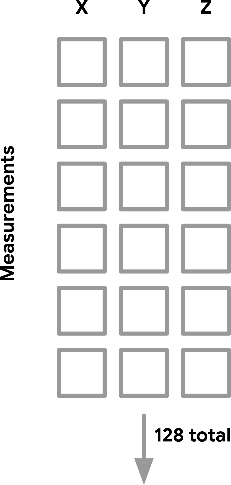

畳み込み層の仕事は、この生データを受け取り、後続の層でインタプリタできる基本的な特徴を抽出することである。`Conv2D()` 関数の引数は、抽出される特徴の数を決定する。引数については[`tf.keras.layers.Conv2D()` のドキュメントを](https://oreil.ly/hqXJF)参照されたい。

卷积层的工作是接收此原始数据并提取后续层可解释的基本特征。`Conv2D()` 函数的参数决定了要提取的特征数量。有关参数，请参阅 [`tf.keras.layers.Conv2D()` 的文档](https://oreil.ly/hqXJF)。

最初の引数は、レイヤーが持つフィルターの数を決定する。学習中、各フィルタは生データの特定の特徴を識別するように学習する。例えば、あるフィルタ は、上向きの動きの兆候を識別するように学習するかもしれない。各フィルタについて、レイヤーは、学習した特徴が入力のどこに現れるかを示す*特徴マップを*出力する。

第一个参数决定了该层拥有的滤波器数量。在训练过程中，每个滤波器都会学习识别原始数据的特定特征。例如，某个滤波器可能会学习识别向上运动的迹象。对于每个滤波器，该层会输出 *特征映射*，显示学习到的特征在输入中出现的位置。

このコードで定義されたレイヤーは8つのフィルタリングを持っている。つまり、入力データから8つの異なるタイプのハイレベルな特徴を認識し、出力することを学習する。これは、出力形状`(batch_size, 128, 3, 8)` に反映されていることがわかる。最終次元には8つの*特徴チャンネルが*あり、各特徴に1つずつ対応している。各チャンネルの値は、その特徴が入力のその場所にどの程度存在するかを示す。

此代码中定义的层具有 8 个滤波器。也就是说，它学习从输入数据中识别并输出 8 种不同类型的高级特征。这反映在输出形状 `(batch_size, 128, 3, 8)` 中。最后一个维度有 8 个 *特征通道*，每个特征对应一个。每个通道的值表示该特征在输入的该位置存在的程度。

第 8 章で学んだように、畳み込み層はデータ全体にウィンドウをスライドさせ、与えられた特徴がそのウィンドウに存在するかどうかを決定する。`Conv2D()` の2 番目の引数は、このウィンドウの次元を指定する。`(4, 3)`これは、フィルタリングの対象となる特徴が、4つの連続した加速度計の測定値と3つの軸すべてにまたがっていることを意味する。ウィンドウは4つの測定にまたがるので、各フィルタは時間の小さなスナップショットを分析する。図 12-9を見れば、これがどのように機能するかがわかる。

正如在 第 8 章中学到的那样，卷积层将窗口在整个数据上滑动，以确定给定特征是否存在于该窗口中。`Conv2D()` 的第二个参数指定此窗口的维度。`(4, 3)` 这意味着要过滤的特征跨越 4 个连续的加速度计测量值和全部 3 个轴。由于窗口跨越 4 个测量值，因此每个滤波器分析时间的微小快照。查看 图 12-9 可了解其工作原理。

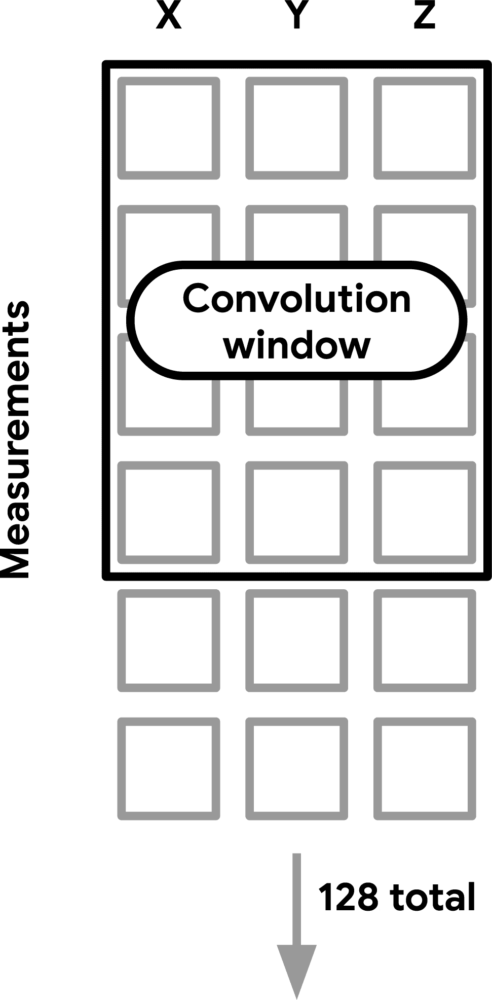

引数`padding` は、ウィンドウがどのようにデータ上を移動するかを決定する。`padding` を`"same"` にセットすると、レイヤーの出力は入力と同じ長さ（128）と幅（3）になる。フィルター・ウィンドウの移動はすべて1つの出力値になるため、`"same"` 引数は、ウィンドウをデータの横方向に3 回、下方向に128 回移動させなければならないことを意味する。

参数 `padding` 决定窗口如何在数据上移动。将 `padding` 设置为 `"same"` 时，层的输出与输入具有相同的长度（128）和宽度（3）。由于滤波器窗口的每次移动都会产生一个输出值，因此 `"same"` 参数意味着窗口必须在数据上横向移动 3 次，纵向移动 128 次。

ウィンドウの幅は3なので、これはデータの左側からはみ出さなければならないことを意味する。フィルター・ウィンドウが実際の値をカバーしていない空白のスペースは、ゼロで*パディングさ*れる。データの長さの合計を128 回移動させるためには、フィルタはデータの先頭からもはみ出さなければならない。図 12-10と図 12-11を見れば、この仕組みがわかるだろう。

由于窗口宽度为 3，这意味着它必须从数据的左侧溢出。滤波器窗口未覆盖实际值的空白空间将用零进行 *填充*。为了使滤波器在数据长度上总共移动 128 次，滤波器还必须从数据的开头溢出。查看图 12-10 和图 12-11 可了解其工作原理。

畳み込みウィンドウがすべてのデータを移動し、各フィルタを使用して8つの異なる特徴マップを作成するとすぐに、出力は次の層、`MaxPool2D` に渡される：

一旦卷积窗口移动过所有数据并使用每个滤波器创建了 8 个不同的特征映射，输出就会传递给下一层 `MaxPool2D`：

```
tf.keras.layers.MaxPool2D((3, 3)),  # (batch, 42, 1, 8)
```

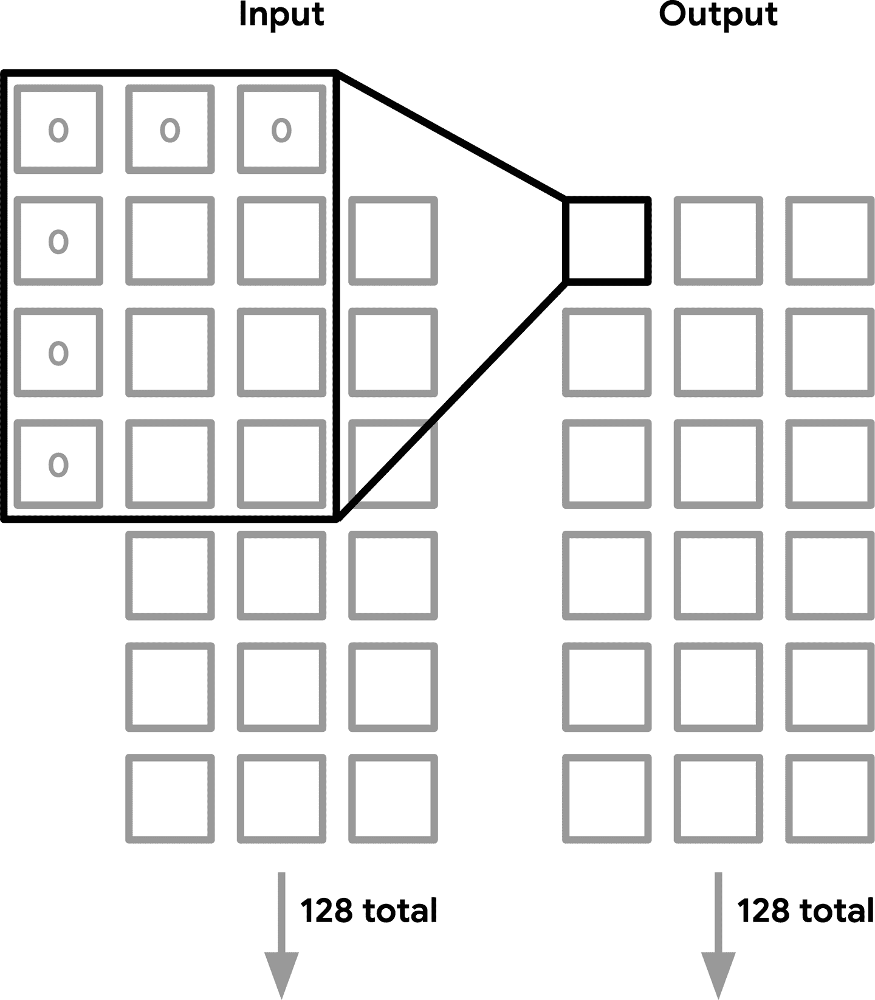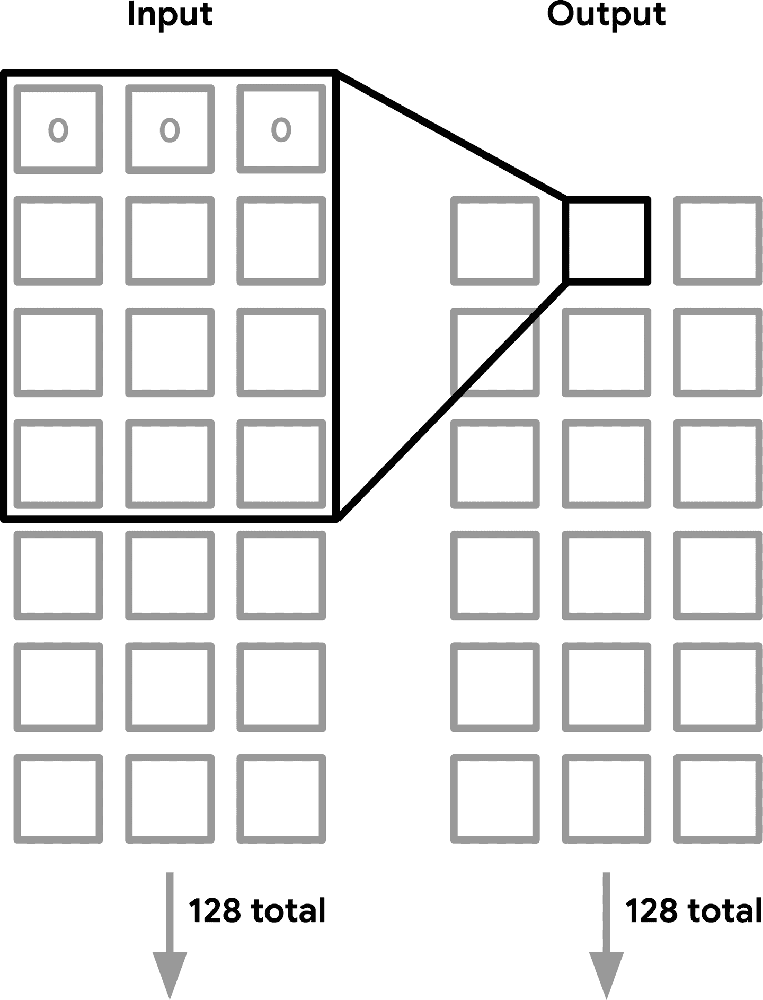

この`MaxPool2D` レイヤーは、前のレイヤーの出力、`(128, 3, 8)` テンソルを受け取り、`(42, 1, 8)` テンソルに縮小する。これは元のサイズの3 分の1である。これは、入力データのウィンドウを見て、ウィンドウの中で最大の値を選択し、その値だけを出力に伝搬させることによって行われる。このプロセスを次のウィンドウのデータで繰り返す。[`MaxPool2D()`](https://oreil.ly/HZo0q)関数に与えられる引数、`(3, 3)` は、3×3のウィンドウを使用することを指定する。デフォルトでは、ウィンドウは常に完全に新しいデータを含むように移動される。図 12-12はこの処理がどのように行われるかを示している。

此 `MaxPool2D` 层接收前一层的输出、`(128, 3, 8)` 张量，并将其缩小为 `(42, 1, 8)` 张量。这是原始大小的三分之一。这是通过查看输入数据的窗口并选择窗口中的最大值，然后仅将该值传播到输出来实现的。对下一个窗口的数据重复此过程。传递给 [`MaxPool2D()`](https://oreil.ly/HZo0q) 函数的参数 `(3, 3)` 指定使用 3×3 窗口。默认情况下，窗口始终移动以包含完全新的数据。图 12-12 显示了此处理的进行方式。

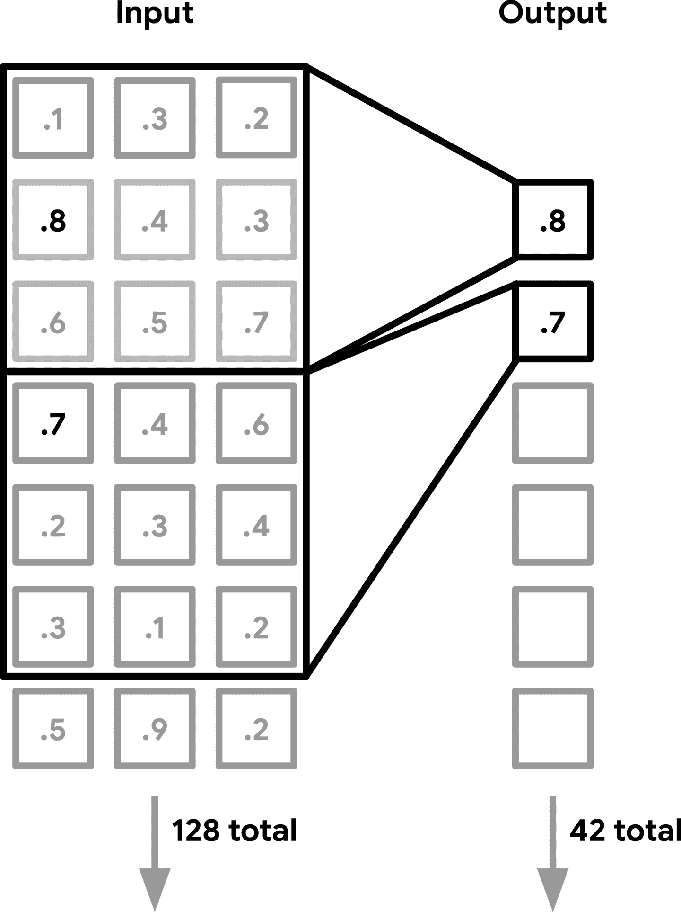

図では各要素に1つの値を示しているが、実際には1 要素につき8つの特徴チャンネルがあることに注意してほしい。

请注意，图中每个元素显示一个值，但实际上每个元素有 8 个特征通道。

しかし、なぜこのように入力を縮小する必要があるのだろうか？分類に使われる場合、CNNの目標は大きくて複雑な入力テンソルを小さくて単純な出力に変換することである。`MaxPool2D`。これは最初の畳み込み層の出力を、それが含む関連情報を凝縮した高レベルの表現に煮詰める。

但是，为什么需要这样缩小输入呢？在用于分类时，CNN 的目标是将大而复杂的输入张量转换为小而简单的输出。`MaxPool2D`。它将第一个卷积层的输出浓缩为包含其相关信息的高级表示。

情報を集中させることで、入力の中にどのジェスチャーが含まれているかを識別するタスクに関係ないものを取り除き始める。最初の畳み込み層の出力で最大に表現された、最も重要な特徴だけが保存される。元の入力には、各測定に3つの加速度計の軸があったにもかかわらず、`Conv2D` と`MaxPool2D` の組み合わせによって、これらが1つの値に統合されたことは興味深い。

通过集中信息，我们开始去除与识别输入中包含哪个手势的任务无关的内容。只有在第一个卷积层输出中最大程度表示的最重要特征才会被保留。尽管原始输入中每个测量值都有 3 个加速度计轴，但 `Conv2D` 和 `MaxPool2D` 的组合将它们整合成一个值，这一点很有趣。

データを縮小した後、[`Dropout`](https://oreil.ly/JuQtU)：

缩小数据后，[`Dropout`](https://oreil.ly/JuQtU)：

```
tf.keras.layers.Dropout(0.1),  # (batch, 42, 1, 8)
```

`Dropout` レイヤーは、トレーニング中にテンソルの値の一部をランダムにゼロにセットする。この場合、`Dropout(0.1)` を呼び出すことで、10％の値をゼロにセットし、そのデータを完全に消去している。これは奇妙なことに思えるかもしれないので、説明しよう。

`Dropout` 层在训练期间将张量的部分值随机设为零。在此情况下，调用 `Dropout(0.1)` 会将 10% 的值设为零，从而完全消除该数据。这可能看起来很奇怪，所以让我们解释一下。

*ドロップアウトは*正則化のテクニックだ。本書で前述したように、*正則化とは*、機械学習モデルを改良して、学習データにオーバーフィットしにくくするプロセスである。ドロップアウトは、オーバーフィットを抑制するシンプルだが効果的な方法である。ある層と次の層の間のデータをランダムに取り除くことで、ニューラルネットワークに予期せぬノイズや変動に対処する方法を学習させるのだ。レイヤーとレイヤーの間にドロップアウトを追加することは、一般的で効果的な方法である。

*Dropout 是* 一种正则化技术。如本书前文所述，*正则化 是* 改进机器学习模型使其不易过拟合训练数据的过程。Dropout 是抑制过拟合的一种简单而有效的方法。通过随机移除层与层之间的数据，它使神经网络学习如何应对意外的噪声和变化。在层与层之间添加 dropout 是一种常见且有效的方法。

ドロップアウト層はトレーニング中のみ有効である。推論中は何の効果もなく、すべてのデータが通過する。

Dropout 层仅在训练期间有效。在推理期间它没有任何效果，所有数据都会通过。

`Dropout`、再び`MaxPool2D`、`Dropout`：

`Dropout`、再次 `MaxPool2D`、`Dropout`：

```
tf.keras.layers.Conv2D(16, (4, 1), padding="same",
                        activation="relu"),  # (batch, 42, 1, 16)
```

このレイヤーには16のフィルタリングがあり、ウィンドウサイズは`(4, 1)` である。これらの数値はモデルのハイパーパラメータの一部であり、モデル開発中の反復プロセスで選択された。効果的なアーキテクチャの設計は試行錯誤のプロセスであり、これらのマジックナンバーは、多くの実験の末にたどり着いたものである。最初から正確に正しい値を選ぶことはまずないだろう。

该层有 16 个滤波器，窗口大小为 `(4, 1)`。这些数字是模型超参数的一部分，在模型开发的迭代过程中选择。设计有效架构是一个试错过程，这些魔术数字是经过大量实验后得出的。几乎不可能从一开始就选择完全正确的数值。

最初の畳み込み層と同様に、この層は、意味のある情報を含む隣接する値のパターンを発見することも学習する。この層の出力は、与えられた入力の内容をさらに高度に表現したものである。この層が認識する特徴は、最初の畳み込み層によって識別された特徴の合成である。

与第一个卷积层类似，该层也学习发现包含有意义信息的相邻值的模式。该层的输出是对给定输入内容的更高级表示。该层识别的特征是第一个卷积层识别出的特征的组合。

この畳み込み層の後、`MaxPool2D`、`Dropout`：

在此卷积层之后，`MaxPool2D`、`Dropout`：

```
tf.keras.layers.MaxPool2D((3, 1), padding="same"),  # (batch, 14, 1, 16)
tf.keras.layers.Dropout(0.1),  # (batch, 14, 1, 16)
```

これは、元の入力をより小さく、より管理しやすい表現に絞り込むプロセスを継続する。出力は、`(14, 1, 16)` の形状を持つ多次元テンソルであり、入力データに含まれる最も重要な構造のみを象徴的に表す。

这继续将原始输入缩小为更小、更易管理的表示。输出是一个形状为 `(14, 1, 16)` 的多维张量，仅象征性地表示输入数据中包含的最重要结构。

その気になれば、畳み込みとプーリングのプロセスを続けることができる。CNNの層数は、モデル開発中に調整できるハイパーパラメータの1つに過ぎない。しかし、このモデルの開発中、2つの畳み込み層で十分であることが発見された。

如果愿意，可以继续卷积和池化的过程。CNN 的层数只是模型开发过程中可以调整的超参数之一。然而，在此模型的开发过程中，发现两个卷积层已足够。

この時点まで、われわれはデータを畳み込みレイヤーに通してきた。畳み込みレイヤーは、隣接する値間の関係だけを気にしており、全体像についてはあまり考慮していなかった。しかし、入力に含まれる主要な特徴を高レベルで表現できるようになったので、それらを「ズームアウト」して集約して調べることができる。そのために、データを平坦化し、`Dense` レイヤー（*完全連結レイヤーとしても*知られる）に入力する：

到目前为止，我们一直将数据通过卷积层。卷积层只关心相邻值之间的关系，对整体情况考虑较少。然而，由于我们现在能够以高级方式表示输入中包含的主要特征，因此我们可以“放大”并汇总检查它们。为此，我们将数据展平并输入到 `Dense` 层（也称为 *全连接层 也*）：

```
tf.keras.layers.Flatten(),  # (batch, 224)
tf.keras.layers.Dense(16, activation="relu"),  # (batch, 16)
```

[`Flatten` レイヤーは](https://oreil.ly/TUIZc)、多次元テンソルを単一次元のものに変換するために使われる。この場合、`(14, 1, 16)` のテンソルは、`(224)` の形状で1 次元に縮小される。

[`Flatten` 层](https://oreil.ly/TUIZc) 用于将多维张量转换为单维张量。在此情况下，`(14, 1, 16)` 张量被缩小为形状为 `(224)` 的一维。

そして16 個のニューロンを持つ[`Dense` 層に](https://oreil.ly/FbpDB)入力される。これはディープラーニングのツールボックスの中で最も基本的なツールのひとつで、すべての入力がすべてのニューロンに接続されている層だ。すべてのデータを一度に考慮することで、この層は様々な入力の組み合わせの意味を学習することができる。この`Dense` レイヤーの出力は、元の入力の内容を高度に圧縮した形で表す16 個の値のセットになる。

然后输入到具有 16 个神经元 的 [`Dense` 层](https://oreil.ly/FbpDB)。这是深度学习工具箱中最基本的工具之一，所有输入都连接到所有神经元的层。通过同时考虑所有数据，该层可以学习各种输入组合的含义。此 `Dense` 层的输出是一组 16 个值，以高度压缩的形式表示原始输入的内容。

最後の仕事は、これら16の値を4つのクラスに縮小することだ。そのために、まずドロップアウトを追加し、最後に`Dense`：

最后的工作是将这 16 个值缩小为 4 个类别。为此，首先添加 dropout，然后是最后的 `Dense`：

```
tf.keras.layers.Dropout(0.1),  # (batch, 16)
tf.keras.layers.Dense(4, activation="softmax")  # (batch, 4)
```

この層は4つのニューロンを持ち、1つはジェスチャーの各クラスを表す。それぞれのニューロンは、前のレイヤーの 16 の出力すべてに接続されている。訓練中、各ニューロンは、それが表すジェスチャーに対応する、前の層の活性度の組み合わせを学習する。

该层有 4 个神经元，每个神经元代表手势的每个类别。每个神经元都连接到前一层的 16 个输出。训练期间，每个神经元学习前一层激活度的组合，对应于它所代表的手势。

このレイヤーは`"softmax"` 活性化関数で構成され、レイヤーの出力は合計が1になる確率のセットとなる。この出力はモデルの出力テンソルで見ることができる。

该层由 `"softmax"` 激活函数构成，层的输出是总和为 1 的概率集合。此输出可在模型的输出张量中看到。

畳み込み層と完全連結層の組み合わせであるこのタイプのモデルアーキテクチャは、加速度センサーから得られる測定値のような時系列センサーデータの分類に非常に役立つ。このモデルは、特定の入力クラスの "指紋 "を表す高レベルの特徴を識別するために学習する。このモデルは小さく、高速に動作し、学習に時間はかからない。このアーキテクチャは、組み込み機械学習エンジニアとしてあなたのベルトの貴重なツールとなるだろう。

这种类型的模型架构，结合了卷积层和全连接层，对时序传感器数据的分类非常有用，例如来自加速度传感器的测量值。该模型学习识别表示特定输入类别“指纹”的高级特征。该模型小巧、运行快速、学习时间短。此架构将成为您作为嵌入式机器学习工程师的腰带上宝贵的工具。

# 自分のデータでトレーニングする
# 使用自己的数据进行训练

このセクションでは、新しいジェスチャーを認識する独自のカスタムモデルをトレーニングする方法を紹介する。加速度センサーのデータを取得し、それを組み込むためにトレーニング・スクリプトを修正し、新しいモデルをトレーニングし、組み込みアプリケーションに統合する方法を説明する。

本节介绍如何训练自己的自定义模型以识别新的手势。说明如何获取加速度传感器数据、修改训练脚本以将其纳入、训练新模型并将其集成到嵌入式应用程序中。

## データを取得する
## 获取数据

トレーニング・データを得るには、ジェスチャーが行われている間、加速度センサーのデータをシリアル・ポートに記録する簡単なプログラムを使えばいい。

要获得训练数据，只需使用一个简单的程序，在执行手势时将加速度传感器数据记录到串行端口即可。

### スパークファン・エッジ
### SparkFun Edge

[SparkFun Edge Board Support Package (BSP)](https://oreil.ly/z4eHX)に収録されているサンプルを変更するのが、最も手っ取り早い方法である。まず、SparkFunの[「Using SparkFun Edge Board with Ambiq Apollo3 SDK」](https://oreil.ly/QqKPa)ガイドに従って、Ambiq SDKとSparkFun Edge BSPをセットアップする。

修改包含在 [SparkFun Edge Board Support Package (BSP)](https://oreil.ly/z4eHX) 中的示例是最快捷的方法。首先，按照 SparkFun 的 [「Using SparkFun Edge Board with Ambiq Apollo3 SDK」](https://oreil.ly/QqKPa) 指南设置 Ambiq SDK 和 SparkFun Edge BSP。

SDKとBSPをダウンロードしたら、サンプル・コードを微調整して、こちらが望むようにする必要がある。

下载 SDK 和 BSP 后，需要对示例代码进行微调，使其符合您的需求。

まず、`AmbiqSuite-Rel2.2.0/boards/SparkFun_Edge_BSP/examples/example1_edge_test/src/tf_adc/tf_adc.c`をテキストエディタで開く。ファイルの61 行目にある`am_hal_adc_samples_read()` の呼び出しを発見する：

首先，用文本编辑器打开 `AmbiqSuite-Rel2.2.0/boards/SparkFun_Edge_BSP/examples/example1_edge_test/src/tf_adc/tf_adc.c`。找到第 61 行的 `am_hal_adc_samples_read()` 调用：

```
if (AM_HAL_STATUS_SUCCESS != am_hal_adc_samples_read(g_ADCHandle,
                                                     NULL,
                                                     &ui32NumSamples,
                                                     &Sample))
```

関数呼び出し全体が次のようになるように、2 番目のパラメータを`true` ：

将第二个参数改为 `true`，使整个函数调用如下：

```
if (AM_HAL_STATUS_SUCCESS != am_hal_adc_samples_read(g_ADCHandle,
                                                     true,
                                                     &ui32NumSamples,
                                                     &Sample))
```


次に、`AmbiqSuite-Rel2.2.0/boards/SparkFun_Edge_BSP/examples/example1_edge_test/src/main.c`ファイルを修正する必要がある。51 行目の`while`ループを発見する：

```
/*
* Read samples in polling mode (no int)
*/
while(1)
{
    // Use Button 14 to break the loop and shut down
    uint32_t pin14Val = 1;
    am_hal_gpio_state_read( AM_BSP_GPIO_14, AM_HAL_GPIO_INPUT_READ, &pin14Val);
```

次の行を追加するようにコードを変更する：

```
/*
* Read samples in polling mode (no int)
*/
while(1)
{
    am_util_stdio_printf("-,-,-\r\n");
    // Use Button 14 to break the loop and shut down
    uint32_t pin14Val = 1;
    am_hal_gpio_state_read( AM_BSP_GPIO_14, AM_HAL_GPIO_INPUT_READ, &pin14Val);
```

今度は、`while`ループの少し先でこの行を発見する：

```
am_util_stdio_printf("Acc [mg] %04.2f x, %04.2f y, %04.2f z,
                     Temp [deg C] %04.2f, MIC0 [counts / 2¹⁴] %d\r\n",
        acceleration_mg[0], acceleration_mg[1], acceleration_mg[2],
        temperature_degC, (audioSample) );
```

元の行を削除し、以下の行に置き換える：

```
am_util_stdio_printf("%04.2f,%04.2f,%04.2f\r\n", acceleration_mg[0],
                     acceleration_mg[1], acceleration_mg[2]);
```

これでプログラミングは、トレーニングスクリプトが期待する形式でデータを出力する。

次に、[SparkFunのガイドの](https://oreil.ly/BPJMG)指示に従って、`example1_edge_test`サンプル・アプリケーションをビルドし、デバイスにフラッシュする。

## ロギング・データ

サンプルコードをビルドしてフラッシュしたら、以下の指示に従ってデータをキャプチャする。

まず、新しいターミナル・ウィンドウを開く。そして以下のコマンドを実行し、ターミナルのすべての出力を`output.txt`という名前のファイルにロギングし始める：

```
script output.txt
```

次に、同じウィンドウで、`screen`を使ってデバイスに接続する：

```
screen ${DEVICENAME} 115200
```

加速度センサーからの測定値は画面に表示され、トレーニングスクリプトが期待するのと同じカンマ区切り文字形式で`output.txt`に保存される。

同じジェスチャーの複数のパフォーマンスを1つのファイルにキャプチャーすることを目指すべきである。ジェスチャーの単一のパフォーマンスのキャプチャを開始するには、`RST`と書かれたボタンを押す。`-,-,-`という文字がシリアルポートに書き込まれる。この出力は、ジェスチャーのパフォーマンスの開始を識別するためにトレーニングスクリプトで使用される。ジェスチャーを実行した後、`14`と書かれたボタンを押して、データのロギングを停止する。

同じジェスチャーを何度もログに記録したら、Ctrl-Aキーを押し、すぐにKキーを押し、次にYキーを押して、`screen`を終了する。`screen`を終了したら、以下のコマンドを入力し、`output.txt`へのデータ・ロギングを停止する：

```
exit
```

`output.txt`というファイルができ、そこには1 人の人が1つのジェスチャーをしたときのデータがコンテナで入っている。全く新しいモデルを訓練するには、元のデータセットと同じような量のデータを集めることを目指すべきである。このデータセットには、10 人による各ジェスチャーの約 15 回のパフォーマンスが含まれている。

自分のモデルが自分以外の人のために機能することを気にしないのであれば、おそらく自分の演技だけをキャプチャしても大丈夫だろう。とはいえ、演技のバリエーションは多ければ多いほどいい。

トレーニングスクリプトとの互換性を保つため、キャプチャしたデータファイルのファイル名を以下の形式に変更する必要がある：

```
output_<gesture_name>_<person_name>.txt
```

例えば、"ダニエル "が行ったと仮定した "三角形 "のジェスチャーのデータは、以下のような名前付けになる：

```
output_triangle_Daniel.txt
```

トレーニングスクリプトは、データが各ジェスチャー名のディレクトリに整理されていることを期待する：

```
data/
├── triangle
│   ├── output_triangle_Daniel.txt
│   └── ...
├── square
│   ├── output_square_Daniel.txt
│   └── ...
└── star
    ├── output_star_Daniel.txt
    └── ...
```

`negative`という名前のディレクトリに、「unknown」カテゴリのデータも用意する必要がある。この場合、元のデータセットのデータファイルを再利用すればよい。

モデル・アーキテクチャは4つのクラス（3つのジェスチャーと「unknown」）の確率を出力するように設計されているため、自分で3つのジェスチャーを用意する必要があることに注意する。ジェスチャーを増やしたり減らしたりしてトレーニングしたい場合は、トレーニングスクリプトを変更し、モデルアーキテクチャを調整する必要がある。

## トレーニングスクリプトを修正する

新しいジェスチャーでモデルをトレーニングするには、トレーニングスクリプトに変更を加える必要がある。

まず、以下のファイル内のジェスチャー名をすべて置き換える：

*   [`data_load.py`](https://oreil.ly/1Tplr)
*   [`data_prepare.py`](https://oreil.ly/O7eym)
*   [`data_split.py`](https://oreil.ly/w8ORq)

次に、以下のファイル内の人名をすべて置き換える：

*   [`data_prepare.py`](https://oreil.ly/3swnY)
*   [`data_split_person.py`](https://oreil.ly/xhVh7)

もし人名の数が違っていて(元のデータセットは10 人)、トレーニング中に人別にデータを分割したい場合は、新しい分割を決める必要があることに注意。数人のデータしかない場合は、トレーニング中に人別に分割することはできないので、`data_split_person.py`を気にする必要はない。

## トレーニング

新しいモデルをトレーニングするには、データファイルディレクトリをトレーニングスクリプトのディレクトリにコピーし、この章の前半で説明したプロセスに従う。

数人からのデータしかない場合は、1 人ごとではなくランダムにデータを分割すべきである。これを行うには、トレーニングの準備時に`data_split_person.py`の代わりに`data_split.py`を実行する。

新しいジェスチャーをトレーニングするのだから、最高の精度を得るためにモデルのハイパーパラメータで遊ぶ価値がある。例えば、エポックを多くするか少なくするか、層の配置やニューロンの数を変えるか、あるいは畳み込みハイパーパラメータを変えてトレーニングすることで、より良い結果が得られるかどうかを見ることができる。`TensorBoard`を使って進捗をモニターすることができる。

許容できる精度のモデルができたら、それがうまく機能するようにプロジェクトにいくつか変更を加える必要がある。

## 新しいモデルを使う

まず、`xxd -i`でフォーマットされた新しいモデルのデータを`magic_wand_model_data.cc`にコピーする必要がある。また、`g_magic_wand_model_data_len`の値を、`xxd`によって出力された数値と一致するように更新する。

次に、配列`should_continuous_count`、`accelerometer_handler.cc`の各ジェスチャーに必要な連続予測回数を指定する値を更新する必要がある。この値は、ジェスチャーの実行にかかる時間に対応する。オリジナルの "wing "ジェスチャーが15の連続カウントを必要とすることを考えると、新しいジェスチャーがそれに比べてどれくらい時間がかかるかを見積もり、配列の値を更新する。最も信頼できるパフォーマンスが得られるまで、これらの値を繰り返し調整することができる。

最後に、`output_handler.cc`のコードを更新して、新しいジェスチャーの正しい名前を表示する。これが終わったら、コードをビルドしてデバイスをフラッシュできる。

# まとめ

この章では、典型的な組み込み機械学習モデルのアーキテクチャを、これまでで最も深く掘り下げてきた。このタイプの畳み込みモデルは、時系列データを分類するための強力なツールであり、よく目にする。

ここまでで、組み込み機械学習アプリケーションがどのようなものか、また、アプリケーション・コードがどのようにモデルと連携して周囲の世界を理解するのか、理解していただけたと思う。自分自身のプロジェクトを構築するにつれて、様々な問題を解決するために使用できる身近なモデルのツールボックスをまとめ始めるだろう。

## 機械学習を学ぶ

本書は、組み込み機械学習の可能性をやさしく紹介することを目的としているが、機械学習そのものに関する完全なリファレンスではない。独自のモデルを構築することに深く取り組みたいのであれば、どのような背景を持つ学生にも適した、素晴らしく非常に利用しやすいリソースがいくつかあり、それらを利用することでスタートラインに立つことができるだろう。

ここで紹介するのは、ここで学んだことをベースにした、私たちのお気に入りだ：

*   フランソワ・ショレの[*PythonによるDeep Learning*](https://oreil.ly/PFF3r)(Manning)
*   オーレリアン・ジェロンの[*Scikit-Learn、Keras、TensorFlowによるハンズオン機械学習* 第 2 版](https://oreil.ly/M5KrN)(オライリー)
*   Deeplearning.aiの[Deep Learning 特殊](https://oreil.ly/xKQMP)化と[TensorFlow 実践](https://oreil.ly/4q7HY)コース
*   Udacityの[ディープラーニングのためのTensorFlow 入門](https://oreil.ly/YJlYd)コース

## 次の記事

本書の残りの章では、組込み機械学習のツールとワークフローをより深く掘り下げていく。独自のTinyMLアプリケーションを設計する方法、低消費電力デバイスでうまく動作するようにモデルとアプリケーションコードを最適化する方法、既存の機械学習モデルを組み込みデバイスに移植する方法、組み込み機械学習コードをデバッグする方法について学ぶ。また、デプロイ、プライバシー、セキュリティといった高レベルの懸念事項にも対処する。

しかしその前に、本書のすべての例を動かすフレームワークであるTensorFlow Liteについてもう少し学んでおこう。

^(1)これは新しい用語で、後で説明する。
