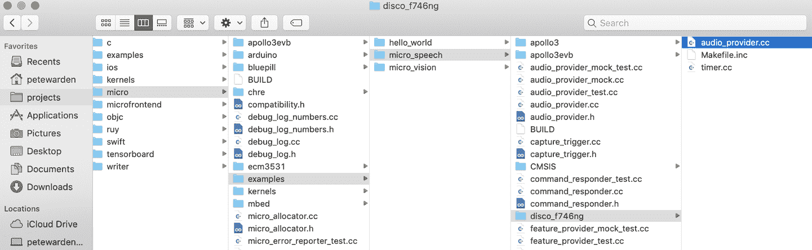

# 第 13 章. マイコン向けTensorFlow Lite

この作品はAIを使って翻訳されている。ご意見、ご感想をお待ちしている：translation-feedback@oreilly.com

この章では、本書のすべての例で使用しているソフトウェアフレームワークについて見ていく：TensorFlow Lite for Microcontrollersである。この章では、TensorFlow Lite for Microcontrollersについて詳しく説明する。もし、ボンネットの下で何が起こっているかに興味がなければ、この章は読み飛ばして構わない。機械学習を実行するために使っているツールの理解を深めたい場合は、ライブラリーの歴史と内部構造をここでカバーする。

## マイコン向けTensorFlow Liteとは？

最初の質問は、フレームワークが実際に何をするのか、ということだろう。それを理解するためには、（かなり長い）名前を少し分解して、コンポーネントを説明することが役に立つ。

### TensorFlow

TensorFlowの名前自体は、マシン学習を研究している人なら聞いたことがあるかもしれない。[TensorFlowは](https://tensorflow.org)Googleのオープンソース機械学習ライブラリで、"An Open Source Machine Learning Framework for Everyone "をモットーとしている。Google 社内で開発され、2015 年に初めて一般公開された。それ以来、このソフトウェアを中心に大規模な外部コミュニティが形成され、Google 内部よりもGoogle 外部の貢献者の方が多くなっている。Linux、Windows、macOSのデスクトップとサーバプラットフォームを対象としており、クラウドでのモデルのトレーニングとデプロイに関する多くのツール、例、最適化を提供している。このライブラリは、Google 社内で同社の製品を動かすために使われている主要なマシンラーニング・ライブラリであり、コア・コード自体は社内版も公開版も同じだ。

また、Googleやその他のソースから入手できる例やチュートリアルも数多くある。これらは、音声認識からデータセンターの電力管理やビデオ分析に至るまで、あらゆるモデルの学習方法や使用方法を教えてくれる。

TensorFlowがローンチされたときの最大のニーズは、デスクトップ環境でモデルをトレーニングして実行する機能だった。例えば、RAMの単位がギガバイトで、ストレージ領域がテラバイトのクラウドサーバでは、バイナリのサイズが数百メガバイトでも問題ない。もうひとつの例は、立ち上げ時の主要インタフェース言語が、サーバで広く使われているスクリプト言語であるPythonだったことだ。

しかし、こうしたエンジニアリングのトレードオフは、他のプラットフォームではそれほど適切ではなかった。AndroidやiPhoneのデバイスでは、アプリのサイズに数メガバイトでも追加すると、ダウンロード数や顧客満足度が劇的に低下する可能性がある。これらの電話プラットフォーム向けにTensorFlowを構築することはできるが、デフォルトではアプリケーションのサイズに20MBが追加され、多少の作業をしても2MB 以下に縮小されることはない。

### TensorFlow Lite

このようなモバイルプラットフォーム向けの低サイズ要件に対応するため、Googleは2017 年にTensorFlow Liteと呼ばれるTensorFlow 本家のコンパニオンプロジェクトを開始した。このライブラリは、モバイルデバイス上で効率的かつ簡単にニューラルネットワークモデルを実行することを目的としている。フレームワークのサイズと複雑さを軽減するため、これらのプラットフォームではあまり一般的でない機能を削除している。例えば、トレーニングはサポートしておらず、クラウドプラットフォームで以前にトレーニングされたモデルで推論を実行するだけだ。また、メインラインのTensorFlowで利用可能なデータ型（`double`など）をフルサポートしていない。さらに、`tf.depth_to_space`のように、あまり使われていない演算子も存在しない。最新の互換性情報は[TensorFlowのWeb](https://oreil.ly/otEIp)サイトで発見できる。

これらのトレードオフと引き換えに、TensorFlow Liteはわずか数百キロバイトに収まるため、サイズに制約のあるアプリケーションへの組み込みが非常に容易になっている。また、`Arm Cortex-A`シリーズCPU 用に高度に最適化されたライブラリがあり、アクセラレータ用のAndroidの`Neural Network API`や、`OpenGL`によるGPUもサポートしている。もうひとつの利点は、ネットワークの8ビット量子化をうまくサポートしていることだ。モデルは数百万のパラメータを持つ可能性があるため、32ビットfloat 型から8ビット整数への75％のサイズ削減だけでも価値があるが、より小さなデータ型で推論をより高速に実行できる特殊化コードパスもある。

### マイコン向けTensorFlow Lite


TensorFlow Lite 已被移动开发者广泛采用，但其工程上的权衡并未满足所有平台的需求。团队注意到存在许多 Google 及外部产品，可以从在嵌入式平台上构建的机器学习中获益，而现有的 TensorFlow Lite 库并不适合这些产品。这里最大的限制仍然是二进制大小。在这些环境中，即使数百千字节也太大了。需要控制在 20 千字节以内。由于不存在移动开发者习以为常的许多依赖关系，例如 C 标准库，因此无法使用依赖这些库的代码。然而，许多需求非常相似。推理是主要的使用场景，量化网络对性能至关重要，拥有开发人员能够探索和修改的足够简单的代码库是优先事项。

考虑到这些需求，2018 年，Google 的团队（包括本书的作者）开始了针对此类嵌入式平台专门定制的 TensorFlow Lite 实验。其目标是在满足嵌入式环境严格要求的同时，尽可能地重用移动项目的代码、工具和文档。为了确认 Google 正在构建实用的东西，团队专注于一个实际用例，即识别口语“唤醒词”，类似于商用语音界面的“Hey Google”和“Alexa”。Google 旨在提供解决此问题的端到端示例，并致力于确保我们设计的系统在生产系统中具有可用性。

## 必要条件

Google 团队知道在嵌入式环境中运行会对代码编写方式施加许多限制，因此确定了库的几个主要要求：

### 不依赖操作系统

机器学习模型本质上是数学黑盒，输入数字，输出数字。由于执行这些运算符不需要访问系统的其他部分，因此可以在不调用底层操作系统的情况下编写机器学习框架。目标平台中有些完全没有操作系统，通过在基础代码中避免对文件或设备的引用，使得移植到这些芯片成为可能。

### 链接时不依赖标准 C 或 C++ 库

与操作系统要求相比这有点微妙，但团队的目标部署设备仅有数十千字节的存储程序内存，因此二进制大小非常重要。即使是看似简单的函数如 `sprintf()` 也可能单独占用 20KB，因此团队的目标是避免从包含 C 或 C++ 标准库实现的库存档中提取任何东西。这很棘手，因为仅头文件依赖（如保存数据类型大小的 `stdint.h`）与标准库的链接时部分（许多字符串函数和 `sprintf()`）之间的边界没有明确定义。实际上，团队需要运用常识来理解，一般来说编译时常量和宏是可以的，但更复杂的东西应避免。链接器规避的一个例外是标准 C `math` 库，用于需要链接的三角函数等。

### 不期望浮点硬件

由于许多嵌入式平台在硬件上不支持浮点运算，因此代码中需要避免使用性能关键的浮点运算。也就是说，集中于具有 8 位整数参数的模型，并对运算符使用 8 位运算符（不过为了保持兼容性，框架在必要时也支持浮点运算符）。

### 没有动态内存分配

使用微控制器的许多应用程序需要连续运行数月至数年。如果程序的主循环使用 `malloc()`/`new` 和 `free()`/`delete` 进行内存分配和释放，保证堆最终不会碎片化到导致分配失败或崩溃是非常困难的。此外，由于大多数嵌入式系统可用内存非常有限，提前规划这种有限资源比其他平台更重要，而且如果没有操作系统，可能甚至不存在堆或分配例程。因此，嵌入式应用程序经常完全避免使用动态内存分配。库被设计为用于此类应用程序，因此也需要这样做。实际上，框架要求调用应用程序在初始化时传递一个小而固定大小的 arena，供框架用于临时分配（如激活缓冲区）。如果 arena 太小，库会立即返回错误，客户端需要使用更大的 arena 重新编译。否则，执行推理的调用可以在不分配额外内存的情况下进行，因此可以重复进行，而不会承担堆碎片化或内存错误的风险。

团队还决定反对嵌入式社区中常见的其他约束，因为这会使代码共享和与移动 TensorFlow Lite 保持兼容变得过于困难。因此：

### 需要 C++11

嵌入式编程通常用 C 编写，并且根据平台的不同，可能完全没有支持 C++ 的工具链，或仅支持 2011 年标准修订版之前的旧版本。TensorFlow Lite 大部分用 C++ 编写，并配备了一些纯 C API，因此易于从其他语言调用。它不依赖于复杂的模板等高级功能。其风格遵循“更好的 C”精神，具有有助于代码模块化的类。用 C 语言重写框架对移动平台用户来说需要大量工作，并且是倒退一步。我们调查了最受欢迎的平台，发现它们都已支持 C++11，因此团队决定用更易于在 TensorFlow Lite 的所有变体中共享代码来交换对旧设备的支持。

### 假设为 32 位处理器

在嵌入式世界中，有大量不同的硬件平台可用，但近年的趋势是转向 32 位处理器，而不是以前常见的 16 位或 8 位芯片。在调查生态系统后，Google 决定将开发集中在新的 32 位设备上。其原因在于，诸如 C 语言 `int` 数据类型为 32 位之类的假设在框架的移动版和嵌入式版中保持一致。也有报告称成功移植到一些 16 位平台，但它们依赖于能够弥补限制的最新工具链，这不是我们的主要优先事项。

## 为什么模型是解释器？

一个经常出现的问题是，为什么选择在运行时解释模型而不是从模型生成代码。要解释这一决定，需要阐明各种方法的优点和问题。

代码生成中，模型被直接转换为 C 或 C++ 代码。在代码中，所有参数作为数据存储保存，架构表示为一系列函数调用，将激活从一层传递到下一层。该代码通常输出为一个大的源文件，具有少数入口点。该文件可以直接导入 IDE 或工具链，并像其他代码一样编译。以下是代码生成的主要优点：

### 构建的简易性

用户告诉我们，构建系统集成的简易性是最主要的优点。无需依赖外部库，只要几个 C 或 C++ 文件，就可以通过拖放轻松地在大多数 IDE 中构建项目。

### 可修改性

至少与需要先确认使用何种实现的大型库相比。

### 内联数据

模型本身的数据可以作为实现源代码的一部分存储，因此不需要额外文件。也可以直接作为内存数据结构存储，因此不需要加载或解析步骤。

### 代码大小

如果事先知道为哪种模型或平台构建，就可以避免包含不会被调用的代码，从而将程序段大小降至最小。

模型的解释器采用不同的方法，依赖于加载定义模型的数据结构。执行代码是静态的，只有模型数据发生变化，模型中的信息控制执行哪个运算符以及参数从何处提取。这类似于在 Python 等解释型语言中运行脚本，而代码生成更接近于 C 语言等传统编译语言：

### 可升级性

如果你修改了本地生成的代码，但想升级到框架的较新版本以获得新功能或优化会怎样？你需要手动将更改 cherry-pick 到本地文件，或完全重新生成并将本地更改重新打补丁。

### 多个模型

同时用代码生成支持多个模型而不重复大量源代码是很困难的。

### 替换模型

由于每个模型在程序中以源代码和数据数组的混合形式表示，因此在不重新编译整个程序的情况下更改模型是困难的。

团队意识到，使用我们称之为*项目生成与*的东西，可以在不承担缺点的情况下获得代码生成的大部分优点。

## 项目生成

在 TensorFlow Lite 中，项目生成是创建构建特定模型所需源文件副本的过程。它保留了代码生成的大部分优点，但也有一些主要优点：

### 可升级性

所有源文件只是来自主 TensorFlow Lite 代码库的原始副本，在文件夹层次结构中显示在相同位置。因此，即使在本地进行修改，也可以轻松恢复到原始源，库的升级可以使用标准合并工具轻松合并。

### 多模型和交换模型

由于底层代码是解释器，因此可以在不重新编译的情况下拥有多个模型或轻松交换数据文件。

### 内联数据

此外，使用 `FlatBuffers` 序列化格式，可以在内存中直接使用该表示，而无需解包或解析。

### 外部依赖

项目构建所需的所有头文件和源文件都与常规 TensorFlow 代码一起复制到文件夹中，因此无需单独下载或安装依赖项。

没有自动带来的最大优点是代码大小。因为解释器结构使得找到不会被调用的代码路径变得困难。在 TensorFlow Lite 中，使用 `OpResolver` 机制手动注册应用程序中使用的内核实现来解决此问题。

## 构建系统

TensorFlow Lite 最初是在 Linux 环境中开发的。因此，我们的许多工具基于传统的 Unix 工具，如 shell 脚本、`Make`、`Python`。然而，我们知道这对嵌入式开发者来说不是常见的组合，因此我们旨在将其他平台和编译工具链作为一流公民来支持。

方法是前面提到的项目生成。如果从 GitHub 获取 TensorFlow 源代码，就可以在 Linux 上使用标准的 `Makefile` 方法为许多平台构建。例如，可以使用此命令行编译和测试 x86 版本的库：

```
make -f tensorflow/lite/micro/tools/make/Makefile test
```

如 SparkFun Edge 平台的语音唤醒词示例，可以使用以下命令构建特定目标：

```
make -f tensorflow/lite/micro/tools/make/Makefile \
  TARGET="sparkfun_edge" micro_speech_bin
```

如果你使用 Windows 机器或想使用 `Keil`、`Mbed`、`Arduino` 等 IDE 或其他专用构建系统怎么办？这就是项目生成派上用场的地方。从 Linux 运行以下命令行即可生成可立即在 `Mbed` IDE 中使用的文件夹：

```
make -f tensorflow/lite/micro/tools/make/Makefile \
  TARGET="disco_f746ng" generate_micro_speech_mbed_project
```

这样，`TensorFlow/lite/micro/tools/make/gen/disco_f746ng_x86_64/prj/micro_speech/mbed/` 中应该会出现一组源文件以及构建 `Mbed` 环境所需的依赖项和项目文件。同样的思路也适用于 `Keil` 和 `Arduino`，还有一个通用版本，仅输出源文件的目录层次结构而无项目元信息（不过包含定义了一些构建规则的 Visual Studio Code 文件）。

你可能会想知道这种 Linux 命令行方法对其他平台的人们有何帮助。我们作为持续集成工作流程的一部分，并在每次进行主要发布时自动运行此项目生成过程。每次运行此过程时，生成的文件都会自动上传到公共 Web 服务器。也就是说，所有平台的用户都可以找到自己喜欢的 IDE 的版本，并将项目作为自包含的文件夹下载，而不是通过 GitHub。

## 专用代码

代码生成的一个优点是，可以轻松地重写库的一部分以使其在特定平台上良好运行，或针对在用例中常见的特定参数集优化函数。我们不想失去这种易于更改的能力，但希望使更普遍有用的更改尽可能容易地合并到主框架源代码中。此外，根据构建环境，可能存在无法在编译时轻松传递自定义 `#define` 宏的限制。因此，我们无法依赖使用宏守卫在编译时切换到不同的实现。

为了解决这个问题，我们将库拆分为小型模块。每个模块都有一个实现默认版本功能的单个 C++ 文件，以及一个定义接口的 C++ 头文件，其他代码可以通过该接口调用模块。然后，我们采用了惯例：如果想编写某个模块的专用版本，则将新版本作为与原始文件同名的 C++ 实现文件保存在原始文件所在目录的子文件夹中。该子文件夹以要专用的平台或功能命名（参见图 13-1）。然后，在为该平台或功能构建时，`Makefile` 或生成的项目会自动使用它代替原始实现。听起来可能很复杂，所以让我们看一些具体例子。

在语音唤醒词示例代码中，需要从麦克风获取音频数据，但不幸的是没有跨平台获取音频的方法。由于至少需要在各种设备上编译，因此我们编写了默认实现，不使用麦克风，只返回一个充满零值的缓冲区。[`audio_provider.h`从](https://oreil.ly/J5N0N)，下面展示了该模块的接口：


# 音频提供者的实现与 Makefile

```
TfLiteStatus GetAudioSamples(tflite::ErrorReporter* error_reporter,
                             int start_ms, int duration_ms,
                             int* audio_samples_size, int16_t** audio_samples);
int32_t LatestAudioTimestamp();
```



第一个函数用指定的期间的音频数据填充缓冲区并输出，如果有问题则返回错误。第二个函数返回最新的音频数据何时被捕获，因此客户端可以请求正确的时间范围并知道新数据何时到达。

由于默认实现不能依赖麦克风的存在，因此[`audio_provider.cc`](https://oreil.ly/8V1Ll)的两个函数的实现非常简单：

```
namespace {
int16_t g_dummy_audio_data[kMaxAudioSampleSize];
int32_t g_latest_audio_timestamp = 0;
}  // namespace

TfLiteStatus GetAudioSamples(tflite::ErrorReporter* error_reporter,
                             int start_ms, int duration_ms,
                             int* audio_samples_size, int16_t** audio_samples) {
  for (int i = 0; i < kMaxAudioSampleSize; ++i) {
    g_dummy_audio_data[i] = 0;
  }
  *audio_samples_size = kMaxAudioSampleSize;
  *audio_samples = g_dummy_audio_data;
  return kTfLiteOk;
}

int32_t LatestAudioTimestamp() {
  g_latest_audio_timestamp += 100;
  return g_latest_audio_timestamp;
}
```

时间戳每次函数被调用时自动递增，因此客户端表现得好像有新数据到来一样，但从捕获例程每次返回的都是相同的零数组。这个优点是，即使在系统上运行麦克风之前，也能创建示例代码的原型并进行实验。`kMaxAudioSampleSize`在模型头中定义，是函数所需的最大采样数。

在实际设备上，代码会更复杂，因此需要新的实现。之前，我将此示例编译用于 STM32F746NG Discovery kit 板。该板内置麦克风，使用另一个 Mbed 库来访问它们。该代码位于[`disco_f746ng/audio_provider.cc`](https://oreil.ly/KrdSO)。由于尺寸过大，这里未内联包含，但查看该文件可知，它实现了与默认的`audio_provider.cc`相同的两个公共函数`GetAudioSamples()`、`LatestAudioTimestamp()`。函数定义更复杂，但从客户端视角的行为相同。此外，与每次接收零数组不同，捕获的音频会显示在返回的缓冲区中。

查看此专用实现的完整路径、`tensorflow/lite/micro/examples/micro_speech/disco_f746ng/audio_provider.cc`，可以发现它与默认实现`tensorflow/lite/micro/examples/micro_speech/audio_provider.cc`几乎相同，但位于与原始`.cc`文件同一层级的`disco_f746ng`子文件夹内。回顾构建 STM32F746NG Mbed 项目的命令行，可以看到通过传递`TARGET=disco_f746ng`来指定平台。构建系统始终会查找具有目标名称的子文件夹中的`.cc`文件，该子文件夹可能存在专用实现，因此在这种情况下，使用的是`disco_f746ng/audio_provider.cc`，而不是父文件夹中的默认`audio_provider.cc`版本。在为 Mbed 项目复制组装源文件时，父级`.cc`文件会被忽略，而子文件夹中的文件会被复制。

音频捕获在几乎所有平台上都是以不同方式进行的，因此该模块实现了各种专用化。还有一个 macOS 版本[`osx/audio_provider.cc`](https://oreil.ly/ZaMtF)，在 Mac 笔记本电脑上本地调试时非常方便。

然而，此机制不仅仅用于可移植性。实际上，在语音唤醒词示例中，我们使用这种方法来加速深度方向卷积运算。查看[`tensorflow/lite/micro/kernels`](https://oreil.ly/0yHNd)，可以看到 TensorFlow Lite for Microcontrollers 支持的所有运算符的实现。这些默认实现写得简短、易于理解且可在任何平台上运行，但实现这些目标往往意味着错失尽可能高速运行的机会。优化通常涉及使算法更复杂、更难理解，因此预计这些参考实现会相对较慢。我们的想法是，让开发者首先以尽可能简单的方式运行代码，确认获得正确结果，然后再逐步更改代码以提高性能。也就是说，任何微小的更改都可以进行测试，以确认其不会破坏正确性，从而使调试变得容易得多。

该模型在[`tensorflow/lite/micro/kernels/depthwise_conv.cc`](https://oreil.ly/a16dw)中有未优化的实现。核心算法在[`tensorFlow/lite/kernels/internal/reference/depthwiseconv_uint8.h`](https://oreil.ly/2gQ-e)中实现，以一组嵌套循环编写。代码本身如下：

```
   for (int b = 0; b < batches; ++b) {
      for (int out_y = 0; out_y < output_height; ++out_y) {
        for (int out_x = 0; out_x < output_width; ++out_x) {
          for (int ic = 0; ic < input_depth; ++ic) {
            for (int m = 0; m < depth_multiplier; m++) {
              const int oc = m + ic * depth_multiplier;
              const int in_x_origin = (out_x * stride_width) - pad_width;
              const int in_y_origin = (out_y * stride_height) - pad_height;
              int32 acc = 0;
              for (int filter_y = 0; filter_y < filter_height; ++filter_y) {
                for (int filter_x = 0; filter_x < filter_width; ++filter_x) {
                  const int in_x =
                      in_x_origin + dilation_width_factor * filter_x;
                  const int in_y =
                      in_y_origin + dilation_height_factor * filter_y;
                  // If the location is outside the bounds of the input image,
                  // use zero as a default value.
                  if ((in_x >= 0) && (in_x < input_width) && (in_y >= 0) &&
                      (in_y < input_height)) {
                    int32 input_val =
                        input_data[Offset(input_shape, b, in_y, in_x, ic)];
                    int32 filter_val = filter_data[Offset(
                        filter_shape, 0, filter_y, filter_x, oc)];
                    acc += (filter_val + filter_offset) *
                           (input_val + input_offset);
                  }
                }
              }
              if (bias_data) {
                acc += bias_data[oc];
              }
              acc = DepthwiseConvRound<output_rounding>(acc, output_multiplier,
                                                        output_shift);
              acc += output_offset;
              acc = std::max(acc, output_activation_min);
              acc = std::min(acc, output_activation_max);
              output_data[Offset(output_shape, b, out_y, out_x, oc)] =
                  static_cast<uint8>(acc);
            }
          }
        }
      }
    }
```

仅粗略查看，就有很多加速的机会。例如，可以预先计算内部循环中每次计算的数组索引。这样的更改会增加代码的复杂性，因此在该参考实现中被避免。然而，语音唤醒词示例需要在微控制器上每秒多次运行，在 SparkFun Edge Cortex-M4 处理器上，发现这种朴素实现是阻碍其速度的主要瓶颈。为了以可用的速度运行此示例，需要进行一些优化。

为了提供优化的实现，我们在`TensorFlow/lite/micro/kernels`中创建了一个新的子文件夹`portable_optimized`，并添加了一个新的 C++ 源文件[`depthwise_conv.cc`](https://oreil.ly/BYRho)。它比参考实现复杂得多，并利用语音模型的特定优势来实现专用优化。例如，卷积窗口的宽度是 8 的倍数，因此可以作为两个 32 位字而不是 8 字节的值从内存中加载。

你可能注意到，子文件夹的名称不是像前例那样平台特定的，而是`portable_optimized`。这是预期在各种处理器上都有用的通用优化，例如预先计算数组索引、将多字节值作为更大的字加载等。接下来，通过将`portable_optimized`添加到[`ALL_TAGS`](https://oreil.ly/XSWFk)的列表中，指定在`make`项目文件中使用此实现。由于存在该标签并且在同名子文件夹内有`depthwise_conv.cc`的实现，因此链接的是优化实现而不是默认的参考版本。

从这些示例中，希望能了解如何利用子文件夹机制，在保持核心实现小而易于理解的同时扩展和优化库代码。

## Makefile

关于易于理解的话题，Makefile 并不是。[`Makeビルドシステムは`](https://oreil.ly/8Ft1J)已经有 40 多年历史了，它有很多令人困惑的功能，例如将制表符用作有意义的语法，以及通过声明规则间接指定构建目标。我们选择使用 Make 而不是 Bazel 或 Cmake 等替代方案，因为它具有足够的灵活性来实现项目生成等复杂行为，并且 TensorFlow Lite for Microcontrollers 的大多数用户希望使用更现代的 IDE 生成的项目，而不是直接与 Makefile 交互。

如果要对核心库进行更改，可能需要更深入地了解 Makefile 引擎盖下发生了什么。

### 注

如果使用 Linux 或 macOS 上的 bash 终端，通常可以通过键入常规的`make -f tensorflow/lite/micro/tools/make/Makefile`命令然后按 Tab 键来显示所有可用的目标（可构建项的名称）。此自动补全功能在发现目标和调试时非常有用。

如果只是添加模块或运算符的专用版本，则完全不需要更新 Makefile。有一个自定义函数调用。[`specialize()`](https://oreil.ly/teIF6)有一个名为[`specialize()`](https://oreil.ly/teIF6)的自定义函数，它自动接收`ALL_TAGS`的字符串列表（包含平台名称和任意自定义标签）和源文件列表，并返回用正确的专用版本替换原版的列表。这也提供了在命令行手动指定标签的灵活性。例如，像这样：

```
make -f tensorflow/lite/micro/tools/make/Makefile \
  TARGET="bluepill" TAGS="portable_optimized foo" test
```

创建一个类似的`ALL_TAGS`列表，并对所有源文件搜索子文件夹以发现可替代的专用版本。

此外，如果只是在标准文件夹中添加新的 C++ 文件，则无需更改 Makefile。[`MICROLITE_CC_BASE_SRCS`](https://oreil.ly/QAtDk)。

Makefile 依赖于在根级别定义要构建的源文件和头文件列表，并根据指定的平台和标签对其进行修改。这些修改在从父构建项目包含的子 Makefile 中进行。例如，[`tensorflow/lite/micro/tools/make/targets`](https://oreil.ly/79zOB)文件夹中所有的`.inc`文件都会自动包含。像 Ambiq 和 SparkFun Edge 平台使用的[`apollo3evb_makefile.inc`](https://oreil.ly/gKKXO)这样，查看这些文件会发现它们检查目标芯片是否在此构建中被指定。以下是省略了最有趣部分的内容：


```
ifeq ($(TARGET),$(filter $(TARGET),apollo3evb sparkfun_edge))
  export PATH := $(MAKEFILE_DIR)/downloads/gcc_embedded/bin/:$(PATH)
  TARGET_ARCH := cortex-m4
  TARGET_TOOLCHAIN_PREFIX := arm-none-eabi-
...
  $(eval $(call add_third_party_download,$(GCC_EMBEDDED_URL), \
      $(GCC_EMBEDDED_MD5),gcc_embedded,))
  $(eval $(call add_third_party_download,$(CMSIS_URL),$(CMSIS_MD5),cmsis,))
...
  PLATFORM_FLAGS = \
    -DPART_apollo3 \
    -DAM_PACKAGE_BGA \
    -DAM_PART_APOLLO3 \
    -DGEMMLOWP_ALLOW_SLOW_SCALAR_FALLBACK \
...
  LDFLAGS += \
    -mthumb -mcpu=cortex-m4 -mfpu=fpv4-sp-d16 -mfloat-abi=hard \
    -nostartfiles -static \
    -Wl,--gc-sections -Wl,--entry,Reset_Handler \
...
  MICROLITE_LIBS := \
    $(BOARD_BSP_PATH)/gcc/bin/libam_bsp.a \
    $(APOLLO3_SDK)/mcu/apollo3/hal/gcc/bin/libam_hal.a \
    $(GCC_ARM)/lib/gcc/arm-none-eabi/7.3.1/thumb/v7e-m/fpv4-sp/hard/crtbegin.o \
    -lm
  INCLUDES += \
    -isystem$(MAKEFILE_DIR)/downloads/cmsis/CMSIS/Core/Include/ \
    -isystem$(MAKEFILE_DIR)/downloads/cmsis/CMSIS/DSP/Include/ \
    -I$(MAKEFILE_DIR)/downloads/CMSIS_ext/ \
...
  MICROLITE_CC_SRCS += \
    $(APOLLO3_SDK)/boards/apollo3_evb/examples/hello_world/gcc_patched/ \
        startup_gcc.c \
    $(APOLLO3_SDK)/utils/am_util_delay.c \
    $(APOLLO3_SDK)/utils/am_util_faultisr.c \
    $(APOLLO3_SDK)/utils/am_util_id.c \
    $(APOLLO3_SDK)/utils/am_util_stdio.c
```

所有针对特定平台的定制都在这里进行。此代码片段向构建系统指明了要使用的编译器在哪里找到，以及指定了哪种架构。还额外指定了一些需要下载的外部库，例如 GCC 工具链和 Arm 的 CMSIS 库。设置了用于构建的编译标志以及传递给链接器的参数。此外，还添加了使 Ambiq 平台构建成功所需的 C 文件。

类似的子 Makefile 包含也在示例构建中使用。语音通话示例代码中，[`micro_speech/Makefile.inc` 中](https://oreil.ly/XjuJP) 有自己的 Makefile，定义了要编译的源代码文件列表和要下载的外部依赖关系。

可以使用函数为不同的 IDE 生成独立的项目。[`generate_microlite_projects()`](https://oreil.ly/iv94T) 函数就是这样做的。它接收源文件和标志的列表，将所需文件复制到新文件夹中，并同时复制构建系统所需的额外项目文件。对于某些 IDE 来说这非常简单，但例如在 `Arduino` 的情况下，需要将所有 `*.cc` 文件重命名为 `*.cpp`，并更改被复制源文件的包含路径。

诸如用于嵌入式 Arm 处理器的 C++ 工具链之类的外部库，会作为 `Makefile` 构建过程的一部分自动下载。这是因为 [`add_third_party_download`](https://oreil.ly/E9tS-) 规则会为每个需要的库调用，并传递 URL 和 MD5 校验和，以检查归档是否正确。它们预计是 `ZIP`、`GZIP`、`BZ2` 或 `TAR` 文件，根据文件扩展名调用合适的解压程序。如果构建目标需要头文件或源文件，则必须在 `Makefile` 的文件列表中明确包含，以便可以将其复制到生成的项目中。对于头文件，只需设置包含路径，`Makefile` 的编译就能正常进行，而无需明确列出包含的文件，因此很容易被遗忘，但生成的项目会构建失败。此外，还需要确保许可证文件包含在文件列表中，以便外部库的副本保留适当的归属。

# 笔记考试

TensorFlow 旨在为所有代码提供单元测试，并且已经在第 5 章 中详细描述了一些这些测试。测试通常作为 `_test.cc` 文件放置在与被测模块相同的目录中，文件名前缀与原始源文件相同。例如，深度方向卷积运算的实现在 [`tensorflow/lite/micro/kernels/depthwise_conv_test.cc` 中](https://oreil.ly/eIiRO) 进行测试。如果添加新的源文件，并且希望将其更改合并回主分支，则必须添加执行该更改的单元测试。这是因为我们需要支持许多不同的平台和模型，并且许多人基于我们的代码构建复杂的系统，因此能够检查我们的核心组件是否正确非常重要。

如果向 `Tensorflow/tensorFlow/lite/experimental/micro` 的直接子文件夹添加文件，只要将其命名为 `<something>_test.cc`，就应该会自动被拾取。在示例中测试模块时，需要显式调用 `microlite_test` `Makefile` 辅助函数[：](https://oreil.ly/wkYgu)

```
# Tests the feature provider module using the mock audio provider.
$(eval $(call microlite_test,feature_provider_mock_test,\
$(FEATURE_PROVIDER_MOCK_TEST_SRCS),$(FEATURE_PROVIDER_MOCK_TEST_HDRS)))
```

测试本身需要在微控制器上运行，因此必须遵循框架试图满足的相同约束，例如避免动态内存分配、避免操作系统或外部库依赖等。不幸的是，这意味着像 [`Google Test`](https://oreil.ly/GZWdj) 这样的通用单元测试系统是不可接受的。相反，我们自己编写了一个非常精简的测试框架，其定义和实现在 [`micro_test.h`](https://oreil.ly/GcIbP) 头文件中。

使用时，创建一个包含头文件的 `*.cc` 文件。首先在新行上定义 `TF_LITE_MICRO_TESTS_BEGIN`，然后定义一系列测试函数，每个函数都使用 `TF_LITE_MICRO_TEST()` 宏定义。在每个测试内部，调用类似 `TF_LITE_MICRO_EXPECT_EQ()` 的宏，以断言被测函数的结果符合预期。所有测试函数的端到端测试需要 `TF_LITE_MICRO_TESTS_END`。下面是一个基本示例：

```
#include "tensorflow/lite/micro/testing/micro_test.h"

TF_LITE_MICRO_TESTS_BEGIN

TF_LITE_MICRO_TEST(SomeTest) {
  TF_LITE_LOG_EXPECT_EQ(true, true);
}

TF_LITE_MICRO_TESTS_END
```

将其编译为你的平台，应该会得到一个可执行的常规二进制文件。运行它时，会输出类似以下日志信息到 `stderr`（或在你的平台上由 `ErrorReporter` 提供并写入的等效位置）：

```
----------------------------------------------------------------------------
Testing SomeTest
1/1 tests passed
~~~ALL TESTS PASSED~~~
----------------------------------------------------------------------------
```

这设计为人类可读，因此只需手动运行测试即可。但是，字符串 `~~~ALL TESTS PASSED~~~` 只有在所有测试确实通过时才会显示。这使得可以通过扫描输出日志寻找魔术值来与自动测试系统集成。这样就可以在微控制器上运行测试。只要有调试日志连接，主机就可以刷新二进制文件并监视输出日志，以查看是否显示了指示测试成功的预期字符串。

# 支持新的硬件平台

TensorFlow Lite for Microcontrollers 项目的主要目标之一是使机器学习模型能够在各种设备、操作系统和架构上轻松运行。核心代码设计为尽可能可移植，构建系统则编写为便于在新环境中启动。本节介绍将 TensorFlow Lite for Microcontrollers 移植到新平台的逐步指南。

## 打印日志

TensorFlow Lite 唯一绝对需要的平台依赖是能够将字符串输出到可以从外部，通常是桌面主机机器检查的日志的功能。这是为了确认测试是否成功运行，以及了解正在运行的程序内部发生了什么。这是一个困难的要求，因此在平台上首先需要做的是确定可用的日志功能是什么，并编写一个输出某些内容的小程序来行使该功能。

在 Linux 或大多数其他桌面操作系统中，这通常是许多 C 语言培训课程开头的典型 "hello world" 示例。通常是这样的：

```
#include <stdio.h>

int main(int argc, char** argv) {
  fprintf(stderr, "Hello World!\n");
}
```

在 Linux、macOS、Windows 上编译构建它，并从命令行运行可执行文件，应该会在终端输出 "Hello World!"。如果运行着高级操作系统，微控制器上也可能运行，但嵌入式系统没有显示器或终端本身，因此至少需要确定文本本身显示在哪里。通常，即使在编译时 `fprintf()` 得到支持，也需要通过 USB 或其他调试连接将桌面机器连接到查看日志。

从微控制器的角度来看，这段代码有一些棘手的地方。其中之一是，`stdio.h` 库需要链接函数，其中一些相当大，因此二进制大小可能会超过小型设备可用资源。这也假设所有常规 C 标准库功能都可用，例如动态内存分配和字符串函数。而且，在嵌入式系统上，`stderr` 应该去哪里并没有自然的定义，因此 API 不明确。

相反，大多数平台定义了自己的调试日志接口。这些接口如何调用通常取决于主机和微控制器之间使用什么连接，以及硬件架构或嵌入式系统上运行的操作系统（如果有）。例如，Arm Cortex-M 微控制器支持[`半主机`](https://oreil.ly/LmC4k)。[`半主机`](https://oreil.ly/LmC4k) 是在开发过程中在主机和目标系统之间通信的标准规范。使用来自主机机的 [`OpenOCD`](https://oreil.ly/lSn0n) 等连接时，会从微控制器调用系统调用。从微控制器调用 [`SYS_WRITE0`](https://oreil.ly/6IyrK) 系统调用时，寄存器 1 的零终止字符串参数会显示在 `OpenOCD` 终端中。在这种情况下，等效的 "hello world" 程序代码如下：

```
void DebugLog(const char* s) {
  asm("mov r0, #0x04\n"  // SYS_WRITE0
      "mov r1, %[str]\n"
      "bkpt #0xAB\n"
      :
      : [ str ] "r"(s)
      : "r0", "r1");
}

int main(int argc, char** argv) {
  DebugLog("Hello World!\n");
}
```

这里需要汇编表明该解决方案是多么特定于平台，但完全不需要引入外部库（即使是标准的 C 库）。

确切的方法因平台而大不相同，但常见的方法之一是使用到主机的串行 UART 连接。这里介绍在 `Mbed` 中的方法：

```
#include <mbed.h>

// On mbed platforms, we set up a serial port and write to it for debug logging.
void DebugLog(const char* s) {
  static Serial pc(USBTX, USBRX);
  pc.printf("%s", s);
}

int main(int argc, char** argv) {
  DebugLog("Hello World!\n");
}
```

而这里是针对 `Arduino` 的一个稍微复杂一点的例子：


# TensorFlow Lite Micro 调试日志移植指南

```
#include "Arduino.h"

// The Arduino DUE uses a different object for the default serial port shown in
// the monitor than most other models, so make sure we pick the right one. See
// https://github.com/arduino/Arduino/issues/3088#issuecomment-406655244
#if defined(__SAM3X8E__)
#define DEBUG_SERIAL_OBJECT (SerialUSB)
#else
#define DEBUG_SERIAL_OBJECT (Serial)
#endif

// On Arduino platforms, we set up a serial port and write to it for debug
// logging.
void DebugLog(const char* s) {
  static bool is_initialized = false;
  if (!is_initialized) {
    DEBUG_SERIAL_OBJECT.begin(9600);
    // Wait for serial port to connect. Only needed for some models apparently?
    while (!DEBUG_SERIAL_OBJECT) {
    }
    is_initialized = true;
  }
  DEBUG_SERIAL_OBJECT.println(s);
}

int main(int argc, char** argv) {
  DebugLog("Hello World!\n");
}
```

这些示例都创建了串行对象，并假设用户通过 USB 将微控制器进行串行连接并连接到主机。

移植工作中的重要第一步是为平台创建一个最小示例，该示例在您想要使用的 IDE 中运行，并以某种方式将字符串输出到主机控制台。如果成功，该代码将成为添加到 TensorFlow Lite 代码中的专用函数的基。

## 实现 DebugLog()

查看 [`TensorFlow/lite/micro/debug_log.cc`查看](https://oreil.ly/Lka3T) ，可以看到与最初介绍的 "hello world " 示例非常相似的 `DebugLog()` 函数实现，它使用 `stdio.h` 和 `fprintf()` 将字符串输出到控制台。如果您的平台完全支持标准 C 库，并且不担心额外的二进制大小，那么可以使用此默认实现并忽略本节的其余部分。但是，遗憾的是，更有可能需要使用另一种方法。

作为第一步，我们将使用已存在的 `DebugLog()` 函数的测试。首先，执行以下命令行：

```
make -f tensorflow/lite/micro/tools/make/Makefile \
  generate_micro_error_reporter_test_make_project
```

`TensorFlow/lite/micro/tools/make/gen/linux_x86_64/prj/micro_error_reporter_test/make/`（请尝试将 `Linux` 替换为 `osx` 或 `Windows`）中查看，`tensorflow` 或 `third_party` 等文件夹应该存在。这些文件夹包含 C++ 源代码，将所有文件拖到 IDE 或构建系统并编译后，应该会完成一个用于测试错误报告功能的执行文件。最初尝试构建此代码很可能会失败。因为此代码仍在使用 [`debug_log.cc`的](https://oreil.ly/fDkLh) 默认的 `DebugLog()` 实现，并且依赖于 `stdio.h` 和 C 标准库。为避免此问题，请更改 `debug_log.cc`，删除 `#include <cstdio>` 语句，并将 `DebugLog()` 的实现替换为不执行任何操作的内容：

```
#include "tensorflow/lite/micro/debug_log.h"

extern "C" void DebugLog(const char* s) {
  // Do nothing for now.
}
```

在此更改状态下，使源文件集能够正常编译。完成后，将生成的二进制文件加载到嵌入式系统。如果可能，请检查程序是否未崩溃而运行，尽管此时仍看不到输出。

如果程序似乎已正确构建并运行，请检查调试日志是否正常工作。将上一节中用于 "hello world " 程序的代码放入 `debug_log.cc` 的 `DebugLog()` 实现中。

实际的测试代码位于 [`tensorflow/lite/micro/micro_error_reporter_test.cc`在](https://oreil.ly/0jD00) ，如下所示：

```
int main(int argc, char** argv) {
  tflite::MicroErrorReporter micro_error_reporter;
  tflite::ErrorReporter* error_reporter = &micro_error_reporter;
  error_reporter->Report("Number: %d", 42);
  error_reporter->Report("Badly-formed format string %");
  error_reporter->Report("Another % badly-formed %% format string");
  error_reporter->Report("~~~%s~~~", "ALL TESTS PASSED");
}
```

它并非直接调用 `DebugLog()`，而是通过先处理可变参数等的 `ErrorReporter` 接口，但其基础实现依赖于刚刚编写的代码。如果一切正常工作，调试控制台应该会显示如下内容：

```
Number: 42
Badly-formed format string
Another  badly-formed  format string
~~~ALL TESTS PASSED~~~
```

完成后，希望将 `DebugLog()` 的实现移回主源树。为此，需要使用之前介绍的子文件夹专用技术。需要决定一个用于识别平台的简短名称（不包含大写字母、空格和其他特殊字符）。例如，已支持的平台使用 `arduino`、`sparkfun_edge`、`linux`。本教程中使用 `my_mcu`。从在 `TensorFlow/lite/micro/` 中创建新的子文件夹 `my_mcu` 开始，该文件夹是 GitHub 上签出的源代码副本（不是生成的或下载的）。将包含实现的 `debug_log.cc` 文件复制到该 `my_mcu` 文件夹中，并使用 Git 添加到源跟踪。将生成的项目文件复制到备份位置并执行以下命令：

```
make -f tensorflow/lite/micro/tools/make/Makefile TARGET=my_mcu clean
make -f tensorflow/lite/micro/tools/make/Makefile \
  TARGET=my_mcu generate_micro_error_reporter_test_make_project
```

查看 `tensorflow/lite/micro/tools/make/gen/my_mcu_x86_64/prj/micro_error_reporter_test/make/tensorflow/lite/micro/`查看 ，默认的 `debug_log.cc` 已不再存在，但实现位于 `my_mcu` 子文件夹中。将此源文件集拖回 IDE 或构建系统后，应该能够成功构建、运行并在调试控制台中显示输出。

## 执行所有目标

这样，TensorFlow 的测试目标和可执行目标都已生效！调试日志的实现是您需要进行的唯一平台特定更改。代码库中的其他所有内容都以足够可移植的方式编写，以便在支持 C++11 的工具链上构建和运行，而无需超出 `math` 库的标准库链接。要创建可在 IDE 中尝试的所有目标，请从终端执行以下命令：

```
make -f tensorflow/lite/micro/tools/make/Makefile generate_projects \
  TARGET=my_mcu
```

这将在与生成的错误报告器测试类似的位置创建许多文件夹，每个文件夹练习库的不同部分。如果您想在平台上运行语音唤醒词示例，请查看 `tensorflow/lite/micro/tools/make/gen/my_mcu_x86_64/prj/micro_speech/make/`。

现在，`DebugLog()` 已实现并在平台上运行。但是，默认的 `audio_provider.cc` 实现始终返回一个全零数组，因此没有任何用处。要使其正常工作，需要使用前面介绍的子文件夹专用方法创建返回捕获音频的专用 `audio_provider.cc` 模块。如果您不坚持可运行的演示，也可以使用相同的示例代码来检查平台上神经网络的推理延迟等，或进行其他测试。

除了传感器和 LED 等输出设备的硬件支持之外，您可能还想利用平台的特殊功能来实现运行速度更快的神经网络运算符版本。我们欢迎此类专用优化，并希望如果证明子文件夹专用技术有用，则将其集成到主源树中将成为良好的方法。

## Makefile 构建与集成

对于许多嵌入式程序员来说，使用 IDE 比使用 `Make` 系统更简单、更熟悉。如果您想在持续集成构建中测试代码，或希望在特定 IDE 之外使用代码，则可能希望将更改与 `Makefile` 更完全地集成。为此所需的一项是发现可供下载的用于您平台的工具链，以及 SDK 和其他依赖项。例如，从 Arm 下载 `GCC Embedded` 工具链的 macOS 版和 Linux 版，并将其 URL 记录在 [`tensorflow/lite/micro/tools/make/third_party_downloads.inc`在](https://oreil.ly/WBrIy) 中。

然后，确定要传递给编译器和链接器的正确命令行标志，并将信息编码到 [`tensorflow/lite/micro/tools/make/targets`的](https://oreil.ly/zusVM) 子 `Makefile` 中，以防有子文件夹专用无法发现的额外必需源文件。如果您想要额外的功劳，请考虑使用 `Renode` 等工具在 x86 服务器上模拟微控制器，以便不仅在构建时验证，还能在持续集成期间运行测试。[`tensorflow/lite/micro/testing/test_bluepill_binary.sh`在](https://oreil.ly/A80CN) 中可以看到使用 `Renode` 测试运行 "Bluepill" 二进制文件的脚本示例。

如果所有构建集都正确设置，则可以执行如下操作来生成可刷写的二进制文件（根据平台设置适当的 target）：

```
make -f tensorflow/lite/micro/tools/make/Makefile \
  TARGET=bluepill micro_error_reporter_test_bin
```

如果用于运行测试的脚本和环境正常工作，则可以执行以下操作来运行平台的所有测试：

```
make -f tensorflow/lite/micro/tools/make/Makefile TARGET=bluepill test
```

# 支持新的 IDE 或构建系统

TensorFlow Lite for Microcontrollers 可以为 `Arduino`、`Mbed`、`Keil` 工具链创建独立项目，但我们也知道嵌入式工程师使用许多其他开发环境。如果您需要在新环境中运行框架，我们首先建议您检查是否可以将 `Make` 项目生成时生成的“原始”文件集导入 IDE。此类项目存档仅包含特定目标所需的源文件，包括第三方依赖项。

### 注

当只有几个文件时，在导出到生成项目时将它们保留在原始源树的嵌套子文件夹（例如 `tensorflow/lite/micro/examples/micro_speech`）中似乎很奇怪。将目录层次结构 flatten 会更合理吗？

我们决定保持深度嵌套文件夹的原因是，尽管在处理生成的项目文件时稍显不便，但可以尽可能轻松地将其合并到主源树中。如果从 `GitHub` 签出的原始代码与每个项目中的副本的路径始终一致，则更改和更新的跟踪将变得容易得多。

遗憾的是，此方法并非适用于所有 IDE。例如，`Arduino` 库要求所有 C++ 源代码文件的后缀为 `.cpp`，而不是 TensorFlow 默认的 `.cc`。此外，也无法指定包含路径，因此在将原始文件复制到 `Arduino` 时需要更改代码中的路径。为了支持这种复杂的转换，我们为 `Makefile` 构建准备了一些规则和脚本。调用 [`generate_microlite_projects()`](https://oreil.ly/YYoHm) ，为每个 IDE 专用，并进一步依赖 [规则](https://oreil.ly/KHo7G)、[Python 脚本](https://oreil.ly/BKLhn)、[模板文件在](https://oreil.ly/tDFhh) 来创建最终输出。如果您需要在自己的 IDE 中执行类似操作，则需要使用 `Makefile` 添加类似功能。

# 在项目和存储库之间集成代码更改

代码生成系统的最大缺点之一是源的多个副本散布在不同位置，使得处理代码更新变得非常麻烦。为了将合并更改的成本降至最低，我们采用了一些惯例和推荐程序。最常见的用例是在项目本地副本中的文件进行更改后，更新到 TensorFlow Lite 框架的新版本以获取新增功能或错误修复。以下是针对这种情况的建议：

1. 下载为您的 IDE 和目标构建的项目文件的构建存档，或使用您感兴趣的框架版本从 `Makefile` 手动生成项目文件。


### 2. 将这套新文件解压到文件夹中，并确认新文件夹与包含已修改项目文件的文件夹之间，文件夹结构保持一致。例如，两者都应该在顶层有 `TensorFlow` 的子文件夹。

### 3. 在两个文件夹之间运行合并工具。使用的工具取决于操作系统，但 [`Meld`](https://meldmerge.org/) 在 Linux、Windows、macOS 上都能运行，是一个不错的选择。合并处理的复杂程度取决于本地修改的文件数量，但预计大部分差异都是框架侧的更新，因此通常可以选择等价于 "accept theirs" 的选项。

如果只在本地修改了一到两个文件，从旧版本复制修改后的代码并手动合并到新的导出项目中可能更简单。

还有一种更高级的方法，即将修改后的代码 `Git` 检查入库，将最新的项目文件作为新分支导入，并使用 `Git` 内置的合并功能进行整合。我们还没有达到可以就此方法提供建议的 [`Git 大师`](https://oreil.ly/sIe1F) 程度，所以我们自己也没有使用过。

这个过程与更传统的代码生成方法之间的一个主要区别是，代码仍然保持分割在多个逻辑文件中，并且其路径会随着时间保持不变。常见的代码生成会将所有源代码连接成一个文件，因此顺序或布局的细微更改会使过去的比较变得不可能，使得合并和更改跟踪变得非常困难。

将项目文件合并到主源树中。这个主源树不一定需要是 [`GitHub`](https://oreil.ly/o8Ytb) 上的官方仓库。我们非常喜欢在主仓库中收到修正和升级的拉取请求，但我们也知道在专有嵌入式开发中并非总是可行。需要注意的重要一点是，为开发文件保留一个“可信的信息源”。特别是当有多个开发人员时，很容易在项目归档内源文件的不同本地副本上进行不兼容的更改，这会使更新和调试成为噩梦。无论是内部还是外部共享，我们都强烈建议拥有一个源代码管理系统，将每个文件的副本集中起来，而不是检查多个版本。

要将更改回写到可信的信息源，需要记录更改了哪些文件。如果没有这些信息，可以随时返回最初下载或生成的项目文件执行 `diff` 来查看更改点。确定哪些文件被更改或新添加后，只需将项目文件的路径复制到 `Git`（或其他源代码管理系统）的仓库中即可。

这种方法的唯一例外是 `TensorFlow` 仓库中不存在的第三方库的一部分文件。然而，作为最后的手段，如果更改不被接受，可以在 `GitHub` 上 fork 项目，并指示平台的构建系统指定新的 URL 而不是原始 URL。只要只更改 `TensorFlow` 的源文件，就应该能够创建一个包含本地更改的仓库。为了确认更改已成功集成，需要使用 `Make` 运行 `generate_projects()`，并确认 IDE 和目标项目已按预期更新。一旦完成并运行测试确认没有其他破坏性更改，就可以将更改提交到 `TensorFlow` 的 fork 中。完成后，如果想公开更改，作为最后一步，可以提交拉取请求。

# 为开源做贡献

`TensorFlow` 的贡献者现在已经比 Google 内部更多，微控制器的开发比大多数其他领域更依赖协作。我们强烈希望得到社区的帮助，而拉取请求是其中最重要的一种方式之一（还有很多其他方式，如 [`Stack Overflow`](https://oreil.ly/7btPw)）。`GitHub` 有一份涵盖拉取请求基础的优秀 [`文档`](https://oreil.ly/8rDKL)，但在 `TensorFlow` 工作时了解一些有用的细节：

* 会有来自 Google 内部和外部的项目维护者进行代码审查。这由 `GitHub` 的代码审查系统管理，因此请期待有关您提交内容的讨论在那里进行。
* 超过 bug 修复或优化的更改通常首先需要设计文档。有一个名为 [`SIG Micro`](https://oreil.ly/JKiwD) 的小组，外部贡献者帮助定义优先级和路线图。这有助于理解拉取请求背后的背景和动机。
* 维护公共 fork 可以在向主分支提交之前获得对实验性更改的反馈。
* 所有拉取请求都会运行自动测试，并增加了 Google 内部工具来检查与公开版本及其依赖的我们自己的项目的集成。遗憾的是，这些测试的结果有时难以解释，更糟糕的是，测试有时会因与您的更改无关的原因而失败，即所谓的“flakey”。但是，如果您在理解测试失败时遇到问题，请在对话线程中向维护者提问。
* 我们力求实现 100% 的测试覆盖率，因此如果更改未被现有测试覆盖，我们会要求您添加新测试。这些测试可以非常简单。我们只想确保我们所做的一切都得到一定程度的覆盖。
* 为了可读性，`TensorFlow` 代码库中始终一致地使用 Google 风格指南来格式化 `C` 和 `C++` 代码。因此，我们要求所有新代码和修改后的代码都采用这种风格。可以使用 [`clang-format`](https://oreil.ly/KkRKL) 配合 `google` 风格参数来自动格式化代码。

感谢您为 `TensorFlow` 做贡献并耐心提交更改。这并不总是容易，但它将为世界各地的许多开发人员带来改变！

# 支持新的硬件加速器

`TensorFlow Lite for Microcontrollers` 的目标之一是成为硬件开发人员更快推进设计的参考软件平台。我们观察到，为了获得在机器学习中有用的新芯片，所做的大量工作是编写从学习环境到 in 运算符的描述工作，特别是关于量化等棘手细节以及典型机器学习模型所需的“长尾”运算的实现工作。这些任务耗时较长，因此不适合硬件优化。

为了解决这些问题，硬件开发人员首先应采取的步骤是在平台上运行 `TensorFlow Lite for Microcontrollers` 的未优化参考代码并获得正确的结果。这证明了除硬件优化之外的一切都已正常工作。一个挑战是，如果芯片是加速器，它只有专门的功能，而不是传统的 CPU，因此不支持通用 `C++` 编译。因为许多用户的图包含无法用任意 `C++` 实现紧凑表示的运算符。此外，`TensorFlow Lite for Microcontrollers` 解释器在设计上决定不支持子图的异步执行。这是因为代码会变得相当复杂，而且在嵌入式领域，与移动世界不同，Android 的 `Neural Network API` 已普及，认为这种需求并不常见。

也就是说，`TensorFlow Lite for Microcontrollers` 支持的架构类型看起来像是与传统处理器同步运行的同步协处理器。加速器加速那些否则会耗时的计算密集型函数，但将更灵活需求的小型处理交给 CPU。实际上，我们建议从在内核级别将单个运算符的实现替换为对专用硬件的调用开始。这意味着期望结果和输入位于 CPU 可寻址的常规内存中（因为对后续 ops 在哪个处理器上运行没有任何保证）。此外，需要在加速器完成前等待继续，或使用平台特定的代码在 Micro 框架之外切换到线程。这些限制应该至少能够实现快速原型制作，并且有望提供在进行增量更改的同时始终能够测试每个小更改正确性的能力。

# 理解文件格式

`TensorFlow Lite` 用于保存模型的形式有很多优点，但遗憾的是简单性不是其中之一。尽管如此，不必被复杂性吓倒。理解一些基本概念后，实际操作起来相当简单。

正如 第 3 章中所提到的，神经网络模型是具有输入和输出的运算图。运算符的输入可能是权重，即学习值的庞大数组，也可能是之前运算的结果或从应用层输入的输入值数组。这些输入可能是图像像素、音频采样数据、加速度传感器的时序数据。模型的一次传递完成后，最终运算符会在其输出中留下值数组，通常表示不同类别的分类预测等。

模型通常在桌面机器上训练，因此需要一种方法将其传输到手机或微控制器等其他设备。在 `TensorFlow` 世界中，我们使用转换器从 `Python` 获取训练好的模型并将其导出为 `TensorFlow Lite` 文件来进行此操作。因为在 `TensorFlow` 中，可以轻松创建依赖于桌面环境功能（例如能够执行 `Python` 代码片段或使用高级运算符）的模型，而这些功能在简单平台上不受支持。此外，还需要优化，例如将学习中可变的值（例如权重）全部转换为常量，删除仅用于梯度反向传播的运算符，融合相邻运算符，或将诸如批归一化等昂贵运算符折叠为更便宜的形式。这更棘手的是，主线 `TensorFlow` 有 800 多个运算符，并且还在不断增加。也就是说，为小型模型集编写自己的转换器相当容易，但确保处理 `TensorFlow` 中可创建的各种网络要困难得多。仅仅跟上新运算符的步伐就是一份全职工作。

转换过程得到的 `TensorFlow Lite` 文件几乎不受这些问题的困扰。具有明确的输入和输出、变量被“冻结”为权重的模型，以及已应用的诸如融合之类的通用图优化。也就是说，即使您不打算使用 `TensorFlow Lite for Microcontrollers`，我们也建议将 `TensorFlow Lite` 文件格式用作访问 `TensorFlow` 模型进行推理的方法，而不是从 `Python` 层编写自己的转换器。

## FlatBuffers

序列化库使用的是 [`FlatBuffers`](https://oreil.ly/jfoBx)。`FlatBuffers` 是为性能关键型应用设计的，因此适合嵌入式系统。其出色特性之一是运行时内存内表示与序列化形式完全相同。因此，可以直接将模型嵌入到闪存中，无需解析或复制即可立即访问。这使得为读取属性而生成的代码类可能由于存在一些间接层而有点难以理解，但重要数据（例如权重）作为小端 blob 直接存储，可以像原始 `C` 数组一样访问。此外，由于几乎没有浪费空间，使用 `FlatBuffers` 也不会带来大小惩罚。

`FlatBuffers` 使用定义要序列化的数据结构的 `schema` 以及将该 schema 转换为用于读写信息的原生 `C++`（或 `C`、`Python`、`Java` 等）代码的编译器来工作。对于 `TensorFlow Lite`，schema 位于 [`tensorflow/lite/schema/schema.fbs`](https://oreil.ly/JoDE9)，生成的 `C++` 访问器代码缓存在 [`tensorflow/lite/schema/schema_generated.h`](https://oreil.ly/LjxOp)。也可以选择不将其保存在源代码管理中，而是在每次进行新构建时生成 `C++` 代码，但为此我们决定牺牲自动生成的便利性和可移植性，以便在构建每个平台时都需要包含 `flatc` 编译器和工具链的其他部分。

如果您想按字节理解格式，我们建议查看 `FlatBuffers` `C++` 项目的 [`内部页面`](https://oreil.ly/EBg3-) 或 [`C 库`](https://oreil.ly/xXkZg) 的等价物。但是，大多数需求应该能通过各种高级语言接口得到满足，您不需要在这种粒度上工作。为了介绍格式背后的概念，我们将说明 schema 和 `MicroInterpreter` 以及读取模型的代码。具体示例将使一切变得更容易理解。

具有讽刺意味的是，要开始，需要滚动到 [`schema 的最`](https://oreil.ly/aHYM-) 后。这里有一行声明 `root_type` 为 `Model`：

```
root_type Model;
```

`FlatBuffers` 需要一个单一的容器对象作为文件中保存的其他数据结构的树的根。此语句表明此格式的根是 `Model`。要了解其含义，让我们再向下滚动几行查看 `Model` 的定义：

```
table Model {
```

这说明 `Model` 在 `FlatBuffers` 中是一个 `table`。可以将其视为 `Python` 中的 `Dict`、`C` 或 `C++` 中的 `struct` 之类的东西（但更灵活）。它定义了对象可以拥有的属性，以及名称和类型。`FlatBuffers` 还有一种称为 `struct` 的类型，对对象数组更具内存效率但灵活性较低，但 `TensorFlow Lite` 目前尚未使用。

它实际如何使用，可以通过查看 [`micro_speech` 示例的 `main()` 函数](https://oreil.ly/StkFf) 来了解：

```
  // Map the model into a usable data structure. This doesn't involve any
  // copying or parsing, it's a very lightweight operation.
  const tflite::Model* model =
      ::tflite::GetModel(g_tiny_conv_micro_features_model_data);
```

`g_tiny_conv_micro_features_model_data` 变量是指向包含序列化 `TensorFlow Lite` 模型的内存区域的指针，而对 `::tflite::GetModel()` 的调用本质上只是将该底层内存转换为空气中由 `C++` 对象支持的指针。调用非常快速高效，因为不需要内存分配或数据结构遍历。为了理解其用法，让我们看看对数据结构执行的下一个操作：


# TensorFlow Lite FlatBuffers 架构解析

```
  if (model->version() != TFLITE_SCHEMA_VERSION) {
    error_reporter->Report(
        "Model provided is schema version %d not equal "
        "to supported version %d.\n",
        model->version(), TFLITE_SCHEMA_VERSION);
    return 1;
  }
```

[查看架构的 `Model` 定义开头](https://oreil.ly/vPpDw)就能明白这段代码所引用的 `version` 属性的定义：

```
  // Version of the schema.
  version:uint;
```

这表明 `version` 属性是一个 32 位无符号整数，因此为 `model->version()` 生成的 C++ 代码会返回该类型的值。这里只是进行了一个错误检查，以确认版本是可以理解的，但对于架构中定义的所有属性，都会生成相同类型的访问函数。

为了理解文件格式更复杂的部分，追踪 `MicroInterpreter` 类加载模型并准备执行的流程是很有价值的。构造函数会传入一个指向内存中模型的指针，如前例中的 `g_tiny_conv_micro_features_model_data`。首先访问的属性是[缓冲区](https://oreil.ly/nQjwY)：

```
  const flatbuffers::Vector<flatbuffers::Offset<Buffer>>* buffers =
      model->buffers();
```

看到类型定义中的 `Vector` 名称时，可能会担心是否试图在没有动态内存管理的嵌入式环境中使用类似标准模板库（STL）类型的对象。然而，幸运的是，FlatBuffers `Vector` 类只是底层内存的只读包装器，因此与根 `Model` 对象一样，创建对象不需要解析或内存分配。

为了更好地理解这个 `buffers` 数组代表什么，查看[架构定义](https://oreil.ly/QOTlY)是很有价值的：

```
// Table of raw data buffers (used for constant tensors). Referenced by tensors
// by index. The generous alignment accommodates mmap-friendly data structures.
table Buffer {
  data:[ubyte] (force_align: 16);
}
```

每个缓冲区被定义为无符号 8 位值的原始数组，且第一个值在内存中以 16 字节对齐。这是用于存储在图中保持的权重（以及其他常量值）的所有数组的容器类型。张量的类型和形状是单独保存的。该数组仅保存支持数组中数据的原始字节。运算符通过此顶级向量中的索引引用这些常量缓冲区。

接下来访问的是[子图列表](https://oreil.ly/9Fa9V)：

```
  auto* subgraphs = model->subgraphs();
  if (subgraphs->size() != 1) {
    error_reporter->Report("Only 1 subgraph is currently supported.\n");
    initialization_status_ = kTfLiteError;
    return;
  }
  subgraph_ = (*subgraphs)[0];
```

子图是指运算符、运算符之间的连接、运算符使用的缓冲区、输入和输出的集合。未来可能会有需要多个子图来支持控制流的更高级模型，但目前希望在微控制器上支持的网络都只有一个子图。为了更了解子图的内容，让我们回顾一下[架构](https://oreil.ly/Z9mLn)：

// The root type, defining a subgraph, which typically represents an entire
// model.
table SubGraph {
  // A list of all tensors used in this subgraph.
  tensors:[Tensor];

  // Indices of the tensors that are inputs into this subgraph. Note this is
  // the list of non-static tensors that feed into the subgraph for inference.
  inputs:[int];

  // Indices of the tensors that are outputs out of this subgraph. Note this is
  // the list of output tensors that are considered the product of the
  // subgraph's inference.
  outputs:[int];

  // All operators, in execution order.
  operators:[Operator];

  // Name of this subgraph (used for debugging).
  name:string;
}
```

所有子图拥有的第一个属性是张量列表，`MicroInterpreter` [：](https://oreil.ly/EsO7M)

```
  tensors_ = subgraph_->tensors();
```

正如前面所述，`Buffer` 对象仅保存权重的原始值，没有关于其类型或形状的任何元数据。张量是存储这些额外信息以供常量缓冲区使用的位置。此外，对于输入、输出、激活层等临时数组，也会保存相同的信息。这些元数据可以在[架构文件顶部](https://oreil.ly/mH0IL)的定义中看到：

```
table Tensor {
  // The tensor shape. The meaning of each entry is operator-specific but
  // builtin ops use: [batch size, height, width, number of channels] (That's
  // Tensorflow's NHWC).
  shape:[int];
  type:TensorType;
  // An index that refers to the buffers table at the root of the model. Or,
  // if there is no data buffer associated (i.e. intermediate results), then
  // this is 0 (which refers to an always existent empty buffer).
  //
  // The data_buffer itself is an opaque container, with the assumption that the
  // target device is little-endian. In addition, all builtin operators assume
  // the memory is ordered such that if `shape` is [4, 3, 2], then index
  // [i, j, k] maps to data_buffer[i*3*2 + j*2 + k].
  buffer:uint;
  name:string;  // For debugging and importing back into tensorflow.
  quantization:QuantizationParameters;  // Optional.

  is_variable:bool = false;
}
```

`shape` 是一个简单的整数列表，表示张量的维度，`type` 是一个映射到 TensorFlow Lite 可能支持的数据类型的枚举类型。`buffer` 属性如果该张量是从文件中加载的常量，则指示根级列表中的哪个 `Buffer` 包含实际值，如果值是动态计算的则为零（例如激活层的情况）。`name` 仅用于为张量提供人类可读的标签，有助于调试。`quantization` 属性定义了将低精度值映射为实数的方法。最后，`is_variable` 成员是为了支持未来的训练和其他高级应用而存在的，但在微控制器单元（MCU）中使用时不需要。

回到 `MicroInterpreter` 的代码，从子图中提取的第二个主要属性是[运算符列表](https://oreil.ly/6Yl8d)：

```
operators_ = subgraph_->operators();
```

该列表保存了模型的图结构。为了理解它是如何编码的，让我们回到 [回到 `Operator` 的架构定义](https://oreil.ly/xTs7j)：

```
// An operator takes tensors as inputs and outputs. The type of operation being
// performed is determined by an index into the list of valid OperatorCodes,
// while the specifics of each operations is configured using builtin_options
// or custom_options.
table Operator {
  // Index into the operator_codes array. Using an integer here avoids
  // complicate map lookups.
  opcode_index:uint;

  // Optional input and output tensors are indicated by -1.
  inputs:[int];
  outputs:[int];

  builtin_options:BuiltinOptions;
  custom_options:[ubyte];
  custom_options_format:CustomOptionsFormat;

  // A list of booleans indicating the input tensors which are being mutated by
  // this operator.(e.g. used by RNN and LSTM).
  // For example, if the "inputs" array refers to 5 tensors and the second and
  // fifth are mutable variables, then this list will contain
  // [false, true, false, false, true].
  //
  // If the list is empty, no variable is mutated in this operator.
  // The list either has the same length as `inputs`, or is empty.
  mutating_variable_inputs:[bool];
}
```

`opcode_index` 成员是 `Model` 中根级 `operator_codes` 向量的索引。像 `Conv2D` 这样的特定运算符可能在一个图中多次出现，并且一些运算符需要字符串来定义它们，因此将所有运算符定义保存在一个顶级数组中并从子图中间接引用，可以节省序列化大小。

`inputs`、`outputs` 数组定义了图中运算符与其相邻运算符之间的连接。它们是引用父子图中张量数组的整数列表，可以引用从模型加载的常量缓冲区、从应用程序输入到网络的输入、其他运算符的执行结果，或计算完成后由应用程序读取的输出缓冲区。

关于保存在子图中的运算符列表需要了解的一个重要事项是，它们始终按拓扑顺序排列。也就是说，如果从数组开头到末尾执行运算符，则某个运算符的输入中依赖于前一个运算符的部分，在到达该运算符之前都已计算完毕。执行循环无需预先对图进行运算，只需按列表顺序执行运算即可，因此解释器的描述非常简单。然而，TensorFlow Lite 侧重于推理，因此这作为权衡是有价值的。

此外，运算符通常需要诸如 `Conv2D` 内核的滤波器形状和步幅之类的参数。这些表示不幸地相当复杂。出于历史原因，TensorFlow Lite 支持两种不同的运算符。内置运算符首先出现，是在移动应用程序中最常用的运算符。可以[在架构中](https://oreil.ly/HjdHn)查看列表。截至 2019 年 11 月，只有 122 个，而 TensorFlow 支持 800 多个运算符。自定义运算符不是像内置运算符那样的固定枚举类型，而是以字符串名称定义，因此可以在不触及架构的情况下更轻松地添加。

对于内置 OPS，参数结构在架构中列出。下面是 `Conv2D` 的示例：

```
table Conv2DOptions {
  padding:Padding;
  stride_w:int;
  stride_h:int;
  fused_activation_function:ActivationFunctionType;
  dilation_w_factor:int = 1;
  dilation_h_factor:int = 1;
}
```

希望列出的大多数成员都是熟悉的，但它们以与其他 FlatBuffers 对象相同的方式访问：通过每个 `Operator` 对象的 `builtin_options` 联合，根据运算符代码选择适当的类型（不过，为此的代码是[基于怪物 `switch` 语句](https://oreil.ly/SkzaA)的[）](https://oreil.ly/SkzaA)）

如果运算符代码被确定为自定义运算符，则事先不知道参数列表的结构，因此无法生成代码对象。相反，参数信息会被打包到[FlexBuffer 中](https://oreil.ly/qPwo9)。这是 FlatBuffer 库提供的格式，用于在事先不知道结构的情况下对任意数据进行编码。也就是说，实现运算符的代码需要指定结果数据的类型来访问它，语法比内置的更麻烦。下面举[对象检测代码的](https://oreil.ly/xQoTR)例子：

```
  const flexbuffers::Map& m = flexbuffers::GetRoot(buffer_t, length).AsMap();
  op_data->max_detections = m["max_detections"].AsInt32();
```

这个例子中引用的缓冲区指针表明，最终可以通过 `Operator` 的 `custom_options` 属性访问参数数据。

`Operator` 的最后一个成员是 `mutating_variable_inputs`。这是一个实验性功能，用于帮助管理 Long Short-Term Memory (LSTM) 以及希望将输入作为变量处理的其他操作，对于大多数 MCU 应用来说应该无关紧要。


以上是 TensorFlow Lite 序列化格式的主要部分。`Model` 的 `metadata_buffer` 之类的）还有一些未涵盖的成员，但这些是非必需的功能，是可选的，因此通常可以忽略。希望这个概述足以让你开始读写自己的模型文件和调试。

# 将 TensorFlow Lite Mobile Ops 移植到 Micro

以移动设备为目标的 TensorFlow Lite 主线中有 100 多个“内置”算子。TensorFlow Lite for Microcontrollers 复用了大部分代码，但这些操作的默认实现会带来依赖关系，例如 `pthreads`、动态内存分配以及嵌入式系统无法使用的其他功能，因此操作的实现（也称为内核）需要一些工作才能在 Micro 中使用。

最终，我们希望统一两个 `op` 的实现，但由于需要更改整个框架的设计和 API，短期内无法实现。大多数 `op` 应该已经拥有 Micro 的实现，但如果在移动 TensorFlow Lite 中可用而在嵌入式版本中不可用的 `op`，本节将说明转换过程。确定要移植的算子后，有几个步骤。

## 分离参考代码

列出的所有 `ops` 都应该已有参考代码，但函数很可能位于 [`reference_ops.h`](https://oreil.ly/QmW4H) 中。这是一个近 5,000 行的单体头文件。由于涵盖了大量算子，因此包含许多嵌入式平台无法使用的依赖关系。要开始移植工作，首先需要将正在处理的运算所需的参考函数提取到单独的头文件中。可以在 [`_conv.h`](https://oreil.ly/vH-6) 和 [`pooling.h`](https://oreil.ly/pwP_0) 中看到这些小头文件的示例。参考函数本身应具有与要实现的算子匹配的名称，通常针对不同的数据类型存在多个算子，有时使用模板。

一旦文件从大型头文件中分离出来，就需要立即从 `reference_ops.h` 中包含该文件，以便该头文件的现有用户仍能看到你移动的函数（不过我们的 Micro 代码只单独包含分离后的头文件）。对于 `conv2d`，这种方法可以在[此处](https://oreil.ly/jtXLU)看到。此外，还需要在 `kernels/internal/BUILD:reference_base` 和 `kernels/internal/BUILD:legacy_reference_base` 的构建规则中添加头文件。完成这些更改后，应该能够运行测试套件并确认所有现有移动测试都通过：

```
bazel test tensorflow/lite/kernels:all
```

这是一个创建用于评审的初始拉取请求的良好时机。你尚未将任何内容移植到 `micro` 分支，但正在为更改准备现有代码。在处理下一步的同时，值得尝试评审和提交这项工作。

## 创建算子的 Micro 副本

每个 Micro 算子的实现都是 `tensorflow/lite/kernels/` 中移动版的修改副本。例如，`micro_conv.cc` 基于 `mobile_conv.cc`。有一些重大差异。首先，由于在嵌入式环境中动态内存分配很麻烦，因此用于推断期间计算的计算值缓存 `OpData` 结构体的创建从 `Prepare()` 返回改为在 `Invoke()` 期间调用的另一个函数中进行。这意味着每次 `Invoke()` 调用都会多做一些工作，但减少内存开销通常对微控制器是有意义的。

其次，`Prepare()` 中的大部分参数检查代码通常会被删除。与完全删除相比，用 `#if defined(DEBUG)` 包围可能更好，但删除可以最小化代码大小。所有对外部框架（`Eigen`、`gemmlowp`、`cpu_backend_support`）的引用都要从包含和代码中全部删除。在 `Eval()` 函数中，除了调用 `reference_ops::` 命名空间函数的路径外，所有内容都要删除。

结果得到修改后的算子实现应保存在 `tensorflow/lite/micro/kernels/` 文件夹中，与移动版同名文件（通常是算子名称的小写形式）中。

## 将测试移植到 Micro 框架

由于无法在嵌入式平台上完整运行 Google Test 框架，因此需要改用 Micro Test 库。你可能会觉得这个库对 GTest 用户很熟悉，但它避免了动态内存分配和 C++ 全局初始化所需的结构。本书其他地方有更详细的文档。

由于我们希望在嵌入式环境中运行与移动端相同的测试，因此需要以 `tensorflow/lite/kernels/<your op name>_test.cc` 的版本作为起点。例如，可以查看 [`tensorflow/lite/kernels/conv_test.cc`](https://oreil.ly/76KXK) 和移植版的 [`tensorflow/lite/micro/kernels/conv_test.cc`](https://oreil.ly/r1wKh)。这里有很大的不同：

*   移动代码依赖于 C++ STL 类，如 `std::map` 和 `std::vector`，这些类需要动态内存分配。
*   移动代码还使用帮助类，以伴随分配的方式传递数据对象。
*   Micro 版本将所有数据分配在栈上。使用 `std::initializer_list` 来传递类似于 `std::vectors` 的对象，但不需要动态内存分配。
*   运行测试的调用被表示为函数调用而不是对象分配。这有助于在不遇到分配问题的情况下重用大量代码。
*   大多数标准错误检查宏可用，但后缀为 `TF_LITE_MICRO_`。例如，`EXPECT_EQ` 变为 `TF_LITE_MICRO_EXPECT_EQ`。

测试应全部汇总到一个文件中，并用 `TF_LITE_MICRO_TESTS_BEGIN`/`TF_LITE_MICRO_TESTS_END` 对括起来。为使测试作为独立二进制运行，需要创建 `main()` 函数。

此外，测试应仅依赖于内核的代码和 API，不要引入解释器等其他类。测试应使用 `GetRegistration()` 返回的 C API 直接调用内核实现。这是为了确保内核完全可独立使用，不需要框架的其他部分。

## 构建 Bazel 测试

现在你已经创建了算子的实现和测试文件，想要检查它们是否正常工作。为此需要使用 Bazel 开源构建系统。在 [`BUILD`](https://oreil.ly/CbwMI) 文件中添加 `tflite_micro_cc_test` 规则，并尝试使用以下命令行构建和运行（将 `conv` 替换为你的算子名称）：

```
bazel test ttensorflow/lite/micro/kernels:conv_test --test_output=streamed
```

肯定会有编译错误或测试失败，因此需要花费时间进行修复。

## 将你的 Op 添加到 AllOpsResolver

为了便于开始，准备了一个包含所有可用算子的 op 解析器，尽管应用程序出于二进制大小考虑也可以只包含特定的算子实现。需要在 [`all_ops_resolver.cc`](https://oreil.ly/0Nq06) 的构造函数中添加算子实现的注册调用，并确保实现和头文件包含在 `BUILD` 规则中。

## 构建 Makefile 测试

到目前为止，你一直在 TensorFlow Lite 的 `micro` 分支内，在 x86 上构建和测试。这是开发最简单的方法，初始任务是创建可移植且未优化的实现。但此时，你应该已经拥有在桌面 Linux 上完全运行并通过测试的算子实现，因此是时候开始在嵌入式设备上编译和测试了。

Google 开源项目的标准构建系统是 Bazel，但不幸的是，使用它实现交叉编译和嵌入式工具链支持并不容易，因此部署不得不依赖久经考验的 Make。Makefile 本身内部非常复杂，但希望新的算子会根据实现文件的名称和位置以及测试自动被拾取。唯一的手动步骤是将你创建的参考头文件添加到 `MICROLITE_CC_HDRS` 文件列表中。

要在此环境中测试你的算子，`cd` 到该文件夹并运行以下命令（将 `conv` 替换为你自己的算子名称）：

```
make -f tensorflow/lite/micro/tools/make/Makefile test_conv_test
```

希望它能编译并且测试通过。如果没有，则执行常规调试步骤，找出问题所在。

你正在使用与嵌入式目标相同的构建机器，但这仍然在本地 Intel x86 桌面机器上原生运行。你也可以将代码编译并刷新到真正的微控制器，如 SparkFun Edge（只需在 Makefile 行中传递 `TARGET=sparkfun_edge` 即可），但为了更简单，我们还提供了 Cortex-M3 设备的软件仿真。运行以下命令应该可以运行测试：

```
make -f tensorflow/lite/micro/tools/make/Makefile TARGET=bluepill test_conv_test
```

由于仿真器运行可能过慢而导致超时，因此可能有点不稳定，但希望第二次尝试就能成功。到此为止，如果可能的话，建议将你的更改贡献给开源构建。开源代码的完整流程有点复杂，但 [TensorFlow 社区的指南](https://oreil.ly/YcbFB) 是一个很好的起点。

## 总结

读完本章后，你可能会有一种从消防水管喝水的感觉。本章提供了有关 TensorFlow Lite for Microcontrollers 如何工作的大量信息。即使你无法理解全部或大部分内容也不必担心。我们只想在你需要潜入引擎盖下时，提供足够的背景信息来知道从哪里开始调查。代码都是开源的，是关于框架如何操作算子的终极指南，但我们希望本解释能帮助你导航其结构并理解为何做出这样的设计决策。

在查看了一些构建好的示例的运行方式并深入了解库的工作原理后，你可能会想知道如何将学到的知识应用到自己的应用程序中。本书的剩余部分将重点关注你需要掌握的技能，以便将自定义机器学习部署到自己的产品中，涵盖优化、调试、模型移植以及隐私和安全。
