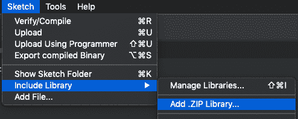

# 第 21 章. 进一步学习

本作品使用 AI 翻译。我们期待您的意见和反馈：translation-feedback@oreilly.com

我们希望本书能帮助你使用廉价、低功耗的设备解决重要问题。由于该领域新颖且快速增长，这里提供的内容仅是快照。如果想获取最新信息，请参考以下资源。

## TinyML 基金会

[TinyML 峰会](https://www.tinymlsummit.org)是一年一度的会议，嵌入式硬件、软件和机器学习专家齐聚一堂，讨论跨领域协作。此外，在[湾区](https://oreil.ly/ZtZu_)和[德克萨斯州奥斯汀](https://oreil.ly/cH9d-)每月举办聚会，预计未来举办地会增加。[TinyML 基金会网站](https://www.tinymlsummit.org)可以观看活动视频、幻灯片和其他资料。

## SIG Micro

本书聚焦于 TensorFlow Lite for Microcontrollers，但如果你有兴趣为该框架做出贡献，有一个 SIG（Special Interest Group），外部开发者可以共同改进。[SIG Micro 有](https://oreil.ly/owmCE)、[公开的月度视频会议](https://oreil.ly/1AdpF)、[邮件列表](https://oreil.ly/qFhbv)、[Gitter 聊天室](https://oreil.ly/btt1p)。如果对库的新功能有想法或需求，这里是讨论的好地方。无论 Google 内部还是外部，所有参与项目的开发者都可以看到路线图和未来工作计划。通常的变更流程首先从分享设计文档开始。对于简单的变更，单页说明为什么需要该变更以及做什么就足够了。我们通常将其作为 RFC（“request for comment”）发布，以便利益相关者提供反馈，并在方法达成一致后，通过包含实际代码变更的拉取请求跟进。

## TensorFlow 网站

TensorFlow 主网站有[我们关于微控制器的研究主页](https://oreil.ly/Utc2E)，可以查看最新的示例和文档。特别是，训练示例代码将继续迁移到 TensorFlow 2.0，因此如果存在兼容性问题，值得查看。

## 其他框架

由于 TensorFlow 是我们最熟悉的库，因此我们聚焦于 TensorFlow 生态系统，但其他框架也有许多有趣的研究。我们非常喜欢 Neil Tan 在[uTensor](https://oreil.ly/IfTva)上的开创性工作，他在从 TensorFlow 模型生成代码方面做了许多有趣的实验。Network+ 的[Embedded Learning Library](https://oreil.ly/Q-r3d)面向 Arduino 和 micro:bit 平台，并支持多种机器学习算法，而不仅仅是深度神经网络。

## 推特


你是否想向世界传达你制作的嵌入式机器学习项目？我们很想看看你解决了什么样的问题。在 Twitter 上使用 *#tinyml 的* 哈希标签分享链接，是联系我们的一种很好的方式。我们自己也在 Twitter 上运营 [@petewarden 和](https://oreil.ly/S60rg) [@dansitu 作为](https://oreil.ly/xswxw)，并计划在 [@tinymlbook 在](https://oreil.ly/4NaMB) 上发布本书的最新信息。

# TinyML 的伙伴们

从早期初创公司到大型企业，这个领域有很多有趣的公司。如果你正在开发产品，你一定会想去了解这些公司提供的东西。这里我们按字母顺序列出了我们合作过的一部分组织：

*   [阿杜夫特](https://www.adafruit.com)
*   [安碧克微](https://ambiqmicro.com)
*   [Arduino](https://www.arduino.cc)
*   [Arm](https://www.arm.com)
*   [凯登斯／腾思力卡](https://ip.cadence.com/knowledgecenter/know-ten)
*   [CEVA/DSP 集团](https://www.ceva-dsp.com)
*   [边缘脉冲](https://www.edgeimpulse.com)
*   [伊塔计算](https://etacompute.com)
*   [永活](https://everactive.com)
*   [绿波技术](https://greenwaves-technologies.com)
*   [晗微](https://www.himax.com.tw)
*   [矩阵工业](https://www.matrixindustries.com)
*   [诺迪克半导体](https://www.nordicsemi.com)
*   [派克特](https://www.pixart.com)
*   [高通](https://www.qualcomm.com)
*   [SparkFun](https://www.sparkfun.com)
*   [意法半导体](https://www.st.com/content/st_com/en.html)
*   [辛坦特](https://www.syntiant.com)
*   [Xnor.ai](https://www.xnor.ai)

# 总结

感谢你参与嵌入式设备中机器学习的探索。我们希望这能成为你开展自己项目的契机。我们迫不及待地想看看你将创造什么，以及你将如何推动这个令人兴奋的新领域向前发展！

# 附录 A. Arduino 库 Zip 的使用与生成

在 Arduino IDE 中，需要以特定方式打包源文件。TensorFlow Lite for Microcontrollers Makefile 知道这种方法，可以生成包含所有源代码的 `.zip` 文件并将其作为库导入到 Arduino IDE 中。这样就可以构建和部署应用程序了。

本节后半部分将说明此文件的生成方法。然而，最简单的方法是使用由 TensorFlow 团队每晚生成的 [已构建的 `.zip` 文件](https://oreil.ly/blgB8)。

下载该文件后，需要导入它。在 Arduino IDE 的 Sketch 菜单中，如 图 A-1 所示，选择 Include Library→Add .ZIP 库。



在显示的文件浏览器中查找 `.zip` 文件，点击 Choose 导入。

例如，当你想对 TensorFlow Git 仓库中的代码进行更改并在 Arduino 环境中进行测试时。

如果需要自己生成文件，请打开终端窗口，克隆 TensorFlow 仓库并进入该目录：

```
git clone https://github.com/tensorflow/tensorflow.git
cd tensorflow
```

运行以下脚本生成 `.zip` 文件：

```
tensorflow/lite/micro/tools/ci_build/test_arduino.sh
```

文件将创建在以下位置：

```
tensorflow/lite/micro/tools/make/gen/arduino_x86_64/ \
  prj/micro_speech/tensorflow_lite.zip
```

要将此 `.zip` 文件导入 Arduino IDE，请使用前面说明的步骤。如果之前安装过此库，则首先需要删除原始版本。从 Arduino IDE 的 `Libraries` 目录中删除 `tensorflow_lite` 目录。它可以在 Arduino IDE 的 Preferences 窗口的 "Sketchbook location " 中找到。

# 附录 B. 在 Arduino 上捕获音频

以下内容将说明 第 7 章中 wake-word 应用的音频捕获代码。由于与机器学习没有直接关系，因此作为附录提供。

Arduino Nano 33 BLE Sense 配备了板载麦克风。要接收来自麦克风的音频数据，只需注册一个在新的音频数据块准备好时会被调用的回调函数即可。

每次都会将新的数据块写入用于存储数据储备的 *缓冲区中*。由于音频数据消耗大量内存，缓冲区只能保存一定量的数据。当缓冲区满时，这些数据会被覆盖。

在程序准备执行推理时，可以随时从该缓冲区读取最后 1 秒的数据。只要有新的数据持续进入的速度比我们访问数据的速度快，缓冲区中就总会有足够的新数据进行预处理并发送给模型。

每个预处理和推理周期都很复杂，完成需要时间。因此，在 Arduino 上推理每秒只能执行几次。也就是说，缓冲区更容易填满。

如 第 7 章中所见，`audio_provider.h` 实现了这两个函数：

*   `GetAudioSamples()` 提供原始音频数据块的指针。
*   `LatestAudioTimestamp()` 返回最近捕获的音频的时间戳。

实现这些功能的 Arduino 代码位于 [`arduino/audio_provider.cc`在](https://oreil.ly/Bfh4v)。

第一部分导入了一些依赖项。`PDM.h` 库定义了用于从麦克风获取数据的 API。`micro_model_settings.h` 文件包含与模型数据要求相关的常量，有助于以正确的格式提供音频：

```
#include "tensorflow/lite/micro/examples/micro_speech/
  audio_provider.h"

#include "PDM.h"
#include "tensorflow/lite/micro/examples/micro_speech/
  micro_features/micro_model_settings.h"
```

下面的代码设置了一些重要变量：

```
namespace {
bool g_is_audio_initialized = false;
// An internal buffer able to fit 16x our sample size
constexpr int kAudioCaptureBufferSize = DEFAULT_PDM_BUFFER_SIZE * 16;
int16_t g_audio_capture_buffer[kAudioCaptureBufferSize];
// A buffer that holds our output
int16_t g_audio_output_buffer[kMaxAudioSampleSize];
// Mark as volatile so we can check in a while loop to see if
// any samples have arrived yet.
volatile int32_t g_latest_audio_timestamp = 0;
}  // namespace
```

布尔值 `g_is_audio_initialized` 用于跟踪麦克风是否已开始捕获音频。音频捕获缓冲区由 `g_audio_capture_buffer` 定义，其大小为 `DEFAULT_PDM_BUFFER_SIZE` 的 16 倍。这是 `PDM.h` 中定义的常量，表示每次回调时从麦克风接收的音频量。缓冲区越大，程序因某种原因变慢时数据不足的可能性就越低。

除了音频捕获缓冲区外，还保留输出音频缓冲区 `g_audio_output_buffer`，并在 `GetAudioSamples()` 被调用时返回其指针。它的长度为 `kMaxAudioSampleSize`，这是 `micro_model_settings.h` 中的常量，定义了预处理代码一次可以处理的 16 位音频样本数。

最后，`g_latest_audio_timestamp` 记录最新音频样本的时间。这与手表时间不一致。它是从开始捕获音频以来的相对毫秒数。该变量被声明为 `volatile`，因此处理器不会尝试缓存其值。其原因将在后面解释。

在设置这些变量之后，定义一个每次有新的音频数据可用时都会被调用的回调函数。这就是全部内容：

```
void CaptureSamples() {
  // This is how many bytes of new data we have each time this is called
  const int number_of_samples = DEFAULT_PDM_BUFFER_SIZE;
  // Calculate what timestamp the last audio sample represents
  const int32_t time_in_ms =
      g_latest_audio_timestamp +
      (number_of_samples / (kAudioSampleFrequency / 1000));
  // Determine the index, in the history of all samples, of the last sample
  const int32_t start_sample_offset =
      g_latest_audio_timestamp * (kAudioSampleFrequency / 1000);
  // Determine the index of this sample in our ring buffer
  const int capture_index = start_sample_offset % kAudioCaptureBufferSize;
  // Read the data to the correct place in our buffer
  PDM.read(g_audio_capture_buffer + capture_index, DEFAULT_PDM_BUFFER_SIZE);
  // This is how we let the outside world know that new audio data has arrived.
  g_latest_audio_timestamp = time_in_ms;
}
```

这个函数有点复杂，所以我们逐步解释。该函数的目标是确定写入新数据的音频捕获缓冲区的正确索引。

首先，计算每次回调时接收多少新数据。利用它来确定缓冲区中最新音频样本的时间（以毫秒为单位）：

```
 // This is how many bytes of new data we have each time this is called
 const int number_of_samples = DEFAULT_PDM_BUFFER_SIZE;
 // Calculate what timestamp the last audio sample represents
 const int32_t time_in_ms =
     g_latest_audio_timestamp +
     (number_of_samples / (kAudioSampleFrequency / 1000));
```

每秒的音频样本数为 `kAudioSampleFrequency`（该常量在 `micro_model_settings.h` 中定义）。将其除以 1,000 得到每毫秒的样本数。

接下来，将每个回调的样本数（`number_of_samples`）除以每毫秒的样本数，求出每个回调获取的数据对应的毫秒数：

```
(number_of_samples / (kAudioSampleFrequency / 1000))
```

接下来，将此时间戳加到最近音频样本的时间戳上，添加到 `g_latest_audio_timestamp`，得到最新新音频样本的时间戳。

了解这个数值后，可以用它来求出 *在所有样本的历史中* 最新样本的索引。为此，将最近音频样本的时间戳乘以每毫秒的样本数：

```
const int32_t start_sample_offset =
    g_latest_audio_timestamp * (kAudioSampleFrequency / 1000);
```

然而，该缓冲区没有容量保存迄今为止捕获的所有样本。相反，它只有 `DEFAULT_PDM_BUFFER_SIZE` 的 16 倍空间。一旦有更多数据，就会开始用新数据覆盖缓冲区。

这样就得到了 *在所有样本历史中* 新样本的索引。接下来，需要将其转换为实际缓冲区中样本的索引。为此，将历史索引除以缓冲区的长度并求余数。这使用模运算符 (`%`) 进行：

```
// Determine the index of this sample in our ring buffer
const int capture_index = start_sample_offset % kAudioCaptureBufferSize;
```

缓冲区大小 `kAudioCaptureBufferSize` 是 `DEFAULT_PDM_BUFFER_SIZE` 的倍数，因此新数据始终能整齐地放入缓冲区。模运算符返回新数据应在缓冲区中开始的索引。

接下来，使用 `PDM.read()` 方法将最新音频读入音频捕获缓冲区：

```
// Read the data to the correct place in our buffer
PDM.read(g_audio_capture_buffer + capture_index, DEFAULT_PDM_BUFFER_SIZE);
```


第一个参数传递指向内存中写入数据的位置的指针。变量 `g_audio_capture_buffer` 是指向音频捕获缓冲区在内存中开始的地址的指针。通过向此位置添加 `capture_index`，可以计算出在内存中写入新数据的正确位置。第二个参数定义要读取多少数据，这里是最大值 `DEFAULT_PDM_BUFFER_SIZE` 。

最后，更新 `g_latest_audio_timestamp`：

```
 // This is how we let the outside world know that new audio data has arrived.
 g_latest_audio_timestamp = time_in_ms;
```

这通过 `LatestAudioTimestamp()` 方法向程序的其他部分公开，告知新数据已可用。因为 `g_latest_audio_timestamp` 被声明为 `volatile`，因此每次访问时其值都会从内存中检索。这很重要，否则变量会被处理器缓存。因为该值在回调中设置，处理器不知道刷新缓存的值，因此访问该变量的代码无法接收当前值。

你可能会想知道为什么 `CaptureSamples()` 作为回调函数运行。如何知道新音频可用？这是开始音频捕获的函数：

```
TfLiteStatus InitAudioRecording(tflite::ErrorReporter* error_reporter) {
  // Hook up the callback that will be called with each sample
  PDM.onReceive(CaptureSamples);
  // Start listening for audio: MONO @ 16KHz with gain at 20
  PDM.begin(1, kAudioSampleFrequency);
  PDM.setGain(20);
  // Block until we have our first audio sample
  while (!g_latest_audio_timestamp) {
  }

  return kTfLiteOk;
}
```

此函数在有人首次调用 `GetAudioSamples()` 时被调用。首先，使用 `PDM` 库，调用 `PDM.onReceive()`，挂钩 `CaptureSamples()` 回调。接下来，`PDM.begin()` 与两个参数一起被调用。第一个参数表示要录制的音频通道数。因为只需要单声道音频，所以指定 `1`。第二个参数指定每秒想要接收的样本数。

接下来，`PDM.setGain()` 设置定义麦克风声音放大程度的*增益*。指定增益为 `20`，这是经过一些实验后选定的。

最后，循环直到 `g_latest_audio_timestamp` 被评估为真。因为 `g_latest_audio_timestamp` 从 `0` 开始，所以在回调捕获音频之前会阻塞执行。

之前解释的两个函数启动音频捕获过程并将捕获的音频存储到缓冲区。下一个函数 `GetAudioSamples()` 为代码的其他部分（即特征提供者）获取音频数据的机制提供：

```
TfLiteStatus GetAudioSamples(tflite::ErrorReporter* error_reporter,
                             int start_ms, int duration_ms,
                             int* audio_samples_size, int16_t** audio_samples) {
  // Set everything up to start receiving audio
  if (!g_is_audio_initialized) {
    TfLiteStatus init_status = InitAudioRecording(error_reporter);
    if (init_status != kTfLiteOk) {
      return init_status;
    }
    g_is_audio_initialized = true;
  }
```

此函数使用用于写入日志的 `ErrorReporter`、指定所需音频的两个变量（ `start_ms` 和 `duration_ms` ）、用于传递音频数据的两个指针（ `audio_samples_size` 和 `audio_samples` ）调用。函数的第一部分调用 `InitAudioRecording()`。如前所述，这会阻塞执行直到音频的第一个样本到达。使用变量 `g_is_audio_initialized` 使此设置代码仅执行一次。

从这一点起，可以假设音频已保存在捕获缓冲区。我们的工作是知道正确的音频数据在缓冲区中的位置。为此，首先确定所需第一个样本在*所有样本历史中的*索引：

```
const int start_offset = start_ms * (kAudioSampleFrequency / 1000);
```

接下来，确定要获取的样本总数：

```
const int duration_sample_count =
    duration_ms * (kAudioSampleFrequency / 1000);
```

获得此信息后，可以考虑在音频捕获缓冲区的何处进行读取。通过循环读取数据：

```
for (int i = 0; i < duration_sample_count; ++i) {
  // For each sample, transform its index in the history of all samples into
  // its index in g_audio_capture_buffer
  const int capture_index = (start_offset + i) % kAudioCaptureBufferSize;
  // Write the sample to the output buffer
  g_audio_output_buffer[i] = g_audio_capture_buffer[capture_index];
}
```

之前，我们看到了使用 modulo 运算符在只能存储最新样本的缓冲区内找到正确位置的方法。将*所有样本历史中的*当前索引除以音频捕获缓冲区的大小 `kAudioCaptureBufferSize`，余数指示缓冲区中数据的位置。接下来，可以使用简单的赋值将数据从捕获缓冲区读取到输出缓冲区。

接下来，为了从此函数中取出数据，使用作为参数给出的两个指针。它们是指向音频样本数的 `audio_samples_size` 和指向输出缓冲区的 `audio_samples`：

```
  // Set pointers to provide access to the audio
  *audio_samples_size = kMaxAudioSampleSize;
  *audio_samples = g_audio_output_buffer;

  return kTfLiteOk;
}
```

`kTfLiteOk` 通知调用者操作成功并结束函数。

最后，定义 `LatestAudioTimestamp()`：

```
int32_t LatestAudioTimestamp() { return g_latest_audio_timestamp; }
```

这始终返回最新的音频时间戳，因此可以在代码的其他部分在循环中检查以判断是否到达了新的音频数据。

关于音频提供者就到此为止！这样，功能提供者就可以稳定地提供新鲜的音频样本了。
