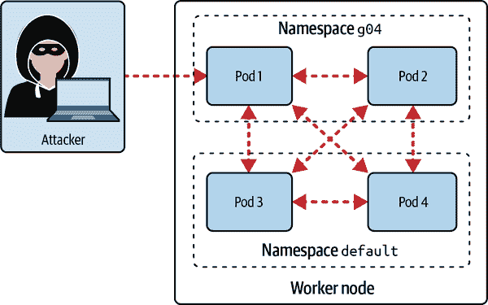
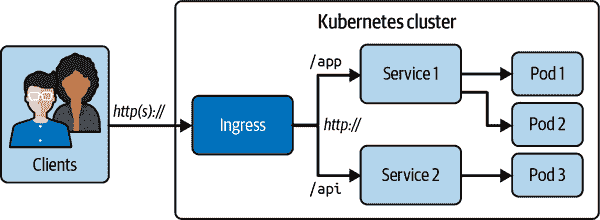
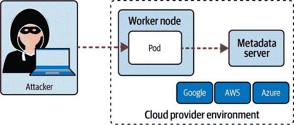
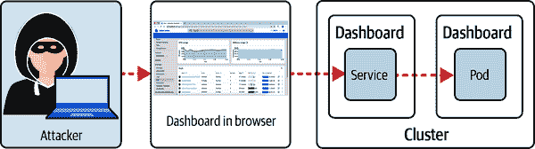
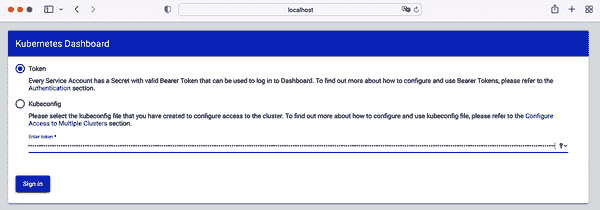
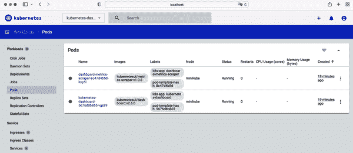
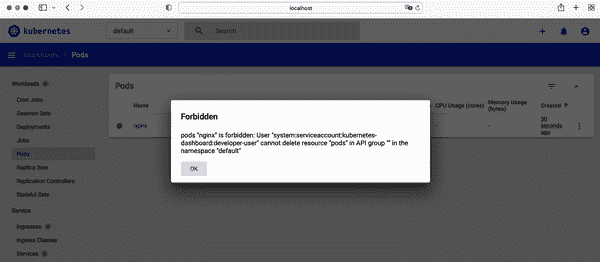
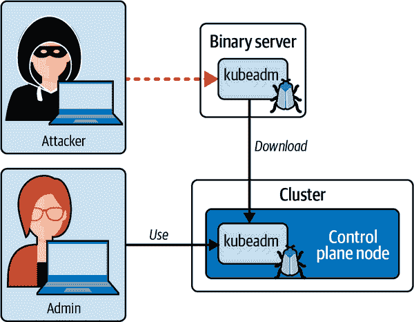

## 第 2 章. クラスターのセットアップ

この作品はAIを使って翻訳されている。ご意見、ご感想をお待ちしている：translation-feedback@oreilly.com

試験の最初の領域は、Kubernetesクラスタのセットアップと設定に関する問題を扱う。この章では、Kubernetes 管理者の標準的なレスポンスではなく、セキュリティに特化した側面のみを掘り下げていく。

この章では、高いレベルで以下の概念をカバーする：

* ネットワークポリシーを使ってPod 間通信を制限する
* `CIS` ベンチマークツールを実行してクラスタコンポー ネントのセキュリティリスクを特定する
* `TLS`をサポートする`Ingress`オブジェクトをセットアップする
* ノードポート、APIエンドポイント、GUIアクセスの保護


*   プラットフォームのバイナリをチェックサムと照合する

### ネットワークポリシーを使ってPod 間通信を制限する

マイクロサービスアーキテクチャがKubernetesで機能するためには、Podがネットワークアドレス変換（NAT）なしで、同じノードまたは異なるノードで動作する別のPodに到達できる必要がある。Kubernetesは、すべてのPodに対して、そのノードのPod CIDR 範囲から、作成時に一意のIPアドレスを代入する。このIPアドレスはエフェメラル（一時的）なものであるため、長期的に安定しているとは言えない。Podを再起動するたびに、新しいIPアドレスがリースされる。一貫したネットワーク・インタフェースに依存できるように、Pod 間通信よりもPod-to-Service 間通信を使用することを推奨する。

Podに代入されるIPアドレスは、すべてのノードとネームスペースで一意である。これは、各ノードの登録時に専用のサブネットを代入することで実現される。ノード上に新しいPodを作成する際、IPアドレスは割り当てられたサブネットからリースされる。これはContainer Network Interface（CNI）プラグインによって処理される。その結果、ノード上のPodは、クラスタの他のどのノード上で実行されている他のすべてのPodと通信できる。

ネットワーク・ポリシーはファイアウォール・ルールに似ているが、Pod 間の通信に対して機能する。規則には、1つのネームスペース内または異なるネームスペースにまたがる1つまたは複数のPodのネットワークトラフィックの方向（ingressおよび/またはegress）、およびそれらのターゲットポートを含めることができる。ネットワークポリシーの基本について深く掘り下げた内容については、書籍『[*Certified Kubernetes Application Developer (CKAD) Study Guide*](https://learning.oreilly.com/library/view/certified-kubernetes-application/9781492083726)』（O'Reilly）または[Kubernetesのドキュメントを](https://oreil.ly/WChde)参照されたい。CKS 試験では、主にネットワークポリシーによるクラスタレベルのアクセス制限に焦点が当てられている。

ネットワーク・ポリシーの規則を正しく定義することは難しい。[`networkpolicy.io`](https://networkpolicy.io)というページは、ネットワーク・ポリシーのためのビジュアル・エディターを提供し、ブラウザ上でグラフィカルに表示する。

#### シナリオ攻撃者がPodにアクセスする

あなたが、3つのワーカーノードでKubernetesクラスタを運用している会社で働いているとする。ワーカーノード1は現在、マイクロサービスアーキテクチャの一部として2つのPodを実行している。KubernetesのPod 間ネットワーク通信のデフォルトの振る舞いを考えると、Pod 1はPod 2と無制限に話すことができ、逆も同様だ。

図 2-1でわかるように、攻撃者はPod 1にアクセスした。ネットワーク・ポリシーを定義しなければ、攻撃者は単純にPod 2に話しかけてさらなる損害を与えることができる。この脆弱性は単一のネームスペースに限定されるものではない。Pod3と4にもアクセスし、侵害することができる。



#### デフォルトの振る舞いを観察する

3つのPodをセットアップして、制限のないPod 間ネットワーク通信を実際に試してみよう。例 2-1 を見るとわかるように、YAML マニフェストは`backend` と`frontend` という名前の Pod を名前空間`g04` で定義しています。`other` Pod は`default` 名前空間に存在する。名前空間とPodのラベル代入に注目してほしい。この章の後半でネットワークポリシーを定義するときに、これらを少し参照することになる。

##### 例 2-1. 異なる名前空間にある 3 つの Pod の YAML マニフェスト

```
apiVersion: v1
kind: Namespace
metadata:
  labels:
    app: orion
  name: g04
---
apiVersion: v1
kind: Pod
metadata:
  labels:
    tier: backend
  name: backend
  namespace: g04
spec:
  containers:
  - image: bmuschko/nodejs-hello-world:1.0.0
    name: hello
    ports:
    - containerPort: 3000
  restartPolicy: Never
---
apiVersion: v1
kind: Pod
metadata:
  labels:
    tier: frontend
  name: frontend
  namespace: g04
spec:
  containers:
  - image: alpine
    name: frontend
    args:
    - /bin/sh
    - -c
    - while true; do sleep 5; done;
  restartPolicy: Never
---
apiVersion: v1
kind: Pod
metadata:
  labels:
    tier: outside
  name: other
spec:
  containers:
  - image: alpine
    name: other
    args:
    - /bin/sh
    - -c
    - while true; do sleep 5; done;
  restartPolicy: Never
```

宣言的な`kubectl apply` コマンドを使用して、既存の YAML マニフェストからオブジェクトを作成することから始める：

```
$ kubectl apply -f setup.yaml
namespace/g04 created
pod/backend created
pod/frontend created
pod/other created
```

ネームスペース`g04` 、正しいPodが実行されていることを確認しよう。`-o wide` CLIオプションを使用して、Podに代入されている仮想 IPアドレスを確認する。`backend` PodはIPアドレス10.0.0.43を使用し、`frontend` PodはIPアドレス10.0.0.193を使用する：

```
$ kubectl get pods -n g04 -o wide
NAME       READY   STATUS    RESTARTS   AGE   IP           NODE     \
  NOMINATED NODE   READINESS GATES
backend    1/1     Running   0          15s   10.0.0.43    minikube \
  <none>           <none>
frontend   1/1     Running   0          15s   10.0.0.193   minikube \
  <none>           <none>
```

 `default` 名前空間は単一のPodを扱う：

```
$ kubectl get pods
NAME    READY   STATUS    RESTARTS   AGE
other   1/1     Running   0          4h45m
```

`frontend` Podは、通信制限がかけられていないため、`backend` Podと話すことができる：

```
$ kubectl exec frontend -it -n g04 -- /bin/sh
/ # wget --spider --timeout=1 10.0.0.43:3000
Connecting to 10.0.0.43:3000 (10.0.0.43:3000)
remote file exists
/ # exit
```

`default` 名前空間に存在する`other` Podは、`backend` Podと問題なく通信できる：

```
$ kubectl exec other -it -- /bin/sh
/ # wget --spider --timeout=1 10.0.0.43:3000
Connecting to 10.0.0.43:3000 (10.0.0.43:3000)
remote file exists
/ # exit
```

次のセクションでは、deny-allネットワークポリシールールの助けを借りて、Pod 間のネットワーク通信を最大レベルに制限することについて説明する。そして、マイクロサービスアーキテクチャが適切に機能するために必要な種類のネットワーク通信に対してのみ、イングレス通信やイグレス通信を開放する。

#### 指向性ネットワークトラフィックを拒否する

Pod 間のネットワーク・トラフィックを制限する最善の方法は、最小権限の原則を用いることである。最小特権とは、Podはネットワーク通信において最も低い特権で通信すべきであるということだ。通常は、あらゆる方向のトラフィックを許可しないことから始めて、アプリケーションアーキテクチャが必要とするトラフィックを開放する。

[Kubernetesのドキュメントには](https://oreil.ly/PZOGf)、役に立つYAMLマニフェストの例がいくつか用意されている。例 2-2は、名前空間`g04` にあるすべての Pod へのイングレス・トラフィックを拒否するネットワーク・ポリシーを示している。

##### 例 2-2. デフォルトのdeny-allイングレスネットワークポリシー

```
apiVersion: networking.k8s.io/v1
kind: NetworkPolicy
metadata:
  name: default-deny-ingress
  namespace: g04
spec:
  podSelector: {}
  policyTypes:
  - Ingress
```

すべてのPodを選択することは、`spec.podSelector` 属性に割り当てられた値`{}` で示される。値属性`spec.policyTypes` はトラフィックの拒否方向を定義する。着信トラフィックに対しては、`Ingress` を配列に追加できる。発信トラフィックは、値`Egress` で指定できる。この例では、すべての流入トラフィックを拒否する。退出トラフィックは依然として許可されている。

deny-all」ネットワークポリシーの内容は、ファイル`deny-all-ingress-network-policy.yaml` に保存されている。次のコマンドはファイルからオブジェクトを作成する：

```
$ kubectl apply -f deny-all-ingress-network-policy.yaml
networkpolicy.networking.k8s.io/default-deny-ingress created
```

これでPod 間ネットワーク通信のランタイムの振る舞いがどう変わったか見てみよう。先ほど使ったのと同じ`wget` コマンドを実行して観察すると、`frontend` Podは`backend` Podと通信できなくなった。CLIオプション`--timeout` で定義されているように、ネットワーク呼び出しは1 秒後にタイムアウトする：

```
$ kubectl exec frontend -it -n g04 -- /bin/sh
/ # wget --spider --timeout=1 10.0.0.43:3000
Connecting to 10.0.0.43:3000 (10.0.0.43:3000)
wget: download timed out
/ # exit
```

さらに、別のネームスペースで動作しているPodも、`backend` Podに接続できなくなる。次の`wget` ・コマンドは、`default` ・ネームスペースで動作している`other` ・Podから、`backend` ・PodのIPアドレスに呼び出しを行う：

```
$ kubectl exec other -it -- /bin/sh
/ # wget --spider --timeout=1 10.0.0.43:3000
Connecting to 10.0.0.43:3000 (10.0.0.43:3000)
wget: download timed out
```

この呼び出しもタイムアウトになる。

#### きめ細かな着信トラフィックを許可する

Networkポリシーは加法的である。ネットワーク通信に対してより多くの許可を与えるには、より細かい規則を持つ別のネットワーク・ポリシーを作成すればよい。`backend` Podへのイングレス・トラフィックを、同じネームスペースにある`frontend` Podからのみ許可したいとする。他のすべてのPodからのイングレス・トラフィックは、それらが実行されている名前空間とは無関係に拒否する必要がある。

ネットワーク・ポリシーは、ラベル選択を使って規則を定義することが多い。`g04` 名前空間と、同じ名前空間で動作しているPodオブジェクトのラベルを特定し、ネットワーク・ポリシーで使用できるようにする：

```
$ kubectl get ns g04 --show-labels
NAME   STATUS   AGE   LABELS
g04    Active   12m   app=orion,kubernetes.io/metadata.name=g04
$ kubectl get pods -n g04 --show-labels
NAME       READY   STATUS    RESTARTS   AGE     LABELS
backend    1/1     Running   0          9m46s   tier=backend
frontend   1/1     Running   0          9m46s   tier=frontend
```

名前空間`g04` のラベル代入は、キーと値のペア`app=orion` を含む。Pod`backend` のラベルセットにはキー・バリューのペア`tier=backend` が含まれ、`frontend` Pod にはキー・バリューのペア`tier=frontend` が含まれる。

`frontend` Podがポート3000でのみ`backend` Podと通信できるように、新しいネットワークポリシーを作成する。それ以外の通信は許可しない。例 2-3の YAML マニフェスト表現は、ネットワークポリシーの完全な定義を示している。

##### 例 2-3. イングレス・トラフィックを許可するネットワーク・ポリシー

```
apiVersion: networking.k8s.io/v1
kind: NetworkPolicy
metadata:
  name: backend-ingress
  namespace: g04
spec:
  podSelector:
    matchLabels:
      tier: backend
  policyTypes:
  - Ingress
  ingress:
  - from:
    - namespaceSelector:
        matchLabels:
          app: orion
      podSelector:
        matchLabels:
          tier: frontend
    ports:
    - protocol: TCP
      port: 3000
```

ネットワーク・ポリシーの定義はファイル`backend-ingress-network-policy.yaml` に格納されている。ファイルからオブジェクトを作成する：

```
$ kubectl apply -f backend-ingress-network-policy.yaml
networkpolicy.networking.k8s.io/backend-ingress created
```

`frontend` Podは`backend` Podと会話できるようになった：

```
$ kubectl exec frontend -it -n g04 -- /bin/sh
/ # wget --spider --timeout=1 10.0.0.43:3000
Connecting to 10.0.0.43:3000 (10.0.0.43:3000)
remote file exists
/ # exit
```

 `g04` ネームスペースの外で実行されているPodは、まだ Podに接続できない。 コマンドはタイムアウトする：`backend` `wget`

```
$ kubectl exec other -it -- /bin/sh
/ # wget --spider --timeout=1 10.0.0.43:3000
Connecting to 10.0.0.43:3000 (10.0.0.43:3000)
wget: download timed out
```

### Kubernetesコンポーネントのセキュリティ・ベスト・プラクティスを適用する


オンプレミスのKubernetesクラスタを管理すると、APIサーバ、etcd、kubeletなどのクラスタコンポーネントに適用される構成オプションを完全に制御できる。`kubeadm`、クラスタノードの作成時に使用されるデフォルトのコンフィギュレーション設定に単純に従うことは珍しくない。こうしたデフォルト設定の中には、クラスタ・コンポーネントを不要な攻撃の機会にさらすものもある。

クラスタのセキュリティ対策を強化することは、攻撃ベクトルを最小化しようとするKubernetes 管理者にとって極めて重要な活動だ。ベストプラクティスを知っていれば手動でこの活動を行うこともできるし、自動化されたプロセスを使うこともできる。

[Center for Internet Security（CIS](https://www.cisecurity.org)）は、サイバーセキュリティのベストプラクティスを公開している非営利団体だ。彼らのベスト・プラクティス・ポートフォリオの一部に、[Kubernetes](https://oreil.ly/CUe_D)環境のベスト・プラクティスのカタログである[Kubernetes CIS Benchmarkが](https://oreil.ly/CUe_D)ある。彼らのWebページには、クラスターコンポーネントの推奨セキュリティ設定の詳細なリストが発見できる。

### クラウドプロバイダーKubernetes 環境のCISベンチマーク

Kubernetes CIS Benchmarkは、Kubernetesのセルフマネージドインストールを対象としている。Amazon Elastic Kubernetes Service（EKS）やGoogle Kubernetes Engine（GKE）のようなクラウドプロバイダのKubernetes 環境は、独自のコマンドラインツールを伴う管理されたコントロールプレーンを提供する。そのため、Kubernetes CIS Benchmarkが推奨するセキュリティは、あまり当てはまらないかもしれない。次に説明するkube-benchのように、クラウドプロバイダーに特化した検証チェックを提供するツールもある。

#### kube-benchを使う

[kube-benchという](https://oreil.ly/y3mbO)ツールを使えば、KubernetesクラスタのコンポーネントをCIS Benchmarkのベストプラクティスに照らして自動でチェックできる。Kube-benchはさまざまな方法で実行できる。例えば、RPMやDebianファイルの形でプラットフォーム固有のバイナリとしてインストールできる。検証プロセスを実行する最も便利で直接的な方法は、Kubernetesクラスタ上で直接 Podでkube-benchを実行することだ。そのためには、ツールのGitHubリポジトリにチェックインしたYAMLマニフェストの助けを借りてジョブ・オブジェクトを作成する。

コントロールプレーンノードかワーカーノードのどちらを検査したいかによって、`job-master.yaml`、または`job-node.yaml`というファイルからジョブを作成することから始める。次のコマンドは、コントロールプレーンノードに対して検証チェックを実行する：

```
$ kubectl apply -f https://raw.githubusercontent.com/aquasecurity/kube-bench/\
main/job-master.yaml
job.batch/kube-bench-master created
```

ジョブを実行すると、検証プロセスを実行している対応するPodは、`default`名前付け空間内の名前によって識別できる。Podの名前はプレフィックス`kube-bench`で始まり、最後にノードのタイプとハッシュが付加される。以下の出力では、`kube-bench-master-8f6qh`という名前のPodを使用している：

```
$ kubectl get pods
NAME                      READY   STATUS      RESTARTS   AGE
kube-bench-master-8f6qh   0/1     Completed   0          45s
```

Podが「Completed」ステータスに遷移するまで待ち、すべての検証チェックが終了したことを確認する。Podのログをダンプすれば、ベンチマーク結果を見ることができる：

```
$ kubectl logs kube-bench-master-8f6qh
```

検証結果をファイルに書き出した方が便利な場合もある。`kubectl logs`コマンドの出力をファイルにリダイレクトするには、例えば`kubectl logs kube-bench-master-8f6qh > control-plane-kube-bench-results.txt`.

#### kube-benchの検証結果

作成される検証結果は、長くて詳細なものになることもあるが、以下の主要要素で構成される：検査されたノードの型、検査されたコンポーネント、合格したチェックのリスト、不合格だったチェックのリスト、警告のリスト、およびハイレベルの要約：

```
[INFO] 1 Control Plane Security Configuration 
[INFO] 1.1 Control Plane Node Configuration Files
[PASS] 1.1.1 Ensure that the API server pod specification file permissions are \
set to 644 or more restrictive (Automated) 
...
[INFO] 1.2 API Server
[WARN] 1.2.1 Ensure that the --anonymous-auth argument is set to false \
(Manual) 
...
[FAIL] 1.2.6 Ensure that the --kubelet-certificate-authority argument is set \
as appropriate (Automated) 

== Remediations master ==
...
1.2.1 Edit the API server pod specification file /etc/kubernetes/manifests/ \
kube-apiserver.yaml on the control plane node and set the below parameter.
--anonymous-auth=false
...
1.2.6 Follow the Kubernetes documentation and setup the TLS connection between 
the apiserver and kubelets. Then, edit the API server pod specification file 
/etc/kubernetes/manifests/kube-apiserver.yaml on the control plane node and \ 
set the --kubelet-certificate-authority parameter to the path to the cert \ 
file for the certificate authority. 
--kubelet-certificate-authority=<ca-string> 

...
== Summary total == 
42 checks PASS
9 checks FAIL
11 checks WARN
0 checks INFO
```


: 

検査されるノード、この場合はコントロールプレーンノード。


: 

パスしたチェック。ここでは、APIサーバ構成ファイルのファイルパーミッションを示す。


: 

APIサーバー実行ファイルに提供された引数の値を手動でチェックするよう促す警告メッセージ。


: 

チェックに失敗した。例えば、APIサーバ実行ファイルに`--kubelet-certificate-authority`フラグをセットする。


: 

問題を解決するために取るべき改善措置。障害や警告の番号（例えば1.2.1）は、改善措置に代入された番号に対応する。


: 

合格したチェックと不合格だったチェックのサマリー、および警告と情報メッセージ。

#### 検出されたセキュリティ問題を修正する

報告された警告や故障のリストは、最初は少し圧倒されるかもしれない。それらすべてを一度に修正する必要はないことを覚えておいてほしい。いくつかのチェックは、コンフィギュレーションに代入された値を確認するための単なるガイドラインや代入を促すものである。以下のステップでは、警告メッセージを取り除くプロセスを説明する。

コントロールプレーンコンポーネントの構成ファイルは、コントロールプレーンノードのホストシステム上のディレクトリ`/etc/kubernetes/manifests`。kube-benchで報告された警告 1.2.12を修正したいとする：

```
[INFO] 1.2 API Server
...
[WARN] 1.2.12 Ensure that the admission control plugin AlwaysPullImages is \
set (Manual)

== Remediations master ==
...
1.2.12 Edit the API server pod specification file /etc/kubernetes/manifests/ \
kube-apiserver.yaml
on the control plane node and set the --enable-admission-plugins parameter \
to include AlwaysPullImages.
--enable-admission-plugins=...,AlwaysPullImages,...
```

改善措置で提案されているように、APIサーバーの構成ファイルを編集し、入場プラグインのリストに値`AlwaysPullImages`を追加することになっている。ファイル`kube-apiserver.yaml`を編集する：

```
$ sudo vim /etc/kubernetes/manifests/kube-apiserver.yaml
```

引数`--enable-admission-plugins`に値`AlwaysPullImages`を追加すると、結果は以下のようになる：

```
apiVersion: v1
kind: Pod
metadata:
  annotations:
    kubeadm.kubernetes.io/kube-apiserver.advertise-address.endpoint: \
    192.168.56.10:6443
  creationTimestamp: null
  labels:
    component: kube-apiserver
    tier: control-plane
  name: kube-apiserver
  namespace: kube-system
spec:
  containers:
  - command:
    - kube-apiserver
    - --advertise-address=192.168.56.10
    - --allow-privileged=true
    - --authorization-mode=Node,RBAC
    - --client-ca-file=/etc/kubernetes/pki/ca.crt
    - --enable-admission-plugins=NodeRestriction,AlwaysPullImages
...
```

変更をファイルに保存する。`kube-system`ネームスペースでAPIサーバを実行しているPodが自動的に再起動される。起動プロセスには数秒かかることがある。そのため、以下のコマンドを実行すると、成功するまでしばらく時間がかかることがある：

```
$ kubectl get pods -n kube-system
NAME                           READY   STATUS    RESTARTS   AGE
...
kube-apiserver-control-plane   1/1     Running   0          71m
...
```

変更された結果を確認する前に、既存のジョブオブジェクトを削除する必要がある：

```
$ kubectl delete job kube-bench-master
job.batch "kube-bench-master" deleted
```

検証チェック1.2.12は、パスした結果を報告するようになった：

```
$ kubectl apply -f https://raw.githubusercontent.com/aquasecurity/kube-bench/\
main/job-master.yaml
job.batch/kube-bench-master created
$ kubectl get pods
NAME                      READY   STATUS      RESTARTS   AGE
kube-bench-master-5gjdn   0/1     Completed   0          10s
$ kubectl logs kube-bench-master-5gjdn | grep 1.2.12
[PASS] 1.2.12 Ensure that the admission control plugin AlwaysPullImages is \
set (Manual)
```

### TLSターミネーションによるイングレスの作成

Ingressは、一致するURLコンテキストパスに基づいて、クラスタ外部からのHTTPおよび/またはHTTPSトラフィックを1つまたは複数のサービスにルーティングする。図 2-2にその機能を示す。



Ingressは、クラスタ外部からのHTTPおよびHTTPSトラフィックを受け入れるように設定されている。発呼側がコンテキストパス(`/app`)を提供した場合、トラフィックはサービス1にルーティングされる。発呼側がコンテキストパス`/api`を提供した場合、トラフィックはサービス2にルーティングされる。重要な点は、通信は通常、Ingressを通過するとすぐに暗号化されていないHTTPネットワーク通信を使用することである。

Ingress APIリソースはCKADとCKA 試験の一部であるため、ここでは基本的な説明は省略する。詳細な議論については、[*Certified Kubernetes Administrator (CKA) Study Guide*](https://oreil.ly/cka-study-guide)または[Kubernetesドキュメントの](https://oreil.ly/wmk2s)情報を参照すること。

### イングレス・コントローラーの役割

Ingressは、Ingressコントローラなしでは機能しないことを覚えておくこと。Ingressコントローラは、トラフィックのルーティングを決定するIngressで定義された規則の集合を評価する。プロダクショングレードのIngressコントローラーの一例として、[F5 NGINX Ingress Controllerや](https://oreil.ly/jOo6P)[AKS Application Gateway Ingress Controllerが](https://oreil.ly/ckuqf)ある。[Kubernetesのドキュメントに](https://oreil.ly/BXx8e)リストされている他のオプションも発見できる。minikubeを使用している場合は、[Ingressアドオンを有効にして](https://oreil.ly/11QAA)おくこと。

CKS の主な焦点は、TLS 終端を持つ Ingress オブジェクトのセットアップにある。HTTPS 通信用に Ingress を設定することで、サービスレベルでのネットワーク通信のセキュリ ティ確保から解放される。このセクションでは、TLS 証明書と鍵の作成方法、証明書と鍵を TLS タイプの Secret オブジェクトに渡す方法、Ingress オブジェクトが HTTPS 通信をサポートするように設定する方法を学ぶ。

#### Ingressバックエンドのセットアップ


Ingressのコンテキストでは、*バックエンドは*サービス名とポートの組み合わせである。Ingressを作成する前に、サービス、デプロイ、そしてnginxが動作するPodを用意し、後で実際のアプリケーションへのHTTPSトラフィックのルーティングを実演できるようにする。これらのオブジェクトはすべて名前空間`t75`に存在する。例 2-4は、Ingressバックエンドを素早く作成する手段として、これらすべてのリソースを単一のYAMLマニフェストファイル`setup.yaml`で定義している。

##### 例 2-4. サービスを通して nginx を公開するための YAML マニフェスト

```
apiVersion: v1
kind: Namespace
metadata:
  name: t75
---
apiVersion: apps/v1
kind: Deployment
metadata:
  name: nginx-deployment
  namespace: t75
  labels:
    app: nginx
spec:
  replicas: 3
  selector:
    matchLabels:
      app: nginx
  template:
    metadata:
      labels:
        app: nginx
    spec:
      containers:
      - name: nginx
        image: nginx:1.14.2
        ports:
        - containerPort: 80
---
apiVersion: v1
kind: Service
metadata:
  name: accounting-service
  namespace: t75
spec:
  selector:
    app: nginx
  ports:
    - protocol: TCP
      port: 80
      targetPort: 80
```

以下のコマンドでYAMLファイルからオブジェクトを作成する：

```
$ kubectl apply -f setup.yaml
namespace/t75 created
deployment.apps/nginx-deployment created
service/accounting-service created
```

オブジェクトが正しく作成され、Podが「Running」ステータスに移行していることを素早く確認してみよう。`get all`コマンドを実行すると、3つのレプリカを制御する`nginx-deployment`という名前のデプロイと、`ClusterIP`タイプの`accounting-service`という名前のサービスが表示されるはずだ：

```
$ kubectl get all -n t75
NAME                                    READY   STATUS    RESTARTS   AGE
pod/nginx-deployment-6595874d85-5rdrh   1/1     Running   0          108s
pod/nginx-deployment-6595874d85-jmhvh   1/1     Running   0          108s
pod/nginx-deployment-6595874d85-vtwxp   1/1     Running   0          108s

NAME                         TYPE        CLUSTER-IP      EXTERNAL-IP   PORT(S) \
  AGE
service/accounting-service   ClusterIP   10.97.101.228   <none>        80/TCP \
  108s

NAME                               READY   UP-TO-DATE   AVAILABLE   AGE
deployment.apps/nginx-deployment   3/3     3            3           108s
```

同じノード上で動作している別のPodからサービスエンドポイントを呼び出すと、nginx Podからのレスポンスが成功するはずだ。ここでは、`wget`コマンドを使って振る舞いを検証している：

```
$ kubectl run tmp --image=busybox --restart=Never -it --rm \
  -- wget 10.97.101.228:80
Connecting to 10.97.101.228:80 (10.97.101.228:80)
saving to 'index.html'
index.html           100% |**|   612  0:00:00 ETA
'index.html' saved
pod "tmp" deleted
```

これらのオブジェクトを配置し、期待通りに機能させれば、あとはTLS 終端を持つIngressの作成に集中できる。

#### TLS 証明書と鍵の作成

TLSシークレットを作成する前に、TLS 証明書と鍵を生成する必要がある。そのためにOpenSSLコマンドを使う。出来上がったファイルの名前は`accounting.crt`と`accounting.key`：

```
$ openssl req -nodes -new -x509 -keyout accounting.key -out accounting.crt \
  -subj "/CN=accounting.tls"
Generating a 2048 bit RSA private key
...........................+
..........................+
writing new private key to 'accounting.key'
-----
$ ls
accounting.crt accounting.key
```

本番環境で使用する場合は、鍵ファイルを生成し、それを使って認証局（CA）からTLS 証明書を取得する。TLS 証明書と鍵の作成の詳細については、[OpenSSLのドキュメントを](https://oreil.ly/sETSb)参照のこと。

#### TLS 型シークレットを作成する

シークレットを作成する最も簡単な方法は、命令型コマンドの助けを借りることだ。この方法では、証明書と鍵の値を手動でbase64エンコーディングする必要はない。エンコーディングはオブジェクトの作成時に自動的に行われる。次のコマンドはシークレットオプション`tls`を使用し、証明書と鍵のファイル名をオプション`--cert`と`--key`で代入している：

```
$ kubectl create secret tls accounting-secret --cert=accounting.crt \
  --key=accounting.key -n t75
secret/accounting-secret created
```

例 2-5は、オブジェクトを宣言的に作成したい場合のTLSシークレットのYAML 表現を示している。

##### 例 2-5. 型を使ったシークレット`kubernetes.io/tls`

```
apiVersion: v1
kind: Secret
metadata:
  name: accounting-secret
  namespace: t75
type: kubernetes.io/tls
data:
  tls.crt: LS0tLS1CRUdJTiBDRVJUSUZJQ0FURS0tLS0tCk...
  tls.key: LS0tLS1CRUdJTiBQUklWQVRFIEtFWS0tLS0tCk...
```

属性`tls.crt`と`tls.key`の代入は、必ず1 行のbase64エンコード値として行うこと。base64エンコード値を生成するには、`base64`コマンドを、内容を変換したいファイル名に向けるだけでよい。次の例は、ファイル`accounting.crt`の内容をbase64エンコードしたものである：

```
$ base64 accounting.crt
LS0tLS1CRUdJTiBDRVJUSUZJQ0FURS0tLS0tCk1JSUNyakNDQ...
```

#### イングレスの作成

次のスニペットに示すワンライナーコマンドを使えば、命令形メソッドでIngressを作成できる。`--rule`引数の値を正しく作るのは難しい。`create ingress`コマンドには特定の式が必要なので、`--help`オプションを参照する必要があるだろう。IngressオブジェクトとTLSシークレットの接続作成に関連する情報は、`tls=accounting-secret`の引数である：

```
$ kubectl create ingress accounting-ingress \
  --rule="accounting.internal.acme.com/*=accounting-service:80, \
  tls=accounting-secret" -n t75
ingress.networking.k8s.io/accounting-ingress created
```

例 2-6はIngressのYAML 表現である。TLS 情報を定義する属性は`spec.tls[]`である。

##### 例 2-6. TLS 終端 Ingress を定義するための YAML マニフェスト

```
apiVersion: networking.k8s.io/v1
kind: Ingress
metadata:
  name: accounting-ingress
  namespace: t75
spec:
  tls:
  - hosts:
    - accounting.internal.acme.com
    secretName: accounting-secret
  rules:
  - host: accounting.internal.acme.com
    http:
      paths:
      - path: /
        pathType: Prefix
        backend:
          service:
            name: accounting-service
            port:
              number: 80
```

命令的または宣言的アプローチでIngressオブジェクトを作成したら、名前空間`t75`。以下の出力でわかるように、"PORT "列には443 番ポートがリストされており、TLS 終端が有効になっていることがわかる：

```
$ kubectl get ingress -n t75
NAME                 CLASS   HOSTS                          ADDRESS       \
  PORTS     AGE
accounting-ingress   nginx   accounting.internal.acme.com   192.168.64.91 \
  80, 443   55s
```

Ingressオブジェクトを記述すると、バックエンドはパス`/`にマッピングされ、`accounting-service`という名前のサービスを経由してPodにトラフィックをルーティングすることがわかる：

```
$ kubectl describe ingress accounting-ingress -n t75
Name:             accounting-ingress
Labels:           <none>
Namespace:        t75
Address:          192.168.64.91
Ingress Class:    nginx
Default backend:  <default>
TLS:
  accounting-secret terminates accounting.internal.acme.com
Rules:
  Host                          Path  Backends
  ----                          ----  --------
  accounting.internal.acme.com
                                /   accounting-service:80 \
                                (172.17.0.5:80,172.17.0.6:80,172.17.0.7:80)
Annotations:                    <none>
Events:
  Type    Reason  Age               From                      Message
  ----    ------  ----              ----                      -------
  Normal  Sync    1s (x2 over 31s)  nginx-ingress-controller  Scheduled for sync
```

#### イングレスの呼び出し

自分のマシン上のローカルKubernetesクラスタでの振る舞いをテストするには、まずノードのIPアドレスを発見する必要がある。以下のコマンドでminikube 環境でのIPアドレスが分かる：

```
$ kubectl get nodes -o wide
NAME       STATUS   ROLES           AGE     VERSION   INTERNAL-IP   \
  EXTERNAL-IP   OS-IMAGE               KERNEL-VERSION   CONTAINER-RUNTIME
minikube   Ready    control-plane   3d19h   v1.24.1   192.168.64.91 \
  <none>        Buildroot 2021.02.12   5.10.57          docker://20.10.16
```

次に、IPアドレスとホスト名のマッピングを`/etc/hosts`ファイルに追加する必要がある：

```
$ sudo vim /etc/hosts
...
192.168.64.91   accounting.internal.acme.com
```

代入されたドメイン名を使ってIngressにHTTPSリクエストを送信し、HTTPレスポンスコード200を受信することができるようになった：

```
$ wget -O- https://accounting.internal.acme.com --no-check-certificate
--2022-07-28 15:32:43--  https://accounting.internal.acme.com/
Resolving accounting.internal.acme.com (accounting.internal.acme.com)... \
192.168.64.91
Connecting to accounting.internal.acme.com (accounting.internal.acme.com) \
|192.168.64.91|:443... connected.
WARNING: cannot verify accounting.internal.acme.com's certificate, issued \
by ‘CN=Kubernetes Ingress Controller Fake Certificate,O=Acme Co’:
  Self-signed certificate encountered.
WARNING: no certificate subject alternative name matches
	requested host name ‘accounting.internal.acme.com’.
HTTP request sent, awaiting response... 200 OK
```

### ノードのメタデータとエンドポイントを保護する

Kubernetesクラスタは、クラスタ・コンポーネントとの通信に使用されるポートを公開する。例えば、APIサーバはデフォルトでポート`6443`を使用し、`kubectl`のようなクライアントがコマンドを実行する際に通信できるようにしている。

Kubernetesのドキュメントには、これらのポートが[「ポートとプロトコル](https://oreil.ly/iN993)」にリストされている[。](https://oreil.ly/iN993)以下の2つの表は、ノードごとのデフォルトのポート代入を示している。

表 2-1にクラスタ・ノードのデフォルトのインバウンド・ポートを示す。

表 2-1. インバウンドコントロールプレーンノードポート

| ポート範囲 || 目的 |

| --- | --- |

| 6643 || Kubernetes APIサーバ |

| --- | --- |

| 2379-2380 || etcdサーバクライアントAPI |

| 10250 || Kubelet API |

| 10259 || キューブ・スケジューラー |

| 10257 || キューブコントローラマネージャ |


これらのポートの多くは設定可能である。例えば、構成ファイル`/etc/kubernetes/manifests/kube-apiserver.yaml`のフラグ`--secure-port`で異なる値を指定することで、クラスタ・コンポーネントの[ドキュメントにある](https://oreil.ly/TTzAz)ようにAPIサーバ・ポートを変更できる。他のすべてのクラスタ・コンポーネントについては、対応するドキュメントを参照のこと。

表 2-2はワーカーノードのデフォルトインバウンドポートのリストである。

#### 表 2-2. インバウンドワーカーノードポート

| ポート範囲 | | 目的 |
| --- | --- | --- |
| 10250 | | Kubelet API |
| --- | --- | --- |
| 30000-32767 | | ノードポート・サービス |

クラスタコンポーネントが使用するポートを保護するために、攻撃対象領域を最小化するファイアウォール規則を設定する。例えば、APIサーバをイントラネット外の誰にも公開しないように決めることができる。`kubectl`を使用するクライアントは、VPNにログインした場合のみKubernetesクラスタに対してコマンドを実行できるようになり、クラスタが攻撃を受けにくくなる。

クラウドプロバイダのKubernetesクラスタ（AWS、Azure、Google Cloudなど）は、いわゆるメタデータサービスを公開している。メタデータサービスは、認証トークンのような機密データを仮想マシンやPodから消費するために、追加の認可なしで提供できるAPIだ。CKS 試験のためには、これらのノードエンドポイントとクラウドプロバイダのメタデータサービスを認識しておく必要がある。さらに、不正アクセスからそれらを保護する方法についても、高レベルで理解しておく必要がある。

#### シナリオ 侵害されたPodがメタデータサーバにアクセスできる

図 2-3は、クラウドプロバイダーのKubernetesクラスタ内のノードで実行されているPodにアクセスした攻撃者を示している。



メタデータサーバへのアクセスはいかなる形でも制限されていない。攻撃者は機密情報を取得することができ、他の侵入の可能性を開く可能性がある。

#### ネットワークポリシーでメタデータサーバへのアクセスを保護する

メタデータのエンドポイントを公開しているクラウドプロバイダーを1つ選んでみよう。AWSの場合、[AWSのドキュメントに](https://oreil.ly/6DsIx)記載されているように、メタデータサーバにはIPアドレス`169.254.169.254`でアクセスできる。公開されたエンドポイントは、EC2インスタンスのメタデータへのアクセスを提供できる。例えば、インスタンスのローカルIPアドレスを取得して外部アプリケーションへの接続を管理したり、スクリプトを使用してインスタンスに接続したりできる。`curl`コマンドラインツールを使用したエンドポイントの呼び出しについては、対応する[ドキュメントのページを](https://oreil.ly/Bwdej)参照のこと。

ネームスペース内のどのPodもメタデータ・サーバのIPアドレスに到達しないようにするには、`169.254.169.254`以外のすべてのIPアドレスへのイグジット・トラフィックを許可するネットワーク・ポリシーを設定する。例 2-7は、このような規則セットを持つYAMLマニフェストを示している。

##### 例 2-7. IPアドレス169.254.169.254へのデフォルトdeny-all egressネットワークポリシー

```
apiVersion: networking.k8s.io/v1
kind: NetworkPolicy
metadata:
  name: default-deny-egress-metadata-server
  namespace: a12
spec:
  podSelector: {}
  policyTypes:
  - Egress
  egress:
  - to:
    - ipBlock:
        cidr: 0.0.0.0/0
        except:
        - 169.254.169.254/32
```

ネットワークポリシーが作成されると、名前空間`a12`のPodはメタデータエンドポイントに到達できなくなるはずである。`curl`経由でエンドポイントを使用する詳細な例については、関連する[AWS ドキュメントを](https://oreil.ly/fQ07b)参照のこと。

### GUI 要素を保護する

クラスタを管理するためのユーザインタフェース（UI）は、`kubectl`ツールだけではない。`kubectl`ではきめ細かな操作が可能だが、ほとんどのユーザはクラスタのオブジェクトを管理するためにより便利なグラフィカル・ユーザ・インターフェイス（GUI）を好む。さまざまなオプションから選択できる。[Kubernetes Dashboardは](https://oreil.ly/ABDQo)無料のウェブベースのアプリケーションだ。[Portainerの](https://oreil.ly/i_FJv)ようなKubernetes 用の他のGUIダッシュボードは、イベントのトレースやハードウェアリソース消費の可視化を追加することで、基本的な機能を超えている。このセクションでは、インストールと設定が簡単なKubernetes Dashboardに焦点を当てる。

#### シナリオ 攻撃者がダッシュボード機能にアクセスする

Kubernetes Dashboardはクラスタ内部のPodとして実行される。Dashboardをインストールすると、`ClusterIP`、クラスタ内部からエンドポイントへのアクセスのみを許可するタイプのServiceも作成される。エンドユーザがDashboardにアクセスできるようにするには、クラスタの外部にServiceを公開する必要がある。たとえば、`NodePort`Serviceタイプに切り替えるか、Ingressを立ち上げる。図 2-4に、Dashboardのデプロイとアクセスに関する高レベルのアーキテクチャを示す。



ダッシュボードを外界に公開した時点で、攻撃者はダッシュボードにアクセスできる可能性がある。適切なセキュリティ設定がなければ、オブジェクトが削除されたり、変更されたり、悪意のある目的に使用されたりする可能性がある。このような攻撃の最も顕著な被害者はテスラで、2018 年に暗号通貨を採掘するために無防備なDashboardにアクセスしたハッカーの餌食になった。それ以来、Dashboardの新しいバージョンではデフォルト設定が変更され、最初からより安全になっている。

#### Kubernetes Dashboardをインストールする

Kubernetes Dashboardのインストールは簡単だ。プロジェクトのGitHubリポジトリで利用可能なYAMLマニフェストの助けを借りて、関連するオブジェクトを作成できる。以下のコマンドは、必要なオブジェクトをすべてインストールする：

```
$ kubectl apply -f https://raw.githubusercontent.com/kubernetes/dashboard/\
v2.6.0/aio/deploy/recommended.yaml
```

#### ダッシュボードにメトリックをレンダリングする

また、ダッシュボード機能の一部としてリソース消費メトリクスの検査に興味がある場合は、[メトリクサーバを](https://oreil.ly/3Rtkl)インストールするとよい。

マニフェストによって作成されたオブジェクトは、`kubernetes-dashboard`名前空間で発見できる。その中には、デプロイ、Pod、およびサービスが含まれる。次のコマンドは、これらすべてのリストを表示する：

```
$ kubectl get deployments,pods,services -n kubernetes-dashboard
NAME                                        READY   UP-TO-DATE   AVAILABLE   AGE
deployment.apps/dashboard-metrics-scraper   1/1     1            1           11m
deployment.apps/kubernetes-dashboard        1/1     1            1           11m

NAME                                             READY   STATUS    RESTARTS   AGE
pod/dashboard-metrics-scraper-78dbd9dbf5-f8z4x   1/1     Running   0          11m
pod/kubernetes-dashboard-5fd5574d9f-ns7nl        1/1     Running   0          11m

NAME                                TYPE        CLUSTER-IP       EXTERNAL-IP \
  PORT(S)    AGE
service/dashboard-metrics-scraper   ClusterIP   10.98.6.37       <none>      \
  8000/TCP   11m
service/kubernetes-dashboard        ClusterIP   10.102.234.158   <none>      \
  80/TCP     11m
```

#### Kubernetesダッシュボードにアクセスする

`kubectl proxy`コマンドは、ブラウザでダッシュボードを開くためのプロキシを一時的に作成するのに役立つ。この機能はトラブルシューティングを目的としており、本番環境向けではない。コマンドに関する情報は`proxy`[ドキュメントで](https://oreil.ly/gGsqX)発見できる：

```
$ kubectl proxy
Starting to serve on 127.0.0.1:8001
```

URL `http://localhost:8001/api/v1/namespaces/kubernetes-dashboard/services/https:kubernetes-dashboard:/proxy`でブラウザを開く。Dashboardが認証方法と資格情報の提供を求める。Dashboardを構成する推奨の方法は、ベアラートークンを使用することである。

#### 管理者権限を持つユーザの作成

ログイン画面で認証する前に、管理者権限を与えるServiceAccountとClusterRoleBindingオブジェクトを作成する必要がある。まず、`admin-user-serviceaccount.yaml`ファイルを作成し、例 2-8に示す内容でそれを埋めることから始める。

##### 例 2-8. 管理者権限を持つサービスアカウント

```
apiVersion: v1
kind: ServiceAccount
metadata:
  name: admin-user
  namespace: kubernetes-dashboard
```

次に、`cluster-admin`という名前のClusterRoleをServiceAccountにマッピングするために、例 2-9の内容をファイル`admin-user-clusterrolebinding.yaml`に格納する。

##### 例 2-9. 管理者権限用のClusterRoleBinding

```
apiVersion: rbac.authorization.k8s.io/v1
kind: ClusterRoleBinding
metadata:
  name: admin-user
roleRef:
  apiGroup: rbac.authorization.k8s.io
  kind: ClusterRole
  name: cluster-admin
subjects:
- kind: ServiceAccount
  name: admin-user
  namespace: kubernetes-dashboard
```

以下の宣言的コマンドで両方のオブジェクトを作成する：

```
$ kubectl create -f admin-user-serviceaccount.yaml
serviceaccount/admin-user created
$ kubectl create -f admin-user-clusterrolebinding.yaml
clusterrolebinding.rbac.authorization.k8s.io/admin-user created
```

次のコマンドで管理者ユーザのベアラートークンを作成できる。このコマンドは、指定されたServiceAccountオブジェクトのトークンを生成し、コンソールに表示する：

```
$ kubectl create token admin-user -n kubernetes-dashboard
eyJhbGciOiJSUzI1NiIsImtpZCI6...
```

### サービス・アカウント・トークンの失効

デフォルトでは、このトークンは24 時間後に失効する。つまり、「有効期間」（TTL）が過ぎると、トークン・オブジェクトは自動的に削除される。コマンドラインオプション`--ttl`を指定することで、トークンのTTLを変更することができる。たとえば、`40h`を指定すると、トークンは40 時間後に失効する。`0`を指定すると、トークンは期限切れにならない。

図 2-5に示すように、コマンドの出力をコピーし、ログイン画面の「Enter token」フィールドにペーストする。



Sign in "ボタンを押すと、図 2-6に示すダッシュボードが表示される。



エンドユーザやクラスタのオブジェクトを制限なく管理できるようになった。

#### 制限された権限を持つユーザの作成

前のセクションでは、クラスタ全体の管理者権限を持つユーザを作成する方法を学んだ。しかし、Dashboardのほとんどのユーザは、制限されたパーミッションのセットしか必要としない。たとえば、クラウドネイティブなアプリケーションを実装して運用する開発者は、Kubernetesクラスタ上でタスクを実行するために管理者権限のサブセットしか必要としない可能性が高い。制限された権限を持つDashboardのユーザを作成するには、3つのステップからなる：

1. ServiceAccountオブジェクトを作成する。
2. パーミッションを定義するClusterRoleオブジェクトを作成する。
3. ClusterRoleをServiceAccountにマッピングするClusterRoleBindingを作成する。

見てわかるように、このプロセスは管理者ユーザに対して行ったものと非常によく似ている。ステップ2が新しく、付与したいパーミッションを特定する必要がある。この後に続くYAMLマニフェストは、読み取り専用パーミッション(たとえば、リソースの取得、リスト表示、監視)だけを許可されるべき開発者として働くユーザをモデル化する。

まず、`restricted-user-serviceaccount.yaml`ファイルを作成し、例 2-10に示す内容を入力する。

##### 例 2-10. 制限された権限のサービスアカウント

```
apiVersion: v1
kind: ServiceAccount
metadata:
  name: developer-user
  namespace: kubernetes-dashboard
```

例 2-11のClusterRoleでは、リソースの取得、リスト、ウォッチのみが許可されている。それ以外の演算子は許可されていない。内容をファイル`restricted-user-clusterrole.yaml`に格納する。

##### 例 2-11. 制限されたパーミッションのためのClusterRole


```yaml
apiVersion: rbac.authorization.k8s.io/v1
kind: ClusterRole
metadata:
  annotations:
    rbac.authorization.kubernetes.io/autoupdate: "true"
  name: cluster-developer
rules:
- apiGroups:
  - '*'
  resources:
  - '*'
  verbs:
  - get
  - list
  - watch
- nonResourceURLs:
  - '*'
  verbs:
  - get
  - list
  - watch
```

最後に、例 2-12に示すように、ファイル`restricted-user-clusterrolebinding.yaml`でServiceAccountをClusterRoleにマッピングする。

##### 例 2-12. 制限されたパーミッションのためのClusterRoleBinding

```yaml
apiVersion: rbac.authorization.k8s.io/v1
kind: ClusterRoleBinding
metadata:
  name: developer-user
roleRef:
  apiGroup: rbac.authorization.k8s.io
  kind: ClusterRole
  name: cluster-developer
subjects:
- kind: ServiceAccount
  name: developer-user
  namespace: kubernetes-dashboard
```

以下の宣言的コマンドですべてのオブジェクトを作成する：

```
$ kubectl create -f restricted-user-serviceaccount.yaml
serviceaccount/restricted-user created
$ kubectl create -f restricted-user-clusterrole.yaml
clusterrole.rbac.authorization.k8s.io/cluster-developer created
$ kubectl create -f restricted-user-clusterrolebinding.yaml
clusterrolebinding.rbac.authorization.k8s.io/developer-user created
```

以下のコマンドで、制限ユーザのベアラートークンを生成する：

```
$ kubectl create token developer-user -n kubernetes-dashboard
eyJhbGciOiJSUzI1NiIsImtpZCI6...
```

ログインしているユーザに許可されていない演算子は、GUIでは無効なオプションとして表示されない。ただし、エラーメッセージは表示される。図 2-7は、操作を実行する権限を持っていないユーザを使って Pod を削除しようとした場合のダッシュボードの振る舞いを示している。



#### 安全でないコンフィギュレーションの引数を避ける

本番環境でダッシュボードを保護するには、認証認可を適切に構成するために必要な[実行引数](https://oreil.ly/gS1hE)を使用する必要がある。デフォルトでは、ログイン機能は有効になっており、HTTPSエンドポイントはポート8443で公開される。TLS 証明書を自動生成させたくない場合は、`--tls-cert-file`および`--tls-cert-key`コマンドラインオプションで指定することができる。

コマンドライン引数`--insecure-port`、HTTPエンドポイントを公開し、`--enable-insecure-login`、HTTPSではなくHTTPでログイン・ページを提供できるようにする設定は避けること。さらに、ログイン画面のSkipボタンをクリックするだけで認証方法を回避できるようになるので、`--enable-skip-login`。

### Kubernetesプラットフォームのバイナリを検証する

Kubernetesプロジェクトは、リリースごとにクライアント、サーバのバイナリを公開している。クライアント・バイナリは、実行ファイル`kubectl`を指す。サーバ・バイナリには、`kubeadm`、APIサーバ、スケジューラ、kubeletの実行ファイルが含まれる。これらのファイルは、[Kubernetes GitHub](https://oreil.ly/vHpAV)リポジトリの "tags"セクションか、リリースページの[*https://dl.k8s.io。*](https://dl.k8s.io)

#### シナリオ 攻撃者が悪意のあるコードをバイナリに注入した

実行ファイル`kubectl`と`kubeadm`は、Kubernetesとやりとりするのに欠かせない。`kubectl`を使うと、オブジェクトの管理など、サーバに対してコマンドを実行できる。`kubeadm`は、クラスタノードをあるバージョンから別のバージョンにアップグレードするのに必要だ。例えば、[クラスタのバージョンを](https://oreil.ly/hTJ57)1.23から1.24に[アップグレードして](https://oreil.ly/hTJ57)いるとしよう。そのプロセスの一環として、`kubeadm`のバイナリもアップグレードする必要がある。公式のアップグレードドキュメントには、バイナリのアップグレードにどのようなコマンドを使うべきか、非常に具体的に書かれている。

攻撃者がバージョン1.24の`kubeadm`実行ファイルを修正し、悪意のあるバイナリが置かれた場所からそのバイナリをダウンロードする必要があると思わせたとする。図 2-8に示すように、変更された`kubeadm`実行可能ファイルを呼び出すたびに、悪意のあるコードを実行する危険にさらされることになる。例えば、クラスタ外のサーバに資格情報を送信している可能性があり、Kubernetes 環境に侵入する新たな方法が開かれることになる。



#### ハッシュに対するバイナリの検証

バイナリの有効性は、MD5やSHAなどのハッシュコードの助けを借りて確認できる。Kubernetesは各バイナリのSHA256ハッシュコードを公開している。初めて使用する前に、個々のバイナリのハッシュ検証を実行する必要がある。生成されたハッシュコードがダウンロードしたものと一致しない場合は、バイナリに何か問題がある。バイナリがサードパーティによって変更されているか、正しいバイナリのタイプやバージョンに対応するハッシュコードを使用していない可能性がある。

バイナリに対応するハッシュコードは、[*https://dl.k8s.io*](https://dl.k8s.io)からダウンロードできる[*。*](https://dl.k8s.io)ハッシュコードの完全なURLは、バイナリのバージョン、オペレーティングシステム、アーキテクチャを反映している。以下のリストは、Linux AMD64と互換性のあるプラットフォーム・バイナリのURLの例を示している：

* `kubectl` https://dl.k8s.io/v1.26.1/bin/linux/amd64/kubectl.sha256
* `kubeadm` https://dl.k8s.io/v1.26.1/bin/linux/amd64/kubeadm.sha256
* `kubelet` https://dl.k8s.io/v1.26.1/bin/linux/amd64/kubelet.sha256
* `kube-apiserver` https://dl.k8s.io/v1.26.1/bin/linux/amd64/kube-apiserver.sha256

バイナリの正当性をチェックするには、オペレーティングシステム固有のハッシュコード検証ツールを使う必要がある。マシンにツールがない場合は、インストールする必要があるかもしれない。以下のコマンドは、[Kubernetesのドキュメントで](https://oreil.ly/2FmVm)説明されているように、異なるオペレーティングシステムでのツールの使い方を示している：

* Linux: `echo "$(cat kubectl.sha256) kubectl" | sha256sum --check`
* MacOSXである：`echo "$(cat kubectl.sha256) kubectl" | shasum -a 256 --check`
* PowerShellでWindows：`$($(CertUtil -hashfile .\kubectl.exe SHA256)[1] -replace " ", "") -eq $(type .\kubectl.exe.sha256)`

以下のコマンドは、バージョン1.26.1の`kubeadm`バイナリと、それに対応するSHA256ハッシュファイルのダウンロードを示している：

```
$ curl -LO "https://dl.k8s.io/v1.26.1/bin/linux/amd64/kubeadm"
$ curl -LO "https://dl.k8s.io/v1.26.1/bin/linux/amd64/kubeadm.sha256"
```

検証ツール`shasum`、チェックサムが一致するかどうかを検証できる：

```
$ echo "$(cat kubeadm.sha256)  kubeadm" | shasum -a 256 --check
kubeadm: OK
```

前のコマンドは "OK"メッセージを返した。バイナリファイルは改ざんされていない。それ以外のメッセージは、バイナリを実行する際に潜在的なセキュリティ・リスクがあることを示している。

### 概要

ドメイン「クラスタのセットアップ」では、Kubernetesクラスタのセットアップに関連するセキュリティの側面にダイアルしている。`kubeadm`を使ってゼロからクラスタを作成していても、必ずしもベストプラクティスに従っているとは限らない。kube-benchを使って潜在的なセキュリティリスクを検出するのは良いスタートだ。ツールによって報告された問題を1つずつ修正する。また、クライアント、サーバのバイナリをチェックサムと照合し、攻撃者によって変更されていないことを確認するのもよい。クラスタとそのオブジェクトを管理するためにDashboardを使用する組織もある。Dashboardの認証と認可によって、少数の関係者にアクセスを制限するようにする。

セキュリティ面で重要なのはネットワーク通信だ。Pod 間の通信はデフォルトでは制限されていない。Kubernetesの内部で動作しているアプリケーションアーキテクチャをよく見てみよう。アーキテクチャの要件を満たすために、PodからPodへの指向性のあるネットワーク・トラフィックだけを許可する。それ以外のネットワークトラフィックはすべて拒否する。アプリケーションをクラスタの外部に公開する場合は、IngressオブジェクトがTLSターミネーションで設定されていることを確認する。これにより、クライアントとKubernetesクラスタ間で送信されるパスワードのような機密情報を攻撃者が観測できないように、データが双方向で暗号化される。

### 試験の要点

ネットワークポリシーの目的と効果を理解する

デフォルトでは、Pod 間の通信は制限されていない。デフォルトの拒否規則をインスタンス化して、最小権限の原則でPod 間のネットワーク・トラフィックを制限する。ネットワークポリシーの属性`spec.podSelector`は、ラベル選択に基づいて規則が適用される対象のPodを選択する。イングレス・ルールとイグレス・ルールでは、送受信トラフィックを許可するためのPod、ネームスペース、IPアドレス、ポートを定義する。ネットワーク・ポリシーは集約できる。デフォルトの拒否規則は、イングレスおよび/またはイグレスのトラフィックを拒否することができる。追加のネットワークポリシーは、より細かい定義でこれらの規則を開くことができる。

クラスタコンポーネントの脆弱性を検出するためのkube-benchの使い方を実践する

Kubernetes CIS Benchmarkは、本番 Kubernetes 環境で推奨されるセキュリティ設定のベストプラクティスのセットである。kube-benchというツールを使えば、セキュリティリスクを検出するプロセスを自動化できる。kube-benchの実行により生成されるレポートには、検出された問題を修正するための詳細な修正アクションが記載されている。結果をどのように解釈し、どのように問題を軽減するかを学ぶ。

TLSターミネーションによるIngressの設定方法を知る

Ingressは、HTTPSエンドポイントを公開することで、暗号化されたデータを送受信するように設定できる。これを動作させるには、TLS Secretオブジェクトを作成し、それにTLS 証明書と鍵を代入する必要がある。このシークレットは、`spec.tls[]`という属性を使ってイングレスが消費できる。

安全なアクセスのためにGUI 要素を設定する方法を知る

Kubernetes DashboardなどのGUI 要素は、オブジェクトを管理する便利な方法を提供する。アプリケーションが不正アクセスから保護されていなければ、攻撃者はクラスタに危害を加える可能性がある。試験のためには、特定の関係者のためにRBACを適切にセットアップする方法を知っている必要がある。さらに、セキュリティ関連のコマンドライン引数を大まかに理解していることも求められる。Dashboardのインストール手順を練習し、そのコマンドライン引数を調整する方法を学び、異なるユーザに対する権限設定の効果を理解する。

変更されたプラットフォームのバイナリを検出する方法を知る

`kubectl`や`kubeadm`のようなプラットフォームバイナリは、対応するハッシュコードと照合して検証することができる。ハッシュファイルの発見場所と、バイナリが改ざんされていないかどうかを確認するための検証ツールの使い方を知っておくこと。

### サンプル練習

これらの練習問題の解答は付録にある。

1. クラスタ外のドメインへのイグジット・トラフィックを拒否するネットワーク・ポリシーを作成する。このネットワークポリシーは、`app=backend`のラベルを持つPodに適用され、他のネームスペースにあるPodへのUDPおよびTCPのポート53のイグジットトラフィックも許可する。

2. ポート80で`busybox:1.36.0`イメージを実行する`allowed`という名前のPodを作成し、`app=frontend`というラベルを代入する。`http://google.com`に`curl`呼び出しを行う。ネットワークポリシーはPodには適用されないので、ネットワーク呼び出しは許可されるはずである。

3. ポート80で`busybox:1.36.0`イメージを実行する`denied`という名前の別のPodを作成し、`app=backend`というラベルを代入する。`http://google.com`に`curl`呼び出しを行う。ネットワーク呼び出しはブロックされるはずである。

4. Kubernetes Dashboardをインストールするか、すでにインストールされていることを確認する。名前空間`kubernetes-dashboard`に、`observer-user`という名前のServiceAccountを作成する。さらに、対応するClusterRoleとClusterRoleBindingを作成する。ServiceAccountにはデプロイの閲覧のみを許可する。他のすべての演算子は拒否されるべきである。例として、`default`名前付けに`deploy`というデプロイを以下のコマンドで作成する：`kubectl create deployment deploy --image=nginx --replicas=3`.

5. `observer-user`という名前のServiceAccount 用トークンを作成し、期限切れにならないようにする。トークンを使用してダッシュボードにログインする。デプロイのみが表示され、他のタイプのリソースは表示されないことを確認する。

6. Linux AMD64 上のバージョン1.26.1のAPIサーバーのバイナリファイルをダウンロードする。バージョン1.23.1のAPIサーバー実行ファイルのSH256チェックサムファイルをダウンロードする。OS 固有の検証ツールを実行し、結果を観察する。
