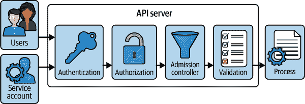
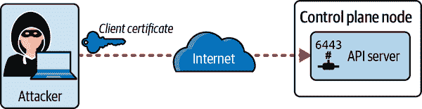
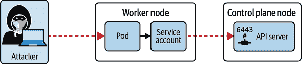
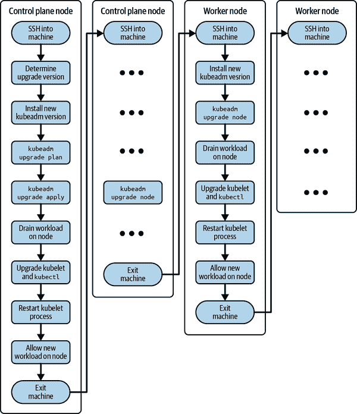

## 第 3 章. クラスタ・ハードニング

この作品はAIを使って翻訳されている。ご意見、ご感想をお待ちしている：translation-feedback@oreilly.com


「クラスタの堅牢化」という領域では、クラスタの初期設定と構成が完了したら、クラスタを可能な限り安全に保つために重要なトピックに触れる。この章の議論の一環として、通常 Kubernetes 管理者の手に落ちる概念やプラクティスを参照することに気づくかもしれない。必要に応じて、CKA 試験ですでにカバーされているトピックへのリンクを提供する。

この章では、高いレベルで以下の概念をカバーする：

*   Kubernetes APIへのアクセスを制限する
*   役割ベースのアクセス制御（RBAC）を設定し、露出を最小限に抑える
*   サービスアカウントの使用に注意を払う
*   Kubernetesを頻繁に更新する

### Kubernetes APIと対話する

APIサーバはKubernetesクラスタへのゲートウェイである。人間のユーザ、クライアント（例：`kubectl`）、クラスタコンポーネント、サービスアカウントは、HTTPS 経由でRESTful API 呼び出しを行うことでAPIサーバにアクセスする。Podの作成やServiceの削除といった演算子を実行するための中心*点*だ。

このセクションでは、APIサーバに関連するセキュリティ特有の側面にのみ焦点を当てる。APIサーバの内部構造とKubernetes APIの使用法に関する詳細な議論については、Brendan Burns 氏とCraig Tracey 氏による書籍『[*Managing Kubernetes*](https://learning.oreilly.com/library/view/managing-kubernetes/9781492033905)』（O'Reilly）を参照されたい。

#### リクエストを処理する

図 3-1は、APIサーバへの呼び出し時にリクエストが通過する段階を示している。参考までに、[Kubernetesのドキュメントに](https://oreil.ly/DuLdf)詳細な情報が発見できる。



リクエスト処理の最初の段階は*認証*である。認証は、クライアント証明書またはベアラートークンを検査する ことで、呼び出し元のIDを検証する。ベアラートークンがサービスアカウントに関連付け られている場合、それはここで検証される。

第 2ステージは、第 1ステージで提供されたIDが動詞とHTTPパスリクエストにアクセスできるかどうかを判断する。そのため、第 2ステージではリクエストの*認可を*扱うが、これは標準的なKubernetes RBACモデルで実装される。ここでは、リクエストされた内容であれば、サービスアカウントがPodのリストや新しいサービスオブジェクトの作成を許可されていることを確認する。

リクエスト処理の第三段階は、*アドミッション制御を*扱う。アドミッションコントロールは、リクエス トが処理される前に、リクエストが整形式であるかどうか、潜在的に修正さ れる必要があるかどうかを検証する。アドミッション制御ポリシーは、例えば、Pod 作成リクエストが特定のラベルの 定義を含むことを保証することができる。もしラベルが定義されていなければ、リクエストは拒否される。

プロセスの最後のステージは、リクエストに含まれるリソースが有効であるこ とを保証する。リクエストの*バリデーションは*アドミッション制御の一部として実装できるが、実装する必要はない。例えば、このステージでは、サービスオブジェクトの名前が、提供されるDNS 名に対する標準的なKubernetesの名前付け規則に準拠していることを保証する。

#### APIサーバに接続する

APIサーバーのエンドポイントは、以下を実行すれば簡単に特定できる：

```
$ kubectl cluster-info
Kubernetes control plane is running at https://172.28.40.5:6443
...
```

指定されたKubernetesクラスタでは、APIサーバはURL[*https://172.28.40.5:6443*](https://172.28.40.5:6443) を介して公開されている。あるいは、APIサーバの構成ファイルにあるコマンドラインオプション`--advertise-address` と`--secure-port` を見て、エンドポイントを決定することもできる。APIサーバーの構成ファイルは`/etc/kubernetes/manifests/kube-apiserver.yaml` で発見できる。

### APIサーバに安全でないポートを設定する

Kubernetes 1.10では、安全でないポート（例えば80）を使用するようにAPIサーバを設定する機能は廃止された。バージョン1.24では、安全でないポートフラグ`--port` と`--insecure-port` が完全に削除されたため、APIサーバの設定に使用できなくなった。詳細は[リリースノートを](https://oreil.ly/OTsmV)参照のこと。

#### Kubernetesサービスを使う

Kubernetesは、APIサーバへのアクセスを特定のユースケースで少し便利にする。例えば、PodからKubernetes APIにリクエストを送りたい場合がある。APIサーバのIPアドレスとポートを使う代わりに、`kubernetes.default.svc` という名前のServiceを参照すればいい。この特殊化 Serviceは`default` ネームスペースに存在し、クラスタによって自動的に立ち上げられる。サービスを削除すると、自動的に再作成される。このServiceは以下のコマンドで簡単に発見できる：

```
$ kubectl get service kubernetes
NAME         TYPE        CLUSTER-IP   EXTERNAL-IP   PORT(S)   AGE
kubernetes   ClusterIP   10.96.0.1    <none>        443/TCP   32s
```

このサービスのエンドポイントを調べると、APIサーバーのIPアドレスとポートを指していることがわかる：

```
$ kubectl get endpoints kubernetes
NAME         ENDPOINTS          AGE
kubernetes   172.28.40.5:6443   4m3s
```

サービスのIPアドレスとポートも、環境変数を通じてPodに公開される。環境変数の値は、コンテナ内で実行されているプログラムから読み取ることができる。サービスのIPアドレスは、環境変数`KUBERNETES_SERVICE_HOST` 。ポートには、環境変数`KUBERNETES_SERVICE_PORT` を使ってアクセスできる。環境をレンダリングするには、一時 Podで`env` コマンドを使って環境変数にアクセスするだけでよい：

```
$ kubectl run kubernetes-envs --image=alpine:3.16.2 -it --rm --restart=Never \
  -- env
KUBERNETES_SERVICE_HOST=10.96.0.1
KUBERNETES_SERVICE_PORT=443
```

サービスアカウントの権限を最小化する」のセクションで、`kubernetes` サービスを使用する。

#### 匿名アクセス

以下のコマンドは、`curl` コマンドラインツールを使用してAPIを匿名で呼び出し、すべてのネームスペースをリストする。オプション`-k` 、サーバのTLS 証明書の検証を回避する：

```
$ curl https://172.28.40.5:6443/api/v1/namespaces -k
{
  "kind": "Status",
  "apiVersion": "v1",
  "metadata": {},
  "status": "Failure",
  "message": "namespaces is forbidden: User \"system:anonymous\" cannot list \
              resource \"namespaces\" in API group \"\" at the cluster scope",
  "reason": "Forbidden",
  "details": {
    "kind": "namespaces"
  },
  "code": 403
}
```

JSON 形式のHTTPレスポンスボディからわかるように、匿名呼び出しはAPIサーバによって受け入れられるが、演算子に対する適切なパーミッションを持っていない。内部的には、Kubernetesはこの呼び出しを[ユーザー名`system:anonymous`](https://oreil.ly/_HrbF) にマッピングしており、事実上この操作を実行する権限がない。

#### クライアント証明書によるアクセス

認可ユーザとしてリクエストを行うには、新しいユーザを作成するか、`kubernetes-admin` という管理者権限を持つ既存のデフォルトユーザを使用する必要がある。ここでは、新規ユーザの作成プロセスは説明しない。ユーザ作成の詳細については、「ユーザ権限の制限」を参照のこと。

以下のコマンドは、クライアント証明書と鍵を含め、利用可能なすべてのユーザをリストする：

```
$ kubectl config view --raw
apiVersion: v1
clusters:
- cluster:
    certificate-authority-data: LS0tLS1CRUdJTiBDRVJUSUZJQ0FURS0tL... 
    server: https://172.28.132.5:6443
  name: kubernetes
contexts:
- context:
    cluster: kubernetes
    user: kubernetes-admin
  name: kubernetes-admin@kubernetes
current-context: kubernetes-admin@kubernetes
kind: Config
preferences: {}
users:
- name: kubernetes-admin 
  user:
    client-certificate-data: LS0tLS1CRUdJTiBDRVJUSUZJQ0FURS0tL... 
    client-key-data: LS0tLS1CRUdJTiBSU0EgUFJJVkFURSBLRVktL... 
```


: 

Base64エンコードされた認証局の値。


: 

デフォルトで作成される管理者権限を持つユーザエントリ。


: 

ユーザのクライアント証明書をbase64エンコードした値。


: 

ユーザの秘密鍵をbase64エンコードした値。

ユーザ`kubernetes-admin` を使用して呼び出しを行うには、CA、クライアント証明書、秘密鍵のbase64エンコード値をbase64デコード値としてファイルに抽出する必要がある。以下のコマンドは、base64エンコードされた値をコピーし、`base64` ツールを使用して、ファイルに書き込む前にデコードする。CA 値はファイル`ca` に、クライアント証明書値は`kubernetes-admin.crt` に、秘密鍵は`kubernetes-admin.key` に格納される：

```
$ echo LS0tLS1CRUdJTiBDRVJUSUZJQ0FURS0tL... | base64 -d > ca
$ echo LS0tLS1CRUdJTiBDRVJUSUZJQ0FURS0tL... | base64 -d > kubernetes-admin.crt
$ echo LS0tLS1CRUdJTiBSU0EgUFJJVkFURSBLRVktL... | base64 - \
> kubernetes-admin.key
```

これで、関連するコマンドラインオプションを指定して、`curl` コマンドをこれらのファイルに向けることができる。APIサーバへのリクエストは、`kubernetes-admin` が適切なパーミッションを持っているため、適切に認証され、既存のすべてのネームスペースが返されるはずである：

```
$ curl --cacert ca --cert kubernetes-admin.crt --key kubernetes-admin.key \
  https://172.28.132.5:6443/api/v1/namespaces
{
  "kind": "NamespaceList",
  "apiVersion": "v1",
  "metadata": {
    "resourceVersion": "2387"
  },
  "items": [
    ...
  ]
}
```

### APIサーバへのアクセスを制限する

APIサーバをインターネットに公開する場合、それが必要かどうか自問してみよう。一部のクラウドプロバイダは、APIサーバへのパブリックアクセスを制限または完全に無効にするプライベートクラスタを作成するオプションを提供している。詳細については、[EKSと](https://oreil.ly/W4Oma)[GKEの](https://oreil.ly/c7G-g)ドキュメントページを参照のこと。

オンプレミスのKubernetesクラスタを運用している場合は、APIサーバへのアクセスを防ぐファイアウォールルールをインスタンス化する必要がある。ファイアウォールルールのセットは試験範囲外なので、本書では説明しない。

#### シナリオ攻撃者はインターネットからAPIサーバを呼び出すことができる。

クラウドプロバイダーはAPIサーバをインターネットに公開し、管理アクセスを簡素化することがある。攻撃者はクライアント証明書やベアラートークンの提供を拒否することで、APIサーバのエンドポイントに匿名でリクエストを試みることができる。攻撃者が幸運にもユーザ資格情報を取得できれば、認証された呼び出しが実行できる。ユーザに代入された演算子によって、悪意のある操作が実行される可能性がある。図 3-2は、攻撃者がインターネットからAPIサーバを呼び出している様子を示している。



この章では、API サーバへのアクセスを制限する方法と、権限を制限した RBAC を実装する方法を、例を挙げて説明する。「オープン・ポリシー・エージェント(OPA)とゲートウェイを理解する」では、OPA ゲートウェイを利用したアドミッション・コントロールについて説明する。

#### ユーザ権限を制限する

Kubernetes APIへの呼び出しに`kubernetes-admin` ユーザの資格情報を使用できることを見てきた。このユーザ資格情報の使用は非常に控えめであるべきで、また資格情報を多くの人間と共有すべきではない。資格情報が悪人の手に渡ると、多くの損害が発生する可能性がある。このユーザはクラスタ管理を担当する人間専用に確保すること。

Kubernetesクラスタの他の関係者については、限定された権限セットを持つ専用ユーザを設定する必要がある。組織内でマッピングできる特定のロールがあるかもしれない。例えば、デプロイ、Pod、ConfigMaps、Secrets、Servicesの管理は許可するが、それ以外の管理は許可しない開発者ロールがあるかもしれない。新しいユーザを作成して関連するRBAC 権限を代入するには、[Kubernetesのドキュメントを](https://oreil.ly/n8EMD)参照する。簡単に言うと、4つのステップがある：

1.  秘密鍵を作成する。
2.  CertificateSigningRequest を作成し、承認する。
3.  RoleとRoleBindingを作成する。
4.  ユーザを[kubeconfigファイルに](https://oreil.ly/OKs9g)追加する。

このプロセスについて詳しく説明するが、サービスアカウントに関するRBAC 概念については、「サービスアカウントの権限を最小化する」で詳しく説明する。

##### 秘密鍵の作成

 `openssl` 実行ファイルを使用して秘密鍵を作成する。 などの式でファイル名を指定する：`<username>.key`


```
$ openssl genrsa -out johndoe.key 2048
Generating RSA private key, 2048 bit long modulus
...+
......................................................................+
e is 65537 (0x10001)
```

証明書署名要求（CSR）を、拡張子`.csr` のファイルに作成する。前のステップで秘密鍵を提供する必要がある。以下のコマンドでは、`Common Name` 値の入力を求められた場合、ユーザー名`johndoe` を使用する。その他の入力要求はすべて任意であり、必要に応じて入力できる：

```
$ openssl req -new -key johndoe.key -out johndoe.csr
You are about to be asked to enter information that will be incorporated
into your certificate request.
What you are about to enter is what is called a Distinguished Name or a DN.
There are quite a few fields but you can leave some blank
For some fields there will be a default value,
If you enter '.', the field will be left blank.
-----
Country Name (2 letter code) []:
State or Province Name (full name) []:
Locality Name (eg, city) []:
Organization Name (eg, company) []:
Organizational Unit Name (eg, section) []:
Common Name (eg, fully qualified host name) []:johndoe
Email Address []:

Please enter the following 'extra' attributes
to be sent with your certificate request
A challenge password []:
```

CSRファイル・コンテンツのbase64エンコード値を以下のコマンドで取得する。次のステップで`CertificateSigningRequest`オブジェクトを作成する際に必要になる：

```
$ cat johndoe.csr | base64 | tr -d "\n"
LS0tLS1CRUdJTiBDRVJUSUZJQ0FURSBSRVFVRVNULS0tL...
```

##### CertificateSigningRequestの作成と承認

以下のスクリプトは、`CertificateSigningRequest`オブジェクトを作成する。[`CertificateSigningRequest` リソースは](https://oreil.ly/ltFbE)、指定された署名者による証明書の署名を要求するために使用される：

```
$ cat <<EOF | kubectl apply -f -
apiVersion: certificates.k8s.io/v1
kind: CertificateSigningRequest
metadata:
  name: johndoe
spec:
  request: LS0tLS1CRUdJTiBDRVJUSUZJQ0FURSBSRVFVRVNULS0tL...
  signerName: kubernetes.io/kube-apiserver-client
  expirationSeconds: 86400
  usages:
  - client auth
EOF
certificatesigningrequest.certificates.k8s.io/johndoe created
```

属性`spec.signerName` の`kubernetes.io/kube-apiserver-client` の値は、APIサーバによってクライアント証明書として承認される証明書に署名する。前のステップでbase64エンコードされた値を使用し、それを属性`spec.request` の値として代入する。最後に、オプションの属性`spec.expirationSeconds` 、証明書の寿命を決定する。代入された値`86400` は、証明書の有効期限を1 日にする。証明書の有効期間をどの程度にしたいかによって、有効期間を長くするか、単に属性を追加しないようにする。

`CertificateSigningRequest` オブジェクトの作成後、条件付きは `Pending` となる。24 時間以内に署名要求を承認しないと、クラスタ内の不要なオブジェクトをガベージコレクションする手段として、オブジェクトは自動的に削除される：

```
$ kubectl get csr johndoe
NAME        AGE   SIGNERNAME                            REQUESTOR     \
  REQUESTEDDURATION   CONDITION
johndoe     6s    kubernetes.io/kube-apiserver-client   minikube-user \
  24h                 Pending
```

`certificate approve` 、署名要求を承認する。その結果、条件付きは `Approved,Issued` に変わる：

```
$ kubectl certificate approve johndoe
certificatesigningrequest.certificates.k8s.io/johndoe approved
$ kubectl get csr johndoe
NAME        AGE   SIGNERNAME                            REQUESTOR     \
  REQUESTEDDURATION   CONDITION
johndoe     17s   kubernetes.io/kube-apiserver-client   minikube-user \
  24h                 Approved,Issued
```

最後に、承認された`CertificateSigningRequest`オブジェクトから発行された証明書をエクスポートする：

```
$ kubectl get csr johndoe -o jsonpath={.status.certificate}| base64 \
  -d > johndoe.crt
```

##### 役割とRoleBindingの作成

いよいよRBAC 権限を代入する。このステップでは、ユーザの`Role`と`RoleBinding`を作成する。`Role`は、組織内の「アプリケーション開発者」の役割をモデル化する。開発者には、Podの取得、リスト表示、更新、削除のみが許可されるべきである。以下の命令コマンドで`Role`オブジェクトを作成する：

```
$ kubectl create role developer --verb=create --verb=get --verb=list \
  --verb=update --verb=delete --resource=pods
role.rbac.authorization.k8s.io/developer created
```

次に、`Role`を`johndoe` という名前のユーザにバインドする。そのためには、命令コマンド`create rolebinding` ：

```
$ kubectl create rolebinding developer-binding-johndoe --role=developer \
  --user=johndoe
rolebinding.rbac.authorization.k8s.io/developer-binding-johndoe created
```

##### kubeconfigファイルにユーザを追加する

この最後のステップでは、`kubeconfig`ファイルにユーザを追加し、ユーザ用のコンテキストを作成する必要がある。minikubeのインストールで試しているため、以下のコマンドではクラスタ名が`minikube` ：

```
$ kubectl config set-credentials johndoe --client-key=johndoe.key \
  --client-certificate=johndoe.crt --embed-certs=true
User "johndoe" set.
$ kubectl config set-context johndoe --cluster=minikube --user=johndoe
Context "johndoe" created.
```

##### パーミッションを確認する

`johndoe` という名前のユーザコンテキストに切り替える時だ：

```
$ kubectl config use-context johndoe
Switched to context "johndoe".
```

APIサーバへの呼び出しを行うクライアントとして`kubectl` 、その操作が許可されているはずであることを検証する。`default` ネームスペース内のすべてのPodをリストアップするAPI 呼び出しは認証認可された：

```
$ kubectl get pods
No resources found in default namespace.
```

このコマンドの出力は、`default` ネームスペースには現時点ではPodオブジェクトが含まれていないが、呼び出しは成功したことを示している。否定的なケースもテストしてみよう。名前空間のリストはユーザにとって許可されていない演算子である。該当する`kubectl` コマンドを実行すると、エラーメッセージが返ってくる：

```
$ kubectl get namespaces
Error from server (Forbidden): namespaces is forbidden: User "johndoe" cannot \
list resource "namespaces" in API group "" at the cluster scope
```

権限の確認が終わったら、管理者権限を持つコンテキストに戻るといいだろう：

```
$ kubectl config use-context minikube
Switched to context "minikube".
```

#### シナリオ 攻撃者はサービスアカウントからAPIサーバを呼び出すことができる。

ユーザは、`kubectl` 実行ファイルまたは UI ダッシュボードを使用して Kubernetes クラスタと対話するのが一般的な実在の人物を表す。まれな条件付きではあるが、Podのコンテナ内で実行されるアプリケーションがKubernetes APIと対話する必要がある。そのような要件の典型的な例は、パッケージマネージャの[Helm](https://helm.sh)だ。`Helm`は、`Helm`チャートにバンドルされたYAMLマニフェストに基づいてKubernetesリソースを管理する。Kubernetesは、認証トークンを介してAPIサーバと`Helm`サービスプロセスを認証するためにサービスアカウントを使用する。このサービスアカウントはPodに代入でき、RBAC 規則にマッピングできる。

Podへのアクセス権を得た攻撃者は、図 3-3に示すように、サービスアカウントを悪用してKubernetes APIへの呼び出しも行える可能性が高い。



#### サービスアカウントの権限を最小化する

アプリケーションを機能させるために本当に必要なサービスアカウントのみに権限を制限することが重要である。次のセクションでは、潜在的な攻撃対象領域を最小化するために、これを実現する方法を説明する。

このシナリオを機能させるには、`ServiceAccount`オブジェクトを作成し、それをPodに代入する必要がある。サービスアカウントはRBACと連携させることができ、`Role`と`RoleBinding`を割り当てて、実行を許可する演算子を定義することができる。

##### サービスアカウントをPodにバインドする

手始めに、Kubernetes APIを呼び出し、名前空間`k97` 、すべてのPodとデプロイメントをリストアップするPodをセットアップする。呼び出しは10 秒ごとに無限ループの一部として行われる。API 呼び出しからのレスポンスは、Podのログからアクセスできる標準出力に書き出される。

APIサーバに対して認証を行うために、Podが使用するサービスアカウントに関連付けられたベアラートークンを送信する。サービスアカウントのデフォルトの振る舞いは、API 資格情報をパス`/var/run/secrets/kubernetes.io/serviceaccount/token` に自動マウントすることである。`cat` コマンドラインツールを使ってファイルの内容を取得し、HTTP リクエストのヘッダとして送信する。例 3-1 では、名前空間、サービスアカウント、および Pod を 1 つの YAML マニフェストファイル`setup.yaml` で定義している。

###### 例 3-1. サービスアカウントを Pod に代入するための YAML マニフェスト

```
apiVersion: v1
kind: Namespace
metadata:
  name: k97
---
apiVersion: v1
kind: ServiceAccount
metadata:
  name: sa-api
  namespace: k97
---
apiVersion: v1
kind: Pod
metadata:
  name: list-objects
  namespace: k97
spec:
  serviceAccountName: sa-api
  containers:
  - name: pods
    image: alpine/curl:3.14
    command: ['sh', '-c', 'while true; do curl -s -k -m 5 -H \
              "Authorization: Bearer $(cat /var/run/secrets/kubernetes.io/ \
              serviceaccount/token)" https://kubernetes.default.svc.cluster. \
              local/api/v1/namespaces/k97/pods; sleep 10; done']
  - name: deployments
    image: alpine/curl:3.14
    command: ['sh', '-c', 'while true; do curl -s -k -m 5 -H \
              "Authorization: Bearer $(cat /var/run/secrets/kubernetes.io/ \
              serviceaccount/token)" https://kubernetes.default.svc.cluster. \
              local/apis/apps/v1/namespaces/k97/deployments; sleep 10; done']
```

以下のコマンドでYAMLファイルからオブジェクトを作成する：

```
$ kubectl apply -f setup.yaml
namespace/k97 created
serviceaccount/sa-api created
pod/list-objects created
```

##### デフォルトのパーミッションを確認する

`list-objects` という名前のPodがAPIサーバに呼び出しを行い、専用コンテナ内のPodとデプロイのリストを取得する。コンテナ は Pods をリストする呼び出しを実行する。コンテナ は、デプロイメントのリストを取得するリクエストを API サーバに送信する。`pods` `deployments`

[Kubernetesのドキュメントで](https://oreil.ly/gBp30)説明されているように、デフォルトのRBACポリシーは、`kube-system` 名前空間外のサービスアカウントにいかなる権限も付与しない。コンテナ`pods` と`deployments` のログは、サービスアカウント`sa-api` がリソースをリストする権限がないことを示すエラーメッセージを返す：


```
$ kubectl logs list-objects -c pods -n k97
{
  "kind": "Status",
  "apiVersion": "v1",
  "metadata": {},
  "status": "Failure",
  "message": "pods is forbidden: User \"system:serviceaccount:k97:sa-api\" \
              cannot list resource \"pods\" in API group \"\" in the \
              namespace \"k97\"",
  "reason": "Forbidden",
  "details": {
    "kind": "pods"
  },
  "code": 403
}
$ kubectl logs list-objects -c deployments -n k97
{
  "kind": "Status",
  "apiVersion": "v1",
  "metadata": {},
  "status": "Failure",
  "message": "deployments.apps is forbidden: User \
              \"system:serviceaccount:k97:sa-api\" cannot list resource \
              \"deployments\" in API group \"apps\" in the namespace \
              \"k97\"",
  "reason": "Forbidden",
  "details": {
    "group": "apps",
    "kind": "deployments"
  },
  "code": 403
}
```

次に、必要な呼び出しを実行するために必要な API 権限を持つ `ClusterRole` と `RoleBinding` オブジェクトを立ち上げます。

##### ClusterRole の作成

例 3-2 に示す `list-pods-clusterrole` という名前の `ClusterRole` をファイル `clusterrole.yaml` で定義することから始めます。規則のセットは `Pod` リソースと動詞 `list` を追加するだけです。

###### 例 3-2. Pod をリストできるようにする ClusterRole の YAML マニフェスト

```
apiVersion: rbac.authorization.k8s.io/v1
kind: ClusterRole
metadata:
  name: list-pods-clusterrole
rules:
- apiGroups: [""]
  resources: ["pods"]
  verbs: ["list"]
```

対応する YAML マニフェストファイルを指してオブジェクトを作成します：

```
$ kubectl apply -f clusterrole.yaml
clusterrole.rbac.authorization.k8s.io/list-pods-clusterrole created
```

##### RoleBinding の作成

例 3-3は`RoleBinding` の YAML マニフェストをファイル `rolebinding.yaml` で定義しています。`RoleBinding` は `ClusterRole` `list-pods-clusterrole` を `sa-pod-api` という名前のサービスアカウントにマッピングし、名前空間 `k97` にのみ適用されます。

###### 例 3-3. サービスアカウントにアタッチされた RoleBinding の YAML マニフェスト

```
apiVersion: rbac.authorization.k8s.io/v1
kind: RoleBinding
metadata:
  name: serviceaccount-pod-rolebinding
  namespace: k97
subjects:
- kind: ServiceAccount
  name: sa-api
roleRef:
  kind: ClusterRole
  name: list-pods-clusterrole
  apiGroup: rbac.authorization.k8s.io
```

`apply`、`RoleBinding` オブジェクトを作成します：

```
$ kubectl apply -f rolebinding.yaml
rolebinding.rbac.authorization.k8s.io/serviceaccount-pod-rolebinding created
```

##### 付与された権限を確認する

付与された `list` パーミッションにより、サービス・アカウントは `k97` ネームスペース内のすべての `Pod` を適切に取得できるようになりました。以下の出力に示すように、`pods` コンテナ内の `curl` コマンドは成功します：

```
$ kubectl logs list-objects -c pods -n k97
{
  "kind": "PodList",
  "apiVersion": "v1",
  "metadata": {
    "resourceVersion": "628"
  },
  "items": [
      {
        "metadata": {
          "name": "list-objects",
          "namespace": "k97",
          ...
      }
  ]
}
```

サービスアカウントには、他のリソースに対するパーミッションは与えていません。`k97` ネームスペースのデプロイメントのリストはまだ失敗しています。以下の出力は、`deployments` ネームスペースでの `curl` コマンドのレスポンスを示しています：

```
$ kubectl logs list-objects -c deployments -n k97
{
  "kind": "Status",
  "apiVersion": "v1",
  "metadata": {},
  "status": "Failure",
  "message": "deployments.apps is forbidden: User \
              \"system:serviceaccount:k97:sa-api\" cannot list resource \
              \"deployments\" in API group \"apps\" in the namespace \
              \"k97\"",
  "reason": "Forbidden",
  "details": {
    "group": "apps",
    "kind": "deployments"
  },
  "code": 403
}
```

`ClusterRole` オブジェクトを自由に変更して、デプロイオブジェクトもリストできるようにします。

##### サービスアカウントトークンの自動マウントを無効にする

前のセクションで説明した `Pod` は、API サーバーに対する認証手段としてサービス・アカウントのトークンを使用しました。トークン・ファイルを `/var/run/secrets/kubernetes.io/serviceaccount/token` にマウントするのは、どのサービス・アカウントでも標準的な振る舞いです。このファイルの内容が本当に必要になるのは、`Pod` が実際に Kubernetes API とやりとりする場合だけです。それ以外の場合、この振る舞いは、`Pod` へのアクセスが攻撃者をトークンに直接導くことになるため、潜在的なセキュリティリスクをもたらします。

例 3-4 に示すように、属性 `automountServiceAccountToken` に値 `false` を代入することで、サービスアカウントオブジェクトのオートマウントの振る舞いを無効にすることができます。

###### 例 3-4. サービスアカウントのトークン自動マウントの振る舞いをオプトアウトする

```
apiVersion: v1
kind: ServiceAccount
metadata:
  name: sa-api
  namespace: k97
automountServiceAccountToken: false
```

個々の `Pod` に対して自動マウントの振る舞いを無効にしたい場合は、`Pod` 定義で属性 `spec.automountServiceAccountToken` を使用します。例 3-5 に、`Pod` の YAML マニフェストを示します。

###### 例 3-5. Pod 内のサービスアカウントのトークン自動マウントを無効にする

```
apiVersion: v1
kind: Pod
metadata:
  name: list-objects
  namespace: k97
spec:
  serviceAccountName: sa-api
  automountServiceAccountToken: false
  ...
```

##### サービスアカウントトークンを生成する

トークンの自動マウントを*無効に*するサービスアカウントを作成したい理由には、様々なユースケースがあります。例えば、外部ツールや継続的デリバリ・パイプラインから Kubernetes API にアクセスし、既存のオブジェクトに関する情報をクエリする必要があるかもしれません。このようなシナリオで API サーバに対して認証を行う場合にも、トークンが必要となります。リストにあるシナリオは、必ずしも代入されたサービスアカウントで `Pod` を実行するわけではなく、`curl` のようなツールから RESTful API 呼び出しを実行するだけです。

トークンを手動で作成するには、`create token` コマンドを実行し、引数にサービスアカウント名を指定します。コマンドの出力がトークンを表示します：

```
$ kubectl create token sa-api
eyJhbGciOiJSUzI1NiIsImtpZCI6IjBtQkJzVWlsQjl...
```

トークンはパスワード・マネージャーなど安全な場所に保管する必要があります。トークンを紛失した場合、再度取り出すことはできません。同じコマンドでトークンを再作成することしかできませんが、その場合、以前のトークンは自動的に無効になります。トークンを使用している参照はすべて変更しなければなりません。

自動化されたプロセスでは、トークンの有効期限を設定しておくと便利です。`--duration`、「タイム・トゥ・ライフ」が過ぎるとトークンは自動的に無効になります：

```
$ kubectl create token sa-api --duration 10m
eyJhbGciOiJSUzI1NiIsImtpZCI6IjBtQkJzVWlsQjl...
```

##### サービスアカウントのシークレットを作成する

Kubernetes 1.24 では、`ServiceAccount` オブジェクトがトークンを含む対応する `Secret` オブジェクトを自動的に作成しなくなりました。詳細は[リリースノートを](https://oreil.ly/MSPuX)参照のこと。`ServiceAccount` オブジェクトをリストすると、`Secrets` の数が 0 になります。また、オブジェクトの YAML 表現に `secrets` 属性が含まれなくなりました：

```
$ kubectl get serviceaccount sa-api -n k97
NAME     SECRETS   AGE
sa-api   0         42m
```

サービスアカウントトークンの作成」で説明されているように、`create token` コマンドを使ってトークンを生成するか、対応するシークレットを手動で作成することができます。例 3-6はそのようなシークレットの YAML マニフェストを示しています。

###### 例 3-6. サービスアカウントのシークレットを手動で作成する

```
apiVersion: v1
kind: Secret
metadata:
  name: sa-api-secret
  namespace: k97
  annotations:
    kubernetes.io/service-account.name: sa-api
type: kubernetes.io/service-account-token
```

シークレットにサービスアカウントを代入するには、`kubernetes.io/service-account.name` というキーでアノテーションを追加します。以下のコマンドで `Secret` オブジェクトを作成します：

```
$ kubectl create -f secret.yaml
secret/sa-api-secret created
```

トークンは、シークレットオブジェクトを説明する際の"データ"セクションで発見することができます：

```
$ kubectl describe secret sa-api-secret -n k97
...
Data
====
ca.crt:     1111 bytes
namespace:  3 bytes
token:      eyJhbGciOiJSUzI1NiIsImtpZCI6IjBtQkJzVWlsQjl...
```

### Kubernetes を頻繁にアップデートする

特定のバージョンで Kubernetes クラスタをインストールすることは、1 回限りの Fire and Forget 演算子ではありません。インストール時に最新の LTS（Long-Term Support）リリースを使用したとしても、クラスタにセキュリティ脆弱性がないことを保証するものではありません。

時間が経つにつれて、セキュリティ関連のバグや弱点が発見されるでしょう。この文には、基盤となるオペレーティングシステムやクラスタノードが実行する依存関係が含まれます。攻撃者は、一般に公開されている[`CVE`](https://oreil.ly/FHhXD)（Common Vulnerabilities and Exposures）データベースでセキュリティ脆弱性を簡単に調べ、それを悪用することができます。

#### バージョニング・スキーム

すべてのノードで Kubernetes のバージョンを定期的に更新するのはクラスタ管理者次第です。Kubernetes は[セマンティック・バージョニング・スキームに従って](https://semver.org)います。セマンティックバージョンは、メジャーバージョン、マイナーバージョン、パッチバージョンで構成されます。例えば、Kubernetes バージョン `1.24.3` の場合、メジャーバージョンは `1`、マイナーバージョンは `24`、パッチバージョンは `3` となります。

バージョンの各部分は特定の意味を持ちます。メジャーバージョン部分の変更は破壊的変更を意味します。マイナーバージョン部分のインクリメントは、新しい関数が後方互換性をもって追加されたことを意味します。パッチバージョン部分は、単にバグを修正したものです。

### Kubernetes のマイナーバージョンアップに伴う破壊的変更

Kubernetes が常にセマンティック・バージョニングの厳密な解釈に固執するわけではないことに触れておくことは重要です。例えば、`PodSecurityPolicy`（`PSP`）アドミッションコントローラーは、[バージョン`1.25.`](https://oreil.ly/JE-i8)0 で `Pod Security Admission` 概念に置き換えられました。従来であれば、これらの変更はメジャーバージョンの更新でのみ発生するはずです。API、フラグ、または機能がどのように段階的に廃止されるかをよりよく理解するために、[Kubernetes の非推奨](https://oreil.ly/on9lu)ポリシーを参照すること。

#### リリース・ケイデンス

Kubernetes の[新しいマイナーバージョンリリースは](https://oreil.ly/LGIn5)3 カ月ごとに行われます。リリースには新機能や追加のバグ修正が含まれることがあります。Kubernetes の最新リリースでは必要に応じてセキュリティ修正が実装される可能性があり、その前の 2 つのマイナーリリースにバックポートされます。自分のクラスタのために常に最新リリースへのアップデートを続けるには、かなりの人的パワーが必要です。それに応じて、それらの活動のための時間を確保する必要があります。

#### アップグレードプロセスを実行する

マイナーバージョンから次の上位バージョンへ（例えば `1.23` から `1.24` へ）、またはパッチバージョンからより新しいバージョンへ（例えば `1.24.1` から `1.24.3` へ）アップグレードすることが推奨されます。予期せぬ副作用を避けるため、複数のマイナーバージョンをジャンプアップすることは控えること。

[アップグレード手順の](https://oreil.ly/RxC9j)詳細は、Kubernetes の公式ドキュメントで発見できます。図 3-4は、アップグレードのプロセスを高いレベルで示しています。


クラスタのバージョンアッププロセスは、すでにCKA 試験の一部である。前提条件としてCKAに合格する必要があることを考えると、このプロセスを実行する方法はすでに知っていると考えられる。詳しい説明は、[`Certified Kubernetes Administrator (CKA) Study Guideを`](https://oreil.ly/cka-study-guide)参照されたい。



### 概要

ユーザ、クライアントアプリケーション（`kubectl` や`curl` など）、サービスアカウントを使用するPod、クラスタコンポーネントはすべて、オブジェクトを管理するためにAPIサーバと通信する。悪意のあるアクセスを防ぐために、APIサーバをセキュアにすることが最も重要である。

攻撃対象領域を最小化するために、ファイアウォールルールを使用してAPIサーバをインターネットに公開しないようにする。すべてのユーザorサービスアカウントに対して、RBAC 規則を使用してKubernetes APIに対する演算実行権限を必要最低限に制限する。パーミッションが最小化されていれば、攻撃者が資格情報にアクセスできたとしても、被害ははるかに少なくなる。

Kubernetesクラスタのバージョンを必ずアップグレードすること。バグやセキュリティの修正を取り入れることで、攻撃者が利用できる不要な脆弱性をさらすリスクを減らすことができる。

### 試験の要点

Kubernetes APIとのやりとりを練習する。

この章では、Kubernetes APIと通信するさまざまな方法を示した。ユーザコンテキストに切り替えたり、`curl` を使用した RESTful API 呼び出しの助けを借りて API リクエストを実行した。APIサーバのエンドポイントを決定する方法と、クライアント資格情報やベアラートークンなどの異なる認証メソッドを使用する方法を理解する必要がある。Kubernetes APIとそのエンドポイントを各自で探索し、より広い範囲に触れる。

ユーザとサービスアカウントのRBAC 規則を定義することの意味を理解する。

匿名ユーザによるKubernetes APIへのリクエストは、実質的な演算子を許可しない。ユーザやサービスアカウントからのリクエストについては、対象者に付与されたパーミッションを注意深く分析する必要がある。パーミッションを制御するための関連オブジェクトを作成することで、RBAC 規則を定義する裏技を学ぼう。サービスアカウントは、Podで使用されるとトークンを自動マウントする。PodからAPI 呼び出しを行う場合のみ、トークンをVolumeとして公開する。

Kubernetesのリリース・ケイデンスとクラスタのアップグレードの必要性を認識しておく。

Kubernetesクラスタは、セキュリティ上の理由から長期にわたって手入れをする必要がある。攻撃者は、古いKubernetesバージョンの既知の脆弱性を利用しようとするかもしれない。バージョンのアップグレードプロセスはすべての管理者の仕事の一部であり、無視すべきではない。

### サンプル練習

これらの練習問題の解答は付録にある。

1. グループ`observer` のユーザ`jill` のクライアント証明書と鍵を作成する。adminコンテキストで、ユーザ`jill` のコンテキストを作成する。
2. グループ（ユーザではない！）に対して、`default` 名前空間に Role と RoleBinding を定義し、リソース Pods、ConfigMaps、Secrets に対して、`get` 、`list` 、`watch` という動詞を許可する。オブジェクトを作成する。
3. ユーザコンテキストに切り替え、許可された演算子の1つを許可する`kubectl` 、許可すべきでない`kubectl` コマンドを1つ実行する。`admin` 。
4. 名前空間`t23` に`service-list` という名前のPodを作成する。コンテナはイメージ`alpine/curl:3.14` を使用し、`default` 名前空間のサービスオブジェクトを無限ループでリスト作成する Kubernetes API への`curl` 呼び出しを行う。サービスアカウント`api-call` を作成し、アタッチする。Podが開始された後、コンテナのログを検査する。`curl` コマンドからどのようなレスポンスが期待できるか。
5. Podが必要とする演算子のみを許可するClusterRoleとRoleBindingをサービスアカウントに代入する。`curl` コマンドのレスポンスを見てみよう。
6. サービス・アカウント・トークンの自動マウントが無効になるようにPodを設定する。トークンの値を取得し、`curl` コマンドで直接使用する。`curl` コマンドがまだ演算子を認可できることを確認する。
7. チェックアウトしたGitHubリポジトリ[`bmuschko/cks-study-guideの`](https://oreil.ly/sImXZ)ディレクトリ`a/ch03/upgrade-versionに`移動する。`vagrant up` コマンドを使用して、クラスタを実行している仮想マシンを起動する。クラスタの全ノードをKubernetes 1.25.6から1.26.1にアップグレードする。このクラスタは、`kube-control-plane` という単一のコントロールプレーンノードと、`kube-worker-1` という単一のワーカーノードで構成されている。完了したら、`vagrant destroy -f` を使用してクラスタをシャットダウンする。

*前提条件*この演習には、[`Vagrantと`](https://oreil.ly/FiyeH) [`VirtualBoxの`](https://oreil.ly/WW8IK)インストールが必要である。
