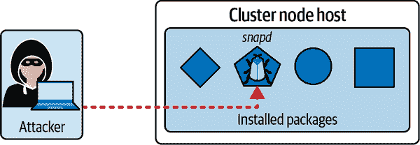
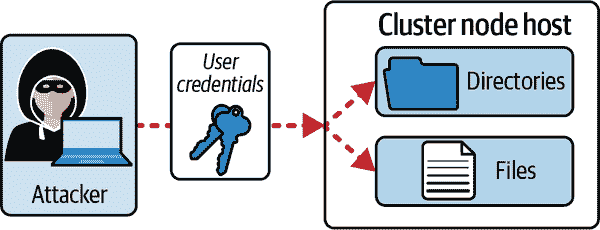

## 第 4 章. システム・ハードニング

この作品はAIを使って翻訳されている。ご意見、ご感想をお待ちしている：translation-feedback@oreilly.com

システムハードニング」の領域では、Kubernetesクラスタノードを実行する基盤となるホストシステムに関連するセキュリティの側面を扱う。ここで取り上げる関数は、基本的にLinuxのコア機能であるテクニックや設定オプションに触れている。これには、サービスの無効化とパッケージの削除、ユーザとグループの管理、ポートの無効化、ファイアウォールルールの設定などが含まれる。最後に、この章では、コンテナ内で動作するプロセスがホストレベルで実行できる演算子を制限できるLinuxカーネルハードニングツールについて説明する。

この章では、高いレベルで以下の概念をカバーする：

* ホストOSのフットプリントを最小限に抑える
* IAMの役割を最小限にする
* ネットワークへの外部アクセスを最小限に抑える
* AppArmorやseccompのようなカーネルハードニングツールを使用する。

### ホストOSのフットプリントを最小限に抑える

クラスタノードは物理マシンまたは仮想マシン上で動作する。ほとんどの場合、これらのマシン上の演算子はLinuxディストリビューションである。明らかに、オペレーティングシステムはセキュリティの脆弱性をさらす可能性がある。

時間をかけて、オペレーティング・システムのバージョンを最新のセキュリティ修正に対応させる必要がある。このプロセスには、例えばノードのオペレーティング・システムをUbuntu 18から22にアップグレードすることが含まれる。オペレーティングシステムのアップグレードは本書の範囲外である。詳細については、関連するLinuxのドキュメントを確認してほしい。

Ubuntuなど多くのLinuxディストリビューションには、Kubernetesクラスタの運用には必ずしも必要ではない追加のツール、アプリケーション、サービスが付属している。セキュリティリスクを特定し、脆弱性を暴露する可能性のあるオペレーティングシステム固有の機能を無効化または削除し、最新のセキュリティ修正を組み込むためにオペレーティングシステムにパッチを適用し続けることは、演算子としてのあなたの仕事だ。オペレーティングシステムの機能が少なければ少ないほど、リスクは小さくなる。

#### Ubuntu Linux 用 CISベンチマーク

リファレンス・ガイドとして、[`Ubuntu LinuxのCISベンチマークと`](https://oreil.ly/AeAAE)あなたのオペレーティング・システムの構成を比較するとよいだろう。

##### シナリオ攻撃者がパッケージの脆弱性を悪用する

図 4-1は、攻撃者がシステムにインストールされたパッケージの脆弱性を悪用する様子を示している。例えば、アプリケーションはパッケージマネージャの[`snapd`](https://oreil.ly/ZOFTj) である。この攻撃者は、機密情報を攻撃者に暴露する可能性のある既知の脆弱性[`USN-5292-1`](https://oreil.ly/lw_MV)を利用していると仮定する 。



以下では、Kubernetesの演算子としてあまり必要のないサービスやパッケージについて、無効化 or 削除するだけでセキュリティリスクを最小化する方法を説明する。

##### サービスを無効にする

Linuxでは、多くのアプリケーションがバックグラウンドでサービスとして実行される。サービスは、コマンドラインツール`systemctl` を使って管理することができる。次の`systemctl` コマンドは、実行中のサービスをすべてリストアップする：

```
$ systemctl | grep running
...
snapd.service   loaded active running   Snap Daemon
```

クラスタ・ノードの運用に不要なサービスの1つに、パッケージ・マネージャのsnapdがある。このサービスの詳細については、`status` サブコマンドを使用してステータスを取得する：

```
$ systemctl status snapd
● snapd.service - Snap Daemon
     Loaded: loaded (/lib/systemd/system/snapd.service; enabled; vendor \
     preset: enabled)
     Active: active (running) since Mon 2022-09-19 22:49:56 UTC; 30min ago
TriggeredBy: ● snapd.socket
   Main PID: 704 (snapd)
      Tasks: 12 (limit: 2339)
     Memory: 45.9M
     CGroup: /system.slice/snapd.service
             └─704 /usr/lib/snapd/snapd
```

`systemctl` サブコマンド`stop` を使ってサービスを停止することができる：

```
$ sudo systemctl stop snapd
Warning: Stopping snapd.service, but it can still be activated by:
  snapd.socket
```

 `disable` サブコマンドを実行し、システム再起動時にサービスが再び開始されないようにする：

```
$ sudo systemctl disable snapd
Removed /etc/systemd/system/multi-user.target.wants/snapd.service.
```

このサービスは現在停止され、無効になっている：

```
$ systemctl status snapd
● snapd.service - Snap Daemon
     Loaded: loaded (/lib/systemd/system/snapd.service; disabled; vendor \
     preset: enabled)
     Active: inactive (dead) since Mon 2022-09-19 23:22:22 UTC; 4min 4s ago
TriggeredBy: ● snapd.socket
   Main PID: 704 (code=exited, status=0/SUCCESS)
```

##### 不要なパッケージを削除する

サービスが無効になった今、パッケージを残しておく意味はもうない。パッケージを削除することで、追加のディスクスペースとメモリーを確保することができる。`apt purge` コマンドを使って、パッケージとその関連パッケージを削除することができる：

```
$ sudo apt purge --auto-remove snapd
Reading package lists... Done
Building dependency tree
Reading state information... Done
The following packages will be REMOVED:
  snapd* squashfs-tools*
0 upgraded, 0 newly installed, 2 to remove and 116 not upgraded.
After this operation, 147 MB disk space will be freed.
Do you want to continue? [Y/n] y
...
```

パッケージがサービスによって管理されていなくても、同じコマンドを使うことができる。不要なパッケージを特定し、単純に削除する。システムのフットプリントはずっとスリムになるはずだ。

潜在的な攻撃者は、システムを悪用するためにsnapdサービスを使用できなくなる。不要なサービスについては、このプロセスを繰り返す。その結果、snapdサービスはシステム上に存在しなくなる：

```
$ systemctl status snapd
Unit snapd.service could not be found.
```

### IAMロールを最小限にする

システム・レベルでのアイデンティティおよびアクセス管理（IAM）には、Linuxユーザ、所属グループ、およびユーザに付与されたパーミッションの管理が含まれる。どのようなディレクトリやファイルにも、ユーザに対してファイル・パーミッションが代入される。

ユーザとアクセスの適切な管理は、すべてのシステム管理者の古典的な責任である。Kubernetes 管理者としてのあなたの役割は、システムレベルのIAMには直接関わらないかもしれないが、セキュリティへの影響を理解することは重要だ。あなたはおそらく、Kubernetesクラスタを実行しているシステムを堅牢化するために、ピアと協力しなければならないだろう。

このセクションでは、ユーザとグループの管理方法について簡単に紹介する。また、アクセスをできるだけ少なくするために、ファイルのパーミッションと所有権をどのようにセットするかについても説明する。本書では、このトピックの表面をかすめるにすぎない。より詳細な情報については、お好きなLinuxのドキュメントを参照されたい。

#### シナリオ攻撃者が資格情報を使ってファイルにアクセスする

セキュリティ侵害は、ユーザ資格情報の盗難につながる可能性がある。有効なユーザ資格情報へのアクセスを得ることで、さらなる攻撃ベクトルへの扉が開かれる。図 4-2は、盗んだユーザ資格情報でクラスタ・ノードにログインし、ユーザに付与されたパーミッションですべてのファイルとディレクトリを対話できるようになった攻撃者を示している。



最小権限の原則に従うことが推奨される。限られたグループのユーザにのみ管理者権限を与える。それ以外のユーザには、自分の仕事を遂行するのに必要な演算子だけを許可する。

#### ユーザ管理を理解する

すべてのユーザは、システムを利用するために認証を受けなければならない。認証されたユーザは、代入された権限に基づいてリソースにアクセスできる。このセクションでは、ユーザを管理するために必要な主な演算子について説明する。

##### リストユーザ

システム上の全ユーザをリストアップするには、ファイル`/etc/passwd` の内容をレンダリングする。すべてのエントリは、一般的なパターン`username:password:UID:GID:com⁠ment:​home:shell` に従っている。パターン内のフィールドのいくつかは空かもしれない：

```
$ cat /etc/passwd
root:x:0:0:root:/root:/bin/bash
nobody:x:65534:65534:nobody:/nonexistent:/usr/sbin/nologin
...
```

コマンド出力は、出力の最初の位置にユーザrootを表示する。`root` ユーザーの文字列の最後の部分、`/bin/bash` は、そのユーザーが`bash` シェルでシステムにログインすることを許可されていることを示す。他のユーザは、ログインがまったく許可されていないかもしれない。そのようなユーザの場合、`shell` フィールドに`/usr/sbin/nologin` という文字列が代入されていることを発見する。

任意の時点で、どのプロセスがユーザによって起動されたかを見ることができる。次のコマンドは、`bash` の全プロセスを、それを起動したユーザーを含めて表示する：


```
$ ps aux | grep bash
root         956  0.0  0.4  22512 19200 pts/0    Ss   17:57   0:00 -bash
root        7064  0.0  0.0   6608  2296 pts/0    S+   18:08   0:00 grep \
--color=auto bash
```

##### ユーザを追加する

ある時点で、クラスタ・ノードが稼動しているマシンへのアクセス権を制限付きでチーム・メンバーに与えたいと思うかもしれない。`adduser`コマンドで新しいユーザをシステムに追加できる。フラグ`--shell /sbin/nologin`を追加して、ユーザのシェル・アクセスを無効にする。次のコマンドはユーザ`ben`を作成する：

```
$ sudo adduser ben
Adding user ‘ben’ ...
Adding new group ‘ben’ (1001) ...
Adding new user ‘ben’ (1001) with group ‘ben’ ...
Creating home directory ‘/home/ben’ ...
Copying files from ‘/etc/skel’ ...
New password:
Retype new password:
...
```

ユーザエントリがファイル`/etc/passwd`に追加された：

```
$ cat /etc/passwd
...
ben:x:1001:1001:,,,:/home/ben:/bin/bash
```

##### ユーザを切り替える

シェルのユーザを変更するには、`su`コマンドを使う。次のコマンドは、先ほど作成したユーザ`ben`に切り替える。ユーザのパスワードの入力を求められる：

```
$ su ben
Password:
ben@controlplane:/root$ pwd
/root
```

シェルはプロンプトで現在のユーザを示す。`su`コマンドを実行したときに使用したアカウントの環境変数を継承する。新しい環境を作成するには、`su`コマンドでハイフンを追加する：

```
$ su - ben
ben@controlplane:~$ pwd
/home/ben
```

ユーザを一時的に切り替えるもう一つの方法は、`sudo`コマンドを使うことである。このコマンドを実行するには、昇格権限が必要である。従って、`sudo`コマンドは「管理者としてこのコマンドを実行する」と等価性である：

```
$ sudo -u ben pwd
/root
```

##### ユーザを削除する

システム内のユーザに代表されるチームメンバーは、他のチームに移ったり、単に会社を去ったりする。資格情報の不正使用を防ぐために、ユーザへのアクセス権を失効させたい。以下のコマンドは、ユーザのホーム・ディレクトリを含め、ユーザを削除する：

```
$ sudo userdel -r ben
```

#### グループ経営を理解する

システム管理者にとっては、同様のアクセス要件を持つユーザをグループ化し、個々のユーザ・レベルでパーミッションをコントロールする方が便利である。Linuxシステムは、チームや特定の組織的役割に基づいてユーザを編成する方法として、グループという概念を提供している。ここでは、グループ管理の最も重要な側面について簡単に触れる。

##### リストグループ

グループのリストは、ファイル`/etc/group`の中身を見ることで確認できる。どのエントリも一般的なパターン`groupname:password:GID:group members`に従っている：

```
$ cat /etc/group
root:x:0:
plugdev:x:46:packer
nogroup:x:65534:
...
```

出力でわかるように、いくつかのフィールドは空かもしれない。代入メンバーがいる唯一のグループは、`plugdev`で、その名前は`packer`である。

##### グループを追加する

新しいグループを追加するには、`groupadd`というコマンドを使う。以下の例では、グループ`kube-developers`を追加している：

```
$ sudo groupadd kube-developers
```

これでグループは、ファイル`/etc/group`にリストされる。グループ識別子は1004である：

```
$ cat /etc/group
...
kube-developers:x:1004:
```

##### ユーザをグループに代入する

ユーザにグループを代入するには、`usermod`コマンドを使用する。以下のコマンドは、ユーザ`ben`をグループ`kube-developers`に追加する：

```
$ sudo usermod -g kube-developers ben
```

グループ識別子 1004は、グループ`kube-developers`の代用として機能する：

```
$ cat /etc/passwd | grep ben
ben:x:1001:1004:,,,:/home/ben:/bin/bash
```

##### グループを削除する

グループを完全に削除したい場合もある。もしかしたら、もう存在しないLinuxグループを参照している組織ロールがあるかもしれない。グループを削除するには、`groupdel`コマンドを使用する。メンバーがまだグループに属している場合は、エラーメッセージを受信する：

```
$ sudo groupdel kube-developers
groupdel: cannot remove the primary group of user ben
```

グループを削除する前に、`usermod`コマンドを使用して、グループメンバーを別のグループに再割り当てする必要がある。以下のコマンドは、グループを`kube-developers`から`kube-admins`に変更する。グループ`kube-admins`は以前に作成されていると仮定する：

```
$ sudo usermod -g kube-admins ben
$ sudo groupdel kube-developers
```

#### ファイルのパーミッションと所有権を理解する

可能な限り最小限のアクセスでファイル・パーミッションを代入することは、セキュリティを最大化する上で極めて重要である。ここでLinuxのファイル・パーミッションとオーナーシップが登場する。ここでは、関連する演算子について高いレベルで述べるにとどめる。詳しくは[Linux FoundationのLinuxファイル・パーミッションに関するブログ記事を](https://oreil.ly/3IpRT)参照されたい。

##### ファイルのパーミッションと所有権を表示する

ユーザは誰でも新しいディレクトリやファイルを作成できる。例えば、`touch`コマンドを使って空のファイルを作成することができる。次のコマンドは、カレント・ディレクトリに`my-file`という名前のファイルを作成する：

```
$ touch my-file
```

ディレクトリの内容を "long "形式で見るには、`ls`コマンドを使用する。`-l`コマンドラインパラメーターで要求される長い形式の出力は、ファイルのパラメータとファイルの所有者を表示する：

```
$ ls -l
total 0
-rw-r--r-- 1 root root 0 Sep 26 17:53 my-file
```

出力の重要な部分は`-rw-r--r--`である。最初の文字は、システムごとに異なる特殊化許可文字であり、その後に`rwx`という表記の3つのグループ分けが続く。最初の3 文字は所有者のパーミッションを表し、2つ目の3 文字のセットはグループのパーミッションを表し、最後の3 文字は全ユーザのパーミッションを表す。記号`r`は読み取りパーミッション、`w`は書き込みパーミッション、`x`は実行パーミッションを意味する。前の例では、ユーザー`root`はファイルの読み書きができるが、グループと他のすべてのユーザーはファイルを読むことしかできない。

##### ファイルの所有者を変更する

ファイルやディレクトリのユーザとグループの代入を変更するには、`chown`コマンドを使用する。コマンドの構文は`chown owner:group filename`のパターンに従う。次のコマンドは、ファイルの所有者をユーザ`ben`に変更するが、グループの再割り当ては行わない。`chown`コマンドを実行するユーザには書き込み権限が必要である：

```
$ chown ben my-file
$ ls -l
total 0
-rw-r--r-- 1 ben  root 0 Sep 26 17:53 my-file
```

##### ファイルのパーミッションを変更する

`chmod`、さまざまな表記でパーミッションの追加や削除ができる。例えば、ファイル所有者の書き込みパーミッションを削除するには、次のコマンドを使う：

```
$ chmod -w file1
$ ls -l
total 0
-r--r--r-- 1 ben  root 0 Sep 26 17:53 my-file
```

### ネットワークへの外部アクセスを最小限にする

クラスタノードへの外部からのアクセスは、Kubernetesの演算に必要なポートに対してのみ許可する必要がある。Kubernetesの標準ポートについては「ノードのメタデータとエンドポイントの保護」ですでに説明した。それ以外のポートへのアクセスはブロックする必要がある。

#### 開いているポートを特定し、無効にする

FTPサーバ、ウェブサーバ、Sambaのようなファイルやプリントサービスのようなアプリケーショ
ンは、クライアントに通信エンドポイントを公開する手段としてポートを開いている。ネットワーク通信をオープンにするアプリケーションを実行すると、セキュリティリスクにさらされる可能性がある。サービスを無効にし、アプリケーションをデインストールするだけで、リスクを排除できる。

例えば、以下のコマンドでコントロールプレーンノードに[Apache 2 HTTPウェブサーバーをインストール](https://oreil.ly/t-np3)したとしよう：

```
$ sudo apt update
$ sudo apt install apache2
```

##### netstatコマンドについて更新

`netstat`コマンドは、より高速で人間にとって読みやすい`ss`コマンドに取って代わられ、廃止された。詳細については、使用しているオペレーティングシステムのドキュメントを参照のこと。

`netstat`と同様の機能を持つユーティリティである、コマンドラインツール`ss`を使って、すべてのオープンポートを検査することができる。以下のコマンドは、プロセスも含めて、すべてのオープンポートを表示する。その中に、Apache 2が公開しているポート80がある：

```
$ sudo ss -ltpn
State    Recv-Q   Send-Q   Local Address:Port   Peer Address:Port   Process
...
LISTEN   0        511      *:80                 *:*                 users: \
(("apache2",pid=18435,fd=4),("apache2",pid=18434,fd=4),("apache2", ]\
pid=18432,fd=4))
```

一時的にウェブサーバが必要になっただけで、インストールするのを忘れてしまっただけかもしれない。このプロセスは現在、サーバによって管理されている。サービスの状態は、`systemctl status`コマンドで確認できる：

```
$ sudo systemctl status apache2
● apache2.service - The Apache HTTP Server
     Loaded: loaded (/lib/systemd/system/apache2.service; enabled; vendor \
     preset: enabled)
     Active: active (running) since Tue 2022-09-20 22:25:25 UTC; 39s ago
       Docs: https://httpd.apache.org/docs/2.4/
   Main PID: 18432 (apache2)
      Tasks: 55 (limit: 2339)
     Memory: 5.6M
     CGroup: /system.slice/apache2.service
             ├─18432 /usr/sbin/apache2 -k start
             ├─18434 /usr/sbin/apache2 -k start
             └─18435 /usr/sbin/apache2 -k start
```

Apache 2はKubernetesには必要ない。サービスを停止し、パッケージをデインストールすることにした：

```
$ sudo systemctl stop apache2
$ sudo systemctl disable apache2
Synchronizing state of apache2.service with SysV service script with \
/lib/systemd/systemd-sysv-install.
Executing: /lib/systemd/systemd-sysv-install disable apache2
Removed /etc/systemd/system/multi-user.target.wants/apache2.service.
$ sudo apt purge --auto-remove apache2
```

そのポートがもう使われていないことを確認する。`ss`、ポート80を公開しているアプリケーションが発見されない：

```
$ sudo ss -ltpn | grep :80
```

#### ファイアウォールルールのセットアップ

ポートを制御するもう1つの方法は、演算子レベルのファイアウォールの助けを借りることだ。Linuxでは、[Uncomplicated Firewall（UFW](https://oreil.ly/iqiwv)）を使うことができる。このセクションでは、UFWを有効にする方法とファイアウォールの規則を設定する方法について、ごく簡単に紹介する。

最小権限の原則に従い、まずファイアウォールを有効にして*、*送受信されるネットワーク・トラフィックの拒否規則を設定するのがよいだろう。以下のコマンドは、そのための手順を示している：

```
$ sudo ufw allow ssh
Rules updated
Rules updated (v6)
$ sudo ufw default deny outgoing
Default outgoing policy changed to deny
(be sure to update your rules accordingly)
$ sudo ufw default deny incoming
Default incoming policy changed to deny
(be sure to update your rules accordingly)
$ sudo ufw enable
Command may disrupt existing ssh connections. Proceed with operation (y|n)? y
Firewall is active and enabled on system startup
```

`kubectl`のような外部ツールが、ポート`6443`で実行されているAPIサーバーに接続できるようにしたい。コントロールプレーンノードで以下のコマンドを実行し、APIサーバーポートへのアクセスを許可する：

```
$ sudo ufw allow 6443
Rule added
Rule added (v6)
```

コントロールプレーンとワーカーノードの他のポートを開放するために、同じプロセスを繰り返す必要がある。Kubernetesの演算子に必要のない他のポートがすべてブロックされていることを確認する。

### カーネルハードニングツールを使う

コンテナ内で実行されるアプリケーションやプロセスは、システム呼び出しを行うことができる。典型的な例は、HTTPリクエストを実行する`curl`コマンドである。システム呼び出しは、カーネルにサービスを要求するための、ユーザ空間で実行されるプログラム抽象化である。カーネルハードニングツールの助けを借りて、どのシステムコールの実行を許可するかを制限することができる。CKS 試験では、この分野でAppArmorとseccompという2つのツールについて明確に言及している。この2つのツールと、それらをKubernetesと統合する仕組みについて説明する。

#### AppArmorを使用する


[AppArmorは](https://apparmor.net)、Linuxシステム上で動作するプログラミングへのアクセス制御を提供する。このツールは、ユーザ空間で呼び出されるアプリケーションと、基盤となるシステム機能との間に、追加のセキュリティ・レイヤーを実装する。例えば、ネットワーク呼び出しやファイルシステムとのやり取りを制限することができる。多くのLinuxディストリビューション（Debian、Ubuntu、openSUSEなど）には、すでにAppArmorが同梱されている。そのため、AppArmorを手動でインストールする必要はない。AppArmorをサポートしていないLinuxディストリビューションは、代わりに[Security-EnhancedLinux（SELinux](https://oreil.ly/CKBr7)）を使用し、AppArmorと同様のアプローチを取る。SELinuxを理解することは、CKS 試験の範囲外である。

#### プロファイルを理解する

プログラムができること、またはできないことを定義する規則は、AppArmorプロファイルで定義される。すべてのプロファイルは、有効にする前にAppArmorにロードする必要がある。AppArmorには、ロードされたプロファイルを確認するためのコマンドラインツールが用意されている。コマンド`aa-status`を実行すると、ロードされたすべてのプロファイルの概要が表示される。AppArmorには、Linuxサービスを保護するためのデフォルト・アプリケーション・プロファイルのセットがすでに用意されていることがわかる：

```
$ sudo aa-status
apparmor module is loaded.
31 profiles are loaded.
31 profiles are in enforce mode.
   /snap/snapd/15177/usr/lib/snapd/snap-confine
   ...
0 profiles are in complain mode.
14 processes have profiles defined.
14 processes are in enforce mode.
   /pause (11934) docker-default
   ...
0 processes are in complain mode.
0 processes are unconfined but have a profile defined.
```

プロファイル・モードは、一致するイベントが発生した場合の、実行時の規則の処理を決定する。AppArmorは2 種類のプロファイルモードを区別する：

**強制する**

: 

システムは規則を実行し、違反を報告し、それをsyslogに書き込む。このモードは、プログラムが特定の呼び出しを行えないようにするために使用する。

**苦情を言う**

: 

システムは規則を強制しないが、違反はログに書き込む。このモードは、プログラムが行う呼び出しを発見したい場合に役立つ。

例 4-1は、ファイルの書き込みアクセスを制限するためのカスタムプロファイルをファイル`k8s-deny-write`で定義している。このファイルは、ワークロードを実行するすべてのワーカーノードのディレクトリ`/etc/apparmor.d`に置かれるべきである。すべての規則を詳細に説明することは、本書の範囲外である。詳細については、[AppArmor wikiを](https://oreil.ly/mNuWB)参照のこと。

##### 例 4-1. ファイル書き込みアクセスを制限するためのAppArmorプロファイル

```
#include <tunables/global>

profile k8s-deny-write flags=(attach_disconnected) { 
  #include <abstractions/base>

  file, 

  deny /** w, 
}
```


: 

`profile`キーワードの後の識別子は、プロファイルの名前である。


: 

ファイル演算子に適用する。


: 

すべてのファイルの書き込みを拒否する。

#### カスタムプロファイルをセットする

プロファイルをAppArmorにロードするには、ワーカー・ノードで以下のコマンドを実行する：

```
$ sudo apparmor_parser /etc/apparmor.d/k8s-deny-write
```

コマンドはデフォルトでenforceモードを使用する。不満モードでプロファイルをロードするには、`-C`オプションを使用する。`aa-status`コマンドは、デフォルトのプロファイルに加えてプロファイルをリストする。出力でわかるように、プロファイルはenforceモードでリストされる：

```
$ sudo aa-status
apparmor module is loaded.
32 profiles are loaded.
32 profiles are in enforce mode.
   k8s-deny-write
   ...
```

AppArmorは、ユーティリティ・パッケージの一部として、追加の便利コマンドをサポートしている。これらを使用したい場合は、以下のコマンドを使用してパッケージを手動でインストールすることができる：

```
$ sudo apt-get update
$ sudo apt-get install apparmor-utils
```

一度インストールすれば、`aa-enforce`というコマンドで強制モードでプロファイルをロードすることができ、`aa-complain`というコマンドで文句モードでプロファイルをロードすることができる。試験では、標準の`apparmor_parser`。

#### コンテナにプロファイルを適用する

Pod 定義でAppArmor 規則を使用する前に、いくつかの前提条件を確認する必要がある。まず、規則を有効にするには、コンテナ・ランタイムがAppArmorをサポートしている必要がある。さらに、Podを実行するワーカー・ノードにAppArmorがインストールされている必要がある。最後に、前のセクションで説明したように、プロファイルをロードしたことを確認する。

例 4-2は、ファイル`pod.yaml`で定義されたPodのYAMLマニフェストを示している。コンテナにプロファイルを適用するには、特定の注釈をセットする必要がある。注釈キーは`container.apparmor.security.beta.kubernetes.io/<container-name>`という形式のキーを使用する必要がある。この場合、コンテナ名は`hello`である。完全なキーは`container.apparmor.security.beta.kubernetes.io/hello`である。注釈の値は`localhost/<profile-name>`というパターンに従う。ここで使用したいカスタムプロファイルは`k8s-deny-write`である。設定オプションの詳細については、[Kubernetesのドキュメントを](https://oreil.ly/1o3zO)参照のこと。

##### 例 4-2. コンテナにAppArmorプロファイルを適用するPod

```
apiVersion: v1
kind: Pod
metadata:
  name: hello-apparmor
  annotations:
    container.apparmor.security.beta.kubernetes.io/hello: \ 
    localhost/k8s-deny-write 
spec:
  containers:
  - name: hello 
    image: busybox:1.28
    command: ["sh", "-c", "echo 'Hello AppArmor!' && sleep 1h"]
```


: 

ハードコードされたプレフィックスと、スラッシュ文字で区切られたコンテナ名からなる注釈キー。


: 

`localhost`で示される、現在のノードで利用可能なプロファイル名。


: 

コンテナ名。

Podを作成する準備ができた。`apply`コマンドを実行し、YAMLマニフェストをポイントする。Podが「Running」ステータスに遷移するまで待つ：

```
$ kubectl apply -f pod.yaml
pod/hello-apparmor created
$ kubectl get pod hello-apparmor
NAME             READY   STATUS    RESTARTS   AGE
hello-apparmor   1/1     Running   0          4s
```

これでコンテナにシェルで入り、ファイル書き込み操作を実行できる：

```
$ kubectl exec -it hello-apparmor -- /bin/sh
/ # touch test.txt
touch: test.txt: Permission denied
```

AppArmorは、コンテナのファイルシステムへのファイルの書き込みを阻止する。この操作を実行しようとすると、"Permission denied "というメッセージが表示される。

### seccompを使う

Seccompは「セキュア・コンピューティング・モード」の略で、ユーザー空間からカーネルへの呼び出しを制限できるLinuxカーネルのもう1つの機能である。seccompプロファイルは、システムコールとその引数を制限する規則を定義するメカニズムである。seccompを使うことで、Linuxカーネルの脆弱性を悪用するリスクを減らすことができる。Kubernetesにおけるseccompの詳細については、[ドキュメントを](https://oreil.ly/B8I5L)参照のこと。

#### デフォルトのコンテナランタイムプロファイルをコンテナに適用する

Docker Engineやcontainerdなどのコンテナランタイムには、デフォルトのseccompプロファイルが同梱されている。デフォルトのseccompプロファイルは、アプリケーションでよく使われるシステムコールを許可し、同時に危険とみなされるシステムコールの使用を禁止している。

KubernetesはPod 作成時にデフォルトのコンテナランタイムプロファイルをコンテナに適用しないが、`SeccompDefault`[feature gateを](https://oreil.ly/m9g0G)使用して有効にすることができる。`seccompProfile`あるいは、セキュリティコンテキスト属性（seccomp profile type）を`RuntimeDefault`に設定することで、Podごとにこの機能を有効にすることもできる。例 4-3はその使い方を示している。

##### 例 4-3. コンテナランタイムプロファイルが提供するデフォルトのseccompプロファイルを適用するPod

```
apiVersion: v1
kind: Pod
metadata:
  name: hello-seccomp
spec:
  securityContext:
    seccompProfile:
      type: RuntimeDefault 
  containers:
  - name: hello
    image: busybox:1.28
    command: ["sh", "-c", "echo 'Hello seccomp!' && sleep 1h"]
```


: 

デフォルトのコンテナランタイムプロファイルを適用する。

`apply`、YAMLマニフェストをポイントしてPodを起動できる。Podは "Running "ステータスに移行するはずだ：

```
$ kubectl apply -f pod.yaml
pod/hello-seccomp created
$ kubectl get pod hello-seccomp
NAME            READY   STATUS    RESTARTS   AGE
hello-seccomp   1/1     Running   0          4s
```

コンテナ内で実行される`echo`コマンドは、デフォルトのseccompプロファイルでは、セキュリティの観点から問題がないとみなされている。以下のコマンドは、コンテナのログを検査する：

```
$ kubectl logs hello-seccomp
Hello seccomp!
```

呼び出しは許可され、"Hello seccomp!"というメッセージが標準出力に書き出された。

#### カスタムプロファイルをセットする

デフォルトのコンテナ・ランタイム・プロファイルに加えて、独自のカスタム・プロファイルを作成してセットすることができる。これらのファイルの標準ディレクトリは`/var/lib/kubelet/seccomp`である。カスタム・プロファイルは、サブディレクトリ`profiles`に整理する。ディレクトリがまだ存在しない場合は作成する：

```
$ sudo mkdir -p /var/lib/kubelet/seccomp/profiles
```

カスタム・プロファイルはprofileディレクトリのファイル`mkdir-violation.json`に作成することにする。例 4-4にプロファイル定義の詳細を示す。一言で言えば、この規則セットは`mkdir`システムコールの使用を許可しない。

##### 例 4-4. `mkdir`システムコールの実行を防ぐseccompプロファイル

```
{
    "defaultAction": "SCMP_ACT_ALLOW", 
    "architectures": [ 
        "SCMP_ARCH_X86_64",
        "SCMP_ARCH_X86",
        "SCMP_ARCH_X32"
    ],
    "syscalls": [
        {
            "names": [
                "mkdir"
            ],
            "action": "SCMP_ACT_ERRNO" 
        }
    ]
}
```


: 

デフォルトの動作は、すべてのシステム呼び出しに適用される。ここでは、`SCMP_ACT_ALLOW`を使ったすべてのシステムコールを許可することにする。


: 

デフォルトのアクションが適用されるべき特定のアーキテクチャをフィルタリングできる。フィールドの定義は任意である。


: 

デフォルトのアクションは、より細かい規則を宣言することで上書きできる。`SCMP_ACT_ERRNO`アクションは、`mkdir`システムコールの実行を阻止する。

カスタムプロファイルをディレクトリ`/var/lib/kubelet/seccomp`に配置しても、その規則が自動的にPodに適用されるわけではない。それを使用するには、まだPodを設定する必要がある。

#### コンテナにカスタムプロファイルを適用する

カスタムプロファイルの適用は、わずかな違いはあるものの、デフォルトのコンテナ実行時プロファイルの適用と同じようなパターンに従う。例 4-5を見るとわかるように、セキュリティ・プロファイルの`seccompProfile`属性をファイル`mkdir-violation.json`に指定し、タイプを`Localhost`に設定している。

##### 例 4-5. カスタムのseccompプロファイルを適用したPodが`mkdir`のシステムコールを防ぐ。


```
apiVersion: v1
kind: Pod
metadata:
  name: hello-seccomp
spec:
  securityContext:
    seccompProfile:
      type: Localhost 
      localhostProfile: profiles/mkdir-violation.json 
  containers:
  - name: hello
    image: busybox:1.28
    command: ["sh", "-c", "echo 'Hello seccomp!' && sleep 1h"]
    securityContext:
      allowPrivilegeEscalation: false
```


: 

現在のノードのプロファイルを指す。


: 

サブディレクトリ`profiles` にある`mkdir-violation.json` という名前のプロファイルを適用する。

宣言的な`apply`・コマンドを使ってPodを作成する。Podが「Running」ステータスに移行するまで待つ：

```
$ kubectl apply -f pod.yaml
pod/hello-seccomp created
$ kubectl get pod hello-seccomp
NAME            READY   STATUS    RESTARTS   AGE
hello-seccomp   1/1     Running   0          4s
```

コンテナにシェルを入れ、seccompが適用された規則を正しく実行していることを確認する：

```
$ kubectl exec -it hello-seccomp -- /bin/sh
/ # mkdir test
mkdir: can't create directory test: Operation not permitted
```

出力でわかるように、`mkdir` コマンドを実行しようとすると、演算子はエラーメッセージを表示する。カスタムプロファイルの規則に違反している。

### 概要

セキュリティ面への対応は、Kubernetesクラスタのコンポーネントやワークロードに限ったことではない。ホストシステムレベルでもできることはたくさんある。我々は、潜在的なセキュリティの脆弱性を最小化するための様々なOSの機能とその使い方について議論した。

多くのオペレーティングシステムには、エンドユーザにより豊富な機能を体験してもらうために、豊富なパッケージやサービスが用意されている。Kubernetesクラスタの運用に不要な機能を見極めることが重要だ。不要なパッケージやサービスは厳格に削除し、必要のないポートは閉じる。また、特定のディレクトリ、ファイル、アプリケーションへのアクセスを許可するユーザを限定したい。Linuxのユーザ管理を使ってパーミッションを制限しよう。

コンテナ内で実行されるアプリケーションやプロセスがシステム呼び出しを行うのは、ごく一般的なことだ。AppArmorやseccompのようなLinuxカーネルハードニングツールを使って、これらの呼び出しを制限することができる。コンテナを実行するアプリケーションのニーズを満たすために不可欠なシステム呼び出しだけを許可する。

### 試験の要点

Linux OSのツールの基本を理解している。

: 

CKS 試験は主にKubernetesのセキュリティ機能に関数している。この領域はLinux OSのセキュリティ機能との境界を越えている。この章で扱う内容とは別に、Linux 特有のツールやセキュリティの側面を調べておいても損はないだろう。高いレベルでは、Linux 上のサービス、パッケージ、ユーザ、ネットワーク管理に慣れ親しもう。

LinuxカーネルハードニングツールをKubernetesに統合する方法を知る。

: 

AppArmorとseccompは、コンテナからのシステム呼び出しを制限するためにKubernetesと統合できるカーネルハードニングツールにすぎない。プロファイルをロードしてコンテナに適用するプロセスを練習する。視野を広げるために、[SELinuxや](https://oreil.ly/DrGbB) [sysctlなど](https://oreil.ly/GyUoc)、Kubernetesと一緒に動作する他のカーネル機能を調べるのもよいだろう。

### サンプル練習

これらの練習問題の解答は付録にある。

1. チェックアウトしたGitHubリポジトリ[`bmuschko/cks-study-guide`](https://oreil.ly/sImXZ)の `app-a/ch04/close-ports`ディレクトリに移動する。`vagrant up` コマンドを使って、クラスタを実行している仮想マシンを立ち上げる。このクラスタは、`kube-control-plane` という単一コントロールプレーンノードと、`kube-worker-1` というワーカーノードから構成される。終了したら、`vagrant destroy -f` を使ってクラスタをシャットダウンする。

仮想マシンのポート21でリッスンしているプロセスを特定する`kube-worker-1` 。攻撃者がこのポートを悪用するリスクを減らすために、このポートを公開しないことにした。対応するプロセスをシャットダウンして、ポートを閉じる。

*前提条件*この演習には、[Vagrantと](https://oreil.ly/FiyeH) [VirtualBoxの](https://oreil.ly/WW8IK)インストールが必要である。

2. チェックアウトしたGitHubリポジトリ[`bmuschko/cks-study-guide`](https://oreil.ly/sImXZ)ディレクトリ`app-a/ch04/apparmor`に移動する。`vagrant up` コマンドを使用して、クラスタを実行している仮想マシンを起動する。このクラスタは、`kube-control-plane` という単一コントロールプレーンノードと、`kube-worker-1` というワーカーノードから構成される。終了したら、`vagrant destroy -f` を使ってクラスタをシャットダウンする。

`network-deny` という名前のAppArmorプロファイルを作成する。このプロファイルは、ネットワークトラフィックの送受信を防止する必要がある。このプロファイルを、enforceモードのAppArmor 規則のセットに追加する。`default` 名前付けで実行されている`network-call` という名前の Pod にプロファイルを適用する。Podのログをチェックして、ネットワーク呼び出しができなくなったことを確認する。

*前提条件*この演習には、[Vagrantと](https://oreil.ly/FiyeH) [VirtualBoxの](https://oreil.ly/WW8IK)インストールが必要である。

3. チェックアウトしたGitHubリポジトリ[`bmuschko/cks-study-guide`](https://oreil.ly/sImXZ) `app-a/ch04/seccomp`ディレクトリに移動する。`vagrant up` コマンドを使用して、クラスタを実行している仮想マシンを起動する。このクラスタは、`kube-control-plane` という単一コントロールプレーンノードと、`kube-worker-1` というワーカーノードから構成される。終了したら、`vagrant destroy -f` を使ってクラスタをシャットダウンする。

標準のseccompディレクトリのすべてのシステムコールをログに記録する、`audit.json` という名前のseccompプロファイルファイルを作成する。このプロファイルを、`default` 名前空間で実行されている`network-call` というPodに適用する。ログファイル`/var/log/syslog` のログエントリを確認する。

*前提条件*この演習には、[Vagrantと](https://oreil.ly/FiyeH) [VirtualBoxの](https://oreil.ly/WW8IK)インストールが必要である。

4. イメージ`nginx:1.23.1` で、`sysctl-pod` という名前の新規 Podを作成する。sysctlパラメータ`net.core.somaxconn` を1024に、`debug.iotrace` を`1` にセットする。Podのステータスをチェックする。
