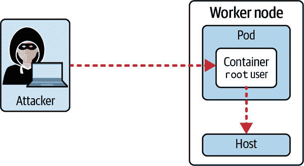
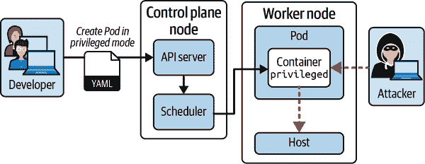
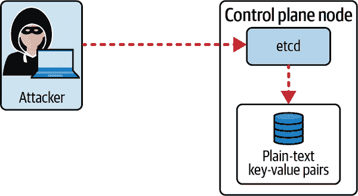
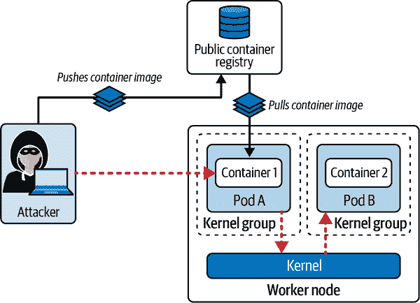
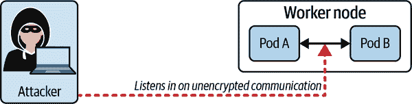

## 第 5 章 マイクロサービスの脆弱性を最小化する

この作品はAIを使って翻訳されている。ご意見、ご感想をお待ちしている：translation-feedback@oreilly.com

Kubernetesクラスタで運用されるアプリケーションスタックは、マイクロサービスアーキテクチャに従うことが多い。マイクロサービスの脆弱性を最小化する」というドメインは、Podレベルでのセキュリティ設定のガバナンスと実施をカバーする。Kubernetesのコア機能と、セキュリティの脆弱性を最小化するのに役立つ外部ツールについて触れる。さらに、マイクロサービスを実行するPod 間の暗号化されたネットワーク通信についても話す。

この章では、高いレベルで以下の概念をカバーする：

* セキュリティコンテキスト、Pod Security Admission（PSA）、Open Policy Agent Gatekeeper を使用して、適切な OS レベルのセキュリティドメインを設定する
* 秘密を管理する
* gVisorやKata Containersなどのコンテナランタイムサンドボックスを使用する。
* 相互 TLS（Transport Layer Security）によるPod 間通信暗号化の実装

### 適切なOSレベルのセキュリティドメインをセットする

コアKubernetesとKubernetesエコシステムの両方が、Podとコンテナレベルでセキュリティ設定を定義、実施、管理するためのソリューションを提供している。本セクションでは、セキュリティコンテキスト、Podセキュリティアドミッション、Open Policy Agent Gatekeeperについて説明する。各機能やツールの適用方法については、セキュリティにおける重要性を示す例を用いて学習する。まず、シナリオを設定することから始めよう。

#### シナリオ攻撃者がルートユーザコンテナアクセスを悪用する

デフォルトでは、コンテナはルート権限で実行される。アプリケーションコンテナに脆弱性があると、攻撃者にコンテナへのアクセス権（`root` ）を与える可能性がある。コンテナのルートユーザは、ホストマシンのルートユーザと同じである。攻撃者は、アプリケーションを検査したり修正したりできるだけでなく、追加のツールをインストールすることで、コンテナから抜け出し、`root` 権限でホストのネームスペースに入ることができるようになる可能性がある。攻撃者はまた、機密データをホストのファイルシステムからコンテナにコピーする可能性もある。図 5-1にシナリオを示す。



そのため、デフォルトのルート・ユーザでコンテナを実行するのは良くない。次のセクションでは、コンテナのセキュリティ・コンテキストを宣言して、非 root ユーザ、または特定のユーザやグループ識別子の使用を強制する方法について説明する。また、コンテナからホスト・アクセスを保護するための、その他のセキュリティ・コンテキスト設定についても説明する。

#### セキュリティ・コンテクストを理解する

Kubernetesはコンテナ・オーケストレーション・エンジンとして、コンテナ・セキュリティを強化するための追加設定を適用することができる。そのためには、セキュリティコンテキストを定義する。セキュリティコンテキストは、Podやコンテナに対する特権とアクセス制御のセットを定義する。以下のリストにいくつか例を示す：

* Podおよび/またはコンテナの実行に使用するユーザID
* ファイルシステムへのアクセスに使用するグループID
* コンテナ内で実行中のプロセスに、rootユーザの権限の一部を付与するが、すべての権限を付与しない。

セキュリティコンテキストはKubernetesのプリミティブではない。Pod 仕様内のディレクティブ`securityContext` 、属性のセットとしてモデル化されている。Podレベルで定義されたセキュリティセットは、Pod 内で実行されているすべてのコンテナに適用されるが、コンテナレベルの設定が優先される。Podレベルのセキュリティ属性の詳細については、[PodSecurityContext APIを](https://oreil.ly/cJWXA)参照のこと。コンテナレベルのセキュリティ属性は[SecurityContext APIで](https://oreil.ly/XOy2a)発見できる。

#### 非ルートユーザの使用を強制する

機能をより透明化するために、ユースケースを見てみよう。オープンソースのリバースプロキシサーバnginxのようなイメージの中には、`root` ユーザで実行しなければならないものがある。より賢明なセキュリティ戦略をサポートする手段として、コンテナを`root` ユーザで実行できないようにしたいとする。例 5-1に示す YAML マニフェストファイル`container-non-root-user-error.yaml` は、コンテナ専用のセキュリティ構成を定義する。このセキュリティコンテキストはこのコンテナにのみ適用され、他のコンテナを定義することはできない。

##### 例 5-1. rootユーザで実行する必要があるイメージに非 rootユーザを強制する

```
apiVersion: v1
kind: Pod
metadata:
  name: non-root-error
spec:
  containers:
  - image: nginx:1.23.1
    name: nginx
    securityContext:
      runAsNonRoot: true
```

コンテナは起動プロセス中に`CreateContainer​Confi⁠gError` というステータスで失敗する。Podのイベントログを見ると、イメージが`root` ユーザで実行しようとしていることがわかる。設定されたセキュリティ・コンテキストはこれを許可していない：

```
$ kubectl apply -f container-non-root-user-error.yaml
pod/non-root-error created
$ kubectl get pod non-root-error
NAME             READY   STATUS                       RESTARTS   AGE
non-root-error   0/1     CreateContainerConfigError   0          9s
$ kubectl describe pod non-root-error
...
Events:
  Type     Reason     Age               From               Message
  ----     ------     ----              ----               -------
  Normal   Scheduled  24s               default-scheduler  Successfully \
  assigned default/non-root to minikube
  Normal   Pulling    24s               kubelet            Pulling image \
  "nginx:1.23.1"
  Normal   Pulled     16s               kubelet            Successfully \
  pulled image "nginx:1.23.1" in 7.775950615s
  Warning  Failed     4s (x3 over 16s)  kubelet            Error: container \
  has runAsNonRoot and image will run as root (pod: "non-root-error_default \
  (6ed9ed71-1002-4dc2-8cb1-3423f86bd144)", container: secured-container)
  Normal   Pulled     4s (x2 over 16s)  kubelet            Container image \
  "nginx:1.23.1" already present on machine
```


`root` ユーザで実行する必要のない、代替のnginxコンテナイメージが利用できる。その一例が[`bitnami/nginx`](https://oreil.ly/EnvzT)である。例 5-2は、`container-non-root-user-success.yaml`ファイルの内容を示している。このファイルの主な変更点は、`spec.containers[].image`属性に代入された値である。

##### 例 5-2. ユーザIDでの実行をサポートするイメージ上で非 rootユーザを強制する

```
apiVersion: v1
kind: Pod
metadata:
  name: non-root-success
spec:
  containers:
  - image: bitnami/nginx:1.23.1
    name: nginx
    securityContext:
      runAsNonRoot: true
```

`runAsNonRoot`ディレクティブでコンテナを起動しても、問題なく動作する。コンテナは "Running "ステータスに遷移する：

```
$ kubectl apply -f container-non-root-user-success.yaml
pod/non-root-success created
$ kubectl get pod non-root-success
NAME               READY   STATUS    RESTARTS   AGE
non-root-success   1/1     Running   0          7s
```

コンテナがどのユーザIDで実行されているか、さっそくチェックしてみよう。コンテナにShellで入り、`id`コマンドを実行する。ユーザID、グループID、補足グループのIDが出力される。イメージ`bitnami/nginx`は、コンテナ・イメージのビルド時に、命令の助けを借りてユーザIDを1001にセットする：

```
$ kubectl exec non-root-success -it -- /bin/sh
$ id
uid=1001 gid=0(root) groups=0(root)
$ exit
```

#### 特定のユーザとグループIDをセットする

多くのコンテナ・イメージは、明示的なユーザIDやグループIDを設定していない。`root`のデフォルトユーザで実行する代わりに、希望するユーザ ID とグループ ID を設定して、潜在的なセキュリティリスクを最小限に抑えることができる。ファイルに格納されている YAML マニフェストは、例 5-3 に示すようにユーザー ID を設定する。`container-user-id.yaml`に格納されている YAML マニフェストは、ユーザ ID を 1000 に、グループ ID を 3000 にセットする。

##### 例 5-3. コンテナを特定のユーザとグループIDで実行する。

```
apiVersion: v1
kind: Pod
metadata:
  name: user-id
spec:
  containers:
  - image: busybox:1.35.0
    name: busybox
    command: ["sh", "-c", "sleep 1h"]
    securityContext:
      runAsUser: 1000
      runAsGroup: 3000
```

Podの作成は問題なく動作する。コンテナは「Running」ステータスに遷移する：

```
$ kubectl apply -f container-user-id.yaml
pod/user-id created
$ kubectl get pods user-id
NAME      READY   STATUS    RESTARTS   AGE
user-id   1/1     Running   0          6s
```

コンテナにシェリングした後、ユーザIDとグループIDを調べることができる。現在のユーザは、`/ `ディレクトリにファイルを作成することはできない。`/tmp`ディレクトリにファイルを作成することは、ほとんどのユーザが書き込み権限を持っているので、うまくいくだろう：

```
$ kubectl exec user-id -it -- /bin/sh
/ $ id
uid=1000 gid=3000 groups=3000
/ $ touch test.txt
touch: test.txt: Permission denied
/ $ touch /tmp/test.txt
/ $ exit
```

#### 特権コンテナを避ける

Kubernetesは、プロセス、ネットワーク、マウント、ユーザIDなどについて、コンテナのネームスペースとホストのネームスペースとの間に明確な分離を確立する。コンテナのセキュリティ・コンテキストを設定することで、ホスト・ネームスペースの特定の側面に対する特権を得ることができる。特権を持つコンテナを使用する場合は、次のような意味を想定する：

*   コンテナ内のプロセスは、ホスト上のプロセスとほぼ同じ権限を持つ。
*   コンテナはホスト上のすべてのデバイスにアクセスできる。
*   コンテナ内のrootユーザは、ホスト上の`root`ユーザと同様の権限を持つ。
*   ホストのファイルシステム上のすべてのディレクトリをコンテナにマウントできる。
*   カーネルのセットは、[`sysctl`コマンドなどで](https://oreil.ly/YEcOs)変更できる。

##### 特権モードでコンテナを使う

特権モードを使用するようにコンテナを設定することは、めったにあることではない。コンテナ内で実行されるアプリケーションやプロセスのほとんどは、コンテナのネームスペース以上の特権を必要としない。特権モードを使用するように設定されたPodに遭遇した場合は、担当のチームまたは開発者に連絡して、そのことを明らかにすること。

特権モードで実行するように設定したコンテナと、非特権コンテナの振る舞いを比較してみよう。まず、例 5-4に示すように、通常のPodをセットアップする。Podレベルまたはコンテナ・レベルにセキュリティ・コンテキストは設定されていない。

##### 例 5-4. 非特権モードのコンテナを持つPod

```
apiVersion: v1
kind: Pod
metadata:
  name: non-privileged
spec:
  containers:
  - image: busybox:1.35.0
    name: busybox
    command: ["sh", "-c", "sleep 1h"]
```

Podを作成し、正しく表示されることを確認する：

```
$ kubectl apply -f non-privileged.yaml
pod/non-privileged created
$ kubectl get pods
NAME             READY   STATUS    RESTARTS   AGE
non-privileged   1/1     Running   0          6s
```

コンテナのネームスペースとホストのネームスペースが分離されていることを示すために、`sysctl`を使ってホスト名を変更してみる。コマンドの出力を見ればわかるように、コンテナは明らかに制限された権限を強制する：

```
$ kubectl exec non-privileged -it -- /bin/sh
/ # sysctl kernel.hostname=test
sysctl: error setting key 'kernel.hostname': Read-only file system
/ # exit
```

コンテナを特権化するには、単純に値`true`をセキュリティコンテキスト属性`privileged`に代入する。例 5-5の YAML マニフェストはその例を示している。

##### 例 5-5. 特権モードで実行するように構成されたコンテナを持つPod

```
apiVersion: v1
kind: Pod
metadata:
  name: privileged
spec:
  containers:
  - image: busybox:1.35.0
    name: busybox
    command: ["sh", "-c", "sleep 1h"]
    securityContext:
      privileged: true
```

通常通りPodを作成する。Podは "Running "ステータスに移行するはずだ：

```
$ kubectl apply -f privileged.yaml
pod/privileged created
$ kubectl get pod privileged
NAME         READY   STATUS    RESTARTS   AGE
privileged   1/1     Running   0          6s
```

同じ`sysctl`、ホスト名を変更できることがわかる：

```
$ kubectl exec privileged -it -- /bin/sh
/ # sysctl kernel.hostname=test
kernel.hostname = test
/ # exit
```

特権モードに関連するコンテナ・セキュリティ・コンテキスト設定は、属性`allowPrivilegeEscalation`である。この属性は、コンテナを実行するプロセスが親プロセスよりも多くの特権を獲得できるようにする。この属性のデフォルト値は`false`であるが、この属性が`true`にセットされているのを見かけたら、その使用を疑ってみること。ほとんどの場合、この機能は必要ない。

#### シナリオ開発者がPodセキュリティのベストプラクティスに従っていない

あらゆる職業やレベルの開発者が、Kubernetesの機能、特にセキュリティのベストプラクティスに適用される機能について幅広い知識を持っていると考えるのは不公平だ。前のセクションでは、セキュリティのコンテキストと、どの設定を避けるべきかについて学んだ。開発者はおそらく、継続的に教育を受けなければ、そうしたベストプラクティスを知らないため、問題のあるセキュリティ設定を使用するPodを作成したり、まったく使用しないPodを作成したりする可能性がある。図 5-2は、開発者がインターネットで見つけたマニフェストをコピーして特権モードで有効化した Pod を作成している様子を示しています。攻撃者はこの設定を喜んで自分の利点として利用するだろう。



そこで、Kubernetesセキュリティのスペシャリストであるあなたの出番となる。Kubernetesエコシステムは、Podのセキュリティ標準を実施するためのコア機能と外部ツールを提供しており、適切な設定のないオブジェクトは拒否されるか、少なくとも監査されるようになっている。次のセクションでは、Pod Security Admissionと名付けられたKubernetesのコア機能について説明する。

#### ポッド・セキュリティ・アドミッション（PSA）を理解する

Kubernetesの旧バージョンには、Pod Security Policies（PSP）と呼ばれる機能が同梱されていた。Podセキュリティポリシーは、Podオブジェクトのセキュリティ標準の実施を支援する概念だ。Kubernetes 1.21では、Pod Security Policiesは廃止され、代替機能としてPod Security Admissionが導入された。PSAは、どのPodセキュリティ標準（PSS）に従うかを決定する。PSSは、非常に制限的なものから非常に寛容なものまで、さまざまなセキュリティポリシーを定義する。

しかし、Kubernetesリリース1.25では、Pod Security Policiesは完全に削除された。旧バージョンのCKSカリキュラムにはまだこの機能がリストされているかもしれない。本書では、Pod Security Admissionのみに焦点を当てる。PSAはKubernetes 1.23でデフォルトで有効になっているが、どのPodがセキュリティ標準に準拠すべきかを宣言する必要がある。PSA 機能をオプトインするために必要なことは、名前空間に特定の形式のラベルを追加することだけだ。その名前空間内のすべてのPodは、宣言された標準に従わなければならなくなる。

ラベルは、プレフィックス、モード、レベルの3つの部分で構成される。*プレフィックスには*、常にハードコードされた値`pod-security.kubernetes.io`を使用し、その後にスラッシュを付ける。*モードは*違反の処理を決定する。最後に、*レベルは*、遵守すべきセキュリティ標準の程度を指示する。このようなラベルの例は以下のようになる：

```
metadata:
  labels:
    pod-security.kubernetes.io/enforce: restricted
```

このモードでは、表 5-1に示す3つの異なるオプションをセットすることができる。

表 5-1. Podセキュリティ入場モード

| モード || 振る舞い |
| --- | --- |
| `enforce` || 違反した場合、Podは却下される。 |
| --- | --- |
| `audit` || Podの作成が許可される。違反は監査ログに追加される。 |
| `warn` || Podの作成は許可される。違反はコンソールに表示される。 |

表 5-2は、PSAに設定されたレベルによって決定されるセキュリティポリシーを示している。

表 5-2. Podセキュリティ入場許可レベル

| レベル || 振る舞い |
| --- | --- |
| `privileged` || 完全無制限の方針。 |
| --- | --- |
| `baseline` || 重要な基準をカバーする最小限の制限の方針。 |
| `restricted` || セキュリティの観点からPodを強化するためのベストプラクティスに従って、ポリシーを厳しく制限する。 |

使用例を含むPSAの詳細については、[Kubernetesのドキュメントを](https://oreil.ly/DYziy)参照のこと。

#### 名前空間のPodセキュリティ標準を実施する

名前空間`psa`内の Pod に PSA を適用してみよう。例 5-6に、ネームスペースの定義と関連するラベルの宣言を示す。このラベルは、最高レベルのセキュリティ標準に PSS を適用する。

##### 例 5-6. 最高レベルのセキュリティ標準を強制する名前空間

```
apiVersion: v1
kind: Namespace
metadata:
  name: psa
  labels:
    pod-security.kubernetes.io/enforce: restricted
```

Pod が名前空間`psa`で作成されていることを確認する。例 5-7は、`busybox`イメージを実行する単純な Pod の YAML マニフェストを示している。

##### 例 5-7. PSAの制限に違反するPod

```
apiVersion: v1
kind: Pod
metadata:
  name: busybox
  namespace: psa
spec:
  containers:
  - image: busybox:1.35.0
    name: busybox
    command: ["sh", "-c", "sleep 1h"]
```

ネームスペースにPodを作成するコマンドを実行すると、違反がコンソールに表示される。以下のように、Podの作成は許可されていない：


```
$ kubectl create -f psa-namespace.yaml
namespace/psa created
$ kubectl apply -f psa-violating-pod.yaml
Error from server (Forbidden): error when creating "psa-pod.yaml": pods \
"busybox" is forbidden: violates PodSecurity "restricted:latest": \
allowPrivilegeEscalation != false (container "busybox" must set \
securityContext.allowPrivilegeEscalation=false), unrestricted \
capabilities (container "busybox" must set securityContext. \
capabilities.drop=["ALL"]), runAsNonRoot != true (pod or container \
"busybox" must set securityContext.runAsNonRoot=true), seccompProfile \
(pod or container "busybox" must set securityContext.seccompProfile. \
type to "RuntimeDefault" or "Localhost")
$ kubectl get pod -n psa
No resources found in psa namespace.
```

为了遵循非常严格的标准，需要配置 Pod 的安全上下文设置。例 5-8 是展示了一个不违反 Pod 安全标准示例 Pod 定义的示例。

##### 例 5-8. 遵循 PSS 的 Pod

```
apiVersion: v1
kind: Pod
metadata:
  name: busybox
  namespace: psa
spec:
  containers:
  - image: busybox:1.35.0
    name: busybox
    command: ["sh", "-c", "sleep 1h"]
    securityContext:
      allowPrivilegeEscalation: false
      capabilities:
        drop: ["ALL"]
      runAsNonRoot: true
      runAsUser: 2000
      runAsGroup: 3000
      seccompProfile:
        type: RuntimeDefault
```

Pod 对象的创建按预期正常工作：

```
$ kubectl apply -f psa-non-violating-pod.yaml
pod/busybox created
$ kubectl get pod busybox -n psa
NAME      READY   STATUS    RESTARTS   AGE
busybox   1/1     Running   0          10s
```

PSA 是 Kubernetes 版本 `1.23` 及以后默认启用的内置功能。引入简单，可以选择合适的策略标准，也可以设置为强制执行，也可以仅记录违规日志。

不幸的是，PSA 仅适用于预先描述了策略集的 Pod。无法编写自己的自定义规则、更改消息传递或在 Pod 对象不符合 PSS 时对其进行变异。下一节将介绍超出 PSA 功能的工具。

#### 理解 Open Policy Agent（OPA）和 Gatekeeper

[Open Policy Agent（OPA](https://oreil.ly/oK9pI)）是一个用于应用规则的开源通用策略引擎。OPA 并非专门针对 Kubernetes，也可在其他技术栈中使用。其优点之一是可以以非常灵活的方式定义策略。在[Rego](https://oreil.ly/0_mA8)查询语言的帮助下，可以编写自己的规则。用 Rego 编写的验证逻辑决定是否接受或拒绝对象。

[Gatekeeper](https://oreil.ly/AyVjP)是 Kubernetes 的扩展，使用 OPA。Gatekeeper 使能够为各种 Kubernetes API 原语定义和执行自定义策略。因此它比 PSA 通用得多，但需要更复杂的知识来创建这些规则。Gatekeeper 参与了“请求处理”中描述的*准入控制*阶段。下面列出了 Gatekeeper 可用的策略：

* 所有服务对象必须定义带有以下键的标签：`team`
* Pod 中定义的所有容器镜像必须从内部注册表中获取。
* 确保部署管理至少 3 个副本。

截至本文撰写时，Gatekeeper 可以通过在未满足要求时拒绝对象创建来强制执行策略。未来版本可能还会提供在对象创建时修改对象的机制。例如，可能希望向创建的对象添加特定标签的键值对。在这种情况下，变异将自动添加标签。

#### Gatekeeper 的安装

Gatekeeper 的安装相对简单。只需从 Gatekeeper 项目提供的 YAML 清单创建 Kubernetes 对象即可。正确安装 Gatekeeper 需要集群管理员权限。以下命令是用于应用最新发布的 `kubectl` 命令。详情请参阅[安装手册](https://oreil.ly/CyZ1c)：

```
$ kubectl apply -f https://raw.githubusercontent.com/open-policy-agent/\
gatekeeper/master/deploy/gatekeeper.yaml
```

Gatekeeper 对象已安装到命名空间 `gatekeeper-system` 中。在使用 Gatekeeper 之前，请确保命名空间中的所有 Pod 都已迁移到“Running”状态：

```
$ kubectl get namespaces
NAME                STATUS   AGE
default             Active   29h
gatekeeper-system   Active   4s
...
```

#### OPA 策略的实现

通过具体的用例示例，展示定义自定义 OPA 策略所需的组件。在“使用网络策略限制 Pod 到 Pod 通信”中，说明了如何为命名空间分配标签以便从网络策略中进行选择。核心自定义 OPA 策略决定命名空间必须至少定义一个带有表示托管应用程序的键 `app` 的标签。

在 Gatekeeper 中，需要实现两个组件来用于自定义策略：*约束模板*和*约束*。简单来说，约束模板用 Rego 定义规则并描述约束的模式。例 5-9 是用于强制标签分配的约束模板定义。

##### 例 5-9. 需要至少一个标签定义的 OPA 约束模板

```
apiVersion: templates.gatekeeper.sh/v1
kind: ConstraintTemplate
metadata:
  name: k8srequiredlabels
spec:
  crd:
    spec:
      names:
        kind: K8sRequiredLabels 
      validation:
        openAPIV3Schema: 
          type: object
          properties:
            labels:
              type: array
              items:
                type: string
  targets:
    - target: admission.k8s.gatekeeper.sh
      rego: | 
        package k8srequiredlabels

        violation[{"msg": msg, "details": {"missing_labels": missing}}] {
          provided := {label | input.review.object.metadata.labels[label]}
          required := {label | label := input.parameters.labels[_]}
          missing := required - provided
          count(missing) > 0
          msg := sprintf("you must provide labels: %v", [missing])
        }
```


: 

声明约束所使用的类型。


: 

指定约束的验证模式。在此情况下，可以传递名为 `labels` 的属性来捕获所需的标签键。


: 

使用 Rego 检查标签是否存在并与所需键列表进行比较。

约束本质上是约束模板的实现。它使用约束模板定义的类型并输入由终端用户提供的数据。例 5-10 中，类型为 `K8sRequiredLabels`，我们在约束模板中定义。我们正在命名空间上匹配，并期望它们定义带有键 `app` 的标签。

##### 例 5-10. 定义策略“数据”的 OPA 约束

```
apiVersion: constraints.gatekeeper.sh/v1beta1
kind: K8sRequiredLabels 
metadata:
  name: ns-must-have-app-label-key
spec:
  match: 
    kinds:
      - apiGroups: [""]
        kinds: ["Namespace"]
  parameters: 
    labels: ["app"]
```


: 

使用约束模板定义的类型。


: 

定义约束模板应适用的 API 资源。


: 

`labels` 属性声明期望键 `app` 存在。

相关 YAML 清单已就位，现在让我们创建约束模板和约束对象。假设约束模板已写入文件 `constraint-template-labels.yaml`，约束已写入文件 `constraint-ns-labels.yaml`：

```
$ kubectl apply -f constraint-template-labels.yaml
constrainttemplate.templates.gatekeeper.sh/k8srequiredlabels created
$ kubectl apply -f constraint-ns-labels.yaml
k8srequiredlabels.constraints.gatekeeper.sh/ns-must-have-app-label-key created
```

验证行为可以通过立即执行的命令式命令进行确认。以下命令尝试在没有标签分配的情况下创建新命名空间。Gatekeeper 将显示错误消息并阻止对象创建：

```
$ kubectl create ns governed-ns
Error from server (Forbidden): admission webhook "validation.gatekeeper.sh" \
denied the request: [ns-must-have-app-label-key] you must provide labels: {"app"}
```

让我们确认可以实际创建具有预期标签分配的命名空间。例 5-11 展示了此类命名空间的 YAML 清单。

##### 例 5-11. 带有标签分配的命名空间 YAML 清单

```
apiVersion: v1
kind: Namespace
metadata:
  labels:
    app: orion
  name: governed-ns
```

以下命令从名为 `namespace-app-label.yaml` 的 YAML 清单文件创建对象：

```
$ kubectl apply -f namespace-app-label.yaml
namespace/governed-ns created
```

这个简单的示例展示了 OPA Gatekeeper 的使用方法。还可以发现更多示例，[OPA Gatekeeper Library](https://oreil.ly/1VV5e)。CKS 课程中未明确提及，但最近在 Kubernetes 社区备受关注的项目[Kyverno](https://kyverno.io)也值得查看。

### 管理密钥

关于 Kubernetes 安全功能的讨论如果不涉及 Secrets 主题就无法结束。你可能已经很熟悉用于定义机密数据的 API 原语 Secret 以及在 Pod 中消费它的各种选项。该主题已是 CKA 考试的一部分，因此此处不再赘述。详情请参阅[*Certified Kubernetes Administrator (CKA) Study Guide*](https://oreil.ly/cka-study-guide)的相关章节，或[Kubernetes 文档](https://oreil.ly/1afoc)。关于在容器内消费 ConfigMap 或 Secret 的安全方面，请参阅“使用 ConfigMap 或 Secret 配置容器”。


CKS 考试更侧重于秘密管理的更专业化的方面。其中之一就是处理分配给服务账户的秘密。请重新确认`创建服务账户的秘密`，以刷新对此主题的记忆。这里不打算介绍所有内置的 Secret 类型，因此最好在[`Kubernetes 文档的`](https://oreil.ly/YU7Yy)相关部分阅读其目的和创建方法。

Secrets 的键值对存储的中心位置是 etcd。让我们看看如果攻击者能够访问集群数据的 Kubernetes 后备存储会发生什么问题。

#### 场景 攻击者访问运行 etcd 的节点

etcd 在哪里运行取决于[`Kubernetes 集群的拓扑结构`](https://oreil.ly/bf5Gt)。在此场景中，假设 etcd 在控制平面节点上运行。由于存储在 etcd 中的数据以未加密的形式存在，因此访问控制平面节点就可以以明文形式读取 Secrets。`图 5-3` 显示了攻击者访问控制平面节点并读取 etcd 中未加密的 Secrets 的情况。



缓解这种情况的一种方法是加密存储在 etcd 中的数据。使用 `etcdctl`、从文件系统读取 etcd 数据或通过访问 etcd，都不会公开人类可读的机密信息。

#### 访问 etcd 数据

首先，在攻击者登录到控制平面节点后，介绍如何读取 etcd 数据。首先需要创建一个存储在 etcd 中的 Secret 对象。使用以下命令创建条目：

```
$ kubectl create secret generic app-config --from-literal=password=passwd123
secret/app-config created
```

使用键值对 `password=passwd123` 创建了 secret。通过 SSH 进入控制平面节点。使用 etcd 客户端工具 `etcdctl` 从 etcd 读取条目。

##### 使用 etcd 客户端工具 etcdctl

很可能控制平面节点上尚未安装 `etcdctl`。请按照[`安装手册`](https://oreil.ly/wpCkO)操作以使其可用。在 Debian Linux 上，可以使用 `sudo apt install etcd-client` 进行安装。要对 etcd 进行身份验证，需要指定必须的命令行选项 `--cacert`、`--cert`、`--key`。相应的值可以在通常位于 `/etc/kubernetes/manifests/kube-apiserver.yaml` 的 API 服务器配置文件中找到。参数需要以 `--etcd` 为前缀。

以下命令使用必需的 CLI 选项从名为 `app-config` 的 Secret 对象中读取内容。以下输出以十六进制格式显示文件内容。虽然并不 100% 明显，但可以从输出中确定明文的键值对：

```
$ sudo ETCDCTL_API=3 etcdctl --cacert=/etc/kubernetes/pki/etcd/ca.crt \
--cert=/etc/kubernetes/pki/etcd/server.crt --key=/etc/kubernetes/pki/\
etcd/server.key get /registry/secrets/default/app-config | hexdump -C
00000000  2f 72 65 67 69 73 74 72  79 2f 73 65 63 72 65 74  |/registry/secret|
00000010  73 2f 64 65 66 61 75 6c  74 2f 61 70 70 2d 63 6f  |s/default/app-co|
00000020  6e 66 69 67 0a 6b 38 73  00 0a 0c 0a 02 76 31 12  |nfig.k8s.....v1.|
00000030  06 53 65 63 72 65 74 12  d9 01 0a b7 01 0a 0a 61  |.Secret........a|
00000040  70 70 2d 63 6f 6e 66 69  67 12 00 1a 07 64 65 66  |pp-config....def|
00000050  61 75 6c 74 22 00 2a 24  36 38 64 65 65 34 34 38  |ault".*$68dee448|
00000060  2d 34 39 62 37 2d 34 34  32 66 2d 39 62 32 66 2d  |-49b7-442f-9b2f-|
00000070  33 66 39 62 39 62 32 61  66 66 36 64 32 00 38 00  |3f9b9b2aff6d2.8.|
00000080  42 08 08 97 f8 a4 9b 06  10 00 7a 00 8a 01 65 0a  |B.........z...e.|
00000090  0e 6b 75 62 65 63 74 6c  2d 63 72 65 61 74 65 12  |.kubectl-create.|
000000a0  06 55 70 64 61 74 65 1a  02 76 31 22 08 08 97 f8  |.Update..v1"....|
000000b0  a4 9b 06 10 00 32 08 46  69 65 6c 64 73 56 31 3a  |.....2.FieldsV1:|
000000c0  31 0a 2f 7b 22 66 3a 64  61 74 61 22 3a 7b 22 2e  |1./{"f:data":{".|
000000d0  22 3a 7b 7d 2c 22 66 3a  70 61 73 73 77 6f 72 64  |":{},"f:password|
000000e0  22 3a 7b 7d 7d 2c 22 66  3a 74 79 70 65 22 3a 7b  |":{}},"f:type":{|
000000f0  7d 7d 42 00 12 15 0a 08  70 61 73 73 77 6f 72 64  |}}B.....password|
00000100  12 09 70 61 73 73 77 64  31 32 33 1a 06 4f 70 61  |..passwd123..Opa|
00000110  71 75 65 1a 00 22 00 0a                           |que.."..|
```

下一步，将存储在 etcd 中的 secret 加密，并使用相同的命令验证现有条目。

#### 加密 etcd 数据

etcd 中 API 数据如何被加密，可以通过为 API 服务器进程提供的命令行选项 `--encryption-provider-config` 来控制。分配给该参数的值需要指向定义 `EncryptionConfiguration` 对象的配置文件。首先创建配置文件，并设置 API 服务器进程使用它。

生成 32 字节的随机密钥并将其 base64 编码。此值对于在加密配置中设置所谓的提供程序是必要的：

```
$ head -c 32 /dev/urandom | base64
W68xlPT/VXcOSEZJvWeIvkGJnGfQNFpvZYfT9e+ZYuY=
```

接下来，如`示例 5-12`所示，使用 base64 编码的密钥将其分配给加密设置的提供程序。将内容保存到文件 `/etc/kubernetes/enc/enc.yaml` 中。

##### 示例 5-12. 加密设置的 YAML 清单

```
apiVersion: apiserver.config.k8s.io/v1
kind: EncryptionConfiguration
resources:
  - resources:
      - secrets 
    providers:
      - aescbc:
          keys:
            - name: key1
              secret: W68xlPT/VXcOSEZJvWeIvkGJnGfQNFpvZYfT9e+ZYuY= 
      - identity: {}
```


: 

定义要使用 etcd 加密的 API 资源。这里仅加密 Secrets 数据。


: 

分配给 AES-CBC 加密提供程序的 base64 编码密钥。

编辑 `/etc/kubernetes/manifests/kube-apiserver.yaml` 中的清单。这是定义 API 服务器以 Pod 形式运行方式的 YAML 清单。添加 `--encryption-provider-config` 参数，并按如下方式定义配置文件 Volume 和 mountpath：

```
$ sudo vim /etc/kubernetes/manifests/kube-apiserver.yaml
apiVersion: v1
kind: Pod
metadata:
  annotations:
    kubeadm.kubernetes.io/kube-apiserver.advertise-address.endpoint: \
    192.168.56.10:6443
  creationTimestamp: null
  labels:
    component: kube-apiserver
    tier: control-plane
  name: kube-apiserver
  namespace: kube-system
spec:
  containers:
  - command:
    - kube-apiserver
    - --encryption-provider-config=/etc/kubernetes/enc/enc.yaml
    volumeMounts:
    ...
    - name: enc
      mountPath: /etc/kubernetes/enc
      readonly: true
  volumes:
  ...
  - name: enc
    hostPath:
      path: /etc/kubernetes/enc
      type: DirectoryOrCreate
...
```

运行 API 服务器的 Pod 应该会自动重启。此过程可能需要几分钟。完全重启后，应该可以进行查询：

```
$ kubectl get pods -n kube-system
NAME                           READY   STATUS    RESTARTS   AGE
...
kube-apiserver-control-plane   1/1     Running   0          69s
```

新 secret 将自动加密。现有 secret 需要更新。可以通过执行以下命令更新所有命名空间的 secret。这也包括 `default` 命名空间中的名为 `app-config` 的 secret：

```
$ kubectl get secrets --all-namespaces -o json | kubectl replace -f -
...
secret/app-config replaced
```

再次执行之前使用的 `etcdctl` 命令，可以看到 `aescbc` 提供程序被用于加密数据。无法再以明文形式读取密码值：

```
$ sudo ETCDCTL_API=3 etcdctl --cacert=/etc/kubernetes/pki/etcd/ca.crt \
--cert=/etc/kubernetes/pki/etcd/server.crt --key=/etc/kubernetes/pki/\
etcd/server.key get /registry/secrets/default/app-config | hexdump -C
00000000  2f 72 65 67 69 73 74 72  79 2f 73 65 63 72 65 74  |/registry/secret|
00000010  73 2f 64 65 66 61 75 6c  74 2f 61 70 70 2d 63 6f  |s/default/app-co|
00000020  6e 66 69 67 0a 6b 38 73  3a 65 6e 63 3a 61 65 73  |nfig.k8s:enc:aes|
00000030  63 62 63 3a 76 31 3a 6b  65 79 31 3a ae 26 e9 c2  |cbc:v1:key1:.&..|
00000040  7b fd a2 74 30 24 85 61  3c 18 1e 56 00 a1 24 65  |{..t0$.a<..V..$e|
00000050  52 3c 3f f1 24 43 9f 6d  de 5f b0 84 32 18 84 47  |R<?.$C.m._..2..G|
00000060  d5 30 e9 64 84 22 f5 d0  0b 6f 02 af db 1d 51 34  |.0.d."...o....Q4|
00000070  db 57 c8 17 93 ed 9e 00  ea 9a 7b ec 0e 75 0c 49  |.W........{..u.I|
00000080  6a e9 97 cd 54 d4 ae 6b  b6 cb 65 8a 5d 4c 3c 9c  |j...T..k..e.]L<.|
00000090  db 9b ed bc ce bf 3c ef  f6 2e cb 6d a2 53 25 49  |......<....m.S%I|
000000a0  d4 26 c5 4c 18 f3 65 bb  a8 4c 0f 8d 6e be 7b d3  |.&.L..e..L..n.{.|
000000b0  24 9b a8 09 9c bb a3 f9  53 49 78 86 f5 24 e7 10  |$.......SIx..$..|
000000c0  ad 05 45 b8 cb 31 bd 38  b6 5c 00 02 b2 a4 62 13  |..E..1.8.\....b.|
000000d0  d5 82 6b 73 79 97 7e fa  2f 5d 3b 91 a0 21 50 9d  |..ksy.~./];..!P.|
000000e0  77 1a 32 44 e1 93 9b 9c  be bf 49 d2 f9 dc 56 23  |w.2D......I...V#|
000000f0  07 a8 ca a5 e3 e7 d1 ae  9c 22 1f 98 b1 63 b8 73  |........."...c.s|
00000100  66 3f 9f a5 6a 45 60 a7  81 eb 32 e5 42 4d 2b fd  |f?..jE`...2.BM+.|
00000110  65 6c c2 c7 74 9f 1d 6a  1c 24 32 0e 7a 94 a2 60  |el..t..j.$2.z..`|
00000120  22 77 58 c9 69 c3 55 72  e8 fb 0b 63 9d 7f 04 31  |"wX.i.Ur...c...1|
00000130  00 a2 07 76 af 95 4e 03  0a 92 10 b8 bb 1e 89 94  |...v..N.........|
00000140  45 60 01 45 bf d7 95 df  ff 2e 9e 31 0a           |E`.E.......1.|
0000014d
```


etcd データの暗号化の詳細については、[Kubernetesのドキュメントを](https://oreil.ly/uIylK)参照されたい。そこには、他の暗号化プロバイダ、復号化キーのローテーション方法、高可用性（HA）クラスタのセットアップで考慮すべきプロセスに関する追加情報が発見できる。

### コンテナランタイムサンドボックスを理解する

コンテナは、ホスト環境から隔離されたコンテナ・ランタイムで実行される。コンテナ内で実行されるプロセスやアプリケーションは、システムコールを行うことでカーネルと相互作用できる。現在、（Podによって制御される）複数のコンテナを単一 Kubernetesクラスタノード上で実行させることができるため、同じカーネルを使用することができる。ある条件付きでは、脆弱性によって、コンテナを実行しているプロセスが、その基盤となるマシンから「抜け出して」、同じホストマシン上で実行されている別のコンテナにアクセスできる状況に陥る可能性がある。*コンテナランタイムのサンドボックスは*、通常のコンテナランタイムと並行して実行されるが、プロセスの分離を強化することでセキュリティのレイヤーを追加する。

コンテナランタイム・サンドボックスを使用することが理にかなっているユースケースがいくつかある。例えば、Kubernetesクラスタが異なる顧客のワークロードを同じインフラで処理する、いわゆるマルチテナント環境だ。より強力なコンテナ分離に頼りたいもう1つの理由は、コンテナイメージ内で実行されているプロセスやアプリケーションを信頼できない可能性があることだ。例えば、コンテナイメージをパブリックレジストリから取得した場合、作成者やそのランタイムの振る舞いを確認できないことがあるはずだ。

#### シナリオ攻撃者が別のコンテナにアクセスする

このシナリオでは、開発者が、Pod から参照されるコンテナイメージを公開レジストリから取得する場面に直面する。コンテナは、セキュリティ脆弱性についてスキャンされていない。攻撃者は、悪意のあるコードを実行するコンテナイメージの新しいタグをプッシュすることができる。イメージからコンテナをインスタンス化した後、コンテナ 1 のカーネルグループで実行されている悪意のあるコードは、コンテナ 2 で実行されているプロセスにアクセスできる。図 5-4 を見ればわかるように、どちらのコンテナもホスト・システムの同じカーネルを使用している。



一般的に言って、公開されているコンテナイメージを盲目的に信用するのは得策ではない。そのようなコンテナ・イメージがより分離された状態で実行されることを保証する方法の1つが、コンテナ・ランタイム・サンドボックスである。次のセクションでは、カリキュラムで明示されている2つの実装を紹介する。

#### 利用可能なコンテナランタイムサンドボックスの実装

本書では、[Kata Containersと](https://katacontainers.io) [gVisorという](https://gvisor.dev)2つのコンテナランタイム・サンドボックスの実装についてだけ説明したい。Kataコンテナは、軽量な仮想マシンでコンテナを実行することでコンテナの分離を実現している。gVisorは、ホストシステム上で動作するLinuxカーネルを効果的に実装している。そのため、ホストシステム上のすべてのコンテナでシステムコールが共有されることはない。

これらのコンテナランタイムサンドボックス実装の機能セットや特定のユースケースについて深く議論することは、本書の範囲を超えている。ここでは、1つのソリューションであるgVisorを例として、それをKubernetesに結びつける方法を学ぶだけだ。詳細な比較については、講演[「KataコンテナとgVisor：定量的比較](https://oreil.ly/PBfEn)」を参照されたい。

#### gVisorのインストールと設定

以下の[手順では](https://oreil.ly/MlSET)、`apt` パッケージマネージャを使用して Linux に gVisor をインストールするために必要な手順を説明する。ワーカーノードとして宣言されたすべてのホストマシンで、この手順を繰り返すことになる。試験では、gVisor や Kata Containers をインストールする必要はない。コンテナランタイムのサンドボックスはすでにインストールされ、設定されていると考えてよい。

以下のコマンドでgVisorの依存関係をインストールすることから始める：

```
$ sudo apt-get update && \
  sudo apt-get install -y \
    apt-transport-https \
    ca-certificates \
    curl \
    gnupg
```

次に、アーカイブとリポジトリの署名に使用するキーを設定する。以下のコマンドでわかるように、gVisorはGoogleストレージでホストされている：

```
$ curl -fsSL https://gvisor.dev/archive.key | sudo gpg --dearmor -o /usr/share/\
keyrings/gvisor-archive-keyring.gpg
$ echo "deb [arch=$(dpkg --print-architecture) signed-by=/usr/share/keyrings/\
gvisor-archive-keyring.gpg] https://storage.googleapis.com/gvisor/releases \
release main" | sudo tee /etc/apt/sources.list.d/gvisor.list > /dev/null
```

gVisorには、`runsc`と呼ばれるOCI（Open Container Initiative）ランタイムが含まれている。`runsc`ランタイムは、DockerやKubernetesのようなツールと統合し、コンテナランタイム・サンドボックスを実行する。以下のコマンドは、リポジトリから実行ファイルをインストールする：

```
$ sudo apt-get update && sudo apt-get install -y runsc
```

コンテナランタイムとして`containerd`を使っていると仮定しよう。`containerd`に`runsc`を認識させるための設定を追加する必要がある。他のコンテナ・ランタイムについても同様の説明がgVisorのドキュメントで発見できる：

```
$ cat <<EOF | sudo tee /etc/containerd/config.toml
version = 2
[plugins."io.containerd.runtime.v1.linux"]
  shim_debug = true
[plugins."io.containerd.grpc.v1.cri".containerd.runtimes.runc]
  runtime_type = "io.containerd.runc.v2"
[plugins."io.containerd.grpc.v1.cri".containerd.runtimes.runsc]
  runtime_type = "io.containerd.runsc.v1"
EOF
```

最後に`containerd`を再起動して、変更を有効にする：

```
$ sudo systemctl restart containerd
```

gVisorのインストールに成功し、Podを設定できるようになった。

#### ランタイム・クラスの作成と使用

コンテナ・ランタイム・サンドボックスをPodで使うには、2 段階のアプローチがある。まず、ランタイムクラスを作成する必要がある。RuntimeClassは、コンテナランタイムの構成を定義するKubernetes APIリソースである。例 5-13は、コンテナランタイムのYAMLマニフェストを示しており、先ほど`containerd`構成ファイルで設定したハンドラとして`runsc`を点示している。

##### 例 5-13. runsc ハンドラを使用してランタイムクラスを定義するための YAML マニフェスト

```
apiVersion: node.k8s.io/v1
kind: RuntimeClass
metadata:
  name: gvisor
handler: runsc
```

これで、Podの構成でランタイム・クラス名`gvisor` を参照できるようになった。例 5-14は、`spec.runtimeClassName` 属性を使用してランタイム・クラスを代入するPod 定義を示している。

##### 例 5-14. ランタイムクラスを使用する Pod の YAML マニフェスト

```
apiVersion: v1
kind: Pod
metadata:
  name: nginx
spec:
  runtimeClassName: gvisor
  containers:
  - name: nginx
    image: nginx:1.23.2
```

`apply` 、ランタイム・クラスとPodオブジェクトを作成する：

```
$ kubectl apply -f runtimeclass.yaml
runtimeclass.node.k8s.io/gvisor created
$ kubectl apply -f pod.yaml
pod/nginx created
```

コンテナが実行されているかどうかは、コンテナランタイムサンドボックスで確認できる。単に`dmesg` コマンドを実行して、カーネルのリングバッファを調べる。コマンドの出力は、以下のようにgVisorについて言及しているはずである：

```
$ kubectl exec nginx -- dmesg
[    0.000000] Starting gVisor...
[    0.123202] Preparing for the zombie uprising...
[    0.415862] Rewriting operating system in Javascript...
[    0.593368] Reading process obituaries...
[    0.741642] Segmenting fault lines...
[    0.797360] Daemonizing children...
[    0.831010] Creating bureaucratic processes...
[    1.313731] Searching for needles in stacks...
[    1.455084] Constructing home...
[    1.834278] Gathering forks...
[    1.928142] Mounting deweydecimalfs...
[    2.109973] Setting up VFS...
[    2.157224] Ready!
```

### mTLSによるPod 間暗号化を理解する

ネットワークポリシーを使ってPod 間通信を制限する」では、Pod 間通信について話した。大きな収穫の一つは、より制限的なネットワークポリシーを設定しない限り、どのPodもその仮想 IPアドレスをターゲットにして他のどのPodとも通信できるということだ。2つのPod 間の通信は、デフォルトでは暗号化されていない。

TLSはネットワーク通信の暗号化を提供するもので、HTTPプロトコルと組み合わせて使われることが多い。ブラウザからWebページへの呼び出しに HTTPSプロトコルを使用するのはそのためである。認証プロセスの一環として、クライアントは自分の身元を証明するためにクライアント証明書をサーバに提供する。しかし、サーバはクライアントを認証しない。

Webページをロードする際、クライアント（この場合はブラウザ）の身元は通常問題にならない。重要なのは、Webページがその身元を証明することである。相互 TLS（mTLS）はTLSのようなものだが、双方が認証する必要がある。この方法には以下の利点がある。第一に、暗号化によって安全な通信を実現できる。第二に、クライアントの身元を確認できる。攻撃者は簡単に他のPodになりすますことができない。

#### シナリオ攻撃者が2つのPod 間の通信を聞く

攻撃者は、暗号化されていないデフォルトのPod 間ネットワーク通信の振る舞いを利用することができる。図 5-5を見れば分かるように、攻撃者はPodに侵入する必要すらない。送信側または受信側になりすましてPod 間通信を盗聴し、機密情報を引き出して、さらに高度な攻撃ベクトルに利用するだけでよい。



mTLSをセットアップすることで、この状況を緩和することができる。次のセクションでは、そのためのオプションについて簡単に触れる。

#### KubernetesでmTLSを採用する

KubernetesクラスタにmTLSを実装する際に厄介なのは、証明書の管理だ。ご想像の通り、マイクロサービスアーキテクチャでは多くの証明書を扱わなければならない。これらの証明書は通常、信頼できることを保証するために公式の認証局（CA）によって生成される。証明書を要求するには、証明書署名要求（CSR）をCAに送信する。CAがリクエストを承認すると、証明書が作成され、署名されて返される。証明書を再発行する前に、証明書に短い寿命を代入することが推奨される。このプロセスを証明書のローテーションと呼ぶ。

CKS 試験でmTLSをどの程度詳しく理解する必要があるのかは、やや不明だ。証明書のリクエストと承認の一般的なプロセスは、[Kubernetesのドキュメントに](https://oreil.ly/QvtEQ)記載されている。

ほとんどの場合、Kubernetes 管理者はmTLSを手動で実装するのではなく、Kubernetesサービスメッシュに頼って実装している。LinkerdやIstioといったKubernetesサービスメッシュは、可観測性やセキュリティといった横断的な機能をクラスタに追加するためのツールだ。

もうひとつの選択肢は、トラフィックが暗号化されないままワイヤー上を通過しないようにするために、透過的な暗号化を使用することだ。[Calicoや](https://oreil.ly/XZSpx) [Ciliumといった](https://oreil.ly/Qsqq_)人気のあるCNIプラグインの中には、[WireGuardの](https://www.wireguard.com)サポートを追加したものもある。WireGuardはオープンソースで軽量かつ安全な仮想プライベートネットワーク（VPN）ソリューションであり、暗号鍵や証明書の設定や管理を必要としない。管理が容易なため、多くのチームがサービスメッシュよりもWireGuardを好んでいる。

サービスメッシュとワイヤーガードは試験範囲外である。

### 概要

Podに対してセキュリティのベストプラクティスを実施することは重要だ。この章では、さまざまなオプションを検討した。セキュリティ・コンテキストと、それをPodやコンテナ・レベルで定義する方法について見てきた。例えば、コンテナのセキュリティコンテキストを設定して、非 root ユーザで実行し、特権モードの使用を防ぐことができる。通常、これらの設定を定義するのは開発者の責任だ。Pod Security Admissionは、Podのセキュリティ設定をさらに一歩進めたKubernetesの機能だ。Podが特定のセキュリティ標準に準拠する必要があるように、Podを一元的に設定することができる。設定されたセキュリティ標準は、強制することも、監査することも、標準出力にログを記録することもできる。Gatekeeperは、Kubernetes 用のOpen Policy Agentの機能を実装したオープンソースプロジェクトだ。Podオブジェクトの設定を管理できるだけでなく、作成時に他の種類のオブジェクトにポリシーを適用することもできる。

Secretsで定義されたキーバリューペアはetcdにプレーンテキストで保存される。攻撃者がetcdから機密データを読み取れないようにするために、etcdの暗号化を設定すべきである。暗号化を有効にするには、EncryptionConfiguration 用のYAMLマニフェストを作成し、それをコマンドラインオプション`--encryption-provider-config` でAPIサーバプロセスに渡す。

コンテナランタイムのサンドボックスは、通常のコンテナランタイムよりも強力にプロセスやアプリケーションを分離するのに役立つ。Kata ContainersとgVisorというプロジェクトは、このようなコンテナランタイム・サンドボックスの実装であり、Kubernetesにインストールして動作するように設定することができる。gVisorを試してみた。gVisorをインストールして設定した後、`runsc`を指すRuntimeClassオブジェクトを作成する必要がある。 Podの設定で、RuntimeClassオブジェクトを名前で指定する。

Pod 間の通信は、デフォルトでは暗号化も認証もされていない。相互 TLSはこのプロセスをより安全にする。互いに通信するPodは、身元を証明するために証明書を提供する必要がある。何百ものマイクロサービスでは、クラスタにmTLSを実装するのは面倒な作業だ。マイクロサービスを実行している各 Podは、クライアント機関から承認された証明書を採用する必要がある。サービスメッシュは、Kubernetesクラスタに機能としてmTLSを追加するのに役立つ。

### 試験の要点

Kubernetesのコア機能と外部ツールを使用して、セキュリティ設定を管理する練習をする。


この章では、OSレベルのセキュリティセットと、さまざまなコア機能と外部ツールでそれらを管理する方法について見てきた。さまざまなオプション、その利点と制限を理解し、コンテキスト要件を実装するためにそれらを適用できるようになる必要がある。セキュリティコンテキスト、Pod Security Admission、Open Policy Agent Gatekeeperの使い方を練習する。Kubernetesエコシステムは、この分野でより多くのツールを提供している。視野を広げるために、自分で自由に探索すること。

etcdがシークレットデータをどのように管理しているかを理解する。

`:`

CKA 試験では、機密設定データをPodに注入するためにSecretsを作成し使用するワークフローをすでにカバーしている。私は、あなたがすでにこの方法を知っていると仮定している。すべてのシークレットのキーバリューペアは etcd に保存される。etcdを実行しているホストにアクセスできる攻撃者がプレーンテキストで情報を読み取れないように、etcdを暗号化する方法を学ぶことで、Secret 管理の知識を広げよう。

コンテナランタイムサンドボックスの使用設定方法を知る。

`:`

コンテナ・ランタイム・サンドボックスは、コンテナにより厳格な分離を追加するのに役立つ。Kata ContainersやgVisorのようなコンテナランタイム・サンドボックスをインストールする必要はない。RuntimeClassオブジェクトの助けを借りてコンテナ・ランタイム・サンドボックスを構成するプロセスと、RuntimeClassを名前付けしてPodに代入する方法を理解する必要はある。

mTLSについての認識を深める。

`:`

Podで実行されているすべてのマイクロサービスに対してmTLSをセットアップするのは、証明書の管理のために非常に面倒になる。試験のために、Pod 間の通信にmTLSをセットアップしたいという一般的なユースケースを理解しておこう。実際に手動で実装することは想定されていないだろうが。プロダクションKubernetesクラスタはサービスメッシュを使ってmTLSを機能として提供している。

### サンプル練習

これらの練習問題の解答は付録にある。

1. コマンド`sh -c sleep 1h` を実行するコンテナイメージ`busybox:1.28` で`busybox-security-context` という名前の Pod を作成する。`emptydir` タイプのボリュームを追加し、パス`/data/test` にマウントする。以下の属性を持つセキュリティコンテキストを構成する：`runAsUser: 1000` `runAsGroup: 3000` および`fsGroup: 2000` を設定する。さらに、属性`allowPrivilegeEscalation` を`false` に設定する。

コンテナに入り、`/data/test` というディレクトリに移動し、`hello.txt` という名前のファイルを作成する。このファイルに代入されているグループをチェックする。その値は？コンテナから出る。

2. Pod Security Admission（PSA）規則を作成する。`audited` というネームスペースに、コンソールにレンダリングされるべきレベル`baseline` を持つ Pod Security Standard（PSS）を作成する。

PSSに違反するネームスペースにPodを作成してみて、コンソールログにメッセージを出す。好きな名前、コンテナ・イメージ、セキュリティ設定を指定できる。Podは作成されるか？Podが作成されないようにするには、どのPSAレベルを設定する必要があるか？

3. クラスタに Gatekeeper をインストールする。ReplicaSet が制御するレプリカの最小数と最大数を定義した Gatekeeper ConstraintTemplate オブジェクトを作成する。ConstraintTemplate を使用する Constraint オブジェクトをインスタンス化する。レプリカの最小数を 3、最大数を 10 にセットする。

レプリカセット数を 15 に設定したデプロイオブジェクトを作成する。Gatekeeper は、デプロイ、ReplicaSet、および Pod の作成を許可してはならない。エラーメッセージが表示されるはずである。レプリカの数を 7 にして、デプロイオブジェクトを再度作成し、すべてのオブジェクトが正常に作成されたことを確認する。

4. `aescbc` プロバイダーを使って etcd の暗号化を設定する。`Opaque` 型の新しい Secret オブジェクトを作成する。キーと値のペア`api-key=YZvkiWUkycvspyGHk3fQRAkt` を提供する。etcdctl を使ってシークレットの値をクエリする。暗号化された値は?

5. チェックアウトしたGitHubリポジトリ[*bmuschko/cks-study-guideの*](https://oreil.ly/sImXZ) *app-a/ch05/gvisor*ディレクトリに移動する。`vagrant up` コマンドを使って、クラスタを実行している仮想マシンを立ち上げる。このクラスタは、`kube-control-plane` という単一コントロールプレーンノードと、`kube-worker-1` というワーカーノードから構成される。終了したら、`vagrant destroy -f` を使ってクラスタをシャットダウンする。

gVisorが仮想マシン`kube-worker-1` にインストールされている。仮想マシンにシェル・インし、runscをハンドラーとして`container-runtime-sandbox` という名前のRuntimeClassオブジェクトを作成する。次に、名前`nginx` 、コンテナイメージ`nginx:1.23.2` を持つPodを作成し、RuntimeClassを代入する。

*前提条件*この演習には、[Vagrantと](https://oreil.ly/FiyeH) [VirtualBoxの](https://oreil.ly/WW8IK)インストールが必要である。
