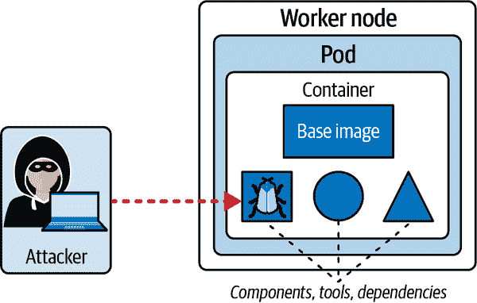
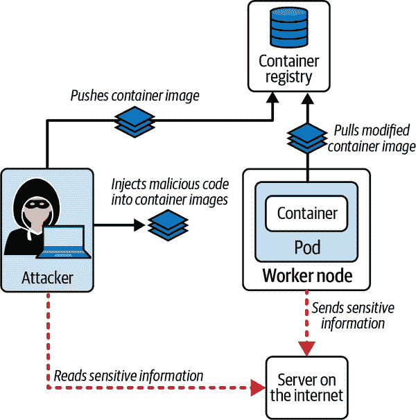
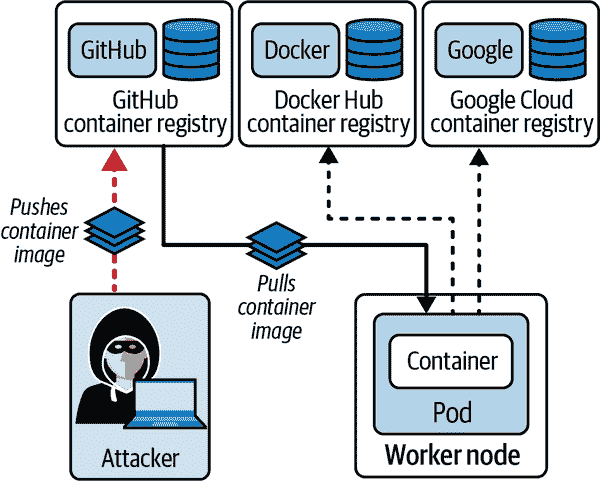
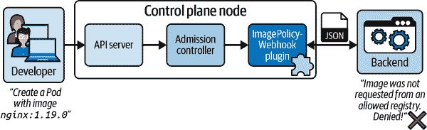
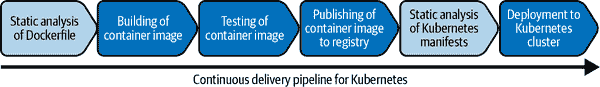
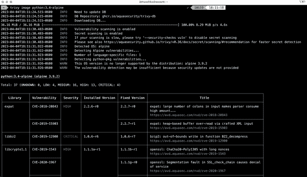

## 第 6 章. サプライチェーンのセキュリティ

この作品はAIを使って翻訳されている。ご意見、ご感想をお待ちしている：translation-feedback@oreilly.com

これまでの章では、主にKubernetesクラスタとそのコンポーネントのセキュリティ、クラスタノードの実行に使用されるOSインフラ、既存のコンテナイメージを使用してクラスタノード上でワークロードを実行するための演算子に焦点を当ててきた。本章では一歩引いて、コンテナイメージを設計、構築、最適化するためのプロセス、ベストプラクティス、ツールについて掘り下げていく。

独自のコンテナイメージを作成せず、別のチームや企業が作成した既存のコンテナイメージを利用することもある。コンテナイメージを使用してワークロードを実行する前に、既知の脆弱性を手動または自動化された方法でスキャンすることは、審査プロセスの一部であるべきだ。ここでは、構築済みコンテナイメージのセキュリティリスクを特定、分析、緩和するために使用される CKS 試験に関連するいくつかのオプションについて説明する。

この章では、高いレベルで以下の概念をカバーする：

* ベース画像のフットプリントを最小限に抑える
* サプライチェーンの確保
* ユーザのワークロードを静的に分析する
* 既知の脆弱性について画像をスキャンする

### ベース画像のフットプリントを最小限に抑える

コンテナ・イメージの構築プロセスは、表面的には簡単そうに見えるが、悪魔はしばしば細部に宿る。コンテナ・イメージを構築する際に、不必要にサイズが大きすぎたり、脆弱性に満ちていたり、コンテナ層のキャッシュに最適化されていなかったりするのを避けることは、このトピックを始めたばかりの人にはわからないかもしれない。この章では、コンテナ・エンジンDockerの助けを借りて、これらの側面すべてに対処していく。

#### シナリオコンテナの脆弱性を悪用する攻撃者

Dockerfileを定義する際に最初に決めなければならないことのひとつが、ベース・イメージの選択だ。ベースイメージはオペレーティングシステムと追加の依存子を提供し、シェルアクセスを公開することもある。

Docker Hubのようなパブリック・レジストリで選択できるベース・イメージの中には、サイズが大きく、アプリケーションをその中で実行するのに必ずしも必要でない機能が含まれている可能性が高いものもある。オペレーティングシステム自体や、ベースイメージで利用可能な依存関係は、脆弱性を露呈する可能性がある。

図 6-1では、攻撃者はコンテナにアクセスすることで、コンテナに関する詳細を把握することができた。これらの脆弱性は、より高度な攻撃のための発射台として利用することができる。



最小限の機能と依存関係を持つベースイメージを使用することを推奨する。次の2、3のセクションでは、より最適化されたベースイメージを作成するメソッドについて説明する。このメソッドは、ビルドがより速く、コンテナレジストリからのダウンロードがより速く、そして最終的には、単に肥大化を抑えることで攻撃対象領域を小さくすることにつながる。次のセクションでは、最も重要なテクニックについて触れる。Dockerfileの書き方のベストプラクティスについては、[Dockerドキュメントで](https://oreil.ly/43Diy)より詳細なリストを発見できるだろう。

#### 小さいサイズのベース画像を選ぶ

コンテナ・イメージの中には、1ギガバイト、あるいはそれ以上のサイズを持つものもある。そのようなコンテナ・イメージにバンドルされているすべての機能が本当に必要だろうか？そうではないだろう。ありがたいことに、多くのコンテナ・プロデューサが、同じリリースにさまざまなバリエーションのコンテナ・イメージをアップロードしている。そのバリエーションの1つに、`alpine` イメージがある。これは、小さくて軽量で、脆弱性の少ないLinuxディストリビューションだ。以下の出力でわかるように、`3.17.0` というタグでダウンロードされた`alpine` コンテナ・イメージのサイズは 7.05MB しかない：

```
$ docker pull alpine:3.17.0
...
$ docker image ls alpine
REPOSITORY   TAG       IMAGE ID       CREATED       SIZE
alpine       3.17.0    49176f190c7e   3 weeks ago   7.05MB
```

`alpine` コンテナ・イメージには、コンテナ内で実行中のプロセスのトラブルシューティングに使用できる`sh` シェルが付属している。以下のコマンドを使用して、新しいコンテナで対話型 Shellを開くことができる：

```
$ docker run -it alpine:3.17.0 /bin/sh
/ # exit
```

ランタイムのトラブルシューティング機能は有用だが、コンテナ・イメージの一部としてシェルを提供することは、コンテナ・イメージのサイズを大きくし、潜在的に攻撃者に門戸を開くことになる。さらに、コンテナ・イメージ内のソフトウェアが多ければ多いほど、脆弱性も多くなる。

Googleが提供する[ディストロ・レス・イメージを](https://oreil.ly/J6Vra)使えば、コンテナ・イメージのサイズと攻撃対象領域をさらに縮小できる。以下のコマンドは、コンテナ・イメージ`gcr.io/distroless/static-debian11` の最新タグをダウンロードし、その詳細を表示する。コンテナ・イメージのサイズはわずか2.34MBである：

```
$ docker pull gcr.io/distroless/static-debian11
...
$ docker image ls gcr.io/distroless/static-debian11:latest
REPOSITORY                          TAG       IMAGE ID       CREATED      \
  SIZE
gcr.io/distroless/static-debian11   latest    901590160d4d   53 years ago \
  2.34MB
```

ディストロ・レスのコンテナ・イメージにはShellが同梱されておらず、以下のコマンドを実行することでそれを確認することができる：

```
$ docker run -it gcr.io/distroless/static-debian11:latest /bin/sh
docker: Error response from daemon: failed to create shim task: OCI runtime \
create failed: runc create failed: unable to start container process: exec: \
"/bin/sh": stat /bin/sh: no such file or directory: unknown.
```

Kubernetesは、ディストロのないコンテナのトラブルシューティングのために、エフェメラル・コンテナという概念を提供している。これらのコンテナは使い捨てを想定しており、通常はシェルを開くことができない最小限のコンテナのトラブルシューティング用にデプロイすることができる。エフェメラル・コンテナについては本書の範囲外だが、[Kubernetesのドキュメントで](https://oreil.ly/IRjP3)詳細な情報を発見できる。

#### コンテナイメージの構築に多段階アプローチを用いる

開発者として、Dockerfileの指示の一部としてアプリケーションコードをビルドすることを決めることができる。このプロセスには、コードのコンパイルとコンテナイメージのエントリポイントとなるバイナリのビルドが含まれる。このプロセスを実装するために必要なツールや依存関係をすべて用意しておけば、コンテナ・イメージのサイズは自動的に大きくなる。

[Dockerにおけるマルチステージビルドの](https://oreil.ly/znQc3)考え方は、ビルドステージをランタイムステージから切り離すというものだ。その結果、ビルドステージで必要な依存関係はすべて、プロセス実行後に破棄されるため、最終的なコンテナイメージには残らない。このアプローチは、不要なゴミをすべて取り除くことで、コンテナ・イメージのサイズをはるかに小さくすることにつながる。

マルチステージDockerfileを作成し、完全に理解するための詳細には立ち入らないが、高いレベルでの違いを紹介したい。まず例 6-1に示すように、プログラミング言語 Goを使った簡単なプログラムをビルドしてテストするDockerfileを紹介する。要するに、Go 1.19.4を含む[ベースイメージを](https://oreil.ly/nwLtT)使用している。Goランタイムは`go` executesを提供する。これを起動してテストを実行し、アプリケーションのバイナリをビルドする。

##### 例 6-1. Goベースイメージを使ったGoプログラムのビルドとテスト

```
FROM golang:1.19.4-alpine 
WORKDIR /app

COPY go.mod .
COPY go.sum .
RUN go mod download

COPY . .
RUN CGO_ENABLED=0 go test -v 
RUN go build -o /go-sample-app . 
CMD ["/go-sample-app"]
```


`:`

Goのベースイメージを使用する


`:`

アプリケーションコードに対してテストを実行する


`:`

Goアプリケーションのバイナリをビルドする。

以下のように、`docker build` コマンドを使って画像を作成することができる：

```
$ docker build . -t go-sample-app:0.0.1
...
```

結果のコンテナ・イメージのサイズは348MBとかなり大きいが、これにはちゃんとした理由がある。コンテナ・イメージのサイズは348MBとかなり大きいが、これにはちゃんとした理由がある。コンテナを起動する際にGoランタイムはもう必要ないにもかかわらず、Goランタイムが含まれているのだ。`go build` コマンドは、コンテナのエントリポイントとして実行できるバイナリを生成した：

```
$ docker images
REPOSITORY      TAG     IMAGE ID       CREATED          SIZE
go-sample-app   0.0.1   88175f3ab0d3   44 seconds ago   358MB
```


接下来，让我们来看一下多阶段方法。多阶段 `Dockerfile` 中至少定义了两个阶段。例 6-2 中指定了别名为 ``build`` 的阶段，并执行了测试并构建了二进制文件。第二个阶段将阶段 ``build`` 中生成的二进制文件复制到专用的目录中。但是，使用 ``alpine`` 基础镜像进行运行。执行 ``docker build`` 命令时，阶段 ``build`` 不会包含在最终的容器镜像中。

##### 例 6-2. 作为多阶段 Dockerfile 的一部分构建并测试 Go 程序。

```
FROM golang:1.19.4-alpine AS build 
RUN apk add --no-cache git
WORKDIR /tmp/go-sample-app
COPY go.mod .
COPY go.sum .
RUN go mod download
COPY . .

RUN CGO_ENABLED=0 go test -v 
RUN go build -o ./out/go-sample-app . 

FROM alpine:3.17.0 
RUN apk add ca-certificates
COPY --from=build /tmp/go-sample-app/out/go-sample-app /app/go-sample-app 
CMD ["/app/go-sample-app"]
```


: 

在名为 ``build`` 的阶段中使用 Go 基础镜像来构建和测试程序。


: 

对应用程序代码执行测试。


: 

构建 Go 应用程序的二进制文件。


: 

为了在容器内运行应用程序，使用更小的基镜像。


: 

将 ``build`` 阶段中生成的应用二进制文件复制，并在容器启动时作为执行命令使用。

结果，使用 ``alpine`` 基础镜像的容器镜像大小仅为 12MB，大幅减小。可以通过再次执行 ``docker build`` 命令并列出容器镜像大小来确认该结果：

```
$ docker build . -t go-sample-app:0.0.1
...
$ docker images
REPOSITORY      TAG     IMAGE ID       CREATED          SIZE
go-sample-app   0.0.1   88175f3ab0d3   44 seconds ago   12MB
```

不仅减小了大小，通过减少依赖关系也减少了攻击面。通过将无发行版的基础镜像集成到 ``alpine`` 基础镜像的替代方案中，可以进一步减小容器镜像的大小。

#### 减少层数

所有 `Dockerfile` 都由按顺序排列的指令列表构成。只有部分指令会为创建的容器镜像创建只读层。这些指令是 ``FROM`` 、 ``COPY`` 、 ``RUN`` 、 ``CMD`` 。所有其他指令都不会创建层，因为它们会创建临时中间镜像。随着向容器镜像添加的层越多，构建执行时间越慢，或容器镜像大小越大。因此，为了最小化容器镜像的占用空间，需要谨慎使用 `Dockerfile` 中的指令。

连续执行多个命令是很常见的。如 例 6-3 所示，可以使用 ``RUN`` 指令列表在单独的行中定义这些命令。

##### 例 6-3. 指定多个 ``RUN`` 指令的 Dockerfile

```
FROM ubuntu:22.10
RUN apt-get update -y
RUN apt-get upgrade -y
RUN apt-get install -y curl
```

每个 ``RUN`` 指令都会创建层，可能增加容器镜像的大小。将它们用 ``&&`` 串联起来以确保仅生成单个层会更有效。例 6-4 是该优化技术的示例。

##### 例 6-4. 指定多个 ``RUN`` 指令的 Dockerfile

```
FROM ubuntu:22.10
RUN apt-get update -y && apt-get upgrade -y && apt-get install -y curl
```

#### 使用容器镜像优化工具

很容易忘记前面提到的优化实践。开源社区开发了一些有助于检查生产者容器镜像的工具。它们的功能为减少不必要的层、文件、文件夹提供了有用的提示：

DockerSlim

: 

`DockerSlim` 通过分析应用程序及其依赖关系来优化和保护容器镜像。详情可在工具的 [GitHub 仓库中](https://oreil.ly/ZbeZl) 找到。

Dive

: 

`Dive` 是一个用于探索容器镜像中烘焙的层的工具。可以轻松识别不必要的层并进一步优化。`Dive` 的代码和文档在 [GitHub 仓库中](https://oreil.ly/UBqqj) 公开。

这只是容器镜像优化工具的简短列表。在「工作负载的静态分析」中，我们将查看其他专注于 `Dockerfile` 和 Kubernetes 清单静态分析的工具。

### 确保供应链

供应链自动化了容器镜像的生产者以及在执行环境（本例中为 Kubernetes）中操作它的过程。我们已经提到了一些可以集成到供应链中以支持容器镜像优化的工具。本节将介绍针对安全方面的实践。详情请参阅 Liz Rice 所著的『*Container Security*』（O'Reilly）。

#### 为容器镜像签名

在将容器镜像推送到容器注册表之前，可以对其进行签名。使用 ``docker trust sign`` 命令进行签名。命令会为容器镜像签名，即添加所谓的镜像摘要。镜像摘要是从容器镜像的内容派生出来的，通常以 SHA256 形式表示。在消费容器镜像时，Kubernetes 会将镜像摘要与镜像内容进行比较，以确认其未被篡改。

#### 场景 攻击者向容器镜像注入恶意代码

验证镜像摘要的 Kubernetes 组件是 `kubelet`。如果将 [镜像拉取策略](https://oreil.ly/0wSjy) 设置为 ``Always`` ，``kubelet`` 会在每次从容器注册表查询镜像摘要，即使容器镜像之前已下载并验证过。

攻击者可以如 图 6-2 所示，修改现有容器镜像的内容，注入恶意代码，并上传到具有相同标签的容器注册表。在容器内运行的恶意方可能会将机密信息发送到攻击者可访问的第三方服务器。



### 镜像校验和验证不是自动的

镜像摘要的验证是 Kubernetes 的可选功能。在定义 Pod 时，应为所有容器镜像明确指定镜像摘要。

#### 验证容器镜像

在 Kubernetes 中，可以在容器的规范中添加 SHA256 镜像摘要。例如，这可以通过 ``spec.containers[].image`` 属性实现。镜像摘要通常在容器注册表中可用。例如，图 6-3 是 [Docker Hub 上](https://oreil.ly/ZAV_H) 的容器镜像 [``alpine:3.17.0``](https://oreil.ly/ZAV_H) 的镜像摘要。在此示例中，镜像摘要为 ``sha256:c0d488a800e4127c334ad20d61d7bc21b4097540327217dfab52262adc02380c`` 。


让我们看看镜像摘要的运行方式。例 6-5 中，而不是使用标签，通过附加镜像摘要来指定容器镜像。

##### 例 6-5. 使用有效容器镜像摘要的 Pod

```
apiVersion: v1
kind: Pod
metadata:
  name: alpine-valid
spec:
  containers:
  - name: alpine
    image: alpine@sha256:c0d488a800e4127c334ad20d61d7bc21b40 \
           97540327217dfab52262adc02380c
    command: ["/bin/sh"]
    args: ["-c", "while true; do echo hello; sleep 10; done"]
```

Pod 的创建按预期工作。镜像摘要得到验证，容器过渡到 “Running” 状态：

```
$ kubectl apply -f pod-valid-image-digest.yaml
pod/alpine-valid created
$ kubectl get pod alpine-valid
NAME           READY   STATUS    RESTARTS   AGE
alpine-valid   1/1     Running   0          6s
```

例 6-6 显示了相同的 Pod 定义，但镜像摘要已更改为与容器镜像内容不匹配。

##### 例 6-6. 使用无效容器镜像摘要的 Pod

```
apiVersion: v1
kind: Pod
metadata:
  name: alpine-invalid
spec:
  containers:
  - name: alpine
    image: alpine@sha256:d006a643bccb6e9adbabaae668533c7f2e5 \
           111572fffb5c61cb7fcba7ef4150b
    command: ["/bin/sh"]
    args: ["-c", "while true; do echo hello; sleep 10; done"]
```

Kubernetes 仍可创建 Pod 对象，但可以看到它无法正确验证容器镜像的哈希。因此，状态变为 "ErrImagePull"。从事件日志可以看出，容器镜像甚至无法从容器注册表拉取：

```
$ kubectl get pods
NAME             READY   STATUS         RESTARTS   AGE
alpine-invalid   0/1     ErrImagePull   0          29s
$ kubectl describe pod alpine-invalid
...
Events:
  Type     Reason     Age   From               Message
  ----     ------     ----  ----               -------
  Normal   Scheduled  13s   default-scheduler  Successfully assigned default \
  /alpine-invalid to minikube
  Normal   Pulling    13s   kubelet            Pulling image "alpine@sha256: \
  d006a643bccb6e9adbabaae668533c7f2e5111572fffb5c61cb7fcba7ef4150b"
  Warning  Failed     11s   kubelet            Failed to pull image \
  "alpine@sha256:d006a643bccb6e9adbabaae668533c7f2e5111572fffb5c61cb7fcba7ef4 \
  150b": rpc error: code = Unknown desc = Error response from daemon: manifest \
  for alpine@sha256:d006a643bccb6e9adbabaae668533c7f2e5111572fffb5c61cb7fcba7e \
  f4150b not found: manifest unknown: manifest unknown
  Warning  Failed     11s   kubelet            Error: ErrImagePull
  Normal   BackOff    11s   kubelet            Back-off pulling image \
  "alpine@sha256:d006a643bccb6e9adbabaae668533c7f2e5111572fffb5c61cb7fcba7ef415 \
  0b"
  Warning  Failed     11s   kubelet            Error: ImagePullBackOff
```

#### 使用公开镜像注册表

容器运行时引擎在每次创建 Pod 时，如果声明的容器镜像在本地不可用，就会从容器注册表下载。该运行时的行为可通过 [镜像拉取策略](https://oreil.ly/ZBMnH) 进一步微调。

镜像名称的前缀声明了注册表的域名。例如，``gcr.io/google-containers/debian-base:v1.0.1`` 指向 [Google Cloud 容器注册表](https://oreil.ly/QFxfY) 的容器镜像 ``google-containers/debian-base:v1.0.1`` ，表示为 ``gcr.io`` 。如果在容器镜像声明中省略域名，容器运行时会使用 [Docker Hub 容器注册表](https://hub.docker.com) 的 ``docker.io`` 。

#### 场景 攻击者上传恶意容器镜像

从公开容器注册表解析容器镜像很方便，但并非没有风险。只要登录这些容器注册表，任何人都可以上传新镜像。消费容器镜像通常甚至不需要账户。

如 图 6-4 所示，攻击者可以使用被盗的凭证将包含恶意代码的容器镜像上传到公开注册表。引用该注册表的容器将自动执行恶意代码。




企業レベルでは、どのコンテナレジストリを信頼するかを管理する必要がある。社内ネットワーク内に独自のコンテナレジストリをセットアップし、完全に制御・管理できるようにすることを推奨する。あるいは、クラウド・プロバイダー環境にプライベート・コンテナ・レジストリをセットアップし、他の誰もアクセスできないようにすることもできる。

あなたが選択できる著名なバイナリ・リポジトリ・マネージャーの1つが[`JFrog Artifactory`](https://oreil.ly/jdF_6)だ。この製品はコンテナイメージの保存、スキャン、提供を完全にサポートしている。コンテナイメージのコンシューマは、ホワイトリストに登録したコンテナレジストリからイメージを引き出すことだけを許可されるべきである。他のすべてのコンテナレジストリは拒否されるべきである。

#### OPA GateKeeperで許可された画像レジストリをホワイトリスト化する

コンテナのレジストリ使用を管理する方法の 1 つに、OPA Gatekeeper がある。`オープン・ポリシー・エージェント（OPA）とゲートキーパーを理解する`」で、OPA ゲートキーパーのインストー ル手順と関数について説明した。ここでは、信頼できるコンテナレジストリを許可するための制約テンプレートと制約について触れる。

`例 6-7は`、OPA Gatekeeperライブラリから直接入手した[`制約テンプレート`](https://oreil.ly/hvgnr)である。入力プロパティとして、制約テンプレートはコンテナレジストリの接頭辞を表す文字列の配列を定義する。Rego 規則は、[`spec.containers[]`] 属性に代入されたコンテナイメージだけでなく、[`spec.initContainers[]`] と[`spec.ephemeralContainers[]`] も検証する。

##### 例 6-7. コンテナレジストリを強制するOPAゲートキーパー制約テンプレート

```
apiVersion: templates.gatekeeper.sh/v1
kind: ConstraintTemplate
metadata:
  name: k8sallowedrepos
  annotations:
    metadata.gatekeeper.sh/title: "Allowed Repositories"
    metadata.gatekeeper.sh/version: 1.0.0
    description: >-
      Requires container images to begin with a string from the specified list.
spec:
  crd:
    spec:
      names:
        kind: K8sAllowedRepos
      validation:
        openAPIV3Schema:
          type: object
          properties:
            repos:
              description: The list of prefixes a container image is allowed to have.
              type: array
              items:
                type: string
  targets:
    - target: admission.k8s.gatekeeper.sh
      rego: |
        package k8sallowedrepos

        violation[{"msg": msg}] {
          container := input.review.object.spec.containers[_]
          satisfied := [good | repo = input.parameters.repos[_] ; \
          good = startswith(container.image, repo)]
          not any(satisfied)
          msg := sprintf("container <%v> has an invalid image repo <%v>, allowed \
          repos are %v", [container.name, container.image, input.parameters.repos])
        }

        violation[{"msg": msg}] {
          container := input.review.object.spec.initContainers[_]
          satisfied := [good | repo = input.parameters.repos[_] ; \
          good = startswith(container.image, repo)]
          not any(satisfied)
          msg := sprintf("initContainer <%v> has an invalid image repo <%v>, \
          allowed repos are %v", [container.name, container.image, \
          input.parameters.repos])
        }

        violation[{"msg": msg}] {
          container := input.review.object.spec.ephemeralContainers[_]
          satisfied := [good | repo = input.parameters.repos[_] ; \
          good = startswith(container.image, repo)]
          not any(satisfied)
          msg := sprintf("ephemeralContainer <%v> has an invalid image repo <%v>, \
          allowed repos are %v", [container.name, container.image, \
          input.parameters.repos])
        }
```

`例 6-`8に示す制約は、どのコンテナレジストリを許可するかを定義する。通常、社内ネットワークでホストされているサーバーのドメイン名を使用する。ここでは、デモのために`gcr.io/` 。

##### 例 6-8. Google Cloud レジストリを信頼リポジトリとして代入する OPA ゲートキーパー制約

```
apiVersion: constraints.gatekeeper.sh/v1beta1
kind: K8sAllowedRepos
metadata:
  name: repo-is-gcr
spec:
  match:
    kinds:
      - apiGroups: [""]
        kinds: ["Pod"]
  parameters:
    repos:
      - "gcr.io/"
```

`apply` 、両方のオブジェクトを作成してみよう：

```
$ kubectl apply -f allowed-repos-constraint-template.yaml
constrainttemplate.templates.gatekeeper.sh/k8sallowedrepos created
$ kubectl apply -f gcr-allowed-repos-constraint.yaml
k8sallowedrepos.constraints.gatekeeper.sh/repo-is-gcr created
```

制約では、規則を適用するネームスペースを指定していない。したがって、クラスタ内のすべてのネームスペースに適用される。以下のコマンドで、ホワイトリストの規則が期待どおりに機能することを確認する。以下のコマンドは、Docker Hubから`nginx` コンテナイメージを使用してPodの作成を試みている。適切なエラーメッセージとともにPodの作成が拒否される：

```
$ kubectl run nginx --image=nginx:1.23.3
Error from server (Forbidden): admission webhook "validation.gatekeeper.sh" \
denied the request: [repo-is-gcr] container <nginx> has an invalid image \
repo <nginx:1.23.3>, allowed repos are ["gcr.io/"]
```

次のコマンドは、Google Cloudのコンテナ・レジストリからコンテナ・イメージを使ってPodを作成する。演算子は許可され、Podオブジェクトが作成される：

```
$ kubectl run busybox --image=gcr.io/google-containers/busybox:1.27.2
pod/busybox created
$ kubectl get pods
NAME      READY   STATUS      RESTARTS     AGE
busybox   0/1     Completed   1 (2s ago)   3s
```

#### ImagePolicyWebhook Admission Controller プラグインで許可された画像レジストリをホワイトリストに登録する

許可された画像レジストリの使用を検証するもう一つの方法は、Podが作成されようとしているときにAPIサーバへの呼び出しをインターセプトすることである。この仕組みは、アドミッションコントローラプラグインを有効にすることで実現できる。いったん設定されると、アドミッションコントローラプラグインのロジックは、APIサーバがリクエストを受信したときに自動的に呼び出されるが、呼び出し元を認証認可した後に呼び出される。API 呼び出しが通過しなければならないフェーズについては、`「リクエストの処理`」ですでに触れた。

アドミッションコントローラは、リクエストが有効になる前に、リクエストを承認、拒否、変更する方法を提供する。例えば、Podを作成するAPIリクエストで送信されたデータを検査し、代入されたコンテナイメージを繰り返しチェックし、コンテナイメージの表記を検証するカスタムロジックを実行することができる。コンテナ・イメージが期待される規約に従っていない場合は、Podの作成を拒否できる。`図 6-5`に高レベルのワークフローを示す。



[`ImagePolicyWebhook`](https://oreil.ly/JxmUu)アドミッションコントローラプラグインは、Kubernetes API 呼び出しをインターセプトするために設定できるプラグインの1つだ。プラグインの名前から、このプラグインの機能を導き出すことができるだろう。このプラグインは、Pod 内で定義されたすべてのコンテナイメージに対するポリシーを定義する。定義されたポリシーとコンテナイメージを比較するために、プラグインはHTTPS 経由でKubernetesの外部のサービス、Webhookに呼び出す。そして、外部サービスがデータの検証方法を決定する。アドミッションコントローラプラグインのコンテキストでは、外部サービスは*バックエンドとも*呼ばれる。

#### バックエンドアプリケーションの実装

バックエンドアプリケーションは、好きなプログラミング言語で実装できる。満たすべき要件は3つだけだ：

1. HTTPSリクエストを処理できるウェブ・アプリケーションだ。
2. JSONリクエストのペイロードを受け入れ、解析することができる。
3. JSONレスポンスのペイロードを送信することができる。

バックエンド・アプリケーションの実装はCKS 試験の一部ではないが、本書の[`GitHubリポジトリで`](https://oreil.ly/OF4fF)Goベースの実装サンプルを発見できる。しかし、本書のGitHubリポジトリにGoベースの実装サンプルがある。

以下のコマンドは、[`https://localhost:8080/validate`] でアクセスできるアプリケーションのランタイムの振る舞いを示している。リクエストとレスポンスのJSONボディの例は、[`Kubernetesのドキュメントで`](https://oreil.ly/8GaQe)発見できる。

次の[`curl`] コマンドは、コンテナイメージの検証ロジックを呼び出す`nginx:1.19.0` 。JSONレスポンスからわかるように、画像は拒否されている：

```
$ curl -X POST -H "Content-Type: application/json" -k -d \'{"apiVersion": \
"imagepolicy.k8s.io/v1alpha1", "kind": "ImageReview", "spec": \
{"containers": [{"image": "nginx:1.19.0"}]}}' https://localhost:8080/validate
{"apiVersion": "imagepolicy.k8s.io/v1alpha1", "kind": "ImageReview", \
"status": {"allowed": false, "reason": "Denied request: [container 1 \
has an invalid image repo nginx:1.19.0, allowed repos are [gcr.io/]]"}}
```

次の[`curl`] コマンドは、コンテナ画像`gcr.io/nginx:1.19.0` の検証ロジックを呼び出す。JSONレスポンスからわかるように、画像は許可されている：

```
$ curl -X POST -H "Content-Type: application/json"  -k -d '{"apiVersion": \
"imagepolicy.k8s.io/v1alpha1", "kind": "ImageReview", "spec": {"containers": \
[{"image": "gcr.io/nginx:1.19.0"}]}}' https://localhost:8080/validate
{"apiVersion": "imagepolicy.k8s.io/v1alpha1", "kind": "ImageReview", \
"status": {"allowed": true, "reason": ""}}
```

#### ImagePolicyWebhookアドミッションコントローラプラグインを設定する

試験では、ImagePolicyWebhookアドミッションコントローラプラグインの「配線」方法を理解することが求められる。このセクションでは、その手順を説明する。最初に、アドミッションコントローラの構成ファイルを作成し、どのプラグインを使用し、実行時にどのように動作するかを知る必要がある。ファイル`/etc/kubernetes/admission-control/image-policy-webhook-admission-config.yaml` を作成し、`例 6-9に`示す内容を入力する。

##### 例 6-9. アドミッションコントローラ構成ファイル

```
apiVersion: apiserver.config.k8s.io/v1
kind: AdmissionConfiguration
plugins:
  - name: ImagePolicyWebhook 
    configuration:
      imagePolicy:
        kubeConfigFile: /etc/kubernetes/admission-control/ \
                        imagepolicywebhook.kubeconfig 
        allowTTL: 50
        denyTTL: 50
        retryBackoff: 500
        defaultAllow: false 
```


: 

ImagePolicyWebhookプラグインの設定を提供する。


: 

バックエンドを設定するための構成ファイルを指す。


: 

バックエンドに到達できない場合、APIリクエストを拒否する。デフォルトはtrueだが、falseにセットする方がはるかに賢明である。


次に、`plugins[].configuration.imagePolicy.kubeConfigFile`属性で参照されるファイルを作成する。このファイルの点は、外部サービスのHTTPS URLを指す。また、クライアント証明書と鍵ファイル、およびディスク上のCAファイルも定義する。例 6-10に構成ファイルの内容を示す。

##### 例 6-10. イメージポリシー構成ファイル

```
apiVersion: v1
kind: Config
preferences: {}
clusters:
  - name: image-validation-webhook
    cluster:
      certificate-authority: /etc/kubernetes/admission-control/ca.crt
      server: https://image-validation-webhook:8080/validate 
contexts:
- context:
    cluster: image-validation-webhook
    user: api-server-client
  name: image-validation-webhook
current-context: image-validation-webhook
users:
  - name: api-server-client
    user:
      client-certificate: /etc/kubernetes/admission-control/api-server-client.crt
      client-key: /etc/kubernetes/admission-control/api-server-client.key
```


: 

バックエンド・サービスのURL。HTTPSプロトコルを使用しなければならない。

APIサーバーの`ImagePolicyWebhook`アドミッションコントローラプラグインを有効にし、アドミッションコントローラを構成ファイルに点す。これを実現するには、APIサーバの構成ファイル（通常は`/etc/kubernetes/manifests/kube-apiserver.yaml`に発見される）を編集する。

コマンドラインオプション`--enable-admission-plugins`を発見し、値`ImagePolicyWebhook`を既存のプラグインリストにカンマ区切りで追加する。コマンドラインオプション`--admission-control-config-file`がまだ存在しない場合はそれを指定し、値を`/etc/kubernetes/admission-control/image-policy-webhook-admission-configuration.yaml`に設定する。構成ファイルが新しいディレクトリに行くことを考えると、それをVolumeとして定義し、コンテナにマウントする必要がある。例 6-11に、APIサーバーコンテナの関連オプションを示す。

##### 例 6-11. APIサーバー構成ファイル

```
...
spec:
  containers:
  - command:
    - kube-apiserver
    - --enable-admission-plugins=NodeRestriction,ImagePolicyWebhook
    - --admission-control-config-file=/etc/kubernetes/admission-control/ \
      image-policy-webhook-admission-configuration.yaml
    ...
    volumeMounts:
    ...
    - name: admission-control
      mountPath: /etc/kubernetes/admission-control
      readonly: true
  volumes:
  ...
  - name: admission-control
    hostPath:
      path: /etc/kubernetes/admission-control
      type: DirectoryOrCreate
...
```

APIサーバーを実行しているPodが自動的に再起動するはずである。この処理には数分かかる場合がある。APIサーバが自力で立ち上がらない場合は、`sudo systemctl restart kubelet`コマンドで`kubelet`サービスを再起動する。完全に再起動したら、クエリができるはずだ：

```
$ kubectl get pods -n kube-system
NAME                           READY   STATUS    RESTARTS   AGE
...
kube-apiserver-control-plane   1/1     Running   0          69s
```

Podの作成を要求するAPI 呼び出しはすべてバックエンドにルーティングされるようになった。検証結果に基づいて、オブジェクトの作成が許可または拒否される。

### ワークロードの静的解析

本書を通して、DockerfileとKubernetesマニフェストのベストプラクティスについて話す。これらのファイルを手作業で検査し、望ましくない構成ファイルを発見し、手作業で修正することができる。このアプローチは多くの複雑な知識を必要とし、非常に面倒でエラーになりやすい。適切なツールを使って自動化された方法でワークロードファイルを分析する方が、はるかに便利で効率的だ。静的解析のための商用およびオープンソースのツールのリストは長い。このセクションでは、Haskell Dockerfile LinterとKubesecという2つの選択肢の機能を紹介する。

何百、何千ものワークロードファイルを処理しなければならない企業レベルでは、図 6-6に示すように、継続的デリバリパイプラインの助けを借りて処理することになる。



関連する静的解析ツールは、コンテナイメージがビルドされ、レジストリにプッシュされ、Kubernetesクラスタにデプロイされる前であっても、パイプラインの初期段階で品質ゲートとして呼び出すことができる。継続的デリバリの原則、プラクティスについては、Jez Humble 氏とDavid Farley 氏による優れた書籍『[*Continuous Delivery*](https://oreil.ly/8CR5M)』（Addison-Wesley Professional）を参照されたい。

#### Dockerファイルの分析にHadolintを使う

[`Haskell Dockerfile Linter`](https://oreil.ly/C9bvu)は、略して`hadolint`とも呼ばれ、Dockerfile 用のリンターである。このツールはDockerドキュメント・ページにリストされている[ベスト・プラクティスに基づいて](https://oreil.ly/Fwksr)Dockerfileを検査する。例 6-12は、Goベースのアプリケーションを実行するコンテナイメージを構築するための、最適化されていないDockerfileを示している。

##### 例 6-12. 最適化されていないDockerファイル

```
FROM golang
COPY main.go .
RUN go build main.go
CMD ["./main"]
```

`Haskell Dockerfile Linter`は、`hadolint`の実行ファイルをディスク上のDockerfileに向けることができるモードをサポートしている。分析によって発見された警告メッセージを含む、この後のコマンド実行を見ることができる：

```
$ hadolint Dockerfile
Dockerfile:1 DL3006 warning: Always tag the version of an image explicitly
Dockerfile:2 DL3045 warning: `COPY` to a relative destination without \
`WORKDIR` set.
```

コマンドの出力は、ベース・イメージにタグを代入することを示唆している。既存のDockerfileは`latest`タグを引き、最新のGoコンテナ・イメージに解決する。このやり方は、Goランタイム・バージョンとアプリケーション・コードの間に非互換性をもたらす可能性がある。リソースをコピーする作業ディレクトリを定義することで、オペレーティングシステム固有のディレクトリやファイルと、アプリケーション固有のディレクトリやファイルを分けて管理することができる。例 6-13は、`Haskell Dockerfile Linter`が発見した警告メッセージを修正している。

##### 例 6-13. 最適化されたDockerファイル

```
FROM golang:1.19.4-alpine
WORKDIR /app
COPY main.go .
RUN go build main.go
CMD ["./main"]
```

変更されたDockerfileに対する別の実行は成功した終了コードにつながり、追加の警告メッセージは表示されない：

```
$ hadolint Dockerfile
```

Dockerfileは現在、`hadorint`が認識しているベストプラクティスに従っている。

#### Kubernetesマニフェストの分析にKubesecを使う

[`Kubesec`](https://kubesec.io)はKubernetesマニフェストを分析するためのツールである。バイナリ、Dockerコンテナ、アドミッションコントローラプラグイン、さらには`kubectl`のプラグインとして実行できる。その使い方を実証するために、例 6-14に示すYAMLマニフェストファイル`pod-initial-kubesec-test.yaml`を出発点としてセットアップする。

##### 例 6-14. 初期セキュリティ設定を使用したPod YAMLマニフェスト

```
apiVersion: v1
kind: Pod
metadata:
  name: kubesec-demo
spec:
  containers:
  - name: kubesec-demo
    image: gcr.io/google-samples/node-hello:1.0
    securityContext:
      readOnlyRootFilesystem: true
```

Podのコンフィギュレーションを確認すると、前の章の内容に基づいて改善すべき点がすでにいくつか提案されているかもしれない。`Kubesec`が何を推奨しようとしているのか見てみよう。

`Kubesec`を起動する最も簡単な方法は、Dockerの助けを借りてコンテナ内でロジックを実行することだ。以下のコマンドは、YAMLマニフェストの内容を標準入力ストリームにフィードする。JSONで形式化された結果は、スコアをレンダリングし、結果の人間が読めるメッセージを提供し、変更すべき点をアドバイスする：


```
$ docker run -i kubesec/kubesec:512c5e0 scan /dev/stdin \
  < pod-initial-kubesec-test.yaml
[
  {
    "object": "Pod/kubesec-demo.default",
    "valid": true,
    "message": "Passed with a score of 1 points",
    "score": 1,
    "scoring": {
      "advise": [
        {
          "selector": ".spec .serviceAccountName",
          "reason": "Service accounts restrict Kubernetes API access and \
                     should be configured with least privilege"
        },
        {
          "selector": ".metadata .annotations .\"container.apparmor.security. \
                       beta.kubernetes.io/nginx\"",
          "reason": "Well defined AppArmor policies may provide greater \
                     protection from unknown threats. WARNING: NOT PRODUCTION \
                     READY"
        },
        {
          "selector": "containers[] .resources .requests .cpu",
          "reason": "Enforcing CPU requests aids a fair balancing of \
                     resources across the cluster"
        },
        {
          "selector": ".metadata .annotations .\"container.seccomp.security. \
                       alpha.kubernetes.io/pod\"",
          "reason": "Seccomp profiles set minimum privilege and secure against \
                     unknown threats"
        },
        {
          "selector": "containers[] .resources .limits .memory",
          "reason": "Enforcing memory limits prevents DOS via resource \
                     exhaustion"
        },
        {
          "selector": "containers[] .resources .limits .cpu",
          "reason": "Enforcing CPU limits prevents DOS via resource exhaustion"
        },
        {
          "selector": "containers[] .securityContext .runAsNonRoot == true",
          "reason": "Force the running image to run as a non-root user to \
                     ensure least privilege"
        },
        {
          "selector": "containers[] .resources .requests .memory",
          "reason": "Enforcing memory requests aids a fair balancing of \
                     resources across the cluster"
        },
        {
          "selector": "containers[] .securityContext .capabilities .drop",
          "reason": "Reducing kernel capabilities available to a container \
                     limits its attack surface"
        },
        {
          "selector": "containers[] .securityContext .runAsUser -gt 10000",
          "reason": "Run as a high-UID user to avoid conflicts with the \
                     host's user table"
        },
        {
          "selector": "containers[] .securityContext .capabilities .drop | \
                       index(\"ALL\")",
          "reason": "Drop all capabilities and add only those required to \
                     reduce syscall attack surface"
        }
      ]
    }
  }
]
```

原始 YAML 清单的改进版可在例 6-15 中找到。这里融入了 `Kubesec` 建议的部分推荐更改。

##### 例 6-15. 使用改进的安全设置 的 Pod YAML 清单

```
apiVersion: v1
kind: Pod
metadata:
  name: kubesec-demo
spec:
  containers:
  - name: kubesec-demo
    image: gcr.io/google-samples/node-hello:1.0
    resources:
      requests:
        memory: "64Mi"
        cpu: "250m"
      limits:
        memory: "128Mi"
        cpu: "500m"
    securityContext:
      readOnlyRootFilesystem: true
      runAsNonRoot: true
      runAsUser: 20000
      capabilities:
        drop: ["ALL"]
```

对更改后的 Pod YAML 清单执行相同的 `Docker` 命令时，会显示改进后的分数，并且建议的消息数量减少：

```
$ docker run -i kubesec/kubesec:512c5e0 scan /dev/stdin \
  < pod-improved-kubesec-test.yaml
[
  {
    "object": "Pod/kubesec-demo.default",
    "valid": true,
    "message": "Passed with a score of 9 points",
    "score": 9,
    "scoring": {
      "advise": [
        {
          "selector": ".metadata .annotations .\"container.seccomp.security. \
                       alpha.kubernetes.io/pod\"",
          "reason": "Seccomp profiles set minimum privilege and secure against \
                     unknown threats"
        },
        {
          "selector": ".spec .serviceAccountName",
          "reason": "Service accounts restrict Kubernetes API access and should \
                     be configured with least privilege"
        },
        {
          "selector": ".metadata .annotations .\"container.apparmor.security. \
                       beta.kubernetes.io/nginx\"",
          "reason": "Well defined AppArmor policies may provide greater \
                     protection from unknown threats. WARNING: NOT PRODUCTION \
                     READY"
        }
      ]
    }
  }
]
```

### 对已知漏洞扫描镜像

记录和发现安全漏洞的顶级来源之一是 [CVE Details](https://oreil.ly/DDlVa)。该页面列出了已知漏洞 CVE 并按分数排名。自动化工具可以识别容器镜像中嵌入的软件组件，将其与中央漏洞数据库进行比较，并根据严重程度标记问题。

其中一个具有此功能的开源工具是 CKS 课程中明确提到的 [Trivy](https://oreil.ly/hqPHH)。`Trivy` 可以作为命令行工具、在容器内、在可配置的 GitHub Actions 中作为持续集成工作流的一部分、作为 IDE VSCode 的插件、作为 `Kubernetes` 操作符等多种模式运行。有关可用安装选项和步骤的概述，请参阅 [Trivy 文档](https://oreil.ly/qB_c8)。考试期间无需安装工具。它已为你预先配置好。你需要理解的是如何运行工具以及如何解释发现的漏洞和修复方法。

假设你已安装了 `Trivy` 的命令行实现。`Trivy` 的版本可通过以下命令确认：

```
$ trivy -v
Version: 0.36.1
Vulnerability DB:
  Version: 2
  UpdatedAt: 2022-12-13 12:07:14.884952254 +0000 UTC
  NextUpdate: 2022-12-13 18:07:14.884951854 +0000 UTC
  DownloadedAt: 2022-12-13 17:09:28.866739 +0000 UTC
```

如 图 6-7 所示，`Trivy` 显示了已知漏洞副本从中央数据库下载的时间戳。`Trivy` 可以以多种格式扫描容器镜像。子命令 `image` 仅期望镜像的名称和标签的拼写，在本例中为 `python:3.4-alpine`。



输出中最重要的信息是包含特定漏洞的库、其严重程度以及用于修复问题的最小版本。在发现的漏洞中，严重或关键的漏洞应考虑修复。如果无法自行控制容器镜像，可以尝试升级到新版本。

### 概要

`Kubernetes` 的主要目的是以可扩展且安全的方式在容器中运行应用程序。本章介绍了确保交付的容器镜像尺寸小且已知安全漏洞尽可能少的流程、最佳实践和工具。

我们回顾了一些最小化容器镜像占用空间的最有效技术。首先从选择一个小的基镜像开始。极端情况下，通过完全不提供 shell 也可以进一步减小尺寸。如果使用 `Docker`，可以利用多阶段方法，在容器内构建应用程序，而无需捆绑实现目标所需的所有编译器、运行时和构建工具。

在 `Pod` 中使用容器镜像时，应仅从受信任的注册表中提取容器镜像。最好在内部设置容器注册表并提供容器镜像。这样就无需访问公共的、面向互联网的注册表，从而消除潜在的安全风险。在 `OPA Gatekeeper` 的帮助下，可以强制使用受信任容器注册表列表。使用容器镜像的 `SHA256` 哈希来验证预期内容，可实施另一项安全措施。

构建和扫描容器镜像的过程可以集成到 CI/CD 管道中。借助第三方工具，甚至可以在部署工件构建之前解析和分析其资源文件。我们研究了用于 `Dockerfile` 的 Haskell Dockerfile Linter 和用于 `Kubernetes` 清单的 `Kubesec`。需要涵盖的另一个安全用例是消费由你或你公司外部实体构建的现有容器镜像。在 `Kubernetes Pod` 中运行容器镜像之前，务必扫描其中是否存在漏洞。`Trivy` 是可以识别容器镜像漏洞并报告的工具之一，可以让你了解在该镜像上运行容器时面临哪些安全风险。

### 考试要点

熟悉减小容器镜像占用空间的技术。

: 

本节介绍了在构建容器镜像时减小尺寸的一些技巧。建议阅读 `Docker` 网页上列出的最佳实践，并将其应用于示例容器镜像。在应用技巧之前和之后比较生产者容器镜像的大小。挑战在于将容器镜像缩小到尽可能小的尺寸，同时避免重要功能丢失。

走一遍管理容器镜像可从何处解析的过程。

: 

`OPA Gatekeeper` 提供了定义用户被允许解析容器镜像的注册表的方法。设置约束模板和约束对象，并检查规则是否正确应用于定义主应用程序容器、init 容器和临时容器的 `Pod`。此外，还可以关注在 `Kubernetes` 空间中提供类似功能的其他产品。其中之一是 [Kyverno](https://kyverno.io)。

对容器镜像进行签名并使用哈希验证。

: 

创建容器镜像后，务必同时创建其摘要。将容器镜像和摘要发布到注册表。练习在 `Pod` 定义中使用摘要，并验证 `Kubernetes` 在拉取容器镜像时的行为。

理解 `ImagePolicyWebhook` 准入控制器插件的配置方法。

: 

不期望编写 `ImagePolicyWebhook` 的后端。这是超出考试范围的，需要编程语言知识。但是，需要理解如何在 API 服务器配置中启用该插件。即使没有运行中的后端应用程序，也建议练习该工作流程。

知道如何修复静态分析工具发出的警告。

: 


CKSのカリキュラムでは、`Dockerfile`やKubernetesマニフェストを分析するための特定のツールを規定していない。試験中、エラーメッセージや警告メッセージのリストを生成する特定のコマンドを実行するよう求められることがある。メッセージをどのようにインタプリタし、関連リソースファイルでどのように修正するかを理解する。

セキュリティの脆弱性を特定し、修正するために`Trivy`を使用する練習をする。

CKSのFAQには、トリビーのドキュメントページがリストアップされている。従って、質問の中に`Trivy`が出てくる可能性があると考えるのが妥当だろう。コンテナ画像をスキャンするために`Trivy`を呼び出すさまざまな方法を理解する必要がある。作成されたレポートは、修正すべき点と発見された脆弱性の深刻度を明確に示してくれる。コンテナ・イメージを簡単に修正できないことを考えると、既知の脆弱性を持つコンテナ・イメージを実行するPodにフラグを立てるよう求められる可能性が高い。

### サンプル練習

これらの練習問題の解答は付録にある。

1. 以下の`Dockerfile`を見てみよう。プロデューサーのコンテナ・イメージのフットプリントを減らす可能性を見つけられるか？

```
FROM node:latest
ENV NODE_ENV development
WORKDIR /app
COPY package.json .
RUN npm install
COPY . .
EXPOSE 3001
CMD ["node", "app.js"]
```

`Dockerfile`のベストプラクティスを適用し、コンテナイメージのフットプリントを最適化する。最適化を行う前と後で、`docker build`コマンドを実行する。その結果、コンテナ・イメージのサイズは小さくなるが、アプリケーションは機能しているはずだ。

2.  Kubernetesクラスタに`Kyverno`をインストールする。インストール方法は[ドキュメントで](https://oreil.ly/yxlLe)発見できる。

[ドキュメントページに](https://oreil.ly/Kdj1k)記載されている「画像レジストリの制限」ポリシーを適用する。許可されるレジストリは`gcr.io`だけである。それ以外のレジストリの使用は拒否する。

コンテナイメージを定義するPodを作成する`gcr.io/google-containers/busybox:1.27.2`。Podの作成は失敗するはずである。コンテナイメージを使用して別のPodを作成する`busybox:1.27.2`。`Kyverno`はPodの作成を許可する。

3.  YAMLマニフェスト`pod-validate-image.yaml`のコンテナイメージ`nginx:1.23.3-alpine`を使ってPodを定義する。Docker Hubからコンテナイメージのダイジェストを取得する。`SHA256`ハッシュを使用してコンテナイメージの内容を検証する。Podを作成する。Kubernetesはコンテナイメージを正常にプルできるはずである。

4.  `Kubesec`を使用して、YAMLマニフェストファイル`pod.yaml`の以下の内容を分析する：

```
apiVersion: v1
kind: Pod
metadata:
  name: hello-world
spec:
  securityContext:
    runAsUser: 0
  containers:
  - name: linux
    image: hello-world:linux
```

`Kubesec`が生成したサジェストを検査する。`seccomp`と`AppArmor`のサジェストは無視する。すべてのメッセージの根本原因を修正し、ツールの別の実行が追加の提案を報告しないようにする。

5.  チェックアウトしたGitHubリポジトリ[*bmuschko/cks-study-guideの*](https://oreil.ly/sImXZ)ディレクトリ`a/ch06/trivy`に移動する。コマンドを実行する`kubectl apply -f setup.yaml`。

このコマンドは、名前空間`r61`に3つの異なるPodを作成する。コマンドラインから、Podで使用されているコンテナイメージに対して`Trivy`を実行する。`CRITICAL`脆弱性を持つPodをすべて削除する。どのPodがまだ実行されているか？
