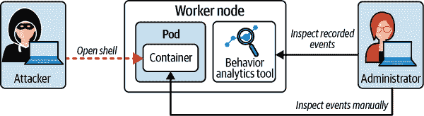
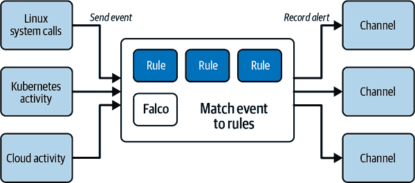
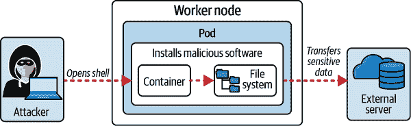
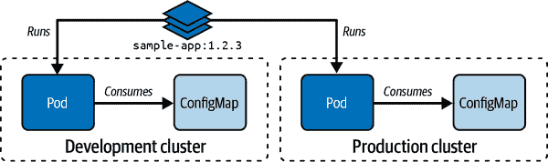
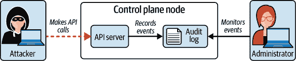
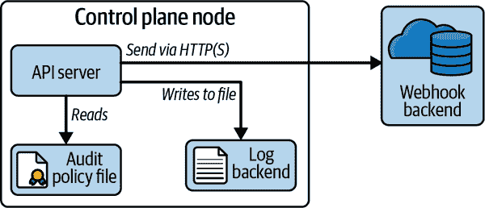

## 第 7 章 監視、ログ、ランタイム・セキュリティ

この作品はAIを使って翻訳されている。ご意見、ご感想をお待ちしている：translation-feedback@oreilly.com

カリキュラムの最後の領域では、主にKubernetesクラスタのホストとコンテナ・レベルでの不審なアクティビティの検出を扱う。まず、*振る舞い分析という*用語の定義と、それがKubernetesの領域にどのように適用されるかを説明する。理論が一段落したところで、侵入シナリオを検出できる`Falco`というツールを導入する。

コンテナが起動した後も、その実行環境は変更できる。例えば、演算子として、手動で追加ツールをインストールしたり、コンテナの一時ファイルシステムにファイルを書き込んだりするために、コンテナにシェルを入れることを決定することができる。コンテナ起動後にコンテナを変更することは、セキュリティリスクへの扉を開く可能性がある。*不変性コンテナ*、つまり起動後に変更できないコンテナを作成することを目指したい。コンテナを不変にするための適切なセットでPodを構成する方法を学ぶ。

最後に、Kubernetesクラスタで発生したイベントのログをキャプチャすることについて説明する。これらのログは、クラスタレベルでのトラブルシューティングの目的で使用することができ、望ましくない、あるいは破壊的なランタイムの振る舞いにつながるようなクラスタ構成の変更がいつ、どのように行われたかを再構築することができる。また、ログエントリは、対策を実行する手段として、今まさに起きているかもしれない攻撃をトレースするために使用することもできる。

この章では、高いレベルで以下の概念をカバーする：

* 振る舞い分析を行い、悪意のある行為を検知する
* 深い分析調査と同定を行う
* 実行時にコンテナの不変性を確保する
* 監査ログを使ってアクセスを監視する

### 振る舞い分析を行う

Kubernetesクラスタの管理とアップグレードとは別に、管理者は潜在的に悪意のあるアクティビティを監視するのが仕事だ。クラスタノードにログインし、ホストレベルやコンテナレベルのプロセスを観察することで、このタスクを手動で実行することはできるが、それは恐ろしく非効率な作業だ。

*振る舞い分析とは*、クラスタノードを観察し、通常とは異なるアクティビティがないかどうかを調べるプロセスである。自動化されたプロセスは、特定の関心のあるイベントのフィルタリング、記録、アラートを支援する。

#### シナリオ Kubernetes 管理者は攻撃者の行動を観察できる

攻撃者がワーカーノード上で動作するシェルを開いてコンテナにアクセスし、Kubernetesクラスタ全体で追加の攻撃を開始した。管理者がコンテナを1つ1つ手動でチェックしても、このイベントを簡単に検出することはできない。図 7-1にシナリオを示す。



管理者は、振る舞い分析ツールをインストールすることで、自らの手で問題を解決することにした。この監視ツールは特定のイベントを継続的に監視し、ほぼ瞬時に記録する。管理者は侵入を検知するための効率的なメカニズムを手に入れ、それに基づいて行動できるようになった。

試験に関連する振る舞い分析ツールには、[Falco](https://falco.org)、[Tracee](https://oreil.ly/ibXcO)、[Tetragonが](https://oreil.ly/q15oU)ある。本書では、試験中に利用可能なドキュメントページのリンクの中にリストされている`Falco`のみに焦点を当てる。

#### ファルコを理解する

`Falco`は、ホストレベルおよびコンテナレベルのアクティビティを観測することで、脅威の検知を支援する。以下は、ファルコが監視できるイベントの例である：

* ファイルシステムの特定の場所でファイルの読み取りや書き込みを行う。
* コンテナ用のシェルバイナリを開く。たとえば、`/bin/bash`で bash シェルを開く。
* 望ましくないURLへのネットワーク呼び出しを試みた。

`Falco`は、設定されたイベントと条件をリッスンするセンサーのセットをデプロイする。各センサーは、イベントをデータソースにマッピングする規則のセットで構成される。規則が特定のイベントにマッチするとアラートがプロデューサされる。アラートは、標準出力、ファイル、 HTTPS エンドポイントなど、イベントを記録する出力チャネルに送られる。`Falco`は同時に複数の出力チャネルを有効にすることができる。図 7-2に`Falco`のハイレベルアーキテクチャを示す。



`Falco`は多くの機能と設定オプションを持つツールである。本書ですべての機能を説明することはできないが、`Falco`の上位概念を理解することに時間を割くことをお勧めする。

ファルコに関するもう一つの素晴らしい学習リソースは、シスディグのトレーニングポータルのウェブページで発見することができる。「[Falco 101 "](https://oreil.ly/PwGWx)は、ファルコのすべての機能を説明する無料のビデオコースである。あなたが始めるために必要なことは、アカウントにサインアップすることだ。さらに、`Loris Degioanni`と`Leonardo Grasso`による書籍『[*Practical Cloud Native Security with Falco*](https://oreil.ly/0WHIR)』（オライリー）を一読することをお勧めする。内容は、`Falco`を学ぶための初心者に優しいアプローチをとっている。

#### ファルコのインストール

`Falco`は、ホストシステム上のバイナリとして、またはKubernetesの`DaemonSet`オブジェクトとしてインストールすることができる。`Falco`は試験環境にプリインストールされていると考えて差し支えない。インストールプロセスの詳細については、`Falco`ドキュメントの[該当箇所を](https://oreil.ly/MB6wU)参照されたい。以下のステップでは、Ubuntuマシンへのバイナリのインストールを簡単に説明する。`Falco`はKubernetesクラスタのすべてのワーカーノードにインストールする必要がある。これらの手順は、将来の`Falco`のバージョンによって変更される可能性があることに注意されたい。

まず、`Falco`のGPGキーを信頼し、`Falco`専用のaptリポジトリを設定し、パッケージリストを更新する必要がある：

```
$ curl -s https://falco.org/repo/falcosecurity-packages.asc | apt-key add -
$ echo "deb https://download.falco.org/packages/deb stable main" | tee -a \
  /etc/apt/sources.list.d/falcosecurity.list
$ apt-get update -y
```

その後、以下のコマンドでカーネル・ヘッダをインストールする：

```
$ apt-get -y install linux-headers-$(uname -r)
```

最後に、バージョン`0.33.1`の`Falco` aptパッケージをインストールする必要がある：

```
$ apt-get install -y falco=0.33.1
```

`Falco`は正常にインストールされ、バックグラウンドでsystemdサービスとして稼働している。以下のコマンドを実行して、`Falco`サービスのステータスを確認する：

```
$ sudo systemctl status falco
● falco.service - Falco: Container Native Runtime Security
     Loaded: loaded (/lib/systemd/system/falco.service; enabled; vendor preset: \
             enabled)
     Active: active (running) since Tue 2023-01-24 15:42:31 UTC; 43min ago
       Docs: https://falco.org/docs/
   Main PID: 8718 (falco)
      Tasks: 12 (limit: 1131)
     Memory: 30.2M
     CGroup: /system.slice/falco.service
             └─8718 /usr/bin/falco --pidfile=/var/run/falco.pid
```

`Falco`サービスは"active"ステータスにあるはずである。`Falco`サービスはすでにシステム内のイベントを監視している。

#### ファルコを設定する

`Falco`サービスは、システムを監視するための演算子環境を、一連のデフォルト規則で提供する。これらの規則は`/etc/falco`ディレクトリのYAMLファイルに存在する。`/etc/falco`内のファイルとサブディレクトリのリストは以下の通りである：

```
$ tree /etc/falco
/etc/falco
├── aws_cloudtrail_rules.yaml
├── falco.yaml
├── falco_rules.local.yaml
├── falco_rules.yaml
├── k8s_audit_rules.yaml
├── rules.available
│   └── application_rules.yaml
└── rules.d
```

これらのファイルのうち、最も重要なものの大まかな目的を説明したい。

##### ファルコ構成ファイル

`falco.yaml`という名前のファイルは、`Falco`プロセスの構成ファイルである。アラートが発生した場合に通知されるチャンネルを制御する。チャネルは標準出力またはファイルである。さらに、このファイルは、ログに含めるアラートの最小ログレベル、および`Falco`プロセスの正常性確認を実装するために使用される組み込みウェブサーバの構成方法を定義する。すべての利用可能なオプションの完全なリファレンスについては、[「ファルコの設定オプ ション](https://oreil.ly/sfHW9)」を参照のこと。

##### デフォルト規則

`falco_rules.yaml`という名前のファイルは、プリインストールされた規則のセットを定義している。`Falco`はこれらの規則がデフォルトで適用されると考えている。その中には、コンテナへのシェルがオープンされたとき、またはシステムディレクトリへの書き込みが実行されたときにアラートを作成するためのチェックがある。[ルール例」のページで](https://oreil.ly/fxHQm)、他の例とそれに対応するルール定義を見つけることができる。

##### カスタム規則

`falco_rules.local.yaml`という名前のファイルにより、カスタム規則を定義し、デフォルト規則を上書きすることができる。`Falco`の新規インストールでは、このファイルにはコメントアウトされた規則のみが含まれており、独自の規則を追加するための出発点となる。[カスタムルールの記述に関するガイダンスは](https://oreil.ly/mJnPo)`Falco`ドキュメンテーションで発見できる。

##### Kubernetes 固有の規則

ファイル`k8s_audit_rules.yaml`、システムコールイベントのロギングに加えて、[Kubernetes 固有の規則を](https://oreil.ly/d5FGD)定義する。典型的な例としては、"ネームスペースが削除されたときにイベントをログする"、"RoleまたはClusterRoleオブジェクトが作成されたときにイベントをログする"などがある。

##### 設定変更を適用する

構成ファイルの内容を変更しても、`Falco`プロセスには自動的に反映されない。以下のコマンドで示されるように、`Falco`サービスを再起動する必要がある：

```
$ sudo systemctl restart falco
```

次は、`Falco`のデフォルト規則でカバーされているいくつかのイベントをトリガーする。それぞれのイベントは、設定されたチャンネルに書き込まれるアラートを作成する。`Falco`の初期設定では、メッセージは標準出力にルーティングされる。

#### イベントの生成と Falco ログの検査

`Falco`のアラートを実際に見てみよう。`Falco`によって追加されたデフォルト規則の1つは、ユーザがコンテナに対してシェルを開こうとするたびにアラートを作成する。ログエントリを見るには、このアクティビティを実行する必要がある。そのためには、`nginx`という名前の新しいPodを作成し、コンテナに対してbashシェルを開き、コンテナから抜ける：


```
$ kubectl run nginx --image=nginx:1.23.3
pod/nginx created
$ kubectl exec -it nginx -- bash
root@nginx:/# exit
```

通过调查 Pod 的运行时详细信息，可以确定 Pod 运行所在的集群节点：

```
$ kubectl get pod nginx -o jsonpath='{.spec.nodeName}'
kube-worker-1
```

该 Pod 在名为 `kube-worker-1` 的集群节点上运行。要发现相关日志条目，需要检查该机器上的 Falco 日志。可以通过在 `kube-worker-1` 集群节点上直接使用 `journalctl` 命令来检查记录的事件。以下命令搜索包含 `falco` 关键词的条目：

```
$ sudo journalctl -fu falco
...
Jan 24 18:03:37 kube-worker-1 falco[8718]: 18:03:14.632368639: Notice A shell \
was spawned in a container with an attached terminal (user=root user_loginuid=0 \
nginx (id=18b247adb3ca) shell=bash parent=runc cmdline=bash pid=47773 \
terminal=34816 container_id=18b247adb3ca image=docker.io/library/nginx)
```

会发现尝试更改容器状态时，会应用额外的规则。假设使用 `apt` 在 `nginx` 容器中安装 Git 包：

```
root@nginx:/# apt update
root@nginx:/# apt install git
```

Falco 为这些系统级操作添加了日志条目。以下输出显示了警报：

```
$ sudo journalctl -fu falco
Jan 24 18:55:48 ubuntu-focal falco[8718]: 18:55:05.173895727: Error Package \
management process launched in container (user=root user_loginuid=0 \
command=apt update pid=60538 container_id=18b247adb3ca container_name=nginx \
image=docker.io/library/nginx:1.23.3)
Jan 24 18:55:48 ubuntu-focal falco[8718]: 18:55:11.050925982: Error Package \
management process launched in container (user=root user_loginuid=0 \
command=apt install git-all pid=60823 container_id=18b247adb3ca \
container_name=nginx image=docker.io/library/nginx:1.23.3)
...
```

下一节将验证触发警报的 Falco 规则及其语法。

#### 理解 Falco 规则文件的基础

Falco 的规则文件通常由 YAML 中定义的三个要素组成，即规则、宏和列表。你需要从高层次理解这些要素，并知道如何修改它们以实现某个目标。

### 创建 Falco 规则

在考试中，你不需要自己创建 Falco 规则。你会提供现有的规则集。如果你想更深入地了解 Falco 规则，请查看相关[文档页面](https://oreil.ly/PD1ro)。

#### 规则

*规则* 是触发警报应满足的条件。它还定义了警报的输出消息。输出消息由硬编码消息组成，可以嵌入内置变量。警报以 `WARNING` 日志级别记录。例 7-1 显示了监听非 Skype 或 Webex 等传统视频会议软件的进程访问机器摄像头的事件的规则的 YAML。

##### 例 7-1. 监控摄像头访问的 Falco 规则

```
- rule: access_camera
  desc: a process other than skype/webex tries to access the camera
  condition: evt.type = open and fd.name = /dev/video0 and not proc.name in \
             (skype, webex)
  output: Unexpected process opening camera video device (command=%proc.cmdline)
  priority: WARNING
```

#### 宏

*宏* 是可重用的规则条件，有助于避免在多个规则中复制粘贴相似的逻辑。当规则文件变得很长并且你想提高可维护性时，宏很有用。

假设你在简化规则文件。你发现多个规则使用相同的条件来监听摄像头访问。例 7-2 显示了如何将逻辑拆分为宏。

##### 例 7-2. 定义可重用条件的 Falco 宏

```
- macro: camera_process_access
  condition: evt.type = open and fd.name = /dev/video0 and not proc.name in \
             (skype, webex)
```

如例 7-3 所示，你现在可以在规则定义中按名称引用宏。

##### 例 7-3. 包含宏的 Falco 规则

```
- rule: access_camera
  desc: a process other than skype/webex tries to access the camera
  condition: camera_process_access
  output: Unexpected process opening camera video device (command=%proc.cmdline)
  priority: WARNING
```

#### 列表

*列表* 是可以包含在规则、宏或其他列表中的项目集合。可以将列表视为传统编程语言中的数组。例 7-4 是创建与视频会议软件相关的进程名称列表。

##### 例 7-4. Falco 的列表

```
- list: video_conferencing_software
  items: [skype, webex]
```

例 7-5 显示了如何在宏中使用按名称的列表。

##### 例 7-5. 使用列表的 Falco 宏

```
- macro: camera_process_access
  condition: evt.type = open and fd.name = /dev/video0 and not proc.name in \
             (video_conferencing_software)
```

#### 分解现有规则

Falco 附带默认规则的原因是为了缩短从开始运行生产集群到开始运行的时间。与其自己想出自己的规则和正确的语法，你只需安装 Falco，即可从一开始就享受最佳实践的好处。

让我们回到“生成事件并检查 Falco 日志”中触发的一个事件。撰写本文时，我使用的是 Falco 版本 0.33.1。随附的规则文件 `/etc/falco/falco_rules.yaml` 包含名为 "Terminal shell in container" 的规则。它监视在容器中打开 shell 的事件。例如，通过搜索 "A shell was spawned in a container " 等日志消息的一部分，可以轻松找到该规则。例 7-6 显示了规则定义的语法和 YAML 注释部分。

##### 例 7-6. 监控容器中 Shell 活动的 Falco 规则

```
- macro: spawned_process 
  condition: (evt.type in (execve, execveat) and evt.dir=<)

- macro: container 
  condition: (container.id != host)

- macro: container_entrypoint 
  condition: (not proc.pname exists or proc.pname in (runc:[0:PARENT], \
              runc:[1:CHILD], runc, docker-runc, exe, docker-runc-cur))

- macro: user_expected_terminal_shell_in_container_conditions 
  condition: (never_true)

- rule: Terminal shell in container 
  desc: A shell was used as the entrypoint/exec point into a container with an \
        attached terminal.
  condition: > 
    spawned_process and container
    and shell_procs and proc.tty != 0
    and container_entrypoint
    and not user_expected_terminal_shell_in_container_conditions
  output: > 
    A shell was spawned in a container with an attached terminal (user=%user.name \
    user_loginuid=%user.loginuid %container.info
    shell=%proc.name parent=%proc.pname cmdline=%proc.cmdline pid=%proc.pid \
    terminal=%proc.tty container_id=%container.id image=%container.image.repository)
  priority: NOTICE 
  tags: [container, shell, mitre_execution] 
```


: 

定义宏（可在多个规则中重用的命名条件）。


: 

指定规则的名称。


: 

由多个宏组成的聚合条件。


: 

事件发生时产生的警报消息。消息可以使用内置字段引用运行时值。


: 

指示规则违规的严重性。


: 

为了便于管理，将规则集分类为相关的规则组。

你可能还想更改现有规则。下一节将说明覆盖默认规则的最佳方法。

### 覆盖现有规则

建议不要直接修改 `/etc/falco/falco_rules.yaml` 中的规则定义，而是在 `/etc/falco/falco_rules.local.yaml` 中重新定义规则。这样，当你想删除修改后的规则或在途中犯错时，可以恢复到原始规则定义。需要在集群的所有工作节点上更改规则定义。

例 7-7に 显示的规则定义通过将优先级更改为 `ALERT` 并[嵌入内置字段](https://oreil.ly/z5oAk)以更改输出为新格式，从而覆盖名为“容器内的终端 shell”的规则。

##### 例 7-7. 监控容器中 Shell 活动的更改规则

```
- rule: Terminal shell in container
  desc: A shell was used as the entrypoint/exec point into a container with an \
        attached terminal.
  condition: >
    spawned_process and container
    and shell_procs and proc.tty != 0
    and container_entrypoint
    and not user_expected_terminal_shell_in_container_conditions
  output: >
    Opened shell: %evt.time,%user.name,%container.name 
  priority: ALERT 
  tags: [container, shell, mitre_execution]
```


: 

简化违规时显示的日志输出。


: 

以 `ALERT` 优先级处理规则违规。

在 `falco_rules.local.yaml` 中添加规则后，需要让 Falco 采用更改。以下命令重启 Falco 服务：

```
$ sudo systemctl restart falco
```

结果是，对容器的 shell 尝试将以不同的输出格式和优先级记录在日志中，如下所示：

```
$ sudo journalctl -fu falco
...
Jan 24 21:19:13 kube-worker-1 falco[100017]: 21:19:13.961970887: Alert Opened \
shell: 21:19:13.961970887,<NA>,nginx
```

除了覆盖现有的 Falco 规则外，还可以在 `/etc/falco/falco_rules.local.yaml` 中定义自己的自定义规则。创建自定义规则超出了本书的范围，但有关该主题的信息应该可以在 Falco 文档中找到很多。

### 确保容器的不可变性


コンテナはデフォルトで可変性である。コンテナを起動した後、そのコンテナに対してシェルを開いたり、既存のソフトウェアのパッチをインストールしたり、ファイルを修正したり、構成を変更したりすることができる。可変性コンテナでは、攻撃者が悪意のあるソフトウェアをダウンロードまたはインストールすることで、コンテナにアクセスできるようになる。

この状況に対抗するには、コンテナを不変性状態で運用するようにする。つまり、コンテナのファイルシステムへの書き込み演算子を禁止するか、あるいはコンテナへのシェル・アクセスを禁止する。依存関係の更新やアプリケーションの新機能の組み込みなど、コンテナに大幅な変更を加える必要がある場合は、コンテナ自体を手動で変更するのではなく、コンテナイメージの新しいタグをリリースする。そうすれば、コンテナ・イメージの新しいタグをPodに代入することで、内部を直接修正する必要がなくなる。

#### シナリオ 攻撃者が悪意のあるソフトウェアをインストールする

図 7-3は、攻撃者が盗んだ資格情報を使用してコンテナにアクセスするシナリオを示している。攻撃者は、コンテナがルートファイルシステムへの書き込み操作を許可していることを前提に、悪意のあるソフトウェアをダウンロードしてインストールする。悪意のあるソフトウエアはコンテナ内の活動を監視し続ける。例えば、アプリケーションログを解析して機密情報を探し出す。そして、その情報をKubernetesクラスタの外部にあるサーバに送信する可能性がある。その結果、データはシステムの他の部分にログインする手段として使用される。



次のセクションでは、ディストロのないコンテナ・イメージを使い、ConfigMapやSecretの助けを借りて設定データを注入し、読み取り専用のコンテナ・ファイルシステムを設定することで、このような状況を防ぐ方法を学ぶ。これらのセット全体が、コンテナを真の不変性とする。

#### ディストロレス・コンテナ・イメージを使う

コンテナの世界では、ディストロレス・コンテナ・イメージの人気が高まっている。これは、アプリケーションとその実行時の依存関係のみをバンドルし、同時にシェル、パッケージ・マネージャー、ライブラリなどのオペレーティング・システムを可能な限り削除する。Distrolessコンテナ・イメージはサイズが小さいだけでなく、より安全だ。攻撃者はコンテナにシェルを入れることができないため、ファイルシステムを悪用して悪意のあるソフトウェアをインストールすることはできない。ディストリビューションレス・コンテナー・イメージを使用することは、不変性コンテナを作成する際の防御の第一線となる。ディストリビューションレス・コンテナ・イメージについては、「サイズの小さいベース・イメージを選ぶ」ですでに説明した。詳細はそのセクションを参照のこと。

#### ConfigMapまたはシークレットでコンテナを設定する

異なるデプロイ環境では、ランタイム構成が異なっていても、同じコンテナイメー ジを使用するのがベストプラクティスである。資格情報やシステムの他の部分への接続 URLなど、環境固有の設定はすべて外部化する必要がある。Kubernetesでは、ConfigMapまたはSecretを使用して、環境変数またはVolumesを介してマウントされたファイルとして設定データをコンテナに注入できる。図 7-4は、同じコンテナイメージを再利用して、開発クラスタと本番クラスタでPodを構成している様子を示している。環境に固有の設定データは ConfigMap によって提供される。



環境固有のコンテナ・イメージの作成を避けることで、作成プロセスが簡素化され、偶発的なセキュ リティ・リスクが発生するリスクが減り、機能のテストが容易になる。ランタイム値の注入は、コンテナ起動後にコンテナを変更する必要がないため、コンテナを不変性にするための鍵となる。

コンテナ内でSecretsを環境変数として使用する場合は、ログメッセージを書く際に、誤って値をプレーンテキスト値として標準出力に記録しないように注意すること。コンテナのログにアクセスできる人なら誰でも、Secretsの値を解析できてしまう。抜き取り検査として、アプリケーションコードの中でシークレットを使用している場所を特定し、暴露のリスクを評価する。

ConfigMapsとSecretsの作成、設定、コンシューマについてブラッシュアップするには、[Kubernetesのドキュメントを](https://oreil.ly/RjxjE)再確認してほしい。

#### 読み取り専用コンテナのルートファイルシステムを設定する

コンテナ不変性のもう1つの側面は、コンテナのファイルシステムへの書き込みアクセ スを防止することである。この実行時の振る舞いは、属性`spec.containers[].securityContext.readOnlyRootFilesystem` に値`true` を代入することで設定できる。

それでもなお、機能要件を満たすために書き込みアクセスが必要な関数もある。たとえば、[nginx は](https://www.nginx.com)`/var/run`、`/var/cache/nginx` 、`/usr/local/nginx` ディレクトリに書き込む必要がある。`readOnlyRootFilesystem` から`true` のセットと組み合わせて、これらのディレクトリを書き込み可能にするボリュームを宣言できる。例 7-8は、nginxを実行する不変性コンテナのYAMLマニフェストを示す。

##### 例 7-8. ルートファイルシステムへの書き込みアクセスを禁止するコンテナ

```
apiVersion: v1
kind: Pod
metadata:
  name: nginx
spec:
  containers:
  - name: nginx
    image: nginx:1.21.6
    securityContext:
      readOnlyRootFilesystem: true
    volumeMounts:
    - name: nginx-run
      mountPath: /var/run
    - name: nginx-cache
      mountPath: /var/cache/nginx
    - name: nginx-data
      mountPath: /usr/local/nginx
  volumes:
  - name: nginx-run
    emptyDir: {}
  - name: nginx-data
    emptyDir: {}
  - name: nginx-cache
    emptyDir: {}
```

Podを作成する前に、アプリケーションのファイルシステム読み取り/書き込み要件を特定する。Volumesの助けを借りて書き込みマウントパスを設定する。それ以外のファイルシステムのパスは読み取り専用にする。

### 監査ログを使ってアクセスを監視する

Kubernetes 管理者にとって、クラスタで発生したイベントの記録を残すことは必須だ。これらの記録はリアルタイムで侵入を検知するのに役立つし、トラブルシューティングのために設定変更を追跡するのに使うこともできる。*監査ログは*、APIサーバが受け取ったイベントの時系列ビューを提供する。

#### シナリオ 管理者は悪意のあるイベントをリアルタイムで監視できる

図 7-5はKubernetes APIイベントを監視する利点を示している。このシナリオでは、攻撃者はAPIサーバへの呼び出しを試みている。関心のあるイベントは監査ログメカニズムによってキャプチャされている。管理者はこれらのイベントをいつでも閲覧し、侵入の試みを特定し、対策を講じることができる。



ここでは、ユースケースの1つ、セキュリティ上の懸念に当てはまるものだけをレビューした。企業内部のAPIリクエストをトレースする機能を過小評価すべきではない。監査ログをレビューすることで、管理者はKubernetesオブジェクトを作成しようとしているアプリケーション開発者にガイダンスを提供したり、クラスタの振る舞いに不具合が生じた可能性のある設定変更を再構築したりすることができる。

#### 監査ログを理解する

Kubernetesは、エンドユーザがAPIサーバに行ったリクエストや、コントロールプレーン自身が発したイベントに対してトリガーしたイベントのレコードを保存することができる。監査ログのエントリは[JSON 行](https://jsonlines.org)形式で存在し、以下の情報で構成されるが、これに限定されるものではない：

*   どのような出来事が起きたのか？

*   誰が引き金となったのか？

*   そのきっかけはいつだったのか？

*   どのKubernetesコンポーネントがリクエストを処理したか？

記録されるイベントのタイプと対応するリクエストデータは、*監査ポリシーによって*定義される。監査ポリシーはこれらの規則を指定するYAMLマニフェストであり、APIサーバプロセスに提供されなければならない。

*監査バックエンドは*、監査ポリシーによって定義されるように、記録された監査イベントを保存する責任を負う。バックエンドには2つの設定可能なオプションがある：

*   イベントをファイルに書き出すログバックエンド。

*   ウェブフック・バックエンドは、HTTP(S)を介して外部サービスにイベントを送信する-例えば、集中型ロギング・モニタリング・システムを統合する目的で。このようなバックエンドは、クラッシュしたアプリケーションのようなランタイムの問題をデバッグするのに役立つ。

図 7-6 は、監査ログを構成するために必要なすべての部品をまとめたものである。以下のセクションでは、それらを構成する詳細を説明する。



監査ポリシーファイルとその構成オプションについて詳しく見てみよう。

#### 監査ポリシーファイルの作成

監査ポリシーファイルは事実上、`Policy` リソースの YAML マニフェストである。APIサーバによって受信されたイベントはすべて、定義順にポリシーファイルで定義された規則と照合される。一致する規則が発見された場合、イベントは宣言された監査レベルでログに記録される。表 7-1に、利用可能なすべての監査レベルをリストする。

表 7-1. 監査レベル

| レベル || 効果 |

| --- | --- |

| `None` || この規則に一致するイベントをログに記録しない。 |

| --- | --- |

| `Metadata` || イベントのリクエストメタデータのみをログに記録する。 |

| `Request` || イベントのメタデータとリクエストボディを記録する。 |

| `RequestResponse` || イベントのメタデータ、リクエスト、レスポンスボディを記録する。 |

例 7-9は例示的な監査ポリシーである。規則は、`rules` という属性を持つ項目の配列として指定される。各規則は、レベル、適用するリソースタイプと API グループ、およびオプションのネームスペースを宣言する。

##### 例 7-9. 監査ポリシーファイルの内容

```
apiVersion: audit.k8s.io/v1
kind: Policy
omitStages:
  - "RequestReceived" 
rules:
  - level: RequestResponse 
    resources:
    - group: ""
      resources: ["pods"]
  - level: Metadata 
    resources:
    - group: ""
      resources: ["pods/log", "pods/status"]
```


: 

`RequestReceived` 、すべてのリクエストに対してログが生成されないようにする。


: 

`RequestResponse` レベルで Pod の変更を記録する。


: 

`Metadata` レベルで、特殊化された Pod イベント（ログやステータス要求など）を記録する。

先ほどの監査ポリシーはそれほど広くはないが、その形式の印象を与えるはずだ。その他の例や詳細については、[Kubernetesのドキュメントを](https://oreil.ly/Zozkf)参照してほしい。

監査ポリシー・ファイルが作成されると、APIサーバー・プロセスによって消費される。ファイル`/etc/kubernetes/manifests/kube-apiserver.yaml` のフラグ`--audit-policy-file` をAPIサーバー・プロセスに追加する。パラメータに代入される値は、監査ポリシー・ファイルへの完全修飾パスである。

次は、ファイルベースのログバックエンドとウェブフックバックエンドについて、APIサーバの監査ロギングの構成に必要なセットについて説明する。

#### ログバックエンドを設定する

ファイルベースのログバックエンドをセットアップするには、3つの構成ファイルをファイル`/etc/kubernetes/manifests/kube-apiserver.yaml` に追加する必要がある。以下のリストに設定をまとめる：

1.  フラグ`--audit-policy-file` は監査ポリシーファイルを指し、フラグ`--audit-log-path` はログ出力ファイルを指す。

2.  監査ログポリシーファイルとログ出力ディレクトリのボリュームマウントパスを追加する。

3.  監査ログポリシーファイルとログ出力ディレクトリのホストパスにボリューム定義を追加する。

例 7-10は、APIサーバー構成ファイルの変更内容を示す。

##### 例 7-10. 監査ポリシーファイルと監査ログファイルを構成する

```
...
spec:
  containers:
  - command:
    - kube-apiserver
    - --audit-policy-file=/etc/kubernetes/audit-policy.yaml 
    - --audit-log-path=/var/log/kubernetes/audit/audit.log 
    ...
    volumeMounts:
    - mountPath: /etc/kubernetes/audit-policy.yaml 
      name: audit
      readOnly: true
    - mountPath: /var/log/kubernetes/audit/ 
      name: audit-log
      readOnly: false
  ...
  volumes:
  - name: audit 
    hostPath:
      path: /etc/kubernetes/audit-policy.yaml
      type: File
  - name: audit-log 
    hostPath:
      path: /var/log/kubernetes/audit/
      type: DirectoryOrCreate
```


: 

ポリシーファイルとログファイルの場所をAPIサーバプロセスに提供する。


: 

ポリシーファイルと監査ログディレクトリを与えられたパスにマウントする。


: 

ポリシーファイルと監査ログディレクトリのボリュームを定義する。

ログバックエンドの実行時の振る舞いは、APIサーバープロセスに追加のフラグを渡すことで、さらにカスタマイズすることができる。例えば、`--audit-log-maxage` フラグを指定することで、古い監査ログファイルを保持する最大日数を指定できる。フラグの完全なリストを見るには、[Kubernetesのドキュメントを](https://oreil.ly/L-63d)参照すること。

そろそろログエントリーを作成しよう。次の`kubectl` コマンドは、`nginx` という名前のPodを作成するリクエストをAPIサーバに送信する：


```
$ kubectl run nginx --image=nginx:1.21.6
pod/nginx created
```

之前的步骤中，已将 `/var/log/kubernetes/audit/audit.log` 配置为审计日志文件。根据审计策略的规则，条目数量可能会变得庞大，从而难以发现特定事件。过滤已配置事件的一种简单方法是搜索分配给 `apiVersion` 属性的值 `audit.k8s.io/v1`。以下命令可发现相关日志条目。一个用于 `RequestResponse` 级别，另一个用于 `Metadata` 级别：

```
$ sudo grep 'audit.k8s.io/v1' /var/log/kubernetes/audit/audit.log
...
{"kind":"Event","apiVersion":"audit.k8s.io/v1","level":"RequestResponse", \
"auditID":"285f4b99-951e-405b-b5de-6b66295074f4","stage":"ResponseComplete", \
"requestURI":"/api/v1/namespaces/default/pods/nginx","verb":"get", \
"user":{"username":"system:node:node01","groups":["system:nodes", \
"system:authenticated"]},"sourceIPs":["172.28.116.6"],"userAgent": \
"kubelet/v1.26.0 (linux/amd64) kubernetes/b46a3f8","objectRef": \
{"resource":"pods","namespace":"default","name":"nginx","apiVersion":"v1"}, \
"responseStatus":{"metadata":{},"code":200},"responseObject":{"kind":"Pod", \
"apiVersion":"v1","metadata":{"name":"nginx","namespace":"default", \
...
{"kind":"Event","apiVersion":"audit.k8s.io/v1","level":"Metadata","auditID": \
"5c8e5ecc-0ce0-49e0-8ab2-368284f2f785","stage":"ResponseComplete", \
"requestURI":"/api/v1/namespaces/default/pods/nginx/status","verb":"patch", \
"user":{"username":"system:node:node01","groups":["system:nodes", \
"system:authenticated"]},"sourceIPs":["172.28.116.6"],"userAgent": \
"kubelet/v1.26.0 (linux/amd64) kubernetes/b46a3f8","objectRef": \
{"resource":"pods","namespace":"default","name":"nginx","apiVersion":"v1", \
"subresource":"status"},"responseStatus":{"metadata":{},"code":200}, \
...
```

#### 设置 Webhook 后端

Webhook 后端的设置与日志后端不同。需要指示 API 服务器将文件替换为向外部服务发送 HTTP(S) 请求。外部服务、webhook 以及进行身份验证所需的凭据的配置，与 “ImagePolicyWebhook Admission Controller 插件的配置” 中所做的配置类似，使用 [`kubeconfig`](https://oreil.ly/bUnmO) 文件定义。

将标志 `--audit-webhook-config-file` 添加到文件 `/etc/kubernetes/manifests/kube-apiserver.yaml` 中的 API 服务器进程，并指向 kubeconfig 文件的位置。标志 `--audit-webhook-initial-backoff` 定义在向外部服务发出初始请求后重试前的等待时间。需要将标志 `--audit-policy-file` 分配给指向审计策略文件。

### 概要

Kubernetes 集群中事件的监控和日志记录是所有管理员的重要职责。我们使用 Falco 来识别和过滤与安全相关的事件。我们学习了各种配置文件的作用和语法，以及如何在日志中发现相关警报。

除了采用行为分析工具外，还希望设置到达 API 服务器的请求的审计日志记录。审计日志记录将配置的事件记录到控制平面节点上的文件或通过 HTTP(S) 调用到外部服务的后端之一。这里将介绍为 API 服务器进程启用审计日志记录的过程。

更安全容器的明智一步是使容器不可变。不可变容器仅支持只读文件系统，防止潜在攻击者安装恶意软件。如果在容器内运行的应用程序需要写入数据，请挂载卷。使用无发行版的容器镜像，以防止攻击者进入容器的 shell。

### 考试要点

练习 Falco 的配置和操作符。

: 

Falco 很可能在考试中作为主题出现。需要理解如何读取和修改配置文件的规则。建议更详细地查看语法和选项，以防需要自行编写。运行 Falco 的主要入口点是命令行工具。可以合理地认为该工具已预装在考试环境中。

了解如何识别不可变容器。

: 

不可变容器是该考试领域的核心主题。需要理解如何为 Pod 设置 `spec.containers[].securityContext.readOnlyRootFilesystem` 属性，以及在容器进程需要写入操作时如何将 Volume 挂载到特定路径。

深入理解审计日志的配置选项。

: 

审计日志的设置分为两个步骤。一是需要理解审计策略文件的语法和结构。二是需要了解如何配置 API 服务器以使用审计策略文件、提供后端引用并挂载相关的文件系统 Volume。应实践所有这些方面。

### 示例练习

1. 移动到已检出的 GitHub 仓库 [*bmuschko/cks-study-guide*](https://oreil.ly/sImXZ) 的目录 `a/ch07/falco`。使用 `vagrant up` 命令启动运行集群的虚拟机。该集群由一个名为 `kube-control-plane` 的单一控制平面节点和一个名为 `kube-worker-1` 的工作节点组成。完成后，使用 `vagrant destroy -f` 关闭集群。Falco 已作为 systemd 服务运行。

检查名为 `malicious` 的现有 Pod 中运行的进程。查看 Falco 的日志，确认规则是否对其进程创建了日志。

将输出更改为 `<timestamp>,<username>,<container-id>`，重新配置创建事件日志的现有规则。从 Falco 的日志中发现更改后的日志条目。

重新配置 Falco 将日志写入文件 `/var/logs/falco.log`。禁用标准输出通道。确认 Falco 将新消息附加到日志文件。

*先决条件* 本练习需要安装 [Vagrant](https://oreil.ly/FiyeH) 和 [VirtualBox](https://oreil.ly/WW8IK)。

2. 移动到已检出的 GitHub 仓库 [*bmuschko/cks-study-guide*](https://oreil.ly/sImXZ) 的 *app-a/ch07/immutable-container* 目录。执行 `kubectl apply -f setup.yaml` 命令。

检查 `default` 命名空间中由 YAML 清单创建的 Pod。对 Pod 进行相关更改，使其容器被视为不可变。

3. 移动到已检出的 GitHub 仓库 [*bmuschko/cks-study-guide*](https://oreil.ly/sImXZ) 的 *app-a/ch07/audit-log* 目录。 使用 `vagrant up` 命令启动运行集群的虚拟机。该集群由一个名为 `kube-control-plane` 的单一控制平面节点和一个名为 `kube-worker-1` 的工作节点组成。完成后，使用 `vagrant destroy -f` 关闭集群。

编辑 `/etc/kubernetes/audit/rules/audit-policy.yaml` 中的现有审计策略文件。添加记录 `Metadata`、ConfigMaps 和 Secrets 事件的规则。添加另一条规则以 `Request` 级别记录服务的事件。

配置 API 服务器使用审计策略文件。日志写入文件 `/var/log/kubernetes/audit/logs/apiserver.log`。定义审计日志文件的保留最大天数为 5 天。

确认日志文件已创建，并且包含至少一条与配置事件匹配的条目。

*先决条件* 本练习需要安装 [Vagrant](https://oreil.ly/FiyeH) 和 [VirtualBox](https://oreil.ly/WW8IK)。
